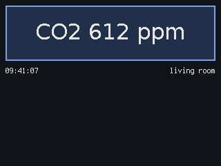
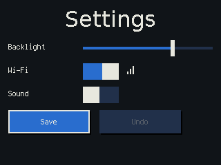

# dgx-ui

*[In English: README.md](README.md)*

Лёгкий слой виджетов на [DGX](https://github.com/jef-sure/esp32-component-dgx), графической библиотеке для ESP32.
Виджеты стоят в строках и столбцах, значения приходят к ним сообщениями от других задач, а на дисплей пишется только
то, что изменилось. Память под пиксели не нужна: виджет занимает 28 байт памяти и 52 байта флеша и рисуется прямо на
дисплей.




Картинки на этих страницах нарисовала сама dgx-ui на виртуальном экране DGX на компьютере.

```c
enum { MSG_CO2 = 1 };
typedef struct { int16_t ppm; } co2_t;
DGX_UI_MESSAGE(co2, MSG_CO2, co2_t) /* gives msg_post_co2() and msg_decode_co2() */

/* the label catches its own value from the messages */
static bool co2_take(dgx_ui_t *ui, int i, const dgx_ui_msg_t *msg)
{
    co2_t c;
    if (msg_decode_co2(msg, &c) == ESP_OK) dgx_ui_text_printf(ui, i, "CO2 %d ppm", c.ppm);
    return false;
}

static dgx_ui_textbox_t      co2_box; /* the text: its buffer and its style are given at the start */
static const dgx_ui_widget_t root_w = {.kind = DGX_UI_BOX, .flags = DGX_UI_COLUMN, .pad = 4};
static const dgx_ui_widget_t co2_w  = {.kind = DGX_UI_LABEL, .text = &co2_box, .take = co2_take};

/* any task: a value sent and forgotten */
void sensor_task(void *queue)
{
    for (;;) {
        const co2_t c = {.ppm = read_co2()};
        msg_post_co2(queue, &c);
        vTaskDelay(pdMS_TO_TICKS(1000));
    }
}

/* the task that owns the display: asleep while nothing changes */
void ui_loop(dgx_ui_t *ui, dgx_ui_paint_t *paint, QueueHandle_t queue)
{
    for (bool busy = false;;) {
        dgx_ui_msg_t msg;
        TickType_t   wait = busy ? 1 : portMAX_DELAY;
        while (xQueueReceive(queue, &msg, wait) == pdTRUE) {
            wait = 0;
            dgx_ui_take(ui, &msg); /* every widget is offered the message */
            dgx_ui_msg_done(&msg);
        }
        const uint32_t now = (uint32_t)(esp_timer_get_time() / 1000);
        busy               = dgx_ui_time(ui, now);
        busy |= dgx_ui_paint(ui, paint, now); /* draws only what changed */
    }
}
```

## Состояние

Версия 0.0.3: тег в репозитории, в реестре компонентов ESP её пока нет. Библиотека ещё строится, и её API может
измениться. Что в ней есть, перечислено в разделе [Что в ней есть](#что-в-ней-есть), чего нет — в разделе
[Чего пока нет](#чего-пока-нет).

## Быстрый старт

В `main/idf_component.yml` проекта:

```yaml
dependencies:
  dgx-ui:
    git: https://github.com/jef-sure/esp32-component-dgx-ui.git
    version: "0.0.3"
```

Нужны ESP-IDF 5.2 или новее и DGX 0.11.4 или новее; DGX подтянется сама, из реестра. Начните со страницы
[Начало работы](docs/ru/getting-started.md): там программа, которая показывает значение, присланное другой задачей, и
часы.

## Документация

| Страница | Что в ней |
| -------- | --------- |
| [Начало работы](docs/ru/getting-started.md) | подключение компонента, первая программа по частям, сборка для платы и для компьютера |
| [Как это устроено](docs/ru/how-it-works.md) | дерево, раскладка, состояние и события, сообщения, время, отрисовка и облики, память |
| [Рецепты](docs/ru/cookbook.md) | значение из задачи, часы, кнопки, ползунок, значок, текст в несколько строк, всплывающее окно, клавиши, касание, свой облик |
| [Справочник API](docs/ru/api.md) | все типы, функции и константы, по заголовочным файлам |

Примеры, каждый для платы CYD и для окна на компьютере:
[thin_paint](examples/thin_paint/main/thin_paint.c) — значение, присланное задачей, и часы;
[controls](examples/controls/main/controls.c) — кнопка с всплывающим окном, переключатель, ползунок и два поля
ввода, код и PIN звёздочками, которые правят в полосе над клавиатурой DGX-DI; управляют ими пальцем и клавишами,
на плате из [boards](https://github.com/jef-sure/esp32-component-boards). Список изменений — в
[CHANGES.md](CHANGES.md).

## Что в ней есть

- **Дерево виджетов** в массиве, который даёт программа, а дальше — блоками по 64. То, что программа говорит о
  виджете, неизменно и может лежать во флеше; дерево держит на виджет 28 байт памяти.
- **Строки и столбцы.** Контейнер ставит детей столбцом или строкой, с отступом от краёв и промежутком между ними, в
  точках, каждая из которых — столько-то пикселей. Ребёнок может занять всё, что осталось. Раскладка делается
  заново, только когда изменился экран, состав виджетов или их размеры, и тогда рисуется только то, что
  сдвинулось.
- **Сообщения.** Номер, который выбирает программа, и до 12 байт по значению или данные по ссылке. Другие задачи
  шлют их через очередь FreeRTOS, прерывание тоже. Сообщение предлагается каждому виджету, и виджет сам берёт из
  него свои значения. Тикер шлёт сообщение раз в столько-то миллисекунд и держит в очереди не больше одного.
- **Отрисовка только того, что изменилось**, одним пакетом DGX, каждый виджет под отсечением по его коробке.
  Значение, нарисованное заново, пишет каждый пиксель своего поля один раз, поэтому на дисплее за шиной оно не
  мигает.
- **Тексты.** В одну строку или в несколько, с переносом по словам. Шрифт выбирается из списка так, чтобы текст
  поместился. Слишком длинный текст обрезается с многоточием или прокручивается. Буквы могут появляться по одной.
- **Элементы управления.** Кнопка с тенью и нажатым видом, переключатель, ползунок, поле ввода, картинки и значки в
  1 бит и в RGB565. Элемент управления сам называет свой облик, поэтому в программу попадают только те облики,
  которыми она пользуется.
- **Всплывающие окна** поверх дерева, одно над другим: модальные или такие, которые закрываются касанием снаружи.
- **Ввод.** Указатель, клавиши диалога, кнопки геймпада с повтором удерживаемой, набранные символы. Касание
  [DGX-DI](https://github.com/jef-sure/esp32-component-dgx-di) подключается заголовком, если оно есть в программе.
- **Время только по просьбе.** Виджет с анимацией сам просит время. Интерфейс, в котором ничего не происходит, —
  спящая задача.
- **Тесты на компьютере.** Логика ничего не рисует и не вызывает DGX, поэтому проверяется без дисплея.

## Чего пока нет

- облика списка и самого списка у выпадающего списка;
- картинок в 4 и 8 бит, текста поверх картинки-фона и дисплеев за шиной на 18 и 24 бита без мигания: всем трём нужен
  буфер отрисовки;
- холста у виджета и рукописного текста;
- построителя интерфейсов на компьютере.

Интерфейс с таблицами, графиками и длинными текстами — задача для
[DGX-LVGL](https://github.com/jef-sure/esp32-component-dgx-lvgl).

## Насколько она лёгкая

Измерено на ESP32 с ESP-IDF 5.5.4, самая маленькая программа: одна надпись, значение приходит сообщением.

| | |
| --- | --- |
| код dgx-ui в программе | около 7,5 КБ |
| память самой dgx-ui | нет |
| виджет | 28 байт памяти и 52 байта флеша |
| сообщение | 20 байт |
| облик текста в несколько строк, если виджет его назвал | ещё около 2,5 КБ |

## Лицензия

MIT, см. [LICENSE](LICENSE).
