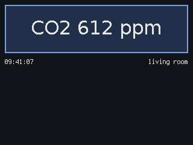
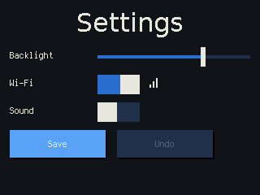

# dgx-ui

*[По-русски: README-ru.md](README-ru.md)*

A light layer of widgets on [DGX](https://github.com/jef-sure/esp32-component-dgx), the display library for ESP32.
Widgets stand in rows and columns, their values come as messages from other tasks, and the display is written only
where something changed. It needs no memory for pixels: a widget is 28 bytes of RAM and 52 bytes of flash, and it
draws straight on the display.




The pictures of these pages are drawn by dgx-ui itself, on a virtual screen of DGX on a computer.

```c
enum { MSG_CO2 = 1 };
typedef struct { int16_t ppm; } co2_t;
DGX_UI_MESSAGE(co2, MSG_CO2, co2_t) /* gives msg_post_co2() and msg_decode_co2() */

/* the label catches its own value from the messages */
static bool co2_take(dgx_ui_t *ui, int i, const dgx_ui_msg_t *msg)
{
    co2_t c;
    if (msg_decode_co2(msg, &c) == ESP_OK) dgx_ui_text_printf(ui, i, "CO2 %d ppm", c.ppm);
    return false;
}

static dgx_ui_textbox_t      co2_box; /* the text: its buffer and its style are given at the start */
static const dgx_ui_widget_t root_w = {.kind = DGX_UI_BOX, .flags = DGX_UI_COLUMN, .pad = 4};
static const dgx_ui_widget_t co2_w  = {.kind = DGX_UI_LABEL, .text = &co2_box, .take = co2_take};

/* any task: a value sent and forgotten */
void sensor_task(void *queue)
{
    for (;;) {
        const co2_t c = {.ppm = read_co2()};
        msg_post_co2(queue, &c);
        vTaskDelay(pdMS_TO_TICKS(1000));
    }
}

/* the task that owns the display: asleep while nothing changes */
void ui_loop(dgx_ui_t *ui, dgx_ui_paint_t *paint, QueueHandle_t queue)
{
    for (bool busy = false;;) {
        dgx_ui_msg_t msg;
        TickType_t   wait = busy ? 1 : portMAX_DELAY;
        while (xQueueReceive(queue, &msg, wait) == pdTRUE) {
            wait = 0;
            dgx_ui_take(ui, &msg); /* every widget is offered the message */
            dgx_ui_msg_done(&msg);
        }
        const uint32_t now = (uint32_t)(esp_timer_get_time() / 1000);
        busy               = dgx_ui_time(ui, now);
        busy |= dgx_ui_paint(ui, paint, now); /* draws only what changed */
    }
}
```

## Status

Version 0.0.1: the first tag, not in the ESP Component Registry yet. It is being built, and its API may still change.
What it has is listed under [What is in it](#what-is-in-it), what it lacks under [Not there yet](#not-there-yet).

## Quick start

In `main/idf_component.yml` of the project:

```yaml
dependencies:
  dgx-ui:
    git: https://github.com/jef-sure/esp32-component-dgx-ui.git
    version: "0.0.1"
```

It needs ESP-IDF 5.2 or later and DGX 0.11.4 or later; DGX comes by itself, from the registry. Start with
[Getting started](docs/en/getting-started.md): a program that shows a value sent by another task, and a clock.

## Documentation

| Page | What it holds |
| ---- | ------------- |
| [Getting started](docs/en/getting-started.md) | adding the component, the first program piece by piece, building for a chip and for the computer |
| [How it works](docs/en/how-it-works.md) | the tree, the layout, state and events, messages, time, the painter and the looks, memory |
| [Cookbook](docs/en/cookbook.md) | recipes: a value from a task, a clock, buttons, a slider, an icon, texts of several lines, a popup, keys, touch, a look of your own |
| [API reference](docs/en/api.md) | every type, function and constant, by header |

An example: [thin_paint](examples/thin_paint/main/thin_paint.c), for a CYD board and for a window on the computer.
The list of changes is in [CHANGES.md](CHANGES.md).

## What is in it

- **A tree of widgets** in an array the program gives, and in blocks of 64 past it. What the program says of a
  widget is constant and may lie in flash; the tree keeps 28 bytes of RAM a widget.
- **Rows and columns**: a box stacks its children as a column or a row, with a padding and a gap, in points that are
  so many pixels. The layout is made again only when the screen, the widgets or their sizes change.
- **Messages**: a number of the program's and up to 12 bytes by value, or data by reference. Other tasks send them
  through a queue of FreeRTOS, an interrupt too; every widget is offered a message and catches its own values.
  A ticker sends one every so many milliseconds and keeps at most one of them in the queue.
- **A painter that writes only what changed**, in one batch of DGX, each widget under a clip of its box. A value
  drawn again writes every pixel of its field once, so it does not blink on a display behind a bus.
- **Texts**: one line, or several laid word by word; the font picked from a list so that the text goes in; a text
  too long cut with an ellipsis or scrolled; letters that appear one by one.
- **Controls**: a button with a shadow and a pressed face, a switch, a slider, a field typed into, pictures and icons
  of 1 bit and of RGB565. A control names its look, so a program carries only the looks it uses.
- **A popup** over the tree: modal, or closed by a finger outside it.
- **Input**: a pointer, the keys of a dialog, the buttons of a game pad with a repeat of a held one, code points
  typed; the touch of [DGX-DI](https://github.com/jef-sure/esp32-component-dgx-di) through a header, if the program
  has it.
- **Time only when asked**: a widget that animates asks for time; an idle interface is a sleeping task.
- **Tests on the computer**: the logic draws nothing and calls no function of DGX, so it is tested without a display.

## Not there yet

- the look of a list, and the list of a dropdown;
- pictures of 4 and 8 bits, text over a picture as the background, and displays of 18 and 24 bits behind a bus without
  a blink: all three wait for the painter's buffer;
- a canvas of a widget, and handwritten text;
- a builder of interfaces on the computer.

An interface of tables, graphs and long texts is a task for
[DGX-LVGL](https://github.com/jef-sure/esp32-component-dgx-lvgl).

## How light

Measured on an ESP32 with ESP-IDF 5.5.4, the smallest program, one label fed by a message:

| | |
| --- | --- |
| code of dgx-ui in the program | about 6 KB |
| RAM of dgx-ui itself | none |
| a widget | 28 bytes of RAM and 52 bytes of flash |
| a message | 20 bytes |
| the look of several lines, when a widget names it | about 2.5 KB more |

## License

MIT, see [LICENSE](LICENSE).
