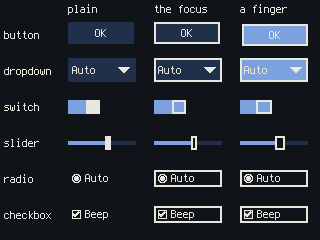

# API reference

*[По-русски](../ru/api.md)*

This page lists every public type, function and constant of dgx-ui, header by header. How they work together is
explained in [How it works](how-it-works.md); the [Cookbook](cookbook.md) shows them at work.

| Header | What it holds |
| ------ | ------------- |
| [`dgx_ui.h`](#dgx_uih) | rectangles, the state, a widget and its node, the tree, the layout, the pointer, the keys, the focus, a popup |
| [`dgx_ui_text.h`](#dgx_ui_texth) | fonts and styles of a text, the text box, setting a text |
| [`dgx_ui_msg.h`](#dgx_ui_msgh) | a message, offering it to a tree, decoders, code points typed |
| [`dgx_ui_post.h`](#dgx_ui_posth) | sending a message through a queue of FreeRTOS |
| [`dgx_ui_ticker.h`](#dgx_ui_tickerh) | a message every so many milliseconds |
| [`dgx_ui_paint.h`](#dgx_ui_painth) | the painter, the looks and their parameters |
| [`dgx_ui_dropdown.h`](#dgx_ui_dropdownh) | the list of a dropdown, opened as a popup |
| [`dgx_ui_transition.h`](#dgx_ui_transitionh) | pages that change by a slide or a crossfade |
| [`dgx_ui_stats.h`](#dgx_ui_statsh) | the statistics of painting: a pass measured |
| [`dgx_ui_load.h`](#dgx_ui_loadh) | a tree made from a description in JSON |
| [`dgx_ui_di.h`](#dgx_ui_dih) | the touch of DGX-DI as the pointer of a tree |
| [`dgx_ui_appearance.h`](#dgx_ui_appearanceh) | colours, text styles and looks from a description in JSON, one for all the pages |
| [`project_include.cmake`](#project_includecmake) | three calls of CMake: descriptions, names files and appearances made C when the program is built |

All public names begin with `dgx_ui_` or `DGX_UI_`. Every header has `extern "C"` for C++. Version 0.0.63: the names
and the signatures may still change.

One task owns a tree. Every call below is made by that task, except those of `dgx_ui_post.h`, which any task may
call. The library keeps nothing of a tree outside the tree and its paint, so two tasks, each with its own trees and
paints, do not meet.

## dgx_ui.h

### Rectangles

```c
typedef struct dgx_ui_rect_t {
    int16_t x, y;
    int16_t w, h;
} dgx_ui_rect_t;
```

A rectangle of a screen in pixels. One of no width or no height is empty.

| Call | What it does |
| ---- | ------------ |
| `dgx_ui_rect_t dgx_ui_rect(int x, int y, int w, int h)` | A rectangle made of its corner and its size. |
| `bool dgx_ui_rect_empty(const dgx_ui_rect_t *r)` | Whether it holds no pixel. |
| `bool dgx_ui_rect_intersect(const dgx_ui_rect_t *a, const dgx_ui_rect_t *b, dgx_ui_rect_t *out)` | The pixels two rectangles have in common, in `out`, which may be `a` or `b`; `false` and all zeros when there are none. |
| `int dgx_ui_rect_subtract(const dgx_ui_rect_t *box, const dgx_ui_rect_t *cut, dgx_ui_rect_t out[4])` | The parts of `box` outside `cut`: up to four rectangles that do not overlap, the band above first. It returns how many: 0 when the box is empty or covered. `x + w` and `y + h` of the box do not pass 32767. |

### The state

```c
typedef struct dgx_ui_bits_t {
    uint8_t bits;
} dgx_ui_bits_t;

typedef struct dgx_ui_state_t {
    uint8_t bits;
    int32_t value;
} dgx_ui_state_t;
```

| Bit | Meaning |
| --- | ------- |
| `DGX_UI_HIDDEN` | not shown, takes no place in its row or column, not hit, not focused |
| `DGX_UI_DISABLED` | shown as its look draws it so, not hit, not focused |
| `DGX_UI_FOCUSED` | the keys go to it |
| `DGX_UI_PRESSED` | pressed, by a finger on it or by the program |

`dgx_ui_bits_t` is the bits of a state: as a widget starts, its `state`, and as it is, the `state` of its node.
`dgx_ui_state_t` is a state as it was last drawn, the bits and the value: the node's `state_drawn`.

**The value** of a control, the row picked in a list, the picture of an icon, is not in the tree. It lives in an
`int32_t` of the program's, its place, which the widget names by `value`.

- The place is written by the program, by the user through the core, or by `dgx_ui_set_value()`, all in the task
  that owns the tree. A constant with a place belongs to the trees of one task; another task sends a message.
- The painter looks at every place at the start of a pass and draws the widgets whose place holds another value
  than they drew. So filling the variables before the first pass is loading the settings, and writing them out is
  saving them.
- A place written after a pass asks for no pass of its own: the task that writes it is awake, by the message that
  made it write, and its next pass draws it.
- Read by `dgx_ui_value()` or `dgx_ui_value_of()`, a value is kept within `min..max` when `min < max`, and a list's or a
  dropdown's when `min <= max`, one row too; an icon's and a radio button's are not. A list or a dropdown with
  `max < min` has no rows: nothing picks, and the user changes nothing. The memory itself is left as it is, since it may have come from flash; the user's next change writes it
  within the bounds.
- Several widgets may name one place, and all of them follow it. A constant added twice, or to two trees, shares its
  value.
- A control with no place shows 0 and nothing changes it; its look says so in the log, once a look.

### A widget

```c
typedef struct dgx_ui_widget_t {
    uint8_t        kind;
    dgx_ui_bits_t  state;
    uint16_t       flags;
    int16_t        pad, gap;
    int16_t        at_x, at_y;
    int16_t        want_w, want_h;
    int16_t        min, max, step;
    int16_t        tag;
    int32_t       *value;
    const dgx_ui_picture_t *picture;
    dgx_ui_textbox_t       *text;
    const dgx_ui_look_t    *look;
    bool (*take)(dgx_ui_t *ui, int i, const dgx_ui_msg_t *msg);
    void (*on)(dgx_ui_t *ui, int i, const dgx_ui_node_t *node, int what, void *ctx);
    void *ctx;
    void *own;
} dgx_ui_widget_t;
```

What the program says of a widget. The library never writes it; it is 56 bytes<!-- sizeof dgx_ui_widget_t --> on a 32-bit chip. Zero is the default
of every member.

| Member | Meaning |
| ------ | ------- |
| `kind` | what it is: see the kinds below |
| `state` | the state it starts with: `.state = {.bits = DGX_UI_HIDDEN}`, or `DGX_UI_DISABLED` |
| `flags` | how it is built: see the flags below |
| `pad`, `gap` | of a box: from its edges to its children, and between them, in points, or in percent with `DGX_UI_PERCENT_PAD`, `DGX_UI_PERCENT_GAP` (the percents below) |
| `at_x`, `at_y` | where it asks to be from the inner edge of its parent, in points, or in percent with `DGX_UI_PERCENT_X`, `DGX_UI_PERCENT_Y`; negative: from the far edge. In a column only `at_x` is used, in a row only `at_y` |
| `want_w`, `want_h` | its size in points, or in percent with `DGX_UI_PERCENT_W`, `DGX_UI_PERCENT_H`; 0 in points: the size of its content, or across the stacking all of the box. The content of a widget with a text is the lines of its text; a button, a dropdown, a radio button and a checkbox are a point higher above and below them, the room of the frame of the focus. A button, a switch or a radio button with a picture, whatever look draws it, asks for its first picture's size, as large as its `scale` draws it, and 5 points more across and down: a point of face and the frame's point on each side, and one for a shadow |
| `min`, `max`, `step` | the range of a control and its step; the first and the last row of a list, and in `step` the least height of its rows in points, 0 a line of its text; the values of an icon's pictures; in `step` of a radio button the number it stands for |
| `tag` | the program's number of it, found by `dgx_ui_find()`; 0 for none |
| `value` | where its value lives, an `int32_t` of the program's: `.value = &volume`; `NULL`: it has none. See the value above |
| `picture` | a picture: one; an icon: an array for the values `min..max`; drawn by `dgx_ui_look_picture_button`, a button's one, a switch's or a radio button's two: off and on, not chosen and chosen |
| `text` | its text box, in RAM |
| `look` | how it is drawn; `NULL`: the look of its kind, which a box, a frame and a label have. Any other widget with no look is not drawn, and the painter logs it once |
| `take` | called with every message offered to the tree; `true` claims the message |
| `on` | told what the user did to it: see the events below. It gets the widget's node as it is now; the value the user set is in the widget's place, the program's own variable, and `dgx_ui_value_of(node)` reads it too |
| `ctx` | given to `on()` |
| `own` | the data of a widget of the program's own kind |

**Kinds**

| Kind | What it is |
| ---- | ---------- |
| `DGX_UI_BOX` | holds children: stacks them as a column or a row, else they sit where they ask |
| `DGX_UI_FRAME` | a box with a fill and a border |
| `DGX_UI_LABEL` | a text |
| `DGX_UI_PICTURE` | one picture |
| `DGX_UI_ICON` | a picture picked by the value from an array; outside `min..max`, none |
| `DGX_UI_LIST` | rows, one picked: the value, `min` the first row. With more rows than it takes, it shows a window of them and scrolls. Its look is `dgx_ui_look_list` |
| `DGX_UI_SWITCH` | value 0 or 1 |
| `DGX_UI_SLIDER` | value `min..max` by `step` |
| `DGX_UI_BUTTON` | clicked: activated |
| `DGX_UI_INPUT` | a field typed into |
| `DGX_UI_DROPDOWN` | a button that shows the option chosen: its options the lines of its text, its value the one chosen. Activated, the program opens its list by `dgx_ui_dropdown_open()` |
| `DGX_UI_OWN` | drawn by a look of the program's, its data in `own`; worked by the finger and the keys when its look names a behaviour. The library's level bar, `dgx_ui_look_level`, and ring scale, `dgx_ui_look_ring`, are looks for it too |
| `DGX_UI_RADIO` | a radio button, one of a group. The group is a place: every button of it names the same `value`. A button stands for the number in its `step` and is chosen while the place holds that number; one of no place never is. A click, or the key that activates while it has the focus, writes its number: its `on()` is told `DGX_UI_CHANGED` when the place changed, and the button that was chosen is told nothing. Its value is the group's, not bound by `min` and `max` |

**Flags**

| Flag | Meaning |
| ---- | ------- |
| `DGX_UI_COLUMN` | a box: its children one under another |
| `DGX_UI_ROW` | a box: its children side by side |
| `DGX_UI_STRETCH` | as wide as its column, or as high as its row, whatever its own size |
| `DGX_UI_SWIPE` | a slider moved by the way the finger goes from where it went down, its width the whole range; a tap on it activates it |
| `DGX_UI_DRAG` | a button dragged up or down as well as clicked, as the knob of a scroll bar: `on()` is told `DGX_UI_CHANGED` at every move |
| `DGX_UI_REST` | along the stacking of a column or a row it takes all the box has left after the other children, the gaps and the pads; several share it equally; never less than 0 |
| `DGX_UI_CANVAS` | the widget has a canvas of its own, a picture kept from pass to pass: `dgx_ui_canvas()` |
| `DGX_UI_REPEAT` | a button told `DGX_UI_ACTIVATED` again and again while it is held: a stepper's "+" |
| `DGX_UI_PERCENT_X`, `DGX_UI_PERCENT_Y` | `at_x`, `at_y` in percent, not in points |
| `DGX_UI_PERCENT_W`, `DGX_UI_PERCENT_H` | `want_w`, `want_h` in percent |
| `DGX_UI_PERCENT_PAD`, `DGX_UI_PERCENT_GAP` | a box's `pad`, `gap` in percent |
| `DGX_UI_SCROLL` | a box of a column whose children may be taller than it, a window over them: [A scrolling box](#a-scrolling-box) |

A button of `DGX_UI_REPEAT` is told `DGX_UI_ACTIVATED` when the finger goes down on it, and again every
`DGX_UI_REPEAT_MS` from `DGX_UI_REPEAT_FIRST_MS` on while the finger holds it, wherever the finger goes: it stays
pressed and looks so until the finger goes up. Nothing is told when it goes up, so a click is one
`DGX_UI_ACTIVATED`. The key that activates, held on it while it has the focus (`dgx_ui_buttons()`), repeats the same
way. The repeats come from `dgx_ui_time()`: a loop with such a button calls it at every turn and waits by
`dgx_ui_wake()`; without the call the button is told once, at the press, and no more. The repeat ends when the
finger goes up or the press is spent: a swipe told on it, the button hidden, disabled or removed, a popup opened
over its tree. One repeats at a time, the last begun: a key held while the finger repeats takes over, and the
other, still held, does not begin again when that one ends. `DGX_UI_PRESSED` set by the program shows the button
pressed and repeats nothing, and a button also of `DGX_UI_DRAG` is the drag's and does not repeat. On any other kind
the flag means nothing. The recipe:
[A stepper: minus, a value, plus](cookbook.md#a-stepper-minus-a-value-plus).

**Percents.** A number in percent is written by `DGX_UI_PERCENT(p)`, beside its flag:
`.want_w = DGX_UI_PERCENT(50), .flags = DGX_UI_ROW | DGX_UI_PERCENT_W`. The member holds it as 8.8 fixed point,
-128 % to 127.99 % in steps of 1/256 %, and the macro holds a number past those at the edge; it is a constant
expression in C and in C++. A percent is of pixels: the unit multiplies the points, never the percents.

| A percent of | Of what |
| --- | --- |
| `pad` | the box's own width, on all four sides |
| `gap` | the inside along the stacking: its width in a row, its height in a column |
| a size along a row's or a column's stacking | the room the children share: the inside less the gaps between the children shown, never below 0 |
| a size across the stacking, and both ways in a box of neither | the inside |
| a place, `at_x` and `at_y` | the inside; a negative one from the far edge, as in points |

- Along the stacking the percents of the children are taken by running totals in their order, so they add up with no
  pixel lost or doubled: two of 50 % with a gap fill a row exactly. A total past 255.99 % is held there.
- A child of points takes its points, and one of `DGX_UI_REST` what is left after the points and the percents;
  neither takes from the percents.
- A hidden child is out of it all: no gap, no part of the room, no step of the totals.
- 0 with its flag is 0 %, no size; 0 in points is the size of the content.
- The root's children are of the root, laid on the screen or on the rectangle given.
- The recipe: [One tree on every board](cookbook.md#one-tree-on-every-board).

**Events**: what `on()` is told in `what`.

| Event | When |
| ----- | ---- |
| `DGX_UI_ACTIVATED` | a button, a row of a list or a dropdown was clicked or activated by a key; "done" was typed into a field |
| `DGX_UI_CHANGED` | the user changed the value: by the finger, a key, or a letter typed |
| `DGX_UI_FOCUS` | the focus came to it |
| `DGX_UI_BACK` | "cancel" was typed into a field; told to the root of a page, or of a popup the key back closes, before it is closed |
| `DGX_UI_NO_MEMORY` | the canvas of the widget could not be had: told once for that size, after the pass; it is tried again whenever its look asks |
| `DGX_UI_EDIT` | a field was clicked, or activated by a key while it has the focus: the program opens its editor, a keyboard |
| `DGX_UI_SHOWN` | told to the root of a tree: the tree came to the screen. It opened as a popup with no page over it, or the page over it closed. Never told to the first tree at the start, nor for `dgx_ui_show()` of a widget |
| `DGX_UI_COVERED` | told to the root of a tree: the tree left the screen. A page opened over it, or it closed while it was shown |

`on()` is told only what the user did, never what the program set. The two events of a root, `DGX_UI_SHOWN` and
`DGX_UI_COVERED`, are the exception: they are told whoever opened or closed the popups, the program too; see
[A popup](#a-popup). `on()` may change and remove widgets, the one it is called for too.

### A picture

```c
typedef struct dgx_ui_picture_t {
    const dgx_image_t *image;
    const uint16_t    *rgb565;
    const uint8_t     *map;
    int16_t            width, height;
    uint8_t            scale;
} dgx_ui_picture_t;
```

A picture of DGX in `image`, drawn by `dgx_ui_look_picture` when it is of 1 bit; or rows of RGB565, high byte first, in
`rgb565` with their `width` and `height`, drawn by `dgx_ui_look_rgb565`. A picture of 4 or 8 bits in `image` is drawn
by `dgx_ui_look_indexed`: its values go through `map` to indices of the painter's table, the value 1 the entry
`map[0]`; without a map the value is the index; a pixel 0 is the paper.

`void dgx_ui_picture_size(const dgx_ui_picture_t *p, int *w, int *h)` gives the size of either.

`scale` is how large it is drawn: 0, a pixel of it is a pixel of the screen; 1, a point of the tree, `unit` by `unit`
pixels; more, so many points; a pixel of it takes 255 pixels of the screen at most. Every look of a picture draws it
so, and the size of a widget of its content counts it; a picture larger than its widget is cut at the widget's edge.
A picture is 20 bytes<!-- sizeof dgx_ui_picture_t --> on a 32-bit chip.

`int dgx_ui_picture_scale(const dgx_ui_t *ui, const dgx_ui_picture_t *picture)` gives the pixels of the screen a pixel
of the picture takes in the tree, across and down: 1 for `scale` 0, else `scale` times `unit`, at most 255; with `ui`
`NULL` the unit is 1.

### A node

```c
typedef struct dgx_ui_node_t {
    const dgx_ui_widget_t *widget;
    int16_t                parent;
    int16_t                child, next;
    int16_t                x, y, w, h;
    dgx_ui_bits_t          state;
    uint8_t                marks;
    dgx_ui_state_t         state_drawn;
} dgx_ui_node_t;
```

A widget in a tree, 28 bytes<!-- sizeof dgx_ui_node_t --> of RAM on a 32-bit chip. The program reads it and does not write it.

| Member | Meaning |
| ------ | ------- |
| `widget` | what the program said of it; `NULL`: a free slot |
| `parent`, `child`, `next` | the numbers of its parent, its first child and its next sibling; -1 for none |
| `x`, `y`, `w`, `h` | where it was laid, in pixels of the screen |
| `state` | its bits as they are: `state.bits`. Its value lives where its widget says |
| `state_drawn` | its bits and its value as they were last drawn: the painter's. Of a radio button the value is whether it was drawn chosen, 1 or 0 |
| `marks` | the library's: see below |

| Mark | Meaning |
| ---- | ------- |
| `DGX_UI_MARK_CHANGED` | its content changed |
| `DGX_UI_MARK_WHOLE` | to be drawn whole |
| `DGX_UI_MARK_FIT` | its text is to be fitted to its field again |
| `DGX_UI_MARK_TIME` | its look asked for time: it is called again at the next pass |
| `DGX_UI_MARK_BELOW` | a widget under it is to be drawn: the painter goes down only where this is set |
| `DGX_UI_MARK_WINDOW` | a list's window is to be brought to its pick when it is drawn next: its value was set, or its height changed |
| `DGX_UI_MARK_AROUND` | a child of it moved, came or went: a box or a frame that stacks its children fills around them, and only the children marked themselves are drawn |
| `DGX_UI_MARK_HARD_SIZE` | its canvas keeps the size it has: a larger one could not be had |

### The tree

`dgx_ui_t` is a tree and what the pointer and the keys are doing to it, 104 bytes<!-- sizeof dgx_ui_t -->. The program fills it by
`dgx_ui_init()` and changes it by the calls only. Members a program may read: `focus`, the number of the focused
widget, and `pressed`, the one the pointer is held on, both -1 for none; `popup`, the popup open over it; `level`,
how many popups lie under it, 0 for a tree that is no popup.

`DGX_UI_BLOCK` is 64: the nodes past the program's array come in blocks of so many.

| Call | What it does |
| ---- | ------------ |
| `void dgx_ui_init(dgx_ui_t *ui, dgx_ui_node_t *first, int first_size, int unit)` | A tree in the program's array of `first_size` nodes; `NULL` and 0 when all nodes are to come in blocks. `unit` is the pixels of a point. |
| `void dgx_ui_free(dgx_ui_t *ui)` | Every widget removed and the blocks given back. A tree open as a popup is closed first, and so are the popups open over a tree, their roots told as a close tells them. The tree being freed is told `DGX_UI_COVERED` when it was shown and never `DGX_UI_SHOWN`; the trees that come to the screen are told after it is wiped. A tree is built again by `dgx_ui_init()` only while it is not open. |
| `int dgx_ui_add(dgx_ui_t *ui, int parent, const dgx_ui_widget_t *w)` | A widget added as the last child of `parent`; the first one added is the root, whatever `parent` is. It returns its number; -1 for no such parent or no memory for a block. The tree keeps the pointer: the widget must live as long as it is in the tree. |
| `int dgx_ui_insert(dgx_ui_t *ui, int parent, int before, const dgx_ui_widget_t *w)` | The same, before the child `before`; -1: as the last. |
| `void dgx_ui_remove(dgx_ui_t *ui, int i)` | A widget removed with everything under it. A focus or a press inside it is dropped, and nothing is told. Its number is given to a widget added later. When it is the widget the pages lie over (`dgx_ui_page_place()`), or one above it, the pages take the whole screen, and the roots covered or shown by that are told `DGX_UI_COVERED` and `DGX_UI_SHOWN` from within the call. |
| `int dgx_ui_find(const dgx_ui_t *ui, int parent, int tag)` | The first widget of a tag under `parent`, in the order of the tree; `parent` -1: in all of the tree. -1 when there is none. |
| `dgx_ui_node_t *dgx_ui_node(const dgx_ui_t *ui, int i)` | The node of a number; `NULL` past the tree. |
| `const dgx_ui_widget_t *dgx_ui_widget(const dgx_ui_t *ui, int i)` | The widget of a number; `NULL` for a number that holds none. |

### The layout

| Call | What it does |
| ---- | ------------ |
| `void dgx_ui_set_root(dgx_ui_t *ui, int x, int y, int w, int h)` | The rectangle the root is laid in, in pixels. Without it the root takes all of the screen. |
| `void dgx_ui_relayout(dgx_ui_t *ui)` | The tree is laid again before it is next drawn or hit: after the program changed a widget it keeps in its own RAM. |
| `void dgx_ui_screen(dgx_ui_t *ui, int width, int height, int turn)` | The screen the tree is shown on. The painter calls it at every pass; a program calls it in a test without a painter. Another size or `turn` lays the tree again and draws it whole. |
| `bool dgx_ui_layout(dgx_ui_t *ui)` | The tree laid now if it has to be; `true` when it was. The painter and the pointer call it. |

### Changing the state

None of these tells `on()`.

| Call | What it does |
| ---- | ------------ |
| `int32_t dgx_ui_value(const dgx_ui_t *ui, int i)` | The value of widget `i`, read from its place and kept within `min..max` when `min < max`; an icon's is not bound. 0 for a widget of no place and for a number that holds no widget. |
| `int32_t dgx_ui_value_of(const dgx_ui_node_t *node)` | The same of a node, for an `on()` and a look, which are given the node. |
| `bool dgx_ui_radio_chosen(const dgx_ui_node_t *node)` | Whether a radio button is the chosen one of its group: its place holds its `step`. An inline of the header. |
| `void dgx_ui_set_value(dgx_ui_t *ui, int i, int value)` | The value written into the widget's place, within `min..max` when `min < max`. An icon's is not bound: outside its range it shows no picture. A widget of no place: nothing. The program may as well write its variable itself. |
| `void dgx_ui_set_state(dgx_ui_t *ui, int i, unsigned bits, bool on)` | `DGX_UI_DISABLED` or `DGX_UI_PRESSED` set or cleared. Disabled, a widget loses the focus, and a press of the finger on it ends. |
| `void dgx_ui_show(dgx_ui_t *ui, int i, bool shown)` | Shown or hidden; its row or column is laid again. Hidden, it loses the focus and a press of the finger. |
| `void dgx_ui_redraw(dgx_ui_t *ui, int i)` | Drawn whole at the next pass, with everything under it. |
| `bool dgx_ui_hidden(const dgx_ui_t *ui, int i)` | Whether it is hidden, itself or by a widget above it. |

### The pointer

```c
typedef struct dgx_ui_pointer_t {
    int16_t  x, y;
    bool     down, pressed, released;
    bool     swipe;
    uint32_t ms;
} dgx_ui_pointer_t;
```

The pointer as it is now: where, in pixels of the screen; `down` now; `pressed` and `released` since the last look;
`swipe`: a swipe was told now; `ms`: the time of the program's clock, the one given to `dgx_ui_time()`.

| Call | What it does |
| ---- | ------------ |
| `bool dgx_ui_pointer(dgx_ui_t *ui, const dgx_ui_pointer_t *pointer)` | The pointer given to the tree, or to its popup first. The widget it went down on is pressed until it goes up, wherever it goes. Let go within `DGX_UI_CLICK_MS`, not swiped and not dragged, it is a click: a button, a row of a list or a dropdown is activated, a switch turned, a field told `DGX_UI_EDIT`, a widget of the program's own told `DGX_UI_ACTIVATED` after its behaviour's `up`. A swipe that begins on a field opens no editor. A widget whose `on(DGX_UI_FOCUS)` opens a popup over it is not pressed: the finger is spent. It returns `true` when a widget took it, or a popup of `DGX_UI_POPUP_MODAL` over the tree did: it takes every pointer that reaches it, down, moving or up, on it or beside it, but one of `DGX_UI_POPUP_PLACE` lets a finger beside it go to the trees under it. |
| `int dgx_ui_hit(dgx_ui_t *ui, int x, int y)` | The deepest widget under a pixel that answers a pointer; -1 for none. A widget is hit, as it is drawn, only within its parent's box. |
| `bool dgx_ui_holding(const dgx_ui_t *ui)` | Whether a widget of the tree or of its popup holds the pointer. |
| `bool dgx_ui_dragging(const dgx_ui_t *ui)` | Whether the widget that holds it is dragged: a slider, a list, a button with `DGX_UI_DRAG`, a widget of the program's own whose `move` said so. Such a widget owns the finger. |

`DGX_UI_CLICK_MS` is 500. `DGX_UI_KNOB` is 3: the width of a slider's knob in points. `DGX_UI_ROW_GAP` is 12: the top
and the bottom twelfth of a list's row belong to no row.

### Keys and the focus

| Key | What it does |
| --- | ------------ |
| `DGX_UI_KEY_NEXT`, `DGX_UI_KEY_PREV` | the focus to the next or the previous widget that takes it; in a list the rows first. The walk passes the fields and opens no editor |
| `DGX_UI_KEY_ACTIVATE` | the focused button, row or dropdown activated, a switch turned, a field told `DGX_UI_EDIT`; a widget of the program's own that did not take the key told `DGX_UI_ACTIVATED` |
| `DGX_UI_KEY_MORE`, `DGX_UI_KEY_LESS` | the focused slider a step up or down, a switch on or off |
| `DGX_UI_KEY_BACK` | closes the popup on top when it has `DGX_UI_POPUP_BACK`, a page or a dropdown's list, and nothing in it took the key; else taken by no widget of the core: the program's |

`DGX_UI_KEYS` is how many keys there are. A focused widget of the program's own is asked first, for every key, by
its behaviour's `key`: [A look and a behaviour](#a-look-and-a-behaviour).

| Call | What it does |
| ---- | ------------ |
| `bool dgx_ui_key(dgx_ui_t *ui, int key)` | A key given to the tree, or to its popup first; `true` when a widget took it. |
| `bool dgx_ui_buttons(dgx_ui_t *ui, uint32_t held, uint32_t now_ms)` | The buttons held now. Each that went down is its key; next, previous, more and less repeat while held. Call it at every tick with all the buttons held, also when the program itself acts on one: a button it did not see go down is a new press at the next call. `true` when a widget took a key. |
| `bool dgx_ui_time(dgx_ui_t *ui, uint32_t now_ms)` | The time step of the logic: a held key repeats when its time comes, and a button of `DGX_UI_REPEAT` held by the finger, in the tree or in a popup over it, is told again; the user's idle, when the program named one for this tree, is judged and told. `true` while such a key or button is held: the loop asks for time. |
| `void dgx_ui_focus(dgx_ui_t *ui, int i)` | The focus put on a widget, which is told `DGX_UI_FOCUS`; -1: on none. A widget that cannot take it (hidden, disabled, of the program's own without `DGX_UI_BEHAVIOR_FOCUS`): on none. |

A held key repeats `DGX_UI_REPEAT_FIRST_MS`, 500 ms, after it went down, and every `DGX_UI_REPEAT_MS`, 100 ms, after.

### Which key a button gives

`dgx_ui_buttons()` takes the buttons as bits of a game pad, the same as in DGX-DI and DGX-GE, and turns each button
into a key by a table.

| Button | Its key by default | What the key does |
| ------ | ------------------ | ----------------- |
| `DGX_UI_PAD_UP` | `DGX_UI_KEY_PREV` | the focus to the widget before |
| `DGX_UI_PAD_DOWN` | `DGX_UI_KEY_NEXT` | the focus to the widget after |
| `DGX_UI_PAD_LEFT` | `DGX_UI_KEY_LESS` | the focused slider a step down, a switch off |
| `DGX_UI_PAD_RIGHT` | `DGX_UI_KEY_MORE` | the focused slider a step up, a switch on |
| `DGX_UI_PAD_A` | `DGX_UI_KEY_ACTIVATE` | the focused button, row or dropdown activated, a switch turned, a field told `DGX_UI_EDIT` |
| `DGX_UI_PAD_BACK`, `DGX_UI_PAD_B` | `DGX_UI_KEY_BACK` | a page or a dropdown's list closed; else nothing in a widget: the program's |
| `DGX_UI_PAD_START` | none | the button is the program's |

The default fits a column of settings: up and down go from one to the next, left and right change the one in focus.

It does not fit buttons that stand in a row. Take a dialog with three buttons side by side, "Back", "OK" and "Next",
the focus on "Back". The user presses right to get to "OK". Right is "more"; a button has no value to make more of,
so nothing happens. The focus moves by up and down only, which nobody looking at a row would guess.

A table of the program's own gives left and right the keys that move the focus:

```c
/* three buttons in a row, "Back", "OK", "Next": left and right move the focus along the row */
static const uint8_t row_keys[8] = {
    DGX_UI_KEY_PREV,     /* DGX_UI_PAD_LEFT:  the focus to the button on the left; by default LESS */
    DGX_UI_KEY_NEXT,     /* DGX_UI_PAD_RIGHT: the focus to the button on the right; by default MORE */
    DGX_UI_KEY_PREV,     /* DGX_UI_PAD_UP:    the focus back, as by default */
    DGX_UI_KEY_NEXT,     /* DGX_UI_PAD_DOWN:  the focus on, as by default */
    DGX_UI_KEY_ACTIVATE, /* DGX_UI_PAD_A:     the focused button activated, as by default */
    0xff,                /* DGX_UI_PAD_START: no key, the button is the program's, as by default */
    DGX_UI_KEY_BACK,     /* DGX_UI_PAD_BACK:  back, which no widget takes: the program's, as by default */
    DGX_UI_KEY_BACK,     /* DGX_UI_PAD_B:     the same */
};
```

`void dgx_ui_button_keys(dgx_ui_t *ui, const uint8_t *keys)` gives the tree such a table: after
`dgx_ui_button_keys(&ui, row_keys)` right on "Back" moves the focus to "OK".

- The table has 8 entries, one for each button, in the order of the bits `DGX_UI_PAD_*`: LEFT, RIGHT, UP, DOWN, A,
  START, BACK, B.
- An entry is a `DGX_UI_KEY_*`, or 0xff: the button gives no key and stays the program's.
- The tree keeps the pointer and copies nothing: give a constant.
- It may be given again at any time, as when a dialog of a column gives way to a dialog of a row. `NULL` gives the
  default back.
- It is the table of the tree given to `dgx_ui_buttons()`. The keys it gives go to the popups over that tree as any
  key does.

### The user's idle

```c
typedef struct dgx_ui_idle_t {
    uint32_t after_ms;  /* the program's: idle after so long with nothing of the user; 0: never */
    int      what;      /* the program's: the number of the message told to home */
    bool     wake_acts; /* the program's: the input that wakes it acts as any other; false: it is spent */
    bool     idle;      /* for the program to read: idle now */
    /* the rest is the library's */
} dgx_ui_idle_t;
```

| Call | What it does |
| ---- | ------------ |
| `void dgx_ui_idle(dgx_ui_t *home, dgx_ui_idle_t *idle, uint32_t now_ms)` | Names the program's idle, one for the whole program, counted from `now_ms`; `home` is the tree whose `dgx_ui_time()` tells of it. The same struct named again is counted anew, and told 0 at home's next step if it had been told 1. Another struct named takes its place. `NULL`: no idle, nothing more is told or spent. The struct dropped reads `idle` false from then on. |
| `uint32_t dgx_ui_idle_for(const dgx_ui_idle_t *idle, uint32_t now_ms)` | The milliseconds since the user's last input; 0 while a key or typed characters wait for the next `dgx_ui_time()`. |

The user is a finger on the screen, a button of the pad held, gone down or let go, a key, typed code points, given
to any tree of the program: home, the popups and pages over it, another home. A finger is on the screen and a button
is held as the last report of each has it, so a source that reports changes alone keeps the idle away while the
finger rests. A `dgx_ui_pointer()` that reports no finger is not the user.

When nothing of the user has come for `after_ms`, home's `dgx_ui_time()` sets `idle` and offers home's trees a
message of the number `what` with one byte, 1, as a ticker's message is offered: a widget hears of it in its
`take()`. The first input after that wakes it: `idle` is false at once, and home's next `dgx_ui_time()` offers the
same message with the byte 0. Both are told by `dgx_ui_time()` of home alone, in home's task, also when the input
came to a tree of another task.

The input that wakes it is spent while `wake_acts` is false, as it is at that moment: the finger's whole gesture
from its press to its release reaches no tree, the key and the code points of that call go nowhere, and the buttons
of the pad held then give no key until each is let go. Every such call returns `true`, `dgx_ui_buttons()` in the
call that spends the buttons. A new press, or a report of no finger, ends a gesture whose release never came. With
`wake_acts` set the waking input acts as any other: for a screen that is only dimmed, where the user sees the
button under the finger.

A key and code points carry no time: they are counted at the next `dgx_ui_time()`, so the loop gives the inputs
first and the time after. `dgx_ui_wake()` gives the moment the idle comes, as it gives a repeat's, and
`dgx_ui_time()` does not return `true` for it: a loop that does not wait by `dgx_ui_wake()` hears of the idle when
it next turns. `after_ms` may be changed while it runs. The backlight, and what the screen shows meanwhile, are the
program's: [Dim the screen when nobody touches it](cookbook.md#dim-the-screen-when-nobody-touches-it).

A program that names no idle carries a test of a pointer in each input call it makes and in `dgx_ui_time()`; one
that names it, about 1 KB more.

### A look and a behaviour

```c
struct dgx_ui_look_t {
    bool (*draw)(const dgx_ui_look_t *look, dgx_ui_paint_t *paint, dgx_ui_t *ui, int i, uint32_t now_ms);
    const void              *params;
    int16_t                  fill;
    const dgx_ui_behavior_t *behavior;
};

typedef struct dgx_ui_behavior_t {
    uint8_t flags;
    void (*down)(dgx_ui_t *ui, int i, int x, int y);
    bool (*move)(dgx_ui_t *ui, int i, int x, int y);
    void (*up)(dgx_ui_t *ui, int i, int x, int y, bool click);
    bool (*key)(dgx_ui_t *ui, int i, int key);
    void (*scroll)(dgx_ui_t *ui, int i);
} dgx_ui_behavior_t;
```

A look is how a widget is drawn. `draw` draws the widget `i` in its state and returns `true` to be called again at
the next pass; `params` is the look's own type; `fill` is the index of the colour it leaves under the widget's
children, -1: what lay there. `behavior` is the behaviour of a widget of `DGX_UI_OWN` drawn by this look, or of a
scrolling box; `NULL`: the widget is only drawn. Of the looks of the library only `dgx_ui_look_scroll` names one,
`dgx_ui_scroll_behavior`. The rules a `draw` keeps are in
[A look of your own](cookbook.md#a-look-of-your-own).

A behaviour is how a widget of `DGX_UI_OWN` answers the finger and the keys. With it the core finds the widget
under the finger, presses it and tells a click, as it does for its own kinds; without it the widget is only drawn.
A behaviour named by the look of a widget of another kind, but for a box of `DGX_UI_SCROLL`, is not called. Every function may be `NULL`. `x` and `y`
are in the widget's own pixels, from its top left corner; while the finger is held they may lie outside the widget.

| Member | When it is called |
| ------ | ----------------- |
| `flags` | `DGX_UI_BEHAVIOR_FOCUS`: the widget takes the focus, and the keys with it. Without it the widget is of the finger alone: a press on it leaves the focus where it was, the keys pass it, and `dgx_ui_focus()` on it leaves nobody focused. `DGX_UI_BEHAVIOR_ALONE`, with it: the focus only while no widget under it can take it, as a scrolling box of text |
| `down` | the finger went down on the widget; `DGX_UI_PRESSED` is set and the focus given by then |
| `move` | at every look of the pointer while the widget holds the finger. `true`: a drag, so there is no click when it is let go, and `dgx_ui_dragging()` is true: a swipe from an edge is not the program's |
| `up` | the finger let go; `click`: not dragged, not swiped, within `DGX_UI_CLICK_MS`. After a click the core tells `on()` `DGX_UI_ACTIVATED`, so `on()` sees a value `up` has set |
| `key` | a key while the widget has the focus; it is asked first, for every key; `true`: taken. What it does not take is the core's: next and previous move the focus on, `DGX_UI_KEY_ACTIVATE` tells `DGX_UI_ACTIVATED` (with no `up`), back is the program's |
| `scroll` | the layout of a box of `DGX_UI_SCROLL`: its children laid in its column at its offset, the place kept within the column, a child only carried along marked by nothing. The library's `dgx_ui_scroll_behavior` has it; `NULL` for a widget of the program's own |

| Call | What it does |
| ---- | ------------ |
| `void dgx_ui_user_value(dgx_ui_t *ui, int i, int value)` | The value of a widget set as the user sets it: within `min`..`max`, the widget marked, `on()` told `DGX_UI_CHANGED` when it changed and nothing when it is the same. For a behaviour's code, and for any widget: a program's test acts as the user by it. |
| `void dgx_ui_tell(dgx_ui_t *ui, int i, int what)` | An event told to a widget's `on()`, the node as it is now. For a behaviour whose data in `own` changed, and for any widget. |

Code points typed go to a `DGX_UI_INPUT` only. The widget is hit in its whole rectangle. The recipe:
[A widget of your own that the finger and the keys work](cookbook.md#a-widget-of-your-own-that-the-finger-and-the-keys-work).

### A popup

| Call | What it does |
| ---- | ------------ |
| `bool dgx_ui_popup_open(dgx_ui_t *ui, dgx_ui_t *popup, int x, int y, int w, int h, unsigned flags)` | A tree opened over another in a rectangle of the screen, in pixels; a popup that tree already had open is closed first. `ui` may itself be a popup: popups stand one over another. `false`, and nothing opened: the popup is the tree itself, it has a popup of its own open or is open elsewhere, or `DGX_UI_POPUP_DEPTH` popups already lie under the tree. |
| `void dgx_ui_popup_close(dgx_ui_t *ui)` | The popup of that tree closed, with every popup over it; the trees under are drawn again there at the next pass. |
| `bool dgx_ui_popup_back(dgx_ui_t *ui)` | The popup of that tree closed as the key back closes one: its root told `DGX_UI_BACK` first, while it is open, then it and every popup over it closed. When that `on()` closed it, put another in its place or opened one over it, nothing more is closed: a page asks before it goes by opening a question over itself. `false`: no popup is open over the tree. |

| Flag | Meaning |
| ---- | ------- |
| `DGX_UI_POPUP_MODAL` | it takes every pointer and key; back stays the program's unless the popup has `DGX_UI_POPUP_BACK`, and reaches no tree under it. The trees under it show no focus |
| `DGX_UI_POPUP_CLOSE_OUTSIDE` | a finger that goes down outside it, and outside every popup over it, closes it |
| `DGX_UI_POPUP_BACK` | the key back that nothing in it took closes it, its root told `DGX_UI_BACK` first |
| `DGX_UI_POPUP_SCREEN` | it lies on the whole screen of the tree and is laid again when the screen turns; `x`, `y`, `w`, `h` are not read |
| `DGX_UI_POPUP_PLACE` | it lies on the box of the widget of the first tree named by `dgx_ui_page_place()` and is laid again when that box changes; on the whole screen while none is named; `x`, `y`, `w`, `h` are not read. With `DGX_UI_POPUP_MODAL` a finger outside it still goes to the trees under it, unless a popup over it that is modal and not of the place takes it |

`DGX_UI_POPUP_DEPTH` is 8: at most so many popups stand one over another over a tree.

**Where a tree is.** A tree is shown while no popup of `DGX_UI_POPUP_SCREEN`, a page, lies over it, anywhere
above it. A dialog, a dropdown's list, any popup that is neither of the whole screen nor of the place covers
nothing. A page in the place (`DGX_UI_POPUP_PLACE`) covers the trees of the place alone: the lowest popup of the
place and those above it. The first tree under it stays shown, and so does a dialog opened over the first tree
before the pages. A popup of the place while no place is named covers as one of the whole screen. The root of a tree
is told `DGX_UI_SHOWN` when the tree comes to the screen and `DGX_UI_COVERED` when it leaves it:

| What happens | Who is told |
| ------------ | ----------- |
| a popup is opened | when it is a page, the roots of the trees it covers `DGX_UI_COVERED`, from the top down; then its own root `DGX_UI_SHOWN` |
| a popup is closed | its root `DGX_UI_COVERED`, when it was shown; when it was a page, then the roots of the trees it covered `DGX_UI_SHOWN`, from the bottom up |
| several are closed by one call | first those of them that were shown `DGX_UI_COVERED`, from the top down; then the trees that came to the screen |
| a popup is opened again elsewhere | nobody: it stays as it was told |

- The two come in turn for every tree: what a root starts at `DGX_UI_SHOWN` it stops at `DGX_UI_COVERED`.
- They are told by the calls that open and close, the key back's too: at the call, not at a pass, once the popups
  stand as the call leaves them.
- The first tree is shown from the start and is told nothing then. A program that wants one path for all its
  screens tells it itself: `dgx_ui_tell(&home, 0, DGX_UI_SHOWN)`.
- A covered tree still takes messages.
- An `on()` told one of the two may open and close popups: the popups are read again after each `on()`. It may
  close or free its own tree. It never opens, closes or frees another tree closed by the same call, which is told
  next, and never opens a tree that is being freed.
- What a root was told last the tree keeps for the library, and it is not to be read: a tree never opened says
  "shown". A program that wants to ask keeps a flag of its own, set in the two events.

The recipe: [A page that works only while it is seen](cookbook.md#a-page-that-works-only-while-it-is-seen).

**The focus under a popup.** While a popup of `DGX_UI_POPUP_MODAL` lies over a tree, anywhere above it, the looks of
that tree show no focus: no frame, a solid knob, no caret, the bar of a list as without the focus. The keys go to
the popup, and one mark on the screen says so. The focus itself stays where it is: `focus` of the tree and the
widget's `DGX_UI_FOCUSED` are as they were, and the program may move it meanwhile. When the popup closes the mark is
back where the focus is then, and no `DGX_UI_FOCUS` is told: the focus did not come. Under a popup that is not modal
the mark stays. The keys go to that popup first all the same when it has widgets that take the focus; a program
whose popup should take the mark off the tree under it opens it `DGX_UI_POPUP_MODAL`.

### Pages

A page is a popup with `DGX_UI_POPUP_MODAL | DGX_UI_POPUP_BACK | DGX_UI_POPUP_SCREEN`: a screen of its own over the
one under it, closed by the key back. While the first tree names a place for its pages, a page is opened with
`DGX_UI_POPUP_PLACE` in place of `DGX_UI_POPUP_SCREEN`: over the box of that widget, the rest of the first tree left
on the screen. A program may open one by `dgx_ui_popup_open()` itself; these calls are the common case, in a file of
their own.

| Call | What it does |
| ---- | ------------ |
| `bool dgx_ui_page_open(dgx_ui_t *home, dgx_ui_t *page)` | A page opened over the top page of `home`, or over `home`. First the popups over that page that a finger elsewhere would close (`DGX_UI_POPUP_CLOSE_OUTSIDE`: a dropdown's list, a hint) are closed, from the top down to the first that is not; a modal dialog that waits for an answer stays under the new page. It returns what `dgx_ui_popup_open()` does. |
| `bool dgx_ui_page_back(dgx_ui_t *home)` | The top page of `home` closed, with all over it; its root told `DGX_UI_BACK` first, while it is open. `false`: no page is open over `home`. |
| `bool dgx_ui_page_place(dgx_ui_t *home, int i)` | The pages of `home` put over the box of its widget `i`: a bar shared by the pages. Pages opened from then on are of `DGX_UI_POPUP_PLACE`, and those open move there at once. -1: the whole screen again. `false`: `home` is itself a popup, or `i` is no widget of it. |

A page in the place follows the box of its widget when the first tree is laid again, at the layout, so that a finger
and a composing meet it where it is. The rest of the first tree stays alive: its widgets take the finger, and it is
not covered. The keys go to the top page alone, so while a page is open the bar is of the finger alone. The widget
hidden, the pages over it are hidden too and told nothing; removed, or a box above it, the pages take the whole
screen. What a widget of the bar opens goes over the top of the chain, found by
`dgx_ui_t *top = &home; while (top->popup) top = top->popup;`: a popup opened over the first tree closes the one it
had, the pages with it.

The recipes: [Pages and "back"](cookbook.md#pages-and-back), [A bar over the pages](cookbook.md#a-bar-over-the-pages).

### Other

`int dgx_ui_textbox_height(const dgx_ui_t *ui, const dgx_ui_textbox_t *box)`: the height a text box asks for in a
tree, its lines times the line of its first font (`dgx_ui_variant_line()`); `ui` `NULL` counts a unit of 1. The layout
calls it.

`void dgx_ui_dump(const dgx_ui_t *ui)`: the tree written to the log, a line a widget, indented by its depth: its
number, kind, place and size, value, state, marks, tag and the beginning of its text; then the popups over it; then
how many nodes are in use, how many the program's array holds and how many blocks of 64 nodes, 1792 bytes<!-- sizeof dgx_ui_node_t * DGX_UI_BLOCK --> each, were
taken past it, with the size of an array that needs none. A file of its own: a program that does not call it does
not carry it. It changes nothing.

## dgx_ui_text.h

### Fonts and styles

```c
typedef struct dgx_ui_font_variant_t {
    const dgx_font_t    *font;
    int16_t              height;
    uint8_t              narrow;
    bool                 joined;
    uint32_t             pen;
    const dgx_ui_hand_t *hand;
    bool                 points;
} dgx_ui_font_variant_t;

typedef struct dgx_ui_text_style_t {
    const dgx_ui_font_variant_t *fonts;
    uint8_t                      count;
    uint8_t                      flags;
    dgx_font_align_t             align;
    uint16_t                     scroll_ms;
} dgx_ui_text_style_t;
```

A variant is a font a text may be drawn in, 20 bytes<!-- sizeof dgx_ui_font_variant_t -->: a font of DGX of bitmaps or of dots, or a handwritten one. For
a font of bitmaps or of dots the other members stay 0 but `points`. For a handwritten font (`DGX_FONT_HW` of DGX):

| Member | Meaning |
| ------ | ------- |
| `height` | the height of a line in pixels |
| `narrow` | how narrow the letters may be made for the text to fit: down to this many percent of their width; 0: never. The narrowing goes by whole percents, and the widest text that fits is taken |
| `joined` | the letters joined |
| `pen` | the width of the pen in pixels, 0 a hairline; `DGX_PEN_SOFT` of DGX added for a soft pen |
| `hand` | `&dgx_ui_handwriting`: written straight on the screen, by a hard pen. `&dgx_ui_handwriting_canvas`: the same, and on a widget of `DGX_UI_CANVAS` into its canvas, where a soft pen is soft; it needs the virtual screens of DGX. `NULL`: the variant is passed over |

`dgx_ui_hand_t` is the library's own type behind the two constants. Handwriting is written by the one-line look of
a text and by `dgx_ui_look_hand_lines`; the other looks pass a handwritten variant over. A text too wide even narrowed is cut by the widget's
rectangle at its end. Letters coming (`dgx_ui_text_appear()`) are written stroke by stroke, the whole text in as
long as its letters at `letter_ms` each, the look asking for a pass every `DGX_UI_HAND_FRAME_MS`, 20 ms. The recipe:
[A handwritten text](cookbook.md#a-handwritten-text).

A style lists its fonts, `fonts`, each a variant, the best first, with their `count`. `align` is `DGX_FONT_ALIGN_LEFT`, `_CENTER` or
`_RIGHT` of DGX. `scroll_ms` is how long an important text shows a line before it scrolls up; 0: it is scrolled by
hand.

| Flag | Meaning |
| ---- | ------- |
| `DGX_UI_TEXT_MIDDLE` | a text in a later variant stands in the middle of the height, not on the base line of the first variant, handwritten or not |
| `DGX_UI_TEXT_IMPORTANT` | a text too long for its lines scrolls rather than being cut; for `dgx_ui_look_lines` and `dgx_ui_look_hand_lines` |

**A font as it is.** `points` true on a variant of a bitmap font draws its every pixel as a square of the tree's
unit, `dgx_ui_init()`'s, crisp, with no smoothing; a soft font's pixel is a square of its coverage. Every measure of
its text is so many times its own: the line's height, the widths, the fit of the variants, the ellipsis, the words laid
into lines. It is for a font taken as it is, not made for the board: a pixel font of a game. A font made by a need
under `DGX_FONTS_SCALE` has the board's size already, so a program of one tree for every board writes
`.points = !DGX_FONT_<NEED>_MADE`. A handwritten variant reads it as nothing. The recipe:
[One tree on every board](cookbook.md#one-tree-on-every-board).

`int dgx_ui_variant_line(const dgx_ui_t *ui, const dgx_ui_font_variant_t *v)`: the height of a line of a variant in a
tree: its own for a handwritten font, the font's advance for one of bitmaps, times the unit for a variant of `points`;
`ui` `NULL` counts a unit of 1.

### The text box

```c
struct dgx_ui_textbox_t {
    char                      *buf;
    uint16_t                   size;
    uint8_t                    lines;
    uint8_t                    variant;
    const dgx_ui_text_style_t *style;
    uint16_t                   top;
    uint8_t                    letter_ms;
    uint8_t                    flags;
    uint32_t                   since_ms;
    uint16_t                   letters_drawn;
    uint16_t                   total_lines, total_letters;
};
```

The string of a widget and how it is laid, 28 bytes<!-- sizeof dgx_ui_textbox_t -->. The program gives `buf`, `size`, `lines` and `style` through
`dgx_ui_textbox_init()` and may read `buf`. The rest is the library's: the variant the text was fitted in, the first
line shown, and what the look of lines and the handwriting count. Its flags `DGX_UI_TEXTBOX_START`, `DGX_UI_TEXTBOX_CAME`,
`DGX_UI_TEXTBOX_ENDED`, `DGX_UI_TEXTBOX_COUNTED`, `DGX_UI_TEXTBOX_SEEN` and `DGX_UI_TEXTBOX_WHOLE` are the library's
too; what they mean to the program, `dgx_ui_text_state()` says. A text box is one widget's: a second widget
that shows the same text has a box of its own.

A box of `size` 0 is over a string constant, as `DGX_UI_TEXT_CONST()` makes it: the library never writes its
buffer, and setting its text changes nothing. The box itself is still the program's RAM. The string may lie under
any number of boxes.

| Call | What it does |
| ---- | ------------ |
| `void dgx_ui_textbox_init(dgx_ui_textbox_t *box, char *buf, int size, int lines, const dgx_ui_text_style_t *style)` | A text box over the program's buffer of `size` bytes, empty, of so many lines. A text set is cut to `size - 1` bytes. |
| `bool dgx_ui_text_printf(dgx_ui_t *ui, int i, const char *format, ...)` | The text of a widget set as by `printf()`, cut to its buffer on a whole letter of UTF-8. `true` when it changed. With a buffer of up to 256 bytes the same text changes nothing; a longer buffer is taken as changed every time. |
| `bool dgx_ui_text_vprintf(dgx_ui_t *ui, int i, const char *format, va_list args)` | The same with a `va_list`. |
| `bool dgx_ui_text_set(dgx_ui_t *ui, int i, const char *text)` | The text set as it is. |
| `void dgx_ui_text_written(dgx_ui_t *ui, int i)` | The program wrote the buffer of the widget's text box itself, or pointed the box at another string: the widget is fitted and drawn again, its text begun anew, and a list open over its tree that shows the box is told, as by `dgx_ui_text_set()`. It does not look whether the text differs. A buffer with no 0 within its size is ended at `size - 1`, on a whole letter. |
| `DGX_UI_TEXT_CONST(text, line_count, text_style)` | The initializer of a text box over a string constant: `static dgx_ui_textbox_t yes = DGX_UI_TEXT_CONST("Yes", 1, &style);`. No buffer, no call. It names every member in its order, so C++ takes it too. |
| `void dgx_ui_text_appear(dgx_ui_t *ui, int i, int letter_ms)` | The text appears letter by letter from the next pass, a letter every so many ms; 0: all at once. A text set later appears too. For `dgx_ui_look_lines`. |
| `int dgx_ui_text_state(const dgx_ui_t *ui, int i)` | What widget i's text has shown, as the painter last drew it: `DGX_UI_TEXT_COMING` while its letters come (`dgx_ui_text_appear()`), or before they are first drawn; `DGX_UI_TEXT_SEEN` once its look showed all it will show of it and asks for no more time; 0 between, while an important text scrolls to its end or a text shown at once is not drawn yet, and for no widget or no text. Seen is "all it will show", not "every letter on the screen": a line cut with an ellipsis, or the lines of a text that is not important and has too little room, are seen at their first pass. After a text set anew, or `dgx_ui_text_appear()`, it is not seen until it is drawn again. A widget hidden, cut away whole by its parents or wholly under a popup is not drawn and not seen; one partly under a popup is. The painter's own pass alone sets it: `dgx_ui_paint_area()` and the composing of a screen leave it as it was. |
| `void dgx_ui_text_whole(dgx_ui_t *ui, int i)` | The letters still coming shown all at the next pass, as if they had come; an important text then scrolls from that pass, its first lines shown `scroll_ms` as always. A text whose letters all came, scrolling or at its end, is left as it is: its scroll never begins again. The pace stays: a text set later appears letter by letter again. |
| `void dgx_ui_text_scroll(dgx_ui_t *ui, int i, int lines)` | The lines of a text that is not important moved so many up, so that the lines after them come into view, or down when negative, as far as there are lines. For `dgx_ui_look_lines`. Of a list that scrolls: its window moved so many rows, within its rows, the pick staying; the next change of the value brings the window back to the pick. |

Setting a text draws and measures nothing: the painter fits and draws it at its next pass.

## dgx_ui_msg.h

```c
struct dgx_ui_msg_t {
    int     what;
    uint8_t flags;
    uint8_t count;
    union {
        uint8_t bytes[DGX_UI_MSG_BYTES];
        struct {
            void  *data;
            size_t size;
            void (*done)(void *data, size_t size);
        } ref;
    };
};
```

A message, 20 bytes<!-- sizeof dgx_ui_msg_t --> on a 32-bit chip: the item of the program's queue. `what` is the program's number. By value,
`count` bytes lie in `bytes`, up to `DGX_UI_MSG_BYTES`, 12. By reference, `flags` has `DGX_UI_MSG_REF` and `ref` holds
the data, its size, and the function called when the message is done with. `DGX_UI_MSG_KEPT` marks a message a widget
kept.

| Call | What it does |
| ---- | ------------ |
| `bool dgx_ui_msg_value(dgx_ui_msg_t *msg, int what, const void *data, size_t size)` | A message by value filled; `false` when the data is larger than 12 bytes. |
| `void dgx_ui_msg_ref(dgx_ui_msg_t *msg, int what, void *data, size_t size, void (*done)(void *, size_t))` | A message by reference filled. |
| `bool dgx_ui_take(dgx_ui_t *ui, dgx_ui_msg_t *msg)` | The message offered to every widget of the tree in its order, the hidden ones too, then to those of its popup, until one claims it. It returns `true` when one did. Nothing is released. |
| `void dgx_ui_msg_done(dgx_ui_msg_t *msg)` | The message done with: `done()` is called, once, for data by reference. Nothing for a message by value or one a widget kept. The loop calls it once for every message. |
| `void dgx_ui_msg_keep(dgx_ui_t *ui, dgx_ui_msg_t *copy)` | Called in a widget's `take()`: the data stays the widget's after the walk. The message is copied into `copy`, which the widget gives to `dgx_ui_msg_done()` when it is done. Keeping claims the message. A second call, or one outside a `take()`, gives a message of no data. A message offered to a second tree after a widget of the first kept it is offered there as any other, read and not kept, and the loop's `dgx_ui_msg_done()` still does nothing. |
| `esp_err_t dgx_ui_msg_copy(const dgx_ui_msg_t *msg, int what, void *out, size_t size)` | The data of a message of the number `what` copied out. `ESP_OK`; `ESP_ERR_NOT_FOUND` for another number; `ESP_ERR_INVALID_SIZE` for this number with data of another size, which is logged. |
| `const void *dgx_ui_msg_data(const dgx_ui_msg_t *msg, size_t *size)` | The data of a message and its size, where they lie; valid until the message is done with. |
| `bool dgx_ui_typed(dgx_ui_t *ui, const uint32_t *code_points, int count)` | Code points typed, to the focused field of the popup or of the tree. `true` when a field took them. |

`DGX_UI_DECODER(name, number, type)` defines `esp_err_t msg_decode_<name>(const dgx_ui_msg_t *msg, type *out)`: the
data of a message of that number, of the size of that type, copied out.

The code points of editing, as the keyboard of DGX-DI types them: `DGX_UI_CP_ERASE` (U+0008) takes the last letter
off, `DGX_UI_CP_DONE` (U+000A) tells the field `DGX_UI_ACTIVATED`, `DGX_UI_CP_CANCEL` (U+001B) tells it
`DGX_UI_BACK`.

## dgx_ui_post.h

Sending, through a queue of FreeRTOS the program makes with items of `sizeof(dgx_ui_msg_t)`. No call waits: when the
queue is full the message is lost and the call returns `false`.

| Call | What it does |
| ---- | ------------ |
| `bool dgx_ui_post(QueueHandle_t q, int what, const void *data, size_t size)` | A message by value, up to 12 bytes, from any task. |
| `bool dgx_ui_post_ref(QueueHandle_t q, int what, void *data, size_t size, void (*done)(void *data, size_t size))` | A message by reference. The message owns the data until `done()` is called, in the task that owns the tree. When it is not sent, `done()` is not called and the data is still the sender's. |
| `bool dgx_ui_post_const(QueueHandle_t q, int what, const void *data, size_t size)` | A message by reference to data that lives for ever. |
| `bool dgx_ui_post_from_isr(QueueHandle_t q, int what, const void *data, size_t size, BaseType_t *woken)` | A message by value from an interrupt; `*woken` as `xQueueSendFromISR()` sets it. It lies in IRAM. |

`DGX_UI_MESSAGE(name, number, type)` ties a type to a number: it defines
`bool msg_post_<name>(QueueHandle_t q, const type *value)` and the decoder `msg_decode_<name>()`. A type larger than
12 bytes does not compile.

## dgx_ui_ticker.h

```c
typedef struct dgx_ui_ticker_t {
    void            *timer;
    QueueHandle_t    queue;
    int              what;
    volatile uint8_t on_its_way;
} dgx_ui_ticker_t;
```

A message of a number every so many milliseconds, at most one of them in the queue: the next is sent only after
`dgx_ui_msg_done()` of the one before. On a chip the timer is an `esp_timer`; on the linux target of ESP-IDF, a timer
of FreeRTOS.

| Call | What it does |
| ---- | ------------ |
| `bool dgx_ui_ticker_start(dgx_ui_ticker_t *ticker, QueueHandle_t queue, int what, uint32_t period_ms)` | Ticks from now on. The struct is zeroed before the first start; a static one is. `false`: no timer could be made, or the ticker runs already. |
| `void dgx_ui_ticker_stop(dgx_ui_ticker_t *ticker)` | No more ticks. The struct must live until `on_its_way` is 0 after this: a tick still in the queue writes into it when it is done with. |

## dgx_ui_paint.h

### The painter

```c
typedef struct dgx_ui_paint_t {
    dgx_screen_t   *scr;
    const uint32_t *colors;
    uint16_t        color_count;
    uint8_t         background;
    dgx_ui_background_draw_t         background_draw;
    void           *background_ctx;
    const dgx_ui_drawn_background_t *drawn;
    void           *buffer;
    size_t          buffer_size;
    const dgx_ui_strips_t *strips;
    dgx_ui_rect_t   cover;
    int16_t         ox, oy;
    /* the painter's */
    uint8_t         paper;
    bool            on_background;
    bool            whole;
    bool            composing;
    uint8_t         part, parts;
    const dgx_ui_t *popup_over;
    dgx_screen_t   *rgb565;
    dgx_screen_t   *indexed;
    uint16_t       *lut;
    dgx_screen_t   *strip;
    size_t          buffer_used;
    uint32_t        now_ms;
    uint32_t        wake_ms;
    bool            wake_named;
    bool            painted;
    dgx_ui_canvases_t *canvases;
    dgx_ui_rect_t   cover_was;
    const dgx_ui_scroller_t *scroller;
    void           *scroll_held;
} dgx_ui_paint_t;
```

How a tree is drawn on a screen. The program fills the first members and keeps the struct from pass to pass.

| Member | Meaning |
| ------ | ------- |
| `scr` | the screen of DGX |
| `colors`, `color_count` | the table of colours: an index of a look to a colour of the screen, as `dgx_screen_rgb()` packs it |
| `background` | the index of the colour under the tree. With a drawn background, the colour a look is told where it cannot lay the picture: give the picture's main colour |
| `background_draw`, `background_ctx`, `drawn` | the program's picture under the tree; set by `dgx_ui_background_set()`, not by hand |
| `buffer`, `buffer_size` | memory of the program's that the painter draws in: for a look that needs it, a picture of 4 or 8 bits, a strip of its rows at a time; and for the strips. Start it on a word boundary, in memory the bus sends by DMA on a chip. `NULL`: none |
| `strips` | `&dgx_ui_strips`: the painter draws through the buffer in strips. Name it for a display behind a bus of 18 or 24 bits, and for one of 16 bits with a drawn background. `NULL`: straight |
| `cover` | a rectangle not drawn into: the band of DGX-DI's keyboard while it is open; empty otherwise |
| `ox`, `oy` | the pixel of the tree's screen that lies at (0, 0) of `scr`; 0, or the place of a buffer when composing |

The members after them are the painter's. A look reads these while it draws: `paper`, the index of the colour
under the widget; `on_background`, what lies under the widget is the program's picture; `whole`, nothing of the widget is on the screen as it should be; `composing`, `dgx_ui_paint_area()`
is drawing and nothing is to be remembered; `part` and `parts`, which part of the widget's box this call is for, of
how many.

| Call | What it does |
| ---- | ------------ |
| `bool dgx_ui_paint(dgx_ui_t *ui, dgx_ui_paint_t *paint, uint32_t now_ms)` | The tree laid if it has to be, then what changed drawn, in one batch, and its popup over it. The clip of the screen is given back as it was. `true` when a widget asks for more time. |
| `void dgx_ui_paint_area(dgx_ui_t *ui, dgx_ui_paint_t *paint, int x, int y, int w, int h)` | A rectangle of the tree's screen composed from the root down: the background, then every widget that meets it, whole, under a clip. Nothing is marked as drawn. Pixels may be written more than once. The looks are given the time of the last `dgx_ui_paint()` with this paint, its `now_ms`; a program that composes with a paint that `dgx_ui_paint()` never draws sets `now_ms` first. |
| `void dgx_ui_paint_area_to(dgx_ui_t *ui, dgx_ui_paint_t *paint, dgx_screen_t *scr, const uint32_t *colors, int x, int y, int w, int h)` | The same rectangle composed onto another screen, its corner at that screen's (0, 0): a strip of a mirror of the display. `colors` is the table packed for that screen, `NULL` the paint's own. The paint's screen, colours and place are put back after; its canvases stay its own. An inline of the header. |
| `void dgx_ui_paint_free(dgx_ui_paint_t *paint)` | What the painter made for itself given back: the screen objects of the looks of RGB565 and of indexed pictures and of the strips, and the table of the indexed pictures. The canvases of the widgets too. The struct may be used again. |
| `uint32_t dgx_ui_color(const dgx_ui_paint_t *paint, int index)` | A colour of the table; 0 past its end. |
| `uint8_t dgx_ui_bits_shown(const dgx_ui_t *ui, const dgx_ui_node_t *n)` | For a look: the bits of a widget's state to show. They are the state's bits, less `DGX_UI_FOCUSED` while a modal popup lies over the widget's tree. `state_drawn.bits` holds them once the widget is drawn. |
| `void dgx_ui_fill_around(dgx_ui_paint_t *paint, dgx_ui_t *ui, int i, dgx_ui_rect_t area, uint32_t color)` | For a look of the program's own that holds children: an area of the widget `i`, in pixels of the tree's screen, filled with a colour everywhere but under its shown children that a look draws. In a column or a row; a widget of neither has the area filled whole. Called from a look's `draw`. |

### What changed, told and not drawn

```c
typedef void (*dgx_ui_changed_fn)(void *ctx, dgx_ui_rect_t rect);
```

| Call | What it does |
| ---- | ------------ |
| `bool dgx_ui_changed(dgx_ui_t *ui, dgx_ui_paint_t *paint, uint32_t now_ms, dgx_ui_changed_fn tell, void *ctx)` | The pass `dgx_ui_paint()` would make, over the same marks, with nothing written. Every part of a widget it would draw is told to `tell` as a rectangle of the tree's screen, in its pixels, and the widget is marked drawn. It returns what `dgx_ui_paint()` would, and fills `wake_ms` the same. |

The tree is then a layer in another compositor's picture, which composes each rectangle told by
`dgx_ui_paint_area_to()`.

- A tree is led by `dgx_ui_paint()` or by `dgx_ui_changed()`, not by both: after `dgx_ui_changed()` the marks are
  gone and nothing is on the paint's screen. That screen is the display's own: the tree is laid for its size and its
  turn, and nothing is written on it.
- The looks are called all the same, under an empty clip, so that each keeps what it keeps: its time and its
  moment, its canvas, its fitted variant.
- A widget drawn whole is told once and its children not. Where the keyboard's band was and where popups closed is
  told too. The parts under `cover` and under a popup are not told, as they are not drawn.
- Call it when the loop would paint: after input and messages, and when `dgx_ui_wake()` says a look's moment has
  come. A look that asks for time is told at every call. A frame composed for the compositor's own reason need not
  call it first.
- `tell` may note the rectangle or compose it at once. `tell` `NULL`: nobody is told, the tree is marked drawn.
- It is in a file of its own: about 0.6 KB for a program that calls it, nothing for one that does not.

The recipe: [The tree as a layer in another compositor's strips](cookbook.md#the-tree-as-a-layer-in-another-compositors-strips).

### A drawn background

```c
typedef void (*dgx_ui_background_draw_t)(struct dgx_ui_paint_t *paint, int x, int y, int w, int h, void *ctx);
```

The program's picture under the tree: a function that puts the rectangle `x, y, w, h` of the tree's screen on
`paint->scr` at `x - paint->ox`, `y - paint->oy`. The painter has set the clip of the screen to the rectangle. The
screen is the display, or a strip of the painter's over the buffer, of the display's depth. `ctx` is what the program
gave with the function.

| Call | What it does |
| ---- | ------------ |
| `void dgx_ui_background_set(dgx_ui_paint_t *paint, dgx_ui_background_draw_t draw, void *ctx)` | Gives the paint the function and what it is called with; `NULL` and `NULL` take the picture away. It sets `background_draw`, `background_ctx` and `drawn`. An inline of the header: only a program that calls it carries the laying of a picture, so a function written into `background_draw` by hand is not called. After the picture was taken away, `dgx_ui_redraw(ui, 0)` draws the tree on the colour again. |
| `void dgx_ui_background_changed(dgx_ui_t *ui, dgx_ui_paint_t *paint, int x, int y, int w, int h)` | The picture changed in a rectangle of the tree's screen: it is laid there at once where it shows, and the widgets on it are drawn again over it. Nothing is drawn within a widget whose look fills, under a popup, or under the keyboard's band. Nothing is kept for the next pass. Called by the task that owns the screen; inside a batch of DGX several calls go out together. Without a drawn background it does nothing. |
| `void dgx_ui_lay_paper(dgx_ui_paint_t *paint, uint8_t paper, int x, int y, int w, int h)` | For a look: its paper laid on a rectangle of the tree's screen. `paper` is an index of the table, or `DGX_UI_PAPER`, what lies under the widget: the colour `paint->paper`, or, when `paint->on_background`, the program's picture. |

`dgx_ui_drawn_background_t` is opaque, and `extern const dgx_ui_drawn_background_t dgx_ui_drawn_background;` is the
library's laying of a picture; `dgx_ui_background_set()` names it, the program does not.

- The picture shows wherever the paper of a look is what lies under the widget and no widget above it fills: between
  the letters of a label, around the face of a button, in a box, outside the root. A frame fills, so it and all in it
  show its fill.
- On a display behind a bus name the strips as well, of 16 bits too: a widget over the picture is then put together
  in the buffer and sent once. Drawn straight it is written twice, and the soft edges of its letters mix with the
  colour `background`, not with the picture.
- The recipe is [A picture under the widgets](cookbook.md#a-picture-under-the-widgets).

### Time, as "when"

`dgx_ui_paint()` returns `true` while a widget asks for time. When the time is wanted is told beside it.

| Call | What it does |
| ---- | ------------ |
| `void dgx_ui_wake_in(dgx_ui_paint_t *paint, uint32_t ms)` | For a look that returns `true`: it asks to be called again no sooner than in `ms`. A look that asks for time and names nothing is called at the next pass. A look names its moment again at every pass it is drawn. |
| `uint32_t dgx_ui_wake(const dgx_ui_paint_t *paint, const dgx_ui_t *ui, uint32_t now_ms)` | For the loop: how long it may wait before the next pass, the least of the moments the looks named at the last `dgx_ui_paint()`, of the next repeat of a key or of a button of `DGX_UI_REPEAT` held, and of the moment the user's idle comes. 0: the next pass, and the loop waits a tick, not nothing. `DGX_UI_WAKE_NONE`: nobody asks, the loop waits for a message. Two trees drawn in turn by one paint are painted with the same `now_ms`; asked after the last of them, it gives the least moment of all. |

`wake_ms` of the paint is the least of the moments named at the last pass, from its `now_ms`; `wake_named` is the
painter's own, and so is `painted`, set once the paint drew a pass. Both calls are inlines of the header. The recipe is
[A loop that sleeps till the next moment](cookbook.md#a-loop-that-sleeps-till-the-next-moment).

### A canvas

A widget with the flag `DGX_UI_CANVAS` has a canvas: a virtual screen of DGX of 8 bits, as large as its box, that the
paint keeps from pass to pass, for a look that draws its picture on and on. `dgx_ui_canvases_t` is opaque: the
canvases a paint made.

| Call | What it does |
| ---- | ------------ |
| `dgx_screen_t *dgx_ui_canvas(dgx_ui_paint_t *paint, dgx_ui_t *ui, int i, bool *made)` | For a look: the canvas of widget `i`, made at its first need after the layout, all zeros. `made` is set: `true` when the canvas is new, or new in another size, and holds nothing. `NULL`: no canvas to be had, or the widget has no `DGX_UI_CANVAS` or no size. |
| `void dgx_ui_canvas_put(dgx_ui_paint_t *paint, dgx_ui_t *ui, int i, int ink)` | For a look: the canvas put on the screen at the top left of the widget's box, the rest of the box its paper. `ink` -1: the values of the canvas are indices of the painter's table, 0 the paper. `ink` an index of the table: the values are amounts of that ink over the paper, 0 none and 255 all. With no canvas, or on a screen of other than 16 bits, the box is paper. |

- A look draws in the canvas what the time and the state say, so that called twice in a pass it draws the same; it
  is called for every part of its box, and each call puts the canvas. Drawn whole with a kept canvas, it puts the
  canvas and draws nothing again.
- When the box changes its size a new canvas is made, then the old one freed. If no new one can be had the old one
  is kept for good, the widget marked `DGX_UI_MARK_HARD_SIZE`, and it is put cut to the box.
- With no canvas at all the widget is told `DGX_UI_NO_MEMORY` at the end of the next `dgx_ui_paint()`, once for
  that size, and the canvas is tried again whenever the look asks.
- The canvases are the paint's: a tree drawn by another paint has others. A canvas is freed when its widget leaves
  the tree, when its tree is not drawn by the paint's `dgx_ui_paint()` (a popup closed), and by
  `dgx_ui_paint_free()`. So one paint draws one tree and the popups over it.
- On a drawn background a 0 of the canvas leaves the picture, and amounts of ink mix with it where the screen can
  be read, in a strip.
- It needs `CONFIG_DGX_ENABLE_VSCREEN`. The recipe is
  [A picture that stays between passes](cookbook.md#a-picture-that-stays-between-passes).

### Drawing through the buffer

`extern const dgx_ui_strips_t dgx_ui_strips;` is the painter's way of drawing through the buffer in strips; the
program names it in `strips` of the paint. `dgx_ui_strips_t` is opaque.

A display behind a bus of 18 or 24 bits fills the field of a text before it writes the letters, so a text drawn
straight blinks there at every change. With the strips named and a buffer given, every widget without children is
drawn whole in a virtual screen of the display's depth laid over the buffer, a strip of as many rows as the buffer
takes, and each strip is sent once: every pixel once.

- A widget that changed is sent whole, all of its box.
- The buffer holds a row of the widget at least, its width times 3 bytes on 18 and 24 bits and times 2 on 16; a
  widget too wide for it is drawn straight,
  told once in the log. A widget with children is drawn straight too: it fills around them.
- A 16-bit display draws straight, but for a widget on a drawn background, which goes through the strips at any
  depth. A virtual screen draws straight whatever is named.
- It needs `CONFIG_DGX_ENABLE_VSCREEN`: named without it, the program does not link. A program that does not name it
  carries none of it.

### A look

The struct of a look, `dgx_ui_look_t`, is declared in `dgx_ui.h`, so that the core sees the behaviour a look may
name: [A look and a behaviour](#a-look-and-a-behaviour). The rules its `draw` keeps are in
[A look of your own](cookbook.md#a-look-of-your-own).

`DGX_UI_PAPER`, 0xff, as the paper of a look's parameters means the colour under the widget.

A look takes the bits it shows from `dgx_ui_bits_shown(ui, n)` and not from `n->state.bits`: under a modal popup the
focus is not shown. Every look of the library does.

### The looks of the library

Their colours are indices of the table: by default 0 the paper, 1 the ink, 2 a fill, 3 a border.

| Look | For | Parameters |
| ---- | --- | ---------- |
| `dgx_ui_look_box` | a box: its paper, when drawn whole. The look of `DGX_UI_BOX` when none is named | none |
| `dgx_ui_look_frame` | a frame: a border and a fill. The look of `DGX_UI_FRAME` when none is named | `dgx_ui_frame_look_t` |
| `dgx_ui_look_text` | a text of one line, cut with an ellipsis when too long. The look of `DGX_UI_LABEL` when none is named | `dgx_ui_text_look_t` |
| `dgx_ui_look_lines` | a text of several lines: laid word by word, cut or scrolled, its letters appearing | `dgx_ui_text_look_t` |
| `dgx_ui_look_hand_lines` | a text of several lines in handwriting: laid word by word at a variant's height, written line after line, cut with `...` or scrolled; a bitmap variant of its style drawn as `dgx_ui_look_lines` draws it | `dgx_ui_text_look_t` |
| `dgx_ui_look_button` | a button or a dropdown: a face over a shadow, its text in the middle | `dgx_ui_button_look_t` |
| `dgx_ui_look_switch` | a switch: a track with a knob at one end | `dgx_ui_switch_look_t` |
| `dgx_ui_look_slider` | a slider: a track filled up to a knob | `dgx_ui_slider_look_t` |
| `dgx_ui_look_radio` | a radio button: a ring two points in from the edges of its box, as high as a line of its text where the box leaves it that: at most the height of the box and its width, each less four points. A dot in it while it is chosen, its text to the right | `dgx_ui_check_look_t` |
| `dgx_ui_look_checkbox` | a switch as a checkbox: a square where a radio button has its ring, a tick in it while the value is not 0, its text to the right | `dgx_ui_check_look_t` |
| `dgx_ui_look_list` | a list: its rows the lines of its text, the row picked on a bar | `dgx_ui_list_look_t` |
| `dgx_ui_look_dropdown` | a dropdown: a flat face with the option chosen and an arrow pointing down | `dgx_ui_dropdown_look_t` |
| `dgx_ui_look_input` | a field: its text in one line, at the top or with `DGX_UI_TEXT_MIDDLE` in the middle of its height, and, focused, a caret after it | `dgx_ui_input_look_t` |
| `dgx_ui_look_picture_button` | a button, a switch or a radio button with a picture of 1 bit on the button's face, pressed and framed as a button | `dgx_ui_button_look_t` |
| `dgx_ui_look_level` | a level bar, on a widget of `DGX_UI_OWN`: the value of its place as the filled part of its box from one edge, its colour by bands of value | `dgx_ui_level_look_t` |
| `dgx_ui_look_ring` | a ring scale, on a widget of `DGX_UI_OWN`: the value of its place as an arc of a ring, coloured by bands of value, widgets inside it | `dgx_ui_ring_look_t` |
| `dgx_ui_look_picture` | a picture or an icon of 1 bit, in the middle of the box | `dgx_ui_picture_look_t` |
| `dgx_ui_look_rgb565` | a picture or an icon of RGB565. It needs `CONFIG_DGX_ENABLE_VSCREEN` and a 16-bit screen | `dgx_ui_picture_look_t` |
| `dgx_ui_look_nine` | a box or a frame drawn as a frame of nine pictures, its pieces given by a look of the program's; colour 2 alone without them | `dgx_ui_nine_look_t` |
| `dgx_ui_look_scroll` | a box of `DGX_UI_COLUMN \| DGX_UI_SCROLL`: a window over its children, its bar at the right while they are taller than it; [A scrolling box](#a-scrolling-box) | `dgx_ui_scroll_look_t` |
| `dgx_ui_look_indexed` | a picture or an icon of 4 or 8 bits, its values through its map indices of the table; one of 1 bit too. It needs `CONFIG_DGX_ENABLE_VSCREEN`, the paint's buffer of a row of the picture at least, and a 16-bit screen; without them the widget is paper | `dgx_ui_picture_look_t` |

A look that no widget names is not linked into the program.

### The drawing functions

The drawing of each look of the library has a name of its own, so that a look in the program's own colours is a
constant: `static const dgx_ui_look_t mine = {.draw = dgx_ui_draw_button, .params = &my_colours, .fill = -1};`. All
have the signature of `dgx_ui_look_t::draw`, and each takes the parameters of its look's type.

| Function | The look it draws | Parameters |
| -------- | ----------------- | ---------- |
| `dgx_ui_draw_box` | `dgx_ui_look_box` | none; its paper is what lies under it |
| `dgx_ui_draw_frame` | `dgx_ui_look_frame` | `dgx_ui_frame_look_t`; its fill is the look's `fill` |
| `dgx_ui_draw_text` | `dgx_ui_look_text` | `dgx_ui_text_look_t` |
| `dgx_ui_draw_lines` | `dgx_ui_look_lines` | `dgx_ui_text_look_t` |
| `dgx_ui_draw_hand_lines` | `dgx_ui_look_hand_lines` | `dgx_ui_text_look_t` |
| `dgx_ui_draw_button` | `dgx_ui_look_button` | `dgx_ui_button_look_t` |
| `dgx_ui_draw_input` | `dgx_ui_look_input` | `dgx_ui_input_look_t` |
| `dgx_ui_draw_switch` | `dgx_ui_look_switch` | `dgx_ui_switch_look_t` |
| `dgx_ui_draw_slider` | `dgx_ui_look_slider` | `dgx_ui_slider_look_t` |
| `dgx_ui_draw_radio` | `dgx_ui_look_radio` | `dgx_ui_check_look_t` |
| `dgx_ui_draw_checkbox` | `dgx_ui_look_checkbox` | `dgx_ui_check_look_t` |
| `dgx_ui_draw_list` | `dgx_ui_look_list` | `dgx_ui_list_look_t` |
| `dgx_ui_draw_dropdown` | `dgx_ui_look_dropdown` | `dgx_ui_dropdown_look_t` |
| `dgx_ui_draw_picture_button` | `dgx_ui_look_picture_button` | `dgx_ui_button_look_t` |
| `dgx_ui_draw_level` | `dgx_ui_look_level` | `dgx_ui_level_look_t` |
| `dgx_ui_draw_ring` | `dgx_ui_look_ring` | `dgx_ui_ring_look_t` |
| `dgx_ui_draw_picture` | `dgx_ui_look_picture` | `dgx_ui_picture_look_t` |
| `dgx_ui_draw_rgb565` | `dgx_ui_look_rgb565` | `dgx_ui_picture_look_t` |
| `dgx_ui_draw_indexed` | `dgx_ui_look_indexed` | `dgx_ui_picture_look_t` |
| `dgx_ui_draw_nine` | `dgx_ui_look_nine` | `dgx_ui_nine_look_t`; its fill is the look's `fill` |
| `dgx_ui_draw_scroll` | `dgx_ui_look_scroll` | `dgx_ui_scroll_look_t`; the look carries `.behavior = &dgx_ui_scroll_behavior` |

A look of the program's with `dgx_ui_draw_box` or `dgx_ui_draw_frame` fills around its children as the library's box
and frame do.

```c
typedef struct dgx_ui_frame_look_t {
    uint8_t border; /* the colour of the border; the fill is the look's fill */
    uint8_t width;  /* of the border, in points */
} dgx_ui_frame_look_t;

typedef struct dgx_ui_text_look_t {
    uint8_t ink;   /* the letters */
    uint8_t paper; /* under them; DGX_UI_PAPER: what lies under the widget */
} dgx_ui_text_look_t;

typedef struct dgx_ui_button_look_t {
    uint8_t face, pressed, focused, disabled; /* the face, the face under a finger, the frame of the focus (DGX_UI_PAPER: none shown), the face disabled */
    uint8_t text, text_disabled;              /* the text */
    uint8_t shadow;                           /* right of the face and below it */
    uint8_t depth;                            /* of the shadow, in points; 0: a flat button */
} dgx_ui_button_look_t;

typedef struct dgx_ui_switch_look_t {
    uint8_t off, on, knob, focused; /* the track off and on, the knob, the border of the knob while it has the focus (DGX_UI_PAPER: none shown) */
    uint8_t disabled;               /* the knob when disabled */
} dgx_ui_switch_look_t;

typedef struct dgx_ui_slider_look_t {
    uint8_t track, fill, knob, focused; /* the track, its filled part, the knob, the border of the knob while it has the focus (DGX_UI_PAPER: none shown) */
    uint8_t disabled;                   /* the knob when disabled */
    uint8_t track_h;                    /* the height of the track, in points */
} dgx_ui_slider_look_t;

typedef struct dgx_ui_check_look_t {
    uint8_t mark, focused, disabled; /* the ring or the square, the frame of the focus (DGX_UI_PAPER: none shown), the mark disabled */
    uint8_t sign;                    /* the dot or the tick; when disabled, the colour disabled */
    uint8_t inside, pressed;         /* inside the mark, and there while a finger is on the widget; DGX_UI_PAPER: what lies under it */
    uint8_t ink, ink_disabled;       /* the text */
    uint8_t paper;                   /* around them; DGX_UI_PAPER: what lies under the widget */
} dgx_ui_check_look_t;

typedef struct dgx_ui_picture_look_t {
    uint8_t ink;   /* the pixels of a picture of 1 bit */
    uint8_t paper; /* the rest; DGX_UI_PAPER: what lies under the widget */
} dgx_ui_picture_look_t;

typedef struct dgx_ui_input_look_t {
    uint8_t ink, caret; /* the text, and the mark where the next letter goes, shown while the field has the focus */
    uint8_t paper;      /* under them; DGX_UI_PAPER: what lies under the widget */
    bool    secret;     /* a star for each letter */
} dgx_ui_input_look_t;

typedef struct dgx_ui_list_look_t {
    uint8_t ink, paper;     /* a row's text and what is under it; DGX_UI_PAPER: what lies under the widget */
    uint8_t pick, pick_ink; /* the bar of the row picked, and its text */
    uint8_t focused;        /* the bar while the list has the focus */
    uint8_t disabled;       /* the text of every row while the list is disabled */
    uint8_t bar;            /* a list that scrolls: the mark on its right edge of where its window is */
} dgx_ui_list_look_t;

typedef struct dgx_ui_dropdown_look_t {
    uint8_t face, pressed, focused, disabled; /* the face, the face under a finger, the frame of the focus (DGX_UI_PAPER: none shown), the face disabled */
    uint8_t text, text_disabled;              /* the option chosen */
    uint8_t arrow;                            /* the arrow; disabled, it is text_disabled */
} dgx_ui_dropdown_look_t;

typedef struct dgx_ui_band_t {
    int32_t below; /* the band holds the values below this, from the band before up */
    uint8_t color; /* its colour */
} dgx_ui_band_t;

enum { DGX_UI_FROM_LEFT, DGX_UI_FROM_BOTTOM, DGX_UI_FROM_RIGHT, DGX_UI_FROM_TOP };

typedef struct dgx_ui_level_look_t {
    uint8_t              bar;        /* the filled part; with bands, a value past the last of them */
    uint8_t              rest;       /* the rest of the box; DGX_UI_PAPER: what lies under the widget */
    uint8_t              from;       /* the edge it fills from: DGX_UI_FROM_LEFT, _BOTTOM, _RIGHT, _TOP */
    uint8_t              band_count; /* how many bands; 0: `bar` alone */
    uint8_t              bands_by;   /* DGX_UI_BANDS_BY_VALUE (0) or DGX_UI_BANDS_BY_PLACE */
    const dgx_ui_band_t *bands;      /* the colours of the filled part, the lowest band first */
} dgx_ui_level_look_t;

enum { DGX_UI_BANDS_BY_VALUE, DGX_UI_BANDS_BY_PLACE };

typedef struct dgx_ui_ring_look_t {
    uint8_t              on, off;    /* the arc up to the value, with no bands or past the last band; the rest of the ring */
    uint8_t              paper;      /* around the ring and inside it; DGX_UI_PAPER: what lies under the widget */
    uint8_t              width;      /* of the ring, in points; not less than the radius: a disc */
    int16_t              start;      /* the angle the scale starts at, in degrees clockwise from the top */
    int16_t              sweep;      /* all of the scale, in degrees, -360..360: clockwise, counter-clockwise when negative */
    uint8_t              band_count; /* how many bands; 0: `on` alone */
    uint8_t              bands_by;   /* DGX_UI_BANDS_BY_VALUE (0) or DGX_UI_BANDS_BY_PLACE */
    const dgx_ui_band_t *bands;      /* the colours of the arc, the lowest band first */
} dgx_ui_ring_look_t;

typedef struct dgx_ui_nine_look_t {
    const dgx_ui_picture_t *pieces; /* nine, row after row, the corners, the edges and the middle; NULL: the fill alone */
    uint8_t                 fill;   /* under them, an index, never DGX_UI_PAPER */
    uint8_t                 ink;    /* the ones of a piece of 1 bit */
} dgx_ui_nine_look_t;

typedef struct dgx_ui_scroll_look_t {
    uint8_t track, knob; /* the bar's track and knob */
    uint8_t focused;     /* the knob while the box has the focus; DGX_UI_PAPER: as the knob */
    uint8_t arrows;      /* the arrows at the track's ends; DGX_UI_PAPER: none */
    uint8_t bar;         /* the bar's width in points; 0: none drawn */
} dgx_ui_scroll_look_t;
```

The rows of a list and the options of a dropdown are the lines of the widget's text, parted by `\n`:
`"Auto\nHeat\nCool"`. The first line is the value `min`, the next `min + 1`. A dropdown shows the line of its value;
a value with no line shows an empty face.

A list whose rows all go into it, at a line of its text or its `step` each, whichever is larger, shows them all, and
they share its height. A list of more rows shows a window of them: as many as go into its height, the first one
kept in `top` of its text box, and a bar on its right edge, two points wide, marks where the window is. The window
follows the pick. With all its rows shown a finger picks the row under it; on a list that scrolls a finger put
down picks nothing, moved up or down it moves the pick a row for each row's height, up going on down the list, and
let go without a move it clicks the row under it.

### A scrolling box

A box of `DGX_UI_COLUMN | DGX_UI_SCROLL` is a window over a column of children that may be taller than it. They are
laid at the heights they want, not squeezed: a percent of a height is of the inside's, and `DGX_UI_REST` takes what
the window leaves, never below 0. The offset, how far the column is moved up, is in pixels, not points, and lives in
the box's place, `value`: `dgx_ui_value()` reads it and `dgx_ui_set_value()` sets it and lays the box at once; a
value written straight into the place is seen when the box is next drawn. A program that keeps a position across
boards scales it by the unit itself. The column is the children with the box's pad above the first and below the
last: those pads scroll with them, the side pads stay. The layout keeps the offset within 0 and the column's height
less the box's, and writes back a value it had to bring in, telling nobody: only the finger, the keys and
`dgx_ui_scroll_to()` tell `on()` `DGX_UI_CHANGED`. A box of no place does not scroll, and the log says so once.

Its look is `dgx_ui_look_scroll`, or a look of the program's by `dgx_ui_draw_scroll` that carries
`.behavior = &dgx_ui_scroll_behavior`. Its parameters, `dgx_ui_scroll_look_t`, 5 bytes<!-- sizeof dgx_ui_scroll_look_t -->,
are its bar: a column of its own the box's whole height, inside its right pad, while the column is taller than it, a track, an arrow
at each end while the bar is four times as tall as it is wide, and a knob as long as the share seen; by default the
track colour 3, the knob and the arrows colour 1, 5 points wide. The children are drawn and hit within the box, as
any child, and are as wide as the inside less the bar.

- **The finger** drags the children by pixels from its first move of 4 points. A press on a child that then moves up
  or down goes to the box: the child is let go with no click, and a value it set is given back. A child that takes a
  vertical drag itself keeps it, and a slider its sideways move. The bar is one target the height of the box: a tap
  on an arrow, or within half a step of an end, scrolls a step, on the track a page, the box's height, and a drag
  of the knob moves the children in proportion. The step is the box's `step` in points, else to the next child's
  edge, else an eighth of the window. The target ends with the box: a box laid wider than what frames it gives the
  finger more.
- **The keys and the focus**: next and previous that bring the focus to a child scroll the box so that it is seen,
  as `dgx_ui_scroll_to()` does. After the finger scrolled, a focused child no longer seen whole gives the focus to
  the first child seen whole on the side the window came from, told `DGX_UI_FOCUS`. A box with no child that takes
  the focus, a page of text, takes it itself: next and previous scroll it a step, and at its end the focus goes on.
- **The move.** When only the offset changed, the rows still seen are moved by `dgx_scroll_no_fill()`, and only the
  rows that came in, the bar, and the children that changed of their own are drawn. A screen that is read moves any
  rectangle; a panel behind a bus only by its own scroll, along its long side and across the whole screen: an
  ILI9341 standing, under a box as wide as the screen, and not lying. Elsewhere the box is drawn again whole. It is
  drawn again too when the move is as large as the window, when a popup or the keyboard's band lies over it, when
  what lies under it is the drawn background, under a composing (`dgx_ui_paint_area()`, pages that slide), and while
  `dgx_ui_changed()` tells the rows instead of drawing them. A page of 60 rows on the whole screen, moved a row of 24
  pixels: on a CYD standing 5.5 ms, against 49.1 ms drawn again; on the 10-inch P4 in its panel's orientation 29.1 ms
  against 50.1 ms, 2 MB of PSRAM copied; on a CYD lying no move, 44.5 ms.
- **The panel's area.** Such a panel moves one area at a time. The box that moved it holds it until it is hidden,
  removed, covered by a popup, laid elsewhere, or another box needs the area, or `dgx_ui_paint_free()`: then the area
  is let go and its rectangle drawn whole again, and in that pass some of its pixels are written twice.
- **One paint.** The offset as drawn is the node's, so a scrolling box is drawn by one paint. A second paint that
  composes, as a mirror does, draws its area whole and is right.

`void dgx_ui_scroll_to(dgx_ui_t *ui, int i)` brings widget `i` wholly into the window of every scrolling box above it,
each by the least move, the nearest first: a child brought from below comes with its bottom at the window's bottom,
from above with its top at the window's top, the pad out of view; one taller than a window comes top to top. The
boxes' places are written, and their `on()` told `DGX_UI_CHANGED`, as for the finger. The recipe:
[A page that scrolls](cookbook.md#a-page-that-scrolls).

### A value, the focus and a finger

A control shows three things, each in its own way. Colour 3 of the table says a value: a switch that is on, the
filled part of a slider, the row picked in a list. The focus, the widget the keys go to, is never shown in that
colour, and a finger on a widget is shown otherwise than the focus:

| Look | The focus | A finger on it |
| ---- | --------- | -------------- |
| `dgx_ui_look_button` | a frame of a point round the face, in `focused` | the face in `pressed`, moved onto the shadow, and the frame with it |
| `dgx_ui_look_dropdown` | a frame of a point round the box, in `focused` | the face in `pressed` |
| `dgx_ui_look_switch` | the knob hollow: a border of a point in `focused`, inside it the colour of the track | the knob a point wider, toward the middle of the track |
| `dgx_ui_look_slider` | the knob hollow: a border of a point in `focused`, inside it the paper | the knob a point wider on each side, kept within the box |
| `dgx_ui_look_radio`, `dgx_ui_look_checkbox` | a frame of a point round the box, in `focused`, a point of paper between it and the mark | the inside of the mark in `pressed` |
| `dgx_ui_look_list` | the bar of the row picked, in `focused` | |
| `dgx_ui_look_input` | the caret, in `caret` | |



By default `focused` and `caret` are colour 1, the colour of the text; `pressed` is colour 3 for a face and colour 2
for the inside of a mark. A frame lies inside the box of its widget, and what it frames is drawn as it is without
the focus: nothing moves when the focus comes or goes.

A finger gives the widget it touches the focus, so on a display with no keys the widget touched last keeps the
mark of it. A program of the finger alone asks for none: parameters whose `focused` is `DGX_UI_PAPER` show no focus,
in each of the six looks. There is no frame then, and the knob is solid:

```c
/* a switch for a display with no keys: the library's colours, and no mark of the focus */
static const dgx_ui_switch_look_t touch_switch      = {.off = 2, .on = 3, .knob = 1, .focused = DGX_UI_PAPER, .disabled = 2};
static const dgx_ui_look_t        look_touch_switch = {.draw = dgx_ui_draw_switch, .params = &touch_switch, .fill = -1};
```

A button or a dropdown whose `focused` is the colour of its face shows none either: the frame is not seen on the
face.

A button, a dropdown, a radio button and a checkbox with a text and no `want_h` are a point higher above and below
their text, the room of the frame. A label laid beside one in a row stands a point above its text; `.at_y = 1` on the
label puts the two level.

By default the ring of a radio button and the square of a checkbox are colour 1, and colour 2 while the widget is
disabled; the dot and the tick are colour 1; the inside of the mark is what lies under the widget, and colour 2
while a finger is on it; the text is colour 1, and 2 while disabled. The mark is written row by row, every pixel
once, and of a group whose choice changed only the two buttons it touched are drawn.

A picture button is a `DGX_UI_BUTTON`, a `DGX_UI_SWITCH` or a `DGX_UI_RADIO` with a picture of 1 bit, drawn by
`dgx_ui_look_picture_button` with the parameters of a button, `dgx_ui_button_look_t`: its `text` and
`text_disabled` are the picture's ink. The picture stands in the middle of the face, cut to it, its zeros the face;
pressed, it moves with the face, and the focus is the frame round the face. A button shows its one picture. A
switch shows its first while off and its second while on, on being a value that is not 0, as the switch look and the
checkbox take it: the three on one place always agree, whatever `min` and `max`. A radio button shows its first
while not chosen and its second while chosen. With no picture, or one that is not of 1 bit (told once in the log),
the face is plain, and a text beside the picture is not drawn. The recipe:
[A button of a picture](cookbook.md#a-button-of-a-picture).

A level bar is a widget of `DGX_UI_OWN` that names `dgx_ui_look_level` and the place of its value:
`.kind = DGX_UI_OWN, .value = &level, .max = 100, .want_h = 6, .look = &dgx_ui_look_level`. Nothing works it. The
value, kept within `min`..`max`, is the filled part of the box from the edge `from`; `max` not above `min` shows it
empty. By default the filled part is colour 3 and the rest colour 2, from the left. With `bands` the filled part
takes its colour from them: that of the first band whose `below` is above the value, the lowest band first; a
value past the last band takes `bar`. By the value shown all of the filled part is of one colour; by place each
part has its own (`bands_by`, below). When only the value moved, the look writes the part between the length it
drew and the new one; when the colour of all of it changed, the filled part and what emptied. The recipe:
[A level bar](cookbook.md#a-level-bar).

A ring scale is a widget of `DGX_UI_OWN` that names `dgx_ui_look_ring` and the place of its value. Nothing works it,
and it may hold children as a box does: widgets inside the ring. The ring stands in the middle of its box, as large
as the box's lesser side, `width` points thick. The scale starts at the angle `start` and goes `sweep` degrees
round, clockwise from the top, which is not DGX's way (counter-clockwise from the right): DGX's 225 and 270 are a
start of -135 and a sweep of 270 here. A negative sweep goes counter-clockwise; a sweep of 0 is no scale, and all
of the box is `paper`. The value, kept within `min`..`max`,
is the arc from the start: none of it at `min`, all of the sweep at `max`, its edge a straight line from the middle.
The arc is `on`, the rest of the ring `off`; around the ring, inside it and outside the sweep is `paper`. By default
the arc is colour 3 and the rest colour 2, 3 points wide, from -135 over 270.

With `bands`, `bands_by` says how they colour, in the level bar and in the ring alike. `DGX_UI_BANDS_BY_VALUE`, 0:
all that is filled takes one colour, that of the value shown (a charge that turns red when low).
`DGX_UI_BANDS_BY_PLACE`: each part takes the colour of the values its own place stands for (a scale with a red zone
at its end).

Every pixel of the ring's box is written once, the children's by the children: the ring's rows are cut by their
boxes. When only the value moved, only the pixels of the arc between the two values are written. A pixel's colour
depends on where it lies in the tree and on the value alone, so a part beside a popup and a strip give the same
pixels, and a value reached by steps is the same picture as that value drawn whole. A child hidden, shown or moved
draws the ring whole with its children. A look of the program's by `dgx_ui_draw_ring` whose `paper` is an index
names the same index as its `fill`, so that its children's paper is the ring's. The recipe:
[A ring scale with widgets inside](cookbook.md#a-ring-scale-with-widgets-inside).

A frame of nine pictures is a box or a frame whose look draws by `dgx_ui_draw_nine` with its pieces,
`dgx_ui_nine_look_t`, 8 bytes<!-- sizeof dgx_ui_nine_look_t --> on a 32-bit chip. The nine, row after row, are the
top-left corner, the top edge, the top-right corner, the left edge, the middle, the right edge, the bottom-left
corner, the bottom edge and the bottom-right corner, each of 1, 4 or 8 bits at its own `scale`: its zeros the fill,
the ones of a piece of 1 bit `ink`. The corners are drawn as they are; the edges and the middle are laid again and
again from the top-left corner of their cell and cut by it, never stretched. The left column is as wide as the
top-left corner and the top row as high, the right column as wide as the top-right corner, the bottom row as high as
the bottom-left one. A box smaller than its corners cuts them, the right and bottom ones kept at its far edges, none
over another. `fill` is an index, never `DGX_UI_PAPER`: the frame is filled whole, and a look of the program's names
the same index as its `fill`, so that its children's paper is the frame's. The children are drawn over it, every
pixel of the box once; what keeps them off its edges is the widget's `pad`. It is drawn in strips over the paint's
buffer, as `dgx_ui_look_indexed` is, and needs what that look needs; without it, with no pieces, or for a piece of
RGB565, the fill stands in, told once in the log. `dgx_ui_look_nine` has no pieces, colour 2 alone, until a look of
the program's gives them; a program that names neither carries none of it. The recipe:
[A frame of nine pictures](cookbook.md#a-frame-of-nine-pictures).

By default the bar of a list is colour 3 and the text on it colour 0; while the list has the focus the bar is colour
1, so the pick shows in a frame too, whose fill is colour 2. The rows of a disabled list are colour 2, and the mark
of a window, `bar`, colour 3.

A field whose parameters say `secret` shows a star for each letter, a password or a PIN; the text box keeps the
letters. The font of the field must have the star, `*`: without it the field shows nothing. A font made at build time
gets it when `*` is listed among the characters of the need.

## dgx_ui_dropdown.h

The list of a dropdown, opened as a popup. It is a source file of its own: a program that calls nothing of it
carries none of it.

```c
typedef struct dgx_ui_dropdown_t {
    dgx_ui_t        tree;     /* the popup: a frame holding the list */
    dgx_ui_node_t   nodes[2];
    dgx_ui_widget_t frame, list;
    int32_t         pick;     /* the place of the list's pick while it is open */
    dgx_ui_t       *ui;       /* the tree of the dropdown whose list it shows */
    int16_t         i;        /* that dropdown */
} dgx_ui_dropdown_t;
```

The popup of a list, in the program's RAM: 284 bytes<!-- sizeof dgx_ui_dropdown_t --> on a 32-bit chip, zeroed before its first use, as a `static`
is. One list is open at a time, so one serves every dropdown of the program.

| Call | What it does |
| ---- | ------------ |
| `bool dgx_ui_dropdown_open(dgx_ui_t *ui, int i, dgx_ui_dropdown_t *dd, const dgx_ui_look_t *frame_look, const dgx_ui_look_t *list_look)` | Opens the list of dropdown `i` as a popup over the top of the chain its tree is in: a popup already open over that tree stays under the list. The tree may be a popup itself. The looks are those of the popup's frame, its border one point, and of its list; `NULL` is the library's. `false`, nothing opened: `i` is no dropdown, it has no option (`max` less than `min`), `dd` shows a list already, the tree does not know its screen yet (the painter tells it, or `dgx_ui_screen()`), a row would have no height, or the popup is refused. |

The program calls it when the dropdown's `on()` is told `DGX_UI_ACTIVATED`.

- The list stands under the dropdown, as wide as it; above it when the screen has no room below; else moved up so
  that it fits the screen, lying over the dropdown.
- Its rows are as high as the dropdown, never lower than a line of the text. More options than the whole screen
  takes rows, and the list scrolls: it stands in the larger of the two rooms, under the dropdown or above it, as
  many rows as go into it, its window at the option chosen, and does not lie over the dropdown.
- The popup is modal and closed by a finger outside it. The keys stay in the list: next and previous move the pick,
  the key that activates chooses. The key back closes the list, the choice unchanged.
- A row chosen sets the dropdown's value, tells its `on()` `DGX_UI_CHANGED` and closes the list. The option it had,
  chosen again, closes the list and tells nothing. Closed any other way, the value stays and nothing is told.
- The list shows the dropdown's own text. Options set while it is open are shown at once, its window kept. The
  program does not remove the dropdown while its list is open.
- The list has a place of its own for its pick, `pick`, filled from the dropdown's when it opens. A value the
  program writes into the dropdown's place while the list is open is shown on the dropdown and not in the list;
  closed with no choice, the dropdown keeps the program's value; a row chosen writes over it.

## dgx_ui_transition.h

Pages that change by a transition, made from two pictures of the whole screen the program gives. A program that
does not include it carries none of it; it needs the virtual screens of DGX.

```c
enum { DGX_UI_SLIDE_LEFT, DGX_UI_SLIDE_RIGHT, DGX_UI_SLIDE_UP, DGX_UI_SLIDE_DOWN, DGX_UI_CROSSFADE };

typedef struct dgx_ui_transition_t {
    dgx_screen_t *from, *to;
    uint16_t      ms;
    uint8_t       kind;
    bool          running;
    bool          started;
    uint32_t      start_ms;
    dgx_ui_rect_t area;    /* where the frames move: the screen, or the place of a page in home's place */
    dgx_ui_rect_t outside; /* what else changed outside the area: written by the last frame alone */
} dgx_ui_transition_t;
```

The program gives `from` and `to`, two virtual screens as large as the display and of its depth, and `ms`, how long
a transition takes. The rest is the module's; the program reads `running`: frames are to come. With
`DGX_UI_SLIDE_LEFT` the new screen comes in from the right, with `_RIGHT` from the left, with `_UP` from below, with
`_DOWN` from above; with `DGX_UI_CROSSFADE` the two screens fade into each other.

| Call | What it does |
| ---- | ------------ |
| `bool dgx_ui_page_open_by(dgx_ui_t *home, dgx_ui_t *page, dgx_ui_paint_t *paint, dgx_ui_transition_t *tr, int kind)` | `dgx_ui_page_open()` by a transition: the screen as it stands composed into `from`, the page opened, the trees marked drawn by `dgx_ui_changed()` with nobody told, the screen as it will be composed into `to`. Called from an `on()`. Asked for while one runs, a new one starts from the trees as they stand. It returns what `dgx_ui_page_open()` does. |
| `bool dgx_ui_page_back_by(dgx_ui_t *home, dgx_ui_paint_t *paint, dgx_ui_transition_t *tr, int kind)` | `dgx_ui_page_back()` by a transition: `from` composed with the top page still open, then the page closed. Call it from the page's root's `on(DGX_UI_BACK)`: the key back and a "back" button then go by one transition. It returns what `dgx_ui_page_back()` does. |
| `bool dgx_ui_transition_frame(dgx_ui_transition_t *tr, dgx_ui_paint_t *paint, uint32_t now_ms)` | The next frame on the paint's screen; the first sets the start. The last puts `to` whole. It asks for the next frame at once, the paint's `wake_ms` 0, and returns `true` while the transition runs, the last frame included. |

- While a transition runs the loop calls `dgx_ui_transition_frame()` in place of `dgx_ui_paint()`, and gives the
  trees no finger and no key. What changes in the trees meanwhile is drawn by the first pass after the last frame.
- `DGX_UI_SHOWN` and `DGX_UI_COVERED` are told when the page is opened or closed, at the start of the transition
  and before `to` is composed: what an `on()` sets then is in the picture that comes in. An `on()` told so that
  calls `dgx_ui_page_open_by()` or `dgx_ui_page_back_by()` itself changes the pages at once, with no pictures of its
  own; the transition goes from what the display showed to the trees as they stand when every `on()` has been told.
- A page in the place of the first tree ([Pages](#pages)) changes within that place: the frames move and fade the
  place alone, and nothing outside it is written while they run. The two pictures are of the whole screen all the
  same.
- A page changes at once, and that is no error: no pictures or `ms` 0; a picture not of the screen's size and depth;
  the keyboard's band open; a crossfade on a display that cannot be read when the paint's buffer does not hold a row.
- A crossfade is mixed in the frame buffer of a display that reads it, and strip by strip in the paint's buffer on
  one that cannot be read. On a display of 24 bits it is slow.

The recipe: [Pages that slide](cookbook.md#pages-that-slide).

## dgx_ui_stats.h

The statistics of painting: a pass measured, how long it took and what it drew, counted into a struct of the
program's; each widget of a tree counted apart when the program gives an array for them; the frames of a transition
in a struct of their own. A program that names none of it carries none of it, and each call only what it names.

```c
typedef struct dgx_ui_paint_slowest_t {
    int8_t   level;
    int16_t  widget;
    uint32_t us;
} dgx_ui_paint_slowest_t;

typedef struct dgx_ui_widget_stats_t {
    const dgx_ui_widget_t *widget;
    uint32_t               draws;
    uint32_t               total_us;
    uint32_t               longest_us;
} dgx_ui_widget_stats_t;

typedef struct dgx_ui_paint_stats_t {
    int64_t (*clock_us)(void);
    uint32_t passes;
    uint64_t passes_us;
    uint32_t last_us;
    uint32_t drawing_passes;
    uint64_t drawing_us;
    uint32_t last_drawing_us;
    uint32_t longest_drawing_us;
    uint32_t looks_last_us;
    uint64_t looks_us;
    uint16_t draws_last;
    uint16_t parts_last;
    uint32_t draws, parts;
    uint16_t widgets;
    uint16_t room;
    dgx_ui_paint_slowest_t slowest_last;
    dgx_ui_paint_slowest_t slowest;
    const dgx_ui_t        *per_widget_tree;
    dgx_ui_widget_stats_t *per_widget;
    uint16_t               per_widget_count;
} dgx_ui_paint_stats_t;

typedef struct dgx_ui_frame_stats_t {
    int64_t (*clock_us)(void);
    uint32_t frames;
    uint64_t frames_us;
    uint32_t last_us;
    uint32_t longest_us;
    uint32_t transitions;
    uint32_t shown_periods;
    uint64_t shown_us;
    int64_t  run_start_us;
    uint32_t run_frames;
    bool     run_seen;
} dgx_ui_frame_stats_t;
```

A pass, `dgx_ui_paint_stats_t`:

| Member | What it holds |
| ------ | ------------- |
| `clock_us` | the program's clock in microseconds; `NULL`: `esp_timer_get_time()` |
| `passes`, `passes_us`, `last_us` | the passes measured, their time in all, the time of the last |
| `drawing_passes`, `drawing_us`, `last_drawing_us`, `longest_drawing_us` | the passes that drew, those at which a look was called for a part of a widget: how many, their time in all, the time of the last and of the longest |
| `looks_last_us`, `looks_us` | the time of the drawing, at the last pass and in all: the time spent in the looks, with what they send to the display and with the program's strips. A pass's time less it is the core's own, the layout and the walk |
| `draws_last`, `parts_last`, `draws`, `parts` | draws of widgets and the parts they were drawn in, at the last pass and in all. A widget partly under a popup or the keyboard's band is drawn in parts |
| `widgets`, `room` | at the last pass, of the tree and its popups: the widgets in use and the room of their arrays and blocks of nodes, as `dgx_ui_dump()` counts them |
| `slowest_last`, `slowest` | the slowest draw of the last pass and of all: `level` 0 is the tree measured, 1 the popup over it, and so on; `widget` is its index there, as `dgx_ui_dump()` numbers them; `us` its time |
| `per_widget_tree`, `per_widget`, `per_widget_count` | the count for each widget: the tree whose widgets are counted each, the measured one or a popup over it, such as a page; the program's array of `dgx_ui_widget_stats_t`, an entry for a node's index; how many entries. `per_widget` `NULL`: none is counted each |

An entry, `dgx_ui_widget_stats_t`: `widget` is the widget counted at this index, `draws` its draws, `total_us` their
time, so the mean is `total_us / draws`, and `longest_us` the longest of them.

The frames, `dgx_ui_frame_stats_t`:

| Member | What it holds |
| ------ | ------------- |
| `clock_us` | the program's clock in microseconds; `NULL`: `esp_timer_get_time()` |
| `frames`, `frames_us`, `last_us`, `longest_us` | the frames measured and what they cost: their time in all, the last frame's and the longest |
| `transitions`, `shown_periods`, `shown_us` | the transitions measured from their first frame to their end, the periods between the starts of their frames, a frame fewer each, and the time those periods took, the loop's waits between the frames in it: the rate the eye saw |
| `run_start_us`, `run_frames`, `run_seen` | the library's own, of the transition running |

| Call | What it does |
| ---- | ------------ |
| `bool dgx_ui_paint_measured(dgx_ui_t *ui, dgx_ui_paint_t *paint, uint32_t now_ms, dgx_ui_paint_stats_t *stats)` | `dgx_ui_paint()`, measured: the same pass, drawing the same and returning the same; its time and what it drew are counted into `stats`. |
| `bool dgx_ui_changed_measured(dgx_ui_t *ui, dgx_ui_paint_t *paint, uint32_t now_ms, dgx_ui_changed_fn tell, void *ctx, dgx_ui_paint_stats_t *stats)` | `dgx_ui_changed()`, measured into the same kind of struct: the pass of a program whose own compositor draws the tree. A rectangle told is its draw and its part, the time of the program's function told is its drawing's time, and the slowest draw is the slowest rectangle's. With `tell` `NULL` only the call is timed. |
| `void dgx_ui_paint_stats_restart(dgx_ui_paint_stats_t *stats)` | The counts begun anew, and the entries of the array named with them; the clock and the array named are kept. |
| `int dgx_ui_paint_stats_text(const dgx_ui_paint_stats_t *stats, const char *name, char *text, size_t size)` | The statistics in words, one line, written as `snprintf()` writes: the passes and those that drew, the mean of a pass that drew and of one that did not, the last and the longest, the drawing's share, the draws and parts, the widgets, and the slowest draw of all and of the last pass. In whole microseconds. `name` is the tree's, for the reader. Returns the length of the whole line. |
| `void dgx_ui_paint_stats_log(const dgx_ui_paint_stats_t *stats, const char *name)` | That line in the log, with the library's tag. It takes 480 bytes of the caller's stack. |
| `int dgx_ui_widget_stats_text(const dgx_ui_paint_stats_t *stats, int i, char *text, size_t size)` | The entry of widget `i` in words: its draws, their mean and the longest, or that it was not drawn. Returns the length of the whole line. |
| `void dgx_ui_widget_stats_log(const dgx_ui_paint_stats_t *stats, const char *name)` | A line of the log for each widget of the array that was drawn. |
| `bool dgx_ui_transition_frame_measured(dgx_ui_transition_t *tr, dgx_ui_paint_t *paint, uint32_t now_ms, dgx_ui_frame_stats_t *stats)` | `dgx_ui_transition_frame()`, measured: the same frame and the same answer, counted into `stats`. Called while no transition runs, it counts nothing. |
| `int dgx_ui_frame_stats_text(const dgx_ui_frame_stats_t *stats, const char *name, char *text, size_t size)` | The frames in words, one line: how many, the transitions run to their end, the mean, the last and the longest frame, and the frames a second shown. Returns the length of the whole line. |
| `void dgx_ui_frame_stats_log(const dgx_ui_frame_stats_t *stats, const char *name)` | That line in the log. |

Of a pass:

- The struct is zeros to begin. `dgx_ui_paint_stats_restart()` begins it anew. Until a pass drew, `draws` is 0 and
  there is no slowest draw.
- A struct is one tree's, with its popups, and one way's: two trees drawn in turn by one paint take a struct each,
  and so would a tree's passes by `dgx_ui_paint()` and by `dgx_ui_changed()`. It is one call's at a time, and the
  library keeps nothing of it between calls.
- The passes that drew and those that did not are counted apart, each with its time. A loop that wakes for a finger
  or a key passes often and draws seldom: the mean of a pass that drew is not thinned by the empty ones, and the mean
  of an empty one is what the core costs when nothing changed.
- A part with no look, where the painter lays the paper, is the core's time, and a pass that only laid paper did
  not draw. The count of the widgets, made after the pass, is outside the time.
- The paint's strips, when the program named them, still draw each part; their time is the drawing's.
- The measured calls are not made from a look, nor from a function told by `dgx_ui_changed()`.
- In a pass by `dgx_ui_changed_measured()` the looks are called under an empty clip: their time is the core's
  there, and no widget is counted each.

Of each widget:

- An entry is an index's and remembers its widget: when another widget stands at the index, added where one was
  removed, the entry begins anew.
- A widget at an index past the array, as in a block of nodes added later, is not counted each; `widgets` and
  `room` tell how large to make the array.
- The tree named is only compared by its address and never read. When it goes, a page closed and freed, name another
  or set `per_widget` to `NULL`: a new tree at the same address would be counted.
- An array is one struct's.
- The sum of an entry's time is 32 bits. When it would run over, the entry's draws and its sum are both halved, and
  the mean is kept.

Of the frames:

- What a frame costs and how many are shown a second are two numbers. A frame of 30 ms in a loop that waits a tick
  of 10 ms between frames is shown 25 times a second, not 33: the line gives the frame's mean and the rate shown. If
  the two disagree by more than the frame's own time, the loop waits too long between frames.
- The rate is taken of the transitions run to their end. A transition begun again before its end, or one whose first
  frame the struct did not see, begun anew by the program in the middle or first given to a transition already
  running, is in the cost and not in the rate.
- The start of a transition, the two screens composed by `dgx_ui_page_open_by()`, is not a frame.
- A struct is one transition's.

A program that names the measured pass and its line carries about 1.8 KB more, and its struct, 104 bytes<!-- sizeof dgx_ui_paint_stats_t --> on a 32-bit
chip. Each of the others named adds to it: `dgx_ui_changed_measured()` about 0.2 KB, the lines of each widget about
0.3 KB and 16 bytes<!-- sizeof dgx_ui_widget_stats_t --> of RAM a widget, the frames about 0.5 KB and their struct.

The recipe: [How long a pass takes](cookbook.md#how-long-a-pass-takes).

## dgx_ui_load.h

A tree of widgets made while the program runs, from a description in JSON, the format a builder writes. Every
pointer of C is a name in the description, found in tables the program gives; the widgets, their text boxes and
their strings are laid in memory of the program's. A program on C constants names none of it and carries none of
it. A recipe: [A page from a description](cookbook.md#a-page-from-a-description).

```c
#include "dgx_ui_load.h"

enum { DGX_UI_LOAD_DEPTH = 24, DGX_UI_LOAD_IDS = 256 };
enum { DGX_UI_TAKES_OWN = 0, DGX_UI_TAKES_NUMBER = 1, DGX_UI_TAKES_PAGE = 2 };

typedef struct dgx_ui_look_name_t    { const char *name; const dgx_ui_look_t *look; } dgx_ui_look_name_t;
typedef struct dgx_ui_value_name_t   { const char *name; int32_t *value; } dgx_ui_value_name_t;
typedef struct dgx_ui_picture_name_t { const char *name; const dgx_ui_picture_t *picture; uint16_t count; } dgx_ui_picture_name_t;
typedef struct dgx_ui_style_name_t   { const char *name; const dgx_ui_text_style_t *style; } dgx_ui_style_name_t;
typedef struct dgx_ui_on_name_t {
    const char *name;
    void (*on)(dgx_ui_t *ui, int i, const dgx_ui_node_t *node, int what, void *ctx);
    uint8_t takes; /* the context it takes: DGX_UI_TAKES_OWN, _NUMBER or _PAGE */
} dgx_ui_on_name_t;
typedef struct dgx_ui_take_name_t    { const char *name; bool (*take)(dgx_ui_t *ui, int i, const dgx_ui_msg_t *msg); } dgx_ui_take_name_t;
typedef struct dgx_ui_context_name_t { const char *name; void *ctx; bool page; } dgx_ui_context_name_t;
typedef struct dgx_ui_id_t           { const char *name; int *index; } dgx_ui_id_t;

typedef struct dgx_ui_load_names_t {
    const dgx_ui_look_name_t    *looks;
    const dgx_ui_value_name_t   *values;
    const dgx_ui_picture_name_t *pictures;
    const dgx_ui_style_name_t   *styles;
    const dgx_ui_on_name_t      *handlers;
    const dgx_ui_take_name_t    *takes;
    const dgx_ui_context_name_t *contexts;
    const dgx_ui_id_t           *ids;
    uint16_t look_count, value_count, picture_count, style_count, handler_count, take_count, context_count, id_count;
} dgx_ui_load_names_t;

typedef struct dgx_ui_load_need_t  { size_t bytes; int nodes; int depth; char name[24]; } dgx_ui_load_need_t;
typedef struct dgx_ui_load_error_t { int code; int offset; char name[24]; } dgx_ui_load_error_t;
```

| Call | What it does |
| ---- | ------------ |
| `bool dgx_ui_load_need(const char *json, size_t len, const dgx_ui_load_names_t *names, dgx_ui_load_need_t *need, dgx_ui_load_error_t *err)` | The description checked whole, against the tables too, and what it takes: the bytes of the memory, the nodes of the tree, its depth; and the tree's name in `need->name`, empty when the description has none. `false`: an error, in `err`. |
| `int dgx_ui_load(dgx_ui_t *ui, int parent, const char *json, size_t len, const dgx_ui_load_names_t *names, void *memory, size_t size, dgx_ui_load_error_t *err)` | The description's tree added under `parent`, -1 as the tree's root, its widgets laid in `memory` of `size` bytes, aligned as a pointer (as `malloc()` aligns). Returns the index of the widget at its top; -1 on an error, in `err`, and the tree is as it was. |
| `DGX_UI_LOOK_NAME(word)` | A look of the library by its own word, for the looks' table: `DGX_UI_LOOK_NAME(slider)` is `{"slider", &dgx_ui_look_slider}`. |
| `DGX_UI_ACTION_NAME(word)` | An action of a button with no code of the program's, for the handlers' table: `DGX_UI_ACTION_NAME(back)` goes back a page, `DGX_UI_ACTION_NAME(page)` opens the page that is the button's `"ctx"`, a tree of the contexts' table. A program that lists neither carries neither. |
| `void dgx_ui_load_on_back(dgx_ui_t *ui, int i, const dgx_ui_node_t *node, int what, void *ctx)`, `void dgx_ui_load_on_page(...)` | The handlers of those two actions; a program names them by the macro. |

**The tables.** Each is a constant array of the program's with its count; a table may be `NULL` with the count 0.
A picture's entry says how many pictures stand there, 0 or 1 meaning one. A handler's entry says whether it takes
its ctx for a number. An id's entry is where the index of the widget of that id is written, when the description
has it and the whole load succeeded; an id the table has not is passed over, so one table serves several pages, and
at most `DGX_UI_LOAD_IDS` ids are in a table.

**The format, version 1**: one object of the keys `"dgx-ui": 1`, `"tree"`, a widget, and two that may be left out,
`"name"`, the tree's name, and `"editor"`, an object of the tool that edits the description; in any order, each at
most once. The name is the description's own word for its tree, a name as any other of the format.
`dgx_ui_load_need()` gives it in `need.name`, so a program that takes descriptions from outside can tell which page
came before it gives any memory. A widget is an object of these keys, in any order, each at most once:

| Key | Its value |
| --- | --------- |
| `"kind"` | `"box"`, `"frame"`, `"label"`, `"picture"`, `"icon"`, `"list"`, `"switch"`, `"slider"`, `"button"`, `"input"`, `"dropdown"`, `"own"` or `"radio"`. A column or a row is a box with the flag `"column"` or `"row"`. |
| `"flags"` | a list of `"column"`, `"row"`, `"stretch"`, `"swipe"`, `"drag"`, `"canvas"`, `"rest"`, `"repeat"`, `"scroll"`; `"scroll"` for a box of `"column"` only |
| `"state"` | a list of `"hidden"`, `"disabled"` |
| `"pad"`, `"gap"` | 0 to 32767 points, or a percent, `"5%"`, 0 % to 127.99 %: for a box, a frame and a widget of the program's own |
| `"at"`, `"want"` | `[x, y]` and `[w, h]`, each in points or a percent, `["50%", 24]`, -128 % to 127.99 % |
| `"min"`, `"max"`, `"step"`, `"value"` | the range, and the name of the place of the value in the values' table: for a list, a switch, a slider, a dropdown, a radio, an icon and a widget of the program's own. A box of `"scroll"` takes `"value"`, the place of its offset, and `"step"`, in points; with no `"value"` it gets a place of the load's own memory |
| `"tag"` | a number of the program's |
| `"look"` | a name of the looks' table, or `null`: none. Not said: none for a box, a frame and a label, else the look the table names by the kind's own word, `"button"` for a button, and `"scroll"` for a box of `"scroll"`; its absence is an error, not a widget nobody sees. |
| `"picture"` | a name of the pictures' table: for a picture, an icon, a button, a switch and a radio |
| `"text"`, `"style"`, `"lines"`, `"text_size"` | the text, the name of its style (the first of the styles' table when none is said), its lines (1), and, when the program is to write it by `dgx_ui_text_set()`, the bytes of its buffer; without `"text_size"` the text is constant. For a label, a button, a list, an input, a dropdown, a radio and a switch. |
| `"on"`, `"take"` | names of the handlers' and the takes' tables |
| `"ctx"` | a name of the contexts' table, or an integer for a handler whose entry says it takes a number: a stepper's 5 and -5; to the action `page` only a context marked a page |
| `"id"` | a name the program finds the widget by; an id of the table on two widgets is an error |
| `"children"` | a list of widgets, for a box, a frame and a widget of the program's own |
| `"editor"` | an object of the tool that edits the description, as at the top: for a widget of any kind |

Numbers are integers. Names are of letters, digits, `_`, `.` and `-`, at most 23 characters. A key the format does
not know is an error, so a typo is not passed over. `"colors"`, `"styles"` and `"looks"` at the top are the keys of
an appearance, [dgx_ui_appearance.h](#dgx_ui_appearanceh), which a page refuses as keys it does not know; `"fonts"`
and `"pages"` are kept for a later version and refused in this one.

**A percent** is a string: an optional `-`, digits with no leading 0 but a lone one, at most two decimals, and `%`:
`"33.33%"`. It sets the widget's flag of that value, `DGX_UI_PERCENT_W` for the first of `"want"`; `"flags"` has no
words for them. More decimals, or a value past its range, is `DGX_UI_LOAD_RANGE`; another form, `"50"`, `"50 %"`,
`"+5%"`, is `DGX_UI_LOAD_SYNTAX`, and so is a percent to a loader before 0.0.49.

**The editor's object.** `"editor"` is where a tool that edits descriptions keeps what is its own and means nothing
to a device: guides, notes, the screens a page was made for, a lock on a widget. Its value is an object, and the
library passes it over. Any JSON may stand in it, its numbers of any kind and size, a fraction or a time in
milliseconds, which a description takes nowhere else; its strings are checked as every string of a description, so
`\u0000` and half of a surrogate pair are refused there too. The tree, `need.bytes` and the C that `dgx_ui_c` makes
are the same with it and without. Two tools do not write over each other when each keeps its things under a key of
its own name, `"editor": {"dgx-ui": {...}}`; the library does not look. A library before 0.0.42 refuses a
description that has an editor's object.

**Nesting.** A value stands inside at most 50 lists and objects, the top's own object counted and an editor's as
any; past them the description is refused with `DGX_UI_LOAD_DEPTH_MAX`. Widgets nested `DGX_UI_LOAD_DEPTH` deep take
48 of them, so the editor's object of a widget at the deepest level has room for one list in it.

**Versions.** A later library may add keys to version 1; an older library refuses a description that has them, with
`DGX_UI_LOAD_KEY` and the key. The number changes when a description that was valid would mean something else. So
that the reason given is the true one whatever a later description holds, the top is judged in one order: a text
that is not JSON, `DGX_UI_LOAD_SYNTAX`; then a version that is not the integer 1, `DGX_UI_LOAD_VERSION`; then a key
of the top unknown or said twice, or no `"tree"`, `DGX_UI_LOAD_KEY`; then the values of the keys known: the name,
the editor's object, the tree. A key of the top may be any string, one that is no name of the format told as a key
unknown by its first 23 bytes, and a value passed over on the way may be any JSON: a key added later is told by its
name even when it holds a fraction.

**The kinds of a context.** A handler's `takes` says what its ctx is: `DGX_UI_TAKES_OWN`, a context of the
program's own; `DGX_UI_TAKES_NUMBER`, an integer, never read as a pointer; `DGX_UI_TAKES_PAGE`, a page's tree, as
the action `page` takes. A context's `page` says it is a page's tree. A page handler with no ctx is taken and does
nothing. A handler of the program's own is given whatever context of the program's own the description names: the
loader checks only a number and a page.

**What a description cannot do.** It may only name what the program listed: no number of it becomes a pointer, or
an index into the program's memory, that the program did not give. An integer `"ctx"` goes only to a handler that
takes a number, and the action `page` only a context marked a page; an icon's range, and the two pictures of a switch or a radio, stay within the count the pictures'
table gives. A look's parameters and its colours, fonts and text styles are not in a description: they are C the
program names. The text may come from a file or over the air: nothing is read past `len`, which need not end in 0,
its UTF-8 is checked, the depth is at most `DGX_UI_LOAD_DEPTH`, and the whole is checked before the first widget is
added; what its depth costs the task that paints the tree is below. The text may be freed after the load; the
memory may not while the widgets are in the tree. The tree once loaded is changed by the calls of `dgx_ui.h` as any
tree. Two tasks may load at once, each into a tree of its own.

**The stack.** A load takes the same stack however deep the description: on an ESP32, measured with ESP-IDF 5.5.4
at its default optimisation, about 1.1 KB for `dgx_ui_load_need()` and for `dgx_ui_load()`, with a value 50
brackets deep in an editor's object as with none. The tree it adds is then walked as any tree, and those walks go
deeper with it. The first paint, with its layout, takes 96 bytes for each level of widgets: about 1.6 KB for one
level with a text in it, 2.3 KB at a depth of 8 and 3.8 KB at 24. The pointer takes 48 bytes a level, 1.3 KB at 24.
A paint with nothing changed, a message and `dgx_ui_free()` do not grow with the depth. The main task's stack is
3584 bytes by default, and an interrupt that comes at the deepest point puts its own frame on the task's stack, up
to 0.2 KB more. `dgx_ui_load_need()` tells the depth, `need.depth`, before any memory is given: a program that takes
descriptions from outside refuses one deeper than the stack of the task that paints it takes.

**The errors**, `err.code`, with `err.offset`, the byte of the text, and `err.name`, the name or the key it is
about when there is one, its first 23 bytes ending on a whole character:

| Code | What went wrong |
| ---- | --------------- |
| `DGX_UI_LOAD_OK` | nothing |
| `DGX_UI_LOAD_SYNTAX` | not JSON, a string that is not well-formed UTF-8, or a value of the wrong type for its key: a number of any kind where a name or a list is read; a string of another form where a percent may be |
| `DGX_UI_LOAD_VERSION` | no `"dgx-ui"`, or a version that is not the integer 1; told before everything but a text that is not JSON |
| `DGX_UI_LOAD_KEY` | a key unknown, or twice in one object |
| `DGX_UI_LOAD_KIND` | no kind, or one unknown |
| `DGX_UI_LOAD_FIELD` | a key of no meaning for the kind; an integer `"ctx"` with no handler that takes a number; a `"ctx"` not a page's for the action `page` |
| `DGX_UI_LOAD_RANGE` | where a number is read, one out of its field, or with a fraction or an exponent; a percent with more than two decimals or past its range; fewer pictures in the table than the widget shows |
| `DGX_UI_LOAD_NAME_BAD` | a name that is empty, of a character not allowed, or longer than 23 |
| `DGX_UI_LOAD_UNKNOWN` | a name its table has not |
| `DGX_UI_LOAD_NO_LOOK` | no look said, and the looks' table names none for the kind |
| `DGX_UI_LOAD_NO_STYLE` | a text, and the styles' table empty |
| `DGX_UI_LOAD_DEPTH_MAX` | widgets nested deeper than `DGX_UI_LOAD_DEPTH`, or a value inside more than 50 lists and objects |
| `DGX_UI_LOAD_MEMORY` | the memory smaller than the need, or not aligned |
| `DGX_UI_LOAD_NODES` | more than 32,767 widgets, refused before any is added; or `dgx_ui_add()` refused, no memory for a block of nodes, and what was begun is removed |
| `DGX_UI_LOAD_ID` | an id of the table on a second widget, or a table of more than `DGX_UI_LOAD_IDS` ids |
| `DGX_UI_LOAD_MISSING` | in an appearance, something that must be said was not: a colour, `"draw"`, `"fonts"` |

A program that loads a description carries about 8 KB more, 3 KB of it the reader of JSON; one that does not,
nothing.

## dgx_ui_appearance.h

The appearance of a program's pages as data: its colours by name, its text styles and its looks, in one document
of JSON for all the pages, loaded into the program's memory, or made C when the program is built, by
`dgx_ui_appearance()` of [project_include.cmake](#project_includecmake). The pages name its looks and its styles as
they name the program's own; an appearance changed changes them all.

```json
{"dgx-ui": 1, "name": "day",
 "colors": {"paper": "#12161e", "ink": "#e8e8de", "fill": "#2c3c56", "border": "#44556a", "accent": "#f0a03c"},
 "styles": {"body": {"fonts": ["body", "small"], "align": "left", "flags": ["middle"]}},
 "looks":  {"slider": {"draw": "slider",
                       "params": {"track": "border", "fill": "accent", "knob": "ink", "focused": "ink",
                                  "disabled": "border", "track_h": 3}}}}
```

**The format** is the one of `dgx_ui_load.h` with other keys at the top: `"dgx-ui": 1` and `"colors"`, and, left
out or not, `"styles"`, `"looks"`, `"name"` and `"editor"`; in any order, each at most once. The top is judged in
a page's order: a text that is not JSON; the version; a key unknown or said twice, or no `"colors"`; then the
values, the colours first, since the styles and the looks name them. A page refuses `"colors"`, `"styles"` and
`"looks"` as keys it does not know, and an appearance refuses `"tree"`.

| Key | Its value |
| --- | --------- |
| `"colors"` | an object, a name and `"#rrggbb"` each. `"paper"`, `"ink"`, `"fill"` and `"border"` are the indices 0, 1, 2 and 3 of the painter's table wherever they stand, as the library's own looks take them, and all four must be there. The others follow from 4 in the order written; 255 colours at most. |
| `"styles"` | an object, a name and a text style each: `"fonts"`, a list of 1 to 255 variants, the best first; `"align"`, `"left"`, `"center"` or `"right"`; `"flags"`, a list of `"middle"` and `"important"`; `"scroll_ms"`, 0 to 65535. A variant is the name of a font of the program's table, or an object for a handwritten one: `"font"`, `"hand"`, a hand of the program's table, `"height"`, `"narrow"` 0 to 100, `"joined"`, `"pen"` 0 to 255, `"soft"`; or an object of a bitmap one whose pixels are points, `{"font": ..., "points": true}`, `"points"` beside `"hand"` refused as `DGX_UI_LOAD_FIELD`. |
| `"looks"` | an object, a name and a look each, as `dgx_ui_look_t` is: `"draw"`, a draw of the program's table; `"fill"`, the colour it leaves under its children, or `null`; `"params"`, the parameters of its draw by their names, below. |
| `"name"` | the appearance's name, a name of the format; `need.name` gives it |
| `"editor"` | an object of the tool that edits it, passed over as a page's is; at the top only |

The parameters of the library's draws. A name alone is a colour, said by its name in `"colors"`; ° marks one that
may be `null`, the colour under the widget (`DGX_UI_PAPER`); `bands` is a list of `[below, colour]`:

| Draw | Its parameters |
| ---- | -------------- |
| `"box"` | none |
| `"frame"` | `border`; `width` 0…255 |
| `"text"` | `ink`; `paper`° |
| `"lines"` | `ink`; `paper`° |
| `"hand_lines"` | `ink`; `paper`° |
| `"button"` | `face`; `pressed`; `focused`°; `disabled`; `text`; `text_disabled`; `shadow`; `depth` 0…255 |
| `"picture_button"` | `face`; `pressed`; `focused`°; `disabled`; `text`; `text_disabled`; `shadow`; `depth` 0…255 |
| `"input"` | `ink`; `caret`; `paper`°; `secret` true/false |
| `"switch"` | `off`; `on`; `knob`; `focused`°; `disabled` |
| `"slider"` | `track`; `fill`; `knob`; `focused`°; `disabled`; `track_h` 0…255 |
| `"list"` | `ink`; `paper`°; `pick`; `pick_ink`; `focused`; `disabled`; `bar` |
| `"dropdown"` | `face`; `pressed`; `focused`°; `disabled`; `text`; `text_disabled`; `arrow` |
| `"picture"` | `ink`; `paper`° |
| `"rgb565"` | `ink`; `paper`° |
| `"indexed"` | `ink`; `paper`° |
| `"radio"` | `mark`; `focused`°; `disabled`; `sign`; `inside`°; `pressed`°; `ink`; `ink_disabled`; `paper`° |
| `"checkbox"` | `mark`; `focused`°; `disabled`; `sign`; `inside`°; `pressed`°; `ink`; `ink_disabled`; `paper`° |
| `"level"` | `bar`; `rest`°; `from`: `"left"`, `"bottom"`, `"right"`, `"top"`; `bands_by`: `"value"`, `"place"`; `bands` |
| `"ring"` | `on`; `off`; `paper`°; `width` 0…255; `start` -360…360; `sweep` -360…360; `bands_by`: `"value"`, `"place"`; `bands` |
| `"nine"` | `fill`; `ink`; `pieces`: a name of the program's pictures, 9 of them at least |
| `"scroll"` | `track`; `knob`; `focused`°; `arrows`°; `bar` 0…32 |

**What is not said.** `"fill"` of a look is `null`, what lies under it. A number, a word and a list of flags are
0, as a member of C left out, and `"joined"`, `"soft"`, `"points"` and `"secret"` false. A colour of a look's parameters must be
said, `null` where it may be: a look that leaves one out is refused with `DGX_UI_LOAD_MISSING` and the field's name,
so that no colour is forgotten into paper on paper. So must a style's `"fonts"`, a variant's `"font"`, and the
`"hand"` of a handwritten font, which the fit would pass over with none. So must the `"pieces"` of `"nine"`: a
name of the program's pictures, as a page names a picture, which a table holds 9 of at least; fewer is
`DGX_UI_LOAD_RANGE` with the field's name.

**The program's tables**, `dgx_ui_appearance_names_t`, 36 bytes<!-- sizeof dgx_ui_appearance_names_t --> on a
32-bit chip: what an appearance may name, and what comes after its own.

| Member | What it lists |
| ------ | ------------- |
| `draws`, `draw_count` | `dgx_ui_draw_name_t`: a draw by its word with its parameters described. `DGX_UI_DRAW_NAME(slider)` is `{"slider", dgx_ui_draw_slider, &dgx_ui_params_slider}`; a program carries only the draws it lists |
| `fonts`, `font_count` | `dgx_ui_font_name_t`: a font of DGX by a name, `{"body", &dgx_font_body}`; every need of the project's `dgx_fonts.h` at once by `#define FONT(need) {#need, &dgx_font_##need},` and `{DGX_FONT_NEEDS(FONT)}` |
| `hands`, `hand_count` | `dgx_ui_hand_name_t`: `DGX_UI_HAND_NAME(handwriting)`, `DGX_UI_HAND_NAME(handwriting_canvas)` |
| `pictures`, `picture_count` | `dgx_ui_picture_name_t`, as a page's table has them: the pictures a look's field may name, `{"card", card_pieces, 9}`. One table may serve the pages and the appearance |
| `looks`, `look_count`, `styles`, `style_count` | the program's own looks and styles, of C, which stand after the appearance's in the tables it lays |

**Whose name it is.** The appearance's looks and styles stand first in the tables, the program's own after them,
and a page takes the first of a name. So a look `"slider"` of an appearance restyles every slider that takes its
look by its kind's word, while the program's table keeps the library's for an appearance that has none; and the
style a text takes when it names none is the appearance's first.

| Call | What it does |
| ---- | ------------ |
| `bool dgx_ui_appearance_need(const char *json, size_t len, const dgx_ui_appearance_names_t *names, dgx_ui_appearance_need_t *need, dgx_ui_load_error_t *err)` | The appearance checked whole, and what it takes: `need.bytes` of memory aligned as a pointer; `need.colors`, `need.looks` and `need.styles`, its own; `need.name`. False: the error in `err`, as a page's. |
| `bool dgx_ui_appearance_load(const char *json, size_t len, const dgx_ui_appearance_names_t *names, void *memory, size_t size, dgx_ui_appearance_t *out, dgx_ui_load_error_t *err)` | The appearance laid in the memory into `*out`: `rgb` and `color_names`, by index, `color_count`; `looks` and `styles`, the tables a page loads on, with `look_count` and `style_count`. False: the error, `*out` as it was. The text may be freed after it; the memory may not while a tree takes its looks. |
| `void dgx_ui_appearance_pack(const dgx_ui_appearance_t *appearance, uint32_t (*pack)(void *ctx, uint8_t r, uint8_t g, uint8_t b), void *ctx, uint32_t *colors)` | Its colours packed by a function of the program's into `colors[color_count]`, the painter's table: a table for each screen of another depth |
| `uint32_t dgx_ui_pack_screen(void *ctx, uint8_t r, uint8_t g, uint8_t b)` | The packer for a screen of DGX, `ctx` the screen: `dgx_screen_rgb()` |
| `int dgx_ui_appearance_color(const dgx_ui_appearance_t *appearance, const char *name)` | The index of a colour by its name, -1 when the appearance has none. A look of the program's own that wants a colour of the appearance takes its index so and fills its parameters at the start: the order of `"colors"` is not the program's to count on. |

```c
static const dgx_ui_draw_name_t        draws[] = {DGX_UI_DRAW_NAME(slider), DGX_UI_DRAW_NAME(button)};
static const dgx_ui_font_name_t        fonts[] = {{"body", &dgx_font_body}, {"small", &dgx_font_small}};
static const dgx_ui_look_name_t        own[]   = {DGX_UI_LOOK_NAME(slider), DGX_UI_LOOK_NAME(button)};
static const dgx_ui_appearance_names_t appearance_names = {.draws = draws, .draw_count = 2, .fonts = fonts, .font_count = 2,
                                                           .looks = own, .look_count = 2};
static dgx_ui_appearance_t appearance;
static dgx_ui_load_names_t page_names; /* the page's tables, their looks and styles the appearance's */
static uint32_t           *colors;

bool appearance_take(const char *json, size_t len, dgx_screen_t *scr, dgx_ui_paint_t *paint)
{
    dgx_ui_appearance_need_t need;
    dgx_ui_load_error_t      err;
    if (!dgx_ui_appearance_need(json, len, &appearance_names, &need, &err)) return false;
    void *memory = malloc(need.bytes);
    colors       = malloc((size_t)need.colors * sizeof *colors);
    if (!memory || !colors || !dgx_ui_appearance_load(json, len, &appearance_names, memory, need.bytes, &appearance, &err)) return false;
    dgx_ui_appearance_pack(&appearance, dgx_ui_pack_screen, scr, colors);
    paint->colors = colors, paint->color_count = appearance.color_count;
    page_names.looks = appearance.looks, page_names.look_count = appearance.look_count;
    page_names.styles = appearance.styles, page_names.style_count = appearance.style_count;
    return true;
}
```

**A draw of the program's own** is listed as the library's are, with its parameters described field by field, and
an appearance then gives it looks:

```c
typedef struct { uint8_t needle, face; uint8_t width; } dial_params_t;
static const dgx_ui_field_t  dial_fields[] = {DGX_UI_COLOR_FIELD(dial_params_t, needle), DGX_UI_COLOR_FIELD(dial_params_t, face),
                                              DGX_UI_NUMBER_FIELD(dial_params_t, width, 1, 9)};
static const dgx_ui_params_t dial_described = DGX_UI_PARAMS(dial_params_t, 1u << DGX_UI_OWN, dial_fields);
```

`dgx_ui_params_t` is the size and the alignment of the parameters, the kinds of widget the draw is for, which a
builder offers it by and a load does not check, the fields, and `behavior`, the behaviour a look of the draw carries,
a scrolling box's, else `NULL`; `dgx_ui_field_t` is a field: its name in a
description, the member's, where it lies and what it holds. The macros write one from the member:
`DGX_UI_COLOR_FIELD`, `DGX_UI_COLOR_OR_UNDER_FIELD`, `DGX_UI_NUMBER_FIELD` with its bounds, `DGX_UI_BOOL_FIELD`,
`DGX_UI_WORD_FIELD` with its words, each ended by 0, `DGX_UI_BANDS_FIELD` with the member of the count,
`DGX_UI_PICTURE_FIELD` with the count of pictures it needs, over
`DGX_UI_FIELD_OF`; `DGX_UI_PARAMS` writes the whole, and `DGX_UI_PARAMS_BEHAVING` the whole of a draw whose looks
carry a behaviour. What a field holds: `DGX_UI_FIELD_COLOR`,
`DGX_UI_FIELD_COLOR_OR_UNDER`, `DGX_UI_FIELD_NUMBER`, `DGX_UI_FIELD_BOOL`, `DGX_UI_FIELD_WORD`, `DGX_UI_FIELD_FLAGS`,
`DGX_UI_FIELD_BIT`, `DGX_UI_FIELD_BANDS`, `DGX_UI_FIELD_PICTURE`, a pointer to the program's pictures, and for a
style and a variant `DGX_UI_FIELD_FONT`, `DGX_UI_FIELD_HAND` and `DGX_UI_FIELD_VARIANTS`. The library's own: `dgx_ui_params_box`, `dgx_ui_params_frame`, `dgx_ui_params_text`,
`dgx_ui_params_lines`, `dgx_ui_params_hand_lines`, `dgx_ui_params_button`, `dgx_ui_params_picture_button`,
`dgx_ui_params_input`, `dgx_ui_params_switch`, `dgx_ui_params_slider`, `dgx_ui_params_list`,
`dgx_ui_params_dropdown`, `dgx_ui_params_picture`, `dgx_ui_params_rgb565`, `dgx_ui_params_indexed`,
`dgx_ui_params_radio`, `dgx_ui_params_checkbox`, `dgx_ui_params_level`, `dgx_ui_params_ring`, `dgx_ui_params_nine`, `dgx_ui_params_scroll`, and
`dgx_ui_params_text_style` and `dgx_ui_params_font_variant` for a style and a variant of a font.

**What an appearance cannot do.** It may only name what the program listed: its draws, its fonts and its hands are
the program's tables; a draw's parameters are laid by the draw's description of them; every colour is an index below
the count, every number within its field. The whole is checked before anything is laid, and a load takes the same
stack whatever the text.

**The errors** are a page's, with one more: `DGX_UI_LOAD_MISSING`, something that must be said was not, `err.name`
the colour, the field or the key: one of the four colours, a colour of a look's parameters, `"draw"`, `"fonts"`,
`"font"`, the `"hand"` of a handwritten font. A colour that is not `#rrggbb` is `DGX_UI_LOAD_SYNTAX` with the
colour's name; a colour, a draw, a font or a hand no table has is `DGX_UI_LOAD_UNKNOWN`.

A program that loads an appearance carries about 5 KB more than one that loads pages, and the description of
each draw it lists, 24 bytes a field; one that does not, nothing. On an ESP32 a load takes about 1 KB of stack.

## project_include.cmake

Three calls for the `CMakeLists.txt` of a component, the program's `main` among them, after `idf_component_register()`;
written before it, a call is `Unknown CMake command` to ESP-IDF. They make a description, a names file or an appearance
C when the program is built, by `dgx_ui_c`, the component's tool that runs on the computer.
A recipe: [A description made C when the program is built](cookbook.md#a-description-made-c-when-the-program-is-built);
the tool's own page: [tools/README.md](https://github.com/jef-sure/esp32-component-dgx-ui/blob/main/tools/README.md).

```cmake
dgx_ui_tree(<description> [PREFIX <prefix>] [NAMES <names file>] [APPEARANCE <appearance>] [HEADERS <header>...])
dgx_ui_names(<names file> [PREFIX <prefix>] [APPEARANCE <appearance>] [HEADERS <header>...])
dgx_ui_appearance(<appearance> [PREFIX <prefix>] [NAMES <names file>] [HEADERS <header>...])
```

| Call | What it makes |
| ---- | ------------- |
| `dgx_ui_tree()` | The description's tree as constants, and `int <prefix>_add(dgx_ui_t *ui, int parent)`: the tree added under `parent`, -1 as the tree's root; the index of its top widget, or -1 when the tree had no room for it and what was added is removed. Two files, named by `PREFIX`, else by the description's file: `sound.json` gives `sound.c` and `sound.h`. The prefix of the C is `PREFIX`, else the tree's name, `"name"` of the description. |
| `dgx_ui_names()` | The tables of `dgx_ui_load.h` of a names file, `const dgx_ui_load_names_t <prefix>_names`, declared by `<prefix>.h`. The prefix, and the files' name, is `PREFIX`, else the names file's own name: `vocab.txt` gives `vocab_names`. |
| `dgx_ui_appearance()` | An appearance of `dgx_ui_appearance.h` as constants: `const dgx_ui_appearance_t <prefix>_appearance`, its looks `<prefix>_look[]` and styles `<prefix>_style[]`, all constants in flash, and a constant `<prefix>_color_<name>` for each colour whose name is a name of C. The files are named by `PREFIX`, else by the appearance's file; the C by `PREFIX`, else by its `"name"`. With `NAMES` its draws, fonts and hands are the file's `draw`, `font` and `hand` lines, and the file's looks and styles stand after its own. |
| `APPEARANCE` | For `dgx_ui_tree()`: the tree made on the appearance, its looks and styles standing before those of the names file, so a widget that names no look takes the appearance's of its kind's word. For `dgx_ui_names()`: the loader's tables with the appearance's looks and styles first, and `const dgx_ui_appearance_names_t <prefix>_appearance_names` when the file has `draw`, `font` or `hand` lines. The appearance is given to `dgx_ui_appearance()` first, in the same component or in one it requires. A file made on an appearance holds its stamp and does not compile against another. |

**Where the files go.** Into `dgx_ui_made` of the build directory of the component that calls. The `.c` is compiled
into that component, and the directory is on the component's own include path, with the directory of each header
`HEADERS` names. Paths are taken from the CMakeLists that gives them. A changed description, or names file, makes its
files again when the program is built next, with no new configure.

**`HEADERS`** are headers of the program the made `.c` includes: those that declare what the names lead to.

**`NAMES`** is the names file: what a description may name, and the C each name leads to. A line is a name: the
table, the name and a C expression written with no spaces; `#` to the end of a line is a comment.

```text
look      slider                          # a look of the library's goes with no expression
look      tall       &tall_slider
value     volume     &settings.volume
picture   dots       dots            2
style     text       &text_style          # the first style: the one of a text that names none
on        step       on_step         number   # its ctx may be a number
on        back                            # so do the actions back and page
take      co2        take_co2
ctx       settings   &settings_page  page # a page's tree, which the action page takes
id        title      title_index          # an int of the program's
```

The tables are `look`, `value`, `picture`, `style`, `on`, `take`, `ctx` and `id`, as the tables of
`dgx_ui_load_names_t`. A picture's line may end with the count of pictures there, 1 when none is said; a handler's
with the word `number`, when it takes its ctx for a number; a context's with the word `page`, when it is a page's
tree, the only context the action `page` takes. The expression of an id is an int of the program's, which
the made function writes the widget's index to; the others are constant expressions. A table has at most 65535
names, the ids' `DGX_UI_LOAD_IDS`. For `dgx_ui_appearance()` the same file says what an appearance may name: its
`picture` lines, the same as a page's, so that one line serves both, and lines of draws, fonts and hands, which
the tool's page lists.

With a names file a description names only what the file lists, as with the tables of `dgx_ui_load()`: a name the
file has not is refused, a table it does not name is empty, and an id it has not is passed over. So what the tool
takes of a description with `NAMES` is what the loader takes of it on the tables `dgx_ui_names()` makes of the same
file, the same tree, or the same error at the same byte. With no `NAMES` the names are taken for C by a rule,
`"settings.volume"` for `&settings.volume`, a context as a page's and a handler as taking a number, and the made header
declares an int for each id, `<prefix>_<id>`, and
the style of the texts that name none, `<prefix>_style`, which the program defines; the rule is on the tool's page.

**The tool** comes in the component as source and is built once for a project by the computer's C compiler: `$CC`
unless it is a chip's, else `cc`. A project that makes neither call builds nothing and needs nothing of the computer.

**Refused when the project is configured**, in words that name the call: two calls of a component that would make
the same files; a prefix said twice in the project, for two of it would collide at link; a `PREFIX` that is not a
name of C, or that begins with `dgx_`; a names file whose own name is not a name of C, with no `PREFIX`; a
description's file whose name no made file may have, one that begins with `-` among them, with no `PREFIX`; a word
that is none of the three.

**Refused when the program is built**, in the tool's words: a description the loader refuses, with the loader's
code, the byte and the name,
`dgx_ui_c: …/main/sound.json: byte 210: DGX_UI_LOAD_UNKNOWN "loudness"`; a tree with no name, or one that is not a
name of C, with no `PREFIX`; a wrong line of the names file, with its number.

## dgx_ui_di.h

For a program that has [DGX-DI](https://github.com/jef-sure/esp32-component-dgx-di): the header is empty without it.
All of it is `static inline`; dgx-ui does not depend on DGX-DI.

```c
typedef struct dgx_ui_di_gestures_t {
    uint8_t edge;       /* DGX_DI_EDGE_*: swiped from that edge */
    uint8_t swipe;      /* DGX_DI_SWIPE_*: swiped that way */
    bool    long_press; /* held long */
    bool    taken;      /* a widget took the finger: it went down on one */
} dgx_ui_di_gestures_t;
```

The gestures of a touch that are the program's.

| Call | What it does |
| ---- | ------------ |
| `void dgx_ui_di_pointer(dgx_ui_t *ui, const dgx_di_pointer_t *pointer, dgx_di_touch_t *touch, uint32_t now_ms, dgx_ui_di_gestures_t *g)` | The first finger of a pointer already read, and left by the keyboard and the pad of DGX-DI, taken into the touch and given to the tree. |
| `void dgx_ui_di_touch(dgx_ui_t *ui, const dgx_di_touch_t *touch, uint32_t now_ms, dgx_ui_di_gestures_t *g)` | A touch the program took itself by `dgx_di_touch_take()`, given to the tree. |

While a widget holds the finger, `swipe` and `long_press` are not told. `edge` is told unless the widget that holds
the finger is dragged.
