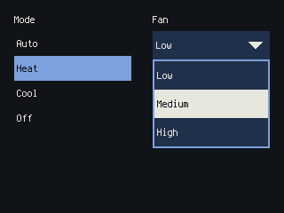
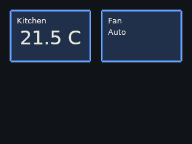
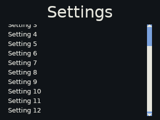

# Cookbook

*[По-русски](../ru/cookbook.md)*

This page is a collection of recipes: short pieces of code for the things an interface is made of, from a button to
a popup and touch. A recipe is a few whole pieces of C that go into a program as they are; the names it does not
define, such as `settings_save()`, are the program's own. The frame all the recipes sit in, the display, the queue
and the loop of the task that owns the tree, is written in [Getting started](getting-started.md).

- [What the recipes share](#what-the-recipes-share)
- [A row and a column that fit any screen](#a-row-and-a-column-that-fit-any-screen)
- [A line between rows](#a-line-between-rows)
- [One tree on every board](#one-tree-on-every-board)
- [One message for several widgets](#one-message-for-several-widgets)
- [A clock, or anything once in a while](#a-clock-or-anything-once-in-a-while)
- [A button](#a-button)
- [A caption from a string constant](#a-caption-from-a-string-constant)
- [A slider and a switch](#a-slider-and-a-switch)
- [A stepper: minus, a value, plus](#a-stepper-minus-a-value-plus)
- [A list](#a-list)
- [A dropdown](#a-dropdown)
- [One of several, and a tick](#one-of-several-and-a-tick)
- [A level bar](#a-level-bar)
- [An icon that shows a state](#an-icon-that-shows-a-state)
- [A button of a picture](#a-button-of-a-picture)
- [A picture from flash](#a-picture-from-flash)
- [A frame of nine pictures](#a-frame-of-nine-pictures)
- [A picture under the widgets](#a-picture-under-the-widgets)
- [A text of several lines](#a-text-of-several-lines)
- [A log of the last lines](#a-log-of-the-last-lines)
- [A page that scrolls](#a-page-that-scrolls)
- [A font that fits](#a-font-that-fits)
- [Letters with soft edges](#letters-with-soft-edges)
- [A handwritten text](#a-handwritten-text)
- [Colours of your own, and a night mode](#colours-of-your-own-and-a-night-mode)
- [Showing, hiding, disabling](#showing-hiding-disabling)
- [A popup](#a-popup)
- [Pages and "back"](#pages-and-back)
- [A bar over the pages](#a-bar-over-the-pages)
- [A page that works only while it is seen](#a-page-that-works-only-while-it-is-seen)
- [Pages that slide](#pages-that-slide)
- [Settings that stay](#settings-that-stay)
- [Buttons of the board](#buttons-of-the-board)
- [One knob](#one-knob)
- [Touch with DGX-DI](#touch-with-dgx-di)
- [Touch woken by an interrupt](#touch-woken-by-an-interrupt)
- [A field and a keyboard](#a-field-and-a-keyboard)
- [A field edited in a strip over the keypad](#a-field-edited-in-a-strip-over-the-keypad)
- [Widgets that come and go](#widgets-that-come-and-go)
- [A page from a description](#a-page-from-a-description)
- [A description made C when the program is built](#a-description-made-c-when-the-program-is-built)
- [An appearance made C when the program is built](#an-appearance-made-c-when-the-program-is-built)
- [Large data: a message by reference](#large-data-a-message-by-reference)
- [A message from an interrupt](#a-message-from-an-interrupt)
- [A look of your own](#a-look-of-your-own)
- [A widget of your own that the finger and the keys work](#a-widget-of-your-own-that-the-finger-and-the-keys-work)
- [A picture that stays between passes](#a-picture-that-stays-between-passes)
- [A graph that sweeps](#a-graph-that-sweeps)
- [A ring scale with widgets inside](#a-ring-scale-with-widgets-inside)
- [A display of 18 or 24 bits](#a-display-of-18-or-24-bits)
- [A loop that sleeps till the next moment](#a-loop-that-sleeps-till-the-next-moment)
- [Dim the screen when nobody touches it](#dim-the-screen-when-nobody-touches-it)
- [How long a pass takes](#how-long-a-pass-takes)
- [A mirror of the screen](#a-mirror-of-the-screen)
- [The tree as a layer in another compositor's strips](#the-tree-as-a-layer-in-another-compositors-strips)
- [Turning the screen](#turning-the-screen)
- [Testing an interface on the computer](#testing-an-interface-on-the-computer)

## What the recipes share

The headers, the colours and two styles of one font. Colours are indices of the table the program gives the painter;
the recipes name them.

The fonts are made for the program when it is built, with soft edges, 4 bits a pixel
([Letters with soft edges](#letters-with-soft-edges)): one for text, one for large figures and one for the keys of a
keypad, all of the first family of a list of rules that the build machine has.

```cmake
# main/CMakeLists.txt: the fonts of the recipes, made by DGX at build time, with the letters of the program's texts
dgx_fonts_rules(fonts.rules)
dgx_font_need(body SIZE 13px BITS 4 TEXTS main.c)
dgx_font_need(large SIZE 32px BITS 4 TEXTS main.c)
dgx_font_need(keys SIZE 20px BITS 4 LETTERS "0123456789")
```

```
# fonts.rules, beside it: the families in the order of preference, each from 7 pixels up
source system
allow "DejaVu Sans"      7..
allow "Liberation Sans"  7..
allow "Noto Sans"        7..
```

```c
#include "dgx_draw.h"
#include "dgx_fonts.h" /* made by DGX at build time: dgx_font_body, dgx_font_large, dgx_font_keys */
#include "dgx_ui_paint.h"
#include "dgx_ui_post.h"
#include "dgx_ui_text.h"
#include "dgx_ui_ticker.h"
#include "esp_attr.h"
#include "esp_timer.h"
#include "freertos/FreeRTOS.h"
#include "freertos/task.h"

enum { PAPER, INK, FILL, BORDER, ACCENT, ACCENT_DOWN, SHADOW, DIM, COLORS };

static dgx_ui_font_variant_t small[1];
static dgx_ui_text_style_t   st_left, st_centre;

static void styles_init(void)
{
    small[0]  = (dgx_ui_font_variant_t){.font = &dgx_font_body};
    st_left   = (dgx_ui_text_style_t){.fonts = small, .count = 1, .align = DGX_FONT_ALIGN_LEFT};
    st_centre = (dgx_ui_text_style_t){.fonts = small, .count = 1, .align = DGX_FONT_ALIGN_CENTER};
}
```

## A row and a column that fit any screen

A child with the flag `DGX_UI_REST` takes what its row or column has left after the others. No width is counted by
hand, and the same tree fits a screen of another width, another unit or a turned screen.

```c
static char             name_buf[16], value_buf[16], title_buf[16];
static dgx_ui_textbox_t name_box, value_box, title_box;

/* a row: the name takes what the value leaves */
static const dgx_ui_widget_t fit_row_w = {.kind = DGX_UI_BOX, .flags = DGX_UI_ROW, .want_h = 10, .gap = 4};
static const dgx_ui_widget_t name_w    = {.kind = DGX_UI_LABEL, .flags = DGX_UI_REST, .text = &name_box};
static const dgx_ui_widget_t value_w   = {.kind = DGX_UI_LABEL, .text = &value_box, .want_w = 40};

/* a column: the content takes what the title and the buttons leave, so the buttons stand at the bottom */
static const dgx_ui_widget_t page_w    = {.kind = DGX_UI_BOX, .flags = DGX_UI_COLUMN, .pad = 4, .gap = 4};
static const dgx_ui_widget_t title_w   = {.kind = DGX_UI_LABEL, .text = &title_box};
static const dgx_ui_widget_t content_w = {.kind = DGX_UI_BOX, .flags = DGX_UI_COLUMN | DGX_UI_REST, .gap = 2};
static const dgx_ui_widget_t bottom_w  = {.kind = DGX_UI_BOX, .flags = DGX_UI_ROW, .want_h = 18, .gap = 6};
```

- Several children with the flag share what is left equally.
- When nothing is left, such a child gets no size and is not seen.
- In a box that is neither a column nor a row the flag does nothing.

## A line between rows

A frame one point high in a column is a line across it, and one point wide in a row, a line down it. Its look
fills the whole box in one colour: the frame's draw with a border of no width, the line's colour as its fill.

```c
/* a line: the frame's draw with a border of no width fills its box in one colour, at any unit */
static const dgx_ui_frame_look_t line_params = {.border = BORDER, .width = 0};
static const dgx_ui_look_t       line_look   = {.draw = dgx_ui_draw_frame, .params = &line_params, .fill = BORDER};

/* across a column, as wide as it; down a row, as high as it */
static const dgx_ui_widget_t across_w = {.kind = DGX_UI_FRAME, .want_h = 1, .look = &line_look};
static const dgx_ui_widget_t down_w   = {.kind = DGX_UI_FRAME, .want_w = 1, .look = &line_look};
```

- Not the frame's own look: its border is a point wide, so a frame one point thick comes out all fill where a
  point is one pixel, all border where it is two, and striped where it is three.
- The line is a point thick, as every size of the tree: two pixels where a point is two.
- The gap of the column stands on both sides of the line, as of any child.
- In a description the look is a name. An appearance gives it to every page by one entry of its `"looks"`:

```json
"line": {"draw": "frame", "fill": "border", "params": {"border": "border", "width": 0}}
```

  and a page names it, `{"kind": "frame", "look": "line", "want": [0, 1]}`. With no appearance, the line
  `look line &line_look` of the names file gives the look of C above.

## One tree on every board

A program for several boards describes its widgets once. The board gives one number when the program is built, its
scale: how many pixels a point is. DGX makes the fonts of points for that scale, and the tree takes it as its unit;
what is in percent is a share of the screen as it is.

```cmake
# main/CMakeLists.txt: the display of the board jef-sure/boards chose, the scale worked out on it, fonts of points
dgx_fonts_board(PIXELS ${BOARD_PIXELS})
dgx_fonts_scale(FIT 320 240)   # the largest whole scale at which 320x240 points fit: 1 on the CYD, 3 on a 10" of 1280x800
dgx_font_need(clock SIZE 40pt BITS 4 LETTERS "0123456789:")
dgx_font_need(caption SIZE 12pt BITS 4 TEXTS main.c)
dgx_font_need(status DGX TerminusTTFMedium12 LETTERS "0123456789 CO2pm")   # a pixel font of DGX, taken as it is
```

```c
static dgx_ui_font_variant_t clock_variant[1], caption_variant[1], status_variant[1];
static dgx_ui_text_style_t   st_clock, st_caption, st_status;
static char                  face_time_buf[8], face_warm_buf[16], face_wet_buf[16], face_status_buf[16];
static dgx_ui_textbox_t      face_time_box, face_warm_box, face_wet_box, face_status_box;

/* a face: the time over half the room, two values side by side under it; the margins and the gaps a share of it */
static const dgx_ui_widget_t face_w      = {.kind  = DGX_UI_BOX,
                                            .flags = DGX_UI_COLUMN | DGX_UI_PERCENT_PAD | DGX_UI_PERCENT_GAP,
                                            .pad   = DGX_UI_PERCENT(4),
                                            .gap   = DGX_UI_PERCENT(3)};
static const dgx_ui_widget_t time_w      = {.kind = DGX_UI_LABEL, .flags = DGX_UI_PERCENT_H, .want_h = DGX_UI_PERCENT(55), .text = &face_time_box};
static const dgx_ui_widget_t values_w    = {.kind = DGX_UI_BOX, .flags = DGX_UI_ROW | DGX_UI_REST | DGX_UI_PERCENT_GAP, .gap = DGX_UI_PERCENT(4)};
static const dgx_ui_widget_t half_w      = {.kind = DGX_UI_FRAME, .flags = DGX_UI_PERCENT_W, .want_w = DGX_UI_PERCENT(50), .pad = 4};
static const dgx_ui_widget_t warm_text_w = {.kind = DGX_UI_LABEL, .text = &face_warm_box};
static const dgx_ui_widget_t wet_text_w  = {.kind = DGX_UI_LABEL, .text = &face_wet_box};
static const dgx_ui_widget_t status_w    = {.kind = DGX_UI_LABEL, .text = &face_status_box};

/* the tree's unit, the board's scale: the fonts of points are made for it */
static void face_ui_init(dgx_ui_t *ui, dgx_ui_node_t *nodes, int count)
{
    dgx_ui_init(ui, nodes, count, DGX_FONTS_SCALE);
}

static int face_add(dgx_ui_t *ui, int parent)
{
    clock_variant[0]   = (dgx_ui_font_variant_t){.font = &dgx_font_clock};
    caption_variant[0] = (dgx_ui_font_variant_t){.font = &dgx_font_caption};
    /* not made for the board: its every pixel a point, a square of the unit */
    status_variant[0] = (dgx_ui_font_variant_t){.font = &dgx_font_status, .points = !DGX_FONT_STATUS_MADE};
    st_status         = (dgx_ui_text_style_t){.fonts = status_variant, .count = 1, .align = DGX_FONT_ALIGN_LEFT};
    st_clock           = (dgx_ui_text_style_t){.fonts = clock_variant, .count = 1, .align = DGX_FONT_ALIGN_CENTER, .flags = DGX_UI_TEXT_MIDDLE};
    st_caption         = (dgx_ui_text_style_t){.fonts = caption_variant, .count = 1, .align = DGX_FONT_ALIGN_CENTER, .flags = DGX_UI_TEXT_MIDDLE};
    dgx_ui_textbox_init(&face_time_box, face_time_buf, sizeof face_time_buf, 1, &st_clock);
    dgx_ui_textbox_init(&face_warm_box, face_warm_buf, sizeof face_warm_buf, 1, &st_caption);
    dgx_ui_textbox_init(&face_wet_box, face_wet_buf, sizeof face_wet_buf, 1, &st_caption);
    dgx_ui_textbox_init(&face_status_box, face_status_buf, sizeof face_status_buf, 1, &st_status);
    const int face   = dgx_ui_add(ui, parent, &face_w);
    const int time   = dgx_ui_add(ui, face, &time_w);
    const int values = dgx_ui_add(ui, face, &values_w);
    const int warm   = dgx_ui_add(ui, dgx_ui_add(ui, values, &half_w), &warm_text_w);
    const int wet    = dgx_ui_add(ui, dgx_ui_add(ui, values, &half_w), &wet_text_w);
    const int status = dgx_ui_add(ui, face, &status_w);
    dgx_ui_text_set(ui, time, "12:34");
    dgx_ui_text_set(ui, warm, "21.5 C");
    dgx_ui_text_set(ui, wet, "41 %");
    dgx_ui_text_set(ui, status, "CO2 612 ppm");
    return face;
}
```

- **One number, chosen at the build**: `dgx_fonts_scale(FIT …)` takes the largest whole scale at which a frame of
  320x240 points fits the board's display (DGX 0.12.2). On the CYD it is 1; on a 10" display of 1280x800 it is 3,
  and the font `clock` is made 120 pixels high from the face itself, not a 40-pixel one enlarged. The program gets the
  number as `DGX_FONTS_SCALE` and gives it to `dgx_ui_init()`, so its points and the fonts' are the same.
- **Points for what should look the same, percents for a share**: the frames' pad of 4 points is 4 pixels on the CYD
  and 12 on the 10"; the margins, the gaps, the time's height and the two halves are shares of the screen, and follow
  its shape and its turn.
- Along a row a percent is of what the children share, the inside less the gaps, and the percents are taken by running
  totals: the two halves of 50 % and the gap between them fill the row exactly, to the pixel.
- `DGX_UI_REST` gives the row of values what the time and the gap leave of the column.
- In a description the same is written `"want": [0, "55%"]` and `"pad": "4%"`.
- For a program with buttons rather than a frame, `dgx_fonts_scale(MM 0.3)` takes the scale at which a point is about
  0.3 mm on every display.
- **A font as it is**: `status` is DGX's pixel font Terminus 12 taken as it is, not made for the board
  (`DGX_FONT_STATUS_MADE` is 0). Its variant of `.points` draws every pixel of it as a square of the unit, crisp: the
  line is 13 pixels high on the CYD and 39 on the 10", as a pixel font of a game is meant to look. Written
  `!DGX_FONT_STATUS_MADE`, it stays right if the need is one day made of points instead.

## One message for several widgets

A sensor sends the temperature and the humidity in one message. Two labels read it; neither claims it, so both see
it.

```c
enum { MSG_CLIMATE = 10 };
typedef struct {
    int16_t t10; /* tenths of a degree */
    uint8_t rh;  /* percent */
} climate_t;
DGX_UI_MESSAGE(climate, MSG_CLIMATE, climate_t)

static bool temp_take(dgx_ui_t *ui, int i, const dgx_ui_msg_t *msg)
{
    climate_t c;
    if (msg_decode_climate(msg, &c) == ESP_OK) dgx_ui_text_printf(ui, i, "%d.%d C", c.t10 / 10, c.t10 % 10);
    return false;
}

static bool rh_take(dgx_ui_t *ui, int i, const dgx_ui_msg_t *msg)
{
    climate_t c;
    if (msg_decode_climate(msg, &c) == ESP_OK) dgx_ui_text_printf(ui, i, "%d %%", c.rh);
    return false;
}

static dgx_ui_textbox_t      temp_box, rh_box;
static const dgx_ui_widget_t temp_w = {.kind = DGX_UI_LABEL, .text = &temp_box, .take = temp_take};
static const dgx_ui_widget_t rh_w   = {.kind = DGX_UI_LABEL, .text = &rh_box, .take = rh_take};

/* the sensor's task */
static void climate_send(QueueHandle_t queue, int t10, int rh)
{
    const climate_t c = {.t10 = (int16_t)t10, .rh = (uint8_t)rh};
    if (!msg_post_climate(queue, &c)) {
        /* the queue is full and the value is lost: the next one comes anyway */
    }
}
```

- The text is compared after it is formatted. The sensor may send 21.53, then 21.48: the label shows "21.5" both
  times and nothing is drawn.
- A type larger than 12 bytes does not compile in `DGX_UI_MESSAGE`. Larger data goes
  [by reference](#large-data-a-message-by-reference).
- A decoder is `dgx_ui_msg_copy()` with the number and the size. A message of the right number and another size is an
  error of the program, and is logged.

## A clock, or anything once in a while

A ticker sends a message of a number every so many milliseconds. Whoever wants it reads it in its `take()`.

```c
enum { MSG_MINUTE = 11 };
static dgx_ui_ticker_t minute_ticker; /* static: zeroed, and alive as long as its ticks */

static bool date_take(dgx_ui_t *ui, int i, const dgx_ui_msg_t *msg)
{
    if (msg->what != MSG_MINUTE) return false;
    const uint32_t minutes = (uint32_t)(esp_timer_get_time() / 60000000);
    dgx_ui_text_printf(ui, i, "up %u h %02u min", (unsigned)(minutes / 60), (unsigned)(minutes % 60));
    return true;
}

static bool minutes_start(QueueHandle_t queue)
{
    return dgx_ui_ticker_start(&minute_ticker, queue, MSG_MINUTE, 60 * 1000);
}
```

- The next tick is sent only after the loop called `dgx_ui_msg_done()` on the one before. A loop that forgets the call
  gets one tick and no more.
- `dgx_ui_ticker_stop()` stops it. The struct must live until its last tick was done with; a static one does.
- A ticker is the way to do slow things in time: the frames of an icon, a value that blinks. The task sleeps between
  the ticks.

## A button


A control names its look. The button's text is a text box, as a label's; `on()` is told `DGX_UI_ACTIVATED` when the
user clicked it or pressed the key of activation with the focus on it.

```c
void settings_save(void);

static dgx_ui_textbox_t save_box = DGX_UI_TEXT_CONST("Save", 1, &st_centre); /* a caption that never changes: no buffer */

static void save_on(dgx_ui_t *ui, int i, const dgx_ui_node_t *node, int what, void *ctx)
{
    if (what == DGX_UI_ACTIVATED) settings_save();
}

static const dgx_ui_widget_t save_w = {
    .kind = DGX_UI_BUTTON, .text = &save_box, .want_w = 60, .want_h = 18, .look = &dgx_ui_look_button, .on = save_on};

static int save_add(dgx_ui_t *ui, int parent)
{
    return dgx_ui_add(ui, parent, &save_w);
}
```

- A button with a text is as high as a line of the text and a point above and below it, the room of the frame of
  the focus, unless it is told: give it `want_h`, or in a row the flag `DGX_UI_STRETCH`, which makes it as high as
  the row.
- `dgx_ui_set_state(ui, b, DGX_UI_PRESSED, true)` draws it pressed and activates nothing: so a key of the board may
  show on the screen.
- `on()` may remove widgets, the button itself too: a dialog may close itself there.

## A caption from a string constant

Most texts of an interface never change: the names of buttons, a title, a unit. Such a text needs no buffer in RAM
and no call that sets it: its text box is made over the string constant itself, as the button above has it.

```c
/* the answers of a dialog in two languages: a box for each widget, pointed at a string of the table */
enum { CAPTION_YES, CAPTION_NO, CAPTIONS };

static const char *const caption_text[2][CAPTIONS] = {{"Yes", "No"}, {"Oui", "Non"}};
static dgx_ui_textbox_t  caption_box[CAPTIONS] = {DGX_UI_TEXT_CONST("Yes", 1, &st_centre), DGX_UI_TEXT_CONST("No", 1, &st_centre)};

/* the language changed: every box pointed at its other string and its widget told; widgets[] are the widgets of the boxes */
static void captions_language(dgx_ui_t *ui, const int widgets[CAPTIONS], int language)
{
    for (int caption = 0; caption < CAPTIONS; ++caption) {
        caption_box[caption].buf = (char *)caption_text[language][caption];
        dgx_ui_text_written(ui, widgets[caption]);
    }
}
```

- **`DGX_UI_TEXT_CONST(text, lines, style)`** makes a box whose buffer is the string and whose size is 0. The
  library never writes such a buffer: `dgx_ui_text_set()` on it changes nothing and returns `false`, and a field over
  it takes no letter.
- **The box is still 28 bytes<!-- sizeof dgx_ui_textbox_t --> of RAM**: the library keeps in it how the text was fitted. What is saved is the
  buffer, and the two calls that made the box and set its text. Measured on ten captions with buffers of 16 bytes on
  an ESP32: 168 bytes of RAM and 88 bytes of code less; the image is some 14 bytes a caption larger, as the boxes'
  first values now lie in flash.
- **A program all of whose texts are constants**, with no number printed into a text anywhere, does not link the
  printing behind `dgx_ui_text_printf()`: about 14 KB less on an ESP32, as long as nothing else in the program prints.
- **A box is one widget's**; the string may lie under any number of boxes. Two buttons that both say "Yes" are two
  boxes over one string.
- **A caption that changes seldom**, with the language or the mode, is pointed at another constant and its widget
  told by `dgx_ui_text_written()`, as above.
- **A text the program makes**, a number, a name that came by a message, keeps its buffer and `dgx_ui_text_printf()`.
- **The rows of a list and the options of a dropdown** may be a constant too: `DGX_UI_TEXT_CONST("Low\nMiddle\nHigh", 1,
  &st_left)`.

## A slider and a switch

The value of a control lives in a variable of the program's, an `int32_t` the widget names: `.value = &backlight_percent`.
The user's finger writes it there, and so may the program; the painter looks at it at every pass and draws the widget
when it holds another value than was drawn. `on()` is told `DGX_UI_CHANGED` when the user changed it: a slider at
every step of the finger, a switch when it is clicked.

```c
void backlight_set(int percent);
void wifi_enable(bool on);

/* the values, the program's own: the slider starts at 70, the switch off */
static int32_t backlight_percent = 70, wifi_wanted;

static void backlight_on(dgx_ui_t *ui, int i, const dgx_ui_node_t *node, int what, void *ctx)
{
    if (what == DGX_UI_CHANGED) backlight_set(backlight_percent);
}

static void wifi_on(dgx_ui_t *ui, int i, const dgx_ui_node_t *node, int what, void *ctx)
{
    if (what == DGX_UI_CHANGED) wifi_enable(wifi_wanted != 0);
}

/* a slider of 0..100 by 5 and a switch, each naming the place of its value */
static const dgx_ui_widget_t backlight_w = {
    .kind = DGX_UI_SLIDER, .min = 0, .max = 100, .step = 5, .want_h = 12, .value = &backlight_percent, .look = &dgx_ui_look_slider, .on = backlight_on};
static const dgx_ui_widget_t wifi_w = {
    .kind = DGX_UI_SWITCH, .max = 1, .want_w = 26, .want_h = 12, .value = &wifi_wanted, .look = &dgx_ui_look_switch, .on = wifi_on};

/* the value came from elsewhere, in the task that owns the tree: written, and the next pass shows it; on() is not told */
static void backlight_show(int percent)
{
    backlight_percent = percent;
}
```

- A value the program writes is shown at the next pass and does not call `on()`: the program does not hear its own
  changes back. It is written by the task that owns the tree; another task sends a message.
- A value outside `min..max`, as one read from flash may be, is shown within them, and the variable is left as it
  is until the user changes the widget. `dgx_ui_set_value()` writes within the bounds at once.
- A control with no `.value` shows 0 and nothing changes it; its look says so in the log.
- One variable may be named by several widgets, a slider and a number beside it: all of them follow it.
- With the flag `DGX_UI_SWIPE` a slider moves by the way the finger goes from where it went down, not to where the
  finger is: a wide strip that is easy to hit.
- With the keys, more and less move a slider by its step and set a switch.

## A stepper: minus, a value, plus

A value set by small steps and exactly: minutes, a threshold. Two buttons and a label over one variable. The buttons
are of `DGX_UI_REPEAT`: a tap is a step, and a finger held goes on stepping.

1. The user taps "+". The button is told `DGX_UI_ACTIVATED` as the finger goes down: 15 becomes 20, and the label
   shows it. Nothing more is told when the finger goes up.
2. The user holds "+". The first step comes at the press; half a second later the next, and then one every 100 ms:
   in two seconds, the press and sixteen more.
3. At 120 the button's `on()` changes nothing more, though it is told on. The user lets go.

```c
static int32_t step_minutes = 15; /* the value: 0 to 120 by 5 */

static dgx_ui_textbox_t step_minus_box = DGX_UI_TEXT_CONST("-", 1, &st_centre), step_plus_box = DGX_UI_TEXT_CONST("+", 1, &st_centre);
static char             step_buf[8];
static dgx_ui_textbox_t step_box;
static int              step_label = -1; /* the number of the label in its tree, kept when the stepper is built */

/* a button of the stepper: its ctx is the step it makes, -5 or 5. Told at the press and at every repeat */
static void on_step(dgx_ui_t *ui, int i, const dgx_ui_node_t *node, int what, void *ctx)
{
    if (what != DGX_UI_ACTIVATED) return;
    int32_t next = step_minutes + (int32_t)(intptr_t)ctx;
    if (next < 0) next = 0;
    if (next > 120) next = 120;
    if (next == step_minutes) return; /* at an end of the range: held, it changes nothing */
    step_minutes = next;
    dgx_ui_text_printf(ui, step_label, "%d min", (int)step_minutes);
}

static const dgx_ui_widget_t step_row_w   = {.kind = DGX_UI_BOX, .flags = DGX_UI_ROW, .gap = 2, .want_h = 16};
static const dgx_ui_widget_t step_minus_w = {
    .kind = DGX_UI_BUTTON, .flags = DGX_UI_REPEAT | DGX_UI_STRETCH, .want_w = 20, .text = &step_minus_box, .look = &dgx_ui_look_button, .on = on_step,
    .ctx = (void *)-5};
static const dgx_ui_widget_t step_value_w = {.kind = DGX_UI_LABEL, .flags = DGX_UI_REST, .at_y = 2, .text = &step_box};
static const dgx_ui_widget_t step_plus_w  = {
    .kind = DGX_UI_BUTTON, .flags = DGX_UI_REPEAT | DGX_UI_STRETCH, .want_w = 20, .text = &step_plus_box, .look = &dgx_ui_look_button, .on = on_step,
    .ctx = (void *)5};

static void step_add(dgx_ui_t *ui, int parent)
{
    dgx_ui_textbox_init(&step_box, step_buf, sizeof step_buf, 1, &st_centre);
    const int row = dgx_ui_add(ui, parent, &step_row_w);
    dgx_ui_add(ui, row, &step_minus_w);
    step_label = dgx_ui_add(ui, row, &step_value_w);
    dgx_ui_add(ui, row, &step_plus_w);
    dgx_ui_text_printf(ui, step_label, "%d min", (int)step_minutes);
}
```

- **The loop makes the repeats.** They come from `dgx_ui_time()`: the loop calls it at every turn and waits by
  `dgx_ui_wake()`, as the loop of [A loop that sleeps till the next moment](#a-loop-that-sleeps-till-the-next-moment)
  does. Without the call a button of `DGX_UI_REPEAT` steps once, at the press, and no more.
- **Held is pressed.** The repeat goes on wherever the finger goes, as the button stays pressed and looks so until
  the finger is lifted. It ends when the finger goes up, at a swipe, and when the button is hidden, disabled or
  removed or a popup opens over its tree.
- **The range** is the buttons' own business: here their `on()` keeps the value within 0 and 120.
- **By the keys** the key that activates, held on the button that has the focus, repeats the same way
  (`dgx_ui_buttons()`).
- **One repeats at a time**, the last begun: a key held while the finger repeats takes over, and when it is let go
  the finger's does not begin again.
- **With pictures** the two buttons are drawn by `dgx_ui_look_picture_button`:
  [A button of a picture](#a-button-of-a-picture).
- **What it costs**: about 0.25 KB in a program with a finger that calls `dgx_ui_time()`.

## A list


A list is a `DGX_UI_LIST` with the look `dgx_ui_look_list`. Its rows are the lines of its text, and one of them is
picked: the value of the list.

```c
void mode_set(int mode);

static char             mode_buf[32];
static dgx_ui_textbox_t mode_box;

static int32_t          mode_picked; /* the row picked */

static void mode_on(dgx_ui_t *ui, int i, const dgx_ui_node_t *node, int what, void *ctx)
{
    if (what == DGX_UI_ACTIVATED) mode_set(mode_picked); /* a row clicked, or activated by a key */
}

/* four rows of 14 points each: the rows share the height of the list */
static const dgx_ui_widget_t mode_w = {
    .kind = DGX_UI_LIST, .text = &mode_box, .min = 0, .max = 3, .want_h = 56, .value = &mode_picked, .look = &dgx_ui_look_list, .on = mode_on};

static int mode_add(dgx_ui_t *ui, int parent)
{
    dgx_ui_textbox_init(&mode_box, mode_buf, sizeof mode_buf, 1, &st_left);
    const int list = dgx_ui_add(ui, parent, &mode_w);
    dgx_ui_text_set(ui, list, "Auto\nHeat\nCool\nOff"); /* a row for each line */
    return list;
}
```

- **The rows** are the lines of the text, parted by `\n`. The first line is the value `min`, the next `min + 1`, up
  to `max`; a row past the last line is empty.
- **The height.** When all the rows go into the list at a line of its text each, they share its height: here 56
  points for four rows of 14. When they do not, the list shows a window of them and scrolls: as many rows at a time as
  lines of the text go into its height. The twelve months in a list 56 pixels high, in a font of 13 pixels a line,
  are four rows at a time, and a thin bar on the right edge shows where the window is among them. `step` of the widget is the least height of a row in points, for rows a finger hits; 0 is a line of the
  text.
- **The finger on a list whose rows all show.** Going down on a row picks it, and `on()` is told `DGX_UI_CHANGED`.
  Moved along the list, it takes the pick with it: the row under the finger is the one picked. Let go soon, on the
  row it went down on, it is a click: `DGX_UI_ACTIVATED`. Once it has left that row, letting go is no click. The
  top and the bottom twelfth of a row belong to no row, and a finger there picks nothing.
- **The finger on a list that scrolls.** Put down, it picks nothing. Moved up or down half a row, it moves the
  pick, a row for each row's height it goes, up going on down the list, and the window follows the pick. Let go
  without having moved, it is a click on the row under it: the row is picked, and `on()` is told `DGX_UI_CHANGED`
  and `DGX_UI_ACTIVATED`.
- **The keys.** Next and previous move the pick through the rows first, `DGX_UI_CHANGED` at each, the window
  following it, and from the last row the focus goes on to the next widget. The key that activates tells
  `DGX_UI_ACTIVATED`.
- **The window** always holds the pick after the pick changed, by a key, a finger or the program writing its
  variable.
  `dgx_ui_text_scroll(ui, list, rows)` moves the window alone, the pick staying where it is, for a scroll bar of
  the program's own.
- **The picked row** lies on a bar, of another colour while the list has the focus. When the pick moves, two rows
  of the display are written: the one it left and the one it came to. A list that scrolls is written whole when its
  window moves after the pick.
- **Colours of your own** are a `dgx_ui_list_look_t` in a look drawn by `dgx_ui_draw_list`, as in
  [Colours of your own](#colours-of-your-own-and-a-night-mode).

## A dropdown



A dropdown is a `DGX_UI_DROPDOWN` with the look `dgx_ui_look_dropdown`: a button that shows the option chosen. Its
options are the lines of its text, as the rows of a list, and its value is the option chosen. The list itself is a
popup, which the program opens with one call when the dropdown is clicked.

Take a fan with the speeds Low, Medium and High, at Low now:

1. The dropdown shows "Low"; its value is 0. The user clicks it. Its `on()` is told `DGX_UI_ACTIVATED` and calls
   `dgx_ui_dropdown_open()`: the list opens under the dropdown, three rows as high as the dropdown, "Low" on the
   bar.
2. The user taps "High". The value of the dropdown becomes 2, its `on()` is told `DGX_UI_CHANGED`, the list closes
   and the dropdown shows "High".
3. Had the user tapped outside the list, it would have closed with the value still 0 and `on()` told nothing. The
   same for a tap on "Low", the option it had.

```c
#include "dgx_ui_dropdown.h"

void fan_set(int speed);

static char              fan_buf[32];
static dgx_ui_textbox_t  fan_box;
static dgx_ui_dropdown_t fan_list; /* the popup of the list: one serves every dropdown of the program */
static int32_t           fan_choice; /* the option chosen */

static void fan_on(dgx_ui_t *ui, int i, const dgx_ui_node_t *node, int what, void *ctx)
{
    if (what == DGX_UI_ACTIVATED) dgx_ui_dropdown_open(ui, i, &fan_list, NULL, NULL); /* clicked: its list opens */
    if (what == DGX_UI_CHANGED) fan_set(fan_choice);                                  /* the user chose an option */
}

static const dgx_ui_widget_t fan_w = {
    .kind = DGX_UI_DROPDOWN, .text = &fan_box, .min = 0, .max = 2, .want_h = 16, .value = &fan_choice, .look = &dgx_ui_look_dropdown, .on = fan_on};

static int fan_add(dgx_ui_t *ui, int parent)
{
    dgx_ui_textbox_init(&fan_box, fan_buf, sizeof fan_buf, 1, &st_left);
    const int fan = dgx_ui_add(ui, parent, &fan_w);
    dgx_ui_text_set(ui, fan, "Low\nMedium\nHigh"); /* an option for each line */
    return fan;
}
```

- **Where the list stands.** Under the dropdown and as wide as it; above it when the screen has no room below;
  else moved up so that it fits the screen, lying over the dropdown.
- **The rows** are as high as the dropdown, and never lower than a line of the text: a dropdown sized for a finger
  has rows a finger hits. More options than the whole screen takes rows, and the list scrolls: it stands in the
  larger of the two rooms, under the dropdown or above it, as many rows as go into it, its window at the option
  chosen, and never lies over the dropdown.
- **The keys.** The key that activates, on the dropdown, tells `DGX_UI_ACTIVATED` as a click does. In the list,
  next and previous move the pick and the key that activates chooses. The list is modal, so the keys stay in it.
  The key "back" closes the list, the value kept: the library does it, `dgx_ui_key()` returns `true`, and the
  program is not given that key while the list is open.
- **A finger moved along the list** takes the bar with it and, let go, chooses nothing: the list stays open, and a
  tap chooses.
- **`dgx_ui_dropdown_t`** is the popup of the list, 284 bytes<!-- sizeof dgx_ui_dropdown_t --> of the program's RAM on a 32-bit chip, zeroed before
  its first use as a `static` is. One list is open at a time, so one serves every dropdown.
- **The looks** of the popup are the last two arguments, its frame and its list; `NULL` is the library's.
- **The tree knows its screen before the first list opens**: the list is placed on the screen the tree was laid
  for. The painter tells it at the first pass, or the program by `dgx_ui_screen()`; before that
  `dgx_ui_dropdown_open()` returns `false` and opens nothing.
- **While the list is open** the program may set the options, as a message may bring them: the list shows them at
  once, its window kept. It does not remove the dropdown: it closes the list first.
- A program that wants another list, a whole screen of choices, opens a popup of its own on `DGX_UI_ACTIVATED`
  instead.

## One of several, and a tick

Radio buttons choose one of several. A group of them is no widget and no object: it is a variable of the program's,
which every button of the group names. A checkbox is a switch drawn as a square with a tick.

```c
void air_mode_set(int mode);
void beep_enable(bool on);

enum { AIR_AUTO, AIR_DAY, AIR_NIGHT, AIR_MODES };

static int32_t air_mode = AIR_AUTO; /* the group: every radio button of it names this variable */
static int32_t beep_wanted = 1;     /* the checkbox */

/* captions that never change: a box for each widget, over a string constant */
static dgx_ui_textbox_t air_box[AIR_MODES] = {
    DGX_UI_TEXT_CONST("Auto", 1, &st_left), DGX_UI_TEXT_CONST("Day", 1, &st_left), DGX_UI_TEXT_CONST("Night", 1, &st_left)};
static dgx_ui_textbox_t beep_box = DGX_UI_TEXT_CONST("Beep", 1, &st_left);

static void air_on(dgx_ui_t *ui, int i, const dgx_ui_node_t *node, int what, void *ctx)
{
    if (what == DGX_UI_CHANGED) air_mode_set(air_mode); /* the user chose another button */
}

static void beep_on(dgx_ui_t *ui, int i, const dgx_ui_node_t *node, int what, void *ctx)
{
    if (what == DGX_UI_CHANGED) beep_enable(beep_wanted != 0);
}

/* a button stands for the number in its step, and is chosen while the group's variable holds that number */
static const dgx_ui_widget_t air_w[AIR_MODES] = {
    {.kind = DGX_UI_RADIO, .step = AIR_AUTO, .text = &air_box[AIR_AUTO], .value = &air_mode, .look = &dgx_ui_look_radio, .on = air_on},
    {.kind = DGX_UI_RADIO, .step = AIR_DAY, .text = &air_box[AIR_DAY], .value = &air_mode, .look = &dgx_ui_look_radio, .on = air_on},
    {.kind = DGX_UI_RADIO, .step = AIR_NIGHT, .text = &air_box[AIR_NIGHT], .value = &air_mode, .look = &dgx_ui_look_radio, .on = air_on},
};

/* a checkbox is a switch drawn as a square with a tick, its text beside it */
static const dgx_ui_widget_t beep_w = {
    .kind = DGX_UI_SWITCH, .max = 1, .text = &beep_box, .value = &beep_wanted, .look = &dgx_ui_look_checkbox, .on = beep_on};

static void air_add(dgx_ui_t *ui, int parent)
{
    for (int mode = 0; mode < AIR_MODES; ++mode) dgx_ui_add(ui, parent, &air_w[mode]);
    dgx_ui_add(ui, parent, &beep_w);
}
```

- **The group is the variable.** The buttons may stand anywhere in the layout, in different rows, on a page and on
  the tree under it: all that name `air_mode` are one group and follow it.
- **A click, or the key that activates,** writes the button's number into the variable. Its `on()` is told
  `DGX_UI_CHANGED` when that changed the variable; a button chosen again tells nothing, and the button that was
  chosen is told nothing.
- **The program writes the variable** too, from a message or from the settings it loaded: at the next pass the
  button that was chosen and the one that is are drawn, the others not.
- **A number no button stands for** shows none chosen, and the variable is left as it is.
- **A list or a dropdown of the same variable** follows the buttons and they follow it: one place, several widgets.
- **A button is as high as a line of its text and a point above and below**, the room of the frame of the focus;
  for a finger give it `want_h`. The whole box is hit, the text too.
- **The focus and the finger are seen**: while the widget has the focus a frame of a point goes round it, in
  colour 1, and while a finger is on it the inside of the ring or the square is colour 2. Colours of your own are a
  `dgx_ui_check_look_t` in a look drawn by `dgx_ui_draw_radio` or `dgx_ui_draw_checkbox`.
- **What it costs**: a program that names the look of a checkbox carries about 1.9 KB more, the look of a radio
  button 1.7 KB, both 2.1 KB; and 0.5 KB once for the frame of the focus, which the looks of a button and of a
  dropdown share. One that names neither, nothing of them.
- **Do not give a radio `min` and `max`**: its number is in `step`. `dgx_ui_radio_chosen(node)` tells whether a
  button is the chosen one; `dgx_ui_value()` of any button of a group is the number chosen.

## A level bar

A value shown as the filled part of a box: a battery, a signal, a tank. It is the library's look
`dgx_ui_look_level` on a widget of `DGX_UI_OWN` that names the place of its value. With no parameters of its own,
`.look = &dgx_ui_look_level`, it is filled from the left in colour 3 over colour 2. Here two bars in colours of the
program's:

```c
static int32_t charge_percent; /* written by whoever reads the battery, as any value of the program */

/* below 20 in one colour, below 50 in another, from there up in `bar`; filled from the left */
static const dgx_ui_band_t       charge_bands[] = {{20, ACCENT_DOWN}, {50, BORDER}};
static const dgx_ui_level_look_t charge_colors  = {.bar = ACCENT, .rest = FILL, .from = DGX_UI_FROM_LEFT, .band_count = 2, .bands = charge_bands};
static const dgx_ui_look_t       look_charge    = {.draw = dgx_ui_draw_level, .params = &charge_colors, .fill = -1};
static const dgx_ui_widget_t     charge_w       = {.kind = DGX_UI_OWN, .max = 100, .want_h = 6, .value = &charge_percent, .look = &look_charge};

/* a tank filled from the bottom: 0 to 200 litres in a box 12 points wide and 40 high; what stands above 160 litres
   is of another colour, a zone at the top that keeps its place */
static int32_t                   tank_litres;
static const dgx_ui_band_t       tank_bands[] = {{160, ACCENT}};
static const dgx_ui_level_look_t tank_colors  = {.bar = ACCENT_DOWN, .rest = FILL, .from = DGX_UI_FROM_BOTTOM, .band_count = 1,
                                                 .bands_by = DGX_UI_BANDS_BY_PLACE, .bands = tank_bands};
static const dgx_ui_look_t       look_tank   = {.draw = dgx_ui_draw_level, .params = &tank_colors, .fill = -1};
static const dgx_ui_widget_t     tank_w      = {.kind = DGX_UI_OWN, .max = 200, .want_w = 12, .want_h = 40, .value = &tank_litres, .look = &look_tank};
```

- **The value** is the variable's, kept within `min`..`max`. Whoever writes the variable moves the bar: a
  message's `take()`, a slider that names the same variable. The bar follows at the next pass.
- **The edge** it fills from is `from`: `DGX_UI_FROM_LEFT`, `DGX_UI_FROM_BOTTOM`, `DGX_UI_FROM_RIGHT`,
  `DGX_UI_FROM_TOP`.
- **Bands.** A value below a band's `below` takes that band's colour, the lowest band first; a value past the last
  band takes `bar`. Here 10 is `ACCENT_DOWN`, 20 and 30 are `BORDER`, 50 and 80 are `ACCENT`. All of the filled part
  is of one colour, the value's: that is `bands_by` 0, `DGX_UI_BANDS_BY_VALUE`.
- **Bands by place**, `DGX_UI_BANDS_BY_PLACE`, colour each part of the bar by the values it stands for: the tank is
  `ACCENT` up to 160 litres and `ACCENT_DOWN` above, whatever its level, a zone that shows only when the level
  reaches it.
- **What is written.** When only the value moved, the part between the length that was filled and the new one:
  a bar 200 pixels long that grows by one percent sends two columns of pixels. When the colour changed, the filled
  part and what emptied. Every pixel once.
- **`rest`** may be `DGX_UI_PAPER`: over a drawn background the empty part shows the picture.
- **Nothing works it**: it takes no finger and no focus. A bar the user moves is a slider.
- **What it costs**: about 0.9 KB in a program that names it.

## An icon that shows a state

An icon is a widget of one size whose picture is picked by its value. A value outside `min..max` shows no picture, and
the widget keeps its place, so nothing around it moves when the icon comes and goes.

```c
/* 8x8, 1 bit: rows from a new byte, the leftmost pixel in the high bit */
static const uint8_t      bars1[8] = {0x00, 0x00, 0x00, 0x00, 0x00, 0x00, 0x80, 0x80};
static const uint8_t      bars2[8] = {0x00, 0x00, 0x00, 0x00, 0x20, 0x20, 0xA0, 0xA0};
static const uint8_t      bars3[8] = {0x00, 0x00, 0x08, 0x08, 0x28, 0x28, 0xA8, 0xA8};
static const uint8_t      bars4[8] = {0x02, 0x02, 0x0A, 0x0A, 0x2A, 0x2A, 0xAA, 0xAA};
static const dgx_image_t  signal_im[4] = {
    {.width = 8, .height = 8, .format = DGX_IMAGE_1BPP, .data = bars1},
    {.width = 8, .height = 8, .format = DGX_IMAGE_1BPP, .data = bars2},
    {.width = 8, .height = 8, .format = DGX_IMAGE_1BPP, .data = bars3},
    {.width = 8, .height = 8, .format = DGX_IMAGE_1BPP, .data = bars4},
};
static const dgx_ui_picture_t signal_pic[4] = {
    {.image = &signal_im[0]}, {.image = &signal_im[1]}, {.image = &signal_im[2]}, {.image = &signal_im[3]}};

enum { MSG_SIGNAL = 12 };
typedef struct {
    int8_t bars; /* 1..4; 0: no network */
} signal_t;
DGX_UI_MESSAGE(signal, MSG_SIGNAL, signal_t)

static int32_t signal_bars; /* the icon's value: which picture */

static bool signal_take(dgx_ui_t *ui, int i, const dgx_ui_msg_t *msg)
{
    signal_t s;
    if (msg_decode_signal(msg, &s) == ESP_OK) signal_bars = s.bars; /* written: the pass after this message shows it */
    return false;
}

/* the pictures of the values 1..4; 0 is outside and shows none */
static const dgx_ui_widget_t signal_w = {
    .kind = DGX_UI_ICON, .picture = signal_pic, .min = 1, .max = 4, .value = &signal_bars, .look = &dgx_ui_look_picture, .take = signal_take};
```

The size of the widget is the size of the first picture. The picture is drawn opaque: its ink and its paper are both
written, so an icon drawn again over itself does not blink.

## A button of a picture

"Back", "sound", tabs: on a small screen a button is often a picture. The look `dgx_ui_look_picture_button` draws a
picture of 1 bit on the face of a button: it is pressed onto its shadow and framed by the focus as a button with a
text is. It draws three kinds:

```c
/* 8x8, 1 bit: rows from a new byte, the leftmost pixel in the high bit */
static const uint8_t icon_back_bits[8]     = {0x10, 0x30, 0x7F, 0xFF, 0x7F, 0x30, 0x10, 0x00}; /* an arrow to the left */
static const uint8_t icon_sound_bits[8]    = {0x08, 0x18, 0x78, 0x78, 0x78, 0x78, 0x18, 0x08}; /* a speaker */
static const uint8_t icon_muted_bits[8]    = {0x09, 0x1A, 0x7C, 0x78, 0x78, 0x7C, 0x1A, 0x09}; /* the speaker crossed */
static const uint8_t icon_tab_bits[8]      = {0xFF, 0x81, 0x81, 0x81, 0x81, 0x81, 0x81, 0xFF}; /* a square, outlined */
static const uint8_t icon_tab_here_bits[8] = {0xFF, 0xFF, 0xFF, 0xFF, 0xFF, 0xFF, 0xFF, 0xFF}; /* and filled */
static const dgx_image_t icon_im[5] = {
    {.width = 8, .height = 8, .format = DGX_IMAGE_1BPP, .data = icon_back_bits},
    {.width = 8, .height = 8, .format = DGX_IMAGE_1BPP, .data = icon_muted_bits},
    {.width = 8, .height = 8, .format = DGX_IMAGE_1BPP, .data = icon_sound_bits},
    {.width = 8, .height = 8, .format = DGX_IMAGE_1BPP, .data = icon_tab_bits},
    {.width = 8, .height = 8, .format = DGX_IMAGE_1BPP, .data = icon_tab_here_bits},
};
static const dgx_ui_picture_t icon_back[1]  = {{.image = &icon_im[0]}};
static const dgx_ui_picture_t icon_sound[2] = {{.image = &icon_im[1]}, {.image = &icon_im[2]}}; /* off, on */
static const dgx_ui_picture_t icon_tab[2]   = {{.image = &icon_im[3]}, {.image = &icon_im[4]}}; /* not chosen, chosen */

static int32_t icon_sound_on, icon_tab_shown = 1; /* the toggle's place; the tabs' place: the number of the tab shown */

static void on_icon_back(dgx_ui_t *ui, int i, const dgx_ui_node_t *node, int what, void *ctx);

/* a button: one picture. A toggle: a switch of two. Tabs: radios of one place, two pictures each */
static const dgx_ui_widget_t icon_back_w  = {.kind = DGX_UI_BUTTON, .picture = icon_back, .look = &dgx_ui_look_picture_button, .on = on_icon_back};
static const dgx_ui_widget_t icon_sound_w = {.kind = DGX_UI_SWITCH, .picture = icon_sound, .value = &icon_sound_on, .look = &dgx_ui_look_picture_button};
static const dgx_ui_widget_t icon_tab_w[2] = {
    {.kind = DGX_UI_RADIO, .picture = icon_tab, .value = &icon_tab_shown, .step = 1, .look = &dgx_ui_look_picture_button},
    {.kind = DGX_UI_RADIO, .picture = icon_tab, .value = &icon_tab_shown, .step = 2, .look = &dgx_ui_look_picture_button},
};

static int icon_backs; /* what "back" does is the program's; here it is counted */
static void on_icon_back(dgx_ui_t *ui, int i, const dgx_ui_node_t *node, int what, void *ctx)
{
    if (what == DGX_UI_ACTIVATED) ++icon_backs;
}
```

- **A button** shows its one picture and tells `DGX_UI_ACTIVATED` at a click, as any button.
- **A toggle** is a switch with two pictures: the first while it is off, the second while it is on. On is what a
  switch calls on, a value that is not 0, so a toggle, a switch and a checkbox of one variable always agree.
- **Tabs** are radio buttons of one variable with two pictures each: the first while not chosen, the second while
  chosen. A click writes the button's number into the variable; of the group only the two that changed are drawn. In
  a bar they open the pages: [A bar over the pages](#a-bar-over-the-pages).
- **The value is shown by the picture**, not by a colour: the face is the button's own in every state.
- **The size.** With no `want_w` and `want_h` the button is as large as its first picture and five points more
  across and down: a point of face and the point of the frame on each side, and one for a shadow. For a finger give
  it a size: the picture stays in the middle of the face, and one larger than the face is cut by it.
- **The colours** are the button's, a `dgx_ui_button_look_t`; its `text` is the picture's ink. A look of your own is
  `{.draw = dgx_ui_draw_picture_button, .params = &my_colours, .fill = -1}`.
- **Other pictures.** One of 4 or 8 bits or of RGB565 is not drawn, and the log says so once: the face is plain. A
  text beside the picture is not drawn either.
- **What it costs**: about 0.8 KB more in a program that has buttons with a text and pictures; 2.8 KB in one
  with no picture yet, as the drawing of pictures comes with it.

## A picture from flash

A picture of 1 bit is a `dgx_image_t` of DGX with the look `dgx_ui_look_picture`, as the icon above; its ink is a
colour of the table. A picture of colours is rows of RGB565 with the look `dgx_ui_look_rgb565`:

```c
extern const uint16_t logo_pixels[64 * 32]; /* rows of RGB565, high byte first */

static const dgx_ui_picture_t logo_pic = {.rgb565 = logo_pixels, .width = 64, .height = 32};
static const dgx_ui_widget_t  logo_w   = {.kind = DGX_UI_PICTURE, .picture = &logo_pic, .look = &dgx_ui_look_rgb565};
```

- The look of RGB565 needs `CONFIG_DGX_ENABLE_VSCREEN=y` and a 16-bit screen. On another screen the widget is
  paper.
- The painter makes one small screen object for such pictures at the first need.
  `dgx_ui_paint_free(&paint)` gives it back when the program stops painting.
- `.scale = 1` draws a pixel of the picture as a point of the tree, `unit` by `unit` pixels: the same logo keeps its
  place beside the text on a screen of a larger unit. 2 draws it twice as large; 0, the default, pixel for pixel.
  Every look of a picture takes it, and the widget's size of its content too.

A picture of several colours of the table is a `dgx_image_t` of 4 or 8 bits with the look `dgx_ui_look_indexed`.
Its values are not colours but numbers, and its map says which colour of the painter's table each number is:

```c
/* a battery of 12 by 6, 4 bits a pixel: a hex digit is a pixel, 0 a hole that shows the paper */
static const uint8_t battery_px[6 * 6] = {
    0x11, 0x11, 0x11, 0x11, 0x11, 0x00,
    0x12, 0x22, 0x23, 0x33, 0x31, 0x10,
    0x12, 0x22, 0x23, 0x33, 0x31, 0x10,
    0x12, 0x22, 0x23, 0x33, 0x31, 0x10,
    0x12, 0x22, 0x23, 0x33, 0x31, 0x10,
    0x11, 0x11, 0x11, 0x11, 0x11, 0x00,
};
static const dgx_image_t battery_im = {.width = 12, .height = 6, .format = DGX_IMAGE_4BPP, .data = battery_px};
/* the colours of the values 1, 2, 3: the case, the charge, the rest; the same data with another map when it is low */
static const uint8_t          battery_ok[15]  = {INK, ACCENT, FILL};
static const uint8_t          battery_low[15] = {INK, ACCENT_DOWN, FILL};
static const dgx_ui_picture_t battery_pics[2] = {{.image = &battery_im, .map = battery_ok}, {.image = &battery_im, .map = battery_low}};
static int32_t                battery_low_now; /* 0: charged, the first map; 1: low, the second */
static const dgx_ui_widget_t  battery_w = {
    .kind = DGX_UI_ICON, .picture = battery_pics, .min = 0, .max = 1, .want_w = 14, .want_h = 8, .value = &battery_low_now, .look = &dgx_ui_look_indexed};

/* the painter's buffer: such a picture is drawn in it a strip of its rows at a time, a byte a pixel */
static uint8_t paint_buffer[256];

static void paint_buffer_give(dgx_ui_paint_t *paint)
{
    paint->buffer = paint_buffer, paint->buffer_size = sizeof paint_buffer;
}
```

- **The values** go through the picture's `map` to indices of the painter's table: the value 1 is `map[0]`, the
  value 2 `map[1]`. Without a map the value itself is the index. A pixel 0 is a hole: the paper shows.
- **The same data in other colours** is another map: the battery above is one picture and two maps, an icon of two
  states.
- **The buffer.** The painter draws such a picture in memory the program gives it, `buffer` and `buffer_size` of
  the paint, a strip of the picture's rows at a time, and sends each strip through the table: every pixel of the
  widget is written once. A row of the widest picture, a byte a pixel, is enough; with more the strips are higher
  and fewer. With no buffer, or one smaller than a row, the widget is paper and the log says so once.
- It needs `CONFIG_DGX_ENABLE_VSCREEN=y` and a 16-bit screen. On a display of 18 or 24 bits such a picture is paper.
- The painter keeps a small screen object and a table of 512 bytes for such pictures from the first one on;
  `dgx_ui_paint_free(&paint)` gives them back.
- A picture of 1 bit is drawn by this look as well, so an icon whose pictures are of different depths names it. A
  program that has pictures of 1 bit only names `dgx_ui_look_picture` and carries none of this.

## A frame of nine pictures

A frame drawn of pictures, the way a game draws its windows: four corners, four edges and a middle, nine pictures of
the program's, here of 4 bits, a look of its own by `dgx_ui_draw_nine`. The children go into `card_w` as into any
frame.

```c
/* the nine pieces of a frame with rounded corners, 4 bits a pixel, a hex digit a pixel: 1 the border, 2 its light
   inner line, 0 the fill. The corners are 4 by 4, the top and bottom edges 1 wide, the side edges 1 high */
static const uint8_t nine_tl_px[4 * 2] = {0x01, 0x11, 0x12, 0x22, 0x12, 0x00, 0x12, 0x00};
static const uint8_t nine_tr_px[4 * 2] = {0x11, 0x10, 0x22, 0x21, 0x00, 0x21, 0x00, 0x21};
static const uint8_t nine_bl_px[4 * 2] = {0x12, 0x00, 0x12, 0x00, 0x12, 0x22, 0x01, 0x11};
static const uint8_t nine_br_px[4 * 2] = {0x00, 0x21, 0x00, 0x21, 0x22, 0x21, 0x11, 0x10};
static const uint8_t nine_t_px[4]      = {0x10, 0x20, 0x00, 0x00};
static const uint8_t nine_b_px[4]      = {0x00, 0x00, 0x20, 0x10};
static const uint8_t nine_l_px[2]      = {0x12, 0x00};
static const uint8_t nine_r_px[2]      = {0x00, 0x21};
static const uint8_t nine_m_px[1]      = {0x00};
#define NINE_IMAGE(px, w, h) {.width = (w), .height = (h), .format = DGX_IMAGE_4BPP, .data = (px)}
static const dgx_image_t nine_images[9] = {
    NINE_IMAGE(nine_tl_px, 4, 4), NINE_IMAGE(nine_t_px, 1, 4), NINE_IMAGE(nine_tr_px, 4, 4),
    NINE_IMAGE(nine_l_px, 4, 1),  NINE_IMAGE(nine_m_px, 1, 1), NINE_IMAGE(nine_r_px, 4, 1),
    NINE_IMAGE(nine_bl_px, 4, 4), NINE_IMAGE(nine_b_px, 1, 4), NINE_IMAGE(nine_br_px, 4, 4),
};
static const uint8_t nine_map[15] = {BORDER, ACCENT}; /* the values 1 and 2 */
/* row after row: the top-left corner, the top edge, the top-right corner, the left edge, the middle, ... */
static const dgx_ui_picture_t nine_pieces[9] = {
    {.image = &nine_images[0], .map = nine_map, .scale = 1}, {.image = &nine_images[1], .map = nine_map, .scale = 1},
    {.image = &nine_images[2], .map = nine_map, .scale = 1}, {.image = &nine_images[3], .map = nine_map, .scale = 1},
    {.image = &nine_images[4], .map = nine_map, .scale = 1}, {.image = &nine_images[5], .map = nine_map, .scale = 1},
    {.image = &nine_images[6], .map = nine_map, .scale = 1}, {.image = &nine_images[7], .map = nine_map, .scale = 1},
    {.image = &nine_images[8], .map = nine_map, .scale = 1},
};
static const dgx_ui_nine_look_t nine_params = {.pieces = nine_pieces, .fill = FILL, .ink = INK};
static const dgx_ui_look_t      nine_look   = {.draw = dgx_ui_draw_nine, .params = &nine_params, .fill = FILL};
static const dgx_ui_widget_t    card_w      = {.kind = DGX_UI_FRAME, .flags = DGX_UI_COLUMN, .pad = 6, .gap = 2,
                                               .want_w = 68, .want_h = 44, .look = &nine_look};
```



- **A box is not sized by its children**: a frame takes its size from `want_w` and `want_h`, or from its parent.
- **The corners** are drawn as they are. **The edges and the middle** are laid again and again along their cell
  from its top-left corner and cut by it, never stretched: a piece one pixel wide makes an edge of any length.
- **The cells** are the corners' sizes: the left column as wide as the top-left corner, the top row as high, the
  right column as wide as the top-right corner, the bottom row as high as the bottom-left one. The `pad` of the
  widget keeps the children off them: here 6 points over corners of 4.
- **`.scale = 1`** draws a pixel of a piece as a point of the tree, so the frame keeps its thickness beside the text
  on a screen of a larger unit; each piece has its own.
- **The fill** is under all of it, where a piece has a 0: `fill` of the parameters, never `DGX_UI_PAPER`, and the
  same index in the look's `fill`, so that the children's paper is the frame's.
- **The buffer**, the screen and `CONFIG_DGX_ENABLE_VSCREEN=y` are those of
  [a picture of several colours](#a-picture-from-flash): the frame is drawn in strips of the paint's buffer, every
  pixel once. Without them it is the fill alone, and the log says so once.
- `dgx_ui_look_nine`, the library's look, has no pieces of its own: a program that wants a frame of pictures gives
  them, as here. One that names neither carries nothing of it.
- **In an appearance** the same frame is a look of `"nine"` whose pieces are a name of the program's pictures: the
  line `picture card nine_pieces 9` in the names file, and in the appearance's looks
  `"card": {"draw": "nine", "fill": "fill", "params": {"fill": "fill", "ink": "ink", "pieces": "card"}}`. A widget
  names the look `"card"`; a table of fewer than 9 pictures is refused at `"pieces"`.

## A picture under the widgets


The background of a tree is a colour, or a picture the program draws. The program gives the painter a function that
puts a rectangle of its picture on the screen, and every widget whose paper is "what lies under me" shows the
picture there. Take a weather map with a column of labels over it, the wind at "5 m/s":

1. The painter draws the label. Its look lays the map's piece of its box by the program's function and writes the
   letters over it with no field around them: the map shows between the letters.
2. The wind becomes "6 m/s". With the strips named, the piece of the map and the new letters are put together in the
   buffer and go to the display once. The label does not blink.
3. The program swaps the map for the one with rain and tells the painter where the picture changed. The painter lays
   the new map there at once, wherever it shows, and draws the labels again over it. Under the frame of the
   temperature nothing is written: a frame fills, and the map does not show through it.

```c
#include "dgx_vscreen.h"

extern const uint16_t map_pixels[320 * 240]; /* the map, as large as the screen: rows of RGB565, high byte first */
extern const uint16_t rain_pixels[320 * 240];

static dgx_screen_t *map_screen;               /* a virtual screen over the map's pixels: made once */
static uint8_t       map_buffer[320 * 2 * 8];  /* eight rows of 16 bits: what lies on the map goes out through it */

/* the program's function: the piece x, y, w, h of the map put where the painter draws */
static void map_draw(dgx_ui_paint_t *paint, int x, int y, int w, int h, void *ctx)
{
    dgx_vscreen_region_to_screen(paint->scr, x - paint->ox, y - paint->oy, ctx, x, y, w, h, 0);
}

/* at the start, before the first pass */
static bool map_under(dgx_ui_paint_t *paint)
{
    map_screen = dgx_vscreen_from_array((void *)map_pixels, 320, 240, 16, DgxScreenRGB);
    if (!map_screen) return false;
    dgx_ui_background_set(paint, map_draw, map_screen);
    paint->buffer = map_buffer, paint->buffer_size = sizeof map_buffer, paint->strips = &dgx_ui_strips;
    return true;
}

/* another map: the same screen pointed at other pixels, and the painter told where the picture changed */
static void map_rain(dgx_ui_t *ui, dgx_ui_paint_t *paint)
{
    dgx_vscreen_array_set(map_screen, (void *)rain_pixels, 320, 240);
    dgx_ui_background_changed(ui, paint, 0, 0, 320, 240);
}
```

- **The function** puts the rectangle `x, y, w, h` of the tree's screen on `paint->scr` at `x - paint->ox`,
  `y - paint->oy`. The painter has set the clip to the rectangle, so a function that draws more than it was asked
  harms nothing. The screen is the display, or a strip of the buffer of the display's depth: on a display of 18 or
  24 bits the picture must be of that depth.
- **`dgx_ui_background_set()`** gives the function and what it is called with. `NULL` takes the picture away; then
  `dgx_ui_redraw(ui, 0)` draws the tree on the colour again. A function written into the paint by hand is not
  called: the call is what brings the laying of a picture into the program.
- **What shows the picture**: a label and a text of lines between their letters, a button around its face, a slider
  around its track, a picture of 1 bit and one of 4 or 8 bits in their holes, a box everywhere. **What does not**: a
  frame and everything in it, as it fills; a look whose parameters name a paper of their own.
- **Name the strips** with a picture on a display behind a bus, of 16 bits too. Drawn straight, a label over the
  picture is written twice, the map and then the letters, and blinks; and the soft edges of its letters, which
  cannot read the display, are mixed with the colour `background`. Through the strips it goes out once and the edges
  mix with the map. The buffer holds a row of the widest such widget at least, its width times 2 bytes at 16 bits.
- **`background`** stays the colour a look is told where it cannot lay the picture. Give it the picture's main
  colour.
- **`dgx_ui_background_changed()`** draws at once and keeps nothing: the picture where it shows in the rectangle,
  then the widgets on it. A game with a dialog over its frame calls it for each piece of the frame that changed,
  where it sent the piece to the display before; inside one batch of DGX the pieces go out together.
- **What it costs**: about 0.5 KB of dgx-ui for the program that calls `dgx_ui_background_set()`, and what its own
  function brings of DGX. A program with a colour for a background carries none of it.

## A text of several lines


The look `dgx_ui_look_lines` lays a text into the lines of its box, word by word. The box says how many lines it
shows; the style says what happens to a text too long.

```c
static char                news_buf[200], hint_buf[120];
static dgx_ui_textbox_t    news_box, hint_box;
static dgx_ui_text_style_t st_important;

static const dgx_ui_widget_t news_w = {.kind = DGX_UI_LABEL, .text = &news_box, .look = &dgx_ui_look_lines};
static const dgx_ui_widget_t hint_w = {.kind = DGX_UI_LABEL, .text = &hint_box, .look = &dgx_ui_look_lines};

static void texts_add(dgx_ui_t *ui, int parent)
{
    /* an important text too long scrolls a line up every 2 s; one that is not is cut with an ellipsis */
    st_important = (dgx_ui_text_style_t){.fonts = small, .count = 1, .flags = DGX_UI_TEXT_IMPORTANT, .scroll_ms = 2000};
    dgx_ui_textbox_init(&news_box, news_buf, sizeof news_buf, 3, &st_important);
    dgx_ui_textbox_init(&hint_box, hint_buf, sizeof hint_buf, 2, &st_left);
    const int news = dgx_ui_add(ui, parent, &news_w);
    const int hint = dgx_ui_add(ui, parent, &hint_w);
    dgx_ui_text_set(ui, news, "The filter has worked for 2000 hours. Replace it and hold the button for three seconds.");
    dgx_ui_text_set(ui, hint, "Swipe from the left edge to open the menu.");
    dgx_ui_text_appear(ui, hint, 30); /* its letters come one by one, 30 ms each */
}
```

- While a text scrolls or its letters come, `dgx_ui_paint()` returns `true` and the loop keeps coming back. When the
  text reached its end and all letters came, it asks no more.
- A new text starts from its first line, and appears again if it was told to.
- `dgx_ui_text_scroll(ui, i, 1)` moves the lines of a text that is not important a line up by hand, so the next
  line comes into view, `-1` a line down.
- A word wider than the line is cut by its letters; `\n` ends a line.
- A program that names this look carries about 2.5 KB more code; a program of one-line labels does not.

A talk that waits for its text, as a game's dialog does: a key while the letters come shows them all at once, and a
key once all is shown goes on. `dgx_ui_text_state()` says which:

```c
static const char *const talk[] = {"The guard looks up from the fire.", "\"Nobody passes the gate at night,\" says the guard."};
static int               talk_at;

/* the key of the talk, on a text of several lines that appears letter by letter */
static void talk_key(dgx_ui_t *ui, int text_i)
{
    const int state = dgx_ui_text_state(ui, text_i);
    if (state & DGX_UI_TEXT_COMING) {
        dgx_ui_text_whole(ui, text_i); /* the letters still coming, all at the next pass */
    } else if ((state & DGX_UI_TEXT_SEEN) && talk_at + 1 < (int)(sizeof talk / sizeof talk[0])) {
        dgx_ui_text_set(ui, text_i, talk[++talk_at]); /* all shown: the next line, appearing as the first did */
    }
    /* neither: an important text still scrolling to its end; the key waits for it */
}
```

- Seen is what the look shows, not every letter: a text that is not important and has too little room, or a line
  cut with an ellipsis, is seen at its first pass. An important one is seen at its last line.
- An important text shown whole scrolls from that pass on, its first lines shown `scroll_ms` as always. A key while
  it scrolls changes nothing: the reader is not hurried past lines not read yet.
- A text hidden, or wholly under a popup, is not seen until it is drawn.

## A log of the last lines

A log shows the last lines that came: a new line is added at the bottom, and when there is no room the oldest go.
The look of lines draws the window; the program keeps the lines, in the buffer of the text box itself.

```c
#include <string.h>

enum { LOG_ROWS = 5 };

static char             log_buf[240]; /* the last lines of the log, "\n" between them: the buffer of the text box itself */
static dgx_ui_textbox_t log_box;

static const dgx_ui_widget_t log_w = {.kind = DGX_UI_LABEL, .text = &log_box, .look = &dgx_ui_look_lines};

static int log_make(dgx_ui_t *ui, int parent)
{
    dgx_ui_textbox_init(&log_box, log_buf, sizeof log_buf, LOG_ROWS, &st_left);
    return dgx_ui_add(ui, parent, &log_w);
}

/* a line added at the end of the log; the oldest lines go when the new one has no room */
static void log_add(dgx_ui_t *ui, int log, const char *line)
{
    const size_t room = sizeof log_buf - 1;
    size_t       have = strlen(log_buf), length = strlen(line);
    if (length > room) { /* longer than the whole log: its beginning, cut on a whole letter of UTF-8 */
        length = room;
        while (length > 0 && ((unsigned char)line[length] & 0xC0) == 0x80) --length;
    }
    while (have > 0 && have + 1 + length > room) { /* the oldest line goes, with its "\n" */
        const char  *line_end = strchr(log_buf, '\n');
        const size_t gone     = line_end ? (size_t)(line_end + 1 - log_buf) : have;
        memmove(log_buf, log_buf + gone, have - gone + 1);
        have -= gone;
    }
    if (have > 0) log_buf[have++] = '\n';
    memcpy(log_buf + have, line, length);
    log_buf[have + length] = 0;
    dgx_ui_text_written(ui, log);        /* the buffer was written in place */
    dgx_ui_text_scroll(ui, log, 0x7fff); /* the lines up as far as they go: the painter stops at the last window */
}
```

- **The buffer is written in place**, and `dgx_ui_text_written()` says so: the widget is fitted and drawn again, and
  its text begins from its first line, as after `dgx_ui_text_set()`. So the lines are kept once: 240 bytes hold
  about ten lines of 20 letters.
- `dgx_ui_text_scroll()` with a number larger than any count of rows then moves the lines up as far as there are
  rows, so the last `LOG_ROWS` rows are shown, however many rows a long line took when it was laid into the box.
- To look back, `dgx_ui_text_scroll(ui, log, -1)` shows a row older, as far as the lines kept go. The next line
  added brings the end back.
- A line longer than the whole log is cut on a whole letter and stands alone in it.
- `log_add()` is called by the task that owns the tree. Another task sends its line as a message, as in
  [Large data: a message by reference](#large-data-a-message-by-reference).

## A page that scrolls

A page longer than the screen: a box of `DGX_UI_COLUMN | DGX_UI_SCROLL` holds its rows, the finger drags them, and a
bar at the right shows where the window is.

```c
enum { LONG_ROWS = 12 };
static int32_t          long_offset; /* the rows moved up so many pixels; 0: the first row at the top */
static char             long_buf[LONG_ROWS][20];
static dgx_ui_textbox_t long_box[LONG_ROWS];
static dgx_ui_widget_t  long_row_w[LONG_ROWS]; /* the program's RAM: a label each, filled before it is added */
static const dgx_ui_widget_t long_page_w = {.kind = DGX_UI_BOX, .flags = DGX_UI_COLUMN | DGX_UI_SCROLL | DGX_UI_REST,
                                            .pad = 4, .gap = 2, .step = 12, .value = &long_offset, .look = &dgx_ui_look_scroll};

/* the page under parent, a column the rest of whose height it takes, its rows added; its index */
static int long_page_add(dgx_ui_t *ui, int parent)
{
    const int page = dgx_ui_add(ui, parent, &long_page_w);
    for (int k = 0; k < LONG_ROWS; ++k) {
        dgx_ui_textbox_init(&long_box[k], long_buf[k], sizeof long_buf[k], 1, &st_left);
        long_row_w[k] = (dgx_ui_widget_t){.kind = DGX_UI_LABEL, .text = &long_box[k]};
        dgx_ui_text_printf(ui, dgx_ui_add(ui, page, &long_row_w[k]), "Setting %d", k + 1);
    }
    return page;
}
```



- **The offset** is the program's `int32_t`, in pixels: `dgx_ui_set_value(ui, page, 0)` brings the first row back to
  the top, and the layout keeps any value within the rows. A box of no place does not scroll.
- **The rows keep their heights**: they are laid as they want and the window shows a part of them. The bar comes only
  while they are taller than the window, and their width is then the inside's less the bar.
- **The finger** drags the rows, and a press on a row that moves up or down goes to the page: a button pressed and
  dragged is not clicked. On the bar, an arrow scrolls a step, `step` points here, the track a page, and the knob
  follows the finger.
- **The keys**: next and previous bring the focused row into the window; `dgx_ui_scroll_to(ui, i)` brings any row.
- **The picture** is moved, not drawn again, where the screen can: a screen that is read, or a panel that scrolls
  itself along the page's height, as a CYD standing. Elsewhere the page is drawn again, the same picture; the API
  page has the numbers.
- In a description the page is `"kind": "box", "flags": ["column", "scroll", "rest"]`, with `"value"` the name of its
  place, or none for a place of the load's own.

## A font that fits

A style lists the fonts a text may be drawn in, the best first. The painter takes the first the text goes into whole,
else the one that shows the most letters. The name of a city goes in the large font when it is short and in the
small one when it is long.

```c
static dgx_ui_font_variant_t city_fonts[2];
static dgx_ui_text_style_t   st_city;

static void city_style_init(void)
{
    city_fonts[0] = (dgx_ui_font_variant_t){.font = &dgx_font_large};
    city_fonts[1] = (dgx_ui_font_variant_t){.font = &dgx_font_body};
    st_city = (dgx_ui_text_style_t){.fonts = city_fonts, .count = 2, .align = DGX_FONT_ALIGN_CENTER, .flags = DGX_UI_TEXT_MIDDLE};
}
```

- The height of a label is the line of its first font, so the label keeps its size whichever font is taken.
- A smaller font stands on the base line of the first one. With `DGX_UI_TEXT_MIDDLE` it stands in the middle of the
  height.
- A font of bitmaps, made for the program or shipped by DGX, is not scaled, nor is one of dots. A handwritten font
  is written at any height: the next recipe.

## Letters with soft edges

The fonts of the recipes are of 4 bits a pixel. A font of 4 or 2 bits a pixel of DGX keeps how much of each pixel a
letter covers, so its letters have no steps. The looks draw it as any font: the program gives it to a variant, and
nothing else changes. Here a heading in the large one:

```c
static dgx_ui_font_variant_t soft[1];
static dgx_ui_text_style_t   st_soft;
static char                  heading_buf[24];
static dgx_ui_textbox_t      heading_box;

static const dgx_ui_widget_t heading_w = {.kind = DGX_UI_LABEL, .text = &heading_box};

static int heading_add(dgx_ui_t *ui, int parent)
{
    soft[0] = (dgx_ui_font_variant_t){.font = &dgx_font_large};
    st_soft = (dgx_ui_text_style_t){.fonts = soft, .count = 1, .align = DGX_FONT_ALIGN_LEFT};
    dgx_ui_textbox_init(&heading_box, heading_buf, sizeof heading_buf, 1, &st_soft);
    const int heading = dgx_ui_add(ui, parent, &heading_w);
    dgx_ui_text_set(ui, heading, "Living room");
    return heading;
}
```

- **The font is made by DGX at build time**, from a need of the program with `BITS 4` or `BITS 2`, as in
  [What the recipes share](#what-the-recipes-share): see
  [Soft edges](https://github.com/jef-sure/esp32-component-dgx/blob/main/docs/fonts-en.md#soft-edges) of DGX. The
  fonts DGX ships are of one bit; a program names one with no need and nothing on the build machine,
  `#include "fonts/TerminusTTFMedium12.h"` and `&TerminusTTFMedium12`.
- **The edge of a letter is its ink mixed with the paper of its look**: a label's paper, a button's face, the bar
  of the picked row of a list. The look knows that colour and the display is not read, so the edges are soft on a
  display behind a bus too, and on 16 bits every pixel of the text is still written once.
- **Over a picture under the widgets** name the strips, and the edges mix with the picture; drawn straight on a
  display that cannot be read they mix with the colour `background`. See
  [A picture under the widgets](#a-picture-under-the-widgets).
- A font of one bit and a font of 4 bits may be variants of one style, as in [A font that fits](#a-font-that-fits).
- **What it costs** is flash for the letters: for DejaVu Sans of 16 pixels with the ASCII and Russian letters, 2.5 KB
  of bitmaps at one bit, 4.4 KB at 2 bits and 8.5 KB at 4. No code is added and no RAM taken.
- A handwritten font is another thing: its strokes are soft only in a widget's canvas, by a soft pen, as the next
  recipe shows.

**A face the machine may not have.** The needs of the recipes name no face: they take the first family of the
rules the program gives, so the program builds wherever one of them is installed. A need may name a face exactly,
`POSTSCRIPT DejaVuSans`, and the build then stops on a machine without it.

- The first line whose family is installed and has all the letters wins. With none the build stops and says which
  size and which letters it looked for.
- **Faces differ in the height of a line**: at 14 pixels it is 16 for DejaVu Sans and Liberation Sans and 19 for
  Noto Sans. Lay nothing for one of them alone: a row's height in points is chosen for the tallest.
- **Small letters**: at 4 bits DejaVu Sans reads from 8 pixels, Liberation Sans from 9.
- **What the build machine needs** for a need: a C compiler, the development files of FreeType, `pkg-config` and
  fontconfig. A program with no need asks for none of it.

## A handwritten text

DGX has handwritten fonts: their letters are strokes, written by a pen at any height. A variant of such a font names
the library's handwriting, `&dgx_ui_handwriting`, and the one-line look of a text writes it. A program that names
none carries none of it.

Here a greeting in DGX's `font0ss`: 32 pixels high when it goes in, narrowed when it nearly does, 20 pixels high when
it is long, and in a bitmap font when it is longer still.

```c
#include "dgx_hw_font.h"
#include "fonts/font0ss.h"

static dgx_ui_font_variant_t greeting_fonts[3];
static dgx_ui_text_style_t   greeting_style;
static char                  greeting_text[64];
static dgx_ui_textbox_t      greeting_box;

static void greeting_init(void)
{
    /* DGX's handwritten face at two heights, then a bitmap font for a text too long even so */
    greeting_fonts[0] = (dgx_ui_font_variant_t){.font = &font0ss, .height = 32, .narrow = 70, .joined = true, .pen = 2, .hand = &dgx_ui_handwriting};
    greeting_fonts[1] = (dgx_ui_font_variant_t){.font = &font0ss, .height = 20, .narrow = 70, .joined = true, .pen = 1, .hand = &dgx_ui_handwriting};
    greeting_fonts[2] = (dgx_ui_font_variant_t){.font = &dgx_font_body};
    greeting_style    = (dgx_ui_text_style_t){.fonts = greeting_fonts, .count = 3, .align = DGX_FONT_ALIGN_LEFT};
    dgx_ui_textbox_init(&greeting_box, greeting_text, sizeof greeting_text, 1, &greeting_style);
}

static const dgx_ui_widget_t greeting_w = {.kind = DGX_UI_LABEL, .text = &greeting_box};

/* a new text, written by the pen: all of it in as long as its letters at 60 ms each */
static void greeting_say(dgx_ui_t *ui, int greeting, const char *text)
{
    dgx_ui_text_set(ui, greeting, text);
    dgx_ui_text_appear(ui, greeting, 60);
}
```

What happens in a label 200 pixels wide:

1. `"Hello"` is 50 pixels wide at the height of 32: the first variant, as it is.
2. `"Good afternoon to you"` is 213 pixels: too wide. `narrow = 70` lets the letters be made narrower, to as little as 70%
   of their width. The narrowing goes in whole percents, and the widest that goes in is taken. The height stays, and
   the pen keeps its width.
3. `"Good afternoon, dear guests of the house"` is 390 pixels, too wide even at 70%: the second variant, 20 pixels
   high. It stands on the base line of the first, so the text does not jump beside its neighbours.
4. `"Good afternoon, dear guests of the house on the hill"` does not go in at 20 pixels either: the bitmap font, cut
   with an ellipsis, on the same base line. Without that last variant the handwriting would be taken and cut by the
   label's rectangle at its end, with no ellipsis.
5. `greeting_say(ui, greeting, "Hello")`: the text is written stroke by stroke, all of it in as long as its five
   letters at 60 ms each, 300 ms. While it is written the look asks for a pass every `DGX_UI_HAND_FRAME_MS`, 20 ms,
   and the loop sleeps between them (`dgx_ui_wake()`). A pass writes only the strokes that are new. A pass that comes
   sooner, for another widget, writes on to its own time. A text set while another is being written is begun again.

What the variant says:

- **`height`** is the line in pixels, and the height of the label when the variant is the first of its style.
- **`narrow`** is how far across the letters may be narrowed, in percent; 0: never.
- **`joined`**: the letters joined, as in handwriting.
- **`pen`** is the width of the pen in pixels; 0 is a hairline.
- **Which looks write it.** The one-line look, that is a label, and `dgx_ui_look_hand_lines` for several lines,
  below. In a button, a field, a list and `dgx_ui_look_lines` a handwritten variant is passed over.
- **What it costs.** Named by a variant: about 31 KB, of which the font `font0ss` is 17.8 KB, DGX's pen 10 KB and
  dgx-ui 1.6 KB. Not named: about 100 bytes. A variant is 20 bytes<!-- sizeof dgx_ui_font_variant_t -->, handwritten or not.
- **The time of a pass.** The pen keeps nothing between passes: each pass goes over the strokes already written
  without drawing them, then writes the new ones. On an ESP32 at 240 MHz with a display of 320 by 240 on SPI a pass
  takes 5 to 9 ms while a line of 12 to 30 letters is written at 24 pixels, under 3 ms of it for the strokes gone
  over. All of the label drawn again would take 23 to 41 ms.

A soft pen has edges that fade, and needs a place that keeps the amounts of its ink: the canvas of a widget. The
variant names `&dgx_ui_handwriting_canvas`, and the label has the flag `DGX_UI_CANVAS`:

```c
static dgx_ui_font_variant_t signature_fonts[1];
static dgx_ui_text_style_t   signature_style;
static char                  signature_text[24];
static dgx_ui_textbox_t      signature_box;

static void signature_init(void)
{
    signature_fonts[0] = (dgx_ui_font_variant_t){.font = &font0ss, .height = 32, .pen = 3 | DGX_PEN_SOFT, .hand = &dgx_ui_handwriting_canvas};
    signature_style    = (dgx_ui_text_style_t){.fonts = signature_fonts, .count = 1, .align = DGX_FONT_ALIGN_LEFT};
    dgx_ui_textbox_init(&signature_box, signature_text, sizeof signature_text, 1, &signature_style);
}

/* the canvas of the label holds the amounts of ink: a byte of RAM for each of its pixels */
static const dgx_ui_widget_t signature_w = {.kind = DGX_UI_LABEL, .flags = DGX_UI_CANVAS, .text = &signature_box, .want_w = 120};
```

The canvas needs `CONFIG_DGX_ENABLE_VSCREEN=y` and a display of 16 bits. Written straight, by `&dgx_ui_handwriting`, a
soft pen is the hard pen of its width, and the log says so once. A program that names only `&dgx_ui_handwriting`
carries no canvas.

### In several lines

A text of several lines in handwriting names a look of its own, `dgx_ui_look_hand_lines`. Its variants name the
handwriting as a label's do.

```c
static dgx_ui_font_variant_t note_fonts[2];
static dgx_ui_text_style_t   note_style;
static char                  note_text[200];
static dgx_ui_textbox_t      note_box;

static void note_init(void)
{
    /* the hand at 20 pixels, then a bitmap font for a note too long for its lines */
    note_fonts[0] = (dgx_ui_font_variant_t){.font = &font0ss, .height = 20, .joined = true, .pen = 1, .hand = &dgx_ui_handwriting};
    note_fonts[1] = (dgx_ui_font_variant_t){.font = &dgx_font_body};
    note_style    = (dgx_ui_text_style_t){.fonts = note_fonts, .count = 2, .align = DGX_FONT_ALIGN_LEFT};
    dgx_ui_textbox_init(&note_box, note_text, sizeof note_text, 3, &note_style); /* three lines */
}

static const dgx_ui_widget_t note_w = {.kind = DGX_UI_LABEL, .text = &note_box, .look = &dgx_ui_look_hand_lines};
```

What happens in a note 200 pixels wide and three lines high:

1. `"The quick brown fox jumps over the lazy dog and runs on and on"` is laid into lines word by word at the height
   of 20, not narrowed: two lines.
2. With `dgx_ui_text_appear(ui, note, 40)` it is written line after line, stroke by stroke. A pass every 20 ms writes
   only the new strokes of the line being written; the lines done are not touched.
3. A note too long for three lines at 20 pixels takes the bitmap font, which is drawn as `dgx_ui_look_lines` draws
   it, its first line on the base line the hand would have.
4. With the hand alone in the style, a note too long is cut, and its last line ends in `...` in the same hand. With
   `DGX_UI_TEXT_IMPORTANT` and a `scroll_ms` in the style it scrolls a line up every `scroll_ms` once all its letters
   came.

What to know of it:

- **The widget names the look.** `dgx_ui_look_lines` passes a handwritten variant over, as before, so a program of
  bitmap lines carries no handwriting, and a program of handwritten labels of one line carries no lines.
- **Not narrowed.** `narrow` is for one line; in lines the list of variants fits the text.
- **What is kept.** The paint keeps the line breaks of the text and each line's amount of writing for the widget: 12
  bytes and 8 a line, 36 bytes for three lines. So a pass costs the line being written, whatever the length of the
  text. They are laid again when the text, the width or the variant changes, and freed when the widget goes.
  Without memory for them the lines are laid at every pass, which is slower and no error.
- **The time of a pass.** On an ESP32 at 240 MHz with a display of 320 by 240 on SPI, at 20 pixels with a pen of 2:
  a pass while letters come takes 7 to 12 ms for a text of 58 letters in two lines and of 101 letters in three.
  Laid at every pass, with no memory for the line breaks, it takes 45 and 80 ms, more than the frame of 20 ms. The
  first pass after a new text, which lays the paper and the lines, takes 40 to 130 ms, and a scroll step, which
  draws the box whole, about 80 ms. With the code of DGX's handwritten fonts in RAM, `CONFIG_DGX_HW_FONT_IN_IRAM=y`,
  6 KB of IRAM, a pass takes 5 to 7 ms.
- **A soft pen** is as for one line: `&dgx_ui_handwriting_canvas` in the variant and `DGX_UI_CANVAS` on the widget.
- **What it costs.** About 3.9 KB for the look, with the look of lines, 2.9 KB, and the paint's table, 0.7 KB, over
  what handwriting costs.

## Colours of your own, and a night mode

The looks of the library have parameters: which colour of the table is the face, the text, the shadow. A look in
other colours is the library's drawing with parameters of its own. It is a constant and lies in flash:

```c
static const dgx_ui_button_look_t blue_button = {
    .face = ACCENT, .pressed = ACCENT_DOWN, .disabled = FILL,
    .focused = INK, /* the frame round the face while the button has the focus */
    .text = INK, .text_disabled = DIM, .shadow = SHADOW, .depth = 1};
/* the library's drawing of a button, in these colours */
static const dgx_ui_look_t look_blue_button = {.draw = dgx_ui_draw_button, .params = &blue_button, .fill = -1};

static const dgx_ui_widget_t ok_w = {.kind = DGX_UI_BUTTON, .want_w = 60, .want_h = 18, .look = &look_blue_button};
```

A night mode is another table of the same colours. The painter is given it, and the root is drawn whole:

```c
static void colors_set(dgx_ui_t *ui, dgx_ui_paint_t *paint, const uint32_t *table)
{
    paint->colors = table;
    dgx_ui_redraw(ui, 0); /* the root whole, and with it everything under it */
}
```

A table is filled for the screen by `dgx_screen_rgb(scr, r, g, b)`, which packs a colour as the depth of the screen
takes it, or by DGX's named colours. A name takes a packer of three arguments: on a screen whose depth the program
learns as it runs, a macro over `dgx_screen_rgb()`, as `examples/hello` does,
`#define SCREEN_RGB(r, g, b) dgx_screen_rgb(scr, (r), (g), (b))` and then `DGX_BLACK(SCREEN_RGB)`; on a screen known
to be of 16 bits, `DGX_BLACK(DGX_RGB_16)`, as in [Getting started](getting-started.md).

## Showing, hiding, disabling

```c
static void advanced_show(dgx_ui_t *ui, int box, int button, bool expert)
{
    dgx_ui_show(ui, box, expert);                           /* hidden, it takes no place: the rest moves up */
    dgx_ui_set_state(ui, button, DGX_UI_DISABLED, !expert); /* stays where it is, drawn dim, takes no finger */
}
```

- A hidden widget still gets the messages, so it is fresh when it is shown.
- Hiding or disabling a widget takes the focus off it and ends a press of the finger on it.
- To make something come and go without moving its neighbours, do not hide it: use
  [an icon](#an-icon-that-shows-a-state) with a value that shows none, or a label with an empty text.

## A popup


A popup is a tree of its own: its own nodes, its own root, the same widgets and looks. It is opened over a tree in a
rectangle of the screen.

```c
/* the question and the two answers never change: boxes over string constants */
static dgx_ui_textbox_t ask_box = DGX_UI_TEXT_CONST("Save the settings?", 1, &st_centre);
static dgx_ui_textbox_t yes_box = DGX_UI_TEXT_CONST("Yes", 1, &st_centre), no_box = DGX_UI_TEXT_CONST("No", 1, &st_centre);
static dgx_ui_node_t    ask_nodes[6];
static dgx_ui_t         ask_ui;
static dgx_ui_t        *ask_over; /* the tree it is open over */

static void yes_on(dgx_ui_t *popup, int i, const dgx_ui_node_t *node, int what, void *ctx)
{
    if (what != DGX_UI_ACTIVATED) return;
    settings_save();
    dgx_ui_popup_close(ask_over);
}

static void no_on(dgx_ui_t *popup, int i, const dgx_ui_node_t *node, int what, void *ctx)
{
    if (what == DGX_UI_ACTIVATED) dgx_ui_popup_close(ask_over);
}

static const dgx_ui_widget_t ask_root_w = {.kind = DGX_UI_FRAME, .flags = DGX_UI_COLUMN, .pad = 5, .gap = 5};
static const dgx_ui_widget_t ask_w      = {.kind = DGX_UI_LABEL, .text = &ask_box, .want_h = 12};
static const dgx_ui_widget_t ask_row_w  = {.kind = DGX_UI_BOX, .flags = DGX_UI_ROW, .want_h = 18, .gap = 6};
/* the two buttons share the row: as high as it (STRETCH), each a half of what it has (REST) */
static const dgx_ui_widget_t yes_w = {
    .kind = DGX_UI_BUTTON, .flags = DGX_UI_STRETCH | DGX_UI_REST, .text = &yes_box, .look = &dgx_ui_look_button, .on = yes_on};
static const dgx_ui_widget_t no_w = {
    .kind = DGX_UI_BUTTON, .flags = DGX_UI_STRETCH | DGX_UI_REST, .text = &no_box, .look = &dgx_ui_look_button, .on = no_on};

static void ask_open(dgx_ui_t *ui)
{
    dgx_ui_init(&ask_ui, ask_nodes, 6, 2);
    const int root = dgx_ui_add(&ask_ui, -1, &ask_root_w);
    dgx_ui_add(&ask_ui, root, &ask_w);
    const int row = dgx_ui_add(&ask_ui, root, &ask_row_w);
    dgx_ui_add(&ask_ui, row, &yes_w);
    dgx_ui_add(&ask_ui, row, &no_w);
    ask_over = ui;
    dgx_ui_popup_open(ui, &ask_ui, 50, 70, 220, 92, DGX_UI_POPUP_MODAL); /* pixels of the screen */
}
```

- The program goes on calling `dgx_ui_take()`, `dgx_ui_pointer()`, `dgx_ui_key()` and `dgx_ui_paint()` with the tree
  under the popup; they go to the popup by themselves.
- A modal popup takes every finger and key. The key "back" no widget takes, so the program may close the popup on
  it; a popup opened with `DGX_UI_POPUP_BACK` is closed by that key itself, as a page is.
- With `DGX_UI_POPUP_CLOSE_OUTSIDE` a finger that goes down outside the popup closes it: so a list of choices
  behaves.
- When the popup closes, the painter draws the tree again where it lay.
- The rectangle is in pixels of the screen as it stands. When the screen is turned, close the popup, or open it again
  in the new pixels.

A popup is a tree, so a popup may be opened over it in turn: a question over a dialog, a list of choices that hangs
out of it.

```c
static dgx_ui_node_t sure_nodes[6];
static dgx_ui_t      sure_ui; /* built as ask_ui above: a frame, a label, two buttons */

/* a second popup, over the first: it is opened over the popup's own tree */
static bool sure_open(void)
{
    return dgx_ui_popup_open(&ask_ui, &sure_ui, 80, 110, 200, 80, DGX_UI_POPUP_MODAL);
}
```

- Up to `DGX_UI_POPUP_DEPTH`, 8, popups stand one over another; `dgx_ui_popup_open()` returns `false` for the ninth,
  and for a tree that is already open as a popup.
- The finger and the keys go to the top popup first. A finger on the part of an upper popup that hangs out of the
  lower one is the upper one's.
- `dgx_ui_popup_close(ui)` closes the popup of that tree and every popup over it.

## Pages and "back"

A page is a popup that lies on the whole screen and is closed by the key back. `dgx_ui_page_open()` opens one over
the page on top, `dgx_ui_page_back()` closes the top one. Take a clock with a page of settings and, from it, a page
"about":

1. The clock is the first tree. The user presses its button: `dgx_ui_page_open()` opens the settings' tree over it,
   the whole screen, modal. The clock is not drawn any more, and the finger and the keys go to the settings.
2. A value of the sensor comes while the settings show. The message is offered to every tree, so the clock's label
   takes it, under the page.
3. From the settings the user opens "about": a second page over the first.
4. Back, the key or the page's own button, closes the page on top: the settings show again. Back once more: the root
   of the settings is told `DGX_UI_BACK`, the program saves what the page holds, and the page is closed: the clock,
   with the value that came in step 2.
5. Back on the clock: nothing is open, `dgx_ui_key()` returns `false`, and the key is the program's.

```c
void settings_save(void); /* the program's */

/* a page is a tree of its own, built at the start as any tree, with its own nodes */
static dgx_ui_node_t page_settings_nodes[8], page_about_nodes[4];
static dgx_ui_t      page_settings, page_about;
static dgx_ui_t     *pages_home; /* the first tree, under every page */

/* a button of the first tree opens the settings; a button of the settings opens "about" */
static void on_open_settings(dgx_ui_t *ui, int i, const dgx_ui_node_t *node, int what, void *ctx)
{
    if (what == DGX_UI_ACTIVATED) dgx_ui_page_open(pages_home, &page_settings);
}
static void on_open_about(dgx_ui_t *ui, int i, const dgx_ui_node_t *node, int what, void *ctx)
{
    if (what == DGX_UI_ACTIVATED) dgx_ui_page_open(pages_home, &page_about);
}

/* the "back" button of a page does what the key back does */
static void on_page_back(dgx_ui_t *ui, int i, const dgx_ui_node_t *node, int what, void *ctx)
{
    if (what == DGX_UI_ACTIVATED) dgx_ui_page_back(pages_home);
}

/* the root of the settings is told when the page goes, by the key or by the button, while its widgets can be read */
static void on_settings_root(dgx_ui_t *ui, int i, const dgx_ui_node_t *node, int what, void *ctx)
{
    if (what == DGX_UI_BACK) settings_save();
}

static const dgx_ui_widget_t settings_root_w  = {.kind = DGX_UI_FRAME, .flags = DGX_UI_COLUMN, .pad = 2, .gap = 2, .on = on_settings_root};
static const dgx_ui_widget_t settings_back_w  = {.kind = DGX_UI_BUTTON, .want_h = 16, .look = &dgx_ui_look_button, .on = on_page_back};
static const dgx_ui_widget_t settings_about_w = {.kind = DGX_UI_BUTTON, .want_h = 16, .look = &dgx_ui_look_button, .on = on_open_about};
static const dgx_ui_widget_t about_root_w     = {.kind = DGX_UI_FRAME, .flags = DGX_UI_COLUMN, .pad = 2};
```

- **A page** is a popup with `DGX_UI_POPUP_MODAL | DGX_UI_POPUP_BACK | DGX_UI_POPUP_SCREEN`. It takes the screen of
  the tree, so it is right when opened before the first pass, and is laid again when the screen turns. A program
  may open such a popup by `dgx_ui_popup_open()` itself.
- **Back.** The key `DGX_UI_KEY_BACK` closes the page on top when nothing in the page took the key;
  `dgx_ui_page_back()` does the same for a button. Either way the page's root is told `DGX_UI_BACK` first, while the
  page is still open and its widgets can be read.
- **To ask before it goes**, the root's `on(DGX_UI_BACK)` opens a question over the page: then nothing is closed,
  and the page stays under the question.
- **What lies over a page.** Back closes a dropdown's list first, then the page. When a new page is opened, the
  popups over the top page that a finger elsewhere would close, a list, a hint, are closed; a modal dialog that
  waits for an answer stays under the new page and shows again after back.
- **The stack** is the popups one over another, up to `DGX_UI_POPUP_DEPTH`, 8, over the first tree, the lists and
  dialogs between the pages counted.
- **The pages under the top one** are fed by `dgx_ui_take()` and drawn when they show again; their canvases are
  kept. A page that is closed costs nothing until it is opened again, and its widgets keep their values.
- **A page's root** covers the screen with the paper, a box, or with its fill, a frame.
- Pages of one level that replace each other, tabs, need no popup: the children of one box, all hidden but one
  (`dgx_ui_show()`).

## A bar over the pages

A status line with a clock, a "back" button, tabs: one bar for every page, in the first tree, with the pages under
it. `dgx_ui_page_place()` names the widget of the first tree the pages lie over; the rest of that tree stays on the
screen and works. Take a bar with a clock, two tabs and "Back":

1. At the start the place under the bar shows what the first tree put there, here an empty box. The clock is the
   label of [A clock, or anything once in a while](#a-clock-or-anything-once-in-a-while), fed by its ticker.
2. The user taps "Air". `on_tab()` finds no page to close and opens the air page: it lies over the box under the
   bar. The first tree is not covered: its root is told nothing, and its ticker runs on.
3. A minute passes. The clock takes the ticker's message and its label is drawn, in the bar, beside the open page.
4. The user taps "Log". The air page is told `DGX_UI_BACK` and `DGX_UI_COVERED` and closes; the log page opens in
   the same place and is told `DGX_UI_SHOWN`.
5. The key back, or "Back" in the bar, closes the page. The place shows the first tree's box again.

```c
static dgx_ui_t *tab_home;         /* the first tree: the bar, and under it the place of the pages */
static dgx_ui_t  tab_air, tab_log; /* two pages, built at the start as any tree */

static char             tab_clock_buf[24];
static dgx_ui_textbox_t tab_clock_box;
static dgx_ui_textbox_t tab_air_box = DGX_UI_TEXT_CONST("Air", 1, &st_centre), tab_log_box = DGX_UI_TEXT_CONST("Log", 1, &st_centre);
static dgx_ui_textbox_t tab_back_box = DGX_UI_TEXT_CONST("Back", 1, &st_centre);

/* a tab of the bar: the page open now goes, its own comes; the widget's ctx names its page */
static void on_tab(dgx_ui_t *ui, int i, const dgx_ui_node_t *node, int what, void *ctx)
{
    if (what != DGX_UI_ACTIVATED) return;
    dgx_ui_page_back(tab_home); /* told DGX_UI_BACK and closed; no page open: nothing */
    dgx_ui_page_open(tab_home, ctx);
}

static void on_tab_back(dgx_ui_t *ui, int i, const dgx_ui_node_t *node, int what, void *ctx)
{
    if (what == DGX_UI_ACTIVATED) dgx_ui_page_back(tab_home);
}

static const dgx_ui_widget_t tab_root_w  = {.kind = DGX_UI_BOX, .flags = DGX_UI_COLUMN};
static const dgx_ui_widget_t tab_bar_w   = {.kind = DGX_UI_BOX, .flags = DGX_UI_ROW, .gap = 2, .want_h = 16};
static const dgx_ui_widget_t tab_clock_w = {.kind = DGX_UI_LABEL, .flags = DGX_UI_REST, .at_y = 2, .text = &tab_clock_box, .take = date_take};
static const dgx_ui_widget_t tab_air_w   = {
    .kind = DGX_UI_BUTTON, .flags = DGX_UI_STRETCH, .want_w = 30, .text = &tab_air_box, .look = &dgx_ui_look_button, .on = on_tab, .ctx = &tab_air};
static const dgx_ui_widget_t tab_log_w   = {
    .kind = DGX_UI_BUTTON, .flags = DGX_UI_STRETCH, .want_w = 30, .text = &tab_log_box, .look = &dgx_ui_look_button, .on = on_tab, .ctx = &tab_log};
static const dgx_ui_widget_t tab_back_w  = {
    .kind = DGX_UI_BUTTON, .flags = DGX_UI_STRETCH, .want_w = 34, .text = &tab_back_box, .look = &dgx_ui_look_button, .on = on_tab_back};
static const dgx_ui_widget_t tab_place_w = {.kind = DGX_UI_BOX, .flags = DGX_UI_REST};

static void tab_build(dgx_ui_t *home)
{
    tab_home = home;
    dgx_ui_textbox_init(&tab_clock_box, tab_clock_buf, sizeof tab_clock_buf, 1, &st_left);
    const int root = dgx_ui_add(home, -1, &tab_root_w), bar = dgx_ui_add(home, root, &tab_bar_w);
    dgx_ui_add(home, bar, &tab_clock_w), dgx_ui_add(home, bar, &tab_air_w), dgx_ui_add(home, bar, &tab_log_w), dgx_ui_add(home, bar, &tab_back_w);
    dgx_ui_page_place(home, dgx_ui_add(home, root, &tab_place_w)); /* the pages lie over this box from now on */
}
```

- **The place** is a widget of the first tree. The pages `dgx_ui_page_open()` opens from then on lie over its box
  and follow it when the tree is laid again: a turn, a widget of the bar shown or hidden. `dgx_ui_page_place(home,
  -1)` gives the pages the whole screen again.
- **The bar works.** Its widgets take the finger, its labels take messages and are drawn, and its root is not told
  `DGX_UI_COVERED`: a page in the place covers the pages under it there, not the first tree.
- **The keys go to the page.** While a page is open the bar is of the finger alone, and its widgets show no focus.
  A program of keys alone reaches what the bar does another way: the key back, a button of the page.
- **What a widget of the bar opens goes over the top**, not over the first tree: a popup opened over a tree closes
  the one it had, the pages with it. The top is found by `dgx_ui_t *top = home; while (top->popup) top =
  top->popup;`. A dropdown of the bar opens its list over the top by itself.
- **A page of the whole screen** over everything, an alarm, is opened by the program:
  `dgx_ui_popup_open(top, &alarm, 0, 0, 0, 0, DGX_UI_POPUP_MODAL | DGX_UI_POPUP_BACK | DGX_UI_POPUP_SCREEN)`. It
  covers the bar too, the first tree is told `DGX_UI_COVERED`, and back closes it as any page.
- **A dialog of a page** lies where it is opened, in pixels of the screen, and takes every finger, a finger on the
  bar too.
- **With a slide** ([Pages that slide](#pages-that-slide)) the frames move the place alone, and nothing of the bar
  is written while they run.
- **The place hidden** hides the pages over it, and they are told nothing; removed, it gives them the whole screen.
- **What it costs**: about 0.5 KB in a program that names a place.

## A page that works only while it is seen

The root of a tree is told when the tree comes to the screen, `DGX_UI_SHOWN`, and when it leaves it,
`DGX_UI_COVERED`. The two come in turn, so what a root starts at the first it stops at the second, and nothing is
left running. Take the clock with a page "air" that asks a sensor every second:

1. The user opens the page. The clock's root is told `DGX_UI_COVERED`, then the page's root `DGX_UI_SHOWN`: it
   starts its ticker.
2. A question opens over the page, a dialog: "reset the sensor?". The page is told nothing: it is still seen round
   the dialog, and its ticker runs on. The dialog's root is told `DGX_UI_SHOWN`, and `DGX_UI_COVERED` when it closes.
3. From the page the user opens "about", a second page. The first page is told `DGX_UI_COVERED` and stops its
   ticker; "about" is told `DGX_UI_SHOWN`.
4. Back: "about" is told `DGX_UI_COVERED`, the page `DGX_UI_SHOWN`, and its ticker runs again.
5. Back once more: the page's root is told `DGX_UI_BACK` while the page is open, then `DGX_UI_COVERED` as it closes.
   The clock is told `DGX_UI_SHOWN`.

```c
enum { MSG_AIR_POLL = 20 };
static dgx_ui_ticker_t air_ticker;
static QueueHandle_t   air_queue; /* the queue of the loop that owns the trees */

void air_read(void); /* the program's: asks the sensor, whose answer comes as a message */

/* the root of the page: its ticker runs from DGX_UI_SHOWN to DGX_UI_COVERED and at no other time */
static void on_air_root(dgx_ui_t *ui, int i, const dgx_ui_node_t *node, int what, void *ctx)
{
    if (what == DGX_UI_SHOWN) dgx_ui_ticker_start(&air_ticker, air_queue, MSG_AIR_POLL, 1000);
    else if (what == DGX_UI_COVERED) dgx_ui_ticker_stop(&air_ticker);
}

static const dgx_ui_widget_t air_root_w = {.kind = DGX_UI_FRAME, .flags = DGX_UI_COLUMN, .pad = 2, .on = on_air_root};

/* in the loop, for a message no widget claimed */
static void air_message(const dgx_ui_msg_t *msg)
{
    if (msg->what == MSG_AIR_POLL) air_read();
}
```

- **A page covers, a dialog does not.** A tree is shown while no popup of the whole screen
  (`DGX_UI_POPUP_SCREEN`) lies over it. A dialog, a hint and a dropdown's list leave it seen. A page in a place
  ([A bar over the pages](#a-bar-over-the-pages)) covers the pages under it there and leaves the first tree shown.
- **Told at the call.** The roots are told by the call that opens or closes, the key back's too, and not at a pass:
  two pages opened one after another before anything was drawn are told just the same.
- **The first tree** is shown from the start and is told nothing then. Start what it needs when it is built, or
  tell it yourself to have one path for every screen: `dgx_ui_tell(&home, 0, DGX_UI_SHOWN)`.
- **A covered page still takes messages**: its labels hold the last values when it shows again. What stops is what
  the page started itself.
- **A tick on its way** when the ticker is stopped still comes: `air_read()` may be called once more after
  `DGX_UI_COVERED`.
- **With a slide** ([Pages that slide](#pages-that-slide)) the roots are told at the start of the transition, before
  the picture that comes in is made: what `DGX_UI_SHOWN` sets is in it.
- **In the handler** a root may open and close pages, and close or free its own tree. It never opens, closes or
  frees another tree closed by the same call: that one is told next. Nor does it open a tree that is being freed.
- **Look at `what`.** A root's `on()` that took every call for `DGX_UI_BACK` now saves or closes at
  `DGX_UI_SHOWN`.
- **It is not `dgx_ui_show()`**: hiding and showing a widget tells nobody.
- **What it costs**: about 0.65 KB in a program that opens popups, nothing in one that opens none; a tree is 104
  bytes<!-- sizeof dgx_ui_t -->.

## Pages that slide

On a board with memory for two pictures of the screen a page may come by a slide or a crossfade. The module is
named by the program, `dgx_ui_transition.h`; a program that does not name it carries none of it. It stands on the
pages of the recipe above: the same trees, `pages_home` and `settings_save()`.

```c
#include "dgx_ui_transition.h"

void *big_memory(size_t bytes); /* the program's: from PSRAM; NULL when there is none */

static dgx_ui_transition_t page_slide = {.ms = 250};
static dgx_ui_paint_t     *slide_paint; /* the paint of the loop, for the calls made from on() */

/* two pictures of the whole screen, of its depth; without them every page changes at once */
static void slide_init(dgx_ui_paint_t *paint)
{
    const dgx_screen_t *screen = paint->scr;
    const size_t        bytes  = (size_t)screen->width * screen->height * ((screen->color_bits + 7) / 8);
    void               *first = big_memory(bytes), *second = big_memory(bytes);
    slide_paint               = paint;
    if (!first || !second) return;
    page_slide.from = dgx_vscreen_from_array(first, screen->width, screen->height, screen->color_bits, screen->rgb_order);
    page_slide.to   = dgx_vscreen_from_array(second, screen->width, screen->height, screen->color_bits, screen->rgb_order);
}

/* a button of the first tree: the settings come in from the right */
static void on_slide_settings(dgx_ui_t *ui, int i, const dgx_ui_node_t *node, int what, void *ctx)
{
    if (what == DGX_UI_ACTIVATED) dgx_ui_page_open_by(pages_home, &page_settings, slide_paint, &page_slide, DGX_UI_SLIDE_LEFT);
}

/* the root of a page that slides away: the key back and the page's "back" button both come here */
static void on_slide_root(dgx_ui_t *ui, int i, const dgx_ui_node_t *node, int what, void *ctx)
{
    if (what != DGX_UI_BACK) return;
    settings_save();
    dgx_ui_page_back_by(pages_home, slide_paint, &page_slide, DGX_UI_SLIDE_RIGHT);
}

/* in the loop, where the pointer is given and the tree painted: no input while the frames run, a frame in place of the pass */
static bool slide_show(dgx_ui_t *home, dgx_ui_paint_t *paint, const dgx_ui_pointer_t *finger, uint32_t now_ms)
{
    if (page_slide.running) return dgx_ui_transition_frame(&page_slide, paint, now_ms);
    if (finger) dgx_ui_pointer(home, finger);
    return dgx_ui_paint(home, paint, now_ms);
}
```

What happens when the user presses the button of the first tree:

1. `dgx_ui_page_open_by()` composes the screen as it stands into the picture `from`, opens the page as
   `dgx_ui_page_open()` does, marks the trees drawn without drawing, and composes the screen as it will be into `to`.
2. The loop finds `page_slide.running` and calls `dgx_ui_transition_frame()` in place of `dgx_ui_paint()`. Each
   frame is made from the two pictures alone: `from` goes out to the left and `to` comes in from the right, every
   pixel written once. The next frame is asked for at once.
3. A message for the clock comes while the frames run. The clock's label takes it; nothing is drawn.
4. After 250 ms the last frame puts `to` whole. The loop paints again, and that pass draws only what changed
   meanwhile.
5. Back, by the key or by the page's button: the root of the settings is told `DGX_UI_BACK`, saves, and calls
   `dgx_ui_page_back_by()`: the page goes out to the right, and the clock shows, with the text that came in step 3.

What to keep to:

- **The loop.** While a transition runs, the frame is called in place of the pass: a pass would draw over the
  frames. The trees get no finger and no key meanwhile. A finger that went down during the frames and is still down
  after them comes without its press, and is nobody's until it goes up.
- **Back** is named in the page's root's `on(DGX_UI_BACK)`. The key back, and a "back" button that calls
  `dgx_ui_page_back()`, both go through it, by one transition.
- **The memory** is two pictures of the screen, of its depth. In RGB565: 0.3 MB for 320 by 240, 0.5 MB for 480 by
  272, 1.5 MB for 480 by 800, 2.5 MB for 1024 by 600, 4.1 MB for 800 by 1280.
- **A page changes at once**, and that is no error, when there are no pictures or `ms` is 0, when a picture is not
  of the screen's size and depth (the screen was turned since they were made), and while the keyboard's band is
  open. The same program then runs on a board without the memory.
- **A crossfade**, `DGX_UI_CROSSFADE`, is mixed in the frame buffer of a display that reads it, a DSI display. On
  one that cannot be read it is mixed strip by strip in the paint's buffer, which must hold a row of the screen at
  least. On a display of 24 bits DGX mixes pixel by pixel, which is slow; a slide is two transfers on any display.
- **How fast.** A frame is one transfer of a whole picture to the display, so the display sets the pace. On an
  ESP32-P4 with a DSI panel of 800 by 1280 at 16 bits and the pictures in PSRAM, in the panel's own orientation, a
  slide runs at 33 frames a second, 30 ms a frame, and a crossfade at 15.6, 64 ms a frame; the start, both screens
  composed, takes 53 ms. The same screen turned, 1280 by 800, runs a slide at 12 frames a second and a crossfade at
  7.5: a screen turned from the panel's own orientation pays for the turn in every transfer.
- **What it costs.** About 1.3 KB, with the 0.6 KB of `dgx_ui_changed()` and the 0.2 KB of the pages' calls, and
  the virtual screens of DGX (`CONFIG_DGX_ENABLE_VSCREEN=y`).

## Settings that stay

The values of the controls live in the program's memory, so keeping them is the program's own: an array of the
settings, read from flash at the start and written when the user saves. The library writes nowhere.

```c
#include "nvs.h"

enum { PREF_BACKLIGHT, PREF_VOLUME, PREF_NIGHT, PREFS };

/* the settings as the program uses them, with the values of a first start; and the copy a page edits */
static int32_t prefs[PREFS] = {70, 40, 0};
static int32_t prefs_edited[PREFS];

/* at the start, after nvs_flash_init() and before the first pass: what was kept, in the place of the first values */
static void prefs_load(void)
{
    nvs_handle_t storage;
    int32_t      kept[PREFS];
    size_t       size = sizeof kept;
    if (nvs_open("prefs", NVS_READONLY, &storage) != ESP_OK) return; /* nothing kept yet */
    if (nvs_get_blob(storage, "values", kept, &size) == ESP_OK && size == sizeof kept) memcpy(prefs, kept, sizeof prefs);
    nvs_close(storage);
}

/* the settings written out, one blob */
static bool prefs_keep(void)
{
    nvs_handle_t storage;
    if (nvs_open("prefs", NVS_READWRITE, &storage) != ESP_OK) return false;
    const bool kept = nvs_set_blob(storage, "values", prefs, sizeof prefs) == ESP_OK && nvs_commit(storage) == ESP_OK;
    nvs_close(storage);
    return kept;
}

/* the widgets of the settings page name the places of the copy */
static const dgx_ui_widget_t pref_backlight_w = {
    .kind = DGX_UI_SLIDER, .min = 5, .max = 100, .step = 5, .want_h = 12, .value = &prefs_edited[PREF_BACKLIGHT], .look = &dgx_ui_look_slider};
static const dgx_ui_widget_t pref_volume_w = {
    .kind = DGX_UI_SLIDER, .min = 0, .max = 100, .step = 5, .want_h = 12, .value = &prefs_edited[PREF_VOLUME], .look = &dgx_ui_look_slider};
static const dgx_ui_widget_t pref_night_w = {
    .kind = DGX_UI_SWITCH, .max = 1, .want_w = 26, .want_h = 12, .value = &prefs_edited[PREF_NIGHT], .look = &dgx_ui_look_switch};

/* the page opens: the copy filled. No widget is told: the next pass shows what the copy holds */
static void prefs_edit_begin(void)
{
    memcpy(prefs_edited, prefs, sizeof prefs_edited);
}

/* its button "Save" */
static bool prefs_edit_save(void)
{
    memcpy(prefs, prefs_edited, sizeof prefs);
    return prefs_keep();
}

/* its button "Undo": the copy as the settings are again, and the sliders go back at the next pass */
static void prefs_edit_undo(void)
{
    memcpy(prefs_edited, prefs, sizeof prefs_edited);
}

/* when the page is left: is there something to ask "discard the changes?" about */
static bool prefs_edit_changed(void)
{
    return memcmp(prefs_edited, prefs, sizeof prefs) != 0;
}
```

- **Loading is filling the array before the first pass.** No widget is told and nothing is called: the painter
  looks at the places and draws what they hold.
- **A page that edits a copy** gives Save, Undo and "discard the changes?" by three copies of memory. The rest of
  the program reads `prefs` and never sees a setting half edited.
- **A page with no Save** names the places of `prefs` itself, and the program calls `prefs_keep()` when the page is
  left, not at every step of a slider: flash wears.
- **A blob of another size**, kept by an older program with other settings, is not taken: the first values stay.
- **A value outside today's bounds**, kept when the bounds were other, is shown within them, and the variable is
  left as it was until the user moves the control. Where the program uses the variable itself, it bounds it itself,
  or reads `dgx_ui_value()` of the widget.
- **`nvs_flash_init()`** is called once at the start, as in any program that keeps something in NVS.
- **On the computer**, in the window of ESP-IDF's linux target, NVS is ESP-IDF's own over a file in place of the
  flash, as DGX-GE's example hello keeps its count in it; a test built with make has no NVS.

## Buttons of the board

Whoever reads the buttons sends which are held now, as bits of a game pad; the loop gives them to the tree.

```c
enum { MSG_BUTTONS = 13 };
typedef struct {
    uint32_t held; /* DGX_UI_PAD_* */
} buttons_t;
DGX_UI_MESSAGE(buttons, MSG_BUTTONS, buttons_t)

void menu_back(void);

/* in the loop, for a message no widget claimed */
static void buttons_message(dgx_ui_t *ui, const dgx_ui_msg_t *msg, uint32_t now_ms)
{
    buttons_t b;
    if (msg_decode_buttons(msg, &b) != ESP_OK) return;
    const bool taken = dgx_ui_buttons(ui, b.held, now_ms);
    if (!taken && (b.held & (DGX_UI_PAD_BACK | DGX_UI_PAD_B))) menu_back();
}
```

- Up and down move the focus, left and right change the focused slider or switch, A activates, B and BACK are the
  program's.
- A held up, down, left or right repeats after 500 ms, every 100 ms. The repeat is made by `dgx_ui_time()`, which the
  loop calls before `dgx_ui_paint()`; while a button is held it returns `true`, and `dgx_ui_wake()` gives the
  loop the moment of the next repeat.
- A single key of a dialog is `dgx_ui_key(ui, DGX_UI_KEY_NEXT)` and its kin.

**Which key a button gives** is a table. By default:

| Button | Its key by default | What the key does |
| ------ | ------------------ | ----------------- |
| `DGX_UI_PAD_UP` | `DGX_UI_KEY_PREV` | the focus to the widget before |
| `DGX_UI_PAD_DOWN` | `DGX_UI_KEY_NEXT` | the focus to the widget after |
| `DGX_UI_PAD_LEFT` | `DGX_UI_KEY_LESS` | the focused slider a step down, a switch off |
| `DGX_UI_PAD_RIGHT` | `DGX_UI_KEY_MORE` | the focused slider a step up, a switch on |
| `DGX_UI_PAD_A` | `DGX_UI_KEY_ACTIVATE` | the focused button, row or dropdown activated, a switch turned, a field told `DGX_UI_EDIT` |
| `DGX_UI_PAD_BACK`, `DGX_UI_PAD_B` | `DGX_UI_KEY_BACK` | nothing in a widget: the program's |
| `DGX_UI_PAD_START` | none | the button is the program's |

The default fits a column of settings: up and down go from one to the next, left and right change the one in focus.

It does not fit buttons that stand in a row. Take a dialog with three buttons side by side, "Back", "OK" and "Next",
the focus on "Back". The user presses right to get to "OK". Right is "more"; a button has no value to make more of,
so nothing happens. The focus moves by up and down only, which nobody looking at a row would guess.

A table of the program's own gives left and right the keys that move the focus:

```c
/* three buttons in a row, "Back", "OK", "Next": left and right move the focus along the row */
static const uint8_t row_keys[8] = {
    DGX_UI_KEY_PREV,     /* DGX_UI_PAD_LEFT:  the focus to the button on the left; by default LESS */
    DGX_UI_KEY_NEXT,     /* DGX_UI_PAD_RIGHT: the focus to the button on the right; by default MORE */
    DGX_UI_KEY_PREV,     /* DGX_UI_PAD_UP:    the focus back, as by default */
    DGX_UI_KEY_NEXT,     /* DGX_UI_PAD_DOWN:  the focus on, as by default */
    DGX_UI_KEY_ACTIVATE, /* DGX_UI_PAD_A:     the focused button activated, as by default */
    0xff,                /* DGX_UI_PAD_START: no key, the button is the program's, as by default */
    DGX_UI_KEY_BACK,     /* DGX_UI_PAD_BACK:  back, which no widget takes: the program's, as by default */
    DGX_UI_KEY_BACK,     /* DGX_UI_PAD_B:     the same */
};

static void dialog_keys(dgx_ui_t *ui, bool buttons_in_a_row)
{
    dgx_ui_button_keys(ui, buttons_in_a_row ? row_keys : NULL); /* NULL: the default table again */
}
```

- The table has 8 entries, one for each button, in the order of the bits `DGX_UI_PAD_*`: LEFT, RIGHT, UP, DOWN, A,
  START, BACK, B.
- An entry is a `DGX_UI_KEY_*`, or 0xff: the button gives no key and stays the program's.
- The tree keeps the pointer and copies nothing: give a constant.
- It may be given again at any time, as when a dialog of a column gives way to a dialog of a row. `NULL` gives the
  default back.
- It is the table of the tree given to `dgx_ui_buttons()`. The keys it gives go to the popups over that tree as any
  key does.

## One knob

An encoder with a push gives three signals in place of six keys: a turn each way and a click. A turn moves the
focus, and in a list walks its rows first, as the keys do; a click activates. A slider needs one thing more, since
a turn cannot both leave it and change it: a click on a slider begins the change, turns then move it, and a click
ends it.

```c
enum { MSG_DIAL = 19 };
typedef struct {
    int8_t steps;   /* turned since the last message, clockwise more than 0 */
    bool   clicked; /* pushed and let go */
} dial_t;
DGX_UI_MESSAGE(dial, MSG_DIAL, dial_t)

/* the slider the dial changes now: its tree, its index and its widget; -1: the dial moves the focus */
static dgx_ui_t              *dial_tree;
static int                    dial_slider = -1;
static const dgx_ui_widget_t *dial_widget;

/* in the loop, before dgx_ui_paint(): the slider is let go when it is the dial's no longer. Its tree may have closed:
   it is looked for among the open ones by its address, and read only when found */
static void dial_tidy(dgx_ui_t *ui)
{
    if (dial_slider < 0) return;
    dgx_ui_t *top  = ui;
    bool      open = ui == dial_tree;
    while (top->popup) top = top->popup, open |= top == dial_tree;
    const bool there = open && dgx_ui_widget(dial_tree, dial_slider) == dial_widget;
    const bool held  = there && (dgx_ui_node(dial_tree, dial_slider)->state.bits & DGX_UI_PRESSED);
    if (held && top == dial_tree && top->focus == dial_slider) return; /* still the dial's */
    if (held) dgx_ui_set_state(dial_tree, dial_slider, DGX_UI_PRESSED, false);
    dial_slider = -1;
}

/* in the loop, for a message no widget claimed */
static void dial_message(dgx_ui_t *ui, const dgx_ui_msg_t *msg)
{
    dial_t dial;
    if (msg_decode_dial(msg, &dial) != ESP_OK) return;
    dial_tidy(ui);
    for (int step = dial.steps; step != 0; step += step > 0 ? -1 : 1) {
        if (dial_slider >= 0) dgx_ui_key(ui, step > 0 ? DGX_UI_KEY_MORE : DGX_UI_KEY_LESS);
        else dgx_ui_key(ui, step > 0 ? DGX_UI_KEY_NEXT : DGX_UI_KEY_PREV);
    }
    if (!dial.clicked) return;
    if (dial_slider >= 0) { /* a click ends the change */
        dgx_ui_set_state(dial_tree, dial_slider, DGX_UI_PRESSED, false);
        dial_slider = -1;
        return;
    }
    dgx_ui_t *top = ui;
    while (top->popup) top = top->popup;
    const dgx_ui_widget_t *focused = top->focus >= 0 ? dgx_ui_widget(top, top->focus) : NULL;
    if (focused && focused->kind == DGX_UI_SLIDER) { /* a click on a slider begins it */
        dial_tree = top, dial_slider = top->focus, dial_widget = focused;
        dgx_ui_set_state(top, dial_slider, DGX_UI_PRESSED, true);
    } else dgx_ui_key(ui, DGX_UI_KEY_ACTIVATE);
}
```

- **Who reads the encoder** sends `MSG_DIAL` with the steps turned since its last message and whether the knob was
  clicked: `msg_post_dial()` from a task, or `dgx_ui_post_from_isr()` from an interrupt, as in
  [A message from an interrupt](#a-message-from-an-interrupt).
- **In the loop** `dial_message()` takes the message when no widget claimed it, and `dial_tidy()` is called before
  `dgx_ui_paint()`.
- **A list and a dropdown** need no mode. Turns walk the rows of a list and leave it at its ends. A click on a
  dropdown opens its list, turns walk it, and a click chooses. A click turns a switch and presses a button.
- **The slider being changed is marked by `DGX_UI_PRESSED`**, and the library's slider shows it: its knob, hollow
  while the slider has the focus, is a point wider on each side while it is pressed. A finger that holds the slider
  shows the same.
- **The change ends by itself** when the slider is the dial's no longer: a finger pressed another widget, or took
  this one and let it go; a popup opened over it; its page closed. That is `dial_tidy()`: of a tree that may have
  closed it compares the address alone, and reads the tree only when it is among the open ones.
- **"Back" has no signal.** A page reached by the dial gets a "back" button, as in
  [Pages and "back"](#pages-and-back).

## Touch with DGX-DI

`dgx_ui_di.h` is for a program that has [DGX-DI](https://github.com/jef-sure/esp32-component-dgx-di). The touch is
read in the task that owns the display, so a ticker wakes it: started once with `MSG_TOUCH`, as the ticker of
[A clock, or anything once in a while](#a-clock-or-anything-once-in-a-while) is, every 20 ms here; the example
controls reads every 15:

```c
#include "dgx_ui_di.h"

enum { MSG_TOUCH = 14 };

void menu_open(void);

/* in the loop, for the ticker's message MSG_TOUCH; the pointer and the touch are set up as DGX-DI tells */
static void touch_message(dgx_ui_t *ui, dgx_di_pointer_t *pointer, dgx_di_touch_t *touch, uint32_t now_ms)
{
    dgx_ui_di_gestures_t g;
    dgx_di_pointer_read(pointer, now_ms);
    /* the keyboard and the pad of DGX-DI, if the program has them, take their fingers here */
    dgx_ui_di_pointer(ui, pointer, touch, now_ms, &g);
    if (g.edge & DGX_DI_EDGE_LEFT) menu_open(); /* swiped from the left edge */
}
```

- A widget is pressed as soon as the finger goes down on it, at an edge too.
- While a widget holds the finger, a plain swipe and a long press are not told to the program.
- A swipe from an edge is told to the program, unless the finger is on a slider, a list or a button with
  `DGX_UI_DRAG`: those own the finger.
- A finger that went down on no widget gives the program all its gestures; `g.taken` tells whether a widget took the
  press.
- In a window on the computer the mouse is the finger, through `dgx_di_host.h` of DGX-DI. The window of DGX reads
  its mouse and its keys in `vTaskDelay()` of the task that owns it, and a loop that sleeps on its queue never calls
  it. The ticker is there for this: at the tick that reads the touch, call `vTaskDelay(0)` first. The example
  [controls](../../examples/controls/main/controls.c) does so.
- [boards](https://github.com/jef-sure/esp32-component-boards) gives a program the display of its board and a
  pointer of DGX-DI already calibrated, and on the computer a window in place of the board. The example controls
  takes both from it.

## Touch woken by an interrupt

The ticker of the recipe above reads the touch every 20 ms for ever, a finger there or not: the task wakes fifty
times a second to learn that nobody touches the screen. A touch chip has a line that says a finger is down. With an
interrupt on it the task sleeps until a finger comes, and reads the touch by the ticker only while a finger is
there. The program chooses: the ticker alone, which needs no pin, or this.

```c
#include "driver/gpio.h"

enum { MSG_TOUCH_WAKE = 18 };

static dgx_ui_ticker_t touch_ticker; /* sends MSG_TOUCH while a finger is down */
static QueueHandle_t   touch_queue;
static gpio_num_t      touch_line;

/* the interrupt of the touch chip's line: one message, and the line left alone until the loop watches it again */
static void IRAM_ATTR touch_line_isr(void *arg)
{
    BaseType_t woken = pdFALSE;
    gpio_intr_disable(touch_line);
    dgx_ui_post_from_isr(touch_queue, MSG_TOUCH_WAKE, NULL, 0, &woken);
    if (woken) portYIELD_FROM_ISR();
}

/* at the start, in place of starting the ticker: the pin the chip pulls while a finger is down, and its level then */
static bool touch_wake_start(QueueHandle_t queue, int pin, bool low_when_touched)
{
    const gpio_config_t line = {.pin_bit_mask = 1ULL << pin,
                                .mode         = GPIO_MODE_INPUT,
                                .intr_type    = low_when_touched ? GPIO_INTR_LOW_LEVEL : GPIO_INTR_HIGH_LEVEL};
    touch_queue = queue, touch_line = (gpio_num_t)pin;
    if (gpio_config(&line) != ESP_OK) return false;
    gpio_install_isr_service(0); /* an error when the program installed it already: that is fine */
    return gpio_isr_handler_add(touch_line, touch_line_isr, NULL) == ESP_OK;
}

/* in the loop, for MSG_TOUCH_WAKE: a finger came, and is read every 20 ms from now on */
static void touch_wake_message(void)
{
    dgx_ui_ticker_start(&touch_ticker, touch_queue, MSG_TOUCH, 20);
}

/* in the loop, after touch_message() of a tick: no finger on the pointer, down or still seen, the keyboard's and the
   pad's too, and no widget holding one: no more ticks, the line watched */
static void touch_sleep_when_up(dgx_ui_t *ui, const dgx_di_pointer_t *pointer, const dgx_di_touch_t *touch)
{
    for (int finger = 0; finger < DGX_DI_FINGERS; ++finger)
        if (pointer->fingers[finger].down || pointer->fingers[finger].sees) return;
    if (touch->down || dgx_ui_holding(ui)) return;
    dgx_ui_ticker_stop(&touch_ticker);
    gpio_intr_enable(touch_line);
}
```

What happens:

1. At the start the program calls `touch_wake_start()` in place of starting the ticker of the recipe above. Nobody
   touches the screen: no ticker runs, the loop sleeps on its queue, and the touch is not read.
2. A finger comes down. The chip pulls its line, the interrupt posts `MSG_TOUCH_WAKE` and turns itself off, so a
   finger that stays down sends one message.
3. The loop wakes at once and starts the ticker: from now on `MSG_TOUCH` comes every 20 ms and `touch_message()`
   reads the finger, as in the recipe above. After it the loop calls `touch_sleep_when_up()`.
4. The finger goes up. At the tick after which the pointer has no finger left and no widget holds one,
   `touch_sleep_when_up()` stops the ticker and turns the interrupt on again. The loop sleeps until the next finger.

What to know of it:

- **The pin and its level** are the board's: the line of the touch chip, and whether the chip pulls it low or high
  when touched. An XPT2046 holds its `PENIRQ` low while a finger is down. A GT911 or a GSL3680 pulses its `INT` at
  every report; give the level of the pulse.
- **The chip must drive the line.** The driver of the XPT2046 for ESP-IDF's `esp_lcd_touch` leaves `PENIRQ` off
  unless it is built with `CONFIG_XPT2046_INTERRUPT_MODE=y`.
- **By the level, not the edge.** A finger that came between the last tick and the line being watched again would
  be missed by an edge. By the level the interrupt comes at once when the line is already pulled.
- **The pointer is asked, not the tree's touch alone.** A finger on a key of DGX-DI's keyboard, or on its pad, is
  theirs: the tree's touch is up while it lies there. Ticks stopped by the touch alone would leave that finger's
  going up unread until the next touch, and the key would be typed late. The pointer also takes a finger as down only
  after it has seen it for some reads running; `sees` is set meanwhile, and the ticks go on.
- **The board's buttons**, when the program reads them at the touch's tick as the example controls does, are not
  read while the ticks are stopped. Give them a ticker or a line of their own, which sends the message of the recipe
  "Buttons of the board".
- **A wake with no finger** costs one read: the tick finds no finger and the ticker is stopped again. On an ESP32
  the pins 36 and 39 may wake so while the ADC or Wi-Fi works.
- **What still needs time is not lost.** A widget that animates, a held key and a look that asks for time wake the
  loop by `dgx_ui_wake()`, as before; only the touch's ticks stop.
- **In a window on the computer** there is no such line: the ticker stays there.
- **Measured on a CYD** (an XPT2046, its `PENIRQ` on pin 36, low when touched): in 70 seconds with nobody touching no
  interrupt came, and the loop was not woken once after its start. 28 touches gave 28 interrupts and 28 stops of the
  ticker, 6 to 47 ticks a touch (the finger down for 120 to 940 ms), 13 for a usual press of a key.

## A field and a keyboard

A field is a `DGX_UI_INPUT` with the look `dgx_ui_look_input`. What is typed goes to the field that has the focus.

```c
#include "dgx_di_keyboard.h"

void wifi_connect(const char *password);

static char             pass_buf[33];
static dgx_ui_textbox_t pass_box;

static void pass_on(dgx_ui_t *ui, int i, const dgx_ui_node_t *node, int what, void *ctx)
{
    if (what == DGX_UI_ACTIVATED) wifi_connect(pass_buf); /* "done" was typed */
    if (what == DGX_UI_BACK) dgx_ui_text_set(ui, i, "");  /* "cancel" was typed */
}

static const dgx_ui_widget_t pass_w = {.kind = DGX_UI_INPUT, .text = &pass_box, .want_h = 14, .look = &dgx_ui_look_input, .on = pass_on};

/* in the loop, after the pointer was read and before the tree gets the finger: the keyboard of DGX-DI takes its
   fingers first and types into the focused field */
static void keyboard_pass(dgx_ui_t *ui, dgx_di_keyboard_t *kb, dgx_di_pointer_t *pointer, uint32_t now_ms)
{
    uint32_t  typed[8];
    const int n = dgx_di_keyboard_take(kb, pointer, now_ms, typed, 8);
    if (n > 0) dgx_ui_typed(ui, typed, n);
}

/* in the loop, right before dgx_ui_paint(): the painter leaves the keyboard's band alone while it is open */
static void keyboard_cover(dgx_ui_paint_t *paint, const dgx_di_keyboard_t *kb)
{
    paint->cover = kb->open ? dgx_ui_rect(kb->x, kb->y, kb->w, kb->h) : dgx_ui_rect(0, 0, 0, 0);
}
```

- The size of the buffer is the most the field takes; a letter that has no room is not typed.
- Erase takes the last letter off, whole, in UTF-8.
- `on()` is told `DGX_UI_CHANGED` at every letter, `DGX_UI_FOCUS` when the field gets the focus, and `DGX_UI_EDIT`
  when the field is clicked, or activated by a key while it has the focus: the place to open the keyboard.
- The band is told to the painter right before it draws, not where the letters are taken: an `on()` called in
  between may have opened or closed the keyboard, and a widget drawn in that pass would be drawn over its keys.
- When the keyboard closes and the band is empty again, the painter draws the tree there by itself.
- Code points from any other source go the same way: `dgx_ui_typed(ui, code_points, count)`.
- The text stands at the top of the field; with `DGX_UI_TEXT_MIDDLE` in its style, in the middle of its height.
- The keys of DGX-DI's keyboard are as large as a finger, in millimetres of the glass. On a small display, the 2.8
  inches of a CYD, even its pad of digits takes the whole screen, and the field is not seen until the keyboard
  closes. The next recipe is for such a display.

## A field edited in a strip over the keypad


On a small display the keyboard hides the field, and the user does not see what is typed. So the field is edited
elsewhere: in a strip at the top of the display, with a keypad of the program's own under it. The strip is a popup
that holds a copy of the field's text. The picture is `examples/controls` on the display of a CYD, 320 by 240, a
PIN of two digits typed so far.

Take a field "Code" that holds `123`:

1. The user clicks the field. Its `on()` is told `DGX_UI_EDIT` and calls `edit_open()`.
2. `edit_open()` opens the keyboard and names it a field one pixel high at the very top of the display. The
   keyboard keeps away from the field it is given, so its band goes to the bottom; `keypad_kb.y` is where the band
   begins.
3. From the top of the display down to the band it opens a popup: a box with one field in it. That field gets the
   focus of the popup and a copy of the text, so the strip shows `123` and the caret after it.
4. The user types `9`. `dgx_ui_typed()` gives a letter to the top popup first, so it goes to the copy: the strip
   shows `1239`, the field under it still holds `123`.
5. "Done" on the keypad: the strip's `on()` is told `DGX_UI_ACTIVATED`, and `edit_close(true)` gives the copy to the
   field, which holds `1239` now. "Cancel" instead: it is told `DGX_UI_BACK`, and `edit_close(false)` only closes.
   The field was never written to, so it holds `123` and there is nothing to undo.

```c
/* the program's keypad: a layout of DGX-DI made a C array by its tools/keyboard_blob.py --c */
extern const uint8_t keypad[];
extern const size_t  keypad_size;

/* a secret field: a star for each letter; the text box keeps the letters */
static const dgx_ui_input_look_t pin_colors = {.ink = INK, .caret = INK, .paper = DGX_UI_PAPER, .secret = true};
static const dgx_ui_look_t       look_pin   = {.draw = dgx_ui_draw_input, .params = &pin_colors, .fill = -1};

static void strip_on(dgx_ui_t *strip, int i, const dgx_ui_node_t *node, int what, void *ctx);

static char             edit_buf[33]; /* the copy that is typed into */
static dgx_ui_textbox_t edit_box;
static const dgx_ui_widget_t strip_w = {.kind = DGX_UI_BOX, .flags = DGX_UI_ROW, .pad = 4};
static const dgx_ui_widget_t strip_in_w = {
    .kind = DGX_UI_INPUT, .text = &edit_box, .flags = DGX_UI_STRETCH | DGX_UI_REST, .look = &dgx_ui_look_input, .on = strip_on};
static const dgx_ui_widget_t strip_pin_w = {
    .kind = DGX_UI_INPUT, .text = &edit_box, .flags = DGX_UI_STRETCH | DGX_UI_REST, .look = &look_pin, .on = strip_on};

static dgx_ui_node_t     strip_nodes[2];
static dgx_ui_t          strip_ui;
static dgx_di_keyboard_t keypad_kb;
static dgx_ui_t         *edit_ui;              /* the tree of the fields; set at the start, with the next three */
static dgx_screen_t     *edit_scr;
static int               edit_mm_w, edit_mm_h; /* the glass in millimetres: the keys are sized by it */
static int               edit_field = -1;      /* the field being edited; -1: none */

static void edit_open(int field)
{
    if (edit_field >= 0) return;
    /* the keyboard keeps away from the field it is given: one at the very top sends its band to the bottom */
    const dgx_di_rect_t top = {.x = 0, .y = 0, .w = (int16_t)edit_scr->width, .h = 1};
    if (!dgx_di_keyboard_open(&keypad_kb, edit_scr, edit_mm_w, edit_mm_h, keypad, keypad_size, &dgx_font_keys, &top)) return;
    const dgx_ui_widget_t *w = dgx_ui_widget(edit_ui, field);
    /* the copy: no longer than the field's own buffer, in the field's style and look */
    const int size = w->text->size < sizeof edit_buf ? w->text->size : (int)sizeof edit_buf;
    dgx_ui_textbox_init(&edit_box, edit_buf, size, 1, w->text->style);
    dgx_ui_init(&strip_ui, strip_nodes, 2, 1);
    dgx_ui_add(&strip_ui, -1, &strip_w);
    const int in = dgx_ui_add(&strip_ui, 0, w->look == &look_pin ? &strip_pin_w : &strip_in_w);
    dgx_ui_text_set(&strip_ui, in, w->text->buf);
    /* the strip: from the top of the display down to the keyboard's band */
    dgx_ui_popup_open(edit_ui, &strip_ui, 0, 0, edit_scr->width, keypad_kb.y, DGX_UI_POPUP_MODAL);
    dgx_ui_focus(&strip_ui, in); /* what is typed goes to the copy */
    edit_field = field;
}

static void edit_close(bool keep)
{
    if (edit_field < 0) return;
    if (keep) dgx_ui_text_set(edit_ui, edit_field, edit_buf); /* done: the copy given to the field */
    dgx_di_keyboard_close(&keypad_kb);
    dgx_ui_popup_close(edit_ui); /* the focus stays on the field: the keys go on from it */
    edit_field = -1;
}

/* the on() of every field edited so: clicked, or activated by a key while it has the focus */
static void field_on(dgx_ui_t *ui, int i, const dgx_ui_node_t *node, int what, void *ctx)
{
    if (what == DGX_UI_EDIT) edit_open(i);
}

static void strip_on(dgx_ui_t *strip, int i, const dgx_ui_node_t *node, int what, void *ctx)
{
    if (what == DGX_UI_ACTIVATED) edit_close(true); /* "done" on the keypad */
    if (what == DGX_UI_BACK) edit_close(false);     /* "cancel": the field keeps what it had */
}

static char             code_buf[9], pin_buf[9];
static dgx_ui_textbox_t code_box, pin_box;
static const dgx_ui_widget_t code_w = {.kind = DGX_UI_INPUT, .text = &code_box, .want_h = 14, .look = &dgx_ui_look_input, .on = field_on};
static const dgx_ui_widget_t pin_w  = {.kind = DGX_UI_INPUT, .text = &pin_box, .want_h = 14, .look = &look_pin, .on = field_on};
```

- **The loop** is that of the recipe above: `keyboard_pass(ui, &keypad_kb, pointer, now_ms)` before the tree gets
  the finger, `keyboard_cover(paint, &keypad_kb)` before `dgx_ui_paint()`. The program calls them with the tree of
  the fields; what is typed finds the strip by itself.
- **The keypad** is a layout of the program's own, as DGX-DI's ready pad of digits leaves no room for a strip on a
  CYD. The one of `examples/controls`, `main/keypad.json`, has rows 7.5 mm high, which leaves a strip of 36 pixels
  there, and a last row of cancel, 0, erase and done.
- **The copy** is why cancel costs nothing: the field's own text is written once, on done. The copy is no longer
  than the field's buffer, so what was typed always fits the field.
- **A secret field** names a look whose parameters say `.secret = true`: a star is drawn for each letter, in the
  field and in the strip, and the text box keeps the letters. The font must have the star. A font made at build
  time for the digits of a PIN has none, and the field then shows nothing: list `*` among the characters of the
  need.
- **`DGX_UI_EDIT` is a click**, as a button's: the finger let go soon, not swiped. A swipe that begins on a field
  opens nothing, and a field clicked again opens its strip again.
- **The focus stays on the field** when the strip closes. A walk by the keys passes the fields and opens nothing,
  so the keys go on from the field to the next widget; the key that activates, on a field, opens its strip.
- **A button of the board that means done** is acted on after `dgx_ui_buttons()` got the buttons of that tick, not
  instead of it. The strip is modal and takes the key. A button that `dgx_ui_buttons()` did not see go down is a
  new press at the next tick: the key that activates, on the field that has the focus, and the strip opens again.

## Widgets that come and go

```c
enum { TAG_ALARM = 7 };

static char             alarm_buf[40];
static dgx_ui_textbox_t alarm_box;
static const dgx_ui_widget_t alarm_w = {.kind = DGX_UI_LABEL, .text = &alarm_box, .tag = TAG_ALARM};

static void alarm_set(dgx_ui_t *ui, int parent, const char *text)
{
    int a = dgx_ui_find(ui, parent, TAG_ALARM);
    if (text && a < 0) {
        dgx_ui_textbox_init(&alarm_box, alarm_buf, sizeof alarm_buf, 1, &st_left);
        a = dgx_ui_insert(ui, parent, dgx_ui_node(ui, parent)->child, &alarm_w); /* before the first child */
    }
    if (text) dgx_ui_text_set(ui, a, text);
    else if (a >= 0) dgx_ui_remove(ui, a);
}
```

- The tree keeps the pointer to the widget and copies nothing. Give it a `static const` object, or memory of the
  program's that lives as long as the widget is in the tree. Never a compound literal made inside a function: it
  dies when the function returns.
- The number of a removed widget is given to the next one added. Find a widget that comes and goes by its tag; tags
  begin at 1, as 0 is the tag of every widget that was given none.
- `dgx_ui_remove()` takes everything under the widget with it.
- A widget the program keeps in its own RAM may be changed: its sizes, its picture. Then call `dgx_ui_relayout()`
  and `dgx_ui_redraw()` for it.

## A page from a description

A page of settings is not C here but a text: the JSON a builder writes, kept in a file of the program or sent to
it. `dgx_ui_load()` makes the widgets from it while the program runs. Everything that is a pointer in C is a name
in the text, and the program says in tables what each name stands for.

```c
#include <stdlib.h>

#include "dgx_ui_load.h"

/* the page as a builder writes it; here a string, as well a file embedded in the program or read from a card */
static const char described_json[] =
    "{\"dgx-ui\": 1, \"name\": \"sound\","
    " \"tree\": {\"kind\": \"box\", \"flags\": [\"column\"], \"pad\": 4, \"gap\": 4, \"children\": ["
    "  {\"kind\": \"label\", \"text\": \"Sound\", \"id\": \"title\", \"text_size\": 24},"
    "  {\"kind\": \"slider\", \"value\": \"volume\", \"max\": 100, \"step\": 5, \"want\": [0, 12]},"
    "  {\"kind\": \"switch\", \"value\": \"mute\", \"text\": \"Mute\", \"look\": \"checkbox\"},"
    "  {\"kind\": \"button\", \"text\": \"Back\", \"on\": \"back\"}]}}";

static int32_t       described_volume = 40, described_mute;
static int           described_title  = -1; /* the label's index, written by the load */
static dgx_ui_t      described_page;
static dgx_ui_node_t described_nodes[8];
static void         *described_memory;

/* what the description's names stand for: only these can be reached from it */
static const dgx_ui_look_name_t  described_looks[]    = {DGX_UI_LOOK_NAME(slider), DGX_UI_LOOK_NAME(checkbox), DGX_UI_LOOK_NAME(button)};
static const dgx_ui_value_name_t described_values[]   = {{"volume", &described_volume}, {"mute", &described_mute}};
static const dgx_ui_style_name_t described_styles[]   = {{"text", &st_left}};
static const dgx_ui_on_name_t    described_handlers[] = {DGX_UI_ACTION_NAME(back)};
static const dgx_ui_id_t         described_ids[]      = {{"title", &described_title}};
static const dgx_ui_load_names_t described_names      = {
    .looks = described_looks, .look_count = 3, .values = described_values, .value_count = 2, .styles = described_styles, .style_count = 1,
    .handlers = described_handlers, .handler_count = 1, .ids = described_ids, .id_count = 1};

/* the page made from its description; false: the description is wrong, err says what and at which byte */
static bool described_page_load(dgx_ui_load_error_t *err)
{
    dgx_ui_load_need_t need;
    if (!dgx_ui_load_need(described_json, sizeof described_json - 1, &described_names, &need, err)) return false;
    if (need.nodes > 8 || !(described_memory = malloc(need.bytes))) return false;
    dgx_ui_init(&described_page, described_nodes, 8, 1);
    if (dgx_ui_load(&described_page, -1, described_json, sizeof described_json - 1, &described_names, described_memory, need.bytes, err) < 0) {
        free(described_memory), described_memory = NULL;
        return false;
    }
    dgx_ui_text_set(&described_page, described_title, "Sound of the room"); /* the label found by its id */
    return true;
}
```

What happens:

1. `dgx_ui_load_need()` reads the whole text and checks it, against the tables too: the slider's `"volume"` is in
   the values' table, the button's `"back"` among the handlers. It answers what the page takes: the bytes, five
   nodes, a depth of two; and the tree's name, `"sound"`.
2. The program gives that memory, and `dgx_ui_load()` lays the five widgets, the three text boxes and their strings
   in it and adds them to the tree. The slider's value is `described_volume`, as if the constant said
   `.value = &described_volume`.
3. The label has `"id": "title"`, so its index is written to `described_title`, and the program sets its text as
   it would for a widget it added itself.
4. The program opens the page by `dgx_ui_page_open(home, &described_page)`. The button "Back" has no code of the
   program's: `DGX_UI_ACTION_NAME(back)` closes the page.

What to know of it:

- **A look not said** is the look the table names by the kind's own word: the slider's `"slider"`, the button's
  `"button"`. The switch says `"look": "checkbox"`. A box, a frame and a label need none. A look the program did
  not list is an error with the kind for its name, not a widget nobody sees.
- **The tree's name**, `"name"`, is the description's own word for its tree and may be left out. It is in
  `need.name` after `dgx_ui_load_need()`, empty when there is none: a program that takes pages from outside tells
  by it which one came, before it gives any memory.
- **A wrong description adds nothing.** `err.code` says what, `err.offset` the byte of the text, `err.name` the
  name or the key: a typo in `"sldier"` is `DGX_UI_LOAD_KIND` at its byte with that word.
- **Only what the program listed can be reached.** A description cannot name a handler, a value or a picture that
  is in no table, and no number of it becomes a pointer. So a text that came over the air can at worst show the
  program's own widgets wrongly arranged, when the program bounds the depth it takes.
- **The depth and the stack.** A load takes about 1.1 KB of stack on an ESP32, the same at any depth. The page is
  then painted as any tree, and its first paint takes 96 bytes for each level of widgets: about 1.6 KB at one level,
  3.8 KB at the 24 the format takes, where the main task has 3584 bytes by default. `need.depth` tells the depth
  before the program gives any memory: a program that takes pages from outside refuses one deeper than its task's
  stack takes.
- **The editor's things**: a tool that edits the description keeps its own in `"editor"`, an object at the top or
  in a widget, which the library passes over; any JSON may stand in it.
- **The text may be freed after the load**, the memory not while the page lives. To take the page away:
  `dgx_ui_free(&described_page)`, then `free(described_memory)`.
- **A text the program writes** needs `"text_size"`, the bytes of its buffer; without it the text is constant, as
  a caption from a string constant is.
- **Colours and fonts are not in the description of a page.** A look with parameters of the program's, a text
  style, a picture: the program makes them in C and gives them names, or the looks and the styles come from an
  appearance, a document of their own for all the pages, `dgx_ui_appearance.h` of the API reference.
- **Several pages**: one table of ids serves them all; a load fills the ids its description has and leaves the
  others. `DGX_UI_ACTION_NAME(page)` opens the page that is the button's `"ctx"`, a tree named in the contexts'
  table.
- **The letters of the fonts**: a font made at build time for the texts of a file takes the strings of a JSON file
  as well, so the description itself can be named in the need's `TEXTS`.
- **What it costs**: about 8 KB of code in a program that loads a description, and in RAM what
  `dgx_ui_load_need()` says: here 56 bytes<!-- sizeof dgx_ui_widget_t --> a widget, its node as for any widget, a text box and the text for each
  that has one. A constant tree lies in flash; a described one in RAM.

## A description made C when the program is built

The page of the recipe before, with no loader in the program. `dgx_ui_c`, a tool of the component that runs on the
computer, reads the description when the program is built and writes the widgets as constants and a function that
adds them. The description stays the source; the program carries no reader of JSON and no tables of names.

The description, `main/sound.json`:

```json
{"dgx-ui": 1, "name": "sound", "tree": {"kind": "box", "flags": ["column"], "pad": 4, "gap": 4, "children": [
  {"kind": "label", "text": "Sound", "id": "title", "text_size": 24},
  {"kind": "slider", "value": "volume", "max": 100, "step": 5, "want": [0, 12]},
  {"kind": "switch", "value": "mute", "text": "Mute", "look": "checkbox"},
  {"kind": "button", "text": "Back", "on": "back"}]}}
```

The names file, `main/vocab.txt`: what a description may name, and the C each name leads to.

```text
# table   name      C expression
look      slider
look      checkbox
look      button
value     volume    &room_volume
value     mute      &room_mute
style     text      &room_style
on        back
id        title     room_title
```

The program's header that declares them, `main/program.h`:

```c
/* program.h: what the names of vocab.txt lead to */
#include "dgx_ui_text.h"

extern int32_t             room_volume, room_mute;
extern dgx_ui_text_style_t room_style;
extern int                 room_title; /* the label's index, written when the tree is added */
```

Two lines of `main/CMakeLists.txt`, after `idf_component_register()`:

```cmake
idf_component_register(SRCS "main.c" INCLUDE_DIRS ".")
dgx_ui_tree(sound.json NAMES vocab.txt HEADERS program.h)   # sound.c, sound.h: int sound_add(dgx_ui_t *ui, int parent)
dgx_ui_names(vocab.txt HEADERS program.h)                   # vocab.c, vocab.h: const dgx_ui_load_names_t vocab_names
```

And the program:

```c
#include "sound.h" /* made when the program is built */
#include "vocab.h"

/* what the names lead to: the program's own */
int32_t             room_volume = 40, room_mute;
dgx_ui_text_style_t room_style;
int                 room_title = -1;

static dgx_ui_t      made_page;
static dgx_ui_node_t made_nodes[8];

/* the page added from its constants; false: the tree had no room for it */
static bool made_page_add(void)
{
    room_style = st_left; /* the texts' style, as the program has it */
    dgx_ui_init(&made_page, made_nodes, 8, 1);
    if (sound_add(&made_page, -1) < 0) return false;
    dgx_ui_text_set(&made_page, room_title, "Sound of the room"); /* the label found by its id */
    return true;
}

/* the same page from a text that came from outside, by the very names: for the time the page is being worked on */
static int made_page_load(const char *json, size_t len, void *memory, size_t size, dgx_ui_load_error_t *err)
{
    room_style = st_left;
    dgx_ui_init(&made_page, made_nodes, 8, 1);
    return dgx_ui_load(&made_page, -1, json, len, &vocab_names, memory, size, err);
}
```

What happens:

1. `dgx_ui_tree()` makes a rule of the build: `sound.json` and `vocab.txt` are read by `dgx_ui_c`, and `sound.c`
   and `sound.h` are written into the build directory of the component and compiled into it. The files are named
   by the description's file, the function by the tree's name inside it: `sound_add()`.
2. The tool reads the description with the loader itself, so what it checks is what `dgx_ui_load()` checks: a
   slider whose value is `"loudness"` stops the build with
   `dgx_ui_c: …/main/sound.json: byte 210: DGX_UI_LOAD_UNKNOWN "loudness"`.
3. `sound_add()` adds the five widgets, constants in flash, and writes the label's index to `room_title`, the int
   the names file gives for the id `title`.
4. `dgx_ui_names()` makes of the same names file the tables `dgx_ui_load()` takes, `vocab_names`. A program that
   only shows the made page does not need them; with them the same description is loaded as it comes, and what
   the tool takes is what the loader takes.

What to know of it:

- **The computer needs a C compiler**, since the tool is built from its source, once for a project, when the
  program is built. A project that calls neither function builds nothing and asks nothing of the computer.
- **The names of what is made.** A tree's files are named by `PREFIX`, else by the description's file; its C by
  `PREFIX`, else by the tree's name, `"name"` of the description. The tables are named by `PREFIX`, else by the
  names file: `vocab.txt` gives `vocab_names`. A changed description makes its files again and nothing else.
- **With a names file a description names only what the file lists**, as with the loader's tables: a name the
  file has not is refused, and an id the file has not is passed over. A look of the library's and the actions
  `back` and `page` go in the file with no expression. An expression is C written with no spaces.
- **With no `NAMES`** the names are taken for C by a rule, `"settings.volume"` for `&settings.volume`, and the
  compiler finds what the program has not. The rule and the tool's own page:
  [tools/README.md](https://github.com/jef-sure/esp32-component-dgx-ui/blob/main/tools/README.md).
- **`HEADERS`** are the program's headers the made file includes, the ones that declare what the expressions name.
- **What it costs**: nothing but the tree. On an ESP32 the program with this page made C is 7.5 KB smaller than the
  one that loads it. The widgets are constants in flash, 56 bytes<!-- sizeof dgx_ui_widget_t --> each; in RAM are the nodes, as for any widget,
  the text boxes and the buffers of the texts the program writes.
- **The made files are not to be edited**: they are written again whenever the description or the names file
  changes.

## An appearance made C when the program is built

The colours, the text style and the looks of the last recipe's page in a document of their own, made C as the page
is: the slider and the button take the looks the appearance gives, and the program carries no loader.

The appearance, `main/day.json`:

```json
{"dgx-ui": 1, "name": "day",
 "colors": {"paper": "#12161e", "ink": "#e8e8de", "fill": "#2c3c56", "border": "#44556a", "accent": "#f0a03c"},
 "styles": {"text": {"fonts": ["small"], "flags": ["middle"]}},
 "looks": {"slider": {"draw": "slider",
                      "params": {"track": "border", "fill": "accent", "knob": "ink", "focused": "ink",
                                 "disabled": "border", "track_h": 3}},
           "button": {"draw": "button",
                      "params": {"face": "fill", "pressed": "accent", "focused": null, "disabled": "border",
                                 "text": "ink", "text_disabled": "border", "shadow": "paper", "depth": 1}}}}
```

Three lines more in `main/vocab.txt`, what an appearance may name: its draws and its font.

```text
# an appearance's own: draws and fonts
draw      slider
draw      button
font      small     dgx_font_body
```

One line more in `main/program.h`, which declares the font: the made files include that header for everything the
names file leads to.

```c
/* program.h, one line more: the font of vocab.txt, the recipes' body text */
#include "dgx_fonts.h"
```

`main/CMakeLists.txt`: the appearance made C, and the page made on it.

```cmake
dgx_ui_appearance(day.json NAMES vocab.txt HEADERS program.h)                     # day.c, day.h: const dgx_ui_appearance_t day_appearance
dgx_ui_tree(sound.json APPEARANCE day.json NAMES vocab.txt HEADERS program.h)     # sound.c, sound.h, on the appearance's looks and styles
```

And the program:

```c
#include "day.h" /* made when the program is built */

static uint32_t day_colors[5]; /* the painter's table: the appearance's five colours, packed for the screen */

/* the appearance taken, before the first paint: its colours packed for this screen */
static void day_take(dgx_screen_t *scr, dgx_ui_paint_t *paint)
{
    dgx_ui_appearance_pack(&day_appearance, dgx_ui_pack_screen, scr, day_colors);
    paint->colors = day_colors, paint->color_count = day_appearance.color_count;
}
```

What happens:

1. When the program is built, `dgx_ui_c` reads `day.json` as the loader of appearances would, on the draws and
   the fonts of `vocab.txt`, and writes `day.c` and `day.h`: the colours, each look with its parameters as a
   constant, the style, and `day_appearance` over them.
2. The page is made on it: its slider and its button, which name no look, take `"slider"` and `"button"` of the
   appearance, which stand before the library's of `vocab.txt`; its texts, which name no style, take the
   appearance's first. The page's file names them as `&day_look[0]` and `&day_style[0]`.
3. The program calls `day_take()` once, before the first paint, and adds the page as before, by `sound_add()`.

What to know of it:

- **An edit of `day.json`** makes `day.c`, and every tree and table made on it, again when the program is built
  next, and nothing else.
- **A page's file is held to its appearance.** `day.h` carries a stamp of its looks' and styles' names in their
  order, and a file made on it refuses to compile against another: "day.h is of another appearance than this file
  was made on: make it again". Under the build it cannot happen; it is for a made file kept by hand.
- **All of it is constants in flash**: the looks with their parameters, the styles with their fonts. Nothing is
  filled when the program starts but the painter's table of colours.
- **The colours are packed by the program**, for each screen it draws on. A look of the program's own names a
  colour of the appearance by the constant `day.h` gives, `day_color_accent`, not by a number. A colour renamed in
  the appearance renames that constant too: the program's C follows it, and the builder says so at the rename.
- **A draw of the program's own** may be named in `vocab.txt`, `draw dial draw_dial`, and an appearance may give it
  a look with a fill; its parameters are described in the program's C, which the tool does not read, so a look with
  `"params"` for it stays a look of C in the program's table.
- **The tables for pages that are loaded**: `dgx_ui_names(vocab.txt APPEARANCE day.json ...)` makes the loader's
  tables with the appearance's looks and styles first, and, of the `draw`, `font` and `hand` lines,
  `vocab_appearance_names`, the tables a program loads an appearance on.
- **What it costs**: on an ESP32 the appearance made C adds about 0.6 KB to the program whose page is made C: its
  constants and the packing. The same appearance loaded takes the 5 KB of its loader and its text
  besides, and its looks' parameters then lie in RAM, not in flash.

## Large data: a message by reference

More than 12 bytes go by reference. The message owns the data from the sending until the loop calls
`dgx_ui_msg_done()`, which calls the sender's `done()` once, in the task that owns the tree.

```c
#include <stdlib.h>
#include <string.h>

enum { MSG_HEADLINE = 15 };

static void headline_done(void *data, size_t size)
{
    free(data);
}

/* any task: the text is the message's from here on */
static void headline_send(QueueHandle_t queue, const char *text)
{
    char *copy = strdup(text);
    if (copy && !dgx_ui_post_ref(queue, MSG_HEADLINE, copy, strlen(copy) + 1, headline_done)) free(copy); /* not sent: still ours */
}

static bool headline_take(dgx_ui_t *ui, int i, const dgx_ui_msg_t *msg)
{
    if (msg->what != MSG_HEADLINE) return false;
    size_t size;
    dgx_ui_text_set(ui, i, dgx_ui_msg_data(msg, &size)); /* copied into the text box now */
    return true;
}
```

- The data is valid until the message is done with. A widget that needs it longer calls
  `dgx_ui_msg_keep(ui, &copy)` in its `take()`, and `dgx_ui_msg_done(&copy)` when it is done; keeping claims the
  message.
- Data that lives for ever, a constant, is sent by `dgx_ui_post_const()`: nothing is done with it.

## A message from an interrupt

```c
enum { MSG_KNOB = 16 };
typedef struct {
    int8_t steps;
} knob_t;

static QueueHandle_t knob_queue;

static void IRAM_ATTR knob_isr(void *arg)
{
    const knob_t k     = {.steps = 1};
    BaseType_t   woken = pdFALSE;
    dgx_ui_post_from_isr(knob_queue, MSG_KNOB, &k, sizeof k, &woken);
    if (woken) portYIELD_FROM_ISR();
}
```

Only by value. The call lies in IRAM, so an interrupt that runs with the cache of the flash off may use it.

## A look of your own

A look is a function that draws a widget, parameters of its own type, and the colour it leaves under the widget's
children. Here a level bar: the value of the widget as a filled part of its box. The library has such a look of its
own, [A level bar](#a-level-bar); this one is the lesson, written out.

```c
typedef struct {
    uint8_t bar, rest; /* indices of the table */
} level_look_t;

static bool level_draw(const dgx_ui_look_t *look, dgx_ui_paint_t *paint, dgx_ui_t *ui, int i, uint32_t now_ms)
{
    const dgx_ui_node_t   *n    = dgx_ui_node(ui, i);
    const dgx_ui_widget_t *w    = n->widget;
    const level_look_t    *p    = look->params;
    const int              span = w->max > w->min ? w->max - w->min : 1;
    const int              full = n->w * (dgx_ui_value_of(n) - w->min) / span;
    const int              x = n->x - paint->ox, y = n->y - paint->oy;
    if (full > 0) dgx_fill_rectangle(paint->scr, x, y, full, n->h, dgx_ui_color(paint, p->bar));
    if (full < n->w) dgx_fill_rectangle(paint->scr, x + full, y, n->w - full, n->h, dgx_ui_color(paint, p->rest));
    return false; /* no more time asked */
}

static const level_look_t    level_colors = {.bar = ACCENT, .rest = FILL};
static const dgx_ui_look_t   level_look   = {.draw = level_draw, .params = &level_colors, .fill = -1};
static int32_t               level_percent; /* what the bar shows */
static const dgx_ui_widget_t level_w      = {.kind = DGX_UI_OWN, .min = 0, .max = 100, .want_h = 6, .value = &level_percent, .look = &level_look};
```

The rules a look keeps:

- **Where.** It draws the widget's box, `n->x, n->y, n->w, n->h`, less `paint->ox, paint->oy`: the screen may be a
  buffer that holds a part of the picture. The clip is already set, and the look does not change it for good.
- **The bits to show** are `dgx_ui_bits_shown(ui, n)`, not `n->state.bits`: while a modal popup lies over the tree
  the focus is not shown, and a look that reads the state itself would go on showing it.
- **Every pixel once.** Write each pixel of what you draw once, and the widget does not blink on a display behind a
  bus. The bar above is two rectangles that do not overlap.
- **The whole box when `paint->whole`.** Then nothing of the widget is on the screen. A look that draws only a
  difference must draw all of it then. Most looks of the library draw all of the box every time; the list and the
  level bar draw a difference.
- **Colours** come from `dgx_ui_color(paint, index)`. `paint->paper` is the index of the colour under the widget.
- **Called for parts.** When a popup or the keyboard lies over a part of the widget, the look is called once for each
  part that shows, the clip set to it. It must draw the same in every call. A look that remembers what it drew stores
  it only in the last one: when `paint->part == paint->parts - 1` and `paint->composing` is false. On a display of
  18 or 24 bits with the strips named it is called once for each strip of a part as well, `paint->whole` set, so it
  draws all of its box every time; `paint->composing` is set in every strip but the last, and the same test holds.
- **Time.** A look that animates returns `true` and is called again at the next pass. It works out where it stands
  from `now_ms`.
- **Its fill.** `fill` is the index of the colour the look leaves under the widget's children, or -1 when it leaves
  what was there. A frame's is its fill.
- **Its paper.** Where the look's paper is what lies under the widget, it lays it by
  `dgx_ui_lay_paper(paint, DGX_UI_PAPER, x, y, w, h)` and not by a fill of its own: that is the colour `paint->paper`,
  or, when `paint->on_background`, the program's picture. On the picture the look draws its letters and pictures
  with no paper of their own: no field of a text, no `DGX_FONT_FILL`, no `DGX_IMAGE_OPAQUE`.

## A widget of your own that the finger and the keys work

A widget of `DGX_UI_OWN` is drawn by its look, and that is all: `dgx_ui_hit()` passes it, a finger on it goes to
nobody, the keys walk past it. A look that names a **behaviour** makes it a control. The core does what is common
to every control: it finds the widget under the finger, sets `DGX_UI_PRESSED`, gives it the focus, decides whether
a let-go is a click, and leaves a hidden or a disabled one alone. The behaviour is four functions for what is the
widget's own; each may be `NULL`.

Here a pad of two axes: the finger's x is the widget's value, its y a number in the program's data.

```c
void point_set(int x, int y); /* the program's: what it does with the two axes, each 0..100 */

/* a pad of two axes: x is the widget's value, 0..100; y lies in the program's data, 0..100 */
typedef struct {
    int16_t y;
} xy_data_t;

enum { XY_KNOB = 6 }; /* the side of the knob, in pixels */

static bool xy_draw(const dgx_ui_look_t *look, dgx_ui_paint_t *paint, dgx_ui_t *ui, int i, uint32_t now_ms)
{
    const dgx_ui_node_t *n = dgx_ui_node(ui, i);
    const xy_data_t     *d = n->widget->own;
    const int            x = n->x - paint->ox, y = n->y - paint->oy;
    const int            kx = (n->w - XY_KNOB) * dgx_ui_value_of(n) / 100, ky = (n->h - XY_KNOB) * d->y / 100;
    const unsigned       bits  = dgx_ui_bits_shown(ui, n); /* what to show: no focus under a modal popup */
    const uint32_t       field = dgx_ui_color(paint, FILL), ink = dgx_ui_color(paint, INK);
    /* the field in four rectangles round the knob, then the knob: every pixel once */
    if (ky > 0) dgx_fill_rectangle(paint->scr, x, y, n->w, ky, field);
    if (ky + XY_KNOB < n->h) dgx_fill_rectangle(paint->scr, x, y + ky + XY_KNOB, n->w, n->h - ky - XY_KNOB, field);
    if (kx > 0) dgx_fill_rectangle(paint->scr, x, y + ky, kx, XY_KNOB, field);
    if (kx + XY_KNOB < n->w) dgx_fill_rectangle(paint->scr, x + kx + XY_KNOB, y + ky, n->w - kx - XY_KNOB, XY_KNOB, field);
    /* the knob: of another colour under a finger; hollow while the pad has the focus, as the library's knobs are */
    if (bits & DGX_UI_PRESSED) dgx_fill_rectangle(paint->scr, x + kx, y + ky, XY_KNOB, XY_KNOB, dgx_ui_color(paint, ACCENT_DOWN));
    else if (bits & DGX_UI_FOCUSED) {
        dgx_draw_rectangle(paint->scr, x + kx, y + ky, XY_KNOB, XY_KNOB, ink);
        dgx_fill_rectangle(paint->scr, x + kx + 1, y + ky + 1, XY_KNOB - 2, XY_KNOB - 2, field);
    } else dgx_fill_rectangle(paint->scr, x + kx, y + ky, XY_KNOB, XY_KNOB, ink);
    return false;
}

/* the finger at x, y of the widget's own pixels: both axes set as the user sets them */
static void xy_at(dgx_ui_t *ui, int i, int x, int y)
{
    const dgx_ui_node_t *n = dgx_ui_node(ui, i);
    xy_data_t           *d = n->widget->own;
    /* while it is held the finger may be anywhere, outside the widget too */
    const int nx = x * 100 / (n->w - 1), ny = y <= 0 ? 0 : y >= n->h - 1 ? 100 : y * 100 / (n->h - 1);
    if (ny != d->y) {
        d->y = (int16_t)ny;
        dgx_ui_redraw(ui, i);               /* data of its own changed: to be drawn */
        dgx_ui_tell(ui, i, DGX_UI_CHANGED); /* and on() told, as for a value */
    }
    dgx_ui_user_value(ui, i, nx); /* kept within min..max; on() told when it changed */
}

static bool xy_move(dgx_ui_t *ui, int i, int x, int y)
{
    xy_at(ui, i, x, y);
    return true; /* a drag: no click when it is let go, and a swipe from an edge is not the program's */
}

static bool xy_key(dgx_ui_t *ui, int i, int key)
{
    if (key != DGX_UI_KEY_MORE && key != DGX_UI_KEY_LESS) return false; /* the rest is the core's */
    dgx_ui_user_value(ui, i, dgx_ui_value(ui, i) + (key == DGX_UI_KEY_MORE ? 5 : -5));
    return true;
}

static const dgx_ui_behavior_t xy_behavior = {.flags = DGX_UI_BEHAVIOR_FOCUS, .down = xy_at, .move = xy_move, .key = xy_key};
static const dgx_ui_look_t     xy_look     = {.draw = xy_draw, .fill = -1, .behavior = &xy_behavior};

static xy_data_t xy_data;
static int32_t   xy_x; /* the pad's value: where the knob is along x; its y is in xy_data */
static void      on_xy(dgx_ui_t *ui, int i, const dgx_ui_node_t *node, int what, void *ctx)
{
    if (what == DGX_UI_CHANGED) point_set(xy_x, xy_data.y);
}
static const dgx_ui_widget_t xy_w = {
    .kind = DGX_UI_OWN, .min = 0, .max = 100, .want_w = 40, .want_h = 40, .value = &xy_x, .look = &xy_look, .own = &xy_data, .on = on_xy};
```

What happens, step by step, on a pad of 40 by 40 pixels:

1. The finger goes down at 30, 10 of the widget. The core sets `DGX_UI_PRESSED`, gives the widget the focus and
   calls `down(ui, i, 30, 10)`. `xy_at()` puts 25 into `xy_data.y`, marks the widget and tells `on()`
   `DGX_UI_CHANGED`; then `dgx_ui_user_value()` sets the value 76, and `on()` is told again.
2. The finger moves, anywhere: the widget holds it until it goes up, so x and y may be negative or past the widget's
   size. `move()` is called at every look of the pointer. It returns `true`: this is a drag. From then on a let-go
   is no click, and a swipe from an edge that began on the pad is the pad's, not the program's
   (`dgx_ui_dragging()`).
3. The finger goes up: `up()`, when there is one, is called with `click` false. Had the widget not been dragged and
   been let go within `DGX_UI_CLICK_MS`, `click` would be true, and after `up()` the core would tell `on()`
   `DGX_UI_ACTIVATED`.
4. The keys: `key()` of the focused widget is asked first, for every key. The pad takes `DGX_UI_KEY_MORE` and
   `DGX_UI_KEY_LESS`. What it answers `false` to is the core's as usual: next and previous move the focus on,
   `DGX_UI_KEY_ACTIVATE` tells `on()` `DGX_UI_ACTIVATED`, back is the program's.

What the code rests on:

- **`dgx_ui_user_value()`** sets a value as the user does: within `min`..`max`, the widget marked, `on()` told
  `DGX_UI_CHANGED` when it changed and nothing when it is the same. `dgx_ui_set_value()` is the program's own
  setting, and `on()` is not told of it.
- **`dgx_ui_tell()`** tells `on()` an event the core knows nothing of: here the second axis. Data of the widget's
  own that its look draws is marked by `dgx_ui_redraw()`.
- **A click or a drag.** The pad returns `true` from every move, so it is never clicked. A widget that is both
  dragged and clicked returns `true` only once the finger has gone far enough from where it went down. One that is
  only pressed has no `move()`.
- **The finger alone.** Without `DGX_UI_BEHAVIOR_FOCUS` the widget takes no focus: the keys pass it, and a press on
  it leaves the focus where it was. A key of a keypad of the program's own is such a widget: the field it types
  into keeps the focus. A behaviour of all `NULL`s is enough for it, as in the bar below.
- **Only for `DGX_UI_OWN`.** A behaviour named by the look of a button or a slider is not called: they are worked as
  their kind.
- **Not there yet.** Code points typed go to a `DGX_UI_INPUT` only. The widget is hit in its whole rectangle, a
  round one in its corners too.

A widget of the finger alone, the level bar of the recipe above made to be tapped:

```c
/* the level bar of the recipe above, tapped: pressed and clicked, the focus left where it is */
static const dgx_ui_behavior_t tap_behavior = {0};
static const dgx_ui_look_t     tap_look     = {.draw = level_draw, .params = &level_colors, .fill = -1, .behavior = &tap_behavior};
static const dgx_ui_widget_t   tap_w        = {.kind = DGX_UI_OWN, .min = 0, .max = 100, .want_h = 6, .value = &level_percent, .look = &tap_look};
```

## A picture that stays between passes

A look draws its widget anew at every change. A widget with the flag `DGX_UI_CANVAS` has a canvas instead: a screen
of DGX of 8 bits, as large as its box, which the painter keeps from pass to pass. The look draws in it only what is
new and puts it on the display. Take a graph of the last values of CO2, a column for each:

1. The first value comes. The look asks for the canvas; it is new, `made` is true, and the look draws all the graph
   has: one column. Then it puts the canvas on the display.
2. The second value comes. The canvas is as the last pass left it, so the look draws one column more, the second,
   and puts the canvas again.
3. A popup opens over the graph and closes. The painter calls the look to have the graph whole on the display. The
   look draws nothing: no column came. It puts the canvas, and the graph is there.

```c
enum { HISTORY = 120 };
static uint8_t history_level[HISTORY]; /* the height of each column of the graph, in pixels */

static bool history_draw(const dgx_ui_look_t *look, dgx_ui_paint_t *paint, dgx_ui_t *ui, int i, uint32_t now_ms)
{
    const dgx_ui_node_t *n     = dgx_ui_node(ui, i);
    const uint8_t       *level = n->widget->own;
    bool                 made;
    dgx_screen_t        *c = dgx_ui_canvas(paint, ui, i, &made);
    if (c) {
        /* a canvas just made, or the graph begun again: all of it; else only the columns that came since it was drawn */
        const int count = dgx_ui_value_of(n), was = n->state_drawn.value;
        const int from  = made || count < was ? 0 : was;
        if (from == 0) dgx_fill_rectangle(c, 0, 0, c->width, c->height, 0);
        for (int k = from; k < count && k < c->width; ++k) dgx_fill_rectangle(c, k, c->height - level[k], 1, level[k], ACCENT);
    }
    dgx_ui_canvas_put(paint, ui, i, -1); /* on the screen: its values are colours of the table, 0 the paper */
    return false;
}

static int32_t               history_count; /* the graph's value: how many columns it has */
static const dgx_ui_look_t   history_look = {.draw = history_draw, .fill = -1};
static const dgx_ui_widget_t history_w    = {
    .kind = DGX_UI_OWN, .flags = DGX_UI_CANVAS, .max = HISTORY, .want_h = 20, .value = &history_count, .own = history_level, .look = &history_look};

/* a new value: one more column; the graph begins again when it is full. Written, and the next pass draws it */
static void history_add(int ppm)
{
    if (history_count >= HISTORY) history_count = 0;
    history_level[history_count] = (uint8_t)(ppm >= 2000 ? 40 : ppm / 50);
    ++history_count;
}
```

- **`dgx_ui_canvas()`** gives the canvas of the widget, made at its first need after the layout, all zeros. `made`
  is true when it is new, or new in another size: nothing is in it, and the look draws all. Else the look draws only
  what changed. It works that out from what it is given, here the widget's value as it is and as it was last drawn,
  so that called twice in a pass it draws the same.
- **`dgx_ui_canvas_put()`** puts the canvas on the screen and lays the paper in the rest of the box. With -1 the
  values of the canvas are colours of the painter's table and 0 is the paper. With an index of the table they are
  amounts of that ink over the paper, 0 none and 255 all, as a soft pen of DGX leaves them.
- **What it saves** is the drawing, not the sending: the canvas goes to the display whole, once, so nothing blinks.
- **What it costs.** A byte a pixel of the box in RAM, 9600 bytes for a graph of 240 by 40 pixels, and about 1.5 KB
  of code for the program that has a canvas. It needs `CONFIG_DGX_ENABLE_VSCREEN=y` and a 16-bit screen; on another
  the box is paper.
- **No memory for it**: the box is paper, the log says so, and the widget's `on()` is told `DGX_UI_NO_MEMORY` when
  the pass is over, once for that size. It is tried again whenever the look asks. A canvas that could not be made
  larger stays as it was and is cut to the box.
- **One paint, one tree.** The canvases are the paint's, for the tree it draws and the popups over it; a canvas is
  freed when its widget leaves the tree or its tree is no longer drawn. Two trees drawn in turn on one screen each
  take a paint of their own.

## A graph that sweeps

The graph of the recipe above goes to the display whole at every value, and its canvas takes a byte of RAM a pixel.
A graph that only grows needs neither: its look writes the one new column. Take the same graph of CO2:

1. A value comes. The widget's value, the number of columns, goes from 5 to 6. The look is called with the value as
   it is and as it was drawn, and writes column 5 alone: 40 pixels of the display.
2. A popup closes over the graph. The look is called with `paint->whole`, and writes all six columns and the paper
   after them.

```c
enum { TRACE = 120 };
static uint8_t trace_level[TRACE]; /* the height of each column, in pixels */

static bool trace_draw(const dgx_ui_look_t *look, dgx_ui_paint_t *paint, dgx_ui_t *ui, int i, uint32_t now_ms)
{
    const dgx_ui_node_t *n     = dgx_ui_node(ui, i);
    const uint8_t       *level = n->widget->own;
    const int            count = dgx_ui_value_of(n) < n->w ? dgx_ui_value_of(n) : n->w, was = n->state_drawn.value;
    /* drawn whole, or begun again: every column and the paper after them; else only the columns that came since */
    const bool all  = paint->whole || count < was;
    for (int k = all ? 0 : was; k < count; ++k) {
        const int h = level[k] < n->h ? level[k] : n->h;
        dgx_ui_lay_paper(paint, DGX_UI_PAPER, n->x + k, n->y, 1, n->h - h);
        if (h) dgx_fill_rectangle(paint->scr, n->x + k - paint->ox, n->y + n->h - h - paint->oy, 1, h, dgx_ui_color(paint, ACCENT));
    }
    if (all) dgx_ui_lay_paper(paint, DGX_UI_PAPER, n->x + count, n->y, n->w - count, n->h);
    return false;
}

static int32_t               trace_count; /* the graph's value: how many columns it has */
static const dgx_ui_look_t   trace_look = {.draw = trace_draw, .fill = -1};
static const dgx_ui_widget_t trace_w    = {.kind = DGX_UI_OWN, .max = TRACE, .want_h = 20, .value = &trace_count, .own = trace_level, .look = &trace_look};

/* a new value: one more column; the graph begins again when it is full. Written, and the next pass draws it */
static void trace_add(int ppm)
{
    if (trace_count >= TRACE) trace_count = 0;
    trace_level[trace_count] = (uint8_t)(ppm >= 2000 ? 40 : ppm / 50);
    ++trace_count;
}
```

- **What goes to the display** at a new value is one column. The canvas of the recipe above sends 9600 pixels for
  the same.
- **What it keeps** is a byte a column, the program's own array. Drawn whole, the look draws from it.
- **The rule it keeps** is that of every look: with `paint->whole` all of its box is written, each pixel once.
- A canvas is the better way when the picture costs much to draw again or is drawn by a soft pen; this one when the
  picture is rebuilt as cheaply as here. Graphs with axes and legends are for DGX-LVGL.

## A ring scale with widgets inside


A scale that goes round the screen, with widgets inside it, is one tree: the ring is a widget of the program's own
kind that holds the others as its children, as a frame does. It needs no popup. The dashes of the second picture
mark what the layout gave: the square the ring's pad leaves inside the circle, and in it the boxes of the number, of
its unit, of the empty box that takes the rest, and of the row with its two labels.

The ring is the library's look `dgx_ui_look_ring` with parameters of the program's:

```c
/* the scale's colours: four more in the table the painter is given, after the recipes' own */
enum { RING_OFF = COLORS, RING_LOW, RING_MID, RING_HIGH, RING_COLORS };
static uint32_t ring_table[RING_COLORS]; /* the paint's on this screen: .colors = ring_table, .color_count = RING_COLORS */

/* up to 800 ppm in one colour, up to 1200 in another, from there in a third, each part of the arc by its own place;
   14 points wide, from half past seven round to half past four */
static const dgx_ui_band_t      ring_bands[] = {{800, RING_LOW}, {1200, RING_MID}};
static const dgx_ui_ring_look_t ring_params  = {
    .on = RING_HIGH, .off = RING_OFF, .paper = DGX_UI_PAPER, .width = 14, .start = -135, .sweep = 270,
    .band_count = 2, .bands_by = DGX_UI_BANDS_BY_PLACE, .bands = ring_bands};
static const dgx_ui_look_t ring_look = {.draw = dgx_ui_draw_ring, .params = &ring_params, .fill = -1};
```

The widgets. One message of the value feeds both the ring and the number; the two labels at the bottom are those of
[One message for several widgets](#one-message-for-several-widgets).

```c
enum { MSG_PPM = 17 };
typedef struct {
    int16_t ppm;
} ppm_t;
DGX_UI_MESSAGE(ppm, MSG_PPM, ppm_t)

static int32_t ring_ppm; /* the ring's value */

static bool ring_take(dgx_ui_t *ui, int i, const dgx_ui_msg_t *msg)
{
    ppm_t v;
    if (msg_decode_ppm(msg, &v) == ESP_OK) ring_ppm = v.ppm; /* shown within 400..2000 by the pass after this message */
    return false; /* the number inside reads the same message */
}

static bool ppm_take(dgx_ui_t *ui, int i, const dgx_ui_msg_t *msg)
{
    ppm_t v;
    if (msg_decode_ppm(msg, &v) == ESP_OK) dgx_ui_text_printf(ui, i, "%d", v.ppm);
    return false;
}

static char                ppm_buf[8], ring_temp_buf[12], ring_rh_buf[8];
static dgx_ui_textbox_t    ppm_box, ppm_unit_box = DGX_UI_TEXT_CONST("ppm CO2", 1, &st_centre);
static dgx_ui_text_style_t st_ring_right;

/* the ring is a column: its pad keeps its children inside the circle */
static const dgx_ui_widget_t ring_w = {
    .kind = DGX_UI_OWN, .flags = DGX_UI_COLUMN, .pad = 46, .gap = 2, .min = 400, .max = 2000, .value = &ring_ppm,
    .look = &ring_look, .take = ring_take};
static const dgx_ui_widget_t ppm_w       = {.kind = DGX_UI_LABEL, .text = &ppm_box, .want_h = 44, .take = ppm_take};
static const dgx_ui_widget_t ppm_unit_w  = {.kind = DGX_UI_LABEL, .text = &ppm_unit_box};
static const dgx_ui_widget_t ring_rest_w = {.kind = DGX_UI_BOX, .flags = DGX_UI_REST};
static const dgx_ui_widget_t ring_row_w  = {.kind = DGX_UI_BOX, .flags = DGX_UI_ROW, .want_h = 13};
static const dgx_ui_widget_t ring_temp_w = {.kind = DGX_UI_LABEL, .flags = DGX_UI_REST, .text = &temp_box, .take = temp_take};
static const dgx_ui_widget_t ring_rh_w   = {.kind = DGX_UI_LABEL, .text = &rh_box, .want_w = 50, .take = rh_take};

/* the tree of a round screen of 240: the ring is its root */
static int ring_add(dgx_ui_t *ui, dgx_screen_t *scr)
{
    ring_table[RING_LOW]  = dgx_screen_rgb(scr, 60, 200, 90);
    ring_table[RING_MID]  = dgx_screen_rgb(scr, 240, 200, 40);
    ring_table[RING_HIGH] = dgx_screen_rgb(scr, 230, 60, 50);
    ring_table[RING_OFF]  = dgx_screen_rgb(scr, 40, 46, 60);
    st_ring_right = (dgx_ui_text_style_t){.fonts = small, .count = 1, .align = DGX_FONT_ALIGN_RIGHT};
    dgx_ui_textbox_init(&ppm_box, ppm_buf, sizeof ppm_buf, 1, &st_city); /* the large font, or the small one */
    dgx_ui_textbox_init(&temp_box, ring_temp_buf, sizeof ring_temp_buf, 1, &st_left);
    dgx_ui_textbox_init(&rh_box, ring_rh_buf, sizeof ring_rh_buf, 1, &st_ring_right);
    const int ring = dgx_ui_add(ui, -1, &ring_w);
    dgx_ui_add(ui, ring, &ppm_w);
    dgx_ui_add(ui, ring, &ppm_unit_w);
    dgx_ui_add(ui, ring, &ring_rest_w); /* pushes the row to the bottom of the square */
    const int row = dgx_ui_add(ui, ring, &ring_row_w);
    dgx_ui_add(ui, row, &ring_temp_w);
    dgx_ui_add(ui, row, &ring_rh_w);
    return ring;
}
```

- **The pad** keeps the children inside the circle. The ring is as large as the lesser side of its box: on a screen
  of 240 its outer radius is 120 and its width 14, so the inner circle has a radius of 106. The square inside that
  circle has a side of 106 x 1.41 = 149, and the pad is (240 - 149) / 2 = 46.
- **The angles** are degrees clockwise from the top: a start of -135 is half past seven, and a sweep of 270 ends at
  half past four. DGX counts the other way, counter-clockwise from the right. A negative sweep goes
  counter-clockwise.
- **The bands by place** give each part of the arc the colour of the values it stands for: a scale with zones. With
  `DGX_UI_BANDS_BY_VALUE` all of the arc takes one colour, that of the value shown.
- **A new value** calls the ring's look once: it writes the pixels of the arc between the old value and the new, and
  no others. The edge of the arc is a straight line from the middle. The number writes its own field.
- **Drawn whole**, at the first paint and after a turn, every pixel of the ring's box is written once: the rows of
  the ring and of its paper are cut by the boxes of the children, which draw themselves.
- **Under a popup** a part of the ring may show beside it. It is the same pixels as without the popup: the colour of
  a pixel depends only on where it lies and on the value.
- A child hidden or shown makes the ring be drawn whole with its children.
- **What it takes.** About 3.8 KB of code in a program that names the look. Of the look's own work, the display's
  apart, built as ESP-IDF builds by default (`-Og`): a step of the value on this ring takes 0.3 ms on an ESP32 at
  240 MHz, and the ring whole 5 ms; a ring of 800 pixels on an ESP32-P4 at 400 MHz, 0.5 ms and 20 ms, three quarters
  of that the writing of its 640,000 pixels. With `-O2` a step and the ring of 240 take about a third less. On a
  display of 18 or 24 bits with the strips named a widget is drawn whole at every change, a ring too.

## A display of 18 or 24 bits

On a 16-bit display a text goes out in one pass, the letters and the paper around them together. A display behind a
bus of 18 or 24 bits takes it otherwise: the field is filled with the paper first, and the letters are written over
it. Take a thermometer whose label goes from "21.5 C" to "21.6 C":

1. Drawn straight, the field of the label is filled, and for a moment it is empty; then the letters come. Every pixel
   of a letter is written twice, and the number blinks at every change.
2. With a buffer and the strips named, the painter draws the label in the buffer, a strip of as many rows as the
   buffer takes, and sends each strip to the display as one window. Every pixel of the display is written once, and
   nothing blinks.

```c
/* eight rows of a display 320 pixels wide, 3 bytes a pixel; on a chip, memory its bus can send by DMA */
static uint8_t deep_buffer[320 * 3 * 8];

static void deep_paint_init(dgx_ui_paint_t *paint)
{
    paint->buffer      = deep_buffer;
    paint->buffer_size = sizeof deep_buffer;
    paint->strips      = &dgx_ui_strips; /* a widget without children goes through the buffer, strip by strip */
}
```

- **What goes through the buffer** is every widget that holds no children: a label, a control, a picture of 1 bit. A
  box or a frame with children is drawn straight, as it only fills around them, each pixel once at any depth.
- **What it costs on the wire.** A widget that changed is sent whole, all of its box, where straight only its field
  would be written.
- **What it costs in RAM.** A row of the widest widget at least: its width in pixels times 3 bytes. More rows make
  fewer transfers. A widget too wide for a row of the buffer is drawn straight and blinks; the log says so once.
- **What it costs in flash.** About 0.6 KB of dgx-ui and 5 KB of DGX's transfers, for the program that names the
  strips. A program that does not name them carries none of it, which is why they are named and not found out.
- **A 16-bit display** draws straight whatever is named: its text is not filled first.
- It needs `CONFIG_DGX_ENABLE_VSCREEN=y`; named without it the program does not link.
- A picture of RGB565 and one of 4 or 8 bits are paper on such a display: their looks need a 16-bit screen.

## A loop that sleeps till the next moment

The loop of [Getting started](getting-started.md) asks `dgx_ui_wake()` how long it may sleep. This is why. A
simpler loop asks only what `dgx_ui_paint()` and `dgx_ui_time()` return, and comes back after one tick while a
widget asks for time. Take an important text that goes up a line every two seconds:

1. With the simpler loop the look of the text asks for time all the two seconds. The task wakes at every tick, two hundred
   times at a tick of 10 ms, and each time the look returns at once: the line is not due yet.
2. The look knows when the line is due, and names the moment. `dgx_ui_wake()` gives the loop the soonest of the
   moments named: 2000, then less as the time goes. A loop that waits so long wakes once for the line.

```c
/* the loop of the task that owns the display, asleep until the next moment a look named or the next message */
static void ui_loop_asleep(dgx_ui_t *ui, dgx_ui_paint_t *paint, QueueHandle_t queue)
{
    TickType_t wait = 0;
    for (;;) {
        dgx_ui_msg_t msg;
        while (xQueueReceive(queue, &msg, wait) == pdTRUE) {
            wait = 0;
            dgx_ui_take(ui, &msg);
            dgx_ui_msg_done(&msg);
        }
        const uint32_t now = (uint32_t)(esp_timer_get_time() / 1000);
        dgx_ui_time(ui, now);
        dgx_ui_paint(ui, paint, now);
        const uint32_t ms = dgx_ui_wake(paint, ui, now);
        /* nobody asks: till a message comes; else so long, a tick at least */
        wait = ms == DGX_UI_WAKE_NONE ? portMAX_DELAY : pdMS_TO_TICKS(ms) > 0 ? pdMS_TO_TICKS(ms) : 1;
    }
}
```

- **`dgx_ui_wake()`** returns how many milliseconds the loop may wait: the least of what the looks named at the last
  pass, counted from `now`, of the next repeat of a held key or of a button of `DGX_UI_REPEAT` under the
  finger, and of the moment the user's idle comes, when the program named one:
  [Dim the screen when nobody touches it](#dim-the-screen-when-nobody-touches-it). `DGX_UI_WAKE_NONE` means
  nobody asks.
- **0 means the next pass**: a look asked for time and named no moment. The wait is then a tick, never nothing: a
  loop that does not wait at all spins.
- **A message wakes the loop sooner**; the next pass names the moments again.
- **A look of your own** names its moment by `dgx_ui_wake_in(paint, ms)` before it returns `true`. Without that it
  is called at the next pass, as before.
- The loop that asks only what `dgx_ui_paint()` and `dgx_ui_time()` return works as it did.

## Dim the screen when nobody touches it

Nobody has touched the device for half a minute: the program dims the backlight. Two minutes: it turns the
backlight off. A touch brings the light back. `dgx_ui_idle()` keeps the time of the user's last input, one for the
whole program, and tells when it has been long enough; the backlight is the program's.

```c
enum { MSG_SCREEN_IDLE = 21, DIM_AFTER_MS = 30000, DARK_AFTER_MS = 120000 };
enum { SCREEN_LIT, SCREEN_DIMMED, SCREEN_DARK };

static dgx_ui_idle_t screen_idle  = {.after_ms = DIM_AFTER_MS, .what = MSG_SCREEN_IDLE, .wake_acts = true};
static int           screen_light = SCREEN_LIT;

/* at the start, when home is built: the time is counted from now */
static void screen_idle_start(dgx_ui_t *home, uint32_t now_ms)
{
    dgx_ui_idle(home, &screen_idle, now_ms);
}

/* in the loop, after dgx_ui_time(): the light follows the idle. Returns in how many ms the screen goes dark,
   DGX_UI_WAKE_NONE when no such moment is ahead: the loop waits no longer than that */
static uint32_t screen_light_step(uint32_t now_ms)
{
    int      light   = SCREEN_LIT;
    uint32_t to_dark = DGX_UI_WAKE_NONE;
    if (screen_idle.idle) {
        const uint32_t untouched = dgx_ui_idle_for(&screen_idle, now_ms);
        light = untouched >= DARK_AFTER_MS ? SCREEN_DARK : SCREEN_DIMMED;
        if (light == SCREEN_DIMMED) to_dark = DARK_AFTER_MS - untouched;
    }
    if (light != screen_light) {
        screen_light = light;
        backlight_set(light == SCREEN_LIT ? (int)backlight_percent : light == SCREEN_DIMMED ? (int)backlight_percent / 4 : 0);
        screen_idle.wake_acts = light != SCREEN_DARK; /* a dark screen shows no button: the touch that wakes it presses none */
    }
    return to_dark;
}

/* the loop of "A loop that sleeps till the next moment", with the idle */
static void ui_loop_with_idle(dgx_ui_t *ui, dgx_ui_paint_t *paint, QueueHandle_t queue)
{
    TickType_t wait = 0;
    screen_idle_start(ui, (uint32_t)(esp_timer_get_time() / 1000));
    for (;;) {
        dgx_ui_msg_t msg;
        while (xQueueReceive(queue, &msg, wait) == pdTRUE) {
            wait = 0;
            dgx_ui_take(ui, &msg); /* the program's own messages, the touch's and the buttons' among them, are handled here */
            dgx_ui_msg_done(&msg);
        }
        const uint32_t now = (uint32_t)(esp_timer_get_time() / 1000);
        dgx_ui_time(ui, now);
        const uint32_t to_dark = screen_light_step(now);
        dgx_ui_paint(ui, paint, now);
        uint32_t ms = dgx_ui_wake(paint, ui, now);
        if (to_dark < ms) ms = to_dark;
        wait = ms == DGX_UI_WAKE_NONE ? portMAX_DELAY : pdMS_TO_TICKS(ms) > 0 ? pdMS_TO_TICKS(ms) : 1;
    }
}
```

What happens:

1. The user sets the temperature and walks away. `dgx_ui_wake()` has given the loop the moment the idle comes, 30
   seconds after the last touch, and the loop sleeps till then. It wakes, `dgx_ui_time()` sets `screen_idle.idle`
   and offers home the message `MSG_SCREEN_IDLE` with the byte 1. `screen_light_step()` dims the backlight to a
   quarter and returns 90 000: the loop sleeps that long.
2. Nobody comes. The loop wakes 90 seconds later, `dgx_ui_idle_for()` gives 120 000, and `screen_light_step()` turns
   the backlight off and clears `wake_acts`. Nothing is ahead now: the loop sleeps till a message.
3. A finger touches the dark screen, on a button as it happens. The touch wakes the idle and is spent: the button is
   not pressed, from the finger's going down to its going up. `screen_idle.idle` is false at once; the next
   `dgx_ui_time()` offers home the message with the byte 0, and `screen_light_step()` gives the light back.
4. Had the finger come while the screen was only dimmed, the button under it would have been pressed: the user saw
   it, and `wake_acts` was set.

What to know of it:

- **What counts as the user**: a finger on the screen, a button of the board, a key, a typed character, in any tree
  of the program: home, its popups and pages, another home. A finger that rests on the screen keeps the idle away,
  also when the touch reports changes alone. A pointer that reports no finger does not count.
- **The inputs first, the time after.** A key and typed characters carry no time; they are counted at the next
  `dgx_ui_time()`. The loops of this page are in that order.
- **One stage** needs less: name the idle and read `screen_idle.idle` after `dgx_ui_time()`; no
  `dgx_ui_idle_for()` and no wait of the program's own. Leave `wake_acts` false for a screen that goes dark at
  once.
- **The time as a setting**: `after_ms` may be changed while the program runs, and 0 means never.
  `dgx_ui_idle(home, NULL, now)` takes the idle away.
- **A button of the board that is the program's own**, as "back": `dgx_ui_buttons()` returns `true` in the call
  that spent the waking press, so `if (!dgx_ui_buttons(...) && back_went_down)` does not go back on it.
- **A widget hears of it too.** The message goes to home's trees as a ticker's does, to the popups and pages over
  home as well. A saver page is a root's `take()` that opens a page at 1 and closes it at 0:

```c
static dgx_ui_t saver_page; /* built as any page; home's root names saver_take as its .take */

/* the take() of home's root: the saver over whatever is open when the idle comes, away when the user wakes it */
static bool saver_take(dgx_ui_t *home, int i, const dgx_ui_msg_t *msg)
{
    if (msg->what != MSG_SCREEN_IDLE) return false;
    if (msg->bytes[0]) dgx_ui_page_open(home, &saver_page);
    else dgx_ui_page_back(home);
    return false; /* not claimed: the trees over home hear of it too */
}
```

  The touch that wakes it closes the saver and presses nothing under it: it is spent, or with `wake_acts` it goes
  to the saver's page, which lies over home.
- **A loop that does not wait by `dgx_ui_wake()`** hears of the idle when it next turns: `dgx_ui_time()` asks for
  no time for it.
- **What it costs**: about 1 KB for a program that names an idle, and a struct of 28 bytes<!-- sizeof dgx_ui_idle_t -->. A program that names
  none carries a test of a pointer in each input call it makes and in `dgx_ui_time()`.

## How long a pass takes

`dgx_ui_paint_measured()` is `dgx_ui_paint()` with a clock around it: the same pass, and into a struct of the
program's how long it took and what it drew. The loop calls it in the place of `dgx_ui_paint()`.

```c
#include "dgx_ui_stats.h"

static dgx_ui_paint_stats_t pass_stats; /* zeros to begin: the clock is esp_timer_get_time() */

/* in the loop, in the place of dgx_ui_paint(): the same pass, measured, and every ten seconds a line of the log */
static bool paint_measured(dgx_ui_t *ui, dgx_ui_paint_t *paint, uint32_t now_ms)
{
    static uint32_t told_ms;
    const bool      more = dgx_ui_paint_measured(ui, paint, now_ms, &pass_stats);
    if (now_ms - told_ms >= 10000) {
        dgx_ui_paint_stats_log(&pass_stats, "home");
        told_ms = now_ms;
    }
    return more;
}

/* the same line in a label of several lines whose text box holds 400 bytes, for a board with no cable to it */
static void stats_show(dgx_ui_t *ui, int label)
{
    char line[400];
    dgx_ui_paint_stats_text(&pass_stats, "home", line, sizeof line);
    dgx_ui_text_set(ui, label, line);
}

/* counted anew, the clock kept: before a thing to be measured by itself */
static void stats_anew(void)
{
    dgx_ui_paint_stats_restart(&pass_stats);
}
```

A line of it, for instance:

```
stats home: 3 passes, 2 drew; a pass that drew 325 us mean, 130 last, 520 longest, its drawing 295 us; one that did not 10 us; 4 draws and 4 parts in all, 1 and 1 at the last pass; 3 widgets in use, room for 4; the slowest draw widget 1 of the tree, 310 us; at the last pass widget 2 of the tree, 110 us
```

How it reads:

- **3 passes, 2 drew.** The loop passed three times; at two of them a look was called to draw.
- **A pass that drew 325 us mean, 130 last, 520 longest**: the mean of those two, the last of them, the longest.
  **Its drawing 295 us**: so much of the mean was spent in the looks, with what they send to the display; the other
  30 are the core, the layout and the walk.
- **One that did not** is what a pass costs when nothing changed: a loop woken fifty times a second by the touch's
  ticker pays it every time.
- **Draws and parts.** A draw is a widget drawn; a widget partly under a popup or the keyboard's band is drawn in
  parts.
- **Widgets in use, room for** so many: as `dgx_ui_dump()` says.
- **The slowest draw**, of all the passes and of the last: the widget's index as `dgx_ui_dump()` numbers them, "of
  the tree" or "of popup 1", the popup or the page over the tree.

What to know of it:

- A struct is one tree's, with its pages and popups. Two trees drawn by one paint take a struct each.
- The line is written when a pass comes: a loop that sleeps writes none while it sleeps.
- Showing the line on the screen draws it, and that draw is counted too.
- The measured pass reads the clock twice for every part it draws, so it is a few microseconds longer than the plain
  one. A program that names none of this carries none; one that does, about 1.8 KB and the struct, 104 bytes<!-- sizeof dgx_ui_paint_stats_t -->.

**Each widget.** The slowest draw names one widget; an array of the program's keeps a count for each of them.

```c
static dgx_ui_widget_stats_t home_widgets[16]; /* an entry for a widget's index, as dgx_ui_dump() numbers them */

/* once, before the passes: the widgets of the home tree counted each */
static void stats_each_widget(dgx_ui_t *home)
{
    pass_stats.per_widget_tree = home, pass_stats.per_widget = home_widgets, pass_stats.per_widget_count = 16;
}

/* with the line of the whole: a line for each widget that was drawn */
static void stats_log_widgets(void)
{
    dgx_ui_widget_stats_log(&pass_stats, "home");
}
```

```
stats home, widget 1: 2 draws, 310 us mean, 310 us longest
```

- The array is for one tree, the home here or a page the program names in its place; the number of an entry is the
  widget's index in that tree.
- An entry remembers its widget: when a widget is removed and another added at its index, the entry begins anew.
- When the tree named goes, a page closed and freed, name another or set `per_widget` to `NULL`.
- `stats_anew()` above begins the entries anew too, and keeps the array named.

**The frames of a transition** are counted into a struct of their own:

```c
static dgx_ui_frame_stats_t slide_stats;

/* in the loop while a transition runs, in the place of dgx_ui_transition_frame(); the line when it has run to its end */
static bool frame_measured(dgx_ui_transition_t *transition, dgx_ui_paint_t *paint, uint32_t now_ms)
{
    const bool more = dgx_ui_transition_frame_measured(transition, paint, now_ms, &slide_stats);
    if (!transition->running) dgx_ui_frame_stats_log(&slide_stats, "slide");
    return more;
}
```

```
frames slide: 11 frames, transitions run to their end: 1; a frame 29700 us mean, 28700 last, 34000 longest; 25.0 frames a second shown
```

- **A frame's mean** is what a frame costs; **frames a second shown** is what the eye saw, the loop's waits between
  the frames counted. Here a frame costs 30 ms and 25 are shown a second: the loop waits a tick of 10 ms between
  frames. On a display that takes 30 ms a frame no loop shows more than 33.
- The rate is taken of the transitions run to their end.

**A program whose own compositor draws the tree** calls `dgx_ui_changed_measured()` in the place of
`dgx_ui_changed()`, with a struct of its own: a rectangle told is then a draw, and the time of the function told,
the composing, is the drawing's.

## A mirror of the screen

A display behind a bus cannot be read, so a picture of it, for a screenshot or a view on a computer, is drawn
again. The painter composes any rectangle of the screen from the root down, and
`dgx_ui_paint_area_to()` does it onto another screen: a strip of a few rows over a small array.

```c
void mirror_send(const uint16_t *pixels, int count); /* the program's: a strip to a computer, a file */

static uint16_t mirror_rows[320 * 8]; /* eight rows of RGB565 */

/* the picture of a display 320 by 240, strip by strip; kb: the keyboard of DGX-DI when the program has one, else NULL */
static void mirror(dgx_ui_t *ui, dgx_ui_paint_t *paint, const dgx_di_keyboard_t *kb)
{
    dgx_screen_t *band = dgx_vscreen_from_array(mirror_rows, 320, 8, 16, DgxScreenRGB);
    if (!band) return;
    for (int y = 0; y < 240; y += 8) {
        dgx_ui_paint_area_to(ui, paint, band, NULL, 0, y, 320, 8);
        if (kb) dgx_di_keyboard_draw_to(kb, band, 0, y); /* the keyboard over the tree, where it is open */
        mirror_send(mirror_rows, 320 * 8);
    }
    dgx_screen_destroy(&band);
}
```

- **The same paint** is given, the one the display is drawn with: the canvases of the widgets are the paint's, and
  the mirror shows them as they are. The call puts the paint's screen back before it returns.
- **The popups** open over the tree are in the picture, each over the one under it.
- **The colours** are the paint's table when the mirror has the display's depth; a mirror of another depth gives
  its own table in place of `NULL`.
- **What moves** is shown as the last pass drew it: the looks are given the time of the last `dgx_ui_paint()`.
- **The keyboard and the pad of DGX-DI** draw themselves past the tree, so the painter does not put them in the
  picture. DGX-DI from 0.1.7 on draws them onto the same strip, after the tree: the keyboard as above, with the
  display's pixel at the strip's corner given, and the pad before it by `dgx_di_pad_draw_to(pad, band, 0, y)`. The
  program's `main/idf_component.yml` then asks for `jef-sure/dgx-di` 0.2.0 or later, the first on DGX 0.12.

## The tree as a layer in another compositor's strips

A program that sends the display its own picture in strips, a game, a map, a video, wants the widgets in the same
strips and not drawn over them afterwards. Two calls do it. `dgx_ui_changed()` makes the pass `dgx_ui_paint()` would
make, but writes nothing: it tells a function of the program each rectangle that changed, and marks it drawn.
`dgx_ui_paint_area_to()` then composes any rectangle of the tree into a screen of the program's. Here the scene is
the tree's drawn background, so one composing lays the scene and the widgets over it.

```c
/* the compositor's own: a piece of its picture laid into a screen, and a strip sent to the display */
void scene_piece(dgx_screen_t *to, int to_x, int to_y, int x, int y, int w, int h);
void strip_send(const uint16_t *pixels, int top, int rows);

enum { LAYER_W = 320, LAYER_H = 240, STRIP_ROWS = 16, STRIPS = LAYER_H / STRIP_ROWS };

static uint16_t strip_pixels[LAYER_W * STRIP_ROWS]; /* a strip of RGB565 */
static bool     strip_marked[STRIPS];               /* to be composed and sent */

/* the scene is the background of the tree: the painter asks for its pieces where the tree shows what lies under it */
static void scene_under(dgx_ui_paint_t *paint, int x, int y, int w, int h, void *ctx)
{
    scene_piece(paint->scr, x - paint->ox, y - paint->oy, x, y, w, h);
}

/* told a rectangle that changed, by the tree or by the scene itself: the strips it meets go out again */
static void layer_changed(void *ctx, dgx_ui_rect_t rect)
{
    for (int number = rect.y < 0 ? 0 : rect.y / STRIP_ROWS; number < STRIPS && number * STRIP_ROWS < rect.y + rect.h; ++number) strip_marked[number] = true;
}

static void layer_init(dgx_ui_paint_t *paint)
{
    dgx_ui_background_set(paint, scene_under, NULL);
}

/* in the loop, where dgx_ui_paint() would be; true while a look asks for time */
static bool layer_show(dgx_ui_t *ui, dgx_ui_paint_t *paint, uint32_t now_ms)
{
    const bool    busy  = dgx_ui_changed(ui, paint, now_ms, layer_changed, NULL);
    dgx_screen_t *strip = dgx_vscreen_from_array(strip_pixels, LAYER_W, STRIP_ROWS, 16, DgxScreenRGB);
    if (!strip) return busy;
    for (int number = 0; number < STRIPS; ++number) {
        if (!strip_marked[number]) continue;
        strip_marked[number] = false;
        /* the scene and the tree over it composed together: every pixel of the strip is written once */
        dgx_ui_paint_area_to(ui, paint, strip, NULL, 0, number * STRIP_ROWS, LAYER_W, STRIP_ROWS);
        strip_send(strip_pixels, number * STRIP_ROWS, STRIP_ROWS);
    }
    dgx_screen_destroy(&strip);
    return busy;
}
```

What happens, on a display of 320 by 240 sent in strips of 16 rows:

1. The first call tells one rectangle, the whole screen: all 15 strips are composed and sent.
2. Nothing changes: the call tells nothing, and nothing is sent.
3. The user moves a slider that lies in rows 100 to 111. Its rectangle is told, strip 6 is marked, composed, the
   scene's piece with the slider over it, and sent: 16 rows, not 240, and no pixel written twice.
4. The scene changes somewhere. The compositor marks the strips itself, by the same `layer_changed()`. A composing
   draws the tree as it stands, so it need not ask what changed first.
5. A text whose letters are coming is told at every call while it asks for time; `layer_show()` returns `true`, and
   `dgx_ui_wake()` says when to call again.

What to keep to:

- **One or the other.** A tree is led by `dgx_ui_paint()` or by `dgx_ui_changed()`, not by both: after
  `dgx_ui_changed()` the marks are gone, and nothing is on the paint's screen.
- **The paint's screen** is the display's own. The tree is laid for its size and its turn, and nothing is written
  on it, so no screen as large as the display is needed.
- **When to call.** When the loop would paint: after input and messages, and when `dgx_ui_wake()` says a look's
  moment has come. A look that asks for time is told at every call, its moment come or not.
- **What is told.** A widget drawn whole is told once, and its children not. Where a popup closed and where the
  keyboard's band was is told too. What lies under a popup or under the band is not told, and is told when it shows.
- **The function** may note the rectangle, as here, or compose it at once into a screen of its own, a frame buffer.
  With `NULL` for the function nobody is told and the tree is marked drawn: for a compositor that has just composed
  all of it.
- **The keyboard and the pad of DGX-DI** go into the same strip after the tree, as in
  [A mirror of the screen](#a-mirror-of-the-screen).
- **What it costs.** About 0.6 KB for a program that calls `dgx_ui_changed()`, and the drawn background's 0.5 KB;
  nothing for one that does not.

## Turning the screen

```c
static void screen_turn(dgx_screen_t *scr, bool landscape)
{
    if (landscape) dgx_screen_orientation(scr, DgxScreenRightLeft, DgxScreenTopBottom, true);
    else dgx_screen_orientation(scr, DgxScreenLeftRight, DgxScreenTopBottom, false);
}
```

Nothing else: the painter compares the size and the orientation of the screen at every pass, lays the tree again and
draws it whole. Sizes in points keep; a row that was wide enough may not be after the turn, unless one of its
children [takes the rest](#a-row-and-a-column-that-fit-any-screen).

## Testing an interface on the computer

The tree, the messages and the state need no display. A test builds the tree, sends what the tasks would send and
does what the user would do:

```c
#include <assert.h>

static int  saved;
static void test_save_on(dgx_ui_t *ui, int i, const dgx_ui_node_t *node, int what, void *ctx)
{
    if (what == DGX_UI_ACTIVATED) ++saved;
}

static void interface_test(void)
{
    static char                  buf[16];
    static dgx_ui_textbox_t      box;
    static const dgx_ui_widget_t root_w   = {.kind = DGX_UI_BOX, .flags = DGX_UI_COLUMN};
    static const dgx_ui_widget_t label_w  = {.kind = DGX_UI_LABEL, .text = &box, .take = temp_take};
    static const dgx_ui_widget_t button_w = {.kind = DGX_UI_BUTTON, .want_h = 20, .on = test_save_on};
    static dgx_ui_node_t         nodes[4];
    dgx_ui_t                     ui;

    styles_init();
    dgx_ui_textbox_init(&box, buf, sizeof buf, 1, &st_left);
    dgx_ui_init(&ui, nodes, 4, 1);
    dgx_ui_add(&ui, -1, &root_w);
    dgx_ui_add(&ui, 0, &label_w);
    const int button = dgx_ui_add(&ui, 0, &button_w);
    dgx_ui_screen(&ui, 240, 320, 0); /* what the painter would tell it */

    /* a message as the sensor's task sends it */
    dgx_ui_msg_t    msg;
    const climate_t c = {.t10 = 215, .rh = 40};
    dgx_ui_msg_value(&msg, MSG_CLIMATE, &c, sizeof c);
    dgx_ui_take(&ui, &msg);
    dgx_ui_msg_done(&msg);
    assert(strcmp(buf, "21.5 C") == 0);

    /* a tap in the middle of the button */
    const dgx_ui_node_t *b = dgx_ui_node(&ui, button);
    dgx_ui_layout(&ui);
    const int16_t x = (int16_t)(b->x + b->w / 2), y = (int16_t)(b->y + b->h / 2);
    dgx_ui_pointer(&ui, &(dgx_ui_pointer_t){.x = x, .y = y, .down = true, .pressed = true, .ms = 1000});
    dgx_ui_pointer(&ui, &(dgx_ui_pointer_t){.x = x, .y = y, .released = true, .ms = 1100});
    assert(saved == 1);
}
```

A test moves a control as the user would by `dgx_ui_user_value(&ui, slider, 7)`: the value is set within its range
and `on()` is told `DGX_UI_CHANGED`, which `dgx_ui_set_value()` does not do. `dgx_ui_tell()` tells `on()` any event.

`dgx_ui_dump(&ui)` prints the tree a test has built: a line for each widget with its number, kind, place and
size, value, state and the beginning of its text, then how many nodes are in use and whether a block past the
program's array was taken.

`dgx_ui.c`, `dgx_ui_text.c`, `dgx_ui_rect.c` and `dgx_ui_msg.c` are plain C and build with any compiler; the stubs of
the few ESP-IDF headers they include come with DGX, in its `host/stubs`. The tests of the repository,
`test/host`, are built so.
