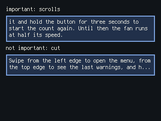
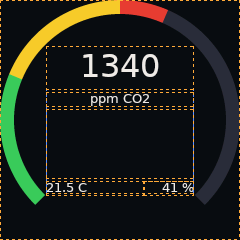

# Cookbook

*[По-русски](../ru/cookbook.md)*

This page is a collection of recipes: short pieces of code for the things an interface is made of, from a button to
a popup and touch. A recipe is a few whole pieces of C that go into a program as they are; the names it does not
define, such as `settings_save()`, are the program's own. The frame all the recipes sit in, the display, the queue
and the loop of the task that owns the tree, is written in [Getting started](getting-started.md).

- [What the recipes share](#what-the-recipes-share)
- [A row and a column that fit any screen](#a-row-and-a-column-that-fit-any-screen)
- [One message for several widgets](#one-message-for-several-widgets)
- [A clock, or anything once in a while](#a-clock-or-anything-once-in-a-while)
- [A button](#a-button)
- [A slider and a switch](#a-slider-and-a-switch)
- [A list](#a-list)
- [A dropdown](#a-dropdown)
- [An icon that shows a state](#an-icon-that-shows-a-state)
- [A picture from flash](#a-picture-from-flash)
- [A picture under the widgets](#a-picture-under-the-widgets)
- [A text of several lines](#a-text-of-several-lines)
- [A log of the last lines](#a-log-of-the-last-lines)
- [A font that fits](#a-font-that-fits)
- [A handwritten text](#a-handwritten-text)
- [Colours of your own, and a night mode](#colours-of-your-own-and-a-night-mode)
- [Showing, hiding, disabling](#showing-hiding-disabling)
- [A popup](#a-popup)
- [Pages and "back"](#pages-and-back)
- [Pages that slide](#pages-that-slide)
- [Buttons of the board](#buttons-of-the-board)
- [Touch with DGX-DI](#touch-with-dgx-di)
- [Touch woken by an interrupt](#touch-woken-by-an-interrupt)
- [A field and a keyboard](#a-field-and-a-keyboard)
- [A field edited in a strip over the keypad](#a-field-edited-in-a-strip-over-the-keypad)
- [Widgets that come and go](#widgets-that-come-and-go)
- [Large data: a message by reference](#large-data-a-message-by-reference)
- [A message from an interrupt](#a-message-from-an-interrupt)
- [A look of your own](#a-look-of-your-own)
- [A widget of your own that the finger and the keys work](#a-widget-of-your-own-that-the-finger-and-the-keys-work)
- [A picture that stays between passes](#a-picture-that-stays-between-passes)
- [A graph that sweeps](#a-graph-that-sweeps)
- [A ring scale with widgets inside](#a-ring-scale-with-widgets-inside)
- [A display of 18 or 24 bits](#a-display-of-18-or-24-bits)
- [A loop that sleeps till the next moment](#a-loop-that-sleeps-till-the-next-moment)
- [How long a pass takes](#how-long-a-pass-takes)
- [A mirror of the screen](#a-mirror-of-the-screen)
- [The tree as a layer in another compositor's strips](#the-tree-as-a-layer-in-another-compositors-strips)
- [Turning the screen](#turning-the-screen)
- [Testing an interface on the computer](#testing-an-interface-on-the-computer)

## What the recipes share

The headers, the colours and two styles of one font. Colours are indices of the table the program gives the painter;
the recipes name them.

```c
#include "dgx_draw.h"
#include "dgx_ui_paint.h"
#include "dgx_ui_post.h"
#include "dgx_ui_text.h"
#include "dgx_ui_ticker.h"
#include "esp_attr.h"
#include "esp_timer.h"
#include "fonts/DejaVuSansBook32.h"
#include "fonts/TerminusTTFMedium12.h"
#include "freertos/FreeRTOS.h"
#include "freertos/task.h"

enum { PAPER, INK, FILL, BORDER, ACCENT, ACCENT_DOWN, SHADOW, DIM, COLORS };

static dgx_ui_font_variant_t small[1];
static dgx_ui_text_style_t   st_left, st_centre;

static void styles_init(void)
{
    small[0]  = (dgx_ui_font_variant_t){.font = TerminusTTFMedium12()};
    st_left   = (dgx_ui_text_style_t){.variants = small, .count = 1, .align = DGX_FONT_ALIGN_LEFT};
    st_centre = (dgx_ui_text_style_t){.variants = small, .count = 1, .align = DGX_FONT_ALIGN_CENTER};
}
```

## A row and a column that fit any screen

A child with the flag `DGX_UI_REST` takes what its row or column has left after the others. No width is counted by
hand, and the same tree fits a screen of another width, another unit or a turned screen.

```c
static char             name_buf[16], value_buf[16], title_buf[16];
static dgx_ui_textbox_t name_box, value_box, title_box;

/* a row: the name takes what the value leaves */
static const dgx_ui_widget_t fit_row_w = {.kind = DGX_UI_BOX, .flags = DGX_UI_ROW, .want_h = 10, .gap = 4};
static const dgx_ui_widget_t name_w    = {.kind = DGX_UI_LABEL, .flags = DGX_UI_REST, .text = &name_box};
static const dgx_ui_widget_t value_w   = {.kind = DGX_UI_LABEL, .text = &value_box, .want_w = 40};

/* a column: the content takes what the title and the buttons leave, so the buttons stand at the bottom */
static const dgx_ui_widget_t page_w    = {.kind = DGX_UI_BOX, .flags = DGX_UI_COLUMN, .pad = 4, .gap = 4};
static const dgx_ui_widget_t title_w   = {.kind = DGX_UI_LABEL, .text = &title_box};
static const dgx_ui_widget_t content_w = {.kind = DGX_UI_BOX, .flags = DGX_UI_COLUMN | DGX_UI_REST, .gap = 2};
static const dgx_ui_widget_t bottom_w  = {.kind = DGX_UI_BOX, .flags = DGX_UI_ROW, .want_h = 18, .gap = 6};
```

- Several children with the flag share what is left equally.
- When nothing is left, such a child gets no size and is not seen.
- In a box that is neither a column nor a row the flag does nothing.

## One message for several widgets

A sensor sends the temperature and the humidity in one message. Two labels read it; neither claims it, so both see
it.

```c
enum { MSG_CLIMATE = 10 };
typedef struct {
    int16_t t10; /* tenths of a degree */
    uint8_t rh;  /* percent */
} climate_t;
DGX_UI_MESSAGE(climate, MSG_CLIMATE, climate_t)

static bool temp_take(dgx_ui_t *ui, int i, const dgx_ui_msg_t *msg)
{
    climate_t c;
    if (msg_decode_climate(msg, &c) == ESP_OK) dgx_ui_text_printf(ui, i, "%d.%d C", c.t10 / 10, c.t10 % 10);
    return false;
}

static bool rh_take(dgx_ui_t *ui, int i, const dgx_ui_msg_t *msg)
{
    climate_t c;
    if (msg_decode_climate(msg, &c) == ESP_OK) dgx_ui_text_printf(ui, i, "%d %%", c.rh);
    return false;
}

static dgx_ui_textbox_t      temp_box, rh_box;
static const dgx_ui_widget_t temp_w = {.kind = DGX_UI_LABEL, .text = &temp_box, .take = temp_take};
static const dgx_ui_widget_t rh_w   = {.kind = DGX_UI_LABEL, .text = &rh_box, .take = rh_take};

/* the sensor's task */
static void climate_send(QueueHandle_t queue, int t10, int rh)
{
    const climate_t c = {.t10 = (int16_t)t10, .rh = (uint8_t)rh};
    if (!msg_post_climate(queue, &c)) {
        /* the queue is full and the value is lost: the next one comes anyway */
    }
}
```

- The text is compared after it is formatted. The sensor may send 21.53, then 21.48: the label shows "21.5" both
  times and nothing is drawn.
- A type larger than 12 bytes does not compile in `DGX_UI_MESSAGE`. Larger data goes
  [by reference](#large-data-a-message-by-reference).
- A decoder is `dgx_ui_msg_copy()` with the number and the size. A message of the right number and another size is an
  error of the program, and is logged.

## A clock, or anything once in a while

A ticker sends a message of a number every so many milliseconds. Whoever wants it reads it in its `take()`.

```c
enum { MSG_MINUTE = 11 };
static dgx_ui_ticker_t minute_ticker; /* static: zeroed, and alive as long as its ticks */

static bool date_take(dgx_ui_t *ui, int i, const dgx_ui_msg_t *msg)
{
    if (msg->what != MSG_MINUTE) return false;
    const uint32_t minutes = (uint32_t)(esp_timer_get_time() / 60000000);
    dgx_ui_text_printf(ui, i, "up %u h %02u min", (unsigned)(minutes / 60), (unsigned)(minutes % 60));
    return true;
}

static bool minutes_start(QueueHandle_t queue)
{
    return dgx_ui_ticker_start(&minute_ticker, queue, MSG_MINUTE, 60 * 1000);
}
```

- The next tick is sent only after the loop called `dgx_ui_msg_done()` on the one before. A loop that forgets the call
  gets one tick and no more.
- `dgx_ui_ticker_stop()` stops it. The struct must live until its last tick was done with; a static one does.
- A ticker is the way to do slow things in time: the frames of an icon, a value that blinks. The task sleeps between
  the ticks.

## A button


A control names its look. The button's text is a text box, as a label's; `on()` is told `DGX_UI_ACTIVATED` when the
user clicked it or pressed the key of activation with the focus on it.

```c
void settings_save(void);

static char             save_buf[8];
static dgx_ui_textbox_t save_box;

static void save_on(dgx_ui_t *ui, int i, const dgx_ui_node_t *node, int what, void *ctx)
{
    if (what == DGX_UI_ACTIVATED) settings_save();
}

static const dgx_ui_widget_t save_w = {
    .kind = DGX_UI_BUTTON, .text = &save_box, .want_w = 60, .want_h = 18, .look = &dgx_ui_look_button, .on = save_on};

static int save_add(dgx_ui_t *ui, int parent)
{
    dgx_ui_textbox_init(&save_box, save_buf, sizeof save_buf, 1, &st_centre);
    const int b = dgx_ui_add(ui, parent, &save_w);
    dgx_ui_text_set(ui, b, "Save");
    return b;
}
```

- A button with a text is as high as a line of the text unless it is told: give it `want_h`, or in a row the flag
  `DGX_UI_STRETCH`, which makes it as high as the row.
- `dgx_ui_set_state(ui, b, DGX_UI_PRESSED, true)` draws it pressed and activates nothing: so a key of the board may
  show on the screen.
- `on()` may remove widgets, the button itself too: a dialog may close itself there.

## A slider and a switch

The value of a control is in its node, and `on()` gets the node: `node->state_value.value` is the value the user
set. `on()` is told `DGX_UI_CHANGED` when the user changed it: a slider at every step of the finger, a switch when
it is clicked.

```c
void backlight_set(int percent);
void wifi_enable(bool on);

static void backlight_on(dgx_ui_t *ui, int i, const dgx_ui_node_t *node, int what, void *ctx)
{
    if (what == DGX_UI_CHANGED) backlight_set(node->state_value.value);
}

static void wifi_on(dgx_ui_t *ui, int i, const dgx_ui_node_t *node, int what, void *ctx)
{
    if (what == DGX_UI_CHANGED) wifi_enable(node->state_value.value != 0);
}

/* a slider of 0..100 by 5 that starts at 70, and a switch that starts off */
static const dgx_ui_widget_t backlight_w = {
    .kind = DGX_UI_SLIDER, .min = 0, .max = 100, .step = 5, .want_h = 12, .state = {.value = 70}, .look = &dgx_ui_look_slider, .on = backlight_on};
static const dgx_ui_widget_t wifi_w = {
    .kind = DGX_UI_SWITCH, .max = 1, .want_w = 26, .want_h = 12, .look = &dgx_ui_look_switch, .on = wifi_on};

/* the value came from elsewhere: shown, and on() is not told */
static void backlight_show(dgx_ui_t *ui, int slider, int percent)
{
    dgx_ui_set_value(ui, slider, percent);
}
```

- `dgx_ui_set_value()` keeps the value within `min..max` and does not call `on()`: the program does not hear its own
  changes back.
- With the flag `DGX_UI_SWIPE` a slider moves by the way the finger goes from where it went down, not to where the
  finger is: a wide strip that is easy to hit.
- With the keys, more and less move a slider by its step and set a switch.

## A list


A list is a `DGX_UI_LIST` with the look `dgx_ui_look_list`. Its rows are the lines of its text, and one of them is
picked: the value of the list.

```c
void mode_set(int mode);

static char             mode_buf[32];
static dgx_ui_textbox_t mode_box;

static void mode_on(dgx_ui_t *ui, int i, const dgx_ui_node_t *node, int what, void *ctx)
{
    if (what == DGX_UI_ACTIVATED) mode_set(node->state_value.value); /* a row clicked, or activated by a key */
}

/* four rows of 14 points each: the rows share the height of the list */
static const dgx_ui_widget_t mode_w = {
    .kind = DGX_UI_LIST, .text = &mode_box, .min = 0, .max = 3, .want_h = 56, .look = &dgx_ui_look_list, .on = mode_on};

static int mode_add(dgx_ui_t *ui, int parent)
{
    dgx_ui_textbox_init(&mode_box, mode_buf, sizeof mode_buf, 1, &st_left);
    const int list = dgx_ui_add(ui, parent, &mode_w);
    dgx_ui_text_set(ui, list, "Auto\nHeat\nCool\nOff"); /* a row for each line */
    return list;
}
```

- **The rows** are the lines of the text, parted by `\n`. The first line is the value `min`, the next `min + 1`, up
  to `max`; a row past the last line is empty.
- **The height.** When all the rows go into the list at a line of its text each, they share its height: here 56
  points for four rows of 14. When they do not, the list shows a window of them and scrolls: as many rows at a time as
  lines of the text go into its height. The twelve months in a list 56 pixels high, in a font of 13 pixels a line,
  are four rows at a time, and a thin bar on the right edge shows where the window is among them. `step` of the widget is the least height of a row in points, for rows a finger hits; 0 is a line of the
  text.
- **The finger on a list whose rows all show.** Going down on a row picks it, and `on()` is told `DGX_UI_CHANGED`.
  Moved along the list, it takes the pick with it: the row under the finger is the one picked. Let go soon, on the
  row it went down on, it is a click: `DGX_UI_ACTIVATED`. Once it has left that row, letting go is no click. The
  top and the bottom twelfth of a row belong to no row, and a finger there picks nothing.
- **The finger on a list that scrolls.** Put down, it picks nothing. Moved up or down half a row, it moves the
  pick, a row for each row's height it goes, up going on down the list, and the window follows the pick. Let go
  without having moved, it is a click on the row under it: the row is picked, and `on()` is told `DGX_UI_CHANGED`
  and `DGX_UI_ACTIVATED`.
- **The keys.** Next and previous move the pick through the rows first, `DGX_UI_CHANGED` at each, the window
  following it, and from the last row the focus goes on to the next widget. The key that activates tells
  `DGX_UI_ACTIVATED`.
- **The window** always holds the pick after the pick changed, by a key, a finger or `dgx_ui_set_value()`.
  `dgx_ui_text_scroll(ui, list, rows)` moves the window alone, the pick staying where it is, for a scroll bar of
  the program's own.
- **The picked row** lies on a bar, of another colour while the list has the focus. When the pick moves, two rows
  of the display are written: the one it left and the one it came to. A list that scrolls is written whole when its
  window moves after the pick.
- **Colours of your own** are a `dgx_ui_list_look_t` in a look drawn by `dgx_ui_draw_list`, as in
  [Colours of your own](#colours-of-your-own-and-a-night-mode).

## A dropdown


A dropdown is a `DGX_UI_DROPDOWN` with the look `dgx_ui_look_dropdown`: a button that shows the option chosen. Its
options are the lines of its text, as the rows of a list, and its value is the option chosen. The list itself is a
popup, which the program opens with one call when the dropdown is clicked.

Take a fan with the speeds Low, Medium and High, at Low now:

1. The dropdown shows "Low"; its value is 0. The user clicks it. Its `on()` is told `DGX_UI_ACTIVATED` and calls
   `dgx_ui_dropdown_open()`: the list opens under the dropdown, three rows as high as the dropdown, "Low" on the
   bar.
2. The user taps "High". The value of the dropdown becomes 2, its `on()` is told `DGX_UI_CHANGED`, the list closes
   and the dropdown shows "High".
3. Had the user tapped outside the list, it would have closed with the value still 0 and `on()` told nothing. The
   same for a tap on "Low", the option it had.

```c
#include "dgx_ui_dropdown.h"

void fan_set(int speed);

static char              fan_buf[32];
static dgx_ui_textbox_t  fan_box;
static dgx_ui_dropdown_t fan_list; /* the popup of the list: one serves every dropdown of the program */

static void fan_on(dgx_ui_t *ui, int i, const dgx_ui_node_t *node, int what, void *ctx)
{
    if (what == DGX_UI_ACTIVATED) dgx_ui_dropdown_open(ui, i, &fan_list, NULL, NULL); /* clicked: its list opens */
    if (what == DGX_UI_CHANGED) fan_set(node->state_value.value);                     /* the user chose an option */
}

static const dgx_ui_widget_t fan_w = {
    .kind = DGX_UI_DROPDOWN, .text = &fan_box, .min = 0, .max = 2, .want_h = 16, .look = &dgx_ui_look_dropdown, .on = fan_on};

static int fan_add(dgx_ui_t *ui, int parent)
{
    dgx_ui_textbox_init(&fan_box, fan_buf, sizeof fan_buf, 1, &st_left);
    const int fan = dgx_ui_add(ui, parent, &fan_w);
    dgx_ui_text_set(ui, fan, "Low\nMedium\nHigh"); /* an option for each line */
    return fan;
}
```

- **Where the list stands.** Under the dropdown and as wide as it; above it when the screen has no room below;
  else moved up so that it fits the screen, lying over the dropdown.
- **The rows** are as high as the dropdown, and never lower than a line of the text: a dropdown sized for a finger
  has rows a finger hits. More options than the whole screen takes rows, and the list scrolls: it stands in the
  larger of the two rooms, under the dropdown or above it, as many rows as go into it, its window at the option
  chosen, and never lies over the dropdown.
- **The keys.** The key that activates, on the dropdown, tells `DGX_UI_ACTIVATED` as a click does. In the list,
  next and previous move the pick and the key that activates chooses. The list is modal, so the keys stay in it.
  The key "back" closes the list, the value kept: the library does it, `dgx_ui_key()` returns `true`, and the
  program is not given that key while the list is open.
- **A finger moved along the list** takes the bar with it and, let go, chooses nothing: the list stays open, and a
  tap chooses.
- **`dgx_ui_dropdown_t`** is the popup of the list, 264 bytes of the program's RAM on a 32-bit chip, zeroed before
  its first use as a `static` is. One list is open at a time, so one serves every dropdown.
- **The looks** of the popup are the last two arguments, its frame and its list; `NULL` is the library's.
- **The tree knows its screen before the first list opens**: the list is placed on the screen the tree was laid
  for. The painter tells it at the first pass, or the program by `dgx_ui_screen()`; before that
  `dgx_ui_dropdown_open()` returns `false` and opens nothing.
- **While the list is open** the program may set the options, as a message may bring them: the list shows them at
  once, its window kept. It does not remove the dropdown: it closes the list first.
- A program that wants another list, a whole screen of choices, opens a popup of its own on `DGX_UI_ACTIVATED`
  instead.

## An icon that shows a state

An icon is a widget of one size whose picture is picked by its value. A value outside `min..max` shows no picture, and
the widget keeps its place, so nothing around it moves when the icon comes and goes.

```c
/* 8x8, 1 bit: rows from a new byte, the leftmost pixel in the high bit */
static const uint8_t      bars1[8] = {0x00, 0x00, 0x00, 0x00, 0x00, 0x00, 0x80, 0x80};
static const uint8_t      bars2[8] = {0x00, 0x00, 0x00, 0x00, 0x20, 0x20, 0xA0, 0xA0};
static const uint8_t      bars3[8] = {0x00, 0x00, 0x08, 0x08, 0x28, 0x28, 0xA8, 0xA8};
static const uint8_t      bars4[8] = {0x02, 0x02, 0x0A, 0x0A, 0x2A, 0x2A, 0xAA, 0xAA};
static const dgx_image_t  signal_im[4] = {
    {.width = 8, .height = 8, .format = DGX_IMAGE_1BPP, .data = bars1},
    {.width = 8, .height = 8, .format = DGX_IMAGE_1BPP, .data = bars2},
    {.width = 8, .height = 8, .format = DGX_IMAGE_1BPP, .data = bars3},
    {.width = 8, .height = 8, .format = DGX_IMAGE_1BPP, .data = bars4},
};
static const dgx_ui_picture_t signal_pic[4] = {
    {.image = &signal_im[0]}, {.image = &signal_im[1]}, {.image = &signal_im[2]}, {.image = &signal_im[3]}};

enum { MSG_SIGNAL = 12 };
typedef struct {
    int8_t bars; /* 1..4; 0: no network */
} signal_t;
DGX_UI_MESSAGE(signal, MSG_SIGNAL, signal_t)

static bool signal_take(dgx_ui_t *ui, int i, const dgx_ui_msg_t *msg)
{
    signal_t s;
    if (msg_decode_signal(msg, &s) == ESP_OK) dgx_ui_set_value(ui, i, s.bars);
    return false;
}

/* the pictures of the values 1..4; 0 is outside and shows none */
static const dgx_ui_widget_t signal_w = {
    .kind = DGX_UI_ICON, .picture = signal_pic, .min = 1, .max = 4, .look = &dgx_ui_look_picture, .take = signal_take};
```

The size of the widget is the size of the first picture. The picture is drawn opaque: its ink and its paper are both
written, so an icon drawn again over itself does not blink.

## A picture from flash

A picture of 1 bit is a `dgx_image_t` of DGX with the look `dgx_ui_look_picture`, as the icon above; its ink is a
colour of the table. A picture of colours is rows of RGB565 with the look `dgx_ui_look_rgb565`:

```c
extern const uint16_t logo_pixels[64 * 32]; /* rows of RGB565, high byte first */

static const dgx_ui_picture_t logo_pic = {.rgb565 = logo_pixels, .width = 64, .height = 32};
static const dgx_ui_widget_t  logo_w   = {.kind = DGX_UI_PICTURE, .picture = &logo_pic, .look = &dgx_ui_look_rgb565};
```

- The look of RGB565 needs `CONFIG_DGX_ENABLE_VSCREEN=y` and a 16-bit screen. On another screen the widget is
  paper.
- The painter makes one small screen object for such pictures at the first need.
  `dgx_ui_paint_free(&paint)` gives it back when the program stops painting.

A picture of several colours of the table is a `dgx_image_t` of 4 or 8 bits with the look `dgx_ui_look_indexed`.
Its values are not colours but numbers, and its map says which colour of the painter's table each number is:

```c
/* a battery of 12 by 6, 4 bits a pixel: a hex digit is a pixel, 0 a hole that shows the paper */
static const uint8_t battery_px[6 * 6] = {
    0x11, 0x11, 0x11, 0x11, 0x11, 0x00,
    0x12, 0x22, 0x23, 0x33, 0x31, 0x10,
    0x12, 0x22, 0x23, 0x33, 0x31, 0x10,
    0x12, 0x22, 0x23, 0x33, 0x31, 0x10,
    0x12, 0x22, 0x23, 0x33, 0x31, 0x10,
    0x11, 0x11, 0x11, 0x11, 0x11, 0x00,
};
static const dgx_image_t battery_im = {.width = 12, .height = 6, .format = DGX_IMAGE_4BPP, .data = battery_px};
/* the colours of the values 1, 2, 3: the case, the charge, the rest; the same data with another map when it is low */
static const uint8_t          battery_ok[15]  = {INK, ACCENT, FILL};
static const uint8_t          battery_low[15] = {INK, ACCENT_DOWN, FILL};
static const dgx_ui_picture_t battery_pics[2] = {{.image = &battery_im, .map = battery_ok}, {.image = &battery_im, .map = battery_low}};
static const dgx_ui_widget_t  battery_w = {
    .kind = DGX_UI_ICON, .picture = battery_pics, .min = 0, .max = 1, .want_w = 14, .want_h = 8, .look = &dgx_ui_look_indexed};

/* the painter's buffer: such a picture is drawn in it a strip of its rows at a time, a byte a pixel */
static uint8_t paint_buffer[256];

static void paint_buffer_give(dgx_ui_paint_t *paint)
{
    paint->buffer = paint_buffer, paint->buffer_size = sizeof paint_buffer;
}
```

- **The values** go through the picture's `map` to indices of the painter's table: the value 1 is `map[0]`, the
  value 2 `map[1]`. Without a map the value itself is the index. A pixel 0 is a hole: the paper shows.
- **The same data in other colours** is another map: the battery above is one picture and two maps, an icon of two
  states.
- **The buffer.** The painter draws such a picture in memory the program gives it, `buffer` and `buffer_size` of
  the paint, a strip of the picture's rows at a time, and sends each strip through the table: every pixel of the
  widget is written once. A row of the widest picture, a byte a pixel, is enough; with more the strips are higher
  and fewer. With no buffer, or one smaller than a row, the widget is paper and the log says so once.
- It needs `CONFIG_DGX_ENABLE_VSCREEN=y` and a 16-bit screen. On a display of 18 or 24 bits such a picture is paper.
- The painter keeps a small screen object and a table of 512 bytes for such pictures from the first one on;
  `dgx_ui_paint_free(&paint)` gives them back.
- A picture of 1 bit is drawn by this look as well, so an icon whose pictures are of different depths names it. A
  program that has pictures of 1 bit only names `dgx_ui_look_picture` and carries none of this.

## A picture under the widgets


The background of a tree is a colour, or a picture the program draws. The program gives the painter a function that
puts a rectangle of its picture on the screen, and every widget whose paper is "what lies under me" shows the
picture there. Take a weather map with a column of labels over it, the wind at "5 m/s":

1. The painter draws the label. Its look lays the map's piece of its box by the program's function and writes the
   letters over it with no field around them: the map shows between the letters.
2. The wind becomes "6 m/s". With the strips named, the piece of the map and the new letters are put together in the
   buffer and go to the display once. The label does not blink.
3. The program swaps the map for the one with rain and tells the painter where the picture changed. The painter lays
   the new map there at once, wherever it shows, and draws the labels again over it. Under the frame of the
   temperature nothing is written: a frame fills, and the map does not show through it.

```c
#include "dgx_vscreen.h"

extern const uint16_t map_pixels[320 * 240]; /* the map, as large as the screen: rows of RGB565, high byte first */
extern const uint16_t rain_pixels[320 * 240];

static dgx_screen_t *map_screen;               /* a virtual screen over the map's pixels: made once */
static uint8_t       map_buffer[320 * 2 * 8];  /* eight rows of 16 bits: what lies on the map goes out through it */

/* the program's function: the piece x, y, w, h of the map put where the painter draws */
static void map_draw(dgx_ui_paint_t *paint, int x, int y, int w, int h, void *ctx)
{
    dgx_vscreen_region_to_screen(paint->scr, x - paint->ox, y - paint->oy, ctx, x, y, w, h, 0);
}

/* at the start, before the first pass */
static bool map_under(dgx_ui_paint_t *paint)
{
    map_screen = dgx_vscreen_from_array((void *)map_pixels, 320, 240, 16, DgxScreenRGB);
    if (!map_screen) return false;
    dgx_ui_background_set(paint, map_draw, map_screen);
    paint->buffer = map_buffer, paint->buffer_size = sizeof map_buffer, paint->strips = &dgx_ui_strips;
    return true;
}

/* another map: the same screen pointed at other pixels, and the painter told where the picture changed */
static void map_rain(dgx_ui_t *ui, dgx_ui_paint_t *paint)
{
    dgx_vscreen_array_set(map_screen, (void *)rain_pixels, 320, 240);
    dgx_ui_background_changed(ui, paint, 0, 0, 320, 240);
}
```

- **The function** puts the rectangle `x, y, w, h` of the tree's screen on `paint->scr` at `x - paint->ox`,
  `y - paint->oy`. The painter has set the clip to the rectangle, so a function that draws more than it was asked
  harms nothing. The screen is the display, or a strip of the buffer of the display's depth: on a display of 18 or
  24 bits the picture must be of that depth.
- **`dgx_ui_background_set()`** gives the function and what it is called with. `NULL` takes the picture away; then
  `dgx_ui_redraw(ui, 0)` draws the tree on the colour again. A function written into the paint by hand is not
  called: the call is what brings the laying of a picture into the program.
- **What shows the picture**: a label and a text of lines between their letters, a button around its face, a slider
  around its track, a picture of 1 bit and one of 4 or 8 bits in their holes, a box everywhere. **What does not**: a
  frame and everything in it, as it fills; a look whose parameters name a paper of their own.
- **Name the strips** with a picture on a display behind a bus, of 16 bits too. Drawn straight, a label over the
  picture is written twice, the map and then the letters, and blinks; and the soft edges of its letters, which
  cannot read the display, are mixed with the colour `background`. Through the strips it goes out once and the edges
  mix with the map. The buffer holds a row of the widest such widget at least, its width times 2 bytes at 16 bits.
- **`background`** stays the colour a look is told where it cannot lay the picture. Give it the picture's main
  colour.
- **`dgx_ui_background_changed()`** draws at once and keeps nothing: the picture where it shows in the rectangle,
  then the widgets on it. A game with a dialog over its frame calls it for each piece of the frame that changed,
  where it sent the piece to the display before; inside one batch of DGX the pieces go out together.
- **What it costs**: about 0.5 KB of dgx-ui for the program that calls `dgx_ui_background_set()`, and what its own
  function brings of DGX. A program with a colour for a background carries none of it.

## A text of several lines



The look `dgx_ui_look_lines` lays a text into the lines of its box, word by word. The box says how many lines it
shows; the style says what happens to a text too long.

```c
static char                news_buf[200], hint_buf[120];
static dgx_ui_textbox_t    news_box, hint_box;
static dgx_ui_text_style_t st_important;

static const dgx_ui_widget_t news_w = {.kind = DGX_UI_LABEL, .text = &news_box, .look = &dgx_ui_look_lines};
static const dgx_ui_widget_t hint_w = {.kind = DGX_UI_LABEL, .text = &hint_box, .look = &dgx_ui_look_lines};

static void texts_add(dgx_ui_t *ui, int parent)
{
    /* an important text too long scrolls a line up every 2 s; one that is not is cut with an ellipsis */
    st_important = (dgx_ui_text_style_t){.variants = small, .count = 1, .flags = DGX_UI_TEXT_IMPORTANT, .scroll_ms = 2000};
    dgx_ui_textbox_init(&news_box, news_buf, sizeof news_buf, 3, &st_important);
    dgx_ui_textbox_init(&hint_box, hint_buf, sizeof hint_buf, 2, &st_left);
    const int news = dgx_ui_add(ui, parent, &news_w);
    const int hint = dgx_ui_add(ui, parent, &hint_w);
    dgx_ui_text_set(ui, news, "The filter has worked for 2000 hours. Replace it and hold the button for three seconds.");
    dgx_ui_text_set(ui, hint, "Swipe from the left edge to open the menu.");
    dgx_ui_text_appear(ui, hint, 30); /* its letters come one by one, 30 ms each */
}
```

- While a text scrolls or its letters come, `dgx_ui_paint()` returns `true` and the loop keeps coming back. When the
  text reached its end and all letters came, it asks no more.
- A new text starts from its first line, and appears again if it was told to.
- `dgx_ui_text_scroll(ui, i, 1)` moves a text that is not important a line up by hand, `-1` a line down.
- A word wider than the line is cut by its letters; `\n` ends a line.
- A program that names this look carries about 2.5 KB more code; a program of one-line labels does not.

## A log of the last lines

A log shows the last lines that came: a new line is added at the bottom, and when there is no room the oldest go.
The look of lines draws the window; the program keeps the lines.

```c
#include <string.h>

enum { LOG_ROWS = 5 };

static char             log_lines[240]; /* the last lines of the log, "\n" between them */
static char             log_buf[sizeof log_lines];
static dgx_ui_textbox_t log_box;

static const dgx_ui_widget_t log_w = {.kind = DGX_UI_LABEL, .text = &log_box, .look = &dgx_ui_look_lines};

static int log_make(dgx_ui_t *ui, int parent)
{
    dgx_ui_textbox_init(&log_box, log_buf, sizeof log_buf, LOG_ROWS, &st_left);
    return dgx_ui_add(ui, parent, &log_w);
}

/* a line added at the end of the log; the oldest lines go when the new one has no room */
static void log_add(dgx_ui_t *ui, int log, const char *line)
{
    const size_t room = sizeof log_lines - 1;
    size_t       have = strlen(log_lines), length = strlen(line);
    if (length > room) { /* longer than the whole log: its beginning, cut on a whole letter of UTF-8 */
        length = room;
        while (length > 0 && ((unsigned char)line[length] & 0xC0) == 0x80) --length;
    }
    while (have > 0 && have + 1 + length > room) { /* the oldest line goes, with its "\n" */
        const char  *line_end = strchr(log_lines, '\n');
        const size_t gone     = line_end ? (size_t)(line_end + 1 - log_lines) : have;
        memmove(log_lines, log_lines + gone, have - gone + 1);
        have -= gone;
    }
    if (have > 0) log_lines[have++] = '\n';
    memcpy(log_lines + have, line, length);
    log_lines[have + length] = 0;
    dgx_ui_text_set(ui, log, log_lines);
    dgx_ui_text_scroll(ui, log, 0x7fff); /* down to the last lines: the painter stops at the last window */
}
```

- `dgx_ui_text_set()` begins a text from its first line. `dgx_ui_text_scroll()` with a number larger than any count
  of rows then moves it down as far as there are rows, so the last `LOG_ROWS` rows are shown, however many rows a
  long line took when it was laid into the box.
- To look back, `dgx_ui_text_scroll(ui, log, -1)` shows a row older, as far as the lines kept go. The next line
  added brings the end back.
- The lines are kept twice, in `log_lines` and in the buffer of the text box: `dgx_ui_text_set()` copies the text it
  is given into the buffer, so the lines cannot be kept in the buffer itself. 240 bytes hold about ten lines of 20
  letters.
- A line longer than the whole log is cut on a whole letter and stands alone in it.
- `log_add()` is called by the task that owns the tree. Another task sends its line as a message, as in
  [Large data: a message by reference](#large-data-a-message-by-reference).

## A font that fits

A style lists the fonts a text may be drawn in, the best first. The painter takes the first the text goes into whole,
else the one that shows the most letters. The name of a city goes in the large font when it is short and in the
small one when it is long.

```c
static dgx_ui_font_variant_t city_fonts[2];
static dgx_ui_text_style_t   st_city;

static void city_style_init(void)
{
    city_fonts[0] = (dgx_ui_font_variant_t){.font = DejaVuSansBook32()};
    city_fonts[1] = (dgx_ui_font_variant_t){.font = TerminusTTFMedium12()};
    st_city = (dgx_ui_text_style_t){.variants = city_fonts, .count = 2, .align = DGX_FONT_ALIGN_CENTER, .flags = DGX_UI_TEXT_MIDDLE};
}
```

- The height of a label is the line of its first font, so the label keeps its size whichever font is taken.
- A smaller font stands on the base line of the first one. With `DGX_UI_TEXT_MIDDLE` it stands in the middle of the
  height.
- The fonts are those of DGX, of bitmaps and of dots. Such a font is not scaled. A handwritten font is written at
  any height: the next recipe.

## A handwritten text

DGX has handwritten fonts: their letters are strokes, written by a pen at any height. A variant of such a font names
the library's handwriting, `&dgx_ui_handwriting`, and the one-line look of a text writes it. A program that names
none carries none of it.

Here a greeting in DGX's `font0ss`: 32 pixels high when it goes in, narrowed when it nearly does, 20 pixels high when
it is long, and in a bitmap font when it is longer still.

```c
#include "dgx_hw_font.h"
#include "fonts/font0ss.h"

static dgx_ui_font_variant_t greeting_fonts[3];
static dgx_ui_text_style_t   greeting_style;
static char                  greeting_text[64];
static dgx_ui_textbox_t      greeting_box;

static void greeting_init(void)
{
    /* DGX's handwritten face at two heights, then a bitmap font for a text too long even so */
    greeting_fonts[0] = (dgx_ui_font_variant_t){.font = font0ss(), .height = 32, .narrow = 70, .joined = true, .pen = 2, .hand = &dgx_ui_handwriting};
    greeting_fonts[1] = (dgx_ui_font_variant_t){.font = font0ss(), .height = 20, .narrow = 70, .joined = true, .pen = 1, .hand = &dgx_ui_handwriting};
    greeting_fonts[2] = (dgx_ui_font_variant_t){.font = TerminusTTFMedium12()};
    greeting_style    = (dgx_ui_text_style_t){.variants = greeting_fonts, .count = 3, .align = DGX_FONT_ALIGN_LEFT};
    dgx_ui_textbox_init(&greeting_box, greeting_text, sizeof greeting_text, 1, &greeting_style);
}

static const dgx_ui_widget_t greeting_w = {.kind = DGX_UI_LABEL, .text = &greeting_box};

/* a new text, written by the pen: all of it in as long as its letters at 60 ms each */
static void greeting_say(dgx_ui_t *ui, int greeting, const char *text)
{
    dgx_ui_text_set(ui, greeting, text);
    dgx_ui_text_appear(ui, greeting, 60);
}
```

What happens in a label 200 pixels wide:

1. `"Hello"` is 50 pixels wide at the height of 32: the first variant, as it is.
2. `"Good afternoon to you"` is 213 pixels: too wide. `narrow = 70` lets the letters be narrowed across down to 70%
   of their width. The narrowing goes in whole percents, and the widest that goes in is taken. The height stays, and
   the pen keeps its width.
3. `"Good afternoon, dear guests of the house"` is 390 pixels, too wide even at 70%: the second variant, 20 pixels
   high. It stands on the base line of the first, so the text does not jump beside its neighbours.
4. `"Good afternoon, dear guests of the house on the hill"` does not go in at 20 pixels either: the bitmap font, cut
   with an ellipsis, on the same base line. Without that last variant the handwriting would be taken and cut by the
   label's rectangle at its end, with no ellipsis.
5. `greeting_say(ui, greeting, "Hello")`: the text is written stroke by stroke, all of it in as long as its five
   letters at 60 ms each, 300 ms. While it is written the look asks for a pass every `DGX_UI_HAND_FRAME_MS`, 20 ms,
   and the loop sleeps between them (`dgx_ui_wake()`). A pass writes only the strokes that are new. A pass that comes
   sooner, for another widget, writes on to its own time. A text set while another is being written is begun again.

What the variant says:

- **`height`** is the line in pixels, and the height of the label when the variant is the first of its style.
- **`narrow`** is how far across the letters may be narrowed, in percent; 0: never.
- **`joined`**: the letters joined, as in handwriting.
- **`pen`** is the width of the pen in pixels; 0 is a hairline.
- **Which looks write it.** The one-line look, that is a label, and `dgx_ui_look_hand_lines` for several lines,
  below. In a button, a field, a list and `dgx_ui_look_lines` a handwritten variant is passed over.
- **What it costs.** Named by a variant: about 31 KB, of which the font `font0ss` is 17.8 KB, DGX's pen 10 KB and
  dgx-ui 1.6 KB. Not named: about 100 bytes. A variant is 16 bytes, handwritten or not.
- **The time of a pass.** The pen keeps nothing between passes: each pass goes over the strokes already written
  without drawing them, then writes the new ones. On an ESP32 at 240 MHz with a display of 320 by 240 on SPI a pass
  takes 5 to 9 ms while a line of 12 to 30 letters is written at 24 pixels, under 3 ms of it for the strokes gone
  over. All of the label drawn again would take 23 to 41 ms.

A soft pen has edges that fade, and needs a place that keeps the amounts of its ink: the canvas of a widget. The
variant names `&dgx_ui_handwriting_canvas`, and the label has the flag `DGX_UI_CANVAS`:

```c
static dgx_ui_font_variant_t signature_fonts[1];
static dgx_ui_text_style_t   signature_style;
static char                  signature_text[24];
static dgx_ui_textbox_t      signature_box;

static void signature_init(void)
{
    signature_fonts[0] = (dgx_ui_font_variant_t){.font = font0ss(), .height = 32, .pen = 3 | DGX_PEN_SOFT, .hand = &dgx_ui_handwriting_canvas};
    signature_style    = (dgx_ui_text_style_t){.variants = signature_fonts, .count = 1, .align = DGX_FONT_ALIGN_LEFT};
    dgx_ui_textbox_init(&signature_box, signature_text, sizeof signature_text, 1, &signature_style);
}

/* the canvas of the label holds the amounts of ink: a byte of RAM for each of its pixels */
static const dgx_ui_widget_t signature_w = {.kind = DGX_UI_LABEL, .flags = DGX_UI_CANVAS, .text = &signature_box, .want_w = 120};
```

The canvas needs `CONFIG_DGX_ENABLE_VSCREEN=y` and a display of 16 bits. Written straight, by `&dgx_ui_handwriting`, a
soft pen is the hard pen of its width, and the log says so once. A program that names only `&dgx_ui_handwriting`
carries no canvas.

### In several lines

A text of several lines in handwriting names a look of its own, `dgx_ui_look_hand_lines`. Its variants name the
handwriting as a label's do.

```c
static dgx_ui_font_variant_t note_fonts[2];
static dgx_ui_text_style_t   note_style;
static char                  note_text[200];
static dgx_ui_textbox_t      note_box;

static void note_init(void)
{
    /* the hand at 20 pixels, then a bitmap font for a note too long for its lines */
    note_fonts[0] = (dgx_ui_font_variant_t){.font = font0ss(), .height = 20, .joined = true, .pen = 1, .hand = &dgx_ui_handwriting};
    note_fonts[1] = (dgx_ui_font_variant_t){.font = TerminusTTFMedium12()};
    note_style    = (dgx_ui_text_style_t){.variants = note_fonts, .count = 2, .align = DGX_FONT_ALIGN_LEFT};
    dgx_ui_textbox_init(&note_box, note_text, sizeof note_text, 3, &note_style); /* three lines */
}

static const dgx_ui_widget_t note_w = {.kind = DGX_UI_LABEL, .text = &note_box, .look = &dgx_ui_look_hand_lines};
```

What happens in a note 200 pixels wide and three lines high:

1. `"The quick brown fox jumps over the lazy dog and runs on and on"` is laid into lines word by word at the height
   of 20, not narrowed: two lines.
2. With `dgx_ui_text_appear(ui, note, 40)` it is written line after line, stroke by stroke. A pass every 20 ms writes
   only the new strokes of the line being written; the lines done are not touched.
3. A note too long for three lines at 20 pixels takes the bitmap font, which is drawn as `dgx_ui_look_lines` draws
   it, its first line on the base line the hand would have.
4. With the hand alone in the style, a note too long is cut, and its last line ends in `...` in the same hand. With
   `DGX_UI_TEXT_IMPORTANT` and a `scroll_ms` in the style it scrolls a line up every `scroll_ms` once all its letters
   came.

What to know of it:

- **The widget names the look.** `dgx_ui_look_lines` passes a handwritten variant over, as before, so a program of
  bitmap lines carries no handwriting, and a program of handwritten labels of one line carries no lines.
- **Not narrowed.** `narrow` is for one line; in lines the list of variants fits the text.
- **What is kept.** The paint keeps the line breaks of the text and each line's amount of writing for the widget: 12
  bytes and 8 a line, 36 bytes for three lines. So a pass costs the line being written, whatever the length of the
  text. They are laid again when the text, the width or the variant changes, and freed when the widget goes.
  Without memory for them the lines are laid at every pass, which is slower and no error.
- **The time of a pass.** On an ESP32 at 240 MHz with a display of 320 by 240 on SPI, at 20 pixels with a pen of 2:
  a pass while letters come takes 7 to 12 ms for a text of 58 letters in two lines and of 101 letters in three.
  Laid at every pass, with no memory for the line breaks, it takes 45 and 80 ms, more than the frame of 20 ms. The
  first pass after a new text, which lays the paper and the lines, takes 40 to 130 ms, and a scroll step, which
  draws the box whole, about 80 ms. With the code of DGX's handwritten fonts in RAM, `CONFIG_DGX_HW_FONT_IN_IRAM=y`,
  6 KB of IRAM, a pass takes 5 to 7 ms.
- **A soft pen** is as for one line: `&dgx_ui_handwriting_canvas` in the variant and `DGX_UI_CANVAS` on the widget.
- **What it costs.** About 3.9 KB for the look, with the look of lines, 2.9 KB, and the paint's table, 0.7 KB, over
  what handwriting costs.

## Colours of your own, and a night mode

The looks of the library have parameters: which colour of the table is the face, the text, the shadow. A look in
other colours is the library's drawing with parameters of its own. It is a constant and lies in flash:

```c
static const dgx_ui_button_look_t blue_button = {
    .face = ACCENT, .pressed = ACCENT_DOWN, .focused = ACCENT_DOWN, .disabled = FILL,
    .text = INK, .text_disabled = DIM, .shadow = SHADOW, .depth = 1};
/* the library's drawing of a button, in these colours */
static const dgx_ui_look_t look_blue_button = {.draw = dgx_ui_draw_button, .params = &blue_button, .fill = -1};

static const dgx_ui_widget_t ok_w = {.kind = DGX_UI_BUTTON, .want_w = 60, .want_h = 18, .look = &look_blue_button};
```

A night mode is another table of the same colours. The painter is given it, and the root is drawn whole:

```c
static void colors_set(dgx_ui_t *ui, dgx_ui_paint_t *paint, const uint32_t *table)
{
    paint->colors = table;
    dgx_ui_redraw(ui, 0); /* the root whole, and with it everything under it */
}
```

A table is filled for the screen by `dgx_screen_rgb(scr, r, g, b)`, as in [Getting started](getting-started.md).

## Showing, hiding, disabling

```c
static void advanced_show(dgx_ui_t *ui, int box, int button, bool expert)
{
    dgx_ui_show(ui, box, expert);                           /* hidden, it takes no place: the rest moves up */
    dgx_ui_set_state(ui, button, DGX_UI_DISABLED, !expert); /* stays where it is, drawn dim, takes no finger */
}
```

- A hidden widget still gets the messages, so it is fresh when it is shown.
- Hiding or disabling a widget takes the focus off it and ends a press of the finger on it.
- To make something come and go without moving its neighbours, do not hide it: use
  [an icon](#an-icon-that-shows-a-state) with a value that shows none, or a label with an empty text.

## A popup


A popup is a tree of its own: its own nodes, its own root, the same widgets and looks. It is opened over a tree in a
rectangle of the screen.

```c
static char             ask_buf[32], yes_buf[8], no_buf[8];
static dgx_ui_textbox_t ask_box, yes_box, no_box;
static dgx_ui_node_t    ask_nodes[6];
static dgx_ui_t         ask_ui;
static dgx_ui_t        *ask_over; /* the tree it is open over */

static void yes_on(dgx_ui_t *popup, int i, const dgx_ui_node_t *node, int what, void *ctx)
{
    if (what != DGX_UI_ACTIVATED) return;
    settings_save();
    dgx_ui_popup_close(ask_over);
}

static void no_on(dgx_ui_t *popup, int i, const dgx_ui_node_t *node, int what, void *ctx)
{
    if (what == DGX_UI_ACTIVATED) dgx_ui_popup_close(ask_over);
}

static const dgx_ui_widget_t ask_root_w = {.kind = DGX_UI_FRAME, .flags = DGX_UI_COLUMN, .pad = 5, .gap = 5};
static const dgx_ui_widget_t ask_w      = {.kind = DGX_UI_LABEL, .text = &ask_box, .want_h = 12};
static const dgx_ui_widget_t ask_row_w  = {.kind = DGX_UI_BOX, .flags = DGX_UI_ROW, .want_h = 18, .gap = 6};
/* the two buttons share the row: as high as it (STRETCH), each a half of what it has (REST) */
static const dgx_ui_widget_t yes_w = {
    .kind = DGX_UI_BUTTON, .flags = DGX_UI_STRETCH | DGX_UI_REST, .text = &yes_box, .look = &dgx_ui_look_button, .on = yes_on};
static const dgx_ui_widget_t no_w = {
    .kind = DGX_UI_BUTTON, .flags = DGX_UI_STRETCH | DGX_UI_REST, .text = &no_box, .look = &dgx_ui_look_button, .on = no_on};

static void ask_open(dgx_ui_t *ui)
{
    dgx_ui_textbox_init(&ask_box, ask_buf, sizeof ask_buf, 1, &st_centre);
    dgx_ui_textbox_init(&yes_box, yes_buf, sizeof yes_buf, 1, &st_centre);
    dgx_ui_textbox_init(&no_box, no_buf, sizeof no_buf, 1, &st_centre);
    dgx_ui_init(&ask_ui, ask_nodes, 6, 2);
    const int root = dgx_ui_add(&ask_ui, -1, &ask_root_w);
    dgx_ui_text_set(&ask_ui, dgx_ui_add(&ask_ui, root, &ask_w), "Save the settings?");
    const int row = dgx_ui_add(&ask_ui, root, &ask_row_w);
    dgx_ui_text_set(&ask_ui, dgx_ui_add(&ask_ui, row, &yes_w), "Yes");
    dgx_ui_text_set(&ask_ui, dgx_ui_add(&ask_ui, row, &no_w), "No");
    ask_over = ui;
    dgx_ui_popup_open(ui, &ask_ui, 50, 70, 220, 92, DGX_UI_POPUP_MODAL); /* pixels of the screen */
}
```

- The program goes on calling `dgx_ui_take()`, `dgx_ui_pointer()`, `dgx_ui_key()` and `dgx_ui_paint()` with the tree
  under the popup; they go to the popup by themselves.
- A modal popup takes every finger and key. The key "back" no widget takes, so the program may close the popup on
  it; a popup opened with `DGX_UI_POPUP_BACK` is closed by that key itself, as a page is.
- With `DGX_UI_POPUP_CLOSE_OUTSIDE` a finger that goes down outside the popup closes it: so a list of choices
  behaves.
- When the popup closes, the painter draws the tree again where it lay.
- The rectangle is in pixels of the screen as it stands. When the screen is turned, close the popup, or open it again
  in the new pixels.

A popup is a tree, so a popup may be opened over it in turn: a question over a dialog, a list of choices that hangs
out of it.

```c
static dgx_ui_node_t sure_nodes[6];
static dgx_ui_t      sure_ui; /* built as ask_ui above: a frame, a label, two buttons */

/* a second popup, over the first: it is opened over the popup's own tree */
static bool sure_open(void)
{
    return dgx_ui_popup_open(&ask_ui, &sure_ui, 80, 110, 200, 80, DGX_UI_POPUP_MODAL);
}
```

- Up to `DGX_UI_POPUP_DEPTH`, 8, popups stand one over another; `dgx_ui_popup_open()` returns `false` for the ninth,
  and for a tree that is already open as a popup.
- The finger and the keys go to the top popup first. A finger on the part of an upper popup that hangs out of the
  lower one is the upper one's.
- `dgx_ui_popup_close(ui)` closes the popup of that tree and every popup over it.

## Pages and "back"

A page is a popup that lies on the whole screen and is closed by the key back. `dgx_ui_page_open()` opens one over
the page on top, `dgx_ui_page_back()` closes the top one. Take a clock with a page of settings and, from it, a page
"about":

1. The clock is the first tree. The user presses its button: `dgx_ui_page_open()` opens the settings' tree over it,
   the whole screen, modal. The clock is not drawn any more, and the finger and the keys go to the settings.
2. A value of the sensor comes while the settings show. The message is offered to every tree, so the clock's label
   takes it, under the page.
3. From the settings the user opens "about": a second page over the first.
4. Back, the key or the page's own button, closes the page on top: the settings show again. Back once more: the root
   of the settings is told `DGX_UI_BACK`, the program saves what the page holds, and the page is closed: the clock,
   with the value that came in step 2.
5. Back on the clock: nothing is open, `dgx_ui_key()` returns `false`, and the key is the program's.

```c
void settings_save(void); /* the program's */

/* a page is a tree of its own, built at the start as any tree, with its own nodes */
static dgx_ui_node_t page_settings_nodes[8], page_about_nodes[4];
static dgx_ui_t      page_settings, page_about;
static dgx_ui_t     *pages_home; /* the first tree, under every page */

/* a button of the first tree opens the settings; a button of the settings opens "about" */
static void on_open_settings(dgx_ui_t *ui, int i, const dgx_ui_node_t *node, int what, void *ctx)
{
    if (what == DGX_UI_ACTIVATED) dgx_ui_page_open(pages_home, &page_settings);
}
static void on_open_about(dgx_ui_t *ui, int i, const dgx_ui_node_t *node, int what, void *ctx)
{
    if (what == DGX_UI_ACTIVATED) dgx_ui_page_open(pages_home, &page_about);
}

/* the "back" button of a page does what the key back does */
static void on_page_back(dgx_ui_t *ui, int i, const dgx_ui_node_t *node, int what, void *ctx)
{
    if (what == DGX_UI_ACTIVATED) dgx_ui_page_back(pages_home);
}

/* the root of the settings is told when the page goes, by the key or by the button, while its widgets can be read */
static void on_settings_root(dgx_ui_t *ui, int i, const dgx_ui_node_t *node, int what, void *ctx)
{
    if (what == DGX_UI_BACK) settings_save();
}

static const dgx_ui_widget_t settings_root_w  = {.kind = DGX_UI_FRAME, .flags = DGX_UI_COLUMN, .pad = 2, .gap = 2, .on = on_settings_root};
static const dgx_ui_widget_t settings_back_w  = {.kind = DGX_UI_BUTTON, .want_h = 16, .look = &dgx_ui_look_button, .on = on_page_back};
static const dgx_ui_widget_t settings_about_w = {.kind = DGX_UI_BUTTON, .want_h = 16, .look = &dgx_ui_look_button, .on = on_open_about};
static const dgx_ui_widget_t about_root_w     = {.kind = DGX_UI_FRAME, .flags = DGX_UI_COLUMN, .pad = 2};
```

- **A page** is a popup with `DGX_UI_POPUP_MODAL | DGX_UI_POPUP_BACK | DGX_UI_POPUP_SCREEN`. It takes the screen of
  the tree, so it is right when opened before the first pass, and is laid again when the screen turns. A program
  may open such a popup by `dgx_ui_popup_open()` itself.
- **Back.** The key `DGX_UI_KEY_BACK` closes the page on top when nothing in the page took the key;
  `dgx_ui_page_back()` does the same for a button. Either way the page's root is told `DGX_UI_BACK` first, while the
  page is still open and its widgets can be read.
- **To ask before it goes**, the root's `on(DGX_UI_BACK)` opens a question over the page: then nothing is closed,
  and the page stays under the question.
- **What lies over a page.** Back closes a dropdown's list first, then the page. When a new page is opened, the
  popups over the top page that a finger elsewhere would close, a list, a hint, are closed; a modal dialog that
  waits for an answer stays under the new page and shows again after back.
- **The stack** is the popups one over another, up to `DGX_UI_POPUP_DEPTH`, 8, over the first tree, the lists and
  dialogs between the pages counted.
- **The pages under the top one** are fed by `dgx_ui_take()` and drawn when they show again; their canvases are
  kept. A page that is closed costs nothing until it is opened again, and its widgets keep their values.
- **A page's root** covers the screen with the paper, a box, or with its fill, a frame.
- Pages of one level that replace each other, tabs, need no popup: the children of one box, all hidden but one
  (`dgx_ui_show()`).

## Pages that slide

On a board with memory for two pictures of the screen a page may come by a slide or a crossfade. The module is
named by the program, `dgx_ui_transition.h`; a program that does not name it carries none of it. It stands on the
pages of the recipe above: the same trees, `pages_home` and `settings_save()`.

```c
#include "dgx_ui_transition.h"

void *big_memory(size_t bytes); /* the program's: from PSRAM; NULL when there is none */

static dgx_ui_transition_t page_slide = {.ms = 250};
static dgx_ui_paint_t     *slide_paint; /* the paint of the loop, for the calls made from on() */

/* two pictures of the whole screen, of its depth; without them every page changes at once */
static void slide_init(dgx_ui_paint_t *paint)
{
    const dgx_screen_t *screen = paint->scr;
    const size_t        bytes  = (size_t)screen->width * screen->height * ((screen->color_bits + 7) / 8);
    void               *first = big_memory(bytes), *second = big_memory(bytes);
    slide_paint               = paint;
    if (!first || !second) return;
    page_slide.from = dgx_vscreen_from_array(first, screen->width, screen->height, screen->color_bits, screen->rgb_order);
    page_slide.to   = dgx_vscreen_from_array(second, screen->width, screen->height, screen->color_bits, screen->rgb_order);
}

/* a button of the first tree: the settings come in from the right */
static void on_slide_settings(dgx_ui_t *ui, int i, const dgx_ui_node_t *node, int what, void *ctx)
{
    if (what == DGX_UI_ACTIVATED) dgx_ui_page_open_by(pages_home, &page_settings, slide_paint, &page_slide, DGX_UI_SLIDE_LEFT);
}

/* the root of a page that slides away: the key back and the page's "back" button both come here */
static void on_slide_root(dgx_ui_t *ui, int i, const dgx_ui_node_t *node, int what, void *ctx)
{
    if (what != DGX_UI_BACK) return;
    settings_save();
    dgx_ui_page_back_by(pages_home, slide_paint, &page_slide, DGX_UI_SLIDE_RIGHT);
}

/* in the loop, where the pointer is given and the tree painted: no input while the frames run, a frame in place of the pass */
static bool slide_show(dgx_ui_t *home, dgx_ui_paint_t *paint, const dgx_ui_pointer_t *finger, uint32_t now_ms)
{
    if (page_slide.running) return dgx_ui_transition_frame(&page_slide, paint, now_ms);
    if (finger) dgx_ui_pointer(home, finger);
    return dgx_ui_paint(home, paint, now_ms);
}
```

What happens when the user presses the button of the first tree:

1. `dgx_ui_page_open_by()` composes the screen as it stands into the picture `from`, opens the page as
   `dgx_ui_page_open()` does, marks the trees drawn without drawing, and composes the screen as it will be into `to`.
2. The loop finds `page_slide.running` and calls `dgx_ui_transition_frame()` in place of `dgx_ui_paint()`. Each
   frame is made from the two pictures alone: `from` goes out to the left and `to` comes in from the right, every
   pixel written once. The next frame is asked for at once.
3. A message for the clock comes while the frames run. The clock's label takes it; nothing is drawn.
4. After 250 ms the last frame puts `to` whole. The loop paints again, and that pass draws only what changed
   meanwhile.
5. Back, by the key or by the page's button: the root of the settings is told `DGX_UI_BACK`, saves, and calls
   `dgx_ui_page_back_by()`: the page goes out to the right, and the clock shows, with the text that came in step 3.

What to keep to:

- **The loop.** While a transition runs, the frame is called in place of the pass: a pass would draw over the
  frames. The trees get no finger and no key meanwhile. A finger that went down during the frames and is still down
  after them comes without its press, and is nobody's until it goes up.
- **Back** is named in the page's root's `on(DGX_UI_BACK)`. The key back, and a "back" button that calls
  `dgx_ui_page_back()`, both go through it, by one transition.
- **The memory** is two pictures of the screen, of its depth. In RGB565: 0.3 MB for 320 by 240, 0.5 MB for 480 by
  272, 1.5 MB for 480 by 800, 2.5 MB for 1024 by 600, 4.1 MB for 800 by 1280.
- **A page changes at once**, and that is no error, when there are no pictures or `ms` is 0, when a picture is not
  of the screen's size and depth (the screen was turned since they were made), and while the keyboard's band is
  open. The same program then runs on a board without the memory.
- **A crossfade**, `DGX_UI_CROSSFADE`, is mixed in the frame buffer of a display that reads it, a DSI display. On
  one that cannot be read it is mixed strip by strip in the paint's buffer, which must hold a row of the screen at
  least. On a display of 24 bits DGX mixes pixel by pixel, which is slow; a slide is two transfers on any display.
- **How fast.** A frame is one transfer of a whole picture to the display, so the display sets the pace. On an
  ESP32-P4 with a DSI panel of 800 by 1280 at 16 bits and the pictures in PSRAM, in the panel's own orientation, a
  slide runs at 33 frames a second, 30 ms a frame, and a crossfade at 15.6, 64 ms a frame; the start, both screens
  composed, takes 53 ms. The same screen turned, 1280 by 800, runs a slide at 12 frames a second and a crossfade at
  7.5: a screen turned from the panel's own orientation pays for the turn in every transfer.
- **What it costs.** About 1.3 KB, with the 0.6 KB of `dgx_ui_changed()` and the 0.2 KB of the pages' calls, and
  the virtual screens of DGX (`CONFIG_DGX_ENABLE_VSCREEN=y`).

## Buttons of the board

Whoever reads the buttons sends which are held now, as bits of a game pad; the loop gives them to the tree.

```c
enum { MSG_BUTTONS = 13 };
typedef struct {
    uint32_t held; /* DGX_UI_PAD_* */
} buttons_t;
DGX_UI_MESSAGE(buttons, MSG_BUTTONS, buttons_t)

void menu_back(void);

/* in the loop, for a message no widget claimed */
static void buttons_message(dgx_ui_t *ui, const dgx_ui_msg_t *msg, uint32_t now_ms)
{
    buttons_t b;
    if (msg_decode_buttons(msg, &b) != ESP_OK) return;
    const bool taken = dgx_ui_buttons(ui, b.held, now_ms);
    if (!taken && (b.held & (DGX_UI_PAD_BACK | DGX_UI_PAD_B))) menu_back();
}
```

- Up and down move the focus, left and right change the focused slider or switch, A activates, B and BACK are the
  program's.
- A held up, down, left or right repeats after 500 ms, every 100 ms. The repeat is made by `dgx_ui_time()`, which the
  loop calls before `dgx_ui_paint()`; while a button is held it returns `true`, and the loop does not sleep.
- A single key of a dialog is `dgx_ui_key(ui, DGX_UI_KEY_NEXT)` and its kin.

**Which key a button gives** is a table. By default:

| Button | Its key by default | What the key does |
| ------ | ------------------ | ----------------- |
| `DGX_UI_PAD_UP` | `DGX_UI_KEY_PREV` | the focus to the widget before |
| `DGX_UI_PAD_DOWN` | `DGX_UI_KEY_NEXT` | the focus to the widget after |
| `DGX_UI_PAD_LEFT` | `DGX_UI_KEY_LESS` | the focused slider a step down, a switch off |
| `DGX_UI_PAD_RIGHT` | `DGX_UI_KEY_MORE` | the focused slider a step up, a switch on |
| `DGX_UI_PAD_A` | `DGX_UI_KEY_ACTIVATE` | the focused button, row or dropdown activated, a switch turned, a field told `DGX_UI_EDIT` |
| `DGX_UI_PAD_BACK`, `DGX_UI_PAD_B` | `DGX_UI_KEY_BACK` | nothing in a widget: the program's |
| `DGX_UI_PAD_START` | none | the button is the program's |

The default fits a column of settings: up and down go from one to the next, left and right change the one in focus.

It does not fit buttons that stand in a row. Take a dialog with three buttons side by side, "Back", "OK" and "Next",
the focus on "Back". The user presses right to get to "OK". Right is "more"; a button has no value to make more of,
so nothing happens. The focus moves by up and down only, which nobody looking at a row would guess.

A table of the program's own gives left and right the keys that move the focus:

```c
/* three buttons in a row, "Back", "OK", "Next": left and right move the focus along the row */
static const uint8_t row_keys[8] = {
    DGX_UI_KEY_PREV,     /* DGX_UI_PAD_LEFT:  the focus to the button on the left; by default LESS */
    DGX_UI_KEY_NEXT,     /* DGX_UI_PAD_RIGHT: the focus to the button on the right; by default MORE */
    DGX_UI_KEY_PREV,     /* DGX_UI_PAD_UP:    the focus back, as by default */
    DGX_UI_KEY_NEXT,     /* DGX_UI_PAD_DOWN:  the focus on, as by default */
    DGX_UI_KEY_ACTIVATE, /* DGX_UI_PAD_A:     the focused button activated, as by default */
    0xff,                /* DGX_UI_PAD_START: no key, the button is the program's, as by default */
    DGX_UI_KEY_BACK,     /* DGX_UI_PAD_BACK:  back, which no widget takes: the program's, as by default */
    DGX_UI_KEY_BACK,     /* DGX_UI_PAD_B:     the same */
};

static void dialog_keys(dgx_ui_t *ui, bool buttons_in_a_row)
{
    dgx_ui_button_keys(ui, buttons_in_a_row ? row_keys : NULL); /* NULL: the default table again */
}
```

- The table has 8 entries, one for each button, in the order of the bits `DGX_UI_PAD_*`: LEFT, RIGHT, UP, DOWN, A,
  START, BACK, B.
- An entry is a `DGX_UI_KEY_*`, or 0xff: the button gives no key and stays the program's.
- The tree keeps the pointer and copies nothing: give a constant.
- It may be given again at any time, as when a dialog of a column gives way to a dialog of a row. `NULL` gives the
  default back.
- It is the table of the tree given to `dgx_ui_buttons()`. The keys it gives go to the popups over that tree as any
  key does.

## Touch with DGX-DI

`dgx_ui_di.h` is for a program that has [DGX-DI](https://github.com/jef-sure/esp32-component-dgx-di). The touch is
read in the task that owns the display, so a ticker wakes it: started once with `MSG_TOUCH`, as the ticker of
[A clock, or anything once in a while](#a-clock-or-anything-once-in-a-while) is, every 20 ms here; the example
controls reads every 15:

```c
#include "dgx_ui_di.h"

enum { MSG_TOUCH = 14 };

void menu_open(void);

/* in the loop, for the ticker's message MSG_TOUCH; the pointer and the touch are set up as DGX-DI tells */
static void touch_message(dgx_ui_t *ui, dgx_di_pointer_t *pointer, dgx_di_touch_t *touch, uint32_t now_ms)
{
    dgx_ui_di_gestures_t g;
    dgx_di_pointer_read(pointer, now_ms);
    /* the keyboard and the pad of DGX-DI, if the program has them, take their fingers here */
    dgx_ui_di_pointer(ui, pointer, touch, now_ms, &g);
    if (g.edge & DGX_DI_EDGE_LEFT) menu_open(); /* swiped from the left edge */
}
```

- A widget is pressed as soon as the finger goes down on it, at an edge too.
- While a widget holds the finger, a plain swipe and a long press are not told to the program.
- A swipe from an edge is told to the program, unless the finger is on a slider, a list or a button with
  `DGX_UI_DRAG`: those own the finger.
- A finger that went down on no widget gives the program all its gestures; `g.taken` tells whether a widget took the
  press.
- In a window on the computer the mouse is the finger, through `dgx_di_host.h` of DGX-DI. The window of DGX reads
  its mouse and its keys in `vTaskDelay()` of the task that owns it, and a loop that sleeps on its queue never calls
  it. The ticker is there for this: at the tick that reads the touch, call `vTaskDelay(0)` first. The example
  [controls](../../examples/controls/main/controls.c) does so.
- [boards](https://github.com/jef-sure/esp32-component-boards) gives a program the display of its board and a
  pointer of DGX-DI already calibrated, and on the computer a window in place of the board. The example controls
  takes both from it.

## Touch woken by an interrupt

The ticker of the recipe above reads the touch every 20 ms for ever, a finger there or not: the task wakes fifty
times a second to learn that nobody touches the screen. A touch chip has a line that says a finger is down. With an
interrupt on it the task sleeps until a finger comes, and reads the touch by the ticker only while a finger is
there. The program chooses: the ticker alone, which needs no pin, or this.

```c
#include "driver/gpio.h"

enum { MSG_TOUCH_WAKE = 18 };

static dgx_ui_ticker_t touch_ticker; /* sends MSG_TOUCH while a finger is down */
static QueueHandle_t   touch_queue;
static gpio_num_t      touch_line;

/* the interrupt of the touch chip's line: one message, and the line left alone until the loop watches it again */
static void IRAM_ATTR touch_line_isr(void *arg)
{
    BaseType_t woken = pdFALSE;
    gpio_intr_disable(touch_line);
    dgx_ui_post_from_isr(touch_queue, MSG_TOUCH_WAKE, NULL, 0, &woken);
    if (woken) portYIELD_FROM_ISR();
}

/* at the start, in place of starting the ticker: the pin the chip pulls while a finger is down, and its level then */
static bool touch_wake_start(QueueHandle_t queue, int pin, bool low_when_touched)
{
    const gpio_config_t line = {.pin_bit_mask = 1ULL << pin,
                                .mode         = GPIO_MODE_INPUT,
                                .intr_type    = low_when_touched ? GPIO_INTR_LOW_LEVEL : GPIO_INTR_HIGH_LEVEL};
    touch_queue = queue, touch_line = (gpio_num_t)pin;
    if (gpio_config(&line) != ESP_OK) return false;
    gpio_install_isr_service(0); /* an error when the program installed it already: that is fine */
    return gpio_isr_handler_add(touch_line, touch_line_isr, NULL) == ESP_OK;
}

/* in the loop, for MSG_TOUCH_WAKE: a finger came, and is read every 20 ms from now on */
static void touch_wake_message(void)
{
    dgx_ui_ticker_start(&touch_ticker, touch_queue, MSG_TOUCH, 20);
}

/* in the loop, after touch_message() of a tick: no finger on the pointer, down or still seen, the keyboard's and the
   pad's too, and no widget holding one: no more ticks, the line watched */
static void touch_sleep_when_up(dgx_ui_t *ui, const dgx_di_pointer_t *pointer, const dgx_di_touch_t *touch)
{
    for (int finger = 0; finger < DGX_DI_FINGERS; ++finger)
        if (pointer->fingers[finger].down || pointer->fingers[finger].sees) return;
    if (touch->down || dgx_ui_holding(ui)) return;
    dgx_ui_ticker_stop(&touch_ticker);
    gpio_intr_enable(touch_line);
}
```

What happens:

1. At the start the program calls `touch_wake_start()` in place of starting the ticker of the recipe above. Nobody
   touches the screen: no ticker runs, the loop sleeps on its queue, and the touch is not read.
2. A finger comes down. The chip pulls its line, the interrupt posts `MSG_TOUCH_WAKE` and turns itself off, so a
   finger that stays down sends one message.
3. The loop wakes at once and starts the ticker: from now on `MSG_TOUCH` comes every 20 ms and `touch_message()`
   reads the finger, as in the recipe above. After it the loop calls `touch_sleep_when_up()`.
4. The finger goes up. At the tick after which the pointer has no finger left and no widget holds one,
   `touch_sleep_when_up()` stops the ticker and turns the interrupt on again. The loop sleeps until the next finger.

What to know of it:

- **The pin and its level** are the board's: the line of the touch chip, and whether the chip pulls it low or high
  when touched. An XPT2046 holds its `PENIRQ` low while a finger is down. A GT911 or a GSL3680 pulses its `INT` at
  every report; give the level of the pulse.
- **The chip must drive the line.** The driver of the XPT2046 for ESP-IDF's `esp_lcd_touch` leaves `PENIRQ` off
  unless it is built with `CONFIG_XPT2046_INTERRUPT_MODE=y`.
- **By the level, not the edge.** A finger that came between the last tick and the line being watched again would
  be missed by an edge. By the level the interrupt comes at once when the line is already pulled.
- **The pointer is asked, not the tree's touch alone.** A finger on a key of DGX-DI's keyboard, or on its pad, is
  theirs: the tree's touch is up while it lies there. Ticks stopped by the touch alone would leave that finger's
  going up unread until the next touch, and the key would be typed late. The pointer also takes a finger as down only
  after it has seen it for some reads running; `sees` is set meanwhile, and the ticks go on.
- **The board's buttons**, when the program reads them at the touch's tick as the example controls does, are not
  read while the ticks are stopped. Give them a ticker or a line of their own, which sends the message of the recipe
  "Buttons of the board".
- **A wake with no finger** costs one read: the tick finds no finger and the ticker is stopped again. On an ESP32
  the pins 36 and 39 may wake so while the ADC or Wi-Fi works.
- **What still needs time is not lost.** A widget that animates, a held key and a look that asks for time wake the
  loop by `dgx_ui_wake()`, as before; only the touch's ticks stop.
- **In a window on the computer** there is no such line: the ticker stays there.
- **Measured on a CYD** (an XPT2046, its `PENIRQ` on pin 36, low when touched): in 70 seconds with nobody touching no
  interrupt came, and the loop was not woken once after its start. 28 touches gave 28 interrupts and 28 stops of the
  ticker, 6 to 47 ticks a touch (the finger down for 120 to 940 ms), 13 for a usual press of a key.

## A field and a keyboard

A field is an `DGX_UI_INPUT` with the look `dgx_ui_look_input`. What is typed goes to the field that has the focus.

```c
#include "dgx_di_keyboard.h"

void wifi_connect(const char *password);

static char             pass_buf[33];
static dgx_ui_textbox_t pass_box;

static void pass_on(dgx_ui_t *ui, int i, const dgx_ui_node_t *node, int what, void *ctx)
{
    if (what == DGX_UI_ACTIVATED) wifi_connect(pass_buf); /* "done" was typed */
    if (what == DGX_UI_BACK) dgx_ui_text_set(ui, i, "");  /* "cancel" was typed */
}

static const dgx_ui_widget_t pass_w = {.kind = DGX_UI_INPUT, .text = &pass_box, .want_h = 14, .look = &dgx_ui_look_input, .on = pass_on};

/* in the loop, after the pointer was read and before the tree gets the finger: the keyboard of DGX-DI takes its
   fingers first and types into the focused field */
static void keyboard_pass(dgx_ui_t *ui, dgx_di_keyboard_t *kb, dgx_di_pointer_t *pointer, uint32_t now_ms)
{
    uint32_t  typed[8];
    const int n = dgx_di_keyboard_take(kb, pointer, now_ms, typed, 8);
    if (n > 0) dgx_ui_typed(ui, typed, n);
}

/* in the loop, right before dgx_ui_paint(): the painter leaves the keyboard's band alone while it is open */
static void keyboard_cover(dgx_ui_paint_t *paint, const dgx_di_keyboard_t *kb)
{
    paint->cover = kb->open ? dgx_ui_rect(kb->x, kb->y, kb->w, kb->h) : dgx_ui_rect(0, 0, 0, 0);
}
```

- The size of the buffer is the most the field takes; a letter that has no room is not typed.
- Erase takes the last letter off, whole, in UTF-8.
- `on()` is told `DGX_UI_CHANGED` at every letter, `DGX_UI_FOCUS` when the field gets the focus, and `DGX_UI_EDIT`
  when the field is clicked, or activated by a key while it has the focus: the place to open the keyboard.
- The band is told to the painter right before it draws, not where the letters are taken: an `on()` called in
  between may have opened or closed the keyboard, and a widget drawn in that pass would be drawn over its keys.
- When the keyboard closes and the band is empty again, the painter draws the tree there by itself.
- Code points from any other source go the same way: `dgx_ui_typed(ui, code_points, count)`.
- The text stands at the top of the field; with `DGX_UI_TEXT_MIDDLE` in its style, in the middle of its height.
- The keys of DGX-DI's keyboard are as large as a finger, in millimetres of the glass. On a small display, the 2.8
  inches of a CYD, even its pad of digits takes the whole screen, and the field is not seen until the keyboard
  closes. The next recipe is for such a display.

## A field edited in a strip over the keypad


On a small display the keyboard hides the field, and the user does not see what is typed. So the field is edited
elsewhere: in a strip at the top of the display, with a keypad of the program's own under it. The strip is a popup
that holds a copy of the field's text. The picture is `examples/controls` on the display of a CYD, 320 by 240, a
PIN of two digits typed so far.

Take a field "Code" that holds `123`:

1. The user clicks the field. Its `on()` is told `DGX_UI_EDIT` and calls `edit_open()`.
2. `edit_open()` opens the keyboard and names it a field one pixel high at the very top of the display. The
   keyboard keeps away from the field it is given, so its band goes to the bottom; `keypad_kb.y` is where the band
   begins.
3. From the top of the display down to the band it opens a popup: a box with one field in it. That field gets the
   focus of the popup and a copy of the text, so the strip shows `123` and the caret after it.
4. The user types `9`. `dgx_ui_typed()` gives a letter to the top popup first, so it goes to the copy: the strip
   shows `1239`, the field under it still holds `123`.
5. "Done" on the keypad: the strip's `on()` is told `DGX_UI_ACTIVATED`, and `edit_close(true)` gives the copy to the
   field, which holds `1239` now. "Cancel" instead: it is told `DGX_UI_BACK`, and `edit_close(false)` only closes.
   The field was never written to, so it holds `123` and there is nothing to undo.

```c
/* the program's keypad: a layout of DGX-DI made a C array by its tools/keyboard_blob.py --c */
extern const uint8_t keypad[];
extern const size_t  keypad_size;

/* a secret field: a star for each letter; the text box keeps the letters */
static const dgx_ui_input_look_t pin_colors = {.ink = INK, .caret = ACCENT, .paper = DGX_UI_PAPER, .secret = true};
static const dgx_ui_look_t       look_pin   = {.draw = dgx_ui_draw_input, .params = &pin_colors, .fill = -1};

static void strip_on(dgx_ui_t *strip, int i, const dgx_ui_node_t *node, int what, void *ctx);

static char             edit_buf[33]; /* the copy that is typed into */
static dgx_ui_textbox_t edit_box;
static const dgx_ui_widget_t strip_w = {.kind = DGX_UI_BOX, .flags = DGX_UI_ROW, .pad = 4};
static const dgx_ui_widget_t strip_in_w = {
    .kind = DGX_UI_INPUT, .text = &edit_box, .flags = DGX_UI_STRETCH | DGX_UI_REST, .look = &dgx_ui_look_input, .on = strip_on};
static const dgx_ui_widget_t strip_pin_w = {
    .kind = DGX_UI_INPUT, .text = &edit_box, .flags = DGX_UI_STRETCH | DGX_UI_REST, .look = &look_pin, .on = strip_on};

static dgx_ui_node_t     strip_nodes[2];
static dgx_ui_t          strip_ui;
static dgx_di_keyboard_t keypad_kb;
static dgx_ui_t         *edit_ui;              /* the tree of the fields; set at the start, with the next three */
static dgx_screen_t     *edit_scr;
static int               edit_mm_w, edit_mm_h; /* the glass in millimetres: the keys are sized by it */
static int               edit_field = -1;      /* the field being edited; -1: none */

static void edit_open(int field)
{
    if (edit_field >= 0) return;
    /* the keyboard keeps away from the field it is given: one at the very top sends its band to the bottom */
    const dgx_di_rect_t top = {.x = 0, .y = 0, .w = (int16_t)edit_scr->width, .h = 1};
    if (!dgx_di_keyboard_open(&keypad_kb, edit_scr, edit_mm_w, edit_mm_h, keypad, keypad_size, TerminusTTFMedium12(), &top)) return;
    const dgx_ui_widget_t *w = dgx_ui_widget(edit_ui, field);
    /* the copy: no longer than the field's own buffer, in the field's style and look */
    const int size = w->text->size < sizeof edit_buf ? w->text->size : (int)sizeof edit_buf;
    dgx_ui_textbox_init(&edit_box, edit_buf, size, 1, w->text->style);
    dgx_ui_init(&strip_ui, strip_nodes, 2, 1);
    dgx_ui_add(&strip_ui, -1, &strip_w);
    const int in = dgx_ui_add(&strip_ui, 0, w->look == &look_pin ? &strip_pin_w : &strip_in_w);
    dgx_ui_text_set(&strip_ui, in, w->text->buf);
    /* the strip: from the top of the display down to the keyboard's band */
    dgx_ui_popup_open(edit_ui, &strip_ui, 0, 0, edit_scr->width, keypad_kb.y, DGX_UI_POPUP_MODAL);
    dgx_ui_focus(&strip_ui, in); /* what is typed goes to the copy */
    edit_field = field;
}

static void edit_close(bool keep)
{
    if (edit_field < 0) return;
    if (keep) dgx_ui_text_set(edit_ui, edit_field, edit_buf); /* done: the copy given to the field */
    dgx_di_keyboard_close(&keypad_kb);
    dgx_ui_popup_close(edit_ui); /* the focus stays on the field: the keys go on from it */
    edit_field = -1;
}

/* the on() of every field edited so: clicked, or activated by a key while it has the focus */
static void field_on(dgx_ui_t *ui, int i, const dgx_ui_node_t *node, int what, void *ctx)
{
    if (what == DGX_UI_EDIT) edit_open(i);
}

static void strip_on(dgx_ui_t *strip, int i, const dgx_ui_node_t *node, int what, void *ctx)
{
    if (what == DGX_UI_ACTIVATED) edit_close(true); /* "done" on the keypad */
    if (what == DGX_UI_BACK) edit_close(false);     /* "cancel": the field keeps what it had */
}

static char             code_buf[9], pin_buf[9];
static dgx_ui_textbox_t code_box, pin_box;
static const dgx_ui_widget_t code_w = {.kind = DGX_UI_INPUT, .text = &code_box, .want_h = 14, .look = &dgx_ui_look_input, .on = field_on};
static const dgx_ui_widget_t pin_w  = {.kind = DGX_UI_INPUT, .text = &pin_box, .want_h = 14, .look = &look_pin, .on = field_on};
```

- **The loop** is that of the recipe above: `keyboard_pass(ui, &keypad_kb, pointer, now_ms)` before the tree gets
  the finger, `keyboard_cover(paint, &keypad_kb)` before `dgx_ui_paint()`. The program calls them with the tree of
  the fields; what is typed finds the strip by itself.
- **The keypad** is a layout of the program's own, as DGX-DI's ready pad of digits leaves no room for a strip on a
  CYD. The one of `examples/controls`, `main/keypad.json`, has rows 7.5 mm high, which leaves a strip of 36 pixels
  there, and a last row of cancel, 0, erase and done.
- **The copy** is why cancel costs nothing: the field's own text is written once, on done. The copy is no longer
  than the field's buffer, so what was typed always fits the field.
- **A secret field** names a look whose parameters say `.secret = true`: a star is drawn for each letter, in the
  field and in the strip, and the text box keeps the letters. The font must have the star. A font made at build
  time for the digits of a PIN has none, and the field then shows nothing: list `*` among the characters of the
  need.
- **`DGX_UI_EDIT` is a click**, as a button's: the finger let go soon, not swiped. A swipe that begins on a field
  opens nothing, and a field clicked again opens its strip again.
- **The focus stays on the field** when the strip closes. A walk by the keys passes the fields and opens nothing,
  so the keys go on from the field to the next widget; the key that activates, on a field, opens its strip.
- **A button of the board that means done** is acted on after `dgx_ui_buttons()` got the buttons of that tick, not
  instead of it. The strip is modal and takes the key. A button that `dgx_ui_buttons()` did not see go down is a
  new press at the next tick: the key that activates, on the field that has the focus, and the strip opens again.

## Widgets that come and go

```c
enum { TAG_ALARM = 7 };

static char             alarm_buf[40];
static dgx_ui_textbox_t alarm_box;
static const dgx_ui_widget_t alarm_w = {.kind = DGX_UI_LABEL, .text = &alarm_box, .tag = TAG_ALARM};

static void alarm_set(dgx_ui_t *ui, int parent, const char *text)
{
    int a = dgx_ui_find(ui, parent, TAG_ALARM);
    if (text && a < 0) {
        dgx_ui_textbox_init(&alarm_box, alarm_buf, sizeof alarm_buf, 1, &st_left);
        a = dgx_ui_insert(ui, parent, dgx_ui_node(ui, parent)->child, &alarm_w); /* before the first child */
    }
    if (text) dgx_ui_text_set(ui, a, text);
    else if (a >= 0) dgx_ui_remove(ui, a);
}
```

- The tree keeps the pointer to the widget and copies nothing. Give it a `static const` object, or memory of the
  program's that lives as long as the widget is in the tree. Never a compound literal made inside a function: it
  dies when the function returns.
- The number of a removed widget is given to the next one added. Find a widget that comes and goes by its tag; tags
  begin at 1, as 0 is the tag of every widget that was given none.
- `dgx_ui_remove()` takes everything under the widget with it.
- A widget the program keeps in its own RAM may be changed: its sizes, its picture. Then call `dgx_ui_relayout()`
  and `dgx_ui_redraw()` for it.

## Large data: a message by reference

More than 12 bytes go by reference. The message owns the data from the sending until the loop calls
`dgx_ui_msg_done()`, which calls the sender's `done()` once, in the task that owns the tree.

```c
#include <stdlib.h>
#include <string.h>

enum { MSG_HEADLINE = 15 };

static void headline_done(void *data, size_t size)
{
    free(data);
}

/* any task: the text is the message's from here on */
static void headline_send(QueueHandle_t queue, const char *text)
{
    char *copy = strdup(text);
    if (copy && !dgx_ui_post_ref(queue, MSG_HEADLINE, copy, strlen(copy) + 1, headline_done)) free(copy); /* not sent: still ours */
}

static bool headline_take(dgx_ui_t *ui, int i, const dgx_ui_msg_t *msg)
{
    if (msg->what != MSG_HEADLINE) return false;
    size_t size;
    dgx_ui_text_set(ui, i, dgx_ui_msg_data(msg, &size)); /* copied into the text box now */
    return true;
}
```

- The data is valid until the message is done with. A widget that needs it longer calls
  `dgx_ui_msg_keep(ui, &copy)` in its `take()`, and `dgx_ui_msg_done(&copy)` when it is done; keeping claims the
  message.
- Data that lives for ever, a constant, is sent by `dgx_ui_post_const()`: nothing is done with it.

## A message from an interrupt

```c
enum { MSG_KNOB = 16 };
typedef struct {
    int8_t steps;
} knob_t;

static QueueHandle_t knob_queue;

static void IRAM_ATTR knob_isr(void *arg)
{
    const knob_t k     = {.steps = 1};
    BaseType_t   woken = pdFALSE;
    dgx_ui_post_from_isr(knob_queue, MSG_KNOB, &k, sizeof k, &woken);
    if (woken) portYIELD_FROM_ISR();
}
```

Only by value. The call lies in IRAM, so an interrupt that runs with the cache of the flash off may use it.

## A look of your own

A look is a function that draws a widget, parameters of its own type, and the colour it leaves under the widget's
children. Here a level bar: the value of the widget as a filled part of its box.

```c
typedef struct {
    uint8_t bar, rest; /* indices of the table */
} level_look_t;

static bool level_draw(const dgx_ui_look_t *look, dgx_ui_paint_t *paint, dgx_ui_t *ui, int i, uint32_t now_ms)
{
    const dgx_ui_node_t   *n    = dgx_ui_node(ui, i);
    const dgx_ui_widget_t *w    = n->widget;
    const level_look_t    *p    = look->params;
    const int              span = w->max > w->min ? w->max - w->min : 1;
    const int              full = n->w * (n->state_value.value - w->min) / span;
    const int              x = n->x - paint->ox, y = n->y - paint->oy;
    if (full > 0) dgx_fill_rectangle(paint->scr, x, y, full, n->h, dgx_ui_color(paint, p->bar));
    if (full < n->w) dgx_fill_rectangle(paint->scr, x + full, y, n->w - full, n->h, dgx_ui_color(paint, p->rest));
    return false; /* no more time asked */
}

static const level_look_t    level_colors = {.bar = ACCENT, .rest = FILL};
static const dgx_ui_look_t   level_look   = {.draw = level_draw, .params = &level_colors, .fill = -1};
static const dgx_ui_widget_t level_w      = {.kind = DGX_UI_OWN, .min = 0, .max = 100, .want_h = 6, .look = &level_look};
```

The rules a look keeps:

- **Where.** It draws the widget's box, `n->x, n->y, n->w, n->h`, less `paint->ox, paint->oy`: the screen may be a
  buffer that holds a part of the picture. The clip is already set, and the look does not change it for good.
- **Every pixel once.** Write each pixel of what you draw once, and the widget does not blink on a display behind a
  bus. The bar above is two rectangles that do not overlap.
- **The whole box when `paint->whole`.** Then nothing of the widget is on the screen. A look that draws only a
  difference must draw all of it then. The looks of the library draw all of the box every time.
- **Colours** come from `dgx_ui_color(paint, index)`. `paint->paper` is the index of the colour under the widget.
- **Called for parts.** When a popup or the keyboard lies over a part of the widget, the look is called once for each
  part that shows, the clip set to it. It must draw the same in every call. A look that remembers what it drew stores
  it only in the last one: when `paint->part == paint->parts - 1` and `paint->composing` is false. On a display of
  18 or 24 bits with the strips named it is called once for each strip of a part as well, `paint->whole` set, so it
  draws all of its box every time; `paint->composing` is set in every strip but the last, and the same test holds.
- **Time.** A look that animates returns `true` and is called again at the next pass. It works out where it stands
  from `now_ms`.
- **Its fill.** `fill` is the index of the colour the look leaves under the widget's children, or -1 when it leaves
  what was there. A frame's is its fill.
- **Its paper.** Where the look's paper is what lies under the widget, it lays it by
  `dgx_ui_lay_paper(paint, DGX_UI_PAPER, x, y, w, h)` and not by a fill of its own: that is the colour `paint->paper`,
  or, when `paint->on_background`, the program's picture. On the picture the look draws its letters and pictures
  with no paper of their own: no field of a text, no `DGX_FONT_FILL`, no `DGX_IMAGE_OPAQUE`.

## A widget of your own that the finger and the keys work

A widget of `DGX_UI_OWN` is drawn by its look, and that is all: `dgx_ui_hit()` passes it, a finger on it goes to
nobody, the keys walk past it. A look that names a **behaviour** makes it a control. The core does what is common
to every control: it finds the widget under the finger, sets `DGX_UI_PRESSED`, gives it the focus, decides whether
a let-go is a click, and leaves a hidden or a disabled one alone. The behaviour is four functions for what is the
widget's own; each may be `NULL`.

Here a pad of two axes: the finger's x is the widget's value, its y a number in the program's data.

```c
void point_set(int x, int y); /* the program's: what it does with the two axes, each 0..100 */

/* a pad of two axes: x is the widget's value, 0..100; y lies in the program's data, 0..100 */
typedef struct {
    int16_t y;
} xy_data_t;

enum { XY_KNOB = 6 }; /* the side of the knob, in pixels */

static bool xy_draw(const dgx_ui_look_t *look, dgx_ui_paint_t *paint, dgx_ui_t *ui, int i, uint32_t now_ms)
{
    const dgx_ui_node_t *n = dgx_ui_node(ui, i);
    const xy_data_t     *d = n->widget->own;
    const int            x = n->x - paint->ox, y = n->y - paint->oy;
    const int            kx = (n->w - XY_KNOB) * n->state_value.value / 100, ky = (n->h - XY_KNOB) * d->y / 100;
    const bool           lit   = n->state_value.bits & (DGX_UI_PRESSED | DGX_UI_FOCUSED);
    const uint32_t       field = dgx_ui_color(paint, FILL), knob = dgx_ui_color(paint, lit ? ACCENT : INK);
    /* the field in four rectangles round the knob, then the knob: every pixel once */
    if (ky > 0) dgx_fill_rectangle(paint->scr, x, y, n->w, ky, field);
    if (ky + XY_KNOB < n->h) dgx_fill_rectangle(paint->scr, x, y + ky + XY_KNOB, n->w, n->h - ky - XY_KNOB, field);
    if (kx > 0) dgx_fill_rectangle(paint->scr, x, y + ky, kx, XY_KNOB, field);
    if (kx + XY_KNOB < n->w) dgx_fill_rectangle(paint->scr, x + kx + XY_KNOB, y + ky, n->w - kx - XY_KNOB, XY_KNOB, field);
    dgx_fill_rectangle(paint->scr, x + kx, y + ky, XY_KNOB, XY_KNOB, knob);
    return false;
}

/* the finger at x, y of the widget's own pixels: both axes set as the user sets them */
static void xy_at(dgx_ui_t *ui, int i, int x, int y)
{
    const dgx_ui_node_t *n = dgx_ui_node(ui, i);
    xy_data_t           *d = n->widget->own;
    /* while it is held the finger may be anywhere, outside the widget too */
    const int nx = x * 100 / (n->w - 1), ny = y <= 0 ? 0 : y >= n->h - 1 ? 100 : y * 100 / (n->h - 1);
    if (ny != d->y) {
        d->y = (int16_t)ny;
        dgx_ui_redraw(ui, i);               /* data of its own changed: to be drawn */
        dgx_ui_tell(ui, i, DGX_UI_CHANGED); /* and on() told, as for a value */
    }
    dgx_ui_user_value(ui, i, nx); /* kept within min..max; on() told when it changed */
}

static bool xy_move(dgx_ui_t *ui, int i, int x, int y)
{
    xy_at(ui, i, x, y);
    return true; /* a drag: no click when it is let go, and a swipe from an edge is not the program's */
}

static bool xy_key(dgx_ui_t *ui, int i, int key)
{
    if (key != DGX_UI_KEY_MORE && key != DGX_UI_KEY_LESS) return false; /* the rest is the core's */
    dgx_ui_user_value(ui, i, dgx_ui_node(ui, i)->state_value.value + (key == DGX_UI_KEY_MORE ? 5 : -5));
    return true;
}

static const dgx_ui_behavior_t xy_behavior = {.flags = DGX_UI_BEHAVIOR_FOCUS, .down = xy_at, .move = xy_move, .key = xy_key};
static const dgx_ui_look_t     xy_look     = {.draw = xy_draw, .fill = -1, .behavior = &xy_behavior};

static xy_data_t xy_data;
static void      on_xy(dgx_ui_t *ui, int i, const dgx_ui_node_t *node, int what, void *ctx)
{
    if (what == DGX_UI_CHANGED) point_set(node->state_value.value, xy_data.y);
}
static const dgx_ui_widget_t xy_w = {
    .kind = DGX_UI_OWN, .min = 0, .max = 100, .want_w = 40, .want_h = 40, .look = &xy_look, .own = &xy_data, .on = on_xy};
```

What happens, step by step, on a pad of 40 by 40 pixels:

1. The finger goes down at 30, 10 of the widget. The core sets `DGX_UI_PRESSED`, gives the widget the focus and
   calls `down(ui, i, 30, 10)`. `xy_at()` puts 25 into `xy_data.y`, marks the widget and tells `on()`
   `DGX_UI_CHANGED`; then `dgx_ui_user_value()` sets the value 76, and `on()` is told again.
2. The finger moves, anywhere: the widget holds it until it goes up, so x and y may be negative or past the widget's
   size. `move()` is called at every look of the pointer. It returns `true`: this is a drag. From then on a let-go
   is no click, and a swipe from an edge that began on the pad is the pad's, not the program's
   (`dgx_ui_dragging()`).
3. The finger goes up: `up()`, when there is one, is called with `click` false. Had the widget not been dragged and
   been let go within `DGX_UI_CLICK_MS`, `click` would be true, and after `up()` the core would tell `on()`
   `DGX_UI_ACTIVATED`.
4. The keys: `key()` of the focused widget is asked first, for every key. The pad takes `DGX_UI_KEY_MORE` and
   `DGX_UI_KEY_LESS`. What it answers `false` to is the core's as usual: next and previous move the focus on,
   `DGX_UI_KEY_ACTIVATE` tells `on()` `DGX_UI_ACTIVATED`, back is the program's.

What the code rests on:

- **`dgx_ui_user_value()`** sets a value as the user does: within `min`..`max`, the widget marked, `on()` told
  `DGX_UI_CHANGED` when it changed and nothing when it is the same. `dgx_ui_set_value()` is the program's own
  setting, and `on()` is not told of it.
- **`dgx_ui_tell()`** tells `on()` an event the core knows nothing of: here the second axis. Data of the widget's
  own that its look draws is marked by `dgx_ui_redraw()`.
- **A click or a drag.** The pad returns `true` from every move, so it is never clicked. A widget that is both
  dragged and clicked returns `true` only once the finger has gone far enough from where it went down. One that is
  only pressed has no `move()`.
- **The finger alone.** Without `DGX_UI_BEHAVIOR_FOCUS` the widget takes no focus: the keys pass it, and a press on
  it leaves the focus where it was. A key of a keypad of the program's own is such a widget: the field it types
  into keeps the focus. A behaviour of all `NULL`s is enough for it, as in the bar below.
- **Only for `DGX_UI_OWN`.** A behaviour named by the look of a button or a slider is not called: they are worked as
  their kind.
- **Not there yet.** Code points typed go to a `DGX_UI_INPUT` only. The widget is hit in its whole rectangle, a
  round one in its corners too.

A widget of the finger alone, the level bar of the recipe above made to be tapped:

```c
/* the level bar of the recipe above, tapped: pressed and clicked, the focus left where it is */
static const dgx_ui_behavior_t tap_behavior = {0};
static const dgx_ui_look_t     tap_look     = {.draw = level_draw, .params = &level_colors, .fill = -1, .behavior = &tap_behavior};
static const dgx_ui_widget_t   tap_w        = {.kind = DGX_UI_OWN, .min = 0, .max = 100, .want_h = 6, .look = &tap_look};
```

## A picture that stays between passes

A look draws its widget anew at every change. A widget with the flag `DGX_UI_CANVAS` has a canvas instead: a screen
of DGX of 8 bits, as large as its box, which the painter keeps from pass to pass. The look draws in it only what is
new and puts it on the display. Take a graph of the last values of CO2, a column for each:

1. The first value comes. The look asks for the canvas; it is new, `made` is true, and the look draws all the graph
   has: one column. Then it puts the canvas on the display.
2. The second value comes. The canvas is as the last pass left it, so the look draws one column more, the second,
   and puts the canvas again.
3. A popup opens over the graph and closes. The painter calls the look to have the graph whole on the display. The
   look draws nothing: no column came. It puts the canvas, and the graph is there.

```c
enum { HISTORY = 120 };
static uint8_t history_level[HISTORY]; /* the height of each column of the graph, in pixels */

static bool history_draw(const dgx_ui_look_t *look, dgx_ui_paint_t *paint, dgx_ui_t *ui, int i, uint32_t now_ms)
{
    const dgx_ui_node_t *n     = dgx_ui_node(ui, i);
    const uint8_t       *level = n->widget->own;
    bool                 made;
    dgx_screen_t        *c = dgx_ui_canvas(paint, ui, i, &made);
    if (c) {
        /* a canvas just made, or the graph begun again: all of it; else only the columns that came since it was drawn */
        const int count = n->state_value.value, was = n->state_drawn.value;
        const int from  = made || count < was ? 0 : was;
        if (from == 0) dgx_fill_rectangle(c, 0, 0, c->width, c->height, 0);
        for (int k = from; k < count && k < c->width; ++k) dgx_fill_rectangle(c, k, c->height - level[k], 1, level[k], ACCENT);
    }
    dgx_ui_canvas_put(paint, ui, i, -1); /* on the screen: its values are colours of the table, 0 the paper */
    return false;
}

static const dgx_ui_look_t   history_look = {.draw = history_draw, .fill = -1};
static const dgx_ui_widget_t history_w    = {
    .kind = DGX_UI_OWN, .flags = DGX_UI_CANVAS, .max = HISTORY, .want_h = 20, .own = history_level, .look = &history_look};

/* a new value: one more column; the graph begins again when it is full */
static void history_add(dgx_ui_t *ui, int graph, int ppm)
{
    int count = dgx_ui_node(ui, graph)->state_value.value;
    if (count >= HISTORY) count = 0;
    history_level[count] = (uint8_t)(ppm >= 2000 ? 40 : ppm / 50);
    dgx_ui_set_value(ui, graph, count + 1);
}
```

- **`dgx_ui_canvas()`** gives the canvas of the widget, made at its first need after the layout, all zeros. `made`
  is true when it is new, or new in another size: nothing is in it, and the look draws all. Else the look draws only
  what changed. It works that out from what it is given, here the widget's value as it is and as it was last drawn,
  so that called twice in a pass it draws the same.
- **`dgx_ui_canvas_put()`** puts the canvas on the screen and lays the paper in the rest of the box. With -1 the
  values of the canvas are colours of the painter's table and 0 is the paper. With an index of the table they are
  amounts of that ink over the paper, 0 none and 255 all, as a soft pen of DGX leaves them.
- **What it saves** is the drawing, not the sending: the canvas goes to the display whole, once, so nothing blinks.
- **What it costs.** A byte a pixel of the box in RAM, 9600 bytes for a graph of 240 by 40 pixels, and about 1.5 KB
  of code for the program that has a canvas. It needs `CONFIG_DGX_ENABLE_VSCREEN=y` and a 16-bit screen; on another
  the box is paper.
- **No memory for it**: the box is paper, the log says so, and the widget's `on()` is told `DGX_UI_NO_MEMORY` when
  the pass is over, once for that size. It is tried again whenever the look asks. A canvas that could not be made
  larger stays as it was and is cut to the box.
- **One paint, one tree.** The canvases are the paint's, for the tree it draws and the popups over it; a canvas is
  freed when its widget leaves the tree or its tree is no longer drawn. Two trees drawn in turn on one screen each
  take a paint of their own.

## A graph that sweeps

The graph of the recipe above goes to the display whole at every value, and its canvas takes a byte of RAM a pixel.
A graph that only grows needs neither: its look writes the one new column. Take the same graph of CO2:

1. A value comes. The widget's value, the number of columns, goes from 5 to 6. The look is called with the value as
   it is and as it was drawn, and writes column 5 alone: 40 pixels of the display.
2. A popup closes over the graph. The look is called with `paint->whole`, and writes all six columns and the paper
   after them.

```c
enum { TRACE = 120 };
static uint8_t trace_level[TRACE]; /* the height of each column, in pixels */

static bool trace_draw(const dgx_ui_look_t *look, dgx_ui_paint_t *paint, dgx_ui_t *ui, int i, uint32_t now_ms)
{
    const dgx_ui_node_t *n     = dgx_ui_node(ui, i);
    const uint8_t       *level = n->widget->own;
    const int            count = n->state_value.value < n->w ? n->state_value.value : n->w, was = n->state_drawn.value;
    /* drawn whole, or begun again: every column and the paper after them; else only the columns that came since */
    const bool all  = paint->whole || count < was;
    for (int k = all ? 0 : was; k < count; ++k) {
        const int h = level[k] < n->h ? level[k] : n->h;
        dgx_ui_lay_paper(paint, DGX_UI_PAPER, n->x + k, n->y, 1, n->h - h);
        if (h) dgx_fill_rectangle(paint->scr, n->x + k - paint->ox, n->y + n->h - h - paint->oy, 1, h, dgx_ui_color(paint, ACCENT));
    }
    if (all) dgx_ui_lay_paper(paint, DGX_UI_PAPER, n->x + count, n->y, n->w - count, n->h);
    return false;
}

static const dgx_ui_look_t   trace_look = {.draw = trace_draw, .fill = -1};
static const dgx_ui_widget_t trace_w    = {.kind = DGX_UI_OWN, .max = TRACE, .want_h = 20, .own = trace_level, .look = &trace_look};

/* a new value: one more column; the graph begins again when it is full */
static void trace_add(dgx_ui_t *ui, int graph, int ppm)
{
    int count = dgx_ui_node(ui, graph)->state_value.value;
    if (count >= TRACE) count = 0;
    trace_level[count] = (uint8_t)(ppm >= 2000 ? 40 : ppm / 50);
    dgx_ui_set_value(ui, graph, count + 1);
}
```

- **What goes to the display** at a new value is one column. The canvas of the recipe above sends 9600 pixels for
  the same.
- **What it keeps** is a byte a column, the program's own array. Drawn whole, the look draws from it.
- **The rule it keeps** is that of every look: with `paint->whole` all of its box is written, each pixel once.
- A canvas is the better way when the picture costs much to draw again or is drawn by a soft pen; this one when the
  picture is rebuilt as cheaply as here. Graphs with axes and legends are for DGX-LVGL.

## A ring scale with widgets inside




A scale that goes round the screen, with widgets inside it, is one tree: the ring is a widget of the program's own
kind that holds the others as its children, as a frame does. It needs no popup. The dashes of the second picture
mark what the layout gave: the square the ring's pad leaves inside the circle, and in it the boxes of the number, of
its unit, of the empty box that takes the rest, and of the row with its two labels.

The ring's look draws a `dgx_gauge_t` of DGX:

```c
#include "dgx_gauge.h"

/* the colours of the scale, packed for the screen at the start */
static uint32_t ring_low, ring_mid, ring_high, ring_off;

static uint32_t ring_color(int ppm)
{
    return ppm < 800 ? ring_low : ppm < 1200 ? ring_mid : ring_high;
}

typedef struct {
    uint8_t width; /* of the ring, in points */
} ring_look_t;

/* what the ring remembers: the gauge of DGX, which draws only the steps that changed */
typedef struct {
    dgx_gauge_t gauge;
    bool        made;
} ring_t;

static bool ring_draw(const dgx_ui_look_t *look, dgx_ui_paint_t *paint, dgx_ui_t *ui, int i, uint32_t now_ms)
{
    const dgx_ui_node_t   *n = dgx_ui_node(ui, i);
    const dgx_ui_widget_t *w = n->widget;
    const ring_look_t     *p = look->params;
    ring_t                *r = w->own;
    const int thick = p->width * ui->unit, outer = (n->w < n->h ? n->w : n->h) / 2 - 2;
    if (paint->whole || !r->made) {
        /* nothing of it is on this screen: its paper around the children, the empty ring, the steps up to the value */
        dgx_gauge_t fresh;
        dgx_ui_fill_around(paint, ui, i, dgx_ui_rect(n->x, n->y, n->w, n->h), dgx_ui_color(paint, paint->paper));
        dgx_gauge_init(&fresh, paint->scr, n->x + n->w / 2 - paint->ox, n->y + n->h / 2 - paint->oy, outer - thick, thick, 225.0f, 270,
                       w->min, w->max, ring_off, ring_color);
        dgx_gauge_set_value(&fresh, n->state_value.value);
        if (!paint->composing) r->gauge = fresh, r->made = true; /* remembered only by the painter's own pass */
    } else if (paint->part == 0) {
        dgx_gauge_set_value(&r->gauge, n->state_value.value); /* only the steps that changed */
    } else {
        dgx_gauge_redraw(&r->gauge); /* another part of it, beside a popup: all of the ring there */
    }
    return false;
}
```

The widgets. One message of the value feeds both the ring and the number; the two labels at the bottom are those of
[One message for several widgets](#one-message-for-several-widgets).

```c
enum { MSG_PPM = 17 };
typedef struct {
    int16_t ppm;
} ppm_t;
DGX_UI_MESSAGE(ppm, MSG_PPM, ppm_t)

static bool ring_take(dgx_ui_t *ui, int i, const dgx_ui_msg_t *msg)
{
    ppm_t v;
    if (msg_decode_ppm(msg, &v) == ESP_OK) dgx_ui_set_value(ui, i, v.ppm);
    return false; /* the number inside reads the same message */
}

static bool ppm_take(dgx_ui_t *ui, int i, const dgx_ui_msg_t *msg)
{
    ppm_t v;
    if (msg_decode_ppm(msg, &v) == ESP_OK) dgx_ui_text_printf(ui, i, "%d", v.ppm);
    return false;
}

static char                ppm_buf[8], ppm_unit_buf[12], ring_temp_buf[12], ring_rh_buf[8];
static dgx_ui_textbox_t    ppm_box, ppm_unit_box;
static dgx_ui_text_style_t st_ring_right;
static ring_t              ring_data;
static const ring_look_t   ring_params = {.width = 14};
static const dgx_ui_look_t ring_look   = {.draw = ring_draw, .params = &ring_params, .fill = -1};

/* the ring is a column: its pad keeps its children inside the circle */
static const dgx_ui_widget_t ring_w = {
    .kind = DGX_UI_OWN, .flags = DGX_UI_COLUMN, .pad = 47, .gap = 2, .min = 400, .max = 2000,
    .look = &ring_look, .own = &ring_data, .take = ring_take};
static const dgx_ui_widget_t ppm_w       = {.kind = DGX_UI_LABEL, .text = &ppm_box, .want_h = 44, .take = ppm_take};
static const dgx_ui_widget_t ppm_unit_w  = {.kind = DGX_UI_LABEL, .text = &ppm_unit_box};
static const dgx_ui_widget_t ring_rest_w = {.kind = DGX_UI_BOX, .flags = DGX_UI_REST};
static const dgx_ui_widget_t ring_row_w  = {.kind = DGX_UI_BOX, .flags = DGX_UI_ROW, .want_h = 13};
static const dgx_ui_widget_t ring_temp_w = {.kind = DGX_UI_LABEL, .flags = DGX_UI_REST, .text = &temp_box, .take = temp_take};
static const dgx_ui_widget_t ring_rh_w   = {.kind = DGX_UI_LABEL, .text = &rh_box, .want_w = 50, .take = rh_take};

/* the tree of a round screen of 240: the ring is its root */
static int ring_add(dgx_ui_t *ui, dgx_screen_t *scr)
{
    ring_low  = dgx_screen_rgb(scr, 60, 200, 90);
    ring_mid  = dgx_screen_rgb(scr, 240, 200, 40);
    ring_high = dgx_screen_rgb(scr, 230, 60, 50);
    ring_off  = dgx_screen_rgb(scr, 40, 46, 60);
    st_ring_right = (dgx_ui_text_style_t){.variants = small, .count = 1, .align = DGX_FONT_ALIGN_RIGHT};
    dgx_ui_textbox_init(&ppm_box, ppm_buf, sizeof ppm_buf, 1, &st_city); /* the large font, or the small one */
    dgx_ui_textbox_init(&ppm_unit_box, ppm_unit_buf, sizeof ppm_unit_buf, 1, &st_centre);
    dgx_ui_textbox_init(&temp_box, ring_temp_buf, sizeof ring_temp_buf, 1, &st_left);
    dgx_ui_textbox_init(&rh_box, ring_rh_buf, sizeof ring_rh_buf, 1, &st_ring_right);
    const int ring = dgx_ui_add(ui, -1, &ring_w);
    dgx_ui_add(ui, ring, &ppm_w);
    dgx_ui_text_set(ui, dgx_ui_add(ui, ring, &ppm_unit_w), "ppm CO2");
    dgx_ui_add(ui, ring, &ring_rest_w); /* pushes the row to the bottom of the square */
    const int row = dgx_ui_add(ui, ring, &ring_row_w);
    dgx_ui_add(ui, row, &ring_temp_w);
    dgx_ui_add(ui, row, &ring_rh_w);
    return ring;
}
```

- **The pad** keeps the children inside the circle. On a screen of 240 the ring's outer radius is 118 and its width
  14, so the inner circle has a radius of 104. The square inside that circle has a side of 104 x 1.41 = 147, and the
  pad is (240 - 147) / 2 = 47.
- **A new value** calls the ring's look once, and the gauge of DGX draws only the steps that changed. The number
  writes its own field. Nothing else is touched.
- **Drawn whole**, at the first paint and after a turn, the ring fills its box around its children by
  `dgx_ui_fill_around()` and draws itself over that paper: the pixels of the ring are written twice then, the
  children's once.
- **Under a popup** a part of the ring may show beside it. The look is then called for each part; the gauge remembers
  its steps after the first, so the other parts are drawn whole.
- A child hidden or shown makes a ring be drawn whole with its children: only a box and a frame fill around what
  stayed.

## A display of 18 or 24 bits

On a 16-bit display a text goes out in one pass, the letters and the paper around them together. A display behind a
bus of 18 or 24 bits takes it otherwise: the field is filled with the paper first, and the letters are written over
it. Take a thermometer whose label goes from "21.5 C" to "21.6 C":

1. Drawn straight, the field of the label is filled, and for a moment it is empty; then the letters come. Every pixel
   of a letter is written twice, and the number blinks at every change.
2. With a buffer and the strips named, the painter draws the label in the buffer, a strip of as many rows as the
   buffer takes, and sends each strip to the display as one window. Every pixel of the display is written once, and
   nothing blinks.

```c
/* eight rows of a display 320 pixels wide, 3 bytes a pixel; on a chip, memory its bus can send by DMA */
static uint8_t deep_buffer[320 * 3 * 8];

static void deep_paint_init(dgx_ui_paint_t *paint)
{
    paint->buffer      = deep_buffer;
    paint->buffer_size = sizeof deep_buffer;
    paint->strips      = &dgx_ui_strips; /* a widget without children goes through the buffer, strip by strip */
}
```

- **What goes through the buffer** is every widget that holds no children: a label, a control, a picture of 1 bit. A
  box or a frame with children is drawn straight, as it only fills around them, each pixel once at any depth.
- **What it costs on the wire.** A widget that changed is sent whole, all of its box, where straight only its field
  would be written.
- **What it costs in RAM.** A row of the widest widget at least: its width in pixels times 3 bytes. More rows make
  fewer transfers. A widget too wide for a row of the buffer is drawn straight and blinks; the log says so once.
- **What it costs in flash.** About 0.6 KB of dgx-ui and 5 KB of DGX's transfers, for the program that names the
  strips. A program that does not name them carries none of it, which is why they are named and not found out.
- **A 16-bit display** draws straight whatever is named: its text is not filled first.
- It needs `CONFIG_DGX_ENABLE_VSCREEN=y`; named without it the program does not link.
- A picture of RGB565 and one of 4 or 8 bits are paper on such a display: their looks need a 16-bit screen.

## A loop that sleeps till the next moment

The loop of [Getting started](getting-started.md) asks `dgx_ui_wake()` how long it may sleep. This is why. A
simpler loop asks only what `dgx_ui_paint()` and `dgx_ui_time()` return, and comes back after one tick while a
widget asks for time. Take an important text that goes up a line every two seconds:

1. With the simpler loop the look of the text asks for time all the two seconds. The task wakes at every tick, two hundred
   times at a tick of 10 ms, and each time the look returns at once: the line is not due yet.
2. The look knows when the line is due, and names the moment. `dgx_ui_wake()` gives the loop the soonest of the
   moments named: 2000, then less as the time goes. A loop that waits so long wakes once for the line.

```c
/* the loop of the task that owns the display, asleep until the next moment a look named or the next message */
static void ui_loop_asleep(dgx_ui_t *ui, dgx_ui_paint_t *paint, QueueHandle_t queue)
{
    TickType_t wait = 0;
    for (;;) {
        dgx_ui_msg_t msg;
        while (xQueueReceive(queue, &msg, wait) == pdTRUE) {
            wait = 0;
            dgx_ui_take(ui, &msg);
            dgx_ui_msg_done(&msg);
        }
        const uint32_t now = (uint32_t)(esp_timer_get_time() / 1000);
        dgx_ui_time(ui, now);
        dgx_ui_paint(ui, paint, now);
        const uint32_t ms = dgx_ui_wake(paint, ui, now);
        /* nobody asks: till a message comes; else so long, a tick at least */
        wait = ms == DGX_UI_WAKE_NONE ? portMAX_DELAY : pdMS_TO_TICKS(ms) > 0 ? pdMS_TO_TICKS(ms) : 1;
    }
}
```

- **`dgx_ui_wake()`** returns how many milliseconds the loop may wait: the least of what the looks named at the last
  pass, counted from `now`, and of the next repeat of a held key. `DGX_UI_WAKE_NONE` means nobody asks.
- **0 means the next pass**: a look asked for time and named no moment. The wait is then a tick, never nothing: a
  loop that does not wait at all spins.
- **A message wakes the loop sooner**; the next pass names the moments again.
- **A look of your own** names its moment by `dgx_ui_wake_in(paint, ms)` before it returns `true`. Without that it
  is called at the next pass, as before.
- The loop that asks only what `dgx_ui_paint()` and `dgx_ui_time()` return works as it did.

## How long a pass takes

`dgx_ui_paint_measured()` is `dgx_ui_paint()` with a clock around it: the same pass, and into a struct of the
program's how long it took and what it drew. The loop calls it in the place of `dgx_ui_paint()`.

```c
#include "dgx_ui_stats.h"

static dgx_ui_paint_stats_t pass_stats; /* zeros to begin: the clock is esp_timer_get_time() */

/* in the loop, in the place of dgx_ui_paint(): the same pass, measured, and every ten seconds a line of the log */
static bool paint_measured(dgx_ui_t *ui, dgx_ui_paint_t *paint, uint32_t now_ms)
{
    static uint32_t told_ms;
    const bool      more = dgx_ui_paint_measured(ui, paint, now_ms, &pass_stats);
    if (now_ms - told_ms >= 10000) {
        dgx_ui_paint_stats_log(&pass_stats, "home");
        told_ms = now_ms;
    }
    return more;
}

/* the same line in a label of several lines whose text box holds 400 bytes, for a board with no cable to it */
static void stats_show(dgx_ui_t *ui, int label)
{
    char line[400];
    dgx_ui_paint_stats_text(&pass_stats, "home", line, sizeof line);
    dgx_ui_text_set(ui, label, line);
}

/* counted anew, the clock kept: before a thing to be measured by itself */
static void stats_anew(void)
{
    pass_stats = (dgx_ui_paint_stats_t){.clock_us = pass_stats.clock_us};
}
```

A line of it, for instance:

```
stats home: 3 passes, 2 drew; a pass that drew 325 us mean, 130 last, 520 longest, its looks 295 us; one that did not 10 us; 4 draws and 4 parts in all, 1 and 1 at the last pass; 3 widgets in use, room for 4; the slowest draw widget 1 of the tree, 310 us; at the last pass widget 2 of the tree, 110 us
```

How it reads:

- **3 passes, 2 drew.** The loop passed three times; at two of them a look was called to draw.
- **A pass that drew 325 us mean, 130 last, 520 longest**: the mean of those two, the last of them, the longest.
  **Its looks 295 us**: so much of the mean was spent in the looks, with what they send to the display; the other
  30 are the core, the layout and the walk.
- **One that did not** is what a pass costs when nothing changed: a loop woken fifty times a second by the touch's
  ticker pays it every time.
- **Draws and parts.** A draw is a widget drawn; a widget partly under a popup or the keyboard's band is drawn in
  parts.
- **Widgets in use, room for** so many: as `dgx_ui_dump()` says.
- **The slowest draw**, of all the passes and of the last: the widget's index as `dgx_ui_dump()` numbers them, "of
  the tree" or "of popup 1", the popup or the page over the tree.

What to know of it:

- A struct is one tree's, with its pages and popups. Two trees drawn by one paint take a struct each.
- The line is written when a pass comes: a loop that sleeps writes none while it sleeps.
- Showing the line on the screen draws it, and that draw is counted too.
- `dgx_ui_changed()` and the frames of a transition are not counted.
- The measured pass reads the clock twice for every part it draws, so it is a few microseconds longer than the plain
  one. A program that names none of this carries none; one that does, about 1.5 KB and the struct, 80 bytes.

## A mirror of the screen

A display behind a bus cannot be read, so a picture of it, for a screenshot or a view on a computer, is drawn
again. The painter composes any rectangle of the screen from the root down, and
`dgx_ui_paint_area_to()` does it onto another screen: a strip of a few rows over a small array.

```c
void mirror_send(const uint16_t *pixels, int count); /* the program's: a strip to a computer, a file */

static uint16_t mirror_rows[320 * 8]; /* eight rows of RGB565 */

/* the picture of a display 320 by 240, strip by strip; kb: the keyboard of DGX-DI when the program has one, else NULL */
static void mirror(dgx_ui_t *ui, dgx_ui_paint_t *paint, const dgx_di_keyboard_t *kb)
{
    dgx_screen_t *band = dgx_vscreen_from_array(mirror_rows, 320, 8, 16, DgxScreenRGB);
    if (!band) return;
    for (int y = 0; y < 240; y += 8) {
        dgx_ui_paint_area_to(ui, paint, band, NULL, 0, y, 320, 8);
        if (kb) dgx_di_keyboard_draw_to(kb, band, 0, y); /* the keyboard over the tree, where it is open */
        mirror_send(mirror_rows, 320 * 8);
    }
    dgx_screen_destroy(&band);
}
```

- **The same paint** is given, the one the display is drawn with: the canvases of the widgets are the paint's, and
  the mirror shows them as they are. The call puts the paint's screen back before it returns.
- **The popups** open over the tree are in the picture, each over the one under it.
- **The colours** are the paint's table when the mirror has the display's depth; a mirror of another depth gives
  its own table in place of `NULL`.
- **What moves** is shown as the last pass drew it: the looks are given the time of the last `dgx_ui_paint()`.
- **The keyboard and the pad of DGX-DI** draw themselves past the tree, so the painter does not put them in the
  picture. DGX-DI from 0.1.7 on draws them onto the same strip, after the tree: the keyboard as above, with the
  display's pixel at the strip's corner given, and the pad before it by `dgx_di_pad_draw_to(pad, band, 0, y)`. The
  program's `main/idf_component.yml` then asks for `jef-sure/dgx-di` 0.1.7 or later.

## The tree as a layer in another compositor's strips

A program that sends the display its own picture in strips, a game, a map, a video, wants the widgets in the same
strips and not drawn over them afterwards. Two calls do it. `dgx_ui_changed()` makes the pass `dgx_ui_paint()` would
make, but writes nothing: it tells a function of the program each rectangle that changed, and marks it drawn.
`dgx_ui_paint_area_to()` then composes any rectangle of the tree into a screen of the program's. Here the scene is
the tree's drawn background, so one composing lays the scene and the widgets over it.

```c
/* the compositor's own: a piece of its picture laid into a screen, and a strip sent to the display */
void scene_piece(dgx_screen_t *to, int to_x, int to_y, int x, int y, int w, int h);
void strip_send(const uint16_t *pixels, int top, int rows);

enum { LAYER_W = 320, LAYER_H = 240, STRIP_ROWS = 16, STRIPS = LAYER_H / STRIP_ROWS };

static uint16_t strip_pixels[LAYER_W * STRIP_ROWS]; /* a strip of RGB565 */
static bool     strip_marked[STRIPS];               /* to be composed and sent */

/* the scene is the background of the tree: the painter asks for its pieces where the tree shows what lies under it */
static void scene_under(dgx_ui_paint_t *paint, int x, int y, int w, int h, void *ctx)
{
    scene_piece(paint->scr, x - paint->ox, y - paint->oy, x, y, w, h);
}

/* told a rectangle that changed, by the tree or by the scene itself: the strips it meets go out again */
static void layer_changed(void *ctx, dgx_ui_rect_t rect)
{
    for (int number = rect.y < 0 ? 0 : rect.y / STRIP_ROWS; number < STRIPS && number * STRIP_ROWS < rect.y + rect.h; ++number) strip_marked[number] = true;
}

static void layer_init(dgx_ui_paint_t *paint)
{
    dgx_ui_background_set(paint, scene_under, NULL);
}

/* in the loop, where dgx_ui_paint() would be; true while a look asks for time */
static bool layer_show(dgx_ui_t *ui, dgx_ui_paint_t *paint, uint32_t now_ms)
{
    const bool    busy  = dgx_ui_changed(ui, paint, now_ms, layer_changed, NULL);
    dgx_screen_t *strip = dgx_vscreen_from_array(strip_pixels, LAYER_W, STRIP_ROWS, 16, DgxScreenRGB);
    if (!strip) return busy;
    for (int number = 0; number < STRIPS; ++number) {
        if (!strip_marked[number]) continue;
        strip_marked[number] = false;
        /* the scene and the tree over it composed together: every pixel of the strip is written once */
        dgx_ui_paint_area_to(ui, paint, strip, NULL, 0, number * STRIP_ROWS, LAYER_W, STRIP_ROWS);
        strip_send(strip_pixels, number * STRIP_ROWS, STRIP_ROWS);
    }
    dgx_screen_destroy(&strip);
    return busy;
}
```

What happens, on a display of 320 by 240 sent in strips of 16 rows:

1. The first call tells one rectangle, the whole screen: all 15 strips are composed and sent.
2. Nothing changes: the call tells nothing, and nothing is sent.
3. The user moves a slider that lies in rows 100 to 111. Its rectangle is told, strip 6 is marked, composed, the
   scene's piece with the slider over it, and sent: 16 rows, not 240, and no pixel written twice.
4. The scene changes somewhere. The compositor marks the strips itself, by the same `layer_changed()`. A composing
   draws the tree as it stands, so it need not ask what changed first.
5. A text whose letters are coming is told at every call while it asks for time; `layer_show()` returns `true`, and
   `dgx_ui_wake()` says when to call again.

What to keep to:

- **One or the other.** A tree is led by `dgx_ui_paint()` or by `dgx_ui_changed()`, not by both: after
  `dgx_ui_changed()` the marks are gone, and nothing is on the paint's screen.
- **The paint's screen** is the display's own. The tree is laid for its size and its turn, and nothing is written
  on it, so no screen as large as the display is needed.
- **When to call.** When the loop would paint: after input and messages, and when `dgx_ui_wake()` says a look's
  moment has come. A look that asks for time is told at every call, its moment come or not.
- **What is told.** A widget drawn whole is told once, and its children not. Where a popup closed and where the
  keyboard's band was is told too. What lies under a popup or under the band is not told, and is told when it shows.
- **The function** may note the rectangle, as here, or compose it at once into a screen of its own, a frame buffer.
  With `NULL` for the function nobody is told and the tree is marked drawn: for a compositor that has just composed
  all of it.
- **The keyboard and the pad of DGX-DI** go into the same strip after the tree, as in
  [A mirror of the screen](#a-mirror-of-the-screen).
- **What it costs.** About 0.6 KB for a program that calls `dgx_ui_changed()`, and the drawn background's 0.5 KB;
  nothing for one that does not.

## Turning the screen

```c
static void screen_turn(dgx_screen_t *scr, bool landscape)
{
    if (landscape) dgx_screen_orientation(scr, DgxScreenRightLeft, DgxScreenTopBottom, true);
    else dgx_screen_orientation(scr, DgxScreenLeftRight, DgxScreenTopBottom, false);
}
```

Nothing else: the painter compares the size and the orientation of the screen at every pass, lays the tree again and
draws it whole. Sizes in points keep; a row that was wide enough may not be after the turn, unless one of its
children [takes the rest](#a-row-and-a-column-that-fit-any-screen).

## Testing an interface on the computer

The tree, the messages and the state need no display. A test builds the tree, sends what the tasks would send and
does what the user would do:

```c
#include <assert.h>

static int  saved;
static void test_save_on(dgx_ui_t *ui, int i, const dgx_ui_node_t *node, int what, void *ctx)
{
    if (what == DGX_UI_ACTIVATED) ++saved;
}

static void interface_test(void)
{
    static char                  buf[16];
    static dgx_ui_textbox_t      box;
    static const dgx_ui_widget_t root_w   = {.kind = DGX_UI_BOX, .flags = DGX_UI_COLUMN};
    static const dgx_ui_widget_t label_w  = {.kind = DGX_UI_LABEL, .text = &box, .take = temp_take};
    static const dgx_ui_widget_t button_w = {.kind = DGX_UI_BUTTON, .want_h = 20, .on = test_save_on};
    static dgx_ui_node_t         nodes[4];
    dgx_ui_t                     ui;

    styles_init();
    dgx_ui_textbox_init(&box, buf, sizeof buf, 1, &st_left);
    dgx_ui_init(&ui, nodes, 4, 1);
    dgx_ui_add(&ui, -1, &root_w);
    dgx_ui_add(&ui, 0, &label_w);
    const int button = dgx_ui_add(&ui, 0, &button_w);
    dgx_ui_screen(&ui, 240, 320, 0); /* what the painter would tell it */

    /* a message as the sensor's task sends it */
    dgx_ui_msg_t    msg;
    const climate_t c = {.t10 = 215, .rh = 40};
    dgx_ui_msg_value(&msg, MSG_CLIMATE, &c, sizeof c);
    dgx_ui_take(&ui, &msg);
    dgx_ui_msg_done(&msg);
    assert(strcmp(buf, "21.5 C") == 0);

    /* a tap in the middle of the button */
    const dgx_ui_node_t *b = dgx_ui_node(&ui, button);
    dgx_ui_layout(&ui);
    const int16_t x = (int16_t)(b->x + b->w / 2), y = (int16_t)(b->y + b->h / 2);
    dgx_ui_pointer(&ui, &(dgx_ui_pointer_t){.x = x, .y = y, .down = true, .pressed = true, .ms = 1000});
    dgx_ui_pointer(&ui, &(dgx_ui_pointer_t){.x = x, .y = y, .released = true, .ms = 1100});
    assert(saved == 1);
}
```

A test moves a control as the user would by `dgx_ui_user_value(&ui, slider, 7)`: the value is set within its range
and `on()` is told `DGX_UI_CHANGED`, which `dgx_ui_set_value()` does not do. `dgx_ui_tell()` tells `on()` any event.

`dgx_ui_dump(&ui)` prints the tree a test has built: a line for each widget with its number, kind, place and
size, value, state and the beginning of its text, then how many nodes are in use and whether a block past the
program's array was taken.

`dgx_ui.c`, `dgx_ui_text.c`, `dgx_ui_rect.c` and `dgx_ui_msg.c` are plain C and build with any compiler; the stubs of
the few ESP-IDF headers they include come with DGX, in its `host/stubs`. The tests of the repository,
`test/host`, are built so.
