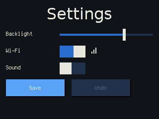
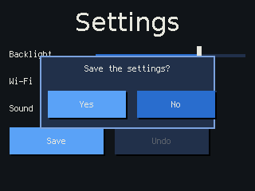

# Cookbook

*[По-русски](../ru/cookbook.md)*

Recipes for the things an interface is made of. Each is a few whole pieces of C; the names a recipe does not define,
such as `settings_save()`, are the program's own. [Getting started](getting-started.md) has the frame they all sit
in: the display, the queue and the loop of the task that owns the tree.

- [What the recipes share](#what-the-recipes-share)
- [One message for several widgets](#one-message-for-several-widgets)
- [A clock, or anything once in a while](#a-clock-or-anything-once-in-a-while)
- [A button](#a-button)
- [A slider and a switch](#a-slider-and-a-switch)
- [An icon that shows a state](#an-icon-that-shows-a-state)
- [A picture from flash](#a-picture-from-flash)
- [A text of several lines](#a-text-of-several-lines)
- [A font that fits](#a-font-that-fits)
- [Colours of your own, and a night mode](#colours-of-your-own-and-a-night-mode)
- [Showing, hiding, disabling](#showing-hiding-disabling)
- [A popup](#a-popup)
- [Buttons of the board](#buttons-of-the-board)
- [Touch with DGX-DI](#touch-with-dgx-di)
- [A field and a keyboard](#a-field-and-a-keyboard)
- [Widgets that come and go](#widgets-that-come-and-go)
- [Large data: a message by reference](#large-data-a-message-by-reference)
- [A message from an interrupt](#a-message-from-an-interrupt)
- [A look of your own](#a-look-of-your-own)
- [Turning the screen](#turning-the-screen)
- [Testing an interface on the computer](#testing-an-interface-on-the-computer)

## What the recipes share

The headers, the colours and two styles of one font. Colours are indices of the table the program gives the painter;
the recipes name them.

```c
#include "dgx_draw.h"
#include "dgx_ui_paint.h"
#include "dgx_ui_post.h"
#include "dgx_ui_text.h"
#include "dgx_ui_ticker.h"
#include "esp_attr.h"
#include "esp_timer.h"
#include "fonts/DejaVuSansBook32.h"
#include "fonts/TerminusTTFMedium12.h"
#include "freertos/FreeRTOS.h"
#include "freertos/task.h"

enum { PAPER, INK, FILL, BORDER, ACCENT, ACCENT_DOWN, SHADOW, DIM, COLORS };

static dgx_ui_font_variant_t small[1];
static dgx_ui_text_style_t   st_left, st_centre;

static void styles_init(void)
{
    small[0]  = (dgx_ui_font_variant_t){.font = TerminusTTFMedium12()};
    st_left   = (dgx_ui_text_style_t){.variants = small, .count = 1, .align = DGX_FONT_ALIGN_LEFT};
    st_centre = (dgx_ui_text_style_t){.variants = small, .count = 1, .align = DGX_FONT_ALIGN_CENTER};
}
```

## One message for several widgets

A sensor sends the temperature and the humidity in one message. Two labels read it; neither claims it, so both see
it.

```c
enum { MSG_CLIMATE = 10 };
typedef struct {
    int16_t t10; /* tenths of a degree */
    uint8_t rh;  /* percent */
} climate_t;
DGX_UI_MESSAGE(climate, MSG_CLIMATE, climate_t)

static bool temp_take(dgx_ui_t *ui, int i, const dgx_ui_msg_t *msg)
{
    climate_t c;
    if (msg_decode_climate(msg, &c) == ESP_OK) dgx_ui_text_printf(ui, i, "%d.%d C", c.t10 / 10, c.t10 % 10);
    return false;
}

static bool rh_take(dgx_ui_t *ui, int i, const dgx_ui_msg_t *msg)
{
    climate_t c;
    if (msg_decode_climate(msg, &c) == ESP_OK) dgx_ui_text_printf(ui, i, "%d %%", c.rh);
    return false;
}

static dgx_ui_textbox_t      temp_box, rh_box;
static const dgx_ui_widget_t temp_w = {.kind = DGX_UI_LABEL, .text = &temp_box, .take = temp_take};
static const dgx_ui_widget_t rh_w   = {.kind = DGX_UI_LABEL, .text = &rh_box, .take = rh_take};

/* the sensor's task */
static void climate_send(QueueHandle_t queue, int t10, int rh)
{
    const climate_t c = {.t10 = (int16_t)t10, .rh = (uint8_t)rh};
    if (!msg_post_climate(queue, &c)) {
        /* the queue is full and the value is lost: the next one comes anyway */
    }
}
```

- The text is compared after it is formatted. The sensor may send 21.53, then 21.48: the label shows "21.5" both
  times and nothing is drawn.
- A type larger than 12 bytes does not compile in `DGX_UI_MESSAGE`. Larger data goes
  [by reference](#large-data-a-message-by-reference).
- A decoder is `dgx_ui_msg_copy()` with the number and the size. A message of the right number and another size is an
  error of the program, and is logged.

## A clock, or anything once in a while

A ticker sends a message of a number every so many milliseconds. Whoever wants it reads it in its `take()`.

```c
enum { MSG_MINUTE = 11 };
static dgx_ui_ticker_t minute_ticker; /* static: zeroed, and alive as long as its ticks */

static bool date_take(dgx_ui_t *ui, int i, const dgx_ui_msg_t *msg)
{
    if (msg->what != MSG_MINUTE) return false;
    const uint32_t minutes = (uint32_t)(esp_timer_get_time() / 60000000);
    dgx_ui_text_printf(ui, i, "up %u h %02u min", (unsigned)(minutes / 60), (unsigned)(minutes % 60));
    return true;
}

static bool minutes_start(QueueHandle_t queue)
{
    return dgx_ui_ticker_start(&minute_ticker, queue, MSG_MINUTE, 60 * 1000);
}
```

- The next tick is sent only after the loop called `dgx_ui_msg_done()` on the one before. A loop that forgets the call
  gets one tick and no more.
- `dgx_ui_ticker_stop()` stops it. The struct must live until its last tick was done with; a static one does.
- A ticker is the way to do slow things in time: the frames of an icon, a value that blinks. The task sleeps between
  the ticks.

## A button



A control names its look. The button's text is a text box, as a label's; `on()` is told `DGX_UI_ACTIVATED` when the
user clicked it or pressed the key of activation with the focus on it.

```c
void settings_save(void);

static char             save_buf[8];
static dgx_ui_textbox_t save_box;

static void save_on(dgx_ui_t *ui, int i, int what, void *ctx)
{
    if (what == DGX_UI_ACTIVATED) settings_save();
}

static const dgx_ui_widget_t save_w = {
    .kind = DGX_UI_BUTTON, .text = &save_box, .want_w = 60, .want_h = 18, .look = &dgx_ui_look_button, .on = save_on};

static int save_add(dgx_ui_t *ui, int parent)
{
    dgx_ui_textbox_init(&save_box, save_buf, sizeof save_buf, 1, &st_centre);
    const int b = dgx_ui_add(ui, parent, &save_w);
    dgx_ui_text_set(ui, b, "Save");
    return b;
}
```

- A button with a text is as high as a line of the text unless it is told: give it `want_h`, or in a row the flag
  `DGX_UI_STRETCH`, which makes it as high as the row.
- `dgx_ui_set_state(ui, b, DGX_UI_PRESSED, true)` draws it pressed and activates nothing: so a key of the board may
  show on the screen.
- `on()` may remove widgets, the button itself too: a dialog may close itself there.

## A slider and a switch

The value of a control is in its node. `on()` is told `DGX_UI_CHANGED` when the user changed it: a slider at every
step of the finger, a switch when it is clicked.

```c
void backlight_set(int percent);
void wifi_enable(bool on);

static void backlight_on(dgx_ui_t *ui, int i, int what, void *ctx)
{
    if (what == DGX_UI_CHANGED) backlight_set(dgx_ui_node(ui, i)->state_value.value);
}

static void wifi_on(dgx_ui_t *ui, int i, int what, void *ctx)
{
    if (what == DGX_UI_CHANGED) wifi_enable(dgx_ui_node(ui, i)->state_value.value != 0);
}

/* a slider of 0..100 by 5 that starts at 70, and a switch that starts off */
static const dgx_ui_widget_t backlight_w = {
    .kind = DGX_UI_SLIDER, .min = 0, .max = 100, .step = 5, .want_h = 12, .state = {.value = 70}, .look = &dgx_ui_look_slider, .on = backlight_on};
static const dgx_ui_widget_t wifi_w = {
    .kind = DGX_UI_SWITCH, .max = 1, .want_w = 26, .want_h = 12, .look = &dgx_ui_look_switch, .on = wifi_on};

/* the value came from elsewhere: shown, and on() is not told */
static void backlight_show(dgx_ui_t *ui, int slider, int percent)
{
    dgx_ui_set_value(ui, slider, percent);
}
```

- `dgx_ui_set_value()` keeps the value within `min..max` and does not call `on()`: the program does not hear its own
  changes back.
- With the flag `DGX_UI_SWIPE` a slider moves by the way the finger goes from where it went down, not to where the
  finger is: a wide strip that is easy to hit.
- With the keys, more and less move a slider by its step and set a switch.

## An icon that shows a state

An icon is a widget of one size whose picture is picked by its value. A value outside `min..max` shows no picture, and
the widget keeps its place, so nothing around it moves when the icon comes and goes.

```c
/* 8x8, 1 bit: rows from a new byte, the leftmost pixel in the high bit */
static const uint8_t      bars1[8] = {0x00, 0x00, 0x00, 0x00, 0x00, 0x00, 0x80, 0x80};
static const uint8_t      bars2[8] = {0x00, 0x00, 0x00, 0x00, 0x20, 0x20, 0xA0, 0xA0};
static const uint8_t      bars3[8] = {0x00, 0x00, 0x08, 0x08, 0x28, 0x28, 0xA8, 0xA8};
static const uint8_t      bars4[8] = {0x02, 0x02, 0x0A, 0x0A, 0x2A, 0x2A, 0xAA, 0xAA};
static const dgx_image_t  signal_im[4] = {
    {.width = 8, .height = 8, .format = DGX_IMAGE_1BPP, .data = bars1},
    {.width = 8, .height = 8, .format = DGX_IMAGE_1BPP, .data = bars2},
    {.width = 8, .height = 8, .format = DGX_IMAGE_1BPP, .data = bars3},
    {.width = 8, .height = 8, .format = DGX_IMAGE_1BPP, .data = bars4},
};
static const dgx_ui_picture_t signal_pic[4] = {
    {.image = &signal_im[0]}, {.image = &signal_im[1]}, {.image = &signal_im[2]}, {.image = &signal_im[3]}};

enum { MSG_SIGNAL = 12 };
typedef struct {
    int8_t bars; /* 1..4; 0: no network */
} signal_t;
DGX_UI_MESSAGE(signal, MSG_SIGNAL, signal_t)

static bool signal_take(dgx_ui_t *ui, int i, const dgx_ui_msg_t *msg)
{
    signal_t s;
    if (msg_decode_signal(msg, &s) == ESP_OK) dgx_ui_set_value(ui, i, s.bars);
    return false;
}

/* the pictures of the values 1..4; 0 is outside and shows none */
static const dgx_ui_widget_t signal_w = {
    .kind = DGX_UI_ICON, .picture = signal_pic, .min = 1, .max = 4, .look = &dgx_ui_look_picture, .take = signal_take};
```

The size of the widget is the size of the first picture. The picture is drawn opaque: its ink and its paper are both
written, so an icon drawn again over itself does not blink.

## A picture from flash

A picture of 1 bit is a `dgx_image_t` of DGX with the look `dgx_ui_look_picture`, as the icon above; its ink is a
colour of the table. A picture of colours is rows of RGB565 with the look `dgx_ui_look_rgb565`:

```c
extern const uint16_t logo_pixels[64 * 32]; /* rows of RGB565, high byte first */

static const dgx_ui_picture_t logo_pic = {.rgb565 = logo_pixels, .width = 64, .height = 32};
static const dgx_ui_widget_t  logo_w   = {.kind = DGX_UI_PICTURE, .picture = &logo_pic, .look = &dgx_ui_look_rgb565};
```

- The look of RGB565 needs `CONFIG_DGX_ENABLE_VSCREEN=y` and a 16-bit screen. On another screen the widget is
  paper.
- The painter makes one small screen object for such pictures at the first need.
  `dgx_ui_paint_free(&paint)` gives it back when the program stops painting.
- Pictures of 4 and 8 bits are not drawn yet.

## A text of several lines


The look `dgx_ui_look_lines` lays a text into the lines of its box, word by word. The box says how many lines it
shows; the style says what happens to a text too long.

```c
static char                news_buf[200], hint_buf[120];
static dgx_ui_textbox_t    news_box, hint_box;
static dgx_ui_text_style_t st_important;

static const dgx_ui_widget_t news_w = {.kind = DGX_UI_LABEL, .text = &news_box, .look = &dgx_ui_look_lines};
static const dgx_ui_widget_t hint_w = {.kind = DGX_UI_LABEL, .text = &hint_box, .look = &dgx_ui_look_lines};

static void texts_add(dgx_ui_t *ui, int parent)
{
    /* an important text too long scrolls a line up every 2 s; one that is not is cut with an ellipsis */
    st_important = (dgx_ui_text_style_t){.variants = small, .count = 1, .flags = DGX_UI_TEXT_IMPORTANT, .scroll_ms = 2000};
    dgx_ui_textbox_init(&news_box, news_buf, sizeof news_buf, 3, &st_important);
    dgx_ui_textbox_init(&hint_box, hint_buf, sizeof hint_buf, 2, &st_left);
    const int news = dgx_ui_add(ui, parent, &news_w);
    const int hint = dgx_ui_add(ui, parent, &hint_w);
    dgx_ui_text_set(ui, news, "The filter has worked for 2000 hours. Replace it and hold the button for three seconds.");
    dgx_ui_text_set(ui, hint, "Swipe from the left edge to open the menu.");
    dgx_ui_text_appear(ui, hint, 30); /* its letters come one by one, 30 ms each */
}
```

- While a text scrolls or its letters come, `dgx_ui_paint()` returns `true` and the loop keeps coming back. When the
  text reached its end and all letters came, it asks no more.
- A new text starts from its first line, and appears again if it was told to.
- `dgx_ui_text_scroll(ui, i, 1)` moves a text that is not important a line up by hand, `-1` a line down.
- A word wider than the line is cut by its letters; `\n` ends a line.
- A program that names this look carries about 2.5 KB more code; a program of one-line labels does not.

## A font that fits

A style lists the fonts a text may be drawn in, the best first. The painter takes the first the text goes into whole,
else the one that shows the most letters. The name of a city goes in the large font when it is short and in the
small one when it is long.

```c
static dgx_ui_font_variant_t city_fonts[2];
static dgx_ui_text_style_t   st_city;

static void city_style_init(void)
{
    city_fonts[0] = (dgx_ui_font_variant_t){.font = DejaVuSansBook32()};
    city_fonts[1] = (dgx_ui_font_variant_t){.font = TerminusTTFMedium12()};
    st_city = (dgx_ui_text_style_t){.variants = city_fonts, .count = 2, .align = DGX_FONT_ALIGN_CENTER, .flags = DGX_UI_TEXT_MIDDLE};
}
```

- The height of a label is the line of its first font, so the label keeps its size whichever font is taken.
- A smaller font stands on the base line of the first one. With `DGX_UI_TEXT_MIDDLE` it stands in the middle of the
  height.
- The fonts are those of DGX, of bitmaps and of dots. A font is not scaled.

## Colours of your own, and a night mode

The looks of the library have parameters: which colour of the table is the face, the text, the shadow. A look in
other colours is the library's look with parameters of its own. It is filled at the start, 12 bytes of RAM:

```c
static const dgx_ui_button_look_t blue_button = {
    .face = ACCENT, .pressed = ACCENT_DOWN, .focused = ACCENT_DOWN, .disabled = FILL,
    .text = INK, .text_disabled = DIM, .shadow = SHADOW, .depth = 1};
static dgx_ui_look_t look_blue_button;

static void looks_init(void)
{
    look_blue_button        = dgx_ui_look_button; /* its drawing */
    look_blue_button.params = &blue_button;       /* in these colours */
}

static const dgx_ui_widget_t ok_w = {.kind = DGX_UI_BUTTON, .want_w = 60, .want_h = 18, .look = &look_blue_button};
```

A night mode is another table of the same colours. The painter is given it, and the root is drawn whole:

```c
static void colors_set(dgx_ui_t *ui, dgx_ui_paint_t *paint, const uint32_t *table)
{
    paint->colors = table;
    dgx_ui_redraw(ui, 0); /* the root whole, and with it everything under it */
}
```

A table is filled for the screen by `dgx_screen_rgb(scr, r, g, b)`, as in [Getting started](getting-started.md).

## Showing, hiding, disabling

```c
static void advanced_show(dgx_ui_t *ui, int box, int button, bool expert)
{
    dgx_ui_show(ui, box, expert);                           /* hidden, it takes no place: the rest moves up */
    dgx_ui_set_state(ui, button, DGX_UI_DISABLED, !expert); /* stays where it is, drawn dim, takes no finger */
}
```

- A hidden widget still gets the messages, so it is fresh when it is shown.
- Hiding or disabling a widget takes the focus off it and ends a press of the finger on it.
- To make something come and go without moving its neighbours, do not hide it: use
  [an icon](#an-icon-that-shows-a-state) with a value that shows none, or a label with an empty text.

## A popup



A popup is a tree of its own: its own nodes, its own root, the same widgets and looks. It is opened over a tree in a
rectangle of the screen.

```c
static char             ask_buf[32], yes_buf[8], no_buf[8];
static dgx_ui_textbox_t ask_box, yes_box, no_box;
static dgx_ui_node_t    ask_nodes[6];
static dgx_ui_t         ask_ui;
static dgx_ui_t        *ask_over; /* the tree it is open over */

static void yes_on(dgx_ui_t *popup, int i, int what, void *ctx)
{
    if (what != DGX_UI_ACTIVATED) return;
    settings_save();
    dgx_ui_popup_close(ask_over);
}

static void no_on(dgx_ui_t *popup, int i, int what, void *ctx)
{
    if (what == DGX_UI_ACTIVATED) dgx_ui_popup_close(ask_over);
}

static const dgx_ui_widget_t ask_root_w = {.kind = DGX_UI_FRAME, .flags = DGX_UI_COLUMN, .pad = 5, .gap = 5};
static const dgx_ui_widget_t ask_w      = {.kind = DGX_UI_LABEL, .text = &ask_box, .want_h = 12};
static const dgx_ui_widget_t ask_row_w  = {.kind = DGX_UI_BOX, .flags = DGX_UI_ROW, .want_h = 18, .gap = 6};
static const dgx_ui_widget_t yes_w = {
    .kind = DGX_UI_BUTTON, .flags = DGX_UI_STRETCH, .text = &yes_box, .want_w = 50, .look = &dgx_ui_look_button, .on = yes_on};
static const dgx_ui_widget_t no_w = {
    .kind = DGX_UI_BUTTON, .flags = DGX_UI_STRETCH, .text = &no_box, .want_w = 50, .look = &dgx_ui_look_button, .on = no_on};

static void ask_open(dgx_ui_t *ui)
{
    dgx_ui_textbox_init(&ask_box, ask_buf, sizeof ask_buf, 1, &st_centre);
    dgx_ui_textbox_init(&yes_box, yes_buf, sizeof yes_buf, 1, &st_centre);
    dgx_ui_textbox_init(&no_box, no_buf, sizeof no_buf, 1, &st_centre);
    dgx_ui_init(&ask_ui, ask_nodes, 6, 2);
    const int root = dgx_ui_add(&ask_ui, -1, &ask_root_w);
    dgx_ui_text_set(&ask_ui, dgx_ui_add(&ask_ui, root, &ask_w), "Save the settings?");
    const int row = dgx_ui_add(&ask_ui, root, &ask_row_w);
    dgx_ui_text_set(&ask_ui, dgx_ui_add(&ask_ui, row, &yes_w), "Yes");
    dgx_ui_text_set(&ask_ui, dgx_ui_add(&ask_ui, row, &no_w), "No");
    ask_over = ui;
    dgx_ui_popup_open(ui, &ask_ui, 50, 70, 220, 92, DGX_UI_POPUP_MODAL); /* pixels of the screen */
}
```

- The program goes on calling `dgx_ui_take()`, `dgx_ui_pointer()`, `dgx_ui_key()` and `dgx_ui_paint()` with the tree
  under the popup; they go to the popup by themselves.
- A modal popup takes every finger and key. The key "back" is never taken, so the program may close the popup on it.
- With `DGX_UI_POPUP_CLOSE_OUTSIDE` a finger that goes down outside the popup closes it: so a list of choices
  behaves.
- When the popup closes, the painter draws the tree again where it lay.
- The rectangle is in pixels of the screen as it stands. When the screen is turned, close the popup, or open it again
  in the new pixels.

## Buttons of the board

Whoever reads the buttons sends which are held now, as bits of a game pad; the loop gives them to the tree.

```c
enum { MSG_BUTTONS = 13 };
typedef struct {
    uint32_t held; /* DGX_UI_PAD_* */
} buttons_t;
DGX_UI_MESSAGE(buttons, MSG_BUTTONS, buttons_t)

void menu_back(void);

/* in the loop, for a message no widget claimed */
static void buttons_message(dgx_ui_t *ui, const dgx_ui_msg_t *msg, uint32_t now_ms)
{
    buttons_t b;
    if (msg_decode_buttons(msg, &b) != ESP_OK) return;
    const bool taken = dgx_ui_buttons(ui, b.held, now_ms);
    if (!taken && (b.held & (DGX_UI_PAD_BACK | DGX_UI_PAD_B))) menu_back();
}
```

- Up and down move the focus, left and right change the focused slider or switch, A activates, B and BACK are the
  program's.
- A held up, down, left or right repeats after 500 ms, every 100 ms. The repeat is made by `dgx_ui_time()`, which the
  loop calls before `dgx_ui_paint()`; while a button is held it returns `true`, and the loop does not sleep.
- A single key of a dialog is `dgx_ui_key(ui, DGX_UI_KEY_NEXT)` and its kin.

## Touch with DGX-DI

`dgx_ui_di.h` is for a program that has [DGX-DI](https://github.com/jef-sure/esp32-component-dgx-di). The touch is
read in the task that owns the display, so a ticker wakes it, every 20 ms here:

```c
#include "dgx_ui_di.h"

enum { MSG_TOUCH = 14 };

void menu_open(void);

/* in the loop, for the ticker's message MSG_TOUCH; the pointer and the touch are set up as DGX-DI tells */
static void touch_message(dgx_ui_t *ui, dgx_di_pointer_t *pointer, dgx_di_touch_t *touch, uint32_t now_ms)
{
    dgx_ui_di_gestures_t g;
    dgx_di_pointer_read(pointer, now_ms);
    /* the keyboard and the pad of DGX-DI, if the program has them, take their fingers here */
    dgx_ui_di_pointer(ui, pointer, touch, now_ms, &g);
    if (g.edge & DGX_DI_EDGE_LEFT) menu_open(); /* swiped from the left edge */
}
```

- A widget is pressed as soon as the finger goes down on it, at an edge too.
- While a widget holds the finger, a plain swipe and a long press are not told to the program.
- A swipe from an edge is told to the program, unless the finger is on a slider, a list or a button with
  `DGX_UI_DRAG`: those own the finger.
- A finger that went down on no widget gives the program all its gestures; `g.taken` tells whether a widget took the
  press.

## A field and a keyboard

A field is an `DGX_UI_INPUT` with the look `dgx_ui_look_input`. What is typed goes to the field that has the focus.

```c
#include "dgx_di_keyboard.h"

void wifi_connect(const char *password);

static char             pass_buf[33];
static dgx_ui_textbox_t pass_box;

static void pass_on(dgx_ui_t *ui, int i, int what, void *ctx)
{
    if (what == DGX_UI_ACTIVATED) wifi_connect(pass_buf); /* "done" was typed */
    if (what == DGX_UI_BACK) dgx_ui_text_set(ui, i, "");  /* "cancel" was typed */
}

static const dgx_ui_widget_t pass_w = {.kind = DGX_UI_INPUT, .text = &pass_box, .want_h = 14, .look = &dgx_ui_look_input, .on = pass_on};

/* in the loop, after the pointer was read: the keyboard of DGX-DI types into the focused field */
static void keyboard_pass(dgx_ui_t *ui, dgx_ui_paint_t *paint, dgx_di_keyboard_t *kb, dgx_di_pointer_t *pointer, uint32_t now_ms)
{
    uint32_t  typed[8];
    const int n = dgx_di_keyboard_take(kb, pointer, now_ms, typed, 8);
    if (n > 0) dgx_ui_typed(ui, typed, n);
    /* the painter leaves the keyboard's band alone while it is open */
    paint->cover = kb->open ? dgx_ui_rect(kb->x, kb->y, kb->w, kb->h) : dgx_ui_rect(0, 0, 0, 0);
}
```

- The size of the buffer is the most the field takes; a letter that has no room is not typed.
- Erase takes the last letter off, whole, in UTF-8.
- `on()` is told `DGX_UI_CHANGED` at every letter, and `DGX_UI_FOCUS` when the field gets the focus: the place to
  open the keyboard.
- When the keyboard closes and the band is empty again, the painter draws the tree there by itself.
- Code points from any other source go the same way: `dgx_ui_typed(ui, code_points, count)`.

## Widgets that come and go

```c
enum { TAG_ALARM = 7 };

static char             alarm_buf[40];
static dgx_ui_textbox_t alarm_box;
static const dgx_ui_widget_t alarm_w = {.kind = DGX_UI_LABEL, .text = &alarm_box, .tag = TAG_ALARM};

static void alarm_set(dgx_ui_t *ui, int parent, const char *text)
{
    int a = dgx_ui_find(ui, parent, TAG_ALARM);
    if (text && a < 0) {
        dgx_ui_textbox_init(&alarm_box, alarm_buf, sizeof alarm_buf, 1, &st_left);
        a = dgx_ui_insert(ui, parent, dgx_ui_node(ui, parent)->child, &alarm_w); /* before the first child */
    }
    if (text) dgx_ui_text_set(ui, a, text);
    else if (a >= 0) dgx_ui_remove(ui, a);
}
```

- The tree keeps the pointer to the widget and copies nothing. Give it a `static const` object, or memory of the
  program's that lives as long as the widget is in the tree. Never a compound literal made inside a function: it
  dies when the function returns.
- The number of a removed widget is given to the next one added. Find a widget that comes and goes by its tag; tags
  begin at 1, as 0 is the tag of every widget that was given none.
- `dgx_ui_remove()` takes everything under the widget with it.
- A widget the program keeps in its own RAM may be changed: its sizes, its picture. Then call `dgx_ui_relayout()`
  and `dgx_ui_redraw()` for it.

## Large data: a message by reference

More than 12 bytes go by reference. The message owns the data from the sending until the loop calls
`dgx_ui_msg_done()`, which calls the sender's `done()` once, in the task that owns the tree.

```c
#include <stdlib.h>
#include <string.h>

enum { MSG_HEADLINE = 15 };

static void headline_done(void *data, size_t size)
{
    free(data);
}

/* any task: the text is the message's from here on */
static void headline_send(QueueHandle_t queue, const char *text)
{
    char *copy = strdup(text);
    if (copy && !dgx_ui_post_ref(queue, MSG_HEADLINE, copy, strlen(copy) + 1, headline_done)) free(copy); /* not sent: still ours */
}

static bool headline_take(dgx_ui_t *ui, int i, const dgx_ui_msg_t *msg)
{
    if (msg->what != MSG_HEADLINE) return false;
    size_t size;
    dgx_ui_text_set(ui, i, dgx_ui_msg_data(msg, &size)); /* copied into the text box now */
    return true;
}
```

- The data is valid until the message is done with. A widget that needs it longer calls
  `dgx_ui_msg_keep(ui, &copy)` in its `take()`, and `dgx_ui_msg_done(&copy)` when it is done; keeping claims the
  message.
- Data that lives for ever, a constant, is sent by `dgx_ui_post_const()`: nothing is done with it.

## A message from an interrupt

```c
enum { MSG_KNOB = 16 };
typedef struct {
    int8_t steps;
} knob_t;

static QueueHandle_t knob_queue;

static void IRAM_ATTR knob_isr(void *arg)
{
    const knob_t k     = {.steps = 1};
    BaseType_t   woken = pdFALSE;
    dgx_ui_post_from_isr(knob_queue, MSG_KNOB, &k, sizeof k, &woken);
    if (woken) portYIELD_FROM_ISR();
}
```

Only by value. The call lies in IRAM, so an interrupt that runs with the cache of the flash off may use it.

## A look of your own

A look is a function that draws a widget, parameters of its own type, and the colour it leaves under the widget's
children. Here a level bar: the value of the widget as a filled part of its box.

```c
typedef struct {
    uint8_t bar, rest; /* indices of the table */
} level_look_t;

static bool level_draw(const dgx_ui_look_t *look, dgx_ui_paint_t *paint, dgx_ui_t *ui, int i, uint32_t now_ms)
{
    const dgx_ui_node_t   *n    = dgx_ui_node(ui, i);
    const dgx_ui_widget_t *w    = n->widget;
    const level_look_t    *p    = look->params;
    const int              span = w->max > w->min ? w->max - w->min : 1;
    const int              full = n->w * (n->state_value.value - w->min) / span;
    const int              x = n->x - paint->ox, y = n->y - paint->oy;
    if (full > 0) dgx_fill_rectangle(paint->scr, x, y, full, n->h, dgx_ui_color(paint, p->bar));
    if (full < n->w) dgx_fill_rectangle(paint->scr, x + full, y, n->w - full, n->h, dgx_ui_color(paint, p->rest));
    return false; /* no more time asked */
}

static const level_look_t    level_colors = {.bar = ACCENT, .rest = FILL};
static const dgx_ui_look_t   level_look   = {.draw = level_draw, .params = &level_colors, .fill = -1};
static const dgx_ui_widget_t level_w      = {.kind = DGX_UI_OWN, .min = 0, .max = 100, .want_h = 6, .look = &level_look};
```

The rules a look keeps:

- **Where.** It draws the widget's box, `n->x, n->y, n->w, n->h`, less `paint->ox, paint->oy`: the screen may be a
  buffer that holds a part of the picture. The clip is already set, and the look does not change it for good.
- **Every pixel once.** Write each pixel of what you draw once, and the widget does not blink on a display behind a
  bus. The bar above is two rectangles that do not overlap.
- **The whole box when `paint->whole`.** Then nothing of the widget is on the screen. A look that draws only a
  difference must draw all of it then. The looks of the library draw all of the box every time.
- **Colours** come from `dgx_ui_color(paint, index)`. `paint->paper` is the index of the colour under the widget.
- **Called for parts.** When a popup or the keyboard lies over a part of the widget, the look is called once for each
  part that shows, the clip set to it. It must draw the same in every call. A look that remembers what it drew stores
  it only in the last one: when `paint->part == paint->parts - 1` and `paint->composing` is false.
- **Time.** A look that animates returns `true` and is called again at the next pass. It works out where it stands
  from `now_ms`.
- **Its fill.** `fill` is the index of the colour the look leaves under the widget's children, or -1 when it leaves
  what was there. A frame's is its fill.

## Turning the screen

```c
static void screen_turn(dgx_screen_t *scr, bool landscape)
{
    if (landscape) dgx_screen_orientation(scr, DgxScreenRightLeft, DgxScreenTopBottom, true);
    else dgx_screen_orientation(scr, DgxScreenLeftRight, DgxScreenTopBottom, false);
}
```

Nothing else: the painter compares the size and the orientation of the screen at every pass, lays the tree again and
draws it whole. Sizes in points keep; a row that was wide enough may not be after the turn.

## Testing an interface on the computer

The tree, the messages and the state need no display. A test builds the tree, sends what the tasks would send and
does what the user would do:

```c
#include <assert.h>

static int  saved;
static void test_save_on(dgx_ui_t *ui, int i, int what, void *ctx)
{
    if (what == DGX_UI_ACTIVATED) ++saved;
}

static void interface_test(void)
{
    static char                  buf[16];
    static dgx_ui_textbox_t      box;
    static const dgx_ui_widget_t root_w   = {.kind = DGX_UI_BOX, .flags = DGX_UI_COLUMN};
    static const dgx_ui_widget_t label_w  = {.kind = DGX_UI_LABEL, .text = &box, .take = temp_take};
    static const dgx_ui_widget_t button_w = {.kind = DGX_UI_BUTTON, .want_h = 20, .on = test_save_on};
    static dgx_ui_node_t         nodes[4];
    dgx_ui_t                     ui;

    styles_init();
    dgx_ui_textbox_init(&box, buf, sizeof buf, 1, &st_left);
    dgx_ui_init(&ui, nodes, 4, 1);
    dgx_ui_add(&ui, -1, &root_w);
    dgx_ui_add(&ui, 0, &label_w);
    const int button = dgx_ui_add(&ui, 0, &button_w);
    dgx_ui_screen(&ui, 240, 320, 0); /* what the painter would tell it */

    /* a message as the sensor's task sends it */
    dgx_ui_msg_t    msg;
    const climate_t c = {.t10 = 215, .rh = 40};
    dgx_ui_msg_value(&msg, MSG_CLIMATE, &c, sizeof c);
    dgx_ui_take(&ui, &msg);
    dgx_ui_msg_done(&msg);
    assert(strcmp(buf, "21.5 C") == 0);

    /* a tap in the middle of the button */
    const dgx_ui_node_t *b = dgx_ui_node(&ui, button);
    dgx_ui_layout(&ui);
    const int16_t x = (int16_t)(b->x + b->w / 2), y = (int16_t)(b->y + b->h / 2);
    dgx_ui_pointer(&ui, &(dgx_ui_pointer_t){.x = x, .y = y, .down = true, .pressed = true, .ms = 1000});
    dgx_ui_pointer(&ui, &(dgx_ui_pointer_t){.x = x, .y = y, .released = true, .ms = 1100});
    assert(saved == 1);
}
```

`dgx_ui.c`, `dgx_ui_text.c`, `dgx_ui_rect.c` and `dgx_ui_msg.c` are plain C and build with any compiler; the stubs of
the few ESP-IDF headers they include come with DGX, in its `host/stubs`. The tests of the repository,
`test/host`, are built so.
