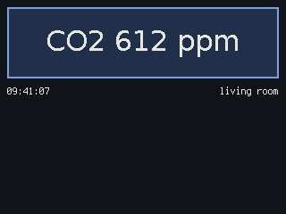

# Getting started

*[По-русски](../ru/getting-started.md)*

dgx-ui is a light layer of widgets on [DGX](https://github.com/jef-sure/esp32-component-dgx), the display library
for ESP32. In this guide we add it to an ESP-IDF project and write its first program, in three steps:

1. add the components to the project;
2. write a program of one file: the CO2, temperature and humidity that a task with an SCD41 sensor sends every five
   seconds, shown by a round scale with zones, the number inside the ring and the temperature and humidity under it;
3. build it and run it, on a board or in a window on the computer.

At the end the display shows this. The arc is coloured by the zones of CO2, a new measurement comes every five
seconds, and exactly what changed is drawn again; between the changes the task that owns the display sleeps:



You need to know how an ESP-IDF project is built and flashed. Nothing of dgx-ui, DGX or Sensirion's sensors is
assumed: every part of the program is explained where it appears.

## What you need

- ESP-IDF 5.3 or later: the driver of the sensor, scd4x 0.3.0, asks for it (dgx-ui alone would take 5.2).
- A display that [DGX](https://github.com/jef-sure/esp32-component-dgx) drives. Here it is a round GC9A01 of 240 by
  240 on SPI.
- A Sensirion SCD41 CO2 sensor on I2C. An SCD40 or an SCD43 does too: the commands are the same, they differ in
  accuracy and modes.
- DGX 0.12.3 or a later 0.12. It comes by itself with dgx-ui.
- On the build machine, beside ESP-IDF: a C compiler of its own, the development files of FreeType, `pkg-config`,
  fontconfig and one of the faces DejaVu Sans, Liberation Sans, Noto Sans, FreeSans and Arial, of which DGX makes the
  program's fonts as it builds it. On Debian and Ubuntu:
  `sudo apt install build-essential libfreetype-dev pkg-config fontconfig fonts-dejavu-core`; the window on the
  computer needs SDL2 too, `libsdl2-dev`.

The board here is an ESP32-C3 with the pins of the station
[esp32-co2-station](https://github.com/jef-sure/esp32-co2-station); on another board only the numbers of the pins in
the program change:

| Device | Pin  | GPIO |
| ------ | ---- | ---- |
| GC9A01 | MOSI | 6    |
|        | CLK  | 4    |
|        | CS   | 7    |
|        | DC   | 1    |
|        | RST  | 2    |
| SCD41  | SDA  | 3    |
|        | SCL  | 5    |

At a reset the ESP32-C3 reads pin 2 to choose how to boot, and it must be high then. Nothing pulls it up at that
moment, and the display's RST input does not hold it: when the display's module has no resistor from RST to the
supply, put 10 kΩ from pin 2 to 3.3 V. The sensor needs pull-ups on SDA and SCL: the station lived with the ESP32's
own, and the datasheet advises external ones of about 10 kΩ (modules usually have them). The sensor runs on 3.3 V,
at a humidity up to 95 % without condensation.

It goes without the hardware too: the same program runs in a window on the computer. A computer has no I2C bus, so
there the program makes the measurements up itself, one a second: all of the scale can be seen, which helps as well.

## 1. Add the components

Version 0.1.3 of dgx-ui and the driver of the sensor are both in the ESP Component Registry. In
`main/idf_component.yml` of the project:

```yaml
dependencies:
  jef-sure/dgx-ui: "^0.1.3"
  jef-sure/scd4x: "^0.3.0"
```

The component manager takes dgx-ui, DGX and scd4x from the registry at the next build: our program asks for dgx-ui
and scd4x, and dgx-ui for DGX.

DGX builds only the buses and the display drivers the project turns on. For a GC9A01 on SPI, in
`sdkconfig.defaults`:

```
CONFIG_DGX_ENABLE_SPI=y
CONFIG_DGX_ENABLE_SPI_GC9A01=y
```

The other displays and buses are in
[Getting started of DGX](https://github.com/jef-sure/esp32-component-dgx#getting-started).

The fonts are made by DGX as it builds the program, with soft edges, 4 bits a pixel, and only of the letters the
program writes. `main/CMakeLists.txt`:

```cmake
idf_component_register(SRCS "main.c")
# the number large, of its digits; the other texts of every letter of main.c
dgx_fonts_rules(fonts.rules)
dgx_font_need(large SIZE 32px BITS 4 LETTERS "0123456789")
dgx_font_need(body SIZE 13px BITS 4 TEXTS main.c)
```

and beside it `main/fonts.rules`, the faces to make them of, the first the build machine has:

```
source system
allow "DejaVu Sans"      7..
allow "Liberation Sans"  7..
allow "Noto Sans"        7..
allow "FreeSans"         7..
allow "Arial"            7..
```

The build prints the face it took.

## 2. Write the first program

The program below is `main/main.c`, piece by piece; the pieces in their order are the whole file. It draws the scale
of the recipe [A ring scale with widgets inside](cookbook.md#a-ring-scale-with-widgets-inside), with the values sent
by a real sensor.

```c
#include "dgx_colors.h" /* DGX_BLACK() and the other named colours */
#include "dgx_fonts.h"  /* made by DGX at build time: dgx_font_large, dgx_font_body */
#include "dgx_ui_paint.h"
#include "dgx_ui_post.h"
#include "dgx_ui_text.h"
#include "esp_log.h"
#include "esp_timer.h"
#include "freertos/FreeRTOS.h"
#include "freertos/task.h"
```

### The display

dgx-ui draws on a screen of DGX and does not care which. Here it is a GC9A01 on an ESP32-C3, or, when the program is
built for the computer, a window of the same size, 240 by 240:

```c
#ifdef DGX_HOST_WINDOW
#include "dgx_host_screen.h"
static dgx_screen_t *display_init(void)
{
    return dgx_host_screen_init(240, 240, 16, NULL);
}
#else
#include "bus/dgx_spi_esp32.h"
#include "drivers/gc9a01.h"
/* GC9A01: MOSI 6, CLK 4, CS 7, DC 1, RST 2, no MISO, SPI at 40 MHz */
static dgx_screen_t *display_init(void)
{
    dgx_bus_protocols_t *bus = dgx_spi_init(SPI2_HOST, SPI_DMA_CH_AUTO, GPIO_NUM_6, GPIO_NUM_NC, GPIO_NUM_4, GPIO_NUM_7,
                                            GPIO_NUM_1, 40 * 1000 * 1000, 0);
    return bus ? dgx_gc9a01_init(bus, GPIO_NUM_2, GPIO_NUM_NC, 16, DgxScreenBGR) : NULL;
}
#endif
```

### Messages

A message is a number the program chooses and up to 12 bytes of data. dgx-ui takes no number for itself and never
looks into a message. `DGX_UI_MESSAGE` binds a type to a number and gives two functions: `msg_post_air()` sends the
message, `msg_decode_air()` reads it.

The sensor gives the CO2, the temperature and the humidity in one measurement, so the message is one too, with all
three: the CO2 in ppm, the temperature in tenths of a degree, the humidity in tenths of a percent.

```c
enum { MSG_AIR = 1 };
typedef struct {
    uint16_t ppm;  /* CO2, ppm: the sensor reads 0..40000 */
    int16_t  t_dC; /* temperature, tenths of a degree */
    uint16_t rh_d; /* humidity, tenths of a percent */
} air_t;
DGX_UI_MESSAGE(air, MSG_AIR, air_t)
```

### The ring

The round scale is a widget of the program's own kind, `DGX_UI_OWN`, drawn by a look of the library. The widget's
value lives not in the tree but in the program's memory: `.value` points at a variable, which the task that owns the
tree writes, and the painter compares it at every pass with what it drew and draws the difference; in `take()` below
that is one line.

The arc goes from `min` to `max`: from 400 to 2000 ppm. The angles are degrees clockwise from the top: a start of
-135 is half past seven, and a sweep of 270 ends at half past four. The bands colour each part of the arc with the
colour of the values it stands for: up to 800 ppm green, up to 1200 yellow, from there red. `.soft` gives the ring
soft edges: a pixel on an edge takes the colours on both sides of it, so the circle has no steps. The colours are
indices of the painter's table, the same as the texts':

```c
enum { PAPER = 0, INK, RING_OFF, RING_LOW, RING_MID, RING_HIGH };

static int32_t ring_ppm; /* the ring's value: written by take(), read by every pass */

/* up to 800 ppm in one colour, up to 1200 in another, from there in a third, each part of the arc by its own place;
   14 points wide, from half past seven round to half past four, its edges soft */
static const dgx_ui_band_t      ring_bands[] = {{800, RING_LOW}, {1200, RING_MID}};
static const dgx_ui_ring_look_t ring_params  = {
    .fill = RING_HIGH, .track = RING_OFF, .paper = DGX_UI_PAPER, .width = 14, .start = -135, .sweep = 270,
    .band_count = 2, .bands_by = DGX_UI_BANDS_BY_PLACE, .bands = ring_bands, .soft = &dgx_ui_ring_soft};
static const dgx_ui_look_t ring_look = {.draw = dgx_ui_draw_ring, .params = &ring_params, .fill = DGX_UI_PAPER};
```

### The texts

A label shows the text of a text box. The box is in RAM: it holds the program's buffer for the string and a style.
A style lists the fonts the text may be drawn in, the best first: the painter takes the first one the text goes into
whole.

There are four boxes here: the large number; its unit, "ppm CO2", a box over a string constant that the program
never changes; and the two labels at the bottom, the temperature on the left and the humidity on the right.

```c
static char                  ppm_buf[8], temp_buf[12], rh_buf[8];
static dgx_ui_textbox_t      ppm_box, temp_box, rh_box;

/* the value in the large font, or in the small one when it does not go in */
static const dgx_ui_font_variant_t vbig[2]   = {{.font = &dgx_font_large}, {.font = &dgx_font_body}};
static const dgx_ui_font_variant_t vsmall[1] = {{.font = &dgx_font_body}};
static const dgx_ui_text_style_t   st_big    = {.fonts = vbig, .count = 2, .align = DGX_FONT_ALIGN_CENTER, .flags = DGX_UI_STYLE_MIDDLE};
static const dgx_ui_text_style_t   st_centre = {.fonts = vsmall, .count = 1, .align = DGX_FONT_ALIGN_CENTER};
static const dgx_ui_text_style_t   st_left   = {.fonts = vsmall, .count = 1, .align = DGX_FONT_ALIGN_LEFT};
static const dgx_ui_text_style_t   st_right  = {.fonts = vsmall, .count = 1, .align = DGX_FONT_ALIGN_RIGHT};

static dgx_ui_textbox_t unit_box = DGX_UI_TEXT_CONST("ppm CO2", 1, &st_centre);
```

### What a widget does with a message

Every message is offered to every widget, in the order of the tree. A widget's `take()` reads what it needs from the
message and returns `false`. When it returns `true`, the widget has claimed the message, and the widgets after it do
not see it. So a message several widgets need is claimed by none of them: then it surely reaches every one.

One measurement is read by four: the ring writes the value into its variable, the number and the two labels print
their boxes, and all four return `false`. `dgx_ui_text_printf()` compares the new text with the old one: when the same value came again, nothing
changes and nothing is drawn.

```c
static bool ring_take(dgx_ui_t *ui, int i, const dgx_ui_msg_t *msg)
{
    air_t a;
    if (msg_decode_air(msg, &a) == ESP_OK) ring_ppm = a.ppm; /* shown within 400..2000 by the pass after this message */
    return false; /* the number and the two labels read the same message */
}

static bool ppm_take(dgx_ui_t *ui, int i, const dgx_ui_msg_t *msg)
{
    air_t a;
    if (msg_decode_air(msg, &a) == ESP_OK) dgx_ui_text_printf(ui, i, "%d", a.ppm);
    return false;
}

static bool temp_take(dgx_ui_t *ui, int i, const dgx_ui_msg_t *msg)
{
    air_t a;
    if (msg_decode_air(msg, &a) == ESP_OK) dgx_ui_text_printf(ui, i, "%.1f C", a.t_dC / 10.0f);
    return false; /* the humidity label reads the same message */
}

static bool rh_take(dgx_ui_t *ui, int i, const dgx_ui_msg_t *msg)
{
    air_t a;
    if (msg_decode_air(msg, &a) == ESP_OK) dgx_ui_text_printf(ui, i, "%.0f %%", a.rh_d / 10.0f);
    return false; /* read by four: claimed by none, so that each of them gets it */
}
```

The ring writes the value into its variable and nothing more: it has no text of its own, and the next pass of the
painter draws the arc.

### The widgets

A widget is a constant: of what kind and size it is, what it shows and what it does. The library never writes it,
so it lies in flash. Sizes are in points; how many pixels a point is, `dgx_ui_init()` says.

- The root is the ring itself: a widget of the program's own kind with the look of the part above. It is a box too:
  its children stand in it as a column, and its pad `pad` keeps them inside the circle. On a screen of 240 the outer
  radius of the ring is 120 and its width 14, so the inner circle has a radius of 106, the square inside it a side of
  149 points, and the pad is (240 - 149) / 2 = 46.
- In the column: the number, 44 high; the unit "ppm CO2"; an empty box with `DGX_UI_REST`; and a row 13 high.
- In the row, two labels: the temperature with `DGX_UI_REST` and the humidity 50 wide.

```c
static const dgx_ui_widget_t ring_w  = {.kind = DGX_UI_OWN, .flags = DGX_UI_COLUMN, .pad = 46, .gap = 2,
                                        .min = 400, .max = 2000, .value = &ring_ppm, .look = &ring_look, .take = ring_take};
static const dgx_ui_widget_t ppm_w   = {.kind = DGX_UI_LABEL, .text = &ppm_box, .want_h = 44, .take = ppm_take};
static const dgx_ui_widget_t unit_w  = {.kind = DGX_UI_LABEL, .text = &unit_box};
static const dgx_ui_widget_t rest_w  = {.kind = DGX_UI_BOX, .flags = DGX_UI_REST};
static const dgx_ui_widget_t row_w   = {.kind = DGX_UI_BOX, .flags = DGX_UI_ROW, .want_h = 13};
static const dgx_ui_widget_t temp_w  = {.kind = DGX_UI_LABEL, .flags = DGX_UI_REST, .text = &temp_box, .take = temp_take};
static const dgx_ui_widget_t rh_w    = {.kind = DGX_UI_LABEL, .text = &rh_box, .want_w = 50, .take = rh_take};
```

Three rules of sizes are worth remembering:

- A box has no size of its own: `want_h` or `want_w` gives it its height or width, and the ring here is the root and
  takes the whole screen. Its look draws the circle on the lesser side of its rectangle, in the middle.
- A label without `want_h` is as high as its lines of text; the large number has one. It has no width of its own: in
  a column it takes the column's width, and in a row it needs `want_w`.
- A child with the flag `DGX_UI_REST` takes what the others leave in its row or column. The empty box under the unit
  is one: it stretches and pushes the row of values to the bottom of the square.

### The tree, the queue and the sensor

What changes while the program runs is held by the tree: a node of 28 bytes<!-- sizeof dgx_ui_node_t --> a widget, in an array the program gives.
One task owns the tree and the display. Every other task only sends messages.

```c
static dgx_ui_node_t nodes[8];
static dgx_ui_t      ui;
static QueueHandle_t queue;
```

The sensor is a task of its own. It opens the I2C bus, starts the periodic measurement, a value every five seconds,
and sends each message into the queue, waiting for nobody:

```c
#ifndef DGX_HOST_WINDOW
#include <math.h>
#include "driver/i2c_master.h"
#include "driver/i2c_types.h"
#include "scd4x.h"

/* the sensor: SDA 3 and SCL 5, as the station wires it; any two free GPIOs go */
static scd4x_t *sensor_open(void)
{
    i2c_master_bus_config_t bus_config = {
        .i2c_port                     = I2C_NUM_0,
        .sda_io_num                   = GPIO_NUM_3,
        .scl_io_num                   = GPIO_NUM_5,
        .clk_source                   = I2C_CLK_SRC_DEFAULT,
        .glitch_ignore_cnt            = 7,
        .flags.enable_internal_pullup = true, /* the station lives with them; external 10k are better */
    };
    i2c_master_bus_handle_t bus = NULL;
    if (i2c_new_master_bus(&bus_config, &bus) != ESP_OK) return NULL;

    i2c_device_config_t dev_config = {
        .dev_addr_length = I2C_ADDR_BIT_LEN_7,
        .device_address  = SCD4X_I2C_ADDR,
        .scl_speed_hz    = 100000,
    };
    i2c_master_dev_handle_t dev = NULL;
    if (i2c_master_bus_add_device(bus, &dev_config, &dev) != ESP_OK) return NULL;

    scd4x_t *sensor = scd4x_init(dev); /* stops a measurement left running, reads the variant */
    if (!sensor) return NULL;
    return scd4x_start_periodic_measurement(sensor) == ESP_OK ? sensor : NULL; /* a value every 5 s */
}

static void sensor_task(void *arg)
{
    scd4x_t *sensor = sensor_open();
    if (!sensor) {
        ESP_LOGE("sensor", "SCD41 not found: check SDA 3 and SCL 5");
        vTaskDelete(NULL);
        return;
    }
    for (;;) {
        scd4x_measurement_t m;
        if (scd4x_read_measurement(sensor, &m) == ESP_OK) {
            const air_t a = {.ppm  = (uint16_t)lroundf(m.co2),
                             .t_dC = (int16_t)lroundf(m.temperature * 10),
                             .rh_d = (uint16_t)lroundf(m.humidity * 10)};
            msg_post_air(queue, &a);
        }
        vTaskDelay(pdMS_TO_TICKS(5000));
    }
}
#else
/* the window has no I2C: a made-up measurement every second, so that all of the scale can be seen */
static void sensor_task(void *arg)
{
    for (int k = 0;; ++k) {
        const air_t a = {.ppm = 420 + (k * 37) % 1400, .t_dC = 231 + k % 7, .rh_d = 420};
        msg_post_air(queue, &a);
        vTaskDelay(pdMS_TO_TICKS(1000));
    }
}
#endif
```

A few words on the reading. `scd4x_read_measurement()` returns `ESP_ERR_NOT_FINISHED` while no new value is ready:
it is no error, only too early, and the loop says nothing and waits for its next turn. When no data came for three
intervals in a row, the driver takes it that the sensor stopped measuring, restarts the measurement itself and
returns `ESP_ERR_TIMEOUT` once. The driver may not be called from several tasks, and here it is not: all the talk
with the sensor is in one task, and the values leave it only as messages.

### The start and the loop

```c
void app_main(void)
{
    dgx_screen_t *scr = display_init();
    if (!scr) return;

    /* the colours of the looks are indices of this table: 0 the paper, 1 the ink, 2..5 the ring; DGX's named colours,
       packed for a display of 16 bits */
    const uint32_t colors[] = {
        DGX_BLACK(DGX_RGB_16), DGX_WHITE(DGX_RGB_16),  DGX_GRAY(DGX_RGB_16),
        DGX_LIME(DGX_RGB_16),  DGX_YELLOW(DGX_RGB_16), DGX_RED(DGX_RGB_16),
    };

    dgx_ui_textbox_init(&ppm_box, ppm_buf, sizeof ppm_buf, 1, &st_big);
    dgx_ui_textbox_init(&temp_box, temp_buf, sizeof temp_buf, 1, &st_left);
    dgx_ui_textbox_init(&rh_box, rh_buf, sizeof rh_buf, 1, &st_right);

    /* the tree: a point is a pixel here; the first widget added is the root */
    dgx_ui_init(&ui, nodes, 8, 1);
    const int ring = dgx_ui_add(&ui, -1, &ring_w);
    dgx_ui_add(&ui, ring, &ppm_w);
    dgx_ui_add(&ui, ring, &unit_w);
    dgx_ui_add(&ui, ring, &rest_w); /* pushes the row to the bottom of the square */
    const int row = dgx_ui_add(&ui, ring, &row_w);
    dgx_ui_add(&ui, row, &temp_w);
    dgx_ui_add(&ui, row, &rh_w);

    /* the queue of the task that owns the display, and who sends into it */
    queue = xQueueCreate(8, sizeof(dgx_ui_msg_t));
    xTaskCreate(sensor_task, "sensor", 4096, NULL, 4, NULL);

    dgx_ui_paint_t paint = {.scr = scr, .colors = colors, .color_count = 6, .background = 0};
    TickType_t     wait  = 0;
    for (;;) {
        dgx_ui_msg_t msg;
        while (xQueueReceive(queue, &msg, wait) == pdTRUE) {
            wait = 0;
            if (!dgx_ui_take(&ui, &msg)) {
                /* no widget claimed it: the program's own messages are handled here */
            }
            dgx_ui_msg_done(&msg); /* once, whatever handled it */
        }
        const uint32_t now = (uint32_t)(esp_timer_get_time() / 1000);
        dgx_ui_time(&ui, now);
        dgx_ui_paint(&ui, &paint, now);
        /* asleep until a message comes, or until the moment a widget or a held key asks for: a tick at least */
        const uint32_t ms = dgx_ui_wake(&paint, &ui, now);
        wait              = ms == DGX_UI_WAKE_NONE ? portMAX_DELAY : pdMS_TO_TICKS(ms) > 0 ? pdMS_TO_TICKS(ms) : 1;
    }
}
```

What the loop does:

1. It sleeps on the queue. A message wakes it; it takes every message that came and offers each to the widgets.
2. `dgx_ui_msg_done()` is called once for every message, whatever handled it.
3. `dgx_ui_paint()` lays the tree out when it has to and draws what changed since the last pass. Here that is the
   arc of the ring and three boxes every five seconds: the ring's look writes only the pixels of the arc between the
   old value and the new, and the number its own box. The ring itself, the unit and the paper are drawn once.
4. `dgx_ui_wake()` tells how long there is nothing to do. When nothing asks, it is `DGX_UI_WAKE_NONE`, and the task
   waits for a message for ever. In this program nothing asks for time, and between the measurements the task sleeps.

## 3. Build it and run it

For the board:

```sh
idf.py set-target esp32c3
idf.py build flash monitor
```

What you should see: the round scale with the number inside, empty at first; the first measurement comes five
seconds after the start, and one every five seconds after it. In a room it is usually 500 to 800 ppm, and the arc
is green. Breathe on the sensor: the CO2 goes past 2000, and the arc reaches its end, a green part, then a yellow,
then a red one, each at the place of its values. The number inside shows the real value, and the temperature and the
humidity under it stay where they are.

In its first days the value may drift: the sensor's automatic self-calibration is on by default and takes it that
once a week it sees fresh air, about 400 ppm. The README of the scd4x component tells of the calibration.

On the computer, in a window of DGX, with the `linux` target of ESP-IDF. The project's `CMakeLists.txt` and
`sdkconfig.defaults` need a few lines, which DGX gives in
[The linux target of ESP-IDF](https://github.com/jef-sure/esp32-component-dgx/blob/main/docs/host-window-en.md#the-linux-target-of-esp-idf-host-esp-idf);
the example [thin_paint](../../examples/thin_paint/CMakeLists.txt) has them. The program built is named after the
project, as `project()` in its `CMakeLists.txt` names it:

```sh
idf.py --preview set-target linux
idf.py build
./build/<project>.elf
```

The values in the window are made up and change every second: the number grows, and the arc goes through all three
zones and begins again.

## 4. Change it

Three small changes show how the parts of the program depend on each other. Make one, build and run again:

- In `sensor_open()` put `scd4x_start_low_power_periodic_measurement()` in place of
  `scd4x_start_periodic_measurement()`, and in `sensor_task()` `pdMS_TO_TICKS(30000)` in place of
  `pdMS_TO_TICKS(5000)`. The sensor now measures about every half a minute: less current and less heating of itself.
  Nothing else in the program knows how often the values come: the ring is drawn again when a message comes.
- In `ring_params` put `.start = 0, .sweep = 180` in place of `.start = -135, .sweep = 270`. The scale becomes a half
  circle from twelve to six, clockwise: the angles are counted from the top, a rule of the look, and the tree knows
  nothing of it. The pad `pad` stays: the children are still inside the circle.
- In `ring_w` put `.max = 5000` in place of `.max = 2000`. The same value colours a smaller part of the arc, and the
  borders of the zones move towards its start: they are values, 800 and 1200, not angles. The number inside does not
  change at all: the scale and the number are widgets of their own, bound only by the message.

## What next

- [How it works](how-it-works.md): what the tree, the painter and a look are, and why an arc drawn again does not
  flicker.
- [Cookbook](cookbook.md): the ring scale and the rest, buttons, sliders, icons, long texts, a popup, keys and touch.
- [API reference](api.md).
- [The README of scd4x](https://github.com/jef-sure/esp32-component-scd4x#readme): the sensor's calibration, single
  measurements, power modes.
- [The station esp32-co2-station](https://github.com/jef-sure/esp32-co2-station): a round display, MQTT for Home
  Assistant, a web server with settings; the same display and sensor in a large project.
