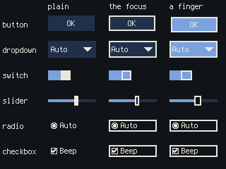

# Справочник API

*[In English](../en/api.md)*

На этой странице перечислены все публичные типы, функции и константы dgx-ui, по заголовочным файлам. Как они
работают вместе, объясняется на странице [Как это устроено](how-it-works.md); [Рецепты](cookbook.md) показывают их
в деле.

| Заголовок | Что в нём |
| --------- | --------- |
| [`dgx_ui.h`](#dgx_uih) | прямоугольники, состояние, виджет и его узел, дерево, раскладка, указатель, клавиши, фокус, всплывающее окно |
| [`dgx_ui_text.h`](#dgx_ui_texth) | шрифты и стили текста, текстовое поле, задание текста |
| [`dgx_ui_msg.h`](#dgx_ui_msgh) | сообщение, как предложить его дереву, декодеры, набранные символы |
| [`dgx_ui_post.h`](#dgx_ui_posth) | отправка сообщения через очередь FreeRTOS |
| [`dgx_ui_ticker.h`](#dgx_ui_tickerh) | сообщение раз в столько-то миллисекунд |
| [`dgx_ui_paint.h`](#dgx_ui_painth) | отрисовка, облики и их параметры |
| [`dgx_ui_dropdown.h`](#dgx_ui_dropdownh) | раскрытый выпадающий список: его строки во всплывающем окне |
| [`dgx_ui_transition.h`](#dgx_ui_transitionh) | страницы, которые сменяются сдвигом или кроссфейдом |
| [`dgx_ui_stats.h`](#dgx_ui_statsh) | статистика отрисовки: измеренный проход |
| [`dgx_ui_load.h`](#dgx_ui_loadh) | дерево из описания в JSON |
| [`dgx_ui_di.h`](#dgx_ui_dih) | касание DGX-DI как указатель дерева |
| [`dgx_ui_appearance.h`](#dgx_ui_appearanceh) | цвета, стили текста и облики из описания в JSON, одного на все страницы |
| [`project_include.cmake`](#project_includecmake) | три вызова CMake: описания, файлы имён и внешний вид, переведённые на C при сборке программы |

Все публичные имена начинаются с `dgx_ui_` или `DGX_UI_`. В каждом заголовке есть `extern "C"` для C++. Версия 0.0.70:
имена и сигнатуры ещё могут измениться.

Деревом владеет одна задача. Все вызовы ниже делает она, кроме вызовов `dgx_ui_post.h`, которые можно делать из
любой задачи. Библиотека ничего не хранит о дереве вне самого дерева и его отрисовки, поэтому две задачи, каждая
со своими деревьями и отрисовками, друг другу не мешают.

## dgx_ui.h

### Прямоугольники

```c
typedef struct dgx_ui_rect_t {
    int16_t x, y;
    int16_t w, h;
} dgx_ui_rect_t;
```

Прямоугольник экрана в пикселях. Без ширины или без высоты он пуст.

| Вызов | Что делает |
| ----- | ---------- |
| `dgx_ui_rect_t dgx_ui_rect(int x, int y, int w, int h)` | Прямоугольник из угла и размера. |
| `bool dgx_ui_rect_empty(const dgx_ui_rect_t *r)` | Пуст ли он. |
| `bool dgx_ui_rect_intersect(const dgx_ui_rect_t *a, const dgx_ui_rect_t *b, dgx_ui_rect_t *out)` | Общая часть двух прямоугольников, в `out`; им может быть `a` или `b`. `false` и нули, если общей части нет. |
| `int dgx_ui_rect_subtract(const dgx_ui_rect_t *box, const dgx_ui_rect_t *cut, dgx_ui_rect_t out[4])` | Части `box` вне `cut`: до четырёх прямоугольников, которые не перекрываются, первой идёт полоса сверху. Возвращает их число; 0, если `box` пуст или закрыт целиком. `x + w` и `y + h` у `box` не больше 32767. |

### Состояние

```c
typedef struct dgx_ui_bits_t {
    uint8_t bits;
} dgx_ui_bits_t;

typedef struct dgx_ui_state_t {
    uint8_t bits;
    int32_t value;
} dgx_ui_state_t;
```

| Бит | Что значит |
| --- | ---------- |
| `DGX_UI_HIDDEN` | не показан, не занимает места в строке или столбце, в него нельзя попасть, не получает фокус |
| `DGX_UI_DISABLED` | показан так, как его рисует облик в этом состоянии; в него нельзя попасть, не получает фокус |
| `DGX_UI_FOCUSED` | клавиши идут к нему |
| `DGX_UI_PRESSED` | нажат: пальцем или программой |

`dgx_ui_bits_t` — биты состояния: с какими виджет начинает, его `state`, и какие они сейчас, `state` его узла.
`dgx_ui_state_t` — состояние, каким оно было нарисовано в последний раз, биты и значение: `state_drawn` узла.

**Значение** элемента управления, выбранная строка списка, картинка значка в дереве не хранится. Оно живёт в
переменной программы типа `int32_t`, в его месте, которое виджет называет членом `value`.

- В место пишет программа, пользователь через ядро или `dgx_ui_set_value()` — всё в задаче, владеющей деревом.
  Константа с местом принадлежит деревьям одной задачи; другая задача шлёт сообщение.
- Отрисовка в начале прохода смотрит на каждое место и рисует виджеты, в месте которых не то значение, что они
  нарисовали. Поэтому заполнить переменные до первого прохода — значит загрузить настройки, а записать их куда-то —
  значит сохранить.
- Место, записанное после прохода, своего прохода не просит: задача, которая пишет, уже разбужена сообщением,
  заставившим её писать, и её следующий проход это нарисует.
- При чтении через `dgx_ui_value()` или `dgx_ui_value_of()` значение держится в пределах `min..max`, если
  `min < max`, а у списка и выпадающего списка — если `min <= max`, в том числе при одной строке; у значка и у
  радиокнопки — нет. У списка или выпадающего списка с `max < min` строк нет: выбирать нечего, и пользователь ничего
  не меняет. Сама память остаётся как есть: она могла прийти из флеша; следующее изменение
  пользователем запишет её уже в пределах.
- Одно место могут называть несколько виджетов, и все они идут за ним. У константы, добавленной дважды или в два
  дерева, значение общее.
- Элемент управления без места показывает 0, и ничто его не меняет; его облик сообщает об этом в журнале, один раз
  на облик.

### Виджет

```c
typedef struct dgx_ui_widget_t {
    uint8_t        kind;
    dgx_ui_bits_t  state;
    uint32_t       flags;
    int16_t        pad, gap;
    int16_t        at_x, at_y;
    int16_t        want_w, want_h;
    int16_t        min, max, step;
    int16_t        tag;
    int32_t       *value;
    const dgx_ui_picture_t *picture;
    dgx_ui_textbox_t       *text;
    const dgx_ui_look_t    *look;
    bool (*take)(dgx_ui_t *ui, int i, const dgx_ui_msg_t *msg);
    void (*on_event)(dgx_ui_t *ui, int i, const dgx_ui_node_t *node, int what, void *ctx);
    void *ctx;
    void *own;
} dgx_ui_widget_t;
```

То, что программа говорит о виджете. Библиотека в него не пишет. На 32-битном чипе он занимает 60 байт<!-- sizeof dgx_ui_widget_t -->. Ноль —
значение по умолчанию у каждого поля.

| Поле | Что значит |
| ---- | ---------- |
| `kind` | что это: см. виды ниже |
| `state` | состояние, с которого он начинает: `.state = {.bits = DGX_UI_HIDDEN}` или `DGX_UI_DISABLED` |
| `flags` | как он устроен: см. флаги ниже |
| `pad`, `gap` | у контейнера: от его краёв до детей и между детьми, в точках или в процентах с `DGX_UI_PERCENT_PAD`, `DGX_UI_PERCENT_GAP` (проценты ниже) |
| `at_x`, `at_y` | где он просит стоять от внутреннего края родителя, в точках или в процентах с `DGX_UI_PERCENT_X`, `DGX_UI_PERCENT_Y`; отрицательное — от дальнего края. В столбце учитывается только `at_x`, в строке — только `at_y` |
| `want_w`, `want_h` | размер в точках или в процентах с `DGX_UI_PERCENT_W`, `DGX_UI_PERCENT_H`; 0 в точках — по содержимому, а поперёк укладки — во весь контейнер. Содержимое виджета с текстом — строки его текста; кнопка, выпадающий список, радиокнопка и флажок на точку выше них сверху и снизу: это место для рамки фокуса. Кнопка, переключатель или радиокнопка с картинкой, каким бы обликом они ни рисовались, просят размер своей первой картинки, увеличенной по её `scale`, и ещё 5 точек в ширину и в высоту: точка лицевой стороны и точка рамки с каждой стороны и одна под тень |
| `min`, `max`, `step` | диапазон элемента управления и его шаг; первая и последняя строка списка, а в `step` — наименьшая высота его строк в точках, 0 — строка текста; значения картинок значка; в `step` радиокнопки — число, которому она соответствует |
| `tag` | номер, который дала ему программа; по нему ищет `dgx_ui_find()`. 0 — тега нет |
| `value` | где живёт его значение, переменная программы типа `int32_t`: `.value = &volume`; `NULL` — значения нет. См. «Значение» выше |
| `picture` | у картинки — одна; у значка — массив для значений `min..max`; если рисует `dgx_ui_look_picture_button`, у кнопки одна, у переключателя и радиокнопки две: выключено и включено, не выбрана и выбрана |
| `text` | его текстовое поле, в памяти |
| `look` | как он рисуется; `NULL` — облик его вида, такой есть у контейнера, рамки и надписи. Любой другой виджет без облика не рисуется, и отрисовка один раз пишет об этом в журнал |
| `take` | вызывается для каждого сообщения, предложенного дереву; `true` забирает сообщение |
| `on_event` | ей сообщается, что сделал с виджетом пользователь: см. события ниже. Она получает узел виджета, какой он сейчас; значение, которое выставил пользователь, лежит в месте виджета, в переменной самой программы, и его же читает `dgx_ui_value_of(node)` |
| `ctx` | передаётся в `on_event()` |
| `own` | данные виджета собственного вида программы |

**Виды**

| Вид | Что это |
| --- | ------- |
| `DGX_UI_BOX` | контейнер: ставит детей столбцом или строкой, иначе они стоят там, где просят |
| `DGX_UI_FRAME` | рамка: контейнер с заливкой и границей |
| `DGX_UI_LABEL` | надпись: текст |
| `DGX_UI_PICTURE` | одна картинка |
| `DGX_UI_ICON` | значок: картинку из массива выбирает значение; вне `min..max` картинки нет |
| `DGX_UI_LIST` | список: строки, одна выбрана — это значение, `min` — первая строка. Если строк больше, чем в него помещается, он показывает окно из них и прокручивается. Его облик — `dgx_ui_look_list` |
| `DGX_UI_SWITCH` | переключатель: значение 0 или 1 |
| `DGX_UI_SLIDER` | ползунок: значение `min..max` с шагом `step` |
| `DGX_UI_BUTTON` | кнопка: срабатывает по нажатию |
| `DGX_UI_INPUT` | поле ввода |
| `DGX_UI_DROPDOWN` | выпадающий список: кнопка, которая показывает выбранный вариант. Варианты — строки его текста, значение — выбранный вариант. Когда кнопка сработала, программа открывает его список вызовом `dgx_ui_dropdown_open()` |
| `DGX_UI_OWN` | свой вид: рисуется обликом программы, данные лежат в `own`; если облик называет поведение, виджетом управляют палец и клавиши. Полоса уровня, `dgx_ui_look_level`, и кольцевая шкала, `dgx_ui_look_ring`, из библиотеки — тоже облики для него |
| `DGX_UI_RADIO` | радиокнопка, одна из группы. Группа — это место: каждая её кнопка называет одно и то же `value`. Кнопка соответствует числу в своём `step` и выбрана, пока в месте лежит это число; кнопка без места не выбрана никогда. Щелчок или клавиша «активировать», пока кнопка в фокусе, пишет её число: её `on_event()` получает `DGX_UI_EVENT_CHANGED`, если место изменилось, а кнопке, которая была выбрана, ничего не сообщается. Её значение — значение группы, пределами `min` и `max` не ограничивается |

**Флаги**

| Флаг | Что значит |
| ---- | ---------- |
| `DGX_UI_COLUMN` | контейнер ставит детей одного под другим |
| `DGX_UI_ROW` | контейнер ставит детей рядом |
| `DGX_UI_STRETCH` | шириной со столбец или высотой со строку, какой бы размер у него ни был |
| `DGX_UI_RELATIVE` | ползунок двигается на столько, на сколько ушёл палец от места касания; вся ширина — весь диапазон. Короткое касание без движения считается нажатием |
| `DGX_UI_DRAG` | кнопку можно не только нажать, но и тащить вверх или вниз, как ручку полосы прокрутки: `on_event()` получает `DGX_UI_EVENT_CHANGED` при каждом движении |
| `DGX_UI_REST` | вдоль укладки столбца или строки занимает всё, что осталось в контейнере после остальных детей, промежутков и отступов; несколько таких делят остаток поровну; не меньше 0 |
| `DGX_UI_CANVAS` | у виджета есть свой холст — картинка, которая хранится от прохода к проходу: `dgx_ui_canvas()` |
| `DGX_UI_REPEAT` | кнопка, которой `DGX_UI_EVENT_ACTIVATED` сообщается снова и снова, пока её держат: «+» степпера |
| `DGX_UI_PERCENT_X`, `DGX_UI_PERCENT_Y` | `at_x`, `at_y` в процентах, а не в точках |
| `DGX_UI_PERCENT_W`, `DGX_UI_PERCENT_H` | `want_w`, `want_h` в процентах |
| `DGX_UI_PERCENT_PAD`, `DGX_UI_PERCENT_GAP` | `pad`, `gap` контейнера в процентах |
| `DGX_UI_SCROLL` | контейнер-столбец, дети которого могут быть выше него, — окно над ними: [Прокручиваемый контейнер](#прокручиваемый-контейнер) |

Кнопке с `DGX_UI_REPEAT` сообщается `DGX_UI_EVENT_ACTIVATED`, когда на неё опускается палец, а затем, начиная с
`DGX_UI_REPEAT_FIRST_MS`, каждые `DGX_UI_REPEAT_MS`, пока палец её держит, куда бы он ни ушёл: кнопка остаётся
нажатой и выглядит нажатой, пока палец не поднят. Когда он поднимается, ничего не сообщается, так что щелчок — это
один `DGX_UI_EVENT_ACTIVATED`. Клавиша «выбрать», удерживаемая на такой кнопке в фокусе (`dgx_ui_buttons()`), повторяется
так же. Повторы приходят из `dgx_ui_time()`: цикл с такой кнопкой зовёт её на каждом обороте и ждёт по
`dgx_ui_wake()`; без этого вызова кнопке сообщается один раз, при нажатии, и больше ни разу. Повтор кончается, когда
палец поднялся или нажатие потрачено: на кнопке сообщён свайп, её скрыли, отключили или удалили, над её деревом
открылось окно. Повторяется что-то одно, начатое последним: клавиша, нажатая, пока повторяет палец, перехватывает
повтор, а второй, всё ещё удерживаемый, не начинается заново, когда первый кончился. `DGX_UI_PRESSED`, выставленный
программой, показывает кнопку нажатой и ничего не повторяет, а кнопка, у которой есть ещё и `DGX_UI_DRAG`,
перетаскивается и не повторяет. У других видов флаг ничего не значит. Рецепт:
[Степпер: минус, значение, плюс](cookbook.md#степпер-минус-значение-плюс).

**Проценты.** Число в процентах пишется через `DGX_UI_PERCENT(p)`, рядом с его флагом:
`.want_w = DGX_UI_PERCENT(50), .flags = DGX_UI_ROW | DGX_UI_PERCENT_W`. Поле хранит его как фиксированную точку 8.8,
от -128 % до 127,99 % с шагом 1/256 %, а макрос держит число за этими пределами у края; это константное выражение и
в C, и в C++. Процент берётся от пикселей: `unit` умножает точки, но никогда не проценты.

| Процент | От чего |
| --- | --- |
| `pad` | от собственной ширины контейнера, со всех четырёх сторон |
| `gap` | от внутренней длины вдоль укладки: ширины в строке, высоты в столбце |
| размер вдоль укладки строки или столбца | от места, которое делят дети: внутреннего размера за вычетом промежутков между показанными детьми, не меньше 0 |
| размер поперёк укладки и в обе стороны в контейнере без флага укладки | от внутреннего размера |
| место, `at_x` и `at_y` | от внутреннего размера; отрицательное — от дальнего края, как в точках |

- Вдоль укладки проценты детей берутся нарастающим итогом в их порядке, так что они складываются без потерянного или
  лишнего пикселя: два по 50 % с промежутком заполняют строку ровно. Итог больше 255,99 % держится на нём.
- Ребёнок в точках берёт свои точки, а ребёнок с `DGX_UI_REST` — то, что осталось после точек и процентов; ни тот,
  ни другой у процентов не отнимает.
- Скрытый ребёнок не участвует ни в чём: ни промежутка, ни доли места, ни шага итога.
- 0 с флагом — это 0 %, никакого размера; 0 в точках — размер по содержимому.
- Дети корня считаются от корня, положенного на экран или на заданный прямоугольник.
- Рецепт: [Одно дерево на всех платах](cookbook.md#одно-дерево-на-всех-платах).

**События**: что сообщается функции `on_event()` в `what`.

| Событие | Когда |
| ------- | ----- |
| `DGX_UI_EVENT_ACTIVATED` | кнопку, строку списка или выпадающий список нажали пальцем или клавишей; в поле ввода набрали «готово» |
| `DGX_UI_EVENT_CHANGED` | пользователь изменил значение: пальцем, клавишей или набранной буквой |
| `DGX_UI_EVENT_FOCUS` | виджет получил фокус |
| `DGX_UI_EVENT_BACK` | в поле ввода набрали «отмена»; сообщается корню страницы или окна, которое закрывает клавиша «назад», перед закрытием |
| `DGX_UI_EVENT_NO_MEMORY` | холст виджета получить не удалось: сообщается один раз для этого размера, после прохода; новая попытка — каждый раз, когда облик просит холст |
| `DGX_UI_EVENT_EDIT` | на поле ввода нажали пальцем или клавишей, пока оно в фокусе: программа открывает свой редактор, клавиатуру |
| `DGX_UI_EVENT_SHOWN` | сообщается корню дерева: дерево появилось на экране. Оно открыто как окно, и над ним нет страницы, или страница над ним закрылась. Первому дереву в начале не сообщается; при `dgx_ui_show()` у виджета — тоже |
| `DGX_UI_EVENT_COVERED` | сообщается корню дерева: дерево ушло с экрана. Над ним открылась страница, или оно закрылось, пока было показано |

`on_event()` сообщается только то, что сделал пользователь, и никогда то, что выставила программа. Исключение — два события
корня, `DGX_UI_EVENT_SHOWN` и `DGX_UI_EVENT_COVERED`: их сообщают, кто бы ни открыл или закрыл окна, в том числе сама программа;
см. [Всплывающее окно](#всплывающее-окно). Внутри `on_event()` можно менять и удалять виджеты, в том числе тот, для
которого она вызвана.

### Картинка

```c
typedef struct dgx_ui_picture_t {
    const dgx_image_t *image;
    const uint16_t    *rgb565;
    const uint8_t     *map;
    int16_t            width, height;
    uint8_t            scale;
} dgx_ui_picture_t;
```

Картинка DGX в `image`: её рисует `dgx_ui_look_picture`, если она в 1 бит. Или строки RGB565, старший байт первым, в
`rgb565`, с шириной `width` и высотой `height`: их рисует `dgx_ui_look_rgb565`. Картинку в 4 или 8 бит в `image`
рисует `dgx_ui_look_indexed`: её значения идут через `map` в номера цветов таблицы отрисовки, значение 1 — это
`map[0]`; без карты номером служит само значение; пиксель 0 — бумага.

`void dgx_ui_picture_size(const dgx_ui_picture_t *p, int *w, int *h)` даёт размер и той и другой.

`scale` — во сколько раз её увеличить: 0 — пиксель картинки равен пикселю экрана; 1 — точке дерева, `unit` на `unit`
пикселей; больше — стольким точкам; больше 255 пикселей экрана на её пиксель не бывает. Так её рисует любой облик
картинки, и размер виджета по содержимому это учитывает; картинка больше своего виджета обрезается по его краю.
Картинка занимает 20 байт<!-- sizeof dgx_ui_picture_t --> на 32-битном чипе.

`int dgx_ui_picture_scale(const dgx_ui_t *ui, const dgx_ui_picture_t *picture)` даёт, сколько пикселей экрана в дереве
занимает пиксель картинки по ширине и по высоте: 1 при `scale` 0, иначе `scale`, умноженный на `unit`, но не больше
255; при `ui`, равном `NULL`, точка считается в 1 пиксель.

### Узел

```c
typedef struct dgx_ui_node_t {
    const dgx_ui_widget_t *widget;
    int16_t                parent;
    int16_t                child, next;
    int16_t                x, y, w, h;
    dgx_ui_bits_t          state;
    uint8_t                marks;
    dgx_ui_state_t         state_drawn;
} dgx_ui_node_t;
```

Виджет в дереве, 28 байт<!-- sizeof dgx_ui_node_t --> памяти на 32-битном чипе. Программа его читает, но не пишет.

| Поле | Что значит |
| ---- | ---------- |
| `widget` | то, что о нём сказала программа; `NULL` — место свободно |
| `parent`, `child`, `next` | номера родителя, первого ребёнка и следующего брата; -1, если такого нет |
| `x`, `y`, `w`, `h` | куда он разложен, в пикселях экрана |
| `state` | его биты, какие они есть: `state.bits`. Его значение живёт там, где сказал виджет |
| `state_drawn` | его биты и значение, какими они были нарисованы в последний раз: принадлежит отрисовке. У радиокнопки значение — была ли она нарисована выбранной, 1 или 0 |
| `marks` | пометки библиотеки: см. ниже |

| Пометка | Что значит |
| ------- | ---------- |
| `DGX_UI_MARK_CHANGED` | изменилось содержимое |
| `DGX_UI_MARK_WHOLE` | нужно нарисовать целиком |
| `DGX_UI_MARK_FIT` | текст нужно заново подобрать под поле |
| `DGX_UI_MARK_TIME` | облик попросил время: его вызовут снова на следующем проходе |
| `DGX_UI_MARK_BELOW` | под ним есть виджет, который нужно нарисовать: отрисовка спускается только туда, где стоит эта пометка |
| `DGX_UI_MARK_WINDOW` | окно списка нужно привести к выбранной строке, когда он рисуется в следующий раз: задано его значение или изменилась высота |
| `DGX_UI_MARK_AROUND` | его ребёнок сдвинулся, появился или исчез: контейнер или рамка со столбцом или строкой заливает место вокруг детей, а рисуются только дети, помеченные сами |
| `DGX_UI_MARK_HARD_SIZE` | холст виджета остаётся того размера, какой есть: больший получить не удалось |

### Дерево

`dgx_ui_t` — дерево и то, что с ним сейчас делают указатель и клавиши, 100 байт<!-- sizeof dgx_ui_t -->. Программа заполняет его вызовом
`dgx_ui_init()` и меняет только через вызовы. Его первые поля программа может читать, облик тоже: `first`,
`first_size` и `count` — узлы; `root_rect` — где разложен корень; `screen_w` и `screen_h`; `unit`; `focus` — номер
виджета в фокусе, `pressed` — номер виджета, на котором удерживается указатель (оба -1, если такого нет); `popup` —
открытое поверх дерева окно, с его `popup_flags`; `level` — сколько окон лежит под ним, 0 у дерева, которое не окно;
`screen_turn`. Остальное принадлежит библиотеке: программа его не читает и не пишет.

`DGX_UI_BLOCK` равно 64: узлы сверх массива программы выделяются блоками такого размера.

| Вызов | Что делает |
| ----- | ---------- |
| `void dgx_ui_init(dgx_ui_t *ui, dgx_ui_node_t *first, int first_size, int unit)` | Дерево в массиве программы на `first_size` узлов; `NULL` и 0, если все узлы должны выделяться блоками. `unit` — сколько пикселей в точке. |
| `void dgx_ui_free(dgx_ui_t *ui)` | Все виджеты удалены, блоки возвращены. Дерево, открытое как окно, сначала закрывается, как и окна, открытые над деревом; их корням сообщается то же, что при закрытии. Дереву, которое освобождают, сообщается `DGX_UI_EVENT_COVERED`, если оно было показано, и никогда `DGX_UI_EVENT_SHOWN`; деревьям, которые после этого появились на экране, сообщается уже после того, как оно стёрто. Заново строить дерево вызовом `dgx_ui_init()` можно, только пока оно не открыто. |
| `int dgx_ui_add(dgx_ui_t *ui, int parent, const dgx_ui_widget_t *w)` | Виджет добавлен последним ребёнком `parent`; первый добавленный становится корнем, каким бы ни был `parent`. Возвращает его номер; -1, если такого родителя нет или нет памяти на блок. Дерево запоминает указатель: виджет должен жить, пока он в дереве. |
| `int dgx_ui_insert(dgx_ui_t *ui, int parent, int before, const dgx_ui_widget_t *w)` | То же, но перед ребёнком `before`; -1 — последним. |
| `void dgx_ui_remove(dgx_ui_t *ui, int i)` | Виджет удалён со всем, что под ним. Фокус и нажатие внутри него сбрасываются, никому ничего не сообщается. Его номер достанется виджету, добавленному позже. Если это виджет, над которым лежат страницы (`dgx_ui_page_place()`), или контейнер над ним, страницы занимают весь экран, а корням, которые из-за этого накрыты или показаны, сообщается `DGX_UI_EVENT_COVERED` и `DGX_UI_EVENT_SHOWN` прямо внутри вызова. |
| `int dgx_ui_find(const dgx_ui_t *ui, int parent, int tag)` | Первый виджет с таким тегом под `parent`, в порядке дерева; `parent` -1 — во всём дереве. -1, если такого нет. |
| `const dgx_ui_node_t *dgx_ui_node(const dgx_ui_t *ui, int i)` | Узел по номеру, только для чтения: он принадлежит дереву и меняется только вызовами; `NULL` за пределами дерева. |
| `const dgx_ui_widget_t *dgx_ui_widget(const dgx_ui_t *ui, int i)` | Виджет по номеру; `NULL`, если под этим номером виджета нет. |

### Раскладка

| Вызов | Что делает |
| ----- | ---------- |
| `void dgx_ui_set_root(dgx_ui_t *ui, int x, int y, int w, int h)` | Прямоугольник, в который раскладывается корень, в пикселях. Без этого вызова корень занимает весь экран. |
| `void dgx_ui_relayout(dgx_ui_t *ui)` | Дерево будет разложено заново перед следующей отрисовкой или проверкой указателя: вызывается после того, как программа изменила виджет, который держит в своей памяти. |
| `void dgx_ui_screen(dgx_ui_t *ui, int width, int height, int turn)` | Экран, на котором показано дерево. Отрисовка вызывает её на каждом проходе; программа — в тесте без отрисовки. При другом размере или другом `turn` дерево раскладывается заново и рисуется целиком. |
| `bool dgx_ui_layout(dgx_ui_t *ui)` | Раскладывает дерево сейчас, если нужно; `true`, если разложила. Её вызывают отрисовка и указатель. |

### Смена состояния

Ни один из этих вызовов не сообщает ничего функции `on_event()`.

| Вызов | Что делает |
| ----- | ---------- |
| `int32_t dgx_ui_value(const dgx_ui_t *ui, int i)` | Значение виджета `i`, прочитанное из его места и приведённое к пределам `min..max`, если `min < max`; у значка не ограничивается. 0 у виджета без места и у номера, под которым виджета нет. |
| `int32_t dgx_ui_value_of(const dgx_ui_node_t *node)` | То же по узлу, для `on_event()` и облика, которым передаётся узел. |
| `bool dgx_ui_radio_chosen(const dgx_ui_node_t *node)` | Выбрана ли радиокнопка в своей группе: в её месте лежит её `step`. Встраиваемая функция заголовка. |
| `void dgx_ui_set_value(dgx_ui_t *ui, int i, int value)` | Пишет значение в место виджета, в пределах `min..max`, если `min < max`. Значение значка не ограничивается: вне диапазона он не показывает картинку. У виджета без места ничего не делает. Программа может с тем же успехом записать свою переменную сама. |
| `void dgx_ui_set_state(dgx_ui_t *ui, int i, unsigned bits, bool on)` | Ставит или снимает `DGX_UI_DISABLED` или `DGX_UI_PRESSED`. Отключённый виджет теряет фокус, и нажатие пальца на нём заканчивается. |
| `void dgx_ui_show(dgx_ui_t *ui, int i, bool shown)` | Показывает или скрывает; его строка или столбец раскладывается заново. Скрытый виджет теряет фокус и нажатие пальца. |
| `void dgx_ui_redraw(dgx_ui_t *ui, int i)` | На следующем проходе виджет рисуется целиком, со всем, что под ним. |
| `bool dgx_ui_hidden(const dgx_ui_t *ui, int i)` | Скрыт ли он: сам или виджетом над ним. |

### Указатель

```c
typedef struct dgx_ui_pointer_t {
    int16_t  x, y;
    bool     down, pressed, released;
    bool     swipe;
    uint32_t ms;
} dgx_ui_pointer_t;
```

Указатель сейчас: где он, в пикселях экрана; `down` — опущен; `pressed` и `released` — опустился и поднялся с
прошлого раза; `swipe` — сейчас сообщён свайп; `ms` — время по часам программы, тем же, что передаются в
`dgx_ui_time()`.

| Вызов | Что делает |
| ----- | ---------- |
| `bool dgx_ui_pointer(dgx_ui_t *ui, const dgx_ui_pointer_t *pointer)` | Передаёт указатель дереву, а сначала его всплывающему окну. Виджет, на который он опустился, нажат, пока указатель не поднимется, куда бы он ни ушёл. Если указатель отпущен не позже чем через `DGX_UI_CLICK_MS`, без свайпа и без перетаскивания, это нажатие: срабатывает кнопка, строка списка или выпадающий список, переключатель меняет положение, полю ввода сообщается `DGX_UI_EVENT_EDIT`, своему виджету программы — `DGX_UI_EVENT_ACTIVATED` после `up` его поведения. Свайп, начатый на поле, редактор не открывает. Виджет, чей `on(DGX_UI_EVENT_FOCUS)` открывает над ним всплывающее окно, нажатым не становится: палец на этом израсходован. Возвращает `true`, если указатель взял виджет или модальное всплывающее окно (`DGX_UI_POPUP_MODAL`) над деревом: оно забирает каждый указатель, который до него доходит, — нажатие, движение и отпускание, на окне и рядом с ним; только окно с `DGX_UI_POPUP_PLACE` отдаёт палец рядом с собой деревьям под ним. |
| `int dgx_ui_hit(dgx_ui_t *ui, int x, int y)` | Самый глубокий виджет под пикселем, который отвечает на указатель; -1, если такого нет. В виджет можно попасть, как и увидеть его, только внутри прямоугольника его родителя. |
| `bool dgx_ui_holding(const dgx_ui_t *ui)` | Держит ли указатель виджет дерева или его окна. |
| `bool dgx_ui_dragging(const dgx_ui_t *ui)` | Тащат ли виджет, который держит указатель: ползунок, список, кнопку с `DGX_UI_DRAG`, свой виджет программы, чья `move` так сказала. Такой виджет владеет пальцем. |

`DGX_UI_CLICK_MS` равно 500. `DGX_UI_KNOB` равно 3: ширина ручки ползунка в точках. `DGX_UI_LIST_ROW_EDGE` равно 12:
верхняя и нижняя двенадцатая часть строки списка не принадлежат ни одной строке.

### Клавиши и фокус

| Клавиша | Что делает |
| ------- | ---------- |
| `DGX_UI_KEY_NEXT`, `DGX_UI_KEY_PREV` | фокус переходит к следующему или предыдущему виджету, который его принимает; в списке сначала перебираются строки. Обход проходит поля ввода и редактор не открывает |
| `DGX_UI_KEY_ACTIVATE` | срабатывает кнопка, строка или выпадающий список в фокусе, переключатель меняет положение, полю ввода сообщается `DGX_UI_EVENT_EDIT`; своему виджету программы, который клавишу не взял, сообщается `DGX_UI_EVENT_ACTIVATED` |
| `DGX_UI_KEY_MORE`, `DGX_UI_KEY_LESS` | ползунок в фокусе на шаг вверх или вниз, переключатель включён или выключен |
| `DGX_UI_KEY_BACK` | закрывает верхнее окно, если у него есть `DGX_UI_POPUP_BACK` — страницу, раскрытый выпадающий список — и клавишу не взял ни один его виджет; иначе виджеты ядра её не берут: достаётся программе |

`DGX_UI_KEYS` — сколько всего клавиш. Свой виджет программы в фокусе спрашивают первым, о каждой клавише, функцией
`key` его поведения: [Облик и поведение](#облик-и-поведение).

| Вызов | Что делает |
| ----- | ---------- |
| `bool dgx_ui_key(dgx_ui_t *ui, int key)` | Передаёт клавишу дереву, а сначала его окну; `true`, если её взял виджет. |
| `bool dgx_ui_buttons(dgx_ui_t *ui, uint32_t held, uint32_t now_ms)` | Кнопки, которые удерживаются сейчас. Каждая, которую только что нажали, становится своей клавишей; «следующий», «предыдущий», «больше» и «меньше» повторяются, пока удерживаются. Вызывайте на каждом тике со всеми удерживаемыми кнопками, даже когда программа сама обработала одну из них: кнопка, нажатия которой вызов не видел, при следующем вызове станет новым нажатием. `true`, если клавишу взял виджет. |
| `bool dgx_ui_time(dgx_ui_t *ui, uint32_t now_ms)` | Шаг времени логики: удерживаемая клавиша повторяется, когда пришло её время, а кнопке с `DGX_UI_REPEAT`, которую держит палец, в дереве или в окне над ним, сообщается снова; состояние покоя, если программа назвала его для этого дерева, оценивается, и о нём сообщается. `true`, пока такая клавиша или кнопка удерживается: цикл просит время. |
| `void dgx_ui_focus(dgx_ui_t *ui, int i)` | Ставит фокус на виджет, которому сообщается `DGX_UI_EVENT_FOCUS`; -1 — ни на какой. Виджет, который взять фокус не может (скрытый, выключенный, свой без `DGX_UI_BEHAVIOR_FOCUS`), — тоже ни на какой. |

Удерживаемая клавиша повторяется через `DGX_UI_REPEAT_FIRST_MS`, 500 мс, после нажатия и дальше каждые
`DGX_UI_REPEAT_MS`, 100 мс.

### Какую клавишу даёт кнопка

`dgx_ui_buttons()` принимает кнопки битами геймпада, теми же, что в DGX-DI и DGX-GE, и превращает каждую кнопку в
клавишу по таблице.

| Кнопка | Её клавиша по умолчанию | Что делает клавиша |
| ------ | ----------------------- | ------------------ |
| `DGX_UI_GAMEPAD_UP` | `DGX_UI_KEY_PREV` | фокус переходит к предыдущему виджету |
| `DGX_UI_GAMEPAD_DOWN` | `DGX_UI_KEY_NEXT` | фокус переходит к следующему виджету |
| `DGX_UI_GAMEPAD_LEFT` | `DGX_UI_KEY_LESS` | ползунок в фокусе на шаг вниз, переключатель выключается |
| `DGX_UI_GAMEPAD_RIGHT` | `DGX_UI_KEY_MORE` | ползунок в фокусе на шаг вверх, переключатель включается |
| `DGX_UI_GAMEPAD_A` | `DGX_UI_KEY_ACTIVATE` | срабатывает кнопка, строка или выпадающий список в фокусе, переключатель меняет положение, полю ввода сообщается `DGX_UI_EVENT_EDIT` |
| `DGX_UI_GAMEPAD_BACK`, `DGX_UI_GAMEPAD_B` | `DGX_UI_KEY_BACK` | закрывает страницу или раскрытый выпадающий список; иначе виджеты её не берут: достаётся программе |
| `DGX_UI_GAMEPAD_START` | никакая | кнопка достаётся программе |

Таблица по умолчанию подходит столбцу настроек: вверх и вниз переходят от одной к другой, влево и вправо меняют ту,
что в фокусе.

Она не подходит кнопкам, которые стоят в ряд. Возьмём диалог с тремя кнопками в строке: «Назад», «OK» и «Дальше»,
фокус на «Назад». Пользователь нажимает вправо, чтобы перейти на «OK». Вправо — это «больше»; у кнопки нет значения,
которое можно увеличить, поэтому не происходит ничего. Фокус двигается только кнопками вверх и вниз, о чём, глядя на
ряд кнопок, не догадается никто.

Своя таблица программы даёт кнопкам влево и вправо клавиши, которые двигают фокус:

```c
/* three buttons in a row, "Back", "OK", "Next": left and right move the focus along the row */
static const uint8_t row_keys[8] = {
    DGX_UI_KEY_PREV,     /* DGX_UI_GAMEPAD_LEFT:  the focus to the button on the left; by default LESS */
    DGX_UI_KEY_NEXT,     /* DGX_UI_GAMEPAD_RIGHT: the focus to the button on the right; by default MORE */
    DGX_UI_KEY_PREV,     /* DGX_UI_GAMEPAD_UP:    the focus back, as by default */
    DGX_UI_KEY_NEXT,     /* DGX_UI_GAMEPAD_DOWN:  the focus on, as by default */
    DGX_UI_KEY_ACTIVATE, /* DGX_UI_GAMEPAD_A:     the focused button activated, as by default */
    0xff,                /* DGX_UI_GAMEPAD_START: no key, the button is the program's, as by default */
    DGX_UI_KEY_BACK,     /* DGX_UI_GAMEPAD_BACK:  back, which no widget takes: the program's, as by default */
    DGX_UI_KEY_BACK,     /* DGX_UI_GAMEPAD_B:     the same */
};
```

`void dgx_ui_button_keys(dgx_ui_t *ui, const uint8_t *keys)` даёт дереву такую таблицу: после
`dgx_ui_button_keys(&ui, row_keys)` кнопка вправо на «Назад» переводит фокус на «OK».

- В таблице 8 записей, по одной на кнопку, в порядке битов `DGX_UI_GAMEPAD_*`: LEFT, RIGHT, UP, DOWN, A, START, BACK, B.
- Запись — это `DGX_UI_KEY_*` или 0xff: кнопка не даёт клавиши и остаётся программе.
- Дерево запоминает указатель и ничего не копирует: дайте константу.
- Таблицу можно задать заново в любой момент, например, когда диалог-столбец сменился диалогом-строкой. `NULL`
  возвращает таблицу по умолчанию.
- Это таблица того дерева, которое передано в `dgx_ui_buttons()`. Клавиши, которые она даёт, идут и в окна над этим
  деревом, как любая клавиша.

### Состояние покоя

```c
typedef struct dgx_ui_idle_t {
    uint32_t after_ms;  /* программы: покой наступает, когда пользователя не было столько; 0 — никогда */
    int      what;      /* программы: номер сообщения, которое получает дом */
    bool     wake_acts; /* программы: ввод, который выводит из покоя, действует как любой; false — он расходуется */
    bool     idle;      /* программа читает: сейчас покой */
    /* остальное — библиотеки */
} dgx_ui_idle_t;
```

| Вызов | Что делает |
| ----- | ---------- |
| `void dgx_ui_idle(dgx_ui_t *home, dgx_ui_idle_t *idle, uint32_t now_ms)` | Называет состояние покоя программы — оно одно на всю программу — и отсчитывает время от `now_ms`; `home` — дерево, чей `dgx_ui_time()` о нём сообщает. Та же структура, названная снова, считается заново, а если ей уже было сообщено 1, на следующем шаге дома сообщается 0. Другая структура занимает её место. `NULL` — покоя нет, больше ничего не сообщается и не расходуется. В оставленной структуре `idle` с этого момента читается как false. |
| `uint32_t dgx_ui_idle_for(const dgx_ui_idle_t *idle, uint32_t now_ms)` | Сколько миллисекунд прошло с последнего действия пользователя; 0, пока клавиша или набранные символы ждут следующего `dgx_ui_time()`. |

Пользователь — это палец на экране, кнопка геймпада (удерживается, нажата или отпущена), клавиша, набранные символы,
в любом дереве программы: в доме, в окнах и страницах над ним, в другом доме. Палец считается лежащим на экране, а
кнопка удерживаемой по последнему сообщению о каждом из них, поэтому источник, который сообщает только об
изменениях, покоя под неподвижным пальцем не вызовет. Вызов `dgx_ui_pointer()`, который сообщает, что пальца нет,
пользователем не считается.

Когда пользователя не было `after_ms`, `dgx_ui_time()` дома выставляет `idle` и предлагает деревьям дома сообщение с
номером `what` и одним байтом, 1, как предлагается сообщение тикера: виджет узнаёт о нём в своём `take()`. Первый
же ввод после этого выводит из покоя: `idle` сразу становится false, а следующий `dgx_ui_time()` дома предлагает то же
сообщение с байтом 0. О том и другом сообщает только `dgx_ui_time()` дома, в задаче дома, даже когда ввод пришёл в
дерево другой задачи.

Ввод, который выводит из покоя, расходуется, пока `wake_acts` равен false, каким он оказался в этот момент: весь жест пальца
от нажатия до отпускания не доходит ни до одного дерева, клавиша и символы этого вызова никуда не идут, а кнопки
геймпада, удерживаемые в этот момент, не дают клавиш, пока каждую не отпустят. Каждый такой вызов возвращает `true`,
`dgx_ui_buttons()` — в том вызове, где кнопки израсходованы. Новое нажатие или сообщение, что пальца нет,
заканчивает жест, отпускание которого так и не пришло. С выставленным `wake_acts` этот ввод действует как любой
другой: это для экрана, который только притушен и на котором пользователь видит кнопку под пальцем.

У клавиши и у набранных символов нет времени: они засчитываются на следующем `dgx_ui_time()`, поэтому цикл сначала
отдаёт ввод, а потом время. `dgx_ui_wake()` отдаёт момент, когда наступит покой, как отдаёт момент повтора, а
`dgx_ui_time()` ради него `true` не возвращает: цикл, который ждёт не по `dgx_ui_wake()`, узнает о покое на
следующем своём обороте. `after_ms` можно менять на ходу. Подсветка и то, что экран показывает в покое, —
дело программы: [Притушить экран, когда никто не трогает](cookbook.md#притушить-экран-когда-никто-не-трогает).

Программа, которая покой не называет, несёт проверку одного указателя в каждом вызове ввода, который она делает,
и в `dgx_ui_time()`; программа, которая называет, — ещё около 1 КБ.

### Облик и поведение

```c
struct dgx_ui_look_t {
    bool (*draw)(const dgx_ui_look_t *look, dgx_ui_paint_t *paint, dgx_ui_t *ui, int i, uint32_t now_ms);
    const void              *params;
    uint8_t                  fill;
    const dgx_ui_behavior_t *behavior;
};

typedef struct dgx_ui_behavior_t {
    uint8_t flags;
    void (*down)(dgx_ui_t *ui, int i, int x, int y);
    bool (*move)(dgx_ui_t *ui, int i, int x, int y);
    void (*up)(dgx_ui_t *ui, int i, int x, int y, bool click);
    bool (*key)(dgx_ui_t *ui, int i, int key);
    void (*lay)(dgx_ui_t *ui, int i);
} dgx_ui_behavior_t;
```

Облик — как рисуется виджет. `draw` рисует виджет `i` в его состоянии и возвращает `true`, чтобы её вызвали снова на
следующем проходе. `params` — параметры своего типа у каждого облика. `fill` — номер цвета, который облик оставляет
под детьми виджета; `DGX_UI_PAPER` — то, что там лежало. `behavior` — поведение виджета вида `DGX_UI_OWN`, который рисуется
этим обликом, или прокручиваемого контейнера; `NULL` — виджет только рисуется. Из обликов библиотеки поведение есть
только у `dgx_ui_look_scroll` — `dgx_ui_scroll_behavior`. Правила, которых держится `draw`,
описаны в рецепте [Свой облик](cookbook.md#свой-облик).

Поведение — как виджет вида `DGX_UI_OWN` отвечает пальцу и клавишам. С ним ядро находит виджет под пальцем,
нажимает его и считает щелчок, как у своих видов; без него виджет только рисуется. Поведение, названное обликом
виджета другого вида, кроме контейнера с `DGX_UI_SCROLL`, не вызывается. Любая функция может быть `NULL`. `x` и `y` — в пикселях самого виджета, от его
левого верхнего угла; пока палец удерживается, они могут выходить за виджет.

| Поле | Когда вызывается |
| ---- | ---------------- |
| `flags` | `DGX_UI_BEHAVIOR_FOCUS`: виджет берёт фокус, а с ним клавиши. Без флага виджет только для пальца: нажатие на него оставляет фокус там, где он был, клавиши его обходят, а `dgx_ui_focus()` на нём снимает фокус со всех. `DGX_UI_BEHAVIOR_ALONE` вместе с ним: фокус — только пока никто под виджетом не может его взять, как у прокручиваемого контейнера с текстом |
| `down` | палец опустился на виджет; `DGX_UI_PRESSED` уже стоит, фокус уже дан |
| `move` | при каждом опросе указателя, пока виджет держит палец. `true` — это перетаскивание: при отпускании щелчка не будет, а `dgx_ui_dragging()` даёт `true`, и свайп от края программе не достаётся |
| `up` | палец отпущен; `click` — щелчок: без перетаскивания, без свайпа, не позже `DGX_UI_CLICK_MS`. После щелчка ядро сообщает `on_event()` событие `DGX_UI_EVENT_ACTIVATED`, так что `on_event()` видит значение, которое поставила `up` |
| `key` | клавиша, пока виджет в фокусе; его спрашивают первым, о каждой клавише; `true` — взял. Что он не взял, делает ядро: «следующий» и «предыдущий» переводят фокус, `DGX_UI_KEY_ACTIVATE` сообщает `DGX_UI_EVENT_ACTIVATED` (без `up`), «назад» остаётся программе |
| `lay` | раскладка детей обликом, вместо раскладки ядра у контейнера с `DGX_UI_SCROLL`: его дети разложены столбцом по его смещению, место удержано в пределах столбца, а ребёнок, который только перенесён, ничем не помечен. Есть у `dgx_ui_scroll_behavior` библиотеки; `NULL` у своего виджета программы |

| Вызов | Что делает |
| ----- | ---------- |
| `void dgx_ui_set_value_as_user(dgx_ui_t *ui, int i, int value)` | Ставит значение виджета так, как его ставит пользователь: в пределах `min`..`max`, виджет помечен, `on_event()` получает `DGX_UI_EVENT_CHANGED`, если значение изменилось, и ничего, если оно то же. Для кода поведения и для любого виджета: тест программы действует им как пользователь. |
| `void dgx_ui_tell(dgx_ui_t *ui, int i, int what)` | Сообщает `on_event()` виджета событие, узел — какой он сейчас. Для поведения, у которого изменились свои данные в `own`, и для любого виджета. |

Набранные символы идут только в `DGX_UI_INPUT`. Виджет нажимается по всему своему прямоугольнику. Рецепт:
[Свой виджет, которым управляют палец и клавиши](cookbook.md#свой-виджет-которым-управляют-палец-и-клавиши).

### Всплывающее окно

| Вызов | Что делает |
| ----- | ---------- |
| `bool dgx_ui_popup_open(dgx_ui_t *ui, dgx_ui_t *popup, int x, int y, int w, int h, unsigned flags)` | Открывает одно дерево поверх другого в прямоугольнике экрана, в пикселях; окно, которое у этого дерева уже было открыто, сначала закрывается. `ui` само может быть окном: окна встают одно над другим. `false`, и ничего не открыто, если окно — это само дерево, если у него открыто своё окно или оно открыто в другом месте, или если под деревом уже лежат `DGX_UI_POPUP_DEPTH` окон. |
| `void dgx_ui_popup_close(dgx_ui_t *ui)` | Закрывает окно этого дерева и все окна над ним; на следующем проходе деревья под ними рисуются там заново. |
| `bool dgx_ui_popup_back(dgx_ui_t *ui)` | Закрывает окно этого дерева так, как его закрывает клавиша «назад»: корню окна сначала сообщается `DGX_UI_EVENT_BACK`, пока оно открыто, потом закрываются оно и все окна над ним. Если этот `on_event()` сам закрыл окно, поставил на его место другое или открыл окно поверх него, больше ничего не закрывается: так страница спрашивает перед уходом, открывая вопрос поверх себя. `false` — над деревом нет открытого окна. |

| Флаг | Что значит |
| ---- | ---------- |
| `DGX_UI_POPUP_MODAL` | окно забирает каждый указатель и каждую клавишу; «назад» остаётся программе, если у окна нет `DGX_UI_POPUP_BACK`, и до деревьев под ним не доходит. Деревья под ним не показывают фокус |
| `DGX_UI_POPUP_CLOSE_OUTSIDE` | палец, опустившийся снаружи окна и всех окон над ним, закрывает его |
| `DGX_UI_POPUP_BACK` | клавиша «назад», которую не взял ни один виджет окна, закрывает его; корню окна сначала сообщается `DGX_UI_EVENT_BACK` |
| `DGX_UI_POPUP_SCREEN` | окно лежит на всём экране дерева и перекладывается при повороте экрана; `x`, `y`, `w`, `h` не читаются |
| `DGX_UI_POPUP_PLACE` | окно лежит на прямоугольнике виджета первого дерева, который назван вызовом `dgx_ui_page_place()`, и перекладывается, когда этот прямоугольник меняется; пока место не названо — на всём экране; `x`, `y`, `w`, `h` не читаются. Вместе с `DGX_UI_POPUP_MODAL` палец вне окна всё равно идёт деревьям под ним, если его не забирает окно выше, модальное и не на месте |

`DGX_UI_POPUP_DEPTH` равно 8: больше стольких окон одно над другим над деревом не открыть.

**Где сейчас дерево.** Дерево показано, пока над ним, на любом уровне выше, нет окна с `DGX_UI_POPUP_SCREEN`, то
есть страницы. Диалог, раскрытый выпадающий список, любое окно не на весь экран и не на месте ничего не накрывает.
Страница на месте (`DGX_UI_POPUP_PLACE`) накрывает только деревья места: нижнее окно места и те, что над ним.
Первое дерево под ней остаётся показанным, как и диалог, открытый над первым деревом до страниц. Окно места, пока
место не названо, накрывает как окно на весь экран. Корню дерева
сообщается `DGX_UI_EVENT_SHOWN`, когда дерево появляется на экране, и `DGX_UI_EVENT_COVERED`, когда оно с него уходит:

| Что происходит | Кому сообщается |
| -------------- | --------------- |
| окно открыто | если это страница, корням деревьев, которые она накрыла, `DGX_UI_EVENT_COVERED`, сверху вниз; затем корню самого окна `DGX_UI_EVENT_SHOWN` |
| окно закрыто | его корню `DGX_UI_EVENT_COVERED`, если оно было показано; если это была страница, затем корням деревьев, которые она накрывала, `DGX_UI_EVENT_SHOWN`, снизу вверх |
| один вызов закрыл несколько окон | сначала тем из них, что были показаны, `DGX_UI_EVENT_COVERED`, сверху вниз; затем деревьям, которые появились на экране |
| окно открыто снова в другом месте | никому: для него ничего не изменилось |

- События идут по очереди для каждого дерева: что корень запустил по `DGX_UI_EVENT_SHOWN`, он останавливает по
  `DGX_UI_EVENT_COVERED`.
- Сообщают вызовы, которые открывают и закрывают, в том числе клавиша «назад»: при самом вызове, а не при проходе,
  когда окна уже стоят так, как их оставил вызов.
- Первое дерево показано с самого начала, и тогда ему ничего не сообщается. Программа, которой нужен один путь для
  всех экранов, сообщает ему сама: `dgx_ui_tell(&home, 0, DGX_UI_EVENT_SHOWN)`.
- Накрытое дерево по-прежнему получает сообщения.
- `on_event()`, которой сообщили одно из двух событий, может открывать и закрывать окна: после каждой `on_event()` окна читаются
  заново. Она может закрыть или освободить своё дерево. Другое дерево, закрытое тем же вызовом, она не открывает, не
  закрывает и не освобождает: ему сообщат следующим. Дерево, которое сейчас освобождают, она тоже не открывает.
- Что корню сообщили последним, дерево хранит для библиотеки, и читать это нельзя: дерево, которое ни разу не
  открывали, говорит «показано». Программа, которой нужно спросить, держит свой флаг и выставляет его в этих двух
  событиях.

Рецепт: [Страница, которая работает, только пока её видно](cookbook.md#страница-которая-работает-только-пока-её-видно).

**Фокус под окном.** Пока над деревом, на любом уровне выше, лежит окно с `DGX_UI_POPUP_MODAL`, облики этого дерева
фокус не показывают: рамки нет, ручка сплошная, курсора нет, полоса списка такая же, как без фокуса. Клавиши идут в
окно, и об этом говорит единственный знак на экране. Сам фокус остаётся на месте: `focus` дерева и бит
`DGX_UI_FOCUSED` виджета те же, и программа может тем временем его передвинуть. Когда окно закрывается, знак
возвращается туда, где фокус в этот момент, и `DGX_UI_EVENT_FOCUS` не сообщается: фокус не приходил. Под немодальным
окном знак остаётся. Клавиши при этом всё равно идут такому окну первому, если в нём есть виджеты, принимающие фокус;
программа, которой нужно, чтобы окно сняло знак с дерева под ним, открывает его с `DGX_UI_POPUP_MODAL`.

### Страницы

Страница — это окно с `DGX_UI_POPUP_MODAL | DGX_UI_POPUP_BACK | DGX_UI_POPUP_SCREEN`: свой экран поверх того, что под
ним, который закрывается клавишей «назад». Пока первое дерево называет место для своих страниц, страница
открывается с `DGX_UI_POPUP_PLACE` вместо `DGX_UI_POPUP_SCREEN`: над прямоугольником этого виджета, а остальное
первое дерево остаётся на экране. Программа может открыть такое окно и сама, через `dgx_ui_popup_open()`; эти
вызовы — обычный случай, они лежат в своём файле.

| Вызов | Что делает |
| ----- | ---------- |
| `bool dgx_ui_page_open(dgx_ui_t *home, dgx_ui_t *page)` | Открывает страницу поверх верхней страницы `home` или поверх самого `home`. Сначала закрываются окна над этой страницей, которые закрыл бы палец в другом месте (`DGX_UI_POPUP_CLOSE_OUTSIDE`: раскрытый выпадающий список, подсказка), сверху вниз до первого, которое так не закрывается; модальный диалог, который ждёт ответа, остаётся под новой страницей. Возвращает то же, что `dgx_ui_popup_open()`. |
| `bool dgx_ui_page_back(dgx_ui_t *home)` | Закрывает верхнюю страницу `home` со всем, что над ней; её корню сначала сообщается `DGX_UI_EVENT_BACK`, пока она открыта. `false` — над `home` нет открытой страницы. |
| `bool dgx_ui_page_place(dgx_ui_t *home, int i)` | Кладёт страницы `home` на прямоугольник его виджета `i`: общая полоса над страницами. Страницы, открытые после этого, получают `DGX_UI_POPUP_PLACE`, а уже открытые сразу переезжают туда. -1 — снова весь экран. `false` — `home` само является окном или `i` не его виджет. |

Страница на месте идёт за прямоугольником своего виджета, когда первое дерево раскладывается заново, причём при
самой раскладке, так что палец и сборка застают её там, где она есть. Остальное первое дерево живёт: его виджеты
принимают палец, и оно не накрыто. Клавиши идут только верхней странице, поэтому, пока страница открыта, полосой
управляет только палец. Если виджет места скрыт, страницы над ним тоже скрыты, и им ничего не сообщается; если он
или контейнер над ним удалён, страницы занимают весь экран. То, что открывает виджет полосы, открывается над верхом
цепочки, который находят так: `dgx_ui_t *top = &home; while (top->popup) top = top->popup;` — окно, открытое над
первым деревом, закрывает прежнее, а с ним и страницы.

Рецепты: [Страницы и «назад»](cookbook.md#страницы-и-назад), [Полоса над страницами](cookbook.md#полоса-над-страницами).

### Прочее

`int dgx_ui_textbox_height(const dgx_ui_t *ui, const dgx_ui_textbox_t *box)`: высота, которую текстовое поле просит в
дереве, — его строки, умноженные на высоту строки первого шрифта (`dgx_ui_variant_line()`); при `ui`, равном `NULL`,
единица считается 1. Её вызывает раскладка.

`void dgx_ui_dump(const dgx_ui_t *ui)`: печатает дерево в журнал, по строке на виджет, с отступом по глубине:
номер, вид, место и размер, значение, состояние, пометки, тег и начало текста; потом окна над деревом; потом
сколько узлов занято, сколько вмещает массив программы и сколько блоков по 64 узла, по 1792 байта<!-- sizeof dgx_ui_node_t * DGX_UI_BLOCK -->, выделено сверх
него, и какого размера массив, чтобы блок не понадобился. Это отдельный файл: программа, которая её не вызывает,
его не несёт. Ничего не меняет.

## dgx_ui_text.h

### Шрифты и стили

```c
typedef struct dgx_ui_font_variant_t {
    const dgx_font_t    *font;
    int16_t              height;
    uint8_t              narrow;
    bool                 joined;
    uint32_t             pen;
    const dgx_ui_hand_t *hand;
    bool                 points;
} dgx_ui_font_variant_t;

typedef struct dgx_ui_text_style_t {
    const dgx_ui_font_variant_t *fonts;
    uint8_t                      count;
    uint8_t                      flags;
    dgx_font_align_t             align;
    uint16_t                     scroll_ms;
} dgx_ui_text_style_t;
```

Вариант — шрифт, которым можно нарисовать текст, 20 байт<!-- sizeof dgx_ui_font_variant_t -->: матричный или точечный шрифт DGX либо рукописный. Для
матричного и точечного шрифта остальные поля, кроме `points`, остаются нулевыми. Для рукописного шрифта (`DGX_FONT_HW` в DGX):

| Поле | Что значит |
| ---- | ---------- |
| `height` | высота строки в точках дерева |
| `narrow` | до скольких процентов можно сузить буквы по ширине, чтобы текст поместился; сужение идёт целыми процентами, берётся самое широкое, что помещается; 0 — нельзя |
| `joined` | буквы соединены |
| `pen` | ширина пера в точках, 0 — волосная линия в один пиксель при любой точке; для мягкого пера добавляется `DGX_PEN_SOFT` из DGX |
| `hand` | `&dgx_ui_handwriting` — пишется прямо на экран, жёстким пером. `&dgx_ui_handwriting_canvas` — то же, а у виджета с `DGX_UI_CANVAS` — в его холст, где мягкое перо остаётся мягким; нужны виртуальные экраны DGX. `NULL` — вариант пропускается |

`dgx_ui_hand_t` — свой тип библиотеки, который стоит за этими двумя константами. Рукописный текст пишут
однострочный облик текста и `dgx_ui_look_hand_lines`; остальные облики рукописный вариант пропускают. Текст, который не помещается даже
суженным, обрезается по прямоугольнику виджета в конце. Буквы, появляющиеся по одной (`dgx_ui_text_appear()`),
пишутся штрих за штрихом, весь текст — за время его букв по `letter_ms` каждая; облик просит проход каждые
`DGX_UI_HAND_FRAME_MS`, 20 мс. Рецепт: [Рукописный текст](cookbook.md#рукописный-текст).

Стиль перечисляет свои шрифты, `fonts`, — каждый вариантом, начиная с лучшего, — и их число `count`. `align` — `DGX_FONT_ALIGN_LEFT`, `_CENTER` или
`_RIGHT` из DGX. `scroll_ms` — сколько важный текст показывает строку, прежде чем прокрутиться вверх; 0 — он
прокручивается вручную.

| Флаг | Что значит |
| ---- | ---------- |
| `DGX_UI_STYLE_MIDDLE` | текст в более позднем варианте стоит посередине высоты, а не на базовой линии первого варианта, рукописного или нет |
| `DGX_UI_STYLE_IMPORTANT` | текст, который не помещается в свои строки, прокручивается, а не обрезается; для `dgx_ui_look_lines` и `dgx_ui_look_hand_lines` |

**Шрифт как есть.** `points`, равное true, у варианта матричного шрифта рисует каждый пиксель шрифта квадратом в
единицу дерева, ту, что дана `dgx_ui_init()`, чётко, без сглаживания; пиксель сглаженного шрифта — квадрат его
покрытия. Все размеры такого текста во столько же раз больше своих: высота строки, ширины, подбор варианта,
многоточие, раскладка слов по строкам. Это для шрифта, взятого как есть, а не сделанного под плату: пиксельного
шрифта игры. Шрифт, сделанный заявкой под `DGX_FONTS_SCALE`, уже нужного платы размера, поэтому программа с одним
деревом на все платы пишет `.points = !DGX_FONT_<ЗАЯВКА>_MADE`. Рукописный вариант это поле не читает. Рецепт:
[Одно дерево на всех платах](cookbook.md#одно-дерево-на-всех-платах).

`int dgx_ui_variant_line(const dgx_ui_t *ui, const dgx_ui_font_variant_t *v)`: высота строки варианта в дереве: её `height` у
рукописного шрифта, шаг строки шрифта у матричного, умноженные на точку дерева, матричный — только у варианта с
`points`; при `ui`, равном `NULL`, точка считается в 1 пиксель.

### Текстовое поле

```c
struct dgx_ui_textbox_t {
    char                      *buf;
    uint16_t                   size;
    uint8_t                    lines;
    uint8_t                    variant;
    const dgx_ui_text_style_t *style;
    uint16_t                   top;
    uint16_t                   letter_ms;
    uint32_t                   since_ms;
    uint16_t                   letters_drawn;
    uint16_t                   total_lines, total_letters;
    uint8_t                    flags;
};
```

Строка виджета и то, как она раскладывается, 28 байт<!-- sizeof dgx_ui_textbox_t -->. Программа задаёт `buf`, `size`, `lines` и `style` через
`dgx_ui_textbox_init()` и может читать `buf`. Остальное принадлежит библиотеке: вариант, в который подобран текст,
первая показанная строка и то, что считает облик текста в несколько строк. Флаги `DGX_UI_TEXTBOX_START`,
`DGX_UI_TEXTBOX_CAME`, `DGX_UI_TEXTBOX_ENDED`, `DGX_UI_TEXTBOX_COUNTED`, `DGX_UI_TEXTBOX_SEEN`, `DGX_UI_TEXTBOX_WHOLE`
и `DGX_UI_TEXTBOX_CARET` — курсор поля, как облик нарисовал его в последний раз, — тоже принадлежат библиотеке; что они значат для программы, говорит `dgx_ui_text_state()`. Текстовое поле
принадлежит одному виджету: второму виджету, который показывает тот же текст, нужно своё поле.

Поле с `size`, равным 0, стоит над строковой константой — таким его делает `DGX_UI_TEXT_CONST()`: в его буфер
библиотека никогда не пишет, и установка текста ничего не меняет. Само поле по-прежнему лежит в ОЗУ программы.
Строка может лежать под любым числом полей.

| Вызов | Что делает |
| ----- | ---------- |
| `void dgx_ui_textbox_init(dgx_ui_textbox_t *box, char *buf, int size, int lines, const dgx_ui_text_style_t *style)` | Текстовое поле поверх буфера программы на `size` байт, пустое, на столько-то строк. Заданный текст обрезается до `size - 1` байт. |
| `bool dgx_ui_text_printf(dgx_ui_t *ui, int i, const char *format, ...)` | Задаёт текст виджета как `printf()`; он обрезается по буферу на целой букве UTF-8. `true`, если текст изменился. При буфере до 256 байт тот же самый текст ничего не меняет; при буфере длиннее текст считается изменённым каждый раз. |
| `bool dgx_ui_text_vprintf(dgx_ui_t *ui, int i, const char *format, va_list args)` | То же с `va_list`. |
| `bool dgx_ui_text_set(dgx_ui_t *ui, int i, const char *text)` | Задаёт текст как есть. |
| `void dgx_ui_text_written(dgx_ui_t *ui, int i)` | Программа сама изменила буфер текстового поля виджета или направила поле на другую строку: виджет подгоняется и рисуется заново, его текст начинается сначала, а списку, открытому над его деревом и показывающему это поле, об этом сообщается — как при `dgx_ui_text_set()`. Отличается ли текст, вызов не смотрит. Буфер, в котором в пределах размера нет 0, заканчивается на `size - 1`, по целой букве. |
| `DGX_UI_TEXT_CONST(text, line_count, text_style)` | Инициализатор текстового поля над строковой константой: `static dgx_ui_textbox_t yes = DGX_UI_TEXT_CONST("Yes", 1, &style);`. Ни буфера, ни вызова. Называет каждый член по порядку, поэтому годится и для C++. |
| `void dgx_ui_text_appear(dgx_ui_t *ui, int i, int letter_ms)` | Со следующего прохода текст появляется по буквам, буква раз в столько-то миллисекунд; 0 — весь сразу. Текст, заданный позже, тоже появляется. Для `dgx_ui_look_lines`. |
| `int dgx_ui_text_state(const dgx_ui_t *ui, int i)` | Что текст виджета i уже показал, как его нарисовал последний проход: `DGX_UI_TEXT_COMING`, пока его буквы появляются (`dgx_ui_text_appear()`) или ещё ни разу не нарисованы; `DGX_UI_TEXT_SEEN`, когда облик показал всё, что покажет, и больше времени не просит; 0 — в промежутке: пока важный текст прокручивается к концу или текст, который показывается сразу, ещё не нарисован, а также если нет виджета или у него нет текста. «Показан» значит «показано всё, что будет показано», а не «на экране каждая буква»: строка, обрезанная многоточием, и строки неважного текста, которым мало места, показаны с первого же прохода. После нового текста или `dgx_ui_text_appear()` текст снова не показан, пока его не нарисуют. Скрытый виджет, виджет, целиком обрезанный родителями, или целиком закрытый всплывающим окном не рисуется и показанным не считается; закрытый частично — считается. Ставит это только собственный проход отрисовки: `dgx_ui_paint_area()` и составление экрана оставляют как было. |
| `void dgx_ui_text_whole(dgx_ui_t *ui, int i)` | Буквы, которые ещё появляются, на следующем проходе показываются все, как будто уже появились; важный текст после этого прокручивается начиная с этого прохода, первые строки стоят `scroll_ms`, как всегда. Текст, все буквы которого уже появились, — прокручивается он или дошёл до конца — остаётся как есть: прокрутка не начинается заново. Темп остаётся: текст, заданный позже, снова появляется по буквам. |
| `void dgx_ui_text_scroll(dgx_ui_t *ui, int i, int lines)` | Сдвигает строки неважного текста на столько-то вверх, так что в виду оказываются следующие за ними, а при отрицательном числе вниз, пока есть строки. Для `dgx_ui_look_lines`. У списка, который прокручивается, сдвигает его окно на столько-то строк в пределах его строк; выбор остаётся на месте, а следующее изменение значения возвращает окно к выбранной строке. |

Задание текста ничего не рисует и не измеряет: отрисовка подбирает шрифт и рисует текст на следующем проходе.

## dgx_ui_msg.h

```c
struct dgx_ui_msg_t {
    int     what;
    uint8_t flags;
    uint8_t count;
    union {
        uint8_t bytes[DGX_UI_MSG_BYTES];
        struct {
            void  *data;
            size_t size;
            void (*done)(void *data, size_t size);
        } ref;
    };
};
```

Сообщение, 20 байт<!-- sizeof dgx_ui_msg_t --> на 32-битном чипе: элемент очереди программы. `what` — номер, который выбрала программа. По
значению `count` байт лежат в `bytes`, не больше `DGX_UI_MSG_BYTES`, то есть 12. По ссылке во `flags` стоит
`DGX_UI_MSG_REF`, а в `ref` лежат данные, их размер и функция, которая вызывается, когда сообщение выбрасывают.
`DGX_UI_MSG_KEPT` помечает сообщение, данные которого виджет оставил себе.

| Вызов | Что делает |
| ----- | ---------- |
| `bool dgx_ui_msg_value(dgx_ui_msg_t *msg, int what, const void *data, size_t size)` | Заполняет сообщение по значению; `false`, если данных больше 12 байт. |
| `void dgx_ui_msg_ref(dgx_ui_msg_t *msg, int what, void *data, size_t size, void (*done)(void *, size_t))` | Заполняет сообщение по ссылке. |
| `bool dgx_ui_take(dgx_ui_t *ui, dgx_ui_msg_t *msg)` | Предлагает сообщение каждому виджету дерева в его порядке, скрытым тоже, потом виджетам его окна, пока кто-нибудь не заберёт. `true`, если забрали. Сообщение при этом не выбрасывается. |
| `void dgx_ui_msg_done(dgx_ui_msg_t *msg)` | Выбрасывает сообщение: для данных по ссылке один раз вызывает `done()`. Для сообщения по значению и для того, которое оставил себе виджет, не делает ничего. Цикл вызывает её один раз для каждого сообщения. |
| `void dgx_ui_msg_keep(dgx_ui_t *ui, dgx_ui_msg_t *copy)` | Вызывается в `take()` виджета: данные остаются у виджета и после обхода. Сообщение копируется в `copy`; эту копию виджет отдаёт в `dgx_ui_msg_done()`, когда данные больше не нужны. Кто оставил данные себе, тот забрал сообщение. Второй вызов и вызов вне `take()` дают сообщение без данных. Сообщение, предложенное второму дереву после того, как виджет первого оставил данные себе, предлагается там как любое другое: его читают, но не оставляют, а `dgx_ui_msg_done()` цикла по-прежнему ничего не делает. |
| `esp_err_t dgx_ui_msg_copy(const dgx_ui_msg_t *msg, int what, void *out, size_t size)` | Копирует наружу данные сообщения с номером `what`. `ESP_OK`; `ESP_ERR_NOT_FOUND` — номер другой; `ESP_ERR_INVALID_SIZE` — номер тот, а размер данных другой, это попадает в журнал. |
| `const void *dgx_ui_msg_data(const dgx_ui_msg_t *msg, size_t *size)` | Данные сообщения и их размер, там, где они лежат; действительны, пока сообщение не выброшено. |
| `bool dgx_ui_typed(dgx_ui_t *ui, const uint32_t *code_points, int count)` | Набранные символы — в поле ввода с фокусом, сначала в окне, потом в дереве. `true`, если их взяло поле. |

`DGX_UI_DECODER(name, number, type)` определяет `esp_err_t msg_decode_<name>(const dgx_ui_msg_t *msg, type *out)`:
данные сообщения с этим номером и размером этого типа копируются наружу.

Символы редактирования, какими их набирает клавиатура DGX-DI: `DGX_UI_CP_ERASE` (U+0008) убирает последнюю букву,
`DGX_UI_CP_DONE` (U+000A) сообщает полю `DGX_UI_EVENT_ACTIVATED`, `DGX_UI_CP_CANCEL` (U+001B) сообщает ему `DGX_UI_EVENT_BACK`.

## dgx_ui_post.h

Отправка, через очередь FreeRTOS, которую программа создаёт с элементами размером `sizeof(dgx_ui_msg_t)`. Ни один
вызов не ждёт: если очередь полна, сообщение теряется, а вызов возвращает `false`.

| Вызов | Что делает |
| ----- | ---------- |
| `bool dgx_ui_post(QueueHandle_t q, int what, const void *data, size_t size)` | Сообщение по значению, до 12 байт, из любой задачи. |
| `bool dgx_ui_post_ref(QueueHandle_t q, int what, void *data, size_t size, void (*done)(void *data, size_t size))` | Сообщение по ссылке. Данные принадлежат сообщению, пока не вызвана `done()`, в задаче, владеющей деревом. Если сообщение не отправлено, `done()` не вызывается и данные остаются у отправителя. |
| `bool dgx_ui_post_const(QueueHandle_t q, int what, const void *data, size_t size)` | Сообщение по ссылке на данные, которые живут вечно. |
| `bool dgx_ui_post_from_isr(QueueHandle_t q, int what, const void *data, size_t size, BaseType_t *woken)` | Сообщение по значению из прерывания; `*woken` — как его ставит `xQueueSendFromISR()`. Лежит в IRAM. |

`DGX_UI_MESSAGE(name, number, type)` связывает тип с номером: определяет
`bool msg_post_<name>(QueueHandle_t q, const type *value)` и декодер `msg_decode_<name>()`. Тип больше 12 байт не
скомпилируется.

## dgx_ui_ticker.h

```c
typedef struct dgx_ui_ticker_t {
    void            *timer;
    QueueHandle_t    queue;
    int              what;
    volatile uint8_t on_its_way;
} dgx_ui_ticker_t;
```

Сообщение с заданным номером раз в столько-то миллисекунд, в очереди не больше одного: следующее уходит, только
когда для предыдущего вызвана `dgx_ui_msg_done()`. На чипе таймер — `esp_timer`, на цели `linux` ESP-IDF — таймер
FreeRTOS.

| Вызов | Что делает |
| ----- | ---------- |
| `bool dgx_ui_ticker_start(dgx_ui_ticker_t *ticker, QueueHandle_t queue, int what, uint32_t period_ms)` | Тики начиная с этого момента. Перед первым запуском структура должна быть обнулена; статическая обнулена всегда. `false` — таймер создать не удалось или тикер уже идёт. |
| `void dgx_ui_ticker_stop(dgx_ui_ticker_t *ticker)` | Тиков больше нет. Структура должна жить, пока после этого `on_its_way` не станет 0: тик, который ещё лежит в очереди, пишет в неё, когда его выбрасывают. |

## dgx_ui_paint.h

### Отрисовка

```c
typedef struct dgx_ui_paint_t {
    dgx_screen_t   *scr;
    const uint32_t *colors;
    uint16_t        color_count;
    uint8_t         background;
    dgx_ui_background_draw_t         background_draw;
    void           *background_ctx;
    const dgx_ui_drawn_background_t *drawn;
    void           *buffer;
    size_t          buffer_size;
    const dgx_ui_strips_t *strips;
    dgx_ui_rect_t   cover;
    int16_t         ox, oy;
    /* the program's to read after dgx_ui_paint() */
    uint32_t        now_ms;
    uint32_t        wake_ms;
    bool            painted;
    /* while a look draws: the look reads them */
    uint8_t         paper;
    bool            on_background;
    bool            whole;
    bool            composing;
    uint8_t         part, parts;
    const dgx_ui_t *popup_over;
    /* the painter's */
    dgx_screen_t   *rgb565;
    dgx_screen_t   *indexed;
    uint16_t       *lut;
    dgx_screen_t   *strip;
    size_t          buffer_used;
    bool            wake_named;
    dgx_ui_canvases_t *canvases;
    dgx_ui_rect_t   cover_was;
    const dgx_ui_scroller_t *scroller;
    void           *scroll_held;
} dgx_ui_paint_t;
```

Как дерево рисуется на экране. Программа заполняет первые поля и хранит структуру от прохода к проходу.

| Поле | Что значит |
| ---- | ---------- |
| `scr` | экран DGX |
| `colors`, `color_count` | таблица цветов: номер из облика в цвет экрана, как его упаковывает `dgx_screen_rgb()` |
| `background` | номер цвета под деревом. С фоном-картинкой — цвет, который сообщается облику там, где картинку положить нельзя: дайте основной цвет картинки |
| `background_draw`, `background_ctx`, `drawn` | картинка программы под деревом; ставит `dgx_ui_background_set()`, руками не заполняются |
| `buffer`, `buffer_size` | память программы, в которой рисует отрисовка: для облика, которому она нужна, — картинку в 4 или 8 бит, полосой в несколько её строк за раз, — и для полос. Начало — на границе слова, на чипе в памяти, которую шина отправляет через DMA. `NULL` — памяти нет |
| `strips` | `&dgx_ui_strips`: отрисовка рисует через буфер полосами. Называется для дисплея за шиной на 18 или 24 бита и для 16-битного с фоном-картинкой; `&dgx_ui_strips_pictures` — для картинок в 4, 8 или 16 бит на экране в 18 или 24 бита. `NULL` — рисовать прямо |
| `cover` | прямоугольник, в котором не рисуют: полоса клавиатуры DGX-DI, пока она открыта; иначе пустой |
| `ox`, `oy` | пиксель экрана дерева, который лежит в точке (0, 0) экрана `scr`; 0 или место буфера при сборке прямоугольника |

Поля после них принадлежат отрисовке. Вот эти читает облик, пока рисует: `paper` — номер цвета под виджетом;
`on_background` — под виджетом лежит картинка программы; `whole` — на экране от виджета нет ничего правильного; `composing` — рисует `dgx_ui_paint_area()`, и запоминать
ничего не надо; `part` и `parts` — для какой части прямоугольника виджета этот вызов и сколько частей всего.

| Вызов | Что делает |
| ----- | ---------- |
| `bool dgx_ui_paint(dgx_ui_t *ui, dgx_ui_paint_t *paint, uint32_t now_ms)` | Раскладывает дерево, если нужно, потом рисует то, что изменилось, одним пакетом, и поверх — его окно. Отсечение экрана возвращается таким, каким было. `true`, если какой-нибудь виджет просит ещё времени. |
| `void dgx_ui_paint_area(dgx_ui_t *ui, dgx_ui_paint_t *paint, int x, int y, int w, int h)` | Собирает прямоугольник экрана дерева от корня вниз: фон, потом каждый виджет, который его задевает, целиком, под отсечением. Ничего не помечается как нарисованное. Пиксели могут писаться больше одного раза. Обликам даётся время последнего `dgx_ui_paint()` с этой структурой отрисовки, её `now_ms`; программа, которая собирает прямоугольник структурой, которой `dgx_ui_paint()` никогда не рисует, сначала ставит `now_ms` сама. |
| `void dgx_ui_paint_area_to(dgx_ui_t *ui, dgx_ui_paint_t *paint, dgx_screen_t *scr, const uint32_t *colors, int x, int y, int w, int h)` | Собирает тот же прямоугольник на другой экран, его угол — в точке (0, 0) того экрана: полоса зеркала дисплея. `colors` — таблица цветов для того экрана, `NULL` — таблица самой структуры отрисовки. После вызова экран, цвета и место структуры возвращаются на место; её холсты остаются её. Встраиваемая функция заголовка. |
| `void dgx_ui_paint_free(dgx_ui_paint_t *paint)` | Возвращает то, что отрисовка создала для себя: объекты экрана для обликов RGB565, картинок с номерами цветов и для полос, и таблицу картинок с номерами цветов. Холсты виджетов тоже. Структурой можно пользоваться дальше. |
| `uint32_t dgx_ui_color(const dgx_ui_paint_t *paint, int index)` | Цвет из таблицы; 0 за её концом. |
| `uint8_t dgx_ui_bits_shown(const dgx_ui_t *ui, const dgx_ui_node_t *n)` | Для облика: биты состояния виджета, которые надо показать. Это биты состояния без `DGX_UI_FOCUSED`, пока над деревом виджета лежит модальное окно. Когда виджет нарисован, они записаны в `state_drawn.bits`. |
| `void dgx_ui_fill_around(dgx_ui_paint_t *paint, dgx_ui_t *ui, int i, dgx_ui_rect_t area, uint32_t color)` | Для собственного облика программы, у виджета которого есть дети: заливает цветом область виджета `i`, в пикселях экрана дерева, везде, кроме мест под его показанными детьми, которых рисует облик. Работает в столбце и в строке; у виджета без укладки область заливается целиком. Вызывается из `draw` облика. |

### Что изменилось: сообщить, не рисуя

```c
typedef void (*dgx_ui_paint_changes_t)(void *ctx, dgx_ui_rect_t rect);
```

| Вызов | Что делает |
| ----- | ---------- |
| `bool dgx_ui_paint_changes(dgx_ui_t *ui, dgx_ui_paint_t *paint, uint32_t now_ms, dgx_ui_paint_changes_t tell, void *ctx)` | Тот же проход, что сделал бы `dgx_ui_paint()`, по тем же пометкам, но ничего не пишется. Каждая часть виджета, которую он нарисовал бы, сообщается функции `tell` прямоугольником экрана дерева, в его пикселях, а виджет отмечается нарисованным. Возвращает то же, что вернул бы `dgx_ui_paint()`, и так же заполняет `wake_ms`. |

Дерево после этого — слой в картинке другого компоновщика, который собирает каждый сообщённый прямоугольник
вызовом `dgx_ui_paint_area_to()`.

- Дерево ведёт либо `dgx_ui_paint()`, либо `dgx_ui_paint_changes()`, но не оба: после `dgx_ui_paint_changes()` пометки сняты, а
  на экране отрисовки ничего нет. Этот экран — сам дисплей: дерево раскладывается под его размер и поворот, а
  писать на него никто не будет.
- Облики всё равно вызываются, под пустым отсечением, чтобы каждый сохранил то, что хранит: своё время и свой
  момент, свой холст, подобранный вариант шрифта.
- Виджет, который рисуется целиком, сообщается один раз, его дети — нет. Сообщается и место, где была полоса
  клавиатуры и где закрылись окна. Части под `cover` и под окном не сообщаются, как и не рисуются.
- Звать его надо тогда, когда цикл рисовал бы: после ввода и сообщений и когда `dgx_ui_wake()` говорит, что пришёл
  момент облика. Облик, который просит время, сообщается при каждом вызове. Перед кадром, который компоновщик
  собирает по своей причине, звать его не нужно.
- `tell` может запомнить прямоугольник или сразу собрать его. `tell`, равная `NULL`: никому не сообщается, дерево
  отмечается нарисованным.
- Вызов лежит в своём файле: около 0,6 КБ у программы, которая его вызывает, и ничего у той, что не вызывает.

Рецепт: [Дерево как слой в чужих полосах](cookbook.md#дерево-как-слой-в-чужих-полосах).

### Фон-картинка

```c
typedef void (*dgx_ui_background_draw_t)(struct dgx_ui_paint_t *paint, int x, int y, int w, int h, void *ctx);
```

Картинка программы под деревом: функция, которая кладёт прямоугольник `x, y, w, h` экрана дерева на `paint->scr` в
точку `x - paint->ox`, `y - paint->oy`. Отсечение экрана по этому прямоугольнику отрисовка уже поставила. Экран —
это дисплей или полоса отрисовки поверх буфера, той же глубины, что у дисплея. `ctx` — то, что программа дала
вместе с функцией.

| Вызов | Что делает |
| ----- | ---------- |
| `void dgx_ui_background_set(dgx_ui_paint_t *paint, dgx_ui_background_draw_t draw, void *ctx)` | Даёт отрисовке функцию и то, с чем её вызывать; `NULL` и `NULL` убирают картинку. Ставит `background_draw`, `background_ctx` и `drawn`. Это встраиваемая функция заголовка: укладку картинки несёт только программа, которая её вызывает, поэтому функция, вписанная в `background_draw` руками, не вызывается. После того как картинку убрали, `dgx_ui_redraw(ui, 0)` рисует дерево снова на цвете. |
| `void dgx_ui_background_changed(dgx_ui_t *ui, dgx_ui_paint_t *paint, int x, int y, int w, int h)` | Картинка изменилась в прямоугольнике экрана дерева: она сразу кладётся там, где видна, и виджеты на ней рисуются поверх заново. Ничего не рисуется внутри виджета, облик которого заливает себя, под всплывающим окном и под полосой клавиатуры. До следующего прохода ничего не хранится. Вызывает задача, которая владеет экраном; внутри пакета DGX несколько вызовов уходят вместе. Без фона-картинки не делает ничего. |
| `void dgx_ui_lay_paper(dgx_ui_paint_t *paint, uint8_t paper, int x, int y, int w, int h)` | Для облика: кладёт его бумагу на прямоугольник экрана дерева. `paper` — номер цвета таблицы или `DGX_UI_PAPER`, то есть то, что лежит под виджетом: цвет `paint->paper` или, когда стоит `paint->on_background`, картинка программы. |

`dgx_ui_drawn_background_t` — непрозрачный тип, а `extern const dgx_ui_drawn_background_t dgx_ui_drawn_background;`
— укладка картинки в библиотеке; её называет `dgx_ui_background_set()`, а не программа.

- Картинка видна везде, где бумага облика — то, что лежит под виджетом, и ни один виджет над ним себя не заливает:
  между буквами надписи, вокруг грани кнопки, в контейнере, за пределами корня. Рамка заливает себя, поэтому она и
  всё, что в ней, показывают её заливку.
- На дисплее за шиной называйте ещё и полосы, и на 16-битном тоже: тогда виджет поверх картинки складывается в
  буфере и уходит один раз. Нарисованный прямо, он пишется дважды, а мягкие края его букв смешиваются с цветом
  `background`, а не с картинкой.
- Рецепт — [Картинка под виджетами](cookbook.md#картинка-под-виджетами).

### Время как «когда»

`dgx_ui_paint()` возвращает `true`, пока какой-нибудь виджет просит время. Когда именно оно нужно, сообщается
рядом.

| Вызов | Что делает |
| ----- | ---------- |
| `void dgx_ui_wake_in(dgx_ui_paint_t *paint, uint32_t ms)` | Для облика, который возвращает `true`: он просит вызвать его снова не раньше чем через `ms`. Облик, который просит время и ничего не называет, вызывается на следующем проходе. Свой момент облик называет заново на каждом проходе, на котором рисуется. |
| `uint32_t dgx_ui_wake(const dgx_ui_paint_t *paint, const dgx_ui_t *ui, uint32_t now_ms)` | Для цикла: сколько можно ждать до следующего прохода — наименьшее из моментов, которые облики назвали на последнем `dgx_ui_paint()`, из следующего повтора удерживаемой клавиши или кнопки с `DGX_UI_REPEAT` и из момента, когда наступит покой. 0 — на следующем проходе, и цикл ждёт один тик, а не нисколько. `DGX_UI_WAKE_NONE` — никто не просит, цикл ждёт сообщения. Два дерева, которые одна отрисовка рисует по очереди, рисуются с одним и тем же `now_ms`; вызванная после последнего из них, она отдаёт ближайший момент из всех. |

`wake_ms` в структуре отрисовки — наименьший из моментов, названных на последнем проходе, считая от её `now_ms`;
`wake_named` — служебное поле отрисовки, как и `painted`: оно ставится, когда отрисовка сделала проход. Оба вызова — встраиваемые функции заголовка. Рецепт —
[Цикл, который спит до следующего момента](cookbook.md#цикл-который-спит-до-следующего-момента).

### Холст

У виджета с флагом `DGX_UI_CANVAS` есть холст: виртуальный экран DGX в 8 бит размером с его прямоугольник, который
структура отрисовки хранит от прохода к проходу, — для облика, который дорисовывает свою картинку раз за разом.
`dgx_ui_canvases_t` — непрозрачный тип: холсты, созданные структурой отрисовки.

| Вызов | Что делает |
| ----- | ---------- |
| `dgx_screen_t *dgx_ui_canvas(dgx_ui_paint_t *paint, dgx_ui_t *ui, int i, bool *made)` | Для облика: холст виджета `i`; создаётся при первой надобности после раскладки, заполнен нулями. В `made` записывается `true`, если холст новый или создан заново в другом размере и в нём ничего нет. `NULL` — холст получить не удалось, либо у виджета нет `DGX_UI_CANVAS` или нет размера. |
| `void dgx_ui_canvas_put(dgx_ui_paint_t *paint, dgx_ui_t *ui, int i, int ink)` | Для облика: кладёт холст на экран в левый верхний угол прямоугольника виджета, остаток прямоугольника — его бумагой. `ink` -1: значения холста — номера цветов таблицы отрисовки, 0 — бумага. `ink` — номер цвета таблицы: значения — количества этих чернил поверх бумаги, 0 — нет, 255 — сплошь. Без холста и на экране не в 16 бит прямоугольник виджета — бумага. |

- Облик рисует в холсте то, что говорят время и состояние, чтобы дважды за проход нарисовать одно и то же: его
  вызывают для каждой части прямоугольника, и каждый вызов кладёт холст. Если виджет рисуется целиком, а холст сохранён,
  облик кладёт холст и ничего не рисует заново.
- Когда прямоугольник виджета меняет размер, создаётся новый холст, потом освобождается старый. Если новый получить не удалось,
  старый остаётся насовсем, виджет получает пометку `DGX_UI_MARK_HARD_SIZE`, а холст кладётся с обрезкой по
  прямоугольнику.
- Если холста нет совсем, виджету сообщается `DGX_UI_EVENT_NO_MEMORY` в конце следующего `dgx_ui_paint()`, один раз для
  этого размера, а новая попытка делается каждый раз, когда облик просит холст.
- Холсты принадлежат структуре отрисовки: у дерева, которое рисует другая структура, они другие. Холст
  освобождается, когда его виджет уходит из дерева, когда его дерево не рисуется вызовом `dgx_ui_paint()` этой
  структуры (окно закрыли) и вызовом `dgx_ui_paint_free()`. Поэтому одна структура отрисовки рисует одно дерево и
  окна над ним.
- На фоне-картинке 0 в холсте оставляет картинку, а количества чернил смешиваются с ней там, где экран можно
  прочитать, — в полосе.
- Нужен `CONFIG_DGX_ENABLE_VSCREEN`. Рецепт —
  [Картинка, которая живёт между проходами](cookbook.md#картинка-которая-живёт-между-проходами).

### Рисование через буфер

`extern const dgx_ui_strips_t dgx_ui_strips;` — способ отрисовки рисовать через буфер полосами; программа называет
его в поле `strips` структуры отрисовки. `dgx_ui_strips_t` — непрозрачный тип.

Дисплей за шиной на 18 или 24 бита сначала заливает поле текста, а потом пишет буквы, поэтому текст, нарисованный
прямо, мигает там при каждой смене. Если полосы названы и буфер дан, каждый виджет без детей рисуется целиком в
виртуальный экран глубины дисплея, положенный на буфер, — полосой во столько строк, сколько в буфер помещается, — и
каждая полоса отправляется один раз: каждый пиксель пишется один раз.

- Изменившийся виджет отправляется целиком, всем прямоугольником.
- В буфер должна помещаться хотя бы строка виджета: его ширина на 3 байта при 18 и 24 битах и на 2 при 16; виджет
  шире рисуется прямо, об этом
  один раз пишется в журнал. Виджет с детьми тоже рисуется прямо: он заливает место вокруг них.
- 16-битный дисплей рисуется прямо, кроме виджета на фоне-картинке: он идёт через полосы при любой глубине.
  Виртуальный экран рисуется прямо, что бы ни было названо.
- Нужен `CONFIG_DGX_ENABLE_VSCREEN`: если назвать полосы без него, программа не соберётся. Программа, которая их
  не назвала, ничего из этого не несёт.
- Поле в фокусе просит времени, чтобы мигать курсором, и через полосы отправляется целиком на каждом таком проходе,
  каждый пиксель один раз, как любой облик, который просит времени.

`extern const dgx_ui_strips_t dgx_ui_strips_pictures;` — те же полосы и картинки на экране в 18 или 24 бита:
`dgx_ui_look_indexed`, `dgx_ui_look_rgb565` и рамка из девяти картинок, которые иначе рисуют только на 16 битах,
проводят свои пиксели через полосу глубины экрана в буфере, 3 байта на пиксель, блок строк за одну передачу. Без них
там лежит бумага или заливка, а в журнал пишется, что назвать. Цвет таблицы идёт таким, как он в таблице; цвет
RGB565 растягивается повтором старших битов в младших, так что белый остаётся 255, 255, 255. Полоса виджета берёт не
больше половины свободного буфера, остальное — картинкам: в него должны помещаться строка картинки, байт на пиксель,
и строка глубины экрана в её масштабе. Дисплей на 24 бита не за шиной, DSI, тоже называет их ради картинок. Замер на
10-дюймовом P4, картинка 200 на 200: 8 бит через них на 24-битный экран — 4,0 мс, около 100 нс на пиксель; RGB565 —
4,7 мс. Это отдельная константа, около 1,4 КБ: программа, которая называет `dgx_ui_strips`, ничего из этого не несёт.

### Облик

Структура облика, `dgx_ui_look_t`, объявлена в `dgx_ui.h`, чтобы ядро видело поведение, которое облик может
назвать: [Облик и поведение](#облик-и-поведение). Правила, которых держится его `draw`, описаны в рецепте
[Свой облик](cookbook.md#свой-облик).

`DGX_UI_PAPER`, 0xff, объявлен в `dgx_ui.h`; на месте бумаги в параметрах облика он означает цвет под виджетом, а в
`fill` облика — что под детьми остаётся то, что там лежало.

Биты, которые он показывает, облик берёт из `dgx_ui_bits_shown(ui, n)`, а не из `n->state.bits`: под модальным окном
фокус не показывается. Так делают все облики библиотеки.

### Облики библиотеки

Их цвета — номера в таблице; по умолчанию 0 — бумага, 1 — чернила, 2 — заливка, 3 — граница.

| Облик | Для чего | Параметры |
| ----- | -------- | --------- |
| `dgx_ui_look_box` | контейнер: его бумага, когда он рисуется целиком. Облик `DGX_UI_BOX`, если не назван другой | нет |
| `dgx_ui_look_frame` | рамка: граница и заливка. Облик `DGX_UI_FRAME`, если не назван другой | `dgx_ui_frame_look_t` |
| `dgx_ui_look_text` | текст в одну строку, слишком длинный обрезается с многоточием. Облик `DGX_UI_LABEL`, если не назван другой | `dgx_ui_text_look_t` |
| `dgx_ui_look_lines` | текст в несколько строк: с переносом по словам, обрезается или прокручивается, буквы могут появляться по одной | `dgx_ui_text_look_t` |
| `dgx_ui_look_hand_lines` | рукописный текст в несколько строк: с переносом по словам на высоте варианта, пишется строка за строкой, обрезается с `...` или прокручивается; матричный вариант его стиля рисуется так, как его рисует `dgx_ui_look_lines` | `dgx_ui_text_look_t` |
| `dgx_ui_look_button` | кнопка и выпадающий список: лицевая сторона над тенью, текст посередине | `dgx_ui_button_look_t` |
| `dgx_ui_look_switch` | переключатель: дорожка с ручкой на одном конце | `dgx_ui_switch_look_t` |
| `dgx_ui_look_slider` | ползунок: дорожка, закрашенная до ручки | `dgx_ui_slider_look_t` |
| `dgx_ui_look_radio` | радиокнопка: кольцо в двух точках от краёв виджета, высотой в строку её текста, если виджет оставляет ему столько места: не больше высоты виджета и его ширины без четырёх точек. Точка в кольце, пока кнопка выбрана, текст справа | `dgx_ui_check_look_t` |
| `dgx_ui_look_checkbox` | переключатель в виде флажка: квадрат там же, где кольцо у радиокнопки, галочка в нём, пока значение не 0, текст справа | `dgx_ui_check_look_t` |
| `dgx_ui_look_list` | список: его строки — строки его текста, выбранная выделена полосой | `dgx_ui_list_look_t` |
| `dgx_ui_look_dropdown` | выпадающий список: плоская кнопка с выбранным вариантом и стрелкой вниз | `dgx_ui_dropdown_look_t` |
| `dgx_ui_look_input` | поле ввода: текст в одну строку, у верхнего края или с `DGX_UI_STYLE_MIDDLE` посередине высоты, и, когда оно в фокусе, курсор после него | `dgx_ui_input_look_t` |
| `dgx_ui_look_picture_button` | кнопка, переключатель или радиокнопка с картинкой в 1 бит на лицевой стороне кнопки; нажимается и получает рамку, как кнопка | `dgx_ui_button_look_t` |
| `dgx_ui_look_level` | полоса уровня на виджете вида `DGX_UI_OWN`: значение его места в виде закрашенной части прямоугольника от одного края, цвет по диапазонам значения | `dgx_ui_level_look_t` |
| `dgx_ui_look_ring` | кольцевая шкала на виджете вида `DGX_UI_OWN`: значение его места в виде дуги кольца, цвет по диапазонам значения, внутри кольца — виджеты | `dgx_ui_ring_look_t` |
| `dgx_ui_look_picture` | картинка или значок в 1 бит, посередине прямоугольника | `dgx_ui_picture_look_t` |
| `dgx_ui_look_rgb565` | картинка или значок RGB565. Нужны `CONFIG_DGX_ENABLE_VSCREEN` и 16-битный экран | `dgx_ui_picture_look_t` |
| `dgx_ui_look_nine` | контейнер или рамка в виде рамки из девяти картинок, которые даёт облик программы; без них — только цвет 2 | `dgx_ui_nine_look_t` |
| `dgx_ui_look_scroll` | контейнер с `DGX_UI_COLUMN \| DGX_UI_SCROLL`: окно над детьми, справа полоса прокрутки, пока они выше окна; [Прокручиваемый контейнер](#прокручиваемый-контейнер) | `dgx_ui_scroll_look_t` |
| `dgx_ui_look_indexed` | картинка или значок в 4 или 8 бит: её значения через карту — номера цветов таблицы; рисует и картинку в 1 бит. Нужны `CONFIG_DGX_ENABLE_VSCREEN`, буфер отрисовки не меньше строки картинки и 16-битный экран; без них на месте виджета бумага | `dgx_ui_picture_look_t` |

Облик, который не назвал ни один виджет, в программу не попадает.

### Функции рисования

У рисования каждого облика библиотеки есть своё имя, поэтому облик в собственных цветах программы — константа:
`static const dgx_ui_look_t mine = {.draw = dgx_ui_draw_button, .params = &my_colours, .fill = DGX_UI_PAPER};`. У всех
сигнатура `dgx_ui_look_t::draw`, и каждая принимает параметры типа своего облика.

| Функция | Какой облик рисует | Параметры |
| ------- | ------------------ | --------- |
| `dgx_ui_draw_box` | `dgx_ui_look_box` | нет; его бумага — то, что лежит под ним |
| `dgx_ui_draw_frame` | `dgx_ui_look_frame` | `dgx_ui_frame_look_t`; его заливка — поле `fill` облика |
| `dgx_ui_draw_text` | `dgx_ui_look_text` | `dgx_ui_text_look_t` |
| `dgx_ui_draw_lines` | `dgx_ui_look_lines` | `dgx_ui_text_look_t` |
| `dgx_ui_draw_hand_lines` | `dgx_ui_look_hand_lines` | `dgx_ui_text_look_t` |
| `dgx_ui_draw_button` | `dgx_ui_look_button` | `dgx_ui_button_look_t` |
| `dgx_ui_draw_input` | `dgx_ui_look_input` | `dgx_ui_input_look_t` |
| `dgx_ui_draw_switch` | `dgx_ui_look_switch` | `dgx_ui_switch_look_t` |
| `dgx_ui_draw_slider` | `dgx_ui_look_slider` | `dgx_ui_slider_look_t` |
| `dgx_ui_draw_radio` | `dgx_ui_look_radio` | `dgx_ui_check_look_t` |
| `dgx_ui_draw_checkbox` | `dgx_ui_look_checkbox` | `dgx_ui_check_look_t` |
| `dgx_ui_draw_list` | `dgx_ui_look_list` | `dgx_ui_list_look_t` |
| `dgx_ui_draw_dropdown` | `dgx_ui_look_dropdown` | `dgx_ui_dropdown_look_t` |
| `dgx_ui_draw_picture_button` | `dgx_ui_look_picture_button` | `dgx_ui_button_look_t` |
| `dgx_ui_draw_level` | `dgx_ui_look_level` | `dgx_ui_level_look_t` |
| `dgx_ui_draw_ring` | `dgx_ui_look_ring` | `dgx_ui_ring_look_t` |
| `dgx_ui_draw_picture` | `dgx_ui_look_picture` | `dgx_ui_picture_look_t` |
| `dgx_ui_draw_rgb565` | `dgx_ui_look_rgb565` | `dgx_ui_picture_look_t` |
| `dgx_ui_draw_indexed` | `dgx_ui_look_indexed` | `dgx_ui_picture_look_t` |
| `dgx_ui_draw_nine` | `dgx_ui_look_nine` | `dgx_ui_nine_look_t`; его заливка — `fill` облика |
| `dgx_ui_draw_scroll` | `dgx_ui_look_scroll` | `dgx_ui_scroll_look_t`; облик несёт `.behavior = &dgx_ui_scroll_behavior` |

Облик программы с `dgx_ui_draw_box` или `dgx_ui_draw_frame` заливает место вокруг детей так же, как контейнер и
рамка библиотеки.

```c
typedef struct dgx_ui_frame_look_t {
    uint8_t border; /* the colour of the border; the fill is the look's fill */
    uint8_t width;  /* of the border, in points */
} dgx_ui_frame_look_t;

typedef struct dgx_ui_text_look_t {
    uint8_t ink;   /* the letters */
    uint8_t paper; /* under them; DGX_UI_PAPER: what lies under the widget */
} dgx_ui_text_look_t;

typedef struct dgx_ui_button_look_t {
    uint8_t face, pressed, focused, disabled; /* the face, the face under a finger, the frame of the focus (DGX_UI_PAPER: none shown), the face disabled */
    uint8_t ink, ink_disabled;                /* the text */
    uint8_t shadow;                           /* right of the face and below it */
    uint8_t depth;                            /* of the shadow, in points; 0: a flat button */
} dgx_ui_button_look_t;

typedef struct dgx_ui_switch_look_t {
    uint8_t track, fill, knob, focused; /* the track off and filled on, the knob, the border of the knob while it has the focus (DGX_UI_PAPER: none shown) */
    uint8_t disabled;               /* the knob when disabled */
} dgx_ui_switch_look_t;

typedef struct dgx_ui_slider_look_t {
    uint8_t track, fill, knob, focused; /* the track, its filled part, the knob, the border of the knob while it has the focus (DGX_UI_PAPER: none shown) */
    uint8_t disabled;                   /* the knob when disabled */
    uint8_t track_h;                    /* the height of the track, in points */
} dgx_ui_slider_look_t;

typedef struct dgx_ui_check_look_t {
    uint8_t mark, focused, disabled; /* the ring or the square, the frame of the focus (DGX_UI_PAPER: none shown), the mark disabled */
    uint8_t sign;                    /* the dot or the tick; when disabled, the colour disabled */
    uint8_t inside, pressed;         /* inside the mark, and there while a finger is on the widget; DGX_UI_PAPER: what lies under it */
    uint8_t ink, ink_disabled;       /* the text */
    uint8_t paper;                   /* around them; DGX_UI_PAPER: what lies under the widget */
} dgx_ui_check_look_t;

typedef struct dgx_ui_picture_look_t {
    uint8_t ink;   /* the pixels of a picture of 1 bit */
    uint8_t paper; /* the rest; DGX_UI_PAPER: what lies under the widget */
} dgx_ui_picture_look_t;

typedef struct dgx_ui_input_look_t {
    uint8_t  ink, caret; /* the text, and the mark where the next letter goes, shown while the field has the focus */
    uint8_t  paper;      /* under them; DGX_UI_PAPER: what lies under the widget */
    bool     secret;     /* a star for each letter */
    uint16_t blink_ms;   /* half a period of the caret, in milliseconds; 0: steady */
} dgx_ui_input_look_t;

typedef struct dgx_ui_list_look_t {
    uint8_t ink, paper;     /* a row's text and what is under it; DGX_UI_PAPER: what lies under the widget */
    uint8_t pick, pick_ink; /* the bar of the row picked, and its text */
    uint8_t focused;        /* the bar while the list has the focus */
    uint8_t ink_disabled;   /* the text of every row while the list is disabled */
    uint8_t knob;           /* a list that scrolls: the mark on its right edge of where its window is */
} dgx_ui_list_look_t;

typedef struct dgx_ui_dropdown_look_t {
    uint8_t face, pressed, focused, disabled; /* the face, the face under a finger, the frame of the focus (DGX_UI_PAPER: none shown), the face disabled */
    uint8_t ink, ink_disabled;                /* the option chosen */
    uint8_t arrow;                            /* the arrow; disabled, it is ink_disabled */
} dgx_ui_dropdown_look_t;

typedef struct dgx_ui_band_t {
    int32_t below; /* the band holds the values below this, from the band before up */
    uint8_t color; /* its colour */
} dgx_ui_band_t;

enum { DGX_UI_FROM_LEFT, DGX_UI_FROM_BOTTOM, DGX_UI_FROM_RIGHT, DGX_UI_FROM_TOP };

typedef struct dgx_ui_level_look_t {
    uint8_t              fill;       /* the filled part; with bands, a value past the last of them */
    uint8_t              track;      /* the rest of the box; DGX_UI_PAPER: what lies under the widget */
    uint8_t              from;       /* the edge it fills from: DGX_UI_FROM_LEFT, _BOTTOM, _RIGHT, _TOP */
    uint8_t              band_count; /* how many bands; 0: `fill` alone */
    uint8_t              bands_by;   /* DGX_UI_BANDS_BY_VALUE (0) or DGX_UI_BANDS_BY_PLACE */
    const dgx_ui_band_t *bands;      /* the colours of the filled part, the lowest band first */
} dgx_ui_level_look_t;

enum { DGX_UI_BANDS_BY_VALUE, DGX_UI_BANDS_BY_PLACE };

typedef struct dgx_ui_ring_look_t {
    uint8_t              fill, track; /* the arc up to the value, with no bands or past the last band; the rest of the ring */
    uint8_t              paper;      /* around the ring and inside it; DGX_UI_PAPER: what lies under the widget */
    uint8_t              width;      /* of the ring, in points; not less than the radius: a disc */
    int16_t              start;      /* the angle the scale starts at, in degrees clockwise from the top */
    int16_t              sweep;      /* all of the scale, in degrees, -360..360: clockwise, counter-clockwise when negative */
    uint8_t              band_count; /* how many bands; 0: `fill` alone */
    uint8_t              bands_by;   /* DGX_UI_BANDS_BY_VALUE (0) or DGX_UI_BANDS_BY_PLACE */
    const dgx_ui_band_t *bands;      /* the colours of the arc, the lowest band first */
} dgx_ui_ring_look_t;

typedef struct dgx_ui_nine_look_t {
    const dgx_ui_picture_t *pieces; /* nine, row after row, the corners, the edges and the middle; NULL: the fill alone */
    uint8_t                 fill;   /* under them, an index, never DGX_UI_PAPER */
    uint8_t                 ink;    /* the ones of a piece of 1 bit */
} dgx_ui_nine_look_t;

typedef struct dgx_ui_scroll_look_t {
    uint8_t track, knob; /* the bar's track and knob */
    uint8_t focused;     /* the knob while the box has the focus; DGX_UI_PAPER: as the knob */
    uint8_t arrows;      /* the arrows at the track's ends; DGX_UI_PAPER: none */
    uint8_t width;       /* the bar's width in points; 0: none drawn */
} dgx_ui_scroll_look_t;
```

Строки списка и варианты выпадающего списка — это строки текста виджета, разделённые `\n`: `"Auto\nHeat\nCool"`.
Первая строка — значение `min`, следующая — `min + 1`. Выпадающий список показывает строку своего
значения; если у значения строки нет, кнопка пуста.

Список, все строки которого в него помещаются — по строке текста или по `step` на каждую, смотря что больше, —
показывает их все, и они делят его высоту между собой. Список, в котором строк больше, показывает окно из них:
столько, сколько помещается по высоте; первая показанная строка хранится в `top` его текстового поля, а полоска
у правого края шириной в два пункта отмечает, где находится окно. Окно идёт за выбором. Когда видны все строки,
палец выбирает строку под собой; на списке, который прокручивается, опущенный палец ничего не выбирает, сдвинутый
вверх или вниз двигает выбор на строку за каждую высоту строки (вверх — дальше по списку), а отпущенный без
сдвига нажимает строку под собой.

### Прокручиваемый контейнер

Контейнер с `DGX_UI_COLUMN | DGX_UI_SCROLL` — окно над столбцом детей, который может быть выше самого контейнера.
Дети раскладываются по той высоте, которую просят, и не сжимаются: проценты высоты считаются от внутренности
контейнера, а `DGX_UI_REST` берёт то, что окно оставило, но не меньше 0. Смещение — на сколько столбец сдвинут вверх
— считается в пикселях, а не в точках, и лежит в месте контейнера, `value`: `dgx_ui_value()` его читает,
`dgx_ui_set_value()` задаёт и сразу раскладывает контейнер; значение, записанное прямо в место, видно при следующей
отрисовке контейнера. Программа, которая хранит положение для разных плат, сама пересчитывает его по точке. Столбец —
это дети вместе с `pad` контейнера над первым и под последним: эти отступы прокручиваются с ними, боковые стоят на
месте. Раскладка держит смещение между 0 и высотой столбца за вычетом высоты контейнера и записывает обратно
значение, которое пришлось поправить, никому не сообщая: `DGX_UI_EVENT_CHANGED` в `on_event()` сообщают только палец, клавиши и
`dgx_ui_scroll_to()`. Контейнер без места не прокручивается, и в лог об этом пишется один раз.

Его облик — `dgx_ui_look_scroll` или облик программы с `dgx_ui_draw_scroll`, который несёт
`.behavior = &dgx_ui_scroll_behavior`. Его параметры, `dgx_ui_scroll_look_t`, 5 байт<!-- sizeof dgx_ui_scroll_look_t -->,
— это полоса прокрутки: свой столбец во всю высоту контейнера внутри его правого отступа, пока столбец выше окна; дорожка, стрелки на обоих концах,
пока полоса вчетверо выше своей ширины, и бегунок длиной в видимую долю. По умолчанию дорожка — цвет 3, бегунок и
стрелки — цвет 1, ширина 5 точек. Дети рисуются и ловят палец в пределах контейнера, как любые дети, а шириной они
с внутренность без полосы.

- **Палец** тянет детей попиксельно, начиная с первого сдвига на 4 точки. Нажатие на ребёнка, после которого палец
  пошёл вверх или вниз, переходит к контейнеру: ребёнок отпускается без щелчка, а значение, которое он успел задать,
  возвращается. Ребёнок, который сам берёт вертикальную тягу, её оставляет себе, а ползунок — свой сдвиг вбок.
  Полоса — одна цель во всю высоту контейнера: касание стрелки или полшага от конца прокручивает на шаг, касание
  дорожки — на страницу, высоту контейнера, а тяга бегунка двигает детей соразмерно. Шаг — `step` контейнера в
  точках, иначе до края следующего ребёнка, иначе восьмая часть окна. Цель кончается вместе с контейнером: если
  разложить его шире того, что его обрамляет, пальцу достанется больше.
- **Клавиши и фокус**: «следующий» и «предыдущий», которые приводят фокус к ребёнку, прокручивают контейнер так,
  чтобы тот был виден, как это делает `dgx_ui_scroll_to()`. Если палец прокрутил так, что ребёнок в фокусе виден не
  целиком, фокус переходит к первому целиком видимому ребёнку с той стороны, откуда пришло окно, и тот получает
  `DGX_UI_EVENT_FOCUS`. Контейнер, в котором никто не берёт фокус, — страница текста, — берёт его сам: «следующий» и
  «предыдущий» прокручивают его на шаг, а в конце фокус идёт дальше.
- **Сдвиг.** Если изменилось только смещение, строки, которые остаются видны, сдвигаются через
  `dgx_scroll_no_fill()`, а рисуются только въехавшие строки, полоса и дети, изменившиеся сами. Экран, который
  читается, сдвигает любой прямоугольник; панель за шиной — только своей прокруткой, вдоль длинной стороны и через
  весь экран: ILI9341 стоя, под контейнером во всю ширину экрана, но не лёжа. В остальных случаях контейнер
  перерисовывается целиком. Целиком он рисуется и тогда, когда сдвиг не меньше окна, когда над ним всплывающее окно
  или полоса клавиатуры, когда под ним нарисованный фон, при сборке кадра (`dgx_ui_paint_area()`, страницы, которые
  съезжают) и пока `dgx_ui_paint_changes()` сообщает строки, а не рисует их. Страница из 60 строк на весь экран, сдвиг на
  строку в 24 пикселя: на CYD стоя 5,5 мс против 49,1 мс перерисовки; на 10-дюймовом P4 в родной ориентации панели
  29,1 мс против 50,1 мс — копируется 2 МБ PSRAM; на CYD лёжа сдвига нет, 44,5 мс.
- **Область панели.** Такая панель сдвигает одну область за раз. Контейнер, который её сдвинул, держит её, пока его
  не скрыли, не убрали, не накрыли всплывающим окном, не разложили в другом месте, пока она не понадобилась другому
  контейнеру или пока не вызвана `dgx_ui_paint_free()`. Тогда область отпускается, а её прямоугольник рисуется заново
  целиком, и в этом проходе часть его пикселей пишется дважды.
- **Одна отрисовка.** Нарисованное смещение хранится в узле, поэтому прокручиваемый контейнер рисует одна
  отрисовка. Вторая, которая собирает кадр заново, как зеркало, рисует свою область целиком и права.

`void dgx_ui_scroll_to(dgx_ui_t *ui, int i)` приводит виджет `i` целиком в окно каждого прокручиваемого контейнера
над ним, каждый — наименьшим сдвигом, начиная с ближнего: виджет снизу встаёт низом к низу окна, сверху — верхом к
верху окна, а отступ уходит из виду; виджет выше окна встаёт верхом к верху. Места
контейнеров записываются, а их `on_event()` получают `DGX_UI_EVENT_CHANGED`, как от пальца. Рецепт:
[Страница, которая прокручивается](cookbook.md#страница-которая-прокручивается).

### Значение, фокус и палец

Элемент управления показывает три разные вещи, и каждую по-своему. Цвет 3 таблицы говорит о значении: включённый
переключатель, закрашенная часть ползунка, выбранная строка списка. Фокус — виджет, которому идут клавиши, — этим
цветом не показывается никогда, а палец на виджете выглядит иначе, чем фокус:

| Облик | Фокус | Палец на виджете |
| ----- | ----- | ---------------- |
| `dgx_ui_look_button` | рамка в одну точку вокруг лицевой стороны, цветом `focused` | лицевая сторона цветом `pressed`, сдвинутая на тень, и рамка вместе с ней |
| `dgx_ui_look_dropdown` | рамка в одну точку по краю виджета, цветом `focused` | лицевая сторона цветом `pressed` |
| `dgx_ui_look_switch` | ручка пустая: контур в одну точку цветом `focused`, внутри цвет дорожки | ручка на точку шире, в сторону середины дорожки |
| `dgx_ui_look_slider` | ручка пустая: контур в одну точку цветом `focused`, внутри бумага | ручка на точку шире с каждой стороны, но не дальше краёв виджета |
| `dgx_ui_look_radio`, `dgx_ui_look_checkbox` | рамка в одну точку по краю виджета, цветом `focused`; между ней и отметкой точка бумаги | середина отметки цветом `pressed` |
| `dgx_ui_look_list` | полоса выбранной строки цветом `focused` | |
| `dgx_ui_look_input` | курсор цветом `caret` | |



По умолчанию `focused` и `caret` — цвет 1, цвет текста; `pressed` — цвет 3 у лицевой стороны и цвет 2 у середины
отметки. Рамка лежит внутри прямоугольника виджета, а то, что она окружает, рисуется так же, как без фокуса: когда
фокус приходит или уходит, ничего не сдвигается.

Палец даёт фокус виджету, которого коснулся, поэтому на дисплее без клавиш знак фокуса остаётся на виджете,
которого коснулись последним. Программа, где есть только палец, может его убрать: параметры, у которых `focused`
равен `DGX_UI_PAPER`, фокус не показывают, и так у каждого из шести обликов. Рамки тогда нет, а ручка сплошная:

```c
/* a switch for a display with no keys: the library's colours, and no mark of the focus */
static const dgx_ui_switch_look_t touch_switch      = {.track = 2, .fill = 3, .knob = 1, .focused = DGX_UI_PAPER, .disabled = 2};
static const dgx_ui_look_t        look_touch_switch = {.draw = dgx_ui_draw_switch, .params = &touch_switch, .fill = DGX_UI_PAPER};
```

Кнопка и выпадающий список, у которых `focused` — цвет лицевой стороны, тоже его не показывают: рамку на лицевой
стороне не видно.

Кнопка, выпадающий список, радиокнопка и флажок с текстом и без `want_h` на точку выше своего текста сверху и снизу:
это место для рамки. Надпись, поставленная рядом с таким виджетом в строке, стоит на точку выше его текста; `.at_y = 1`
у надписи выравнивает их.

По умолчанию кольцо радиокнопки и квадрат флажка — цвет 1 и цвет 2, пока виджет отключён; точка и галочка —
цвет 1; середина отметки — то, что лежит под виджетом, и цвет 2, пока на нём палец; текст — цвет 1, а у отключённого —
2. Отметка пишется по строкам, каждый пиксель один раз, а в группе, где выбор сменился, рисуются только две кнопки,
которых он коснулся.

Кнопка с картинкой — это `DGX_UI_BUTTON`, `DGX_UI_SWITCH` или `DGX_UI_RADIO` с картинкой в 1 бит, которую рисует
`dgx_ui_look_picture_button` с параметрами кнопки, `dgx_ui_button_look_t`: её `ink` и `ink_disabled` — чернила
картинки. Картинка стоит посередине лицевой стороны и обрезается по ней, её нули — цвет лицевой стороны; при нажатии
она сдвигается вместе с лицевой стороной, а фокус — рамка вокруг лицевой стороны. Кнопка показывает свою
единственную картинку. Переключатель показывает первую, пока выключен, и вторую, пока включён; включён он при
значении не 0, как это понимают облик переключателя и флажок: все три на одном месте всегда согласны, какими бы ни
были `min` и `max`. Радиокнопка показывает первую, пока не выбрана, и вторую, пока выбрана. Без картинки или с
картинкой не в 1 бит (об этом один раз говорится в журнале) лицевая сторона пустая, а текст рядом с картинкой не
рисуется. Рецепт: [Кнопка с картинкой](cookbook.md#кнопка-с-картинкой).

Полоса уровня — виджет вида `DGX_UI_OWN`, который называет `dgx_ui_look_level` и место своего значения:
`.kind = DGX_UI_OWN, .value = &level, .max = 100, .want_h = 6, .look = &dgx_ui_look_level`. Им ничто не управляет.
Значение, приведённое к `min`..`max`, — это закрашенная часть прямоугольника от края `from`; если `max` не больше
`min`, полоса пуста. По умолчанию закрашенная часть — цвет 3, остальное — цвет 2, от левого края. С `bands` цвет
закрашенной части берётся из них: первый диапазон, у которого `below` больше значения (диапазоны идут от меньшего
к большему); значение за последним диапазоном получает цвет `fill`. По показанному значению вся закрашенная часть
одного цвета, по месту — у каждой части свой (`bands_by`, ниже). Если изменилось только значение, облик пишет часть
между длиной, которую нарисовал, и новой; если сменился цвет всей части — закрашенную часть и то, что опустело.
Рецепт: [Полоса уровня](cookbook.md#полоса-уровня).

Кольцевая шкала — виджет вида `DGX_UI_OWN`, который называет `dgx_ui_look_ring` и место своего значения. Им ничто
не управляет, и у него могут быть дети, как у контейнера: виджеты внутри кольца. Кольцо стоит посередине своего
прямоугольника, занимает его меньшую сторону и имеет толщину `width` точек. Шкала начинается с угла `start` и идёт
на `sweep` градусов, по часовой стрелке от верха; в DGX отсчёт другой (против часовой стрелки от правого луча):
225 и 270 из DGX здесь — начало -135 и размах 270. Отрицательный размах идёт против часовой стрелки; при размахе 0
шкалы нет, и весь прямоугольник — `paper`. Значение,
приведённое к `min`..`max`, — это дуга от начала: при `min` её нет, при `max` она занимает весь размах, её край —
прямая линия из центра. Дуга — цвет `fill`, остальное кольцо — `track`; вокруг кольца, внутри него и вне размаха —
`paper`. По умолчанию дуга — цвет 3, остальное — цвет 2, толщина 3 точки, от -135 на 270.

С `bands` член `bands_by` говорит, как они красят, одинаково у полосы уровня и у кольца. `DGX_UI_BANDS_BY_VALUE`,
0: всё закрашенное одного цвета — цвета показанного значения (заряд, который краснеет, когда мал).
`DGX_UI_BANDS_BY_PLACE`: каждая часть берёт цвет тех значений, которым соответствует её место (шкала с красной зоной
в конце).

Каждый пиксель прямоугольника кольца пишется один раз, пиксели детей — самими детьми: строки кольца обрезаются по их
прямоугольникам. Если изменилось только значение, пишутся только пиксели дуги между двумя значениями. Цвет пикселя
зависит только от того, где он лежит в дереве, и от значения, поэтому часть рядом с окном и полоса дают те же
пиксели, а значение, к которому пришли шагами, выглядит так же, как нарисованное целиком. Если ребёнка скрыли,
показали или передвинули, кольцо рисуется целиком вместе с детьми. Облик программы с `dgx_ui_draw_ring`, у которого
`paper` — номер цвета, называет тот же номер в своём `fill`, чтобы бумага его детей была бумагой кольца. Рецепт:
[Шкала по кругу с виджетами внутри](cookbook.md#шкала-по-кругу-с-виджетами-внутри).

Рамка из девяти картинок — контейнер или рамка, облик которых рисует `dgx_ui_draw_nine` со своими картинками,
`dgx_ui_nine_look_t`, 8 байт<!-- sizeof dgx_ui_nine_look_t --> на 32-битном чипе. Девять картинок построчно: левый
верхний угол, верхний край, правый верхний угол, левый край, середина, правый край, левый нижний угол, нижний край и
правый нижний угол, каждая в 1, 4 или 8 бит со своим `scale`: её нули — заливка, единицы картинки в 1 бит — `ink`.
Углы рисуются как есть; края и середина кладутся снова и снова от левого верхнего угла своей клетки и обрезаются
ею, но не растягиваются. Левый столбец шириной с левый верхний угол, верхняя строка — с его высоту, правый столбец
шириной с правый верхний угол, нижняя строка — с высоту левого нижнего. Прямоугольник меньше углов обрезает их:
правые и нижние остаются у его дальних краёв, и ни один не ложится на другой. `fill` — номер цвета и никогда не
`DGX_UI_PAPER`: рамка залита целиком, а облик программы называет тот же номер в своём `fill`, чтобы бумага его детей
была бумагой рамки. Дети рисуются поверх, каждый пиксель прямоугольника пишется один раз; от краёв их отодвигает
`pad` виджета. Рисуется она полосами в буфере отрисовки, как `dgx_ui_look_indexed`, и нужно ей то же, что этому
облику; без этого, без картинок или вместо картинки RGB565 — заливка, о чём один раз пишется в лог.
У `dgx_ui_look_nine` картинок нет — только цвет 2, пока их не даст облик программы; программа, которая не называет ни
того, ни другого, ничего из этого не несёт. Рецепт: [Рамка из девяти картинок](cookbook.md#рамка-из-девяти-картинок).

По умолчанию полоса списка — цвет 3, текст на ней — цвет 0; пока список в фокусе, полоса — цвет 1, так что выбор
виден и в рамке, заливка которой — цвет 2. Строки отключённого списка — цвет 2, а отметка окна, `knob`, — цвет 3.

Поле, в параметрах которого стоит `secret`, показывает звёздочку вместо каждой буквы — пароль или PIN; сами буквы
остаются в текстовом поле. В шрифте поля должна быть звёздочка, `*`: без неё поле ничего не показывает. Шрифт,
сделанный при сборке, получит её, если добавить `*` к знакам запроса.

Курсор поля в фокусе мигает: виден `blink_ms` миллисекунд и столько же скрыт, по умолчанию 500; 0 оставляет его
ровным. Набранная буква, заданный текст и пришедший фокус показывают его сразу и начинают
период заново. При переключении пишется только прямоугольник курсора, а облик называет следующее переключение через
`dgx_ui_wake_in()`, так что цикл, который ждёт `dgx_ui_wake()`, просыпается дважды в секунду, пока поле в фокусе;
программа, которой нужен долгий сон, даёт своему полю облик с `blink_ms` 0. Поле без фокуса, скрытое или под модальным
окном времени не просит. Облик `"input"` во внешнем виде, который не говорит `"blink_ms"`, получает 0, ровный курсор,
как любое пропущенное число.

## dgx_ui_dropdown.h

Список выпадающего списка, открытый всплывающим окном. Это отдельный исходный файл: программа, которая ничего из
него не вызывает, его не несёт.

```c
typedef struct dgx_ui_dropdown_t {
    dgx_ui_t        tree;     /* the popup: a frame holding the list */
    dgx_ui_node_t   nodes[2];
    dgx_ui_widget_t frame, list;
    int32_t         pick;     /* the place of the list's pick while it is open */
    dgx_ui_t       *ui;       /* the tree of the dropdown whose list it shows */
    int16_t         i;        /* that dropdown */
} dgx_ui_dropdown_t;
```

Всплывающее окно списка, в ОЗУ программы: 288 байт<!-- sizeof dgx_ui_dropdown_t --> на 32-битном чипе, обнулённые перед первым открытием, как любая
`static`-переменная. Открыт бывает только один список, поэтому одной структуры хватает на все выпадающие списки
программы.

| Вызов | Что делает |
| ----- | ---------- |
| `bool dgx_ui_dropdown_open(dgx_ui_t *ui, int i, dgx_ui_dropdown_t *dd, const dgx_ui_look_t *frame_look, const dgx_ui_look_t *list_look)` | Раскрывает выпадающий список `i`: его строки во всплывающем окне над верхом цепочки, в которой лежит его дерево: окно, уже открытое над этим деревом, остаётся под списком. Дерево само может быть окном. Облики — рамки окна, с границей в одну точку, и его списка; `NULL` значит облик библиотеки. `false`, ничего не открыто: `i` — не выпадающий список, у него нет вариантов (`max` меньше `min`), `dd` уже показывает список, дерево ещё не знает свой экран (его сообщает отрисовка или `dgx_ui_screen()`), у строки не было бы высоты, или окно не открылось. |

Программа вызывает его, когда `on_event()` выпадающего списка получает `DGX_UI_EVENT_ACTIVATED`.

- Список встаёт под выпадающим списком, той же ширины; над ним, если внизу на экране нет места; иначе сдвигается
  вверх так, чтобы поместиться на экране, и ложится поверх самого выпадающего списка.
- Его строки высотой с выпадающий список и не ниже строки текста. Если вариантов больше, чем строк помещается на
  весь экран, список прокручивается: он встаёт там, где места больше, под выпадающим списком или над ним, в столько
  строк, сколько туда помещается, его окно стоит на выбранном варианте, а сам выпадающий список он не закрывает.
- Окно модальное и закрывается касанием снаружи. Клавиши остаются в списке: «следующий» и «предыдущий» ведут
  выбор, «активировать» выбирает. Клавиша «назад» закрывает список, выбор не меняется.
- Выбранная строка задаёт значение выпадающего списка, сообщает его `on_event()` `DGX_UI_EVENT_CHANGED` и закрывает список.
  Если выбран вариант, который уже стоял, список закрывается и ничего не сообщается. Если список закрыт иначе,
  значение остаётся прежним и ничего не сообщается.
- Список показывает текст самого выпадающего списка. Варианты, заданные, пока он открыт, показываются сразу, его
  окно остаётся на месте. Сам выпадающий список программа не удаляет, пока его список открыт.
- У списка своё место для выбора, `pick`; оно заполняется из места выпадающего списка при открытии. Значение,
  которое программа запишет в место выпадающего списка, пока список открыт, показывается на нём самом, а не в
  списке; если список закрыт без выбора, остаётся значение программы; выбранная строка пишет поверх него.

## dgx_ui_transition.h

Страницы, которые сменяются переходом, сделанным из двух картинок всего экрана, которые даёт программа. Программа,
которая заголовок не включает, ничего из него не несёт; нужны виртуальные экраны DGX.

```c
enum { DGX_UI_SLIDE_LEFT, DGX_UI_SLIDE_RIGHT, DGX_UI_SLIDE_UP, DGX_UI_SLIDE_DOWN, DGX_UI_CROSSFADE };

typedef struct dgx_ui_transition_t {
    dgx_screen_t *from, *to;
    uint16_t      ms;
    uint8_t       kind;
    bool          running;
    bool          started;
    uint32_t      start_ms;
    dgx_ui_rect_t area;    /* куда движутся кадры: экран или место страницы в месте дома */
    dgx_ui_rect_t outside; /* что ещё изменилось вне этой области: пишет только последний кадр */
} dgx_ui_transition_t;
```

Программа даёт `from` и `to` — два виртуальных экрана размером с дисплей и его глубины — и `ms`, сколько длится
переход. Остальное — поля модуля; программа читает `running`: кадры ещё будут. С `DGX_UI_SLIDE_LEFT` новый экран
приходит справа, с `_RIGHT` — слева, с `_UP` — снизу, с `_DOWN` — сверху; с `DGX_UI_CROSSFADE` два экрана
перетекают один в другой.

| Вызов | Что делает |
| ----- | ---------- |
| `bool dgx_ui_page_open_by(dgx_ui_t *home, dgx_ui_t *page, dgx_ui_paint_t *paint, dgx_ui_transition_t *tr, int kind)` | `dgx_ui_page_open()` с переходом: экран, какой он есть, собирается в `from`, страница открывается, деревья отмечаются нарисованными вызовом `dgx_ui_paint_changes()` без сообщений, экран, каким он будет, собирается в `to`. Зовётся из `on_event()`. Если переход уже идёт, новый начинается с деревьев, какие они сейчас. Возвращает то же, что `dgx_ui_page_open()`. |
| `bool dgx_ui_page_back_by(dgx_ui_t *home, dgx_ui_paint_t *paint, dgx_ui_transition_t *tr, int kind)` | `dgx_ui_page_back()` с переходом: `from` собирается, пока верхняя страница ещё открыта, потом страница закрывается. Звать его надо из `on(DGX_UI_EVENT_BACK)` корня страницы: тогда и клавиша «назад», и кнопка «назад» идут одним переходом. Возвращает то же, что `dgx_ui_page_back()`. |
| `bool dgx_ui_transition_frame(dgx_ui_transition_t *tr, dgx_ui_paint_t *paint, uint32_t now_ms)` | Следующий кадр на экране отрисовки; первый задаёт начало. Последний кладёт `to` целиком. Следующий кадр запрашивается сразу, `wake_ms` отрисовки равно 0; возвращает `true`, пока переход идёт, включая последний кадр. |

- Пока идёт переход, цикл вместо `dgx_ui_paint()` зовёт `dgx_ui_transition_frame()` и не даёт деревьям ни палец, ни
  клавиши. То, что изменилось в деревьях за это время, рисует первый проход после последнего кадра.
- `DGX_UI_EVENT_SHOWN` и `DGX_UI_EVENT_COVERED` сообщаются, когда страница открыта или закрыта, то есть в начале перехода и до
  того, как собрана картинка `to`: то, что `on_event()` выставит в этот момент, попадёт во въезжающую картинку. Если такая
  `on_event()` сама зовёт `dgx_ui_page_open_by()` или `dgx_ui_page_back_by()`, страницы меняются сразу, без своих картинок;
  переход идёт от того, что показывал дисплей, к деревьям, какими они стали, когда всем `on_event()` сообщено.
- Страница на месте первого дерева ([Страницы](#страницы)) меняется внутри этого места: кадры двигают и смешивают
  только место, и вне его, пока они идут, ничего не пишется. Обе картинки при этом всё равно размером с экран.
- Страница меняется сразу, и это не ошибка: нет картинок или `ms` равно 0; картинка не того размера или глубины,
  что экран; открыта полоса клавиатуры; кроссфейд на дисплее, который нельзя прочитать, когда в буфер отрисовки не
  помещается строка.
- Кроссфейд смешивается в буфере кадра дисплея, который его читает, и полосами в буфере отрисовки на дисплее,
  который прочитать нельзя. На дисплее в 24 бита он медленный.

Рецепт: [Страницы, которые сдвигаются](cookbook.md#страницы-которые-сдвигаются).

## dgx_ui_stats.h

Статистика отрисовки: измеренный проход — сколько он длился и что нарисовал — считается в структуру программы;
каждый виджет дерева считается отдельно, если программа даёт для них массив; кадры перехода — в своей структуре.
Программа, которая ничего из этого не назвала, ничего из этого не несёт, а каждый вызов несёт только то, что назвал.

```c
typedef struct dgx_ui_paint_slowest_t {
    int8_t   level;
    int16_t  widget;
    uint32_t us;
} dgx_ui_paint_slowest_t;

typedef struct dgx_ui_widget_stats_t {
    const dgx_ui_widget_t *widget;
    uint32_t               draws;
    uint32_t               total_us;
    uint32_t               longest_us;
} dgx_ui_widget_stats_t;

typedef struct dgx_ui_paint_stats_t {
    int64_t (*clock_us)(void);
    uint32_t passes;
    uint64_t passes_us;
    uint32_t last_us;
    uint32_t drawing_passes;
    uint64_t drawing_us;
    uint32_t last_drawing_us;
    uint32_t longest_drawing_us;
    uint32_t looks_last_us;
    uint64_t looks_us;
    uint16_t draws_last;
    uint16_t parts_last;
    uint32_t draws, parts;
    uint16_t widgets;
    uint16_t room;
    dgx_ui_paint_slowest_t slowest_last;
    dgx_ui_paint_slowest_t slowest;
    const dgx_ui_t        *per_widget_tree;
    dgx_ui_widget_stats_t *per_widget;
    uint16_t               per_widget_count;
} dgx_ui_paint_stats_t;

typedef struct dgx_ui_frame_stats_t {
    int64_t (*clock_us)(void);
    uint32_t frames;
    uint64_t frames_us;
    uint32_t last_us;
    uint32_t longest_us;
    uint32_t transitions;
    uint32_t shown_periods;
    uint64_t shown_us;
    int64_t  run_start_us;
    uint32_t run_frames;
    bool     run_seen;
} dgx_ui_frame_stats_t;
```

Проход, `dgx_ui_paint_stats_t`:

| Член | Что в нём |
| ---- | --------- |
| `clock_us` | часы программы в микросекундах; `NULL` значит `esp_timer_get_time()` |
| `passes`, `passes_us`, `last_us` | измеренные проходы, их время в сумме, время последнего |
| `drawing_passes`, `drawing_us`, `last_drawing_us`, `longest_drawing_us` | проходы, которые рисовали, то есть те, на которых облик был вызван для части виджета: сколько их, их время в сумме, время последнего и самого долгого |
| `looks_last_us`, `looks_us` | время рисования, на последнем проходе и в сумме: время, проведённое в обликах, вместе с тем, что они отправляют на дисплей, и с полосами программы. Время прохода без него — время самого ядра: раскладка и обход |
| `draws_last`, `parts_last`, `draws`, `parts` | отрисовки виджетов и части, которыми они рисовались, на последнем проходе и в сумме. Виджет, частично закрытый окном или полосой клавиатуры, рисуется частями |
| `widgets`, `room` | на последнем проходе, у дерева и его окон: занятые виджеты и вместимость их массивов и блоков узлов, как их считает `dgx_ui_dump()` |
| `slowest_last`, `slowest` | самая долгая отрисовка последнего прохода и за всё время: `level` 0 — измеряемое дерево, 1 — окно над ним и так далее; `widget` — номер виджета в нём, как их нумерует `dgx_ui_dump()`; `us` — её время |
| `per_widget_tree`, `per_widget`, `per_widget_count` | счёт по каждому виджету: дерево, виджеты которого считаются отдельно, — измеряемое или окно над ним, например страница; массив программы из `dgx_ui_widget_stats_t`, запись на номер узла; число записей. `per_widget` равен `NULL` — отдельно не считается никто |

Запись, `dgx_ui_widget_stats_t`: `widget` — виджет, который считается на этом номере, `draws` — его отрисовки,
`total_us` — их время, так что среднее — это `total_us / draws`, и `longest_us` — самая долгая из них.

Кадры, `dgx_ui_frame_stats_t`:

| Член | Что в нём |
| ---- | --------- |
| `clock_us` | часы программы в микросекундах; `NULL` значит `esp_timer_get_time()` |
| `frames`, `frames_us`, `last_us`, `longest_us` | измеренные кадры и их цена: их время в сумме, время последнего кадра и самого долгого |
| `transitions`, `shown_periods`, `shown_us` | переходы, измеренные от первого кадра до конца, периоды между началами их кадров, на один меньше, чем кадров, и время этих периодов, вместе с ожиданиями цикла между кадрами: частота, которую видел глаз |
| `run_start_us`, `run_frames`, `run_seen` | служебные поля библиотеки, об идущем переходе |

| Вызов | Что делает |
| ----- | ---------- |
| `bool dgx_ui_paint_measured(dgx_ui_t *ui, dgx_ui_paint_t *paint, uint32_t now_ms, dgx_ui_paint_stats_t *stats)` | `dgx_ui_paint()` с измерением: тот же проход, рисует то же и возвращает то же; его время и нарисованное считаются в `stats`. |
| `bool dgx_ui_paint_changes_measured(dgx_ui_t *ui, dgx_ui_paint_t *paint, uint32_t now_ms, dgx_ui_paint_changes_t tell, void *ctx, dgx_ui_paint_stats_t *stats)` | `dgx_ui_paint_changes()` с измерением, в структуру того же вида: проход программы, дерево которой рисует её собственный компоновщик. Сообщённый прямоугольник — это его отрисовка и его часть, время функции программы, которой сообщают, — время его рисования, а самая долгая отрисовка — самый долгий прямоугольник. Если `tell` равен `NULL`, измеряется только сам вызов. |
| `void dgx_ui_paint_stats_restart(dgx_ui_paint_stats_t *stats)` | Счёт начинается заново, и записи названного массива вместе с ним; часы и названный массив сохраняются. |
| `int dgx_ui_paint_stats_text(const dgx_ui_paint_stats_t *stats, const char *name, char *text, size_t size)` | Статистика словами, одной строкой, записанной так, как пишет `snprintf()`: проходы и те из них, что рисовали, среднее время прохода, который рисовал, и того, который не рисовал, последний и самый долгий, доля рисования, отрисовки и части, виджеты, самая долгая отрисовка за всё время и на последнем проходе. В целых микросекундах. `name` — имя дерева, для читателя. Возвращает длину всей строки. |
| `void dgx_ui_paint_stats_log(const dgx_ui_paint_stats_t *stats, const char *name)` | Эта строка в журнале, с тегом библиотеки. Занимает 480 байт стека вызывающей задачи. |
| `int dgx_ui_widget_stats_text(const dgx_ui_paint_stats_t *stats, int i, char *text, size_t size)` | Запись виджета `i` словами: его отрисовки, их среднее и самая долгая, либо что он не рисовался. Возвращает длину всей строки. |
| `void dgx_ui_widget_stats_log(const dgx_ui_paint_stats_t *stats, const char *name)` | Строка журнала на каждый виджет массива, который рисовался. |
| `bool dgx_ui_transition_frame_measured(dgx_ui_transition_t *tr, dgx_ui_paint_t *paint, uint32_t now_ms, dgx_ui_frame_stats_t *stats)` | `dgx_ui_transition_frame()` с измерением: тот же кадр и тот же ответ, считается в `stats`. Вызванная, когда переход не идёт, ничего не считает. |
| `int dgx_ui_frame_stats_text(const dgx_ui_frame_stats_t *stats, const char *name, char *text, size_t size)` | Кадры словами, одной строкой: сколько их, сколько переходов дошло до конца, средний, последний и самый долгий кадр и сколько кадров в секунду показано. Возвращает длину всей строки. |
| `void dgx_ui_frame_stats_log(const dgx_ui_frame_stats_t *stats, const char *name)` | Эта строка в журнале. |

О проходе:

- Вначале структура обнулена. `dgx_ui_paint_stats_restart()` начинает счёт заново. Пока ни один проход не рисовал,
  `draws` равно 0 и самой долгой отрисовки нет.
- Структура — одного дерева, вместе с его окнами, и одного способа: два дерева, которые по очереди рисует одна
  отрисовка, берут по структуре, и так же брали бы проходы одного дерева через `dgx_ui_paint()` и через
  `dgx_ui_paint_changes()`. Она одного вызова в каждый момент, и библиотека ничего из неё между вызовами не хранит.
- Проходы, которые рисовали, и те, которые не рисовали, считаются отдельно, каждые со своим временем. Цикл, который
  просыпается от пальца или клавиши, проходит часто, а рисует редко: среднее время прохода, который рисовал, пустые
  проходы не занижают, а среднее пустого — это цена ядра, когда ничего не изменилось.
- Часть без облика, где отрисовка кладёт бумагу, — это время ядра, и проход, который только клал бумагу, не
  рисовал. Подсчёт виджетов делается после прохода и во время не входит.
- Полосы отрисовки, если программа их назвала, по-прежнему рисуют каждую часть; их время — время рисования.
- Измеряемые вызовы не делаются из облика и из функции, которой сообщает `dgx_ui_paint_changes()`.
- В проходе через `dgx_ui_paint_changes_measured()` облики вызываются под пустым клипом: их время там — время ядра, и по
  виджетам ничего не считается.

О счёте по виджетам:

- Запись принадлежит номеру и помнит свой виджет: когда на номере стоит другой виджет, добавленный на место
  удалённого, запись начинается заново.
- Виджет с номером за концом массива, например в блоке узлов, добавленном позже, отдельно не считается; `widgets` и
  `room` говорят, каким сделать массив.
- Названное дерево только сравнивается по адресу и никогда не читается. Когда оно уходит — страница закрыта и
  освобождена, — назовите другое или поставьте `per_widget` в `NULL`: новое дерево по тому же адресу считалось бы.
- Массив — одной структуры.
- Сумма времени записи — 32 бита. Когда она переполнилась бы, отрисовки и сумма записи делятся пополам, и среднее
  сохраняется.

О кадрах:

- Цена кадра и число кадров в секунду — два разных числа. Кадр в 30 мс в цикле, который ждёт между кадрами тик в
  10 мс, показывается 25 раз в секунду, а не 33: строка даёт и среднее время кадра, и показанную частоту. Если они
  расходятся больше чем на время самого кадра, цикл слишком долго ждёт между кадрами.
- Частота берётся по переходам, дошедшим до конца. Переход, начатый заново до своего конца, и переход, первого
  кадра которого структура не видела — программа обнулила её посередине или впервые дала уже идущему переходу, —
  входит в цену, но не в частоту.
- Начало перехода, два экрана, которые собирает `dgx_ui_page_open_by()`, — не кадр.
- Структура — одного перехода.

Программа, которая назвала измеряемый проход и его строку, несёт ещё около 1,8 КБ и свою структуру, 104 байта<!-- sizeof dgx_ui_paint_stats_t --> на
32-битном чипе. Каждое из остального добавляет своё: `dgx_ui_paint_changes_measured()` около 0,2 КБ, строки по виджетам
около 0,3 КБ и 16 байт<!-- sizeof dgx_ui_widget_stats_t --> ОЗУ на виджет, кадры около 0,5 КБ и их структуру.

Рецепт: [Сколько длится проход](cookbook.md#сколько-длится-проход).

## dgx_ui_load.h

Дерево виджетов, которое строится на ходу из описания в JSON — формата, который пишет построитель. Всё, что в C
указатель, в описании — имя, и оно ищется в таблицах, которые даёт программа; виджеты, их текстовые поля и строки
лежат в памяти программы. Программа на константах C ничего из этого не называет и не несёт. Рецепт:
[Страница из описания](cookbook.md#страница-из-описания).

```c
#include "dgx_ui_load.h"

enum { DGX_UI_LOAD_MAX_DEPTH = 24, DGX_UI_LOAD_MAX_IDS = 256 };
enum { DGX_UI_CTX_OWN = 0, DGX_UI_CTX_NUMBER = 1, DGX_UI_CTX_PAGE = 2 };

typedef struct dgx_ui_look_name_t    { const char *name; const dgx_ui_look_t *look; } dgx_ui_look_name_t;
typedef struct dgx_ui_value_name_t   { const char *name; int32_t *value; } dgx_ui_value_name_t;
typedef struct dgx_ui_picture_name_t { const char *name; const dgx_ui_picture_t *picture; uint16_t count; } dgx_ui_picture_name_t;
typedef struct dgx_ui_style_name_t   { const char *name; const dgx_ui_text_style_t *style; } dgx_ui_style_name_t;
typedef struct dgx_ui_on_event_name_t {
    const char *name;
    void (*on_event)(dgx_ui_t *ui, int i, const dgx_ui_node_t *node, int what, void *ctx);
    uint8_t ctx_kind; /* какой контекст принимает: DGX_UI_CTX_OWN, _NUMBER или _PAGE */
} dgx_ui_on_event_name_t;
typedef struct dgx_ui_take_name_t    { const char *name; bool (*take)(dgx_ui_t *ui, int i, const dgx_ui_msg_t *msg); } dgx_ui_take_name_t;
typedef struct dgx_ui_context_name_t { const char *name; void *ctx; bool page; } dgx_ui_context_name_t;
typedef struct dgx_ui_id_name_t           { const char *name; int *index; } dgx_ui_id_name_t;

typedef struct dgx_ui_load_names_t {
    const dgx_ui_look_name_t    *looks;
    const dgx_ui_value_name_t   *values;
    const dgx_ui_picture_name_t *pictures;
    const dgx_ui_style_name_t   *styles;
    const dgx_ui_on_event_name_t      *handlers;
    const dgx_ui_take_name_t    *takes;
    const dgx_ui_context_name_t *contexts;
    const dgx_ui_id_name_t           *ids;
    uint16_t look_count, value_count, picture_count, style_count, handler_count, take_count, context_count, id_count;
} dgx_ui_load_names_t;

typedef struct dgx_ui_load_need_t  { size_t bytes; int nodes; int depth; char name[24]; } dgx_ui_load_need_t;
typedef struct dgx_ui_load_error_t { int code; int offset; char name[24]; } dgx_ui_load_error_t;
```

| Вызов | Что делает |
| ----- | ---------- |
| `bool dgx_ui_load_need(const char *json, size_t len, const dgx_ui_load_names_t *names, dgx_ui_load_need_t *need, dgx_ui_load_error_t *err)` | Проверяет описание целиком, в том числе по таблицам, и говорит, сколько оно требует: байты памяти, узлы дерева, глубину; а в `need->name` — имя дерева, пустое, если описание его не называет. `false` — ошибка, она в `err`. |
| `int dgx_ui_load(dgx_ui_t *ui, int parent, const char *json, size_t len, const dgx_ui_load_names_t *names, void *memory, size_t size, dgx_ui_load_error_t *err)` | Добавляет дерево описания под `parent` (-1 — корнем дерева), раскладывая виджеты в `memory` размером `size` байт; память выровнена как указатель (так выравнивает `malloc()`). Возвращает индекс верхнего виджета; -1 при ошибке, она в `err`, а дерево остаётся каким было. |
| `DGX_UI_LOOK_NAME(word)` | Облик библиотеки под его собственным словом, для таблицы обликов: `DGX_UI_LOOK_NAME(slider)` — это `{"slider", &dgx_ui_look_slider}`. |
| `DGX_UI_ACTION_NAME(word)` | Действие кнопки без кода программы, для таблицы обработчиков: `DGX_UI_ACTION_NAME(back)` возвращает на страницу назад, `DGX_UI_ACTION_NAME(page)` открывает страницу, которая стоит в `"ctx"` кнопки, — дерево из таблицы контекстов. Программа, которая не перечислила ни одного, ни одного и не несёт. |
| `void dgx_ui_action_back(dgx_ui_t *ui, int i, const dgx_ui_node_t *node, int what, void *ctx)`, `void dgx_ui_action_page(...)` | Обработчики этих двух действий; программа называет их макросом. |

**Таблицы.** Каждая — константный массив программы и его длина; таблицы может не быть (`NULL` и длина 0). Запись
картинки говорит, сколько картинок стоит по этому адресу (0 или 1 — одна). Запись обработчика говорит, принимает ли
он свой ctx как число. Запись идентификатора — место, куда пишется индекс виджета с таким `id`, если он есть в
описании и вся загрузка удалась; `id`, которого нет в таблице, пропускается, так что одна таблица служит нескольким
страницам; в таблице не больше `DGX_UI_LOAD_MAX_IDS` идентификаторов.

**Формат, версия 1**: один объект с ключами `"dgx-ui": 1`, `"tree"` — виджет и двумя, которые можно не писать:
`"name"` — имя дерева и `"editor"` — объект инструмента, которым описание правят; в любом порядке, каждый не более
одного раза. Имя — собственное слово описания для его дерева, такое же имя, как все имена формата.
`dgx_ui_load_need()` отдаёт его в `need.name`, так что программа, которая берёт описания извне, узнаёт, какая
страница пришла, ещё до того, как даст память. Виджет — объект с такими ключами, в любом порядке, каждый не более
одного раза:

| Ключ | Его значение |
| ---- | ------------ |
| `"kind"` | `"box"`, `"frame"`, `"label"`, `"picture"`, `"icon"`, `"list"`, `"switch"`, `"slider"`, `"button"`, `"input"`, `"dropdown"`, `"own"` или `"radio"`. Столбец или строка — это контейнер с флагом `"column"` или `"row"`. |
| `"flags"` | список из `"column"`, `"row"`, `"stretch"`, `"relative"`, `"drag"`, `"canvas"`, `"rest"`, `"repeat"`, `"scroll"`; `"scroll"` — только у контейнера с `"column"` |
| `"state"` | список из `"hidden"`, `"disabled"` |
| `"pad"`, `"gap"` | от 0 до 32767 точек или процент, `"5%"`, от 0 % до 127,99 %: у контейнера, рамки и своего виджета программы |
| `"at"`, `"want"` | `[x, y]` и `[w, h]`, каждое в точках или процентом, `["50%", 24]`, от -128 % до 127,99 % |
| `"min"`, `"max"`, `"step"`, `"value"` | диапазон и имя места значения в таблице значений: у списка, переключателя, ползунка, выпадающего списка, радиокнопки, значка и своего виджета программы. Контейнер с `"scroll"` берёт `"value"` — место своего смещения — и `"step"` в точках; без `"value"` он получает место в памяти самой загрузки |
| `"tag"` | число программы |
| `"look"` | имя из таблицы обликов или `null` — без облика. Если не сказан: у контейнера, рамки и надписи облика нет, у остальных берётся облик, который таблица называет словом самого вида, `"button"` для кнопки, `"scroll"` для контейнера с `"scroll"`; если его там нет, это ошибка, а не виджет, которого никто не видит. |
| `"picture"` | имя из таблицы картинок: у картинки, значка, кнопки, переключателя и радиокнопки |
| `"text"`, `"style"`, `"lines"`, `"text_size"` | текст, имя его стиля (если не сказан — первый в таблице стилей), число строк (1) и, если программа будет писать текст через `dgx_ui_text_set()`, размер его буфера в байтах; без `"text_size"` текст постоянный. У надписи, кнопки, списка, поля ввода, выпадающего списка, радиокнопки и переключателя. |
| `"on_event"`, `"take"` | имена из таблиц обработчиков `on_event` и `take` |
| `"ctx"` | имя из таблицы контекстов или целое число — для обработчика, запись которого говорит, что он принимает число: 5 и -5 у степпера; действию `page` — только контекст, помеченный как страница |
| `"id"` | имя, по которому программа находит виджет; один `id` из таблицы у двух виджетов — ошибка |
| `"children"` | список виджетов, у контейнера, рамки и своего виджета программы |
| `"editor"` | объект инструмента, которым описание правят, как на верхнем уровне: у виджета любого вида |

Числа — целые. Имена состоят из букв, цифр, `_`, `.` и `-`, не длиннее 23 символов. Ключ, которого формат не знает, —
ошибка, так что опечатка не проходит молча. `"colors"`, `"styles"` и `"looks"` на верхнем уровне — ключи внешнего
вида, [dgx_ui_appearance.h](#dgx_ui_appearanceh); страница отвергает их как ключи, которых не знает. `"fonts"` и
`"pages"` оставлены для следующей версии и в этой отвергаются.

**Процент** — это строка: необязательный `-`, цифры без ведущего 0 (кроме одиночного), не больше двух знаков после
точки и `%`: `"33.33%"`. Она ставит виджету флаг этого значения, `DGX_UI_PERCENT_W` для первого из `"want"`; в
`"flags"` слов для них нет. Больше знаков после точки или значение за пределами — `DGX_UI_LOAD_RANGE`; другой вид,
`"50"`, `"50 %"`, `"+5%"`, — `DGX_UI_LOAD_SYNTAX`, и так же процент для загрузчика до 0.0.49.

**Объект редактора.** В `"editor"` инструмент, которым описания правят, держит своё — то, что устройству ничего не
говорит: направляющие, заметки, экраны, под которые страница сделана, замок на виджете. Значение — объект, и
библиотека его пропускает. В нём может стоять любой JSON, числа любого вида и размера — дробь, время в
миллисекундах, — каких описание больше нигде не принимает; строки проверяются, как все строки описания, поэтому
`\u0000` и половина суррогатной пары отвергаются и там. Дерево, `need.bytes` и C, который делает `dgx_ui_c`, с ним
и без него одни и те же. Два инструмента не затрут данные друг друга, если каждый держит своё под ключом со своим
именем: `"editor": {"dgx-ui": {...}}`; библиотека туда не смотрит. Библиотека до 0.0.42 отвергает описание, в
котором есть объект редактора.

**Вложенность.** Значение стоит не более чем в 50 списках и объектах, считая верхний объект и объект редактора
наравне с остальными; глубже описание отвергается с `DGX_UI_LOAD_TOO_DEEP`. Виджеты, вложенные на
`DGX_UI_LOAD_MAX_DEPTH` уровней, занимают из них 48, так что у объекта редактора в виджете самого глубокого уровня
есть место для одного списка внутри.

**Версии.** Следующая библиотека может добавить ключи в версию 1; более старая отвергает описание с ними: код
`DGX_UI_LOAD_KEY` и сам ключ. Число меняется, когда описание, которое было верным, стало бы значить другое. Чтобы
причина называлась настоящая, что бы ни несло более позднее описание, верхний объект судится в одном порядке:
текст, который не JSON, — `DGX_UI_LOAD_SYNTAX`; затем версия, которая не целое 1, — `DGX_UI_LOAD_VERSION`; затем
ключ верхнего объекта, неизвестный или сказанный дважды, либо отсутствие `"tree"` — `DGX_UI_LOAD_KEY`; затем
значения известных ключей: имя, объект редактора, дерево. Ключ верхнего объекта может быть любой строкой: тот,
что не является именем формата, назван неизвестным ключом по первым 23 байтам; значение, которое при этом
пропускается, может быть любым JSON. Поэтому ключ, добавленный позже, назван по имени, даже когда в нём дробь.

**Виды контекста.** `ctx_kind` обработчика говорит, что такое его ctx: `DGX_UI_CTX_OWN` — свой контекст программы;
`DGX_UI_CTX_NUMBER` — целое число, которое никогда не читается как указатель; `DGX_UI_CTX_PAGE` — дерево
страницы, его берёт действие `page`. `page` контекста говорит, что это дерево страницы. Обработчик страницы без ctx
принимается и ничего не делает. Обработчик программы получает тот её контекст, который назовёт описание: загрузчик
проверяет только число и страницу.

**Чего описание не может.** Оно называет только то, что перечислила программа: ни одно его число не становится
указателем или индексом в память программы, которых программа не давала. Целое `"ctx"` доходит только до
обработчика, который принимает число, а действие `page` получает только контекст, помеченный как страница; диапазон значка и две картинки переключателя или радиокнопки не выходят за
число картинок, названное в таблице. Параметров облика и его цветов, шрифтов и стилей текста в описании нет: это C,
который программа называет. Текст может прийти из файла или по сети: за `len` ничего не читается (нуля в конце
может не быть), UTF-8 проверяется, глубина не больше `DGX_UI_LOAD_MAX_DEPTH`, и всё проверяется до того, как добавлен
первый виджет; чего его глубина стоит задаче, которая рисует дерево, сказано ниже. Текст после загрузки можно
освободить; память нельзя, пока виджеты в дереве. Загруженное дерево меняется вызовами `dgx_ui.h`, как любое. Две
задачи могут загружать одновременно, каждая в своё дерево.

**Стек.** Загрузка берёт один и тот же стек при любой глубине описания: на ESP32 (замер с ESP-IDF 5.5.4,
оптимизация по умолчанию) около 1,1 КБ и у `dgx_ui_load_need()`, и у `dgx_ui_load()`, со значением на глубине 50
скобок в объекте редактора так же, как без него. Дерево, которое она добавила, дальше обходится, как любое, и эти
обходы идут вглубь вместе с ним. Первая отрисовка с раскладкой берёт 96 байт на каждый уровень виджетов: около
1,6 КБ на один уровень с текстом в нём, 2,3 КБ на глубине 8 и 3,8 КБ на глубине 24. Указатель берёт 48 байт на
уровень, 1,3 КБ на глубине 24. Отрисовка без изменений, сообщение и `dgx_ui_free()` с глубиной не растут. Стек
главной задачи по умолчанию — 3584 байта, а прерывание, пришедшее в самой глубокой точке, кладёт на стек задачи
ещё и свой кадр, до 0,2 КБ. `dgx_ui_load_need()` говорит глубину, `need.depth`, до того, как программа даст
память: программа, которая берёт описания извне, отказывает тому, что глубже, чем выдержит стек задачи, которая
его рисует.

**Ошибки**, `err.code`, с `err.offset` — байтом текста — и `err.name` — именем или ключом, о котором речь, если
оно есть: его первые 23 байта, которые кончаются на целом символе:

| Код | Что не так |
| --- | ---------- |
| `DGX_UI_LOAD_OK` | ничего |
| `DGX_UI_LOAD_SYNTAX` | не JSON, строка с неверным UTF-8 или значение не того типа для своего ключа: число любого вида там, где читается имя или список; строка другого вида там, где может стоять процент |
| `DGX_UI_LOAD_VERSION` | нет `"dgx-ui"` или версия — не целое 1; об этом сказано раньше всего, кроме текста, который не JSON |
| `DGX_UI_LOAD_KEY` | ключ неизвестен или дважды в одном объекте |
| `DGX_UI_LOAD_KIND` | вид не сказан или неизвестен |
| `DGX_UI_LOAD_FIELD` | ключ, который для этого вида ничего не значит; целое `"ctx"` без обработчика, который принимает число; `"ctx"` не страницы для действия `page` |
| `DGX_UI_LOAD_RANGE` | там, где читается число: оно вне своего поля, с дробью или с показателем степени; процент с тремя знаками после точки или за своими пределами; в таблице меньше картинок, чем показывает виджет |
| `DGX_UI_LOAD_NAME_BAD` | имя пустое, в нём недопустимый символ или оно длиннее 23 |
| `DGX_UI_LOAD_UNKNOWN` | имени нет в его таблице |
| `DGX_UI_LOAD_NO_LOOK` | облик не сказан, и таблица обликов не называет облика для этого вида |
| `DGX_UI_LOAD_NO_STYLE` | текст есть, а таблица стилей пуста |
| `DGX_UI_LOAD_TOO_DEEP` | виджеты вложены глубже `DGX_UI_LOAD_MAX_DEPTH` или значение стоит более чем в 50 списках и объектах |
| `DGX_UI_LOAD_MEMORY` | памяти меньше, чем требуется, или она не выровнена |
| `DGX_UI_LOAD_NODES` | больше 32 767 виджетов — отказ до того, как добавлен хоть один; или `dgx_ui_add()` отказал — нет памяти под блок узлов, и начатое убрано |
| `DGX_UI_LOAD_ID` | `id` из таблицы у второго виджета или в таблице больше `DGX_UI_LOAD_MAX_IDS` идентификаторов |
| `DGX_UI_LOAD_MISSING` | во внешнем виде не сказано то, что должно быть сказано: цвет, `"draw"`, `"fonts"` |

Программа, которая загружает описание, несёт ещё около 8 КБ, из них 3 КБ — читатель JSON; программа, которая не
загружает, — ничего.

## dgx_ui_appearance.h

Внешний вид страниц программы в данных: цвета по именам, стили текста и облики в одном документе JSON на все
страницы, который загружается в память программы или переводится на C при сборке — вызовом
`dgx_ui_appearance()` из [project_include.cmake](#project_includecmake). Страницы называют его облики и стили так
же, как собственные облики и стили программы; изменился внешний вид — изменились все страницы.

```json
{"dgx-ui": 1, "name": "day",
 "colors": {"paper": "#12161e", "ink": "#e8e8de", "fill": "#2c3c56", "border": "#44556a", "accent": "#f0a03c"},
 "styles": {"body": {"fonts": ["body", "small"], "align": "left", "flags": ["middle"]}},
 "looks":  {"slider": {"draw": "slider",
                       "params": {"track": "border", "fill": "accent", "knob": "ink", "focused": "ink",
                                  "disabled": "border", "track_h": 3}}}}
```

**Формат** — тот же, что у `dgx_ui_load.h`, с другими ключами верхнего объекта: `"dgx-ui": 1` и `"colors"`, а ещё,
если нужны, `"styles"`, `"looks"`, `"name"` и `"editor"`; в любом порядке, каждый не более одного раза. Верхний
объект судится в порядке страницы: текст, который не JSON; версия; ключ неизвестный или сказанный дважды, либо
отсутствие `"colors"`; затем значения, цвета первыми — на них ссылаются стили и облики. Страница отвергает
`"colors"`, `"styles"` и `"looks"` как ключи, которых не знает, а внешний вид отвергает `"tree"`.

| Ключ | Его значение |
| ---- | ------------ |
| `"colors"` | объект: имя и `"#rrggbb"`. `"paper"`, `"ink"`, `"fill"` и `"border"` — индексы 0, 1, 2 и 3 таблицы отрисовки, где бы они ни стояли: так их берут собственные облики библиотеки; все четыре обязательны. Остальные идут с 4 в порядке записи; цветов не больше 255. |
| `"styles"` | объект: имя и стиль текста. В стиле: `"fonts"` — список от 1 до 255 вариантов, лучший первым; `"align"` — `"left"`, `"center"` или `"right"`; `"flags"` — список из `"middle"` и `"important"`; `"scroll_ms"` — от 0 до 65535. Вариант — имя шрифта из таблицы программы или объект для рукописного шрифта: `"font"`, `"hand"` — почерк из таблицы программы, `"height"`, `"narrow"` от 0 до 100, `"joined"`, `"pen"` от 0 до 255, `"soft"`; или объект матричного шрифта, у которого пиксель — точка, `{"font": ..., "points": true}`; `"points"` рядом с `"hand"` отклоняется как `DGX_UI_LOAD_FIELD`. |
| `"looks"` | объект: имя и облик, устроенный как `dgx_ui_look_t`: `"draw"` — функция рисования из таблицы программы; `"fill"` — цвет, который она оставляет под детьми, или `null`; `"params"` — параметры этой функции по именам, они ниже. |
| `"name"` | имя внешнего вида, имя формата; его отдаёт `need.name` |
| `"editor"` | объект инструмента, которым документ правят; пропускается, как у страницы; только на верхнем уровне |

Параметры функций рисования библиотеки. Имя без пояснений — цвет, он называется именем из `"colors"`; значком °
помечен тот, что может быть `null` — цвет под виджетом (`DGX_UI_PAPER`); `bands` — список пар `[below, цвет]`:

| Функция рисования | Её параметры |
| ----------------- | ------------ |
| `"box"` | нет |
| `"frame"` | `border`; `width` 0…255 |
| `"text"` | `ink`; `paper`° |
| `"lines"` | `ink`; `paper`° |
| `"hand_lines"` | `ink`; `paper`° |
| `"button"` | `face`; `pressed`; `focused`°; `disabled`; `ink`; `ink_disabled`; `shadow`; `depth` 0…255 |
| `"picture_button"` | `face`; `pressed`; `focused`°; `disabled`; `ink`; `ink_disabled`; `shadow`; `depth` 0…255 |
| `"input"` | `ink`; `caret`; `paper`°; `secret` да/нет; `blink_ms` 0…65535 |
| `"switch"` | `track`; `fill`; `knob`; `focused`°; `disabled` |
| `"slider"` | `track`; `fill`; `knob`; `focused`°; `disabled`; `track_h` 0…255 |
| `"list"` | `ink`; `paper`°; `pick`; `pick_ink`; `focused`; `ink_disabled`; `knob` |
| `"dropdown"` | `face`; `pressed`; `focused`°; `disabled`; `ink`; `ink_disabled`; `arrow` |
| `"picture"` | `ink`; `paper`° |
| `"rgb565"` | `ink`; `paper`° |
| `"indexed"` | `ink`; `paper`° |
| `"radio"` | `mark`; `focused`°; `disabled`; `sign`; `inside`°; `pressed`°; `ink`; `ink_disabled`; `paper`° |
| `"checkbox"` | `mark`; `focused`°; `disabled`; `sign`; `inside`°; `pressed`°; `ink`; `ink_disabled`; `paper`° |
| `"level"` | `fill`; `track`°; `from`: `"left"`, `"bottom"`, `"right"`, `"top"`; `bands_by`: `"value"`, `"place"`; `bands` |
| `"ring"` | `fill`; `track`; `paper`°; `width` 0…255; `start` -360…360; `sweep` -360…360; `bands_by`: `"value"`, `"place"`; `bands` |
| `"nine"` | `fill`; `ink`; `pieces`: имя картинок программы, которых в таблице не меньше 9 |
| `"scroll"` | `track`; `knob`; `focused`°; `arrows`°; `width` 0…32 |

**Чего не сказано.** `"fill"` облика — `null`, то, что лежит под ним. Число, слово и список флагов равны 0, как
пропущенный член структуры C, а `"joined"`, `"soft"`, `"points"` и `"secret"` — ложь. Цвет в параметрах облика должен быть
сказан, `null` — там, где он допустим: облик, который цвет пропустил, отвергается с `DGX_UI_LOAD_MISSING` и именем
поля, чтобы забытый цвет не стал бумагой по бумаге. Так же обязательны `"fonts"` стиля, `"font"` варианта и
`"hand"` рукописного шрифта: без почерка подбор шрифта молча пропустил бы вариант. Так же обязательны
`"pieces"` у `"nine"`: имя картинок программы, как страница называет картинку, и в таблице их должно быть не
меньше 9; если меньше — `DGX_UI_LOAD_RANGE` с именем поля.

**Таблицы программы**, `dgx_ui_appearance_names_t`, 36 байт<!-- sizeof dgx_ui_appearance_names_t --> на
32-битном чипе: что внешний вид может назвать и что идёт после его собственного.

| Член | Что в нём перечислено |
| ---- | --------------------- |
| `draws`, `draw_count` | `dgx_ui_draw_name_t`: функция рисования по её слову и описание её параметров. `DGX_UI_DRAW_NAME(slider)` — это `{"slider", dgx_ui_draw_slider, &dgx_ui_params_slider}`; программа несёт только те функции, которые перечислила |
| `fonts`, `font_count` | `dgx_ui_font_name_t`: шрифт DGX по имени, `{"body", &dgx_font_body}`; все заявки из `dgx_fonts.h` проекта разом: `#define FONT(need) {#need, &dgx_font_##need},` и `{DGX_FONT_NEEDS(FONT)}` |
| `hands`, `hand_count` | `dgx_ui_hand_name_t`: `DGX_UI_HAND_NAME(handwriting)`, `DGX_UI_HAND_NAME(handwriting_canvas)` |
| `pictures`, `picture_count` | `dgx_ui_picture_name_t`, как в таблице страницы: картинки, которые может назвать поле облика, `{"card", card_pieces, 9}`. Одна таблица может служить и страницам, и внешнему виду |
| `looks`, `look_count`, `styles`, `style_count` | собственные облики и стили программы, написанные на C; в таблицах, которые кладёт загрузка, они стоят после обликов и стилей внешнего вида |

**Чьё имя.** Облики и стили внешнего вида стоят в таблицах первыми, собственные облики и стили программы — после
них, а страница берёт первое совпадение по имени. Поэтому облик `"slider"` из внешнего вида меняет каждый ползунок,
который берёт облик по слову своего вида, а в таблице программы остаётся облик библиотеки — на случай внешнего
вида, в котором такого облика нет. Стиль, который берёт текст, не назвавший своего, — первый стиль внешнего вида.

| Вызов | Что делает |
| ----- | ---------- |
| `bool dgx_ui_appearance_need(const char *json, size_t len, const dgx_ui_appearance_names_t *names, dgx_ui_appearance_need_t *need, dgx_ui_load_error_t *err)` | Проверяет внешний вид целиком и говорит, сколько ему нужно: `need.bytes` памяти, выровненной как указатель; `need.colors`, `need.looks` и `need.styles` — его собственные; `need.name`. Ложь: ошибка в `err`, как у страницы. |
| `bool dgx_ui_appearance_load(const char *json, size_t len, const dgx_ui_appearance_names_t *names, void *memory, size_t size, dgx_ui_appearance_t *out, dgx_ui_load_error_t *err)` | Кладёт внешний вид в память и заполняет `*out`: `rgb` и `color_names` по индексу, `color_count`; `looks` и `styles` — таблицы, на которых загружается страница, с `look_count` и `style_count`. Ложь: ошибка, `*out` не тронут. Текст после загрузки можно освободить; память нельзя, пока дерево берёт из неё облики. |
| `void dgx_ui_appearance_pack(const dgx_ui_appearance_t *appearance, uint32_t (*pack)(void *ctx, uint8_t r, uint8_t g, uint8_t b), void *ctx, uint32_t *colors)` | Упаковывает цвета функцией программы в `colors[color_count]` — таблицу отрисовки: на каждый экран другой глубины своя таблица |
| `uint32_t dgx_ui_pack_screen(void *ctx, uint8_t r, uint8_t g, uint8_t b)` | Упаковщик для экрана DGX, `ctx` — экран: `dgx_screen_rgb()` |
| `int dgx_ui_appearance_color(const dgx_ui_appearance_t *appearance, const char *name)` | Индекс цвета по имени; -1, если такого цвета во внешнем виде нет. Собственный облик программы, которому нужен цвет внешнего вида, берёт индекс так и заполняет свои параметры при старте: на порядок в `"colors"` программе рассчитывать нельзя. |

```c
static const dgx_ui_draw_name_t        draws[] = {DGX_UI_DRAW_NAME(slider), DGX_UI_DRAW_NAME(button)};
static const dgx_ui_font_name_t        fonts[] = {{"body", &dgx_font_body}, {"small", &dgx_font_small}};
static const dgx_ui_look_name_t        own[]   = {DGX_UI_LOOK_NAME(slider), DGX_UI_LOOK_NAME(button)};
static const dgx_ui_appearance_names_t appearance_names = {.draws = draws, .draw_count = 2, .fonts = fonts, .font_count = 2,
                                                           .looks = own, .look_count = 2};
static dgx_ui_appearance_t appearance;
static dgx_ui_load_names_t page_names; /* the page's tables, their looks and styles the appearance's */
static uint32_t           *colors;

bool appearance_take(const char *json, size_t len, dgx_screen_t *scr, dgx_ui_paint_t *paint)
{
    dgx_ui_appearance_need_t need;
    dgx_ui_load_error_t      err;
    if (!dgx_ui_appearance_need(json, len, &appearance_names, &need, &err)) return false;
    void *memory = malloc(need.bytes);
    colors       = malloc((size_t)need.colors * sizeof *colors);
    if (!memory || !colors || !dgx_ui_appearance_load(json, len, &appearance_names, memory, need.bytes, &appearance, &err)) return false;
    dgx_ui_appearance_pack(&appearance, dgx_ui_pack_screen, scr, colors);
    paint->colors = colors, paint->color_count = appearance.color_count;
    page_names.looks = appearance.looks, page_names.look_count = appearance.look_count;
    page_names.styles = appearance.styles, page_names.style_count = appearance.style_count;
    return true;
}
```

**Собственная функция рисования программы** перечисляется так же, как функции библиотеки, с описанием её
параметров по полям, и тогда внешний вид даёт ей облики:

```c
typedef struct { uint8_t needle, face; uint8_t width; } dial_params_t;
static const dgx_ui_field_t  dial_fields[] = {DGX_UI_COLOR_FIELD(dial_params_t, needle), DGX_UI_COLOR_FIELD(dial_params_t, face),
                                              DGX_UI_NUMBER_FIELD(dial_params_t, width, 1, 9)};
static const dgx_ui_params_t dial_described = DGX_UI_PARAMS(dial_params_t, 1u << DGX_UI_OWN, dial_fields);
```

`dgx_ui_params_t` — размер и выравнивание параметров, виды виджетов, для которых функция предназначена (по ним её
предлагает построитель, загрузка их не проверяет), поля и `behavior` — поведение, которое несёт облик этой функции,
у прокручиваемого контейнера, иначе `NULL`; `dgx_ui_field_t` — поле: его имя в описании, то же, что у
члена структуры, где оно лежит и что в нём. Поле по члену структуры пишут макросы: `DGX_UI_COLOR_FIELD`,
`DGX_UI_COLOR_OR_UNDER_FIELD`, `DGX_UI_NUMBER_FIELD` с пределами, `DGX_UI_BOOL_FIELD`, `DGX_UI_WORD_FIELD` со
словами, каждое кончается нулём, `DGX_UI_BANDS_FIELD` с членом, в котором лежит число полос,
`DGX_UI_PICTURE_FIELD` с числом нужных картинок — все поверх
`DGX_UI_FIELD_OF`; `DGX_UI_PARAMS` пишет описание целиком, а `DGX_UI_PARAMS_WITH_BEHAVIOR` — описание функции, облики
которой несут поведение. Что бывает в поле: `DGX_UI_FIELD_COLOR`,
`DGX_UI_FIELD_COLOR_OR_UNDER`, `DGX_UI_FIELD_NUMBER`, `DGX_UI_FIELD_BOOL`, `DGX_UI_FIELD_WORD`, `DGX_UI_FIELD_FLAGS`,
`DGX_UI_FIELD_BIT`, `DGX_UI_FIELD_BANDS`, `DGX_UI_FIELD_PICTURE` — указатель на картинки программы, а у стиля и
варианта шрифта — `DGX_UI_FIELD_FONT`, `DGX_UI_FIELD_HAND` и `DGX_UI_FIELD_VARIANTS`. Описания самой библиотеки: `dgx_ui_params_box`, `dgx_ui_params_frame`,
`dgx_ui_params_text`, `dgx_ui_params_lines`, `dgx_ui_params_hand_lines`, `dgx_ui_params_button`,
`dgx_ui_params_picture_button`, `dgx_ui_params_input`, `dgx_ui_params_switch`, `dgx_ui_params_slider`,
`dgx_ui_params_list`, `dgx_ui_params_dropdown`, `dgx_ui_params_picture`, `dgx_ui_params_rgb565`,
`dgx_ui_params_indexed`, `dgx_ui_params_radio`, `dgx_ui_params_checkbox`, `dgx_ui_params_level`,
`dgx_ui_params_ring`, `dgx_ui_params_nine`, `dgx_ui_params_scroll`, а для стиля и варианта шрифта — `dgx_ui_params_text_style` и `dgx_ui_params_font_variant`.

**Чего внешний вид не может.** Он называет только то, что перечислила программа: функции рисования, шрифты и
почерки — из её таблиц; параметры функции кладутся по её описанию; каждый цвет — индекс меньше числа цветов,
каждое число — в пределах своего поля. Всё проверяется до того, как что-либо положено, а загрузка берёт один и
тот же стек, каким бы ни был текст.

**Ошибки** — те же, что у страницы, и ещё одна: `DGX_UI_LOAD_MISSING` — не сказано то, что должно быть сказано;
`err.name` — цвет, поле или ключ: один из четырёх цветов, цвет в параметрах облика, `"draw"`, `"fonts"`, `"font"`,
`"hand"` рукописного шрифта. Цвет, записанный не как `#rrggbb`, — `DGX_UI_LOAD_SYNTAX` с именем цвета; цвет,
функция рисования, шрифт или почерк, которых нет в таблицах, — `DGX_UI_LOAD_UNKNOWN`.

Программа, которая загружает внешний вид, несёт около 5 КБ сверх той, что загружает страницы, и описание
каждой перечисленной функции рисования, по 24 байта на поле; программа, которая не загружает, — ничего. На ESP32
загрузка берёт около 1 КБ стека.

## project_include.cmake

Три вызова для `CMakeLists.txt` компонента, в том числе `main` программы, после `idf_component_register()`; вызов,
написанный до него, ESP-IDF встречает словами `Unknown CMake command`. Они переводят описание, файл имён или внешний вид
на C при сборке программы — это делает `dgx_ui_c`, инструмент компонента, который работает на компьютере. Рецепт:
[Описание, переведённое на C при сборке](cookbook.md#описание-переведённое-на-c-при-сборке);
страница самого инструмента:
[tools/README.md](https://github.com/jef-sure/esp32-component-dgx-ui/blob/main/tools/README.md).

```cmake
dgx_ui_tree(<description> [PREFIX <prefix>] [NAMES <names file>] [APPEARANCE <appearance>] [HEADERS <header>...])
dgx_ui_names(<names file> [PREFIX <prefix>] [APPEARANCE <appearance>] [HEADERS <header>...])
dgx_ui_appearance(<appearance> [PREFIX <prefix>] [NAMES <names file>] [HEADERS <header>...])
```

| Вызов | Что он делает |
| ----- | ------------- |
| `dgx_ui_tree()` | Дерево описания константами и `int <prefix>_add(dgx_ui_t *ui, int parent)`: дерево добавлено под `parent`, -1 — корнем дерева; возвращает индекс верхнего виджета или -1, если в дереве не хватило места, и тогда добавленное убрано. Два файла, названные по `PREFIX`, а без него по файлу описания: `sound.json` даёт `sound.c` и `sound.h`. Приставка C — `PREFIX`, а без него имя дерева, `"name"` описания. |
| `dgx_ui_names()` | Таблицы `dgx_ui_load.h` из файла имён, `const dgx_ui_load_names_t <prefix>_names`, объявлена в `<prefix>.h`. Приставка и имя файлов — `PREFIX`, а без него имя самого файла имён: `vocab.txt` даёт `vocab_names`. |
| `dgx_ui_appearance()` | Внешний вид из `dgx_ui_appearance.h` константами: `const dgx_ui_appearance_t <prefix>_appearance`, его облики `<prefix>_look[]` и стили `<prefix>_style[]` — всё константы во флеше, и константа `<prefix>_color_<name>` для каждого цвета, чьё имя — имя C. Файлы называются по `PREFIX`, иначе по файлу внешнего вида; C — по `PREFIX`, иначе по его `"name"`. С `NAMES` его функции рисования, шрифты и почерки — строки `draw`, `font` и `hand` файла имён, а облики и стили файла стоят после его собственных. |
| `APPEARANCE` | У `dgx_ui_tree()`: дерево делается на внешнем виде, его облики и стили стоят раньше обликов и стилей файла имён, так что виджет, который не называет облика, берёт облик внешнего вида по слову своего вида. У `dgx_ui_names()`: таблицы загрузчика с обликами и стилями внешнего вида впереди, а если в файле есть строки `draw`, `font` или `hand` — ещё и `const dgx_ui_appearance_names_t <prefix>_appearance_names`. Внешний вид сначала отдают `dgx_ui_appearance()`, в том же компоненте или в том, который этому компоненту нужен. Файл, сделанный на внешнем виде, хранит его штамп и с другим не компилируется. |

**Куда кладутся файлы.** В `dgx_ui_made` каталога сборки того компонента, который зовёт. Файл `.c` компилируется
в этот компонент, а каталог стоит в собственном пути включения компонента, вместе с каталогом каждого заголовка
из `HEADERS`. Пути отсчитываются от того CMakeLists, который их даёт. Изменённое описание или файл имён делает
свои файлы заново при следующей сборке программы, без новой настройки проекта.

**`HEADERS`** — заголовки программы, которые включает сделанный `.c`: те, что объявляют, к чему ведут имена.

**`NAMES`** — файл имён: что описание может назвать и к какому C ведёт каждое имя. Строка — одно имя: таблица, имя
и выражение C без пробелов; `#` до конца строки — комментарий.

```text
look      slider                          # облик библиотеки пишется без выражения
look      tall       &tall_slider
value     volume     &settings.volume
picture   dots       dots            2
style     text       &text_style          # первый стиль: его берёт текст, который стиля не называет
on_event  step       on_step         number   # его ctx может быть числом
on_event  back                            # без выражения и действия back и page
take      co2        take_co2
ctx       settings   &settings_page  page # дерево страницы — его берёт действие page
id        title      title_index          # целое программы
```

Таблицы — `look`, `value`, `picture`, `style`, `on_event`, `take`, `ctx` и `id`, как таблицы `dgx_ui_load_names_t`. Строка
картинки может кончаться числом картинок, 1, если оно не сказано; строка обработчика — словом `number`, если он
принимает свой ctx как число; строка контекста — словом `page`, если это дерево страницы: только такой контекст
принимает действие `page`. Выражение id — целое программы, в которое сделанная функция записывает индекс
виджета; остальные выражения — константные. В таблице не больше 65535 имён, в таблице id — `DGX_UI_LOAD_MAX_IDS`.
Для `dgx_ui_appearance()` тот же файл говорит, что может назвать внешний вид: его строки `picture`, те же, что у
страницы, так что одна строка служит обоим, и строки функций рисования, шрифтов и почерков, которые перечислены на
странице инструмента.

С файлом имён описание называет только то, что в нём перечислено, как с таблицами `dgx_ui_load()`: имя, которого
в файле нет, отвергается, таблица, которой он не называет, пуста, а id, которого в нём нет, пропускается. Поэтому
описание с `NAMES` инструмент принимает ровно так, как загрузчик принимает его на таблицах, которые
`dgx_ui_names()` делает из того же файла: то же дерево или та же ошибка на том же байте. Без `NAMES` имена
превращаются в C по правилу, `"settings.volume"` становится `&settings.volume`, контекст считается страницей, а обработчик —
принимающим число; сделанный заголовок объявляет
целое для каждого id, `<prefix>_<id>`, и стиль текстов, которые стиля не называют, `<prefix>_style`, — его
определяет программа; правило описано на странице инструмента.

**Инструмент** приходит в компоненте исходником и собирается один раз на проект компилятором C компьютера: `$CC`,
если это не компилятор чипа, иначе `cc`. Проект, который не делает ни одного из двух вызовов, ничего не собирает и
ничего от компьютера не требует.

**Отказы при настройке проекта**, словами, которые называют вызов: два вызова одного компонента, которые сделали бы
одни и те же файлы; приставка, сказанная в проекте дважды, — две такие столкнулись бы при компоновке; `PREFIX`,
который не является именем C или начинается с `dgx_`; файл имён, чьё собственное имя не является именем C, без
`PREFIX`; файл описания с именем, какого не может быть у сделанного файла, в том числе с первым `-`, без `PREFIX`;
слово, которое не одно из трёх.

**Отказы при сборке программы**, словами инструмента: описание, которое отвергает загрузчик, — с кодом загрузчика,
байтом и именем,
`dgx_ui_c: …/main/sound.json: byte 210: DGX_UI_LOAD_UNKNOWN "loudness"`; дерево без имени или с именем,
которое не является именем C, без `PREFIX`; неверная строка файла имён — с её номером.

## dgx_ui_di.h

Для программы, в которой есть [DGX-DI](https://github.com/jef-sure/esp32-component-dgx-di): без неё заголовок пуст.
Всё в нём — `static inline`; dgx-ui от DGX-DI не зависит.

```c
typedef struct dgx_ui_di_gestures_t {
    uint8_t edge;       /* DGX_DI_EDGE_*: swiped from that edge */
    uint8_t swipe;      /* DGX_DI_SWIPE_*: swiped that way */
    bool    long_press; /* held long */
    bool    taken;      /* a widget took the finger: it went down on one */
} dgx_ui_di_gestures_t;
```

Жесты касания, которые достаются программе.

| Вызов | Что делает |
| ----- | ---------- |
| `void dgx_ui_di_pointer(dgx_ui_t *ui, const dgx_di_pointer_t *pointer, dgx_di_touch_t *touch, uint32_t now_ms, dgx_ui_di_gestures_t *g)` | Берёт первый палец уже прочитанного указателя, оставшийся после клавиатуры и пада DGX-DI, передаёт его в касание и отдаёт дереву. |
| `void dgx_ui_di_touch(dgx_ui_t *ui, const dgx_di_touch_t *touch, uint32_t now_ms, dgx_ui_di_gestures_t *g)` | Отдаёт дереву касание, которое программа сама приняла вызовом `dgx_di_touch_take()`. |

Пока палец держит виджет, `swipe` и `long_press` не сообщаются. `edge` сообщается, если только виджет, который держит
палец, не тащат.
