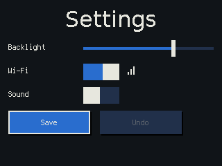

# Рецепты

*[In English](../en/cookbook.md)*

Рецепты того, из чего складывается интерфейс. Каждый — несколько законченных кусков на C. Имена, которые рецепт не
определяет, например `settings_save()`, — это функции самой программы. Рамка, в которой все они работают, — дисплей,
очередь и цикл задачи, владеющей деревом, — показана в [Начале работы](getting-started.md).

- [Общее для всех рецептов](#общее-для-всех-рецептов)
- [Строка и столбец под любой экран](#строка-и-столбец-под-любой-экран)
- [Одно сообщение для нескольких виджетов](#одно-сообщение-для-нескольких-виджетов)
- [Часы или что угодно время от времени](#часы-или-что-угодно-время-от-времени)
- [Кнопка](#кнопка)
- [Ползунок и переключатель](#ползунок-и-переключатель)
- [Значок который показывает состояние](#значок-который-показывает-состояние)
- [Картинка из флеша](#картинка-из-флеша)
- [Текст в несколько строк](#текст-в-несколько-строк)
- [Шрифт по размеру текста](#шрифт-по-размеру-текста)
- [Свои цвета и ночной режим](#свои-цвета-и-ночной-режим)
- [Показать скрыть отключить](#показать-скрыть-отключить)
- [Всплывающее окно](#всплывающее-окно)
- [Кнопки платы](#кнопки-платы)
- [Касание с DGX-DI](#касание-с-dgx-di)
- [Поле ввода и клавиатура](#поле-ввода-и-клавиатура)
- [Виджеты которые появляются и исчезают](#виджеты-которые-появляются-и-исчезают)
- [Большие данные: сообщение по ссылке](#большие-данные-сообщение-по-ссылке)
- [Сообщение из прерывания](#сообщение-из-прерывания)
- [Свой облик](#свой-облик)
- [Шкала по кругу с виджетами внутри](#шкала-по-кругу-с-виджетами-внутри)
- [Поворот экрана](#поворот-экрана)
- [Проверка интерфейса на компьютере](#проверка-интерфейса-на-компьютере)

## Общее для всех рецептов

Заголовки, цвета и два стиля одного шрифта. Цвета — это номера в таблице, которую программа даёт отрисовке; рецепты
называют их по именам.

```c
#include "dgx_draw.h"
#include "dgx_ui_paint.h"
#include "dgx_ui_post.h"
#include "dgx_ui_text.h"
#include "dgx_ui_ticker.h"
#include "esp_attr.h"
#include "esp_timer.h"
#include "fonts/DejaVuSansBook32.h"
#include "fonts/TerminusTTFMedium12.h"
#include "freertos/FreeRTOS.h"
#include "freertos/task.h"

enum { PAPER, INK, FILL, BORDER, ACCENT, ACCENT_DOWN, SHADOW, DIM, COLORS };

static dgx_ui_font_variant_t small[1];
static dgx_ui_text_style_t   st_left, st_centre;

static void styles_init(void)
{
    small[0]  = (dgx_ui_font_variant_t){.font = TerminusTTFMedium12()};
    st_left   = (dgx_ui_text_style_t){.variants = small, .count = 1, .align = DGX_FONT_ALIGN_LEFT};
    st_centre = (dgx_ui_text_style_t){.variants = small, .count = 1, .align = DGX_FONT_ALIGN_CENTER};
}
```

## Строка и столбец под любой экран

Ребёнок с флагом `DGX_UI_REST` занимает то, что осталось в его строке или столбце после остальных. Ширину не надо
считать руками, и то же дерево подходит экрану другой ширины, другому `unit` и повёрнутому экрану.

```c
static char             name_buf[16], value_buf[16], title_buf[16];
static dgx_ui_textbox_t name_box, value_box, title_box;

/* a row: the name takes what the value leaves */
static const dgx_ui_widget_t fit_row_w = {.kind = DGX_UI_BOX, .flags = DGX_UI_ROW, .want_h = 10, .gap = 4};
static const dgx_ui_widget_t name_w    = {.kind = DGX_UI_LABEL, .flags = DGX_UI_REST, .text = &name_box};
static const dgx_ui_widget_t value_w   = {.kind = DGX_UI_LABEL, .text = &value_box, .want_w = 40};

/* a column: the content takes what the title and the buttons leave, so the buttons stand at the bottom */
static const dgx_ui_widget_t page_w    = {.kind = DGX_UI_BOX, .flags = DGX_UI_COLUMN, .pad = 4, .gap = 4};
static const dgx_ui_widget_t title_w   = {.kind = DGX_UI_LABEL, .text = &title_box};
static const dgx_ui_widget_t content_w = {.kind = DGX_UI_BOX, .flags = DGX_UI_COLUMN | DGX_UI_REST, .gap = 2};
static const dgx_ui_widget_t bottom_w  = {.kind = DGX_UI_BOX, .flags = DGX_UI_ROW, .want_h = 18, .gap = 6};
```

- Несколько детей с этим флагом делят остаток поровну.
- Если не осталось ничего, такой ребёнок не получает размера и не виден.
- В контейнере, который не столбец и не строка, флаг ничего не делает.

## Одно сообщение для нескольких виджетов

Датчик шлёт температуру и влажность одним сообщением. Его читают две надписи; ни одна его не забирает, поэтому
видят обе.

```c
enum { MSG_CLIMATE = 10 };
typedef struct {
    int16_t t10; /* tenths of a degree */
    uint8_t rh;  /* percent */
} climate_t;
DGX_UI_MESSAGE(climate, MSG_CLIMATE, climate_t)

static bool temp_take(dgx_ui_t *ui, int i, const dgx_ui_msg_t *msg)
{
    climate_t c;
    if (msg_decode_climate(msg, &c) == ESP_OK) dgx_ui_text_printf(ui, i, "%d.%d C", c.t10 / 10, c.t10 % 10);
    return false;
}

static bool rh_take(dgx_ui_t *ui, int i, const dgx_ui_msg_t *msg)
{
    climate_t c;
    if (msg_decode_climate(msg, &c) == ESP_OK) dgx_ui_text_printf(ui, i, "%d %%", c.rh);
    return false;
}

static dgx_ui_textbox_t      temp_box, rh_box;
static const dgx_ui_widget_t temp_w = {.kind = DGX_UI_LABEL, .text = &temp_box, .take = temp_take};
static const dgx_ui_widget_t rh_w   = {.kind = DGX_UI_LABEL, .text = &rh_box, .take = rh_take};

/* the sensor's task */
static void climate_send(QueueHandle_t queue, int t10, int rh)
{
    const climate_t c = {.t10 = (int16_t)t10, .rh = (uint8_t)rh};
    if (!msg_post_climate(queue, &c)) {
        /* the queue is full and the value is lost: the next one comes anyway */
    }
}
```

- Текст сравнивается уже отформатированным. Датчик может прислать 21,53, потом 21,48: надпись оба раза показывает
  «21.5», и ничего не рисуется.
- Тип больше 12 байт в `DGX_UI_MESSAGE` не скомпилируется. Данные побольше идут
  [по ссылке](#большие-данные-сообщение-по-ссылке).
- Декодер — это `dgx_ui_msg_copy()` с номером и размером. Сообщение с нужным номером, но другого размера — ошибка
  программы, и она попадает в журнал.

## Часы или что угодно время от времени

Тикер шлёт сообщение с заданным номером раз в столько-то миллисекунд. Кому оно нужно, тот читает его в своей
`take()`.

```c
enum { MSG_MINUTE = 11 };
static dgx_ui_ticker_t minute_ticker; /* static: zeroed, and alive as long as its ticks */

static bool date_take(dgx_ui_t *ui, int i, const dgx_ui_msg_t *msg)
{
    if (msg->what != MSG_MINUTE) return false;
    const uint32_t minutes = (uint32_t)(esp_timer_get_time() / 60000000);
    dgx_ui_text_printf(ui, i, "up %u h %02u min", (unsigned)(minutes / 60), (unsigned)(minutes % 60));
    return true;
}

static bool minutes_start(QueueHandle_t queue)
{
    return dgx_ui_ticker_start(&minute_ticker, queue, MSG_MINUTE, 60 * 1000);
}
```

- Следующий тик уходит, только когда цикл вызвал `dgx_ui_msg_done()` для предыдущего. Цикл, который забыл этот вызов,
  получит один тик и больше ни одного.
- `dgx_ui_ticker_stop()` останавливает тикер. Его структура должна жить, пока не выброшен последний тик; статическая
  живёт всегда.
- Тикером удобно делать медленное во времени: кадры значка, мигающее значение. Между тиками задача спит.

## Кнопка



Элемент управления называет свой облик. Текст кнопки — текстовое поле, как у надписи. Функции `on()` сообщается
`DGX_UI_ACTIVATED`, когда пользователь нажал кнопку пальцем или клавишей «выбрать», пока на кнопке фокус.

```c
void settings_save(void);

static char             save_buf[8];
static dgx_ui_textbox_t save_box;

static void save_on(dgx_ui_t *ui, int i, const dgx_ui_node_t *node, int what, void *ctx)
{
    if (what == DGX_UI_ACTIVATED) settings_save();
}

static const dgx_ui_widget_t save_w = {
    .kind = DGX_UI_BUTTON, .text = &save_box, .want_w = 60, .want_h = 18, .look = &dgx_ui_look_button, .on = save_on};

static int save_add(dgx_ui_t *ui, int parent)
{
    dgx_ui_textbox_init(&save_box, save_buf, sizeof save_buf, 1, &st_centre);
    const int b = dgx_ui_add(ui, parent, &save_w);
    dgx_ui_text_set(ui, b, "Save");
    return b;
}
```

- Кнопка с текстом высотой в одну строку текста, если не сказано иначе: задайте `want_h`, а в строке — флаг
  `DGX_UI_STRETCH`, с ним кнопка высотой со строку.
- `dgx_ui_set_state(ui, b, DGX_UI_PRESSED, true)` рисует кнопку нажатой и ничего не запускает: так кнопка платы
  может отражаться на экране.
- `on()` может удалять виджеты, и саму кнопку тоже: диалог может закрыть себя прямо там.

## Ползунок и переключатель

Значение элемента управления лежит в его узле, и `on()` получает этот узел: `node->state_value.value` — значение,
которое выставил пользователь. Функции `on()` сообщается `DGX_UI_CHANGED`, когда значение изменил пользователь: у
ползунка — на каждом шаге пальца, у переключателя — по нажатию.

```c
void backlight_set(int percent);
void wifi_enable(bool on);

static void backlight_on(dgx_ui_t *ui, int i, const dgx_ui_node_t *node, int what, void *ctx)
{
    if (what == DGX_UI_CHANGED) backlight_set(node->state_value.value);
}

static void wifi_on(dgx_ui_t *ui, int i, const dgx_ui_node_t *node, int what, void *ctx)
{
    if (what == DGX_UI_CHANGED) wifi_enable(node->state_value.value != 0);
}

/* a slider of 0..100 by 5 that starts at 70, and a switch that starts off */
static const dgx_ui_widget_t backlight_w = {
    .kind = DGX_UI_SLIDER, .min = 0, .max = 100, .step = 5, .want_h = 12, .state = {.value = 70}, .look = &dgx_ui_look_slider, .on = backlight_on};
static const dgx_ui_widget_t wifi_w = {
    .kind = DGX_UI_SWITCH, .max = 1, .want_w = 26, .want_h = 12, .look = &dgx_ui_look_switch, .on = wifi_on};

/* the value came from elsewhere: shown, and on() is not told */
static void backlight_show(dgx_ui_t *ui, int slider, int percent)
{
    dgx_ui_set_value(ui, slider, percent);
}
```

- `dgx_ui_set_value()` держит значение в пределах `min..max` и `on()` не вызывает: свои собственные изменения
  программа обратно не слышит.
- С флагом `DGX_UI_SWIPE` ползунок двигается на столько, на сколько ушёл палец от места касания, а не туда, где
  палец: получается широкая полоса, в которую легко попасть.
- Клавиши «больше» и «меньше» двигают ползунок на его шаг и ставят переключатель.

## Значок который показывает состояние

Значок — виджет постоянного размера, картинку которого выбирает значение. При значении вне `min..max` картинки нет,
а место за виджетом остаётся, поэтому вокруг ничего не сдвигается, когда значок появляется и исчезает.

```c
/* 8x8, 1 bit: rows from a new byte, the leftmost pixel in the high bit */
static const uint8_t      bars1[8] = {0x00, 0x00, 0x00, 0x00, 0x00, 0x00, 0x80, 0x80};
static const uint8_t      bars2[8] = {0x00, 0x00, 0x00, 0x00, 0x20, 0x20, 0xA0, 0xA0};
static const uint8_t      bars3[8] = {0x00, 0x00, 0x08, 0x08, 0x28, 0x28, 0xA8, 0xA8};
static const uint8_t      bars4[8] = {0x02, 0x02, 0x0A, 0x0A, 0x2A, 0x2A, 0xAA, 0xAA};
static const dgx_image_t  signal_im[4] = {
    {.width = 8, .height = 8, .format = DGX_IMAGE_1BPP, .data = bars1},
    {.width = 8, .height = 8, .format = DGX_IMAGE_1BPP, .data = bars2},
    {.width = 8, .height = 8, .format = DGX_IMAGE_1BPP, .data = bars3},
    {.width = 8, .height = 8, .format = DGX_IMAGE_1BPP, .data = bars4},
};
static const dgx_ui_picture_t signal_pic[4] = {
    {.image = &signal_im[0]}, {.image = &signal_im[1]}, {.image = &signal_im[2]}, {.image = &signal_im[3]}};

enum { MSG_SIGNAL = 12 };
typedef struct {
    int8_t bars; /* 1..4; 0: no network */
} signal_t;
DGX_UI_MESSAGE(signal, MSG_SIGNAL, signal_t)

static bool signal_take(dgx_ui_t *ui, int i, const dgx_ui_msg_t *msg)
{
    signal_t s;
    if (msg_decode_signal(msg, &s) == ESP_OK) dgx_ui_set_value(ui, i, s.bars);
    return false;
}

/* the pictures of the values 1..4; 0 is outside and shows none */
static const dgx_ui_widget_t signal_w = {
    .kind = DGX_UI_ICON, .picture = signal_pic, .min = 1, .max = 4, .look = &dgx_ui_look_picture, .take = signal_take};
```

Размер виджета — размер первой картинки. Картинка рисуется непрозрачной: пишутся и её чернила, и её бумага, поэтому
значок, нарисованный поверх себя, не мигает.

## Картинка из флеша

Картинка в 1 бит — это `dgx_image_t` из DGX с обликом `dgx_ui_look_picture`, как значок выше; её чернила — цвет из
таблицы. Цветная картинка — строки RGB565 с обликом `dgx_ui_look_rgb565`:

```c
extern const uint16_t logo_pixels[64 * 32]; /* rows of RGB565, high byte first */

static const dgx_ui_picture_t logo_pic = {.rgb565 = logo_pixels, .width = 64, .height = 32};
static const dgx_ui_widget_t  logo_w   = {.kind = DGX_UI_PICTURE, .picture = &logo_pic, .look = &dgx_ui_look_rgb565};
```

- Облику RGB565 нужны `CONFIG_DGX_ENABLE_VSCREEN=y` и 16-битный экран. На другом экране вместо картинки бумага.
- Для таких картинок отрисовка при первой надобности создаёт один небольшой объект экрана.
  `dgx_ui_paint_free(&paint)` возвращает его, когда программа перестаёт рисовать.
- Картинки в 4 и 8 бит пока не рисуются.

## Текст в несколько строк


Облик `dgx_ui_look_lines` раскладывает текст по строкам своего поля, с переносом по словам. Поле говорит, сколько
строк оно показывает; стиль — что делать со слишком длинным текстом.

```c
static char                news_buf[200], hint_buf[120];
static dgx_ui_textbox_t    news_box, hint_box;
static dgx_ui_text_style_t st_important;

static const dgx_ui_widget_t news_w = {.kind = DGX_UI_LABEL, .text = &news_box, .look = &dgx_ui_look_lines};
static const dgx_ui_widget_t hint_w = {.kind = DGX_UI_LABEL, .text = &hint_box, .look = &dgx_ui_look_lines};

static void texts_add(dgx_ui_t *ui, int parent)
{
    /* an important text too long scrolls a line up every 2 s; one that is not is cut with an ellipsis */
    st_important = (dgx_ui_text_style_t){.variants = small, .count = 1, .flags = DGX_UI_TEXT_IMPORTANT, .scroll_ms = 2000};
    dgx_ui_textbox_init(&news_box, news_buf, sizeof news_buf, 3, &st_important);
    dgx_ui_textbox_init(&hint_box, hint_buf, sizeof hint_buf, 2, &st_left);
    const int news = dgx_ui_add(ui, parent, &news_w);
    const int hint = dgx_ui_add(ui, parent, &hint_w);
    dgx_ui_text_set(ui, news, "The filter has worked for 2000 hours. Replace it and hold the button for three seconds.");
    dgx_ui_text_set(ui, hint, "Swipe from the left edge to open the menu.");
    dgx_ui_text_appear(ui, hint, 30); /* its letters come one by one, 30 ms each */
}
```

- Пока текст прокручивается или появляются его буквы, `dgx_ui_paint()` возвращает `true`, и цикл возвращается снова
  и снова. Когда текст дошёл до конца и все буквы появились, он времени больше не просит.
- Новый текст начинается с первой строки и появляется заново, если это было задано.
- `dgx_ui_text_scroll(ui, i, 1)` сдвигает неважный текст на строку вверх вручную, `-1` — на строку вниз.
- Слово шире строки режется по буквам; `\n` заканчивает строку.
- Программа, которая называет этот облик, несёт примерно на 2,5 КБ кода больше; программа с однострочными
  надписями — нет.

## Шрифт по размеру текста

Стиль перечисляет шрифты, которыми можно нарисовать текст, начиная с лучшего. Отрисовка берёт первый, в который
текст помещается целиком, а иначе тот, что показывает больше букв. Короткое название города встаёт крупным шрифтом,
длинное — мелким.

```c
static dgx_ui_font_variant_t city_fonts[2];
static dgx_ui_text_style_t   st_city;

static void city_style_init(void)
{
    city_fonts[0] = (dgx_ui_font_variant_t){.font = DejaVuSansBook32()};
    city_fonts[1] = (dgx_ui_font_variant_t){.font = TerminusTTFMedium12()};
    st_city = (dgx_ui_text_style_t){.variants = city_fonts, .count = 2, .align = DGX_FONT_ALIGN_CENTER, .flags = DGX_UI_TEXT_MIDDLE};
}
```

- Высота надписи — строка её первого шрифта, поэтому размер надписи не зависит от того, какой шрифт выбран.
- Меньший шрифт стоит на базовой линии первого. С флагом `DGX_UI_TEXT_MIDDLE` он стоит посередине высоты.
- Шрифты — из DGX, матричные и точечные. Шрифт не масштабируется.

## Свои цвета и ночной режим

У обликов библиотеки есть параметры: какой цвет таблицы у лицевой стороны, у текста, у тени. Облик в других
цветах — это рисование библиотеки со своими параметрами. Он константа и лежит во флеше:

```c
static const dgx_ui_button_look_t blue_button = {
    .face = ACCENT, .pressed = ACCENT_DOWN, .focused = ACCENT_DOWN, .disabled = FILL,
    .text = INK, .text_disabled = DIM, .shadow = SHADOW, .depth = 1};
/* the library's drawing of a button, in these colours */
static const dgx_ui_look_t look_blue_button = {.draw = dgx_ui_draw_button, .params = &blue_button, .fill = -1};

static const dgx_ui_widget_t ok_w = {.kind = DGX_UI_BUTTON, .want_w = 60, .want_h = 18, .look = &look_blue_button};
```

Ночной режим — другая таблица тех же цветов. Её дают отрисовке, и корень рисуется целиком:

```c
static void colors_set(dgx_ui_t *ui, dgx_ui_paint_t *paint, const uint32_t *table)
{
    paint->colors = table;
    dgx_ui_redraw(ui, 0); /* the root whole, and with it everything under it */
}
```

Таблица заполняется под экран вызовами `dgx_screen_rgb(scr, r, g, b)`, как в [Начале работы](getting-started.md).

## Показать скрыть отключить

```c
static void advanced_show(dgx_ui_t *ui, int box, int button, bool expert)
{
    dgx_ui_show(ui, box, expert);                           /* hidden, it takes no place: the rest moves up */
    dgx_ui_set_state(ui, button, DGX_UI_DISABLED, !expert); /* stays where it is, drawn dim, takes no finger */
}
```

- Скрытый виджет по-прежнему получает сообщения, поэтому при показе он свежий.
- Скрытый или отключённый виджет теряет фокус, и нажатие пальца на нём заканчивается.
- Чтобы что-то появлялось и исчезало, не двигая соседей, не скрывайте его: возьмите
  [значок](#значок-который-показывает-состояние) со значением без картинки или надпись с пустым текстом.

## Всплывающее окно


Всплывающее окно — отдельное дерево: свои узлы, свой корень, те же виджеты и облики. Оно открывается поверх дерева в
прямоугольнике экрана.

```c
static char             ask_buf[32], yes_buf[8], no_buf[8];
static dgx_ui_textbox_t ask_box, yes_box, no_box;
static dgx_ui_node_t    ask_nodes[6];
static dgx_ui_t         ask_ui;
static dgx_ui_t        *ask_over; /* the tree it is open over */

static void yes_on(dgx_ui_t *popup, int i, const dgx_ui_node_t *node, int what, void *ctx)
{
    if (what != DGX_UI_ACTIVATED) return;
    settings_save();
    dgx_ui_popup_close(ask_over);
}

static void no_on(dgx_ui_t *popup, int i, const dgx_ui_node_t *node, int what, void *ctx)
{
    if (what == DGX_UI_ACTIVATED) dgx_ui_popup_close(ask_over);
}

static const dgx_ui_widget_t ask_root_w = {.kind = DGX_UI_FRAME, .flags = DGX_UI_COLUMN, .pad = 5, .gap = 5};
static const dgx_ui_widget_t ask_w      = {.kind = DGX_UI_LABEL, .text = &ask_box, .want_h = 12};
static const dgx_ui_widget_t ask_row_w  = {.kind = DGX_UI_BOX, .flags = DGX_UI_ROW, .want_h = 18, .gap = 6};
/* the two buttons share the row: as high as it (STRETCH), each a half of what it has (REST) */
static const dgx_ui_widget_t yes_w = {
    .kind = DGX_UI_BUTTON, .flags = DGX_UI_STRETCH | DGX_UI_REST, .text = &yes_box, .look = &dgx_ui_look_button, .on = yes_on};
static const dgx_ui_widget_t no_w = {
    .kind = DGX_UI_BUTTON, .flags = DGX_UI_STRETCH | DGX_UI_REST, .text = &no_box, .look = &dgx_ui_look_button, .on = no_on};

static void ask_open(dgx_ui_t *ui)
{
    dgx_ui_textbox_init(&ask_box, ask_buf, sizeof ask_buf, 1, &st_centre);
    dgx_ui_textbox_init(&yes_box, yes_buf, sizeof yes_buf, 1, &st_centre);
    dgx_ui_textbox_init(&no_box, no_buf, sizeof no_buf, 1, &st_centre);
    dgx_ui_init(&ask_ui, ask_nodes, 6, 2);
    const int root = dgx_ui_add(&ask_ui, -1, &ask_root_w);
    dgx_ui_text_set(&ask_ui, dgx_ui_add(&ask_ui, root, &ask_w), "Save the settings?");
    const int row = dgx_ui_add(&ask_ui, root, &ask_row_w);
    dgx_ui_text_set(&ask_ui, dgx_ui_add(&ask_ui, row, &yes_w), "Yes");
    dgx_ui_text_set(&ask_ui, dgx_ui_add(&ask_ui, row, &no_w), "No");
    ask_over = ui;
    dgx_ui_popup_open(ui, &ask_ui, 50, 70, 220, 92, DGX_UI_POPUP_MODAL); /* pixels of the screen */
}
```

- Программа по-прежнему вызывает `dgx_ui_take()`, `dgx_ui_pointer()`, `dgx_ui_key()` и `dgx_ui_paint()` для дерева
  под окном; до окна они доходят сами.
- Модальное окно забирает каждый палец и каждую клавишу. Клавишу «отмена» не берёт никто, поэтому программа может
  по ней закрыть окно.
- С флагом `DGX_UI_POPUP_CLOSE_OUTSIDE` окно закрывает палец, опустившийся снаружи: так ведёт себя список выбора.
- Когда окно закрывается, отрисовка заново рисует дерево там, где оно лежало.
- Прямоугольник задан в пикселях экрана, как он стоит сейчас. При повороте экрана закройте окно или откройте заново
  в новых пикселях.

Окно — это дерево, поэтому над ним в свою очередь можно открыть окно: вопрос поверх диалога или список выбора,
который выступает за его край.

```c
static dgx_ui_node_t sure_nodes[6];
static dgx_ui_t      sure_ui; /* built as ask_ui above: a frame, a label, two buttons */

/* a second popup, over the first: it is opened over the popup's own tree */
static bool sure_open(void)
{
    return dgx_ui_popup_open(&ask_ui, &sure_ui, 80, 110, 200, 80, DGX_UI_POPUP_MODAL);
}
```

- Одно над другим могут стоять до `DGX_UI_POPUP_DEPTH`, то есть 8, окон. Для девятого `dgx_ui_popup_open()`
  возвращает `false`, как и для дерева, которое уже открыто как окно.
- Палец и клавиши сначала идут в верхнее окно. Палец на той части верхнего окна, что выступает за нижнее, достаётся
  верхнему.
- `dgx_ui_popup_close(ui)` закрывает окно этого дерева и все окна над ним.

## Кнопки платы

Тот, кто читает кнопки, шлёт, какие из них удерживаются сейчас, битами геймпада; цикл передаёт их дереву.

```c
enum { MSG_BUTTONS = 13 };
typedef struct {
    uint32_t held; /* DGX_UI_PAD_* */
} buttons_t;
DGX_UI_MESSAGE(buttons, MSG_BUTTONS, buttons_t)

void menu_back(void);

/* in the loop, for a message no widget claimed */
static void buttons_message(dgx_ui_t *ui, const dgx_ui_msg_t *msg, uint32_t now_ms)
{
    buttons_t b;
    if (msg_decode_buttons(msg, &b) != ESP_OK) return;
    const bool taken = dgx_ui_buttons(ui, b.held, now_ms);
    if (!taken && (b.held & (DGX_UI_PAD_BACK | DGX_UI_PAD_B))) menu_back();
}
```

- Вверх и вниз двигают фокус, влево и вправо меняют ползунок или переключатель в фокусе, A выбирает, B и BACK
  достаются программе.
- Удерживаемые вверх, вниз, влево и вправо повторяются через 500 мс, каждые 100 мс. Повтор делает
  `dgx_ui_time()`, которую цикл вызывает перед `dgx_ui_paint()`. Пока кнопка удерживается, она возвращает `true`, и
  цикл не спит.
- Одна клавиша диалога — это `dgx_ui_key(ui, DGX_UI_KEY_NEXT)` и ей подобные.

**Какую клавишу даёт кнопка**, определяет таблица. По умолчанию:

| Кнопка | Её клавиша по умолчанию | Что делает клавиша |
| ------ | ----------------------- | ------------------ |
| `DGX_UI_PAD_UP` | `DGX_UI_KEY_PREV` | фокус переходит к предыдущему виджету |
| `DGX_UI_PAD_DOWN` | `DGX_UI_KEY_NEXT` | фокус переходит к следующему виджету |
| `DGX_UI_PAD_LEFT` | `DGX_UI_KEY_LESS` | ползунок в фокусе на шаг вниз, переключатель выключается |
| `DGX_UI_PAD_RIGHT` | `DGX_UI_KEY_MORE` | ползунок в фокусе на шаг вверх, переключатель включается |
| `DGX_UI_PAD_A` | `DGX_UI_KEY_ACTIVATE` | срабатывает кнопка, строка или выпадающий список в фокусе, переключатель меняет положение |
| `DGX_UI_PAD_BACK`, `DGX_UI_PAD_B` | `DGX_UI_KEY_BACK` | виджеты её не берут: достаётся программе |
| `DGX_UI_PAD_START` | никакая | кнопка достаётся программе |

Таблица по умолчанию подходит столбцу настроек: вверх и вниз переходят от одной к другой, влево и вправо меняют ту,
что в фокусе.

Она не подходит кнопкам, которые стоят в ряд. Возьмём диалог с тремя кнопками в строке: «Назад», «OK» и «Дальше»,
фокус на «Назад». Пользователь нажимает вправо, чтобы перейти на «OK». Вправо — это «больше»; у кнопки нет значения,
которое можно увеличить, поэтому не происходит ничего. Фокус двигается только кнопками вверх и вниз, о чём, глядя на
ряд кнопок, не догадается никто.

Своя таблица программы даёт кнопкам влево и вправо клавиши, которые двигают фокус:

```c
/* three buttons in a row, "Back", "OK", "Next": left and right move the focus along the row */
static const uint8_t row_keys[8] = {
    DGX_UI_KEY_PREV,     /* DGX_UI_PAD_LEFT:  the focus to the button on the left; by default LESS */
    DGX_UI_KEY_NEXT,     /* DGX_UI_PAD_RIGHT: the focus to the button on the right; by default MORE */
    DGX_UI_KEY_PREV,     /* DGX_UI_PAD_UP:    the focus back, as by default */
    DGX_UI_KEY_NEXT,     /* DGX_UI_PAD_DOWN:  the focus on, as by default */
    DGX_UI_KEY_ACTIVATE, /* DGX_UI_PAD_A:     the focused button activated, as by default */
    0xff,                /* DGX_UI_PAD_START: no key, the button is the program's, as by default */
    DGX_UI_KEY_BACK,     /* DGX_UI_PAD_BACK:  back, which no widget takes: the program's, as by default */
    DGX_UI_KEY_BACK,     /* DGX_UI_PAD_B:     the same */
};

static void dialog_keys(dgx_ui_t *ui, bool buttons_in_a_row)
{
    dgx_ui_button_keys(ui, buttons_in_a_row ? row_keys : NULL); /* NULL: the default table again */
}
```

- В таблице 8 записей, по одной на кнопку, в порядке битов `DGX_UI_PAD_*`: LEFT, RIGHT, UP, DOWN, A, START, BACK, B.
- Запись — это `DGX_UI_KEY_*` или 0xff: кнопка не даёт клавиши и остаётся программе.
- Дерево запоминает указатель и ничего не копирует: дайте константу.
- Таблицу можно задать заново в любой момент, например когда диалог-столбец сменился диалогом-строкой. `NULL`
  возвращает таблицу по умолчанию.
- Это таблица того дерева, которое передано в `dgx_ui_buttons()`. Клавиши, которые она даёт, идут и в окна над этим
  деревом, как любая клавиша.

## Касание с DGX-DI

`dgx_ui_di.h` — для программы, в которой есть [DGX-DI](https://github.com/jef-sure/esp32-component-dgx-di). Касание
читается в задаче, владеющей дисплеем, поэтому её будит тикер, здесь каждые 20 мс:

```c
#include "dgx_ui_di.h"

enum { MSG_TOUCH = 14 };

void menu_open(void);

/* in the loop, for the ticker's message MSG_TOUCH; the pointer and the touch are set up as DGX-DI tells */
static void touch_message(dgx_ui_t *ui, dgx_di_pointer_t *pointer, dgx_di_touch_t *touch, uint32_t now_ms)
{
    dgx_ui_di_gestures_t g;
    dgx_di_pointer_read(pointer, now_ms);
    /* the keyboard and the pad of DGX-DI, if the program has them, take their fingers here */
    dgx_ui_di_pointer(ui, pointer, touch, now_ms, &g);
    if (g.edge & DGX_DI_EDGE_LEFT) menu_open(); /* swiped from the left edge */
}
```

- Виджет становится нажатым, как только на него опустился палец, в том числе у края.
- Пока палец держит виджет, обычный свайп и долгое нажатие программе не сообщаются.
- Свайп от края программе сообщается, если только палец не на ползунке, списке или кнопке с `DGX_UI_DRAG`: эти
  владеют пальцем.
- Палец, который опустился мимо виджетов, отдаёт программе все свои жесты. `g.taken` говорит, взял ли нажатие
  виджет.

## Поле ввода и клавиатура

Поле ввода — это `DGX_UI_INPUT` с обликом `dgx_ui_look_input`. Набранное идёт в поле, на котором фокус.

```c
#include "dgx_di_keyboard.h"

void wifi_connect(const char *password);

static char             pass_buf[33];
static dgx_ui_textbox_t pass_box;

static void pass_on(dgx_ui_t *ui, int i, const dgx_ui_node_t *node, int what, void *ctx)
{
    if (what == DGX_UI_ACTIVATED) wifi_connect(pass_buf); /* "done" was typed */
    if (what == DGX_UI_BACK) dgx_ui_text_set(ui, i, "");  /* "cancel" was typed */
}

static const dgx_ui_widget_t pass_w = {.kind = DGX_UI_INPUT, .text = &pass_box, .want_h = 14, .look = &dgx_ui_look_input, .on = pass_on};

/* in the loop, after the pointer was read: the keyboard of DGX-DI types into the focused field */
static void keyboard_pass(dgx_ui_t *ui, dgx_ui_paint_t *paint, dgx_di_keyboard_t *kb, dgx_di_pointer_t *pointer, uint32_t now_ms)
{
    uint32_t  typed[8];
    const int n = dgx_di_keyboard_take(kb, pointer, now_ms, typed, 8);
    if (n > 0) dgx_ui_typed(ui, typed, n);
    /* the painter leaves the keyboard's band alone while it is open */
    paint->cover = kb->open ? dgx_ui_rect(kb->x, kb->y, kb->w, kb->h) : dgx_ui_rect(0, 0, 0, 0);
}
```

- Размер буфера — это сколько поле вмещает; буква, которой нет места, не набирается.
- «Стереть» убирает последнюю букву целиком, в UTF-8.
- Функции `on()` сообщается `DGX_UI_CHANGED` на каждую букву и `DGX_UI_FOCUS`, когда поле получает фокус: здесь и
  открывать клавиатуру.
- Когда клавиатура закрывается и полоса снова свободна, отрисовка сама рисует там дерево.
- Символы из любого другого источника идут тем же путём: `dgx_ui_typed(ui, code_points, count)`.

## Виджеты которые появляются и исчезают

```c
enum { TAG_ALARM = 7 };

static char             alarm_buf[40];
static dgx_ui_textbox_t alarm_box;
static const dgx_ui_widget_t alarm_w = {.kind = DGX_UI_LABEL, .text = &alarm_box, .tag = TAG_ALARM};

static void alarm_set(dgx_ui_t *ui, int parent, const char *text)
{
    int a = dgx_ui_find(ui, parent, TAG_ALARM);
    if (text && a < 0) {
        dgx_ui_textbox_init(&alarm_box, alarm_buf, sizeof alarm_buf, 1, &st_left);
        a = dgx_ui_insert(ui, parent, dgx_ui_node(ui, parent)->child, &alarm_w); /* before the first child */
    }
    if (text) dgx_ui_text_set(ui, a, text);
    else if (a >= 0) dgx_ui_remove(ui, a);
}
```

- Дерево запоминает указатель на виджет и ничего не копирует. Дайте ему объект `static const` или память программы,
  которая живёт, пока виджет в дереве. Никогда не давайте составной литерал, созданный внутри функции: он исчезает,
  когда функция возвращается.
- Номер удалённого виджета отдаётся следующему добавленному. Виджет, который появляется и исчезает, ищите по тегу;
  теги начинаются с 1, потому что 0 — тег любого виджета, которому тега не дали.
- `dgx_ui_remove()` удаляет и всё, что под виджетом.
- Виджет, который программа держит в своей памяти, можно менять: его размеры, его картинку. После этого вызовите
  `dgx_ui_relayout()` и для него `dgx_ui_redraw()`.

## Большие данные: сообщение по ссылке

Больше 12 байт идут по ссылке. Сообщение владеет данными от отправки до того, как цикл вызовет
`dgx_ui_msg_done()`: этот вызов один раз вызывает `done()` отправителя, в задаче, владеющей деревом.

```c
#include <stdlib.h>
#include <string.h>

enum { MSG_HEADLINE = 15 };

static void headline_done(void *data, size_t size)
{
    free(data);
}

/* any task: the text is the message's from here on */
static void headline_send(QueueHandle_t queue, const char *text)
{
    char *copy = strdup(text);
    if (copy && !dgx_ui_post_ref(queue, MSG_HEADLINE, copy, strlen(copy) + 1, headline_done)) free(copy); /* not sent: still ours */
}

static bool headline_take(dgx_ui_t *ui, int i, const dgx_ui_msg_t *msg)
{
    if (msg->what != MSG_HEADLINE) return false;
    size_t size;
    dgx_ui_text_set(ui, i, dgx_ui_msg_data(msg, &size)); /* copied into the text box now */
    return true;
}
```

- Данные действительны, пока сообщение не выброшено. Виджет, которому они нужны дольше, вызывает в своей `take()`
  функцию `dgx_ui_msg_keep(ui, &copy)`, а когда данные больше не нужны — `dgx_ui_msg_done(&copy)`. Кто оставил
  данные себе, тот забрал сообщение.
- Данные, которые живут вечно, то есть константу, шлёт `dgx_ui_post_const()`: с ними ничего не делается.

## Сообщение из прерывания

```c
enum { MSG_KNOB = 16 };
typedef struct {
    int8_t steps;
} knob_t;

static QueueHandle_t knob_queue;

static void IRAM_ATTR knob_isr(void *arg)
{
    const knob_t k     = {.steps = 1};
    BaseType_t   woken = pdFALSE;
    dgx_ui_post_from_isr(knob_queue, MSG_KNOB, &k, sizeof k, &woken);
    if (woken) portYIELD_FROM_ISR();
}
```

Только по значению. Вызов лежит в IRAM, поэтому им может пользоваться прерывание, которое работает при выключенном
кеше флеша.

## Свой облик

Облик — это функция, которая рисует виджет, параметры своего типа и цвет, который она оставляет под детьми виджета.
Здесь — полоса уровня: значение виджета в виде закрашенной части его коробки.

```c
typedef struct {
    uint8_t bar, rest; /* indices of the table */
} level_look_t;

static bool level_draw(const dgx_ui_look_t *look, dgx_ui_paint_t *paint, dgx_ui_t *ui, int i, uint32_t now_ms)
{
    const dgx_ui_node_t   *n    = dgx_ui_node(ui, i);
    const dgx_ui_widget_t *w    = n->widget;
    const level_look_t    *p    = look->params;
    const int              span = w->max > w->min ? w->max - w->min : 1;
    const int              full = n->w * (n->state_value.value - w->min) / span;
    const int              x = n->x - paint->ox, y = n->y - paint->oy;
    if (full > 0) dgx_fill_rectangle(paint->scr, x, y, full, n->h, dgx_ui_color(paint, p->bar));
    if (full < n->w) dgx_fill_rectangle(paint->scr, x + full, y, n->w - full, n->h, dgx_ui_color(paint, p->rest));
    return false; /* no more time asked */
}

static const level_look_t    level_colors = {.bar = ACCENT, .rest = FILL};
static const dgx_ui_look_t   level_look   = {.draw = level_draw, .params = &level_colors, .fill = -1};
static const dgx_ui_widget_t level_w      = {.kind = DGX_UI_OWN, .min = 0, .max = 100, .want_h = 6, .look = &level_look};
```

Правила, которых держится облик:

- **Где.** Он рисует коробку виджета, `n->x, n->y, n->w, n->h`, за вычетом `paint->ox, paint->oy`: экраном может быть
  буфер, в котором лежит часть картины. Отсечение уже поставлено, и облик не меняет его насовсем.
- **Каждый пиксель один раз.** Пишите каждый пиксель того, что рисуете, один раз, и на дисплее за шиной виджет не
  мигает. Полоса выше — два прямоугольника, которые не перекрываются.
- **Всю коробку, когда `paint->whole`.** Тогда на экране от виджета нет ничего. Облик, который рисует только
  разницу, обязан в этом случае нарисовать всё. Облики библиотеки рисуют всю коробку каждый раз.
- **Цвета** берутся из `dgx_ui_color(paint, index)`. `paint->paper` — номер цвета под виджетом.
- **Вызов по частям.** Когда на части виджета лежит всплывающее окно или клавиатура, облик вызывается по разу для
  каждой видимой части, с отсечением по ней. В каждом вызове он должен рисовать одно и то же. Облик, который помнит,
  что нарисовал, записывает это только в последнем: когда `paint->part == paint->parts - 1`, а `paint->composing`
  ложно.
- **Время.** Облик с анимацией возвращает `true`, и его вызывают снова на следующем проходе. Где он находится, он
  считает по `now_ms`.
- **Его заливка.** `fill` — номер цвета, который облик оставляет под детьми виджета, или -1, если он оставляет то,
  что было. У рамки это её заливка.

## Шкала по кругу с виджетами внутри


Шкала, которая идёт по кругу экрана, с виджетами внутри — это одно дерево: кольцо — виджет собственного вида
программы, а остальные виджеты — его дети, как у рамки. Всплывающее окно для этого не нужно. Штрихи на второй
картинке показывают, что дала раскладка: квадрат, который отступ кольца оставляет внутри круга, и в нём коробки
числа, его единицы, пустого контейнера, который занимает остаток, и строки с двумя надписями.

Облик кольца рисует `dgx_gauge_t` из DGX:

```c
#include "dgx_gauge.h"

/* the colours of the scale, packed for the screen at the start */
static uint32_t ring_low, ring_mid, ring_high, ring_off;

static uint32_t ring_color(int ppm)
{
    return ppm < 800 ? ring_low : ppm < 1200 ? ring_mid : ring_high;
}

typedef struct {
    uint8_t width; /* of the ring, in points */
} ring_look_t;

/* what the ring remembers: the gauge of DGX, which draws only the steps that changed */
typedef struct {
    dgx_gauge_t gauge;
    bool        made;
} ring_t;

static bool ring_draw(const dgx_ui_look_t *look, dgx_ui_paint_t *paint, dgx_ui_t *ui, int i, uint32_t now_ms)
{
    const dgx_ui_node_t   *n = dgx_ui_node(ui, i);
    const dgx_ui_widget_t *w = n->widget;
    const ring_look_t     *p = look->params;
    ring_t                *r = w->own;
    const int thick = p->width * ui->unit, outer = (n->w < n->h ? n->w : n->h) / 2 - 2;
    if (paint->whole || !r->made) {
        /* nothing of it is on this screen: its paper around the children, the empty ring, the steps up to the value */
        dgx_gauge_t fresh;
        dgx_ui_fill_around(paint, ui, i, dgx_ui_rect(n->x, n->y, n->w, n->h), dgx_ui_color(paint, paint->paper));
        dgx_gauge_init(&fresh, paint->scr, n->x + n->w / 2 - paint->ox, n->y + n->h / 2 - paint->oy, outer - thick, thick, 225.0f, 270,
                       w->min, w->max, ring_off, ring_color);
        dgx_gauge_set_value(&fresh, n->state_value.value);
        if (!paint->composing) r->gauge = fresh, r->made = true; /* remembered only by the painter's own pass */
    } else if (paint->part == 0) {
        dgx_gauge_set_value(&r->gauge, n->state_value.value); /* only the steps that changed */
    } else {
        dgx_gauge_redraw(&r->gauge); /* another part of it, beside a popup: all of the ring there */
    }
    return false;
}
```

Виджеты. Одно сообщение со значением получают и кольцо, и число. Две надписи внизу — те же, что в рецепте
[Одно сообщение для нескольких виджетов](#одно-сообщение-для-нескольких-виджетов).

```c
enum { MSG_PPM = 17 };
typedef struct {
    int16_t ppm;
} ppm_t;
DGX_UI_MESSAGE(ppm, MSG_PPM, ppm_t)

static bool ring_take(dgx_ui_t *ui, int i, const dgx_ui_msg_t *msg)
{
    ppm_t v;
    if (msg_decode_ppm(msg, &v) == ESP_OK) dgx_ui_set_value(ui, i, v.ppm);
    return false; /* the number inside reads the same message */
}

static bool ppm_take(dgx_ui_t *ui, int i, const dgx_ui_msg_t *msg)
{
    ppm_t v;
    if (msg_decode_ppm(msg, &v) == ESP_OK) dgx_ui_text_printf(ui, i, "%d", v.ppm);
    return false;
}

static char                ppm_buf[8], ppm_unit_buf[12], ring_temp_buf[12], ring_rh_buf[8];
static dgx_ui_textbox_t    ppm_box, ppm_unit_box;
static dgx_ui_text_style_t st_ring_right;
static ring_t              ring_data;
static const ring_look_t   ring_params = {.width = 14};
static const dgx_ui_look_t ring_look   = {.draw = ring_draw, .params = &ring_params, .fill = -1};

/* the ring is a column: its pad keeps its children inside the circle */
static const dgx_ui_widget_t ring_w = {
    .kind = DGX_UI_OWN, .flags = DGX_UI_COLUMN, .pad = 47, .gap = 2, .min = 400, .max = 2000,
    .look = &ring_look, .own = &ring_data, .take = ring_take};
static const dgx_ui_widget_t ppm_w       = {.kind = DGX_UI_LABEL, .text = &ppm_box, .want_h = 44, .take = ppm_take};
static const dgx_ui_widget_t ppm_unit_w  = {.kind = DGX_UI_LABEL, .text = &ppm_unit_box};
static const dgx_ui_widget_t ring_rest_w = {.kind = DGX_UI_BOX, .flags = DGX_UI_REST};
static const dgx_ui_widget_t ring_row_w  = {.kind = DGX_UI_BOX, .flags = DGX_UI_ROW, .want_h = 13};
static const dgx_ui_widget_t ring_temp_w = {.kind = DGX_UI_LABEL, .flags = DGX_UI_REST, .text = &temp_box, .take = temp_take};
static const dgx_ui_widget_t ring_rh_w   = {.kind = DGX_UI_LABEL, .text = &rh_box, .want_w = 50, .take = rh_take};

/* the tree of a round screen of 240: the ring is its root */
static int ring_add(dgx_ui_t *ui, dgx_screen_t *scr)
{
    ring_low  = dgx_screen_rgb(scr, 60, 200, 90);
    ring_mid  = dgx_screen_rgb(scr, 240, 200, 40);
    ring_high = dgx_screen_rgb(scr, 230, 60, 50);
    ring_off  = dgx_screen_rgb(scr, 40, 46, 60);
    st_ring_right = (dgx_ui_text_style_t){.variants = small, .count = 1, .align = DGX_FONT_ALIGN_RIGHT};
    dgx_ui_textbox_init(&ppm_box, ppm_buf, sizeof ppm_buf, 1, &st_city); /* the large font, or the small one */
    dgx_ui_textbox_init(&ppm_unit_box, ppm_unit_buf, sizeof ppm_unit_buf, 1, &st_centre);
    dgx_ui_textbox_init(&temp_box, ring_temp_buf, sizeof ring_temp_buf, 1, &st_left);
    dgx_ui_textbox_init(&rh_box, ring_rh_buf, sizeof ring_rh_buf, 1, &st_ring_right);
    const int ring = dgx_ui_add(ui, -1, &ring_w);
    dgx_ui_add(ui, ring, &ppm_w);
    dgx_ui_text_set(ui, dgx_ui_add(ui, ring, &ppm_unit_w), "ppm CO2");
    dgx_ui_add(ui, ring, &ring_rest_w); /* pushes the row to the bottom of the square */
    const int row = dgx_ui_add(ui, ring, &ring_row_w);
    dgx_ui_add(ui, row, &ring_temp_w);
    dgx_ui_add(ui, row, &ring_rh_w);
    return ring;
}
```

- **Отступ** держит детей внутри круга. На экране 240 внешний радиус кольца 118, ширина 14, значит, радиус
  внутреннего круга 104. У квадрата внутри этого круга сторона 104 x 1,41 = 147, поэтому отступ равен
  (240 - 147) / 2 = 47.
- **Новое значение** вызывает облик кольца один раз, и шкала DGX рисует только те деления, которые изменились.
  Число пишет своё поле. Больше ничего не трогается.
- **Целиком**, при первой отрисовке и после поворота, кольцо заливает свою коробку вокруг детей вызовом
  `dgx_ui_fill_around()` и рисует себя поверх этой бумаги: пиксели кольца в этом случае пишутся дважды, пиксели
  детей — один раз.
- **Под всплывающим окном** часть кольца может быть видна рядом с ним. Тогда облик вызывается для каждой части;
  после первой шкала уже помнит свои деления, поэтому остальные части рисуются целиком.
- Если ребёнка скрыли или показали, кольцо рисуется целиком вместе с детьми: вокруг оставшихся на месте заливают
  только контейнер и рамка.

## Поворот экрана

```c
static void screen_turn(dgx_screen_t *scr, bool landscape)
{
    if (landscape) dgx_screen_orientation(scr, DgxScreenRightLeft, DgxScreenTopBottom, true);
    else dgx_screen_orientation(scr, DgxScreenLeftRight, DgxScreenTopBottom, false);
}
```

Больше ничего: отрисовка на каждом проходе сравнивает размер и ориентацию экрана, раскладывает дерево заново и
рисует его целиком. Размеры в точках остаются прежними; строка, которой хватало ширины, после поворота может не
поместиться, если только один из её детей не [занимает остаток](#строка-и-столбец-под-любой-экран).

## Проверка интерфейса на компьютере

Дереву, сообщениям и состоянию дисплей не нужен. Тест строит дерево, посылает то, что послали бы задачи, и делает то,
что сделал бы пользователь:

```c
#include <assert.h>

static int  saved;
static void test_save_on(dgx_ui_t *ui, int i, const dgx_ui_node_t *node, int what, void *ctx)
{
    if (what == DGX_UI_ACTIVATED) ++saved;
}

static void interface_test(void)
{
    static char                  buf[16];
    static dgx_ui_textbox_t      box;
    static const dgx_ui_widget_t root_w   = {.kind = DGX_UI_BOX, .flags = DGX_UI_COLUMN};
    static const dgx_ui_widget_t label_w  = {.kind = DGX_UI_LABEL, .text = &box, .take = temp_take};
    static const dgx_ui_widget_t button_w = {.kind = DGX_UI_BUTTON, .want_h = 20, .on = test_save_on};
    static dgx_ui_node_t         nodes[4];
    dgx_ui_t                     ui;

    styles_init();
    dgx_ui_textbox_init(&box, buf, sizeof buf, 1, &st_left);
    dgx_ui_init(&ui, nodes, 4, 1);
    dgx_ui_add(&ui, -1, &root_w);
    dgx_ui_add(&ui, 0, &label_w);
    const int button = dgx_ui_add(&ui, 0, &button_w);
    dgx_ui_screen(&ui, 240, 320, 0); /* what the painter would tell it */

    /* a message as the sensor's task sends it */
    dgx_ui_msg_t    msg;
    const climate_t c = {.t10 = 215, .rh = 40};
    dgx_ui_msg_value(&msg, MSG_CLIMATE, &c, sizeof c);
    dgx_ui_take(&ui, &msg);
    dgx_ui_msg_done(&msg);
    assert(strcmp(buf, "21.5 C") == 0);

    /* a tap in the middle of the button */
    const dgx_ui_node_t *b = dgx_ui_node(&ui, button);
    dgx_ui_layout(&ui);
    const int16_t x = (int16_t)(b->x + b->w / 2), y = (int16_t)(b->y + b->h / 2);
    dgx_ui_pointer(&ui, &(dgx_ui_pointer_t){.x = x, .y = y, .down = true, .pressed = true, .ms = 1000});
    dgx_ui_pointer(&ui, &(dgx_ui_pointer_t){.x = x, .y = y, .released = true, .ms = 1100});
    assert(saved == 1);
}
```

`dgx_ui.c`, `dgx_ui_text.c`, `dgx_ui_rect.c` и `dgx_ui_msg.c` — обычный C и собираются любым компилятором. Заглушки
тех немногих заголовков ESP-IDF, которые они подключают, идут вместе с DGX, в её `host/stubs`. Так собраны тесты
репозитория, `test/host`.
