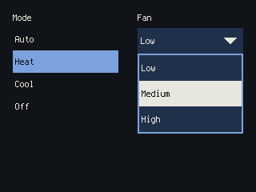
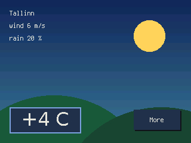
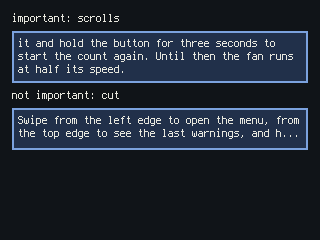
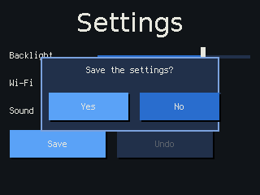
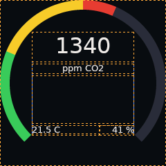

# Рецепты

*[In English](../en/cookbook.md)*

На этой странице собраны рецепты: короткие куски кода для всего, из чего складывается интерфейс, — от кнопки до
всплывающего окна и касания. Рецепт — это несколько законченных кусков на C, которые переносятся в программу как
есть. Имена, которые рецепт не определяет, например `settings_save()`, — это функции самой программы. Рамка, в
которой работают все рецепты, — дисплей, очередь и цикл задачи, владеющей деревом, — написана в
[Начале работы](getting-started.md).

- [Общее для всех рецептов](#общее-для-всех-рецептов)
- [Строка и столбец под любой экран](#строка-и-столбец-под-любой-экран)
- [Одно сообщение для нескольких виджетов](#одно-сообщение-для-нескольких-виджетов)
- [Часы или что угодно время от времени](#часы-или-что-угодно-время-от-времени)
- [Кнопка](#кнопка)
- [Подпись из строковой константы](#подпись-из-строковой-константы)
- [Ползунок и переключатель](#ползунок-и-переключатель)
- [Список](#список)
- [Выпадающий список](#выпадающий-список)
- [Одно из нескольких и галочка](#одно-из-нескольких-и-галочка)
- [Полоса уровня](#полоса-уровня)
- [Значок, который показывает состояние](#значок-который-показывает-состояние)
- [Картинка из флеша](#картинка-из-флеша)
- [Картинка под виджетами](#картинка-под-виджетами)
- [Текст в несколько строк](#текст-в-несколько-строк)
- [Журнал последних строк](#журнал-последних-строк)
- [Шрифт по размеру текста](#шрифт-по-размеру-текста)
- [Сглаженные буквы](#сглаженные-буквы)
- [Рукописный текст](#рукописный-текст)
- [Свои цвета и ночной режим](#свои-цвета-и-ночной-режим)
- [Показать, скрыть, отключить](#показать-скрыть-отключить)
- [Всплывающее окно](#всплывающее-окно)
- [Страницы и «назад»](#страницы-и-назад)
- [Полоса над страницами](#полоса-над-страницами)
- [Страница, которая работает, только пока её видно](#страница-которая-работает-только-пока-её-видно)
- [Страницы, которые сдвигаются](#страницы-которые-сдвигаются)
- [Настройки, которые сохраняются](#настройки-которые-сохраняются)
- [Кнопки платы](#кнопки-платы)
- [Одна ручка](#одна-ручка)
- [Касание с DGX-DI](#касание-с-dgx-di)
- [Касание по прерыванию](#касание-по-прерыванию)
- [Поле ввода и клавиатура](#поле-ввода-и-клавиатура)
- [Ввод в полосе над клавиатурой](#ввод-в-полосе-над-клавиатурой)
- [Виджеты, которые появляются и исчезают](#виджеты-которые-появляются-и-исчезают)
- [Большие данные: сообщение по ссылке](#большие-данные-сообщение-по-ссылке)
- [Сообщение из прерывания](#сообщение-из-прерывания)
- [Свой облик](#свой-облик)
- [Свой виджет, которым управляют палец и клавиши](#свой-виджет-которым-управляют-палец-и-клавиши)
- [Картинка, которая живёт между проходами](#картинка-которая-живёт-между-проходами)
- [График-развёртка](#график-развёртка)
- [Шкала по кругу с виджетами внутри](#шкала-по-кругу-с-виджетами-внутри)
- [Дисплей на 18 или 24 бита](#дисплей-на-18-или-24-бита)
- [Цикл, который спит до следующего момента](#цикл-который-спит-до-следующего-момента)
- [Сколько длится проход](#сколько-длится-проход)
- [Зеркало экрана](#зеркало-экрана)
- [Дерево как слой в чужих полосах](#дерево-как-слой-в-чужих-полосах)
- [Поворот экрана](#поворот-экрана)
- [Проверка интерфейса на компьютере](#проверка-интерфейса-на-компьютере)

## Общее для всех рецептов

Заголовки, цвета и два стиля одного шрифта. Цвета — это номера в таблице, которую программа даёт отрисовке; рецепты
называют их по именам.

```c
#include "dgx_draw.h"
#include "dgx_ui_paint.h"
#include "dgx_ui_post.h"
#include "dgx_ui_text.h"
#include "dgx_ui_ticker.h"
#include "esp_attr.h"
#include "esp_timer.h"
#include "fonts/DejaVuSansBook32.h"
#include "fonts/TerminusTTFMedium12.h"
#include "freertos/FreeRTOS.h"
#include "freertos/task.h"

enum { PAPER, INK, FILL, BORDER, ACCENT, ACCENT_DOWN, SHADOW, DIM, COLORS };

static dgx_ui_font_variant_t small[1];
static dgx_ui_text_style_t   st_left, st_centre;

static void styles_init(void)
{
    small[0]  = (dgx_ui_font_variant_t){.font = TerminusTTFMedium12()};
    st_left   = (dgx_ui_text_style_t){.variants = small, .count = 1, .align = DGX_FONT_ALIGN_LEFT};
    st_centre = (dgx_ui_text_style_t){.variants = small, .count = 1, .align = DGX_FONT_ALIGN_CENTER};
}
```

## Строка и столбец под любой экран

Ребёнок с флагом `DGX_UI_REST` занимает то, что осталось в его строке или столбце после остальных. Ширину не надо
считать руками, и то же дерево подходит экрану другой ширины, другому `unit` и повёрнутому экрану.

```c
static char             name_buf[16], value_buf[16], title_buf[16];
static dgx_ui_textbox_t name_box, value_box, title_box;

/* a row: the name takes what the value leaves */
static const dgx_ui_widget_t fit_row_w = {.kind = DGX_UI_BOX, .flags = DGX_UI_ROW, .want_h = 10, .gap = 4};
static const dgx_ui_widget_t name_w    = {.kind = DGX_UI_LABEL, .flags = DGX_UI_REST, .text = &name_box};
static const dgx_ui_widget_t value_w   = {.kind = DGX_UI_LABEL, .text = &value_box, .want_w = 40};

/* a column: the content takes what the title and the buttons leave, so the buttons stand at the bottom */
static const dgx_ui_widget_t page_w    = {.kind = DGX_UI_BOX, .flags = DGX_UI_COLUMN, .pad = 4, .gap = 4};
static const dgx_ui_widget_t title_w   = {.kind = DGX_UI_LABEL, .text = &title_box};
static const dgx_ui_widget_t content_w = {.kind = DGX_UI_BOX, .flags = DGX_UI_COLUMN | DGX_UI_REST, .gap = 2};
static const dgx_ui_widget_t bottom_w  = {.kind = DGX_UI_BOX, .flags = DGX_UI_ROW, .want_h = 18, .gap = 6};
```

- Несколько детей с этим флагом делят остаток поровну.
- Если не осталось ничего, такой ребёнок не получает размера и не виден.
- В контейнере, который не столбец и не строка, флаг ничего не делает.

## Одно сообщение для нескольких виджетов

Датчик шлёт температуру и влажность одним сообщением. Его читают две надписи; ни одна его не забирает, поэтому
видят обе.

```c
enum { MSG_CLIMATE = 10 };
typedef struct {
    int16_t t10; /* tenths of a degree */
    uint8_t rh;  /* percent */
} climate_t;
DGX_UI_MESSAGE(climate, MSG_CLIMATE, climate_t)

static bool temp_take(dgx_ui_t *ui, int i, const dgx_ui_msg_t *msg)
{
    climate_t c;
    if (msg_decode_climate(msg, &c) == ESP_OK) dgx_ui_text_printf(ui, i, "%d.%d C", c.t10 / 10, c.t10 % 10);
    return false;
}

static bool rh_take(dgx_ui_t *ui, int i, const dgx_ui_msg_t *msg)
{
    climate_t c;
    if (msg_decode_climate(msg, &c) == ESP_OK) dgx_ui_text_printf(ui, i, "%d %%", c.rh);
    return false;
}

static dgx_ui_textbox_t      temp_box, rh_box;
static const dgx_ui_widget_t temp_w = {.kind = DGX_UI_LABEL, .text = &temp_box, .take = temp_take};
static const dgx_ui_widget_t rh_w   = {.kind = DGX_UI_LABEL, .text = &rh_box, .take = rh_take};

/* the sensor's task */
static void climate_send(QueueHandle_t queue, int t10, int rh)
{
    const climate_t c = {.t10 = (int16_t)t10, .rh = (uint8_t)rh};
    if (!msg_post_climate(queue, &c)) {
        /* the queue is full and the value is lost: the next one comes anyway */
    }
}
```

- Текст сравнивается уже отформатированным. Датчик может прислать 21,53, потом 21,48: надпись оба раза показывает
  «21.5», и ничего не рисуется.
- Тип больше 12 байт в `DGX_UI_MESSAGE` не скомпилируется. Данные побольше идут
  [по ссылке](#большие-данные-сообщение-по-ссылке).
- Декодер — это `dgx_ui_msg_copy()` с номером и размером. Сообщение с нужным номером, но другого размера — ошибка
  программы, и она попадает в журнал.

## Часы или что угодно время от времени

Тикер шлёт сообщение с заданным номером раз в столько-то миллисекунд. Кому оно нужно, тот читает его в своей
`take()`.

```c
enum { MSG_MINUTE = 11 };
static dgx_ui_ticker_t minute_ticker; /* static: zeroed, and alive as long as its ticks */

static bool date_take(dgx_ui_t *ui, int i, const dgx_ui_msg_t *msg)
{
    if (msg->what != MSG_MINUTE) return false;
    const uint32_t minutes = (uint32_t)(esp_timer_get_time() / 60000000);
    dgx_ui_text_printf(ui, i, "up %u h %02u min", (unsigned)(minutes / 60), (unsigned)(minutes % 60));
    return true;
}

static bool minutes_start(QueueHandle_t queue)
{
    return dgx_ui_ticker_start(&minute_ticker, queue, MSG_MINUTE, 60 * 1000);
}
```

- Следующий тик уходит, только когда цикл вызвал `dgx_ui_msg_done()` для предыдущего. Цикл, который забыл этот вызов,
  получит один тик и больше ни одного.
- `dgx_ui_ticker_stop()` останавливает тикер. Его структура должна жить, пока не выброшен последний тик; статическая
  живёт всегда.
- Тикером удобно делать медленное во времени: кадры значка, мигающее значение. Между тиками задача спит.

## Кнопка


Элемент управления называет свой облик. Текст кнопки — текстовое поле, как у надписи. Функции `on()` сообщается
`DGX_UI_ACTIVATED`, когда пользователь нажал кнопку пальцем или клавишей «выбрать», пока на кнопке фокус.

```c
void settings_save(void);

static dgx_ui_textbox_t save_box = DGX_UI_TEXT_CONST("Save", 1, &st_centre); /* a caption that never changes: no buffer */

static void save_on(dgx_ui_t *ui, int i, const dgx_ui_node_t *node, int what, void *ctx)
{
    if (what == DGX_UI_ACTIVATED) settings_save();
}

static const dgx_ui_widget_t save_w = {
    .kind = DGX_UI_BUTTON, .text = &save_box, .want_w = 60, .want_h = 18, .look = &dgx_ui_look_button, .on = save_on};

static int save_add(dgx_ui_t *ui, int parent)
{
    return dgx_ui_add(ui, parent, &save_w);
}
```

- Кнопка с текстом высотой в одну строку текста и ещё по точке сверху и снизу, это место для рамки фокуса, если не
  сказано иначе: задайте `want_h`, а в строке — флаг `DGX_UI_STRETCH`, с ним кнопка высотой со строку.
- `dgx_ui_set_state(ui, b, DGX_UI_PRESSED, true)` рисует кнопку нажатой и ничего не запускает: так кнопка платы
  может отражаться на экране.
- `on()` может удалять виджеты, и саму кнопку тоже: диалог может закрыть себя прямо там.

## Подпись из строковой константы

Большинство текстов интерфейса не меняется никогда: названия кнопок, заголовок, единица измерения. Такому тексту не
нужен ни буфер в ОЗУ, ни вызов, который его задаёт: его текстовое поле делается прямо над строковой константой, как
у кнопки выше.

```c
/* the answers of a dialog in two languages: a box for each widget, pointed at a string of the table */
enum { CAPTION_YES, CAPTION_NO, CAPTIONS };

static const char *const caption_text[2][CAPTIONS] = {{"Yes", "No"}, {"Oui", "Non"}};
static dgx_ui_textbox_t  caption_box[CAPTIONS] = {DGX_UI_TEXT_CONST("Yes", 1, &st_centre), DGX_UI_TEXT_CONST("No", 1, &st_centre)};

/* the language changed: every box pointed at its other string and its widget told; widgets[] are the widgets of the boxes */
static void captions_language(dgx_ui_t *ui, const int widgets[CAPTIONS], int language)
{
    for (int caption = 0; caption < CAPTIONS; ++caption) {
        caption_box[caption].buf = (char *)caption_text[language][caption];
        dgx_ui_text_written(ui, widgets[caption]);
    }
}
```

- **`DGX_UI_TEXT_CONST(text, lines, style)`** делает поле, у которого буфер — сама строка, а размер — 0. В такой
  буфер библиотека не пишет никогда: `dgx_ui_text_set()` на нём ничего не меняет и возвращает `false`, а поле ввода
  над ним не принимает ни одной буквы.
- **Само поле по-прежнему занимает 28 байт ОЗУ**: библиотека хранит в нём, как текст был подогнан. Экономятся
  буфер и два вызова — тот, что делал поле, и тот, что задавал текст. Замер на десяти подписях с буферами по 16 байт
  на ESP32: на 168 байт ОЗУ и на 88 байт кода меньше; образ при этом больше примерно на 14 байт на подпись, потому
  что начальные значения полей теперь лежат во флеше.
- **Программа, у которой все тексты — константы** и нигде в текст не печатается число, не тянет и печать, стоящую за
  `dgx_ui_text_printf()`: на ESP32 это около 14 КБ меньше — пока ничто другое в программе не печатает.
- **Поле — одного виджета**; строка может лежать под любым числом полей. Две кнопки с надписью «Да» — это два поля
  над одной строкой.
- **Подпись, которая меняется редко** — с языком или режимом, — направляется на другую константу, а её виджету об
  этом сообщает `dgx_ui_text_written()`, как выше.
- **Текст, который программа составляет сама** — число, имя, пришедшее сообщением, — оставляет себе буфер и
  `dgx_ui_text_printf()`.
- **Строки списка и варианты выпадающего списка** тоже могут быть константой:
  `DGX_UI_TEXT_CONST("Low\nMiddle\nHigh", 1, &st_left)`.

## Ползунок и переключатель

Значение элемента управления живёт в переменной программы, `int32_t`, которую называет виджет:
`.value = &backlight_percent`. Туда его пишет палец пользователя, туда же может писать программа; отрисовка смотрит на
неё при каждом проходе и рисует виджет, если в переменной не то значение, что нарисовано. Функции `on()` сообщается
`DGX_UI_CHANGED`, когда значение изменил пользователь: у ползунка — на каждом шаге пальца, у переключателя — по
нажатию.

```c
void backlight_set(int percent);
void wifi_enable(bool on);

/* the values, the program's own: the slider starts at 70, the switch off */
static int32_t backlight_percent = 70, wifi_wanted;

static void backlight_on(dgx_ui_t *ui, int i, const dgx_ui_node_t *node, int what, void *ctx)
{
    if (what == DGX_UI_CHANGED) backlight_set(backlight_percent);
}

static void wifi_on(dgx_ui_t *ui, int i, const dgx_ui_node_t *node, int what, void *ctx)
{
    if (what == DGX_UI_CHANGED) wifi_enable(wifi_wanted != 0);
}

/* a slider of 0..100 by 5 and a switch, each naming the place of its value */
static const dgx_ui_widget_t backlight_w = {
    .kind = DGX_UI_SLIDER, .min = 0, .max = 100, .step = 5, .want_h = 12, .value = &backlight_percent, .look = &dgx_ui_look_slider, .on = backlight_on};
static const dgx_ui_widget_t wifi_w = {
    .kind = DGX_UI_SWITCH, .max = 1, .want_w = 26, .want_h = 12, .value = &wifi_wanted, .look = &dgx_ui_look_switch, .on = wifi_on};

/* the value came from elsewhere, in the task that owns the tree: written, and the next pass shows it; on() is not told */
static void backlight_show(int percent)
{
    backlight_percent = percent;
}
```

- Значение, которое записала программа, показывается на следующем проходе и `on()` не вызывает: свои собственные
  изменения программа обратно не слышит. Пишет его задача, владеющая деревом; другая задача шлёт сообщение.
- Значение вне `min..max`, каким оно может прийти из флеша, показывается в этих пределах, а сама переменная остаётся
  как есть, пока виджет не изменит пользователь. `dgx_ui_set_value()` пишет сразу в пределах.
- Элемент управления без `.value` показывает 0, и ничто его не меняет; его облик сообщает об этом в журнале.
- Одну переменную могут называть несколько виджетов, ползунок и число рядом с ним: все они идут за ней.
- С флагом `DGX_UI_SWIPE` ползунок двигается на столько, на сколько ушёл палец от места касания, а не туда, где
  палец: получается широкая полоса, в которую легко попасть.
- Клавиши «больше» и «меньше» двигают ползунок на его шаг и ставят переключатель.

## Список


Список — это `DGX_UI_LIST` с обликом `dgx_ui_look_list`. Его строки — это строки его текста, и одна из них выбрана:
это значение списка.

```c
void mode_set(int mode);

static char             mode_buf[32];
static dgx_ui_textbox_t mode_box;

static int32_t          mode_picked; /* the row picked */

static void mode_on(dgx_ui_t *ui, int i, const dgx_ui_node_t *node, int what, void *ctx)
{
    if (what == DGX_UI_ACTIVATED) mode_set(mode_picked); /* a row clicked, or activated by a key */
}

/* four rows of 14 points each: the rows share the height of the list */
static const dgx_ui_widget_t mode_w = {
    .kind = DGX_UI_LIST, .text = &mode_box, .min = 0, .max = 3, .want_h = 56, .value = &mode_picked, .look = &dgx_ui_look_list, .on = mode_on};

static int mode_add(dgx_ui_t *ui, int parent)
{
    dgx_ui_textbox_init(&mode_box, mode_buf, sizeof mode_buf, 1, &st_left);
    const int list = dgx_ui_add(ui, parent, &mode_w);
    dgx_ui_text_set(ui, list, "Auto\nHeat\nCool\nOff"); /* a row for each line */
    return list;
}
```

- **Строки** — это строки текста, разделённые `\n`. Первая строка — значение `min`, следующая — `min + 1`, и так до
  `max`; строка за последней строкой текста пуста.
- **Высота.** Если все строки помещаются в список по строке текста на каждую, они делят его высоту между собой:
  здесь 56 пунктов на четыре строки по 14. Если не помещаются, список показывает окно из них и прокручивается:
  за раз видно столько строк, сколько строк текста помещается в его высоту. Двенадцать месяцев в списке высотой
  56 пикселей, шрифтом в 13 пикселей на строку, — это четыре строки за раз, а тонкая полоска у правого края
  показывает, где окно находится среди всех строк. `step` виджета — наименьшая высота строки в пунктах, чтобы в строку
  попадал палец; 0 значит строку текста.
- **Палец на списке, все строки которого видны.** Когда палец опускается на строку, она выбирается, и `on()`
  сообщается `DGX_UI_CHANGED`. Если вести палец по списку, выбор идёт за ним: выбрана та строка, что под пальцем.
  Палец, отпущенный вскоре на той же строке, на которую опустился, — это нажатие: `DGX_UI_ACTIVATED`. Если он с
  этой строки ушёл, отпускание уже не нажатие. Верхняя и нижняя двенадцатая часть строки не принадлежит ни одной
  строке, и палец там ничего не выбирает.
- **Палец на списке, который прокручивается.** Опущенный палец ничего не выбирает. Если сдвинуть его вверх или
  вниз на полстроки, он двигает выбор — на строку за каждую высоту строки, вверх значит дальше по списку, — а окно
  идёт за выбором. Палец, отпущенный без сдвига, — это нажатие на строку под ним: строка выбирается, и `on()`
  сообщаются `DGX_UI_CHANGED` и `DGX_UI_ACTIVATED`.
- **Клавиши.** «Следующий» и «предыдущий» сначала ведут выбор по строкам, с `DGX_UI_CHANGED` на каждой, и окно идёт за
  ним, а с последней строки фокус уходит к следующему виджету. Клавиша «активировать» сообщает
  `DGX_UI_ACTIVATED`.
- **Окно** всегда содержит выбранную строку после того, как выбор изменился: клавишей, пальцем или вызовом
  `dgx_ui_set_value()`. `dgx_ui_text_scroll(ui, list, rows)` двигает одно окно, выбор остаётся на месте, — для
  своей полосы прокрутки.
- **Выбранная строка** выделена полосой, другого цвета, пока список в фокусе. Когда выбор сдвигается, на дисплей
  пишутся две строки: та, с которой он ушёл, и та, на которую пришёл. Прокручиваемый список пишется целиком, когда
  его окно сдвигается вслед за выбором.
- **Свои цвета** — это `dgx_ui_list_look_t` в облике, который рисует `dgx_ui_draw_list`, как в рецепте
  [Свои цвета](#свои-цвета-и-ночной-режим).

## Выпадающий список



Выпадающий список — это `DGX_UI_DROPDOWN` с обликом `dgx_ui_look_dropdown`: кнопка, которая показывает выбранный
вариант. Его варианты — это строки его текста, как строки у списка, а значение — выбранный вариант. Сам список —
всплывающее окно; программа открывает его одним вызовом, когда на выпадающий список нажали.

Возьмём вентилятор со скоростями Low, Medium и High; сейчас стоит Low:

1. Выпадающий список показывает «Low», его значение 0. Пользователь нажимает на него. Его `on()` получает
   `DGX_UI_ACTIVATED` и вызывает `dgx_ui_dropdown_open()`: под ним открывается список из трёх строк высотой с сам
   выпадающий список, «Low» выделена полосой.
2. Пользователь нажимает «High». Значение выпадающего списка становится 2, его `on()` получает `DGX_UI_CHANGED`,
   список закрывается, и на кнопке написано «High».
3. Если бы пользователь нажал мимо списка, список закрылся бы, значение осталось бы 0, а `on()` ничего бы не
   получила. То же при нажатии на «Low» — вариант, который уже стоял.

```c
#include "dgx_ui_dropdown.h"

void fan_set(int speed);

static char              fan_buf[32];
static dgx_ui_textbox_t  fan_box;
static dgx_ui_dropdown_t fan_list; /* the popup of the list: one serves every dropdown of the program */
static int32_t           fan_choice; /* the option chosen */

static void fan_on(dgx_ui_t *ui, int i, const dgx_ui_node_t *node, int what, void *ctx)
{
    if (what == DGX_UI_ACTIVATED) dgx_ui_dropdown_open(ui, i, &fan_list, NULL, NULL); /* clicked: its list opens */
    if (what == DGX_UI_CHANGED) fan_set(fan_choice);                                  /* the user chose an option */
}

static const dgx_ui_widget_t fan_w = {
    .kind = DGX_UI_DROPDOWN, .text = &fan_box, .min = 0, .max = 2, .want_h = 16, .value = &fan_choice, .look = &dgx_ui_look_dropdown, .on = fan_on};

static int fan_add(dgx_ui_t *ui, int parent)
{
    dgx_ui_textbox_init(&fan_box, fan_buf, sizeof fan_buf, 1, &st_left);
    const int fan = dgx_ui_add(ui, parent, &fan_w);
    dgx_ui_text_set(ui, fan, "Low\nMedium\nHigh"); /* an option for each line */
    return fan;
}
```

- **Где встаёт список.** Под выпадающим списком, той же ширины; над ним, если внизу на экране нет места; иначе
  сдвигается вверх так, чтобы поместиться на экране, и ложится поверх самого выпадающего списка.
- **Строки** высотой с сам выпадающий список и не ниже строки текста: если его сделали под палец, пальцем
  попадёшь и в строку. Если вариантов больше, чем строк помещается на весь экран, список прокручивается: он
  встаёт там, где места больше, под выпадающим списком или над ним, в столько строк, сколько туда помещается, его
  окно стоит на выбранном варианте, а сам выпадающий список он никогда не закрывает.
- **Клавиши.** Клавиша «активировать» на выпадающем списке сообщает `DGX_UI_ACTIVATED`, как и нажатие. В списке
  «следующий» и «предыдущий» ведут выбор, «активировать» выбирает. Список модальный, поэтому клавиши остаются в
  нём. Клавиша «назад» закрывает список, значение остаётся прежним: это делает библиотека, `dgx_ui_key()`
  возвращает `true`, и программе эта клавиша, пока список открыт, не достаётся.
- **Палец, который ведут по списку,** ведёт за собой полосу, а отпущенный ничего не выбирает: список остаётся
  открытым, выбирает нажатие.
- **`dgx_ui_dropdown_t`** — это всплывающее окно списка, 284 байта ОЗУ программы на 32-битном чипе, обнулённые
  перед первым открытием, как любая `static`-переменная. Открыт бывает только один список, поэтому одной структуры
  хватает на все выпадающие списки.
- **Облики** окна — два последних аргумента, рамка и список; `NULL` значит облик библиотеки.
- **Дерево знает свой экран до того, как откроется первый список**: список ставится на экран, под который
  разложено дерево. Экран сообщает отрисовка при первом проходе или сама программа вызовом `dgx_ui_screen()`; до
  этого `dgx_ui_dropdown_open()` возвращает `false` и ничего не открывает.
- **Пока список открыт,** программа может задать варианты заново, например по пришедшему сообщению: список сразу
  показывает новые, его окно остаётся на месте. Сам выпадающий список она не удаляет: сначала закрывает список.
- Если программе нужен другой список, например выбор на весь экран, она по `DGX_UI_ACTIVATED` открывает своё
  всплывающее окно.

## Одно из нескольких и галочка

Радиокнопки выбирают одно из нескольких. Их группа — не виджет и не объект: это переменная программы, которую
называет каждая кнопка группы. Флажок — это переключатель, нарисованный квадратом с галочкой.

```c
void air_mode_set(int mode);
void beep_enable(bool on);

enum { AIR_AUTO, AIR_DAY, AIR_NIGHT, AIR_MODES };

static int32_t air_mode = AIR_AUTO; /* the group: every radio button of it names this variable */
static int32_t beep_wanted = 1;     /* the checkbox */

/* captions that never change: a box for each widget, over a string constant */
static dgx_ui_textbox_t air_box[AIR_MODES] = {
    DGX_UI_TEXT_CONST("Auto", 1, &st_left), DGX_UI_TEXT_CONST("Day", 1, &st_left), DGX_UI_TEXT_CONST("Night", 1, &st_left)};
static dgx_ui_textbox_t beep_box = DGX_UI_TEXT_CONST("Beep", 1, &st_left);

static void air_on(dgx_ui_t *ui, int i, const dgx_ui_node_t *node, int what, void *ctx)
{
    if (what == DGX_UI_CHANGED) air_mode_set(air_mode); /* the user chose another button */
}

static void beep_on(dgx_ui_t *ui, int i, const dgx_ui_node_t *node, int what, void *ctx)
{
    if (what == DGX_UI_CHANGED) beep_enable(beep_wanted != 0);
}

/* a button stands for the number in its step, and is chosen while the group's variable holds that number */
static const dgx_ui_widget_t air_w[AIR_MODES] = {
    {.kind = DGX_UI_RADIO, .step = AIR_AUTO, .text = &air_box[AIR_AUTO], .value = &air_mode, .look = &dgx_ui_look_radio, .on = air_on},
    {.kind = DGX_UI_RADIO, .step = AIR_DAY, .text = &air_box[AIR_DAY], .value = &air_mode, .look = &dgx_ui_look_radio, .on = air_on},
    {.kind = DGX_UI_RADIO, .step = AIR_NIGHT, .text = &air_box[AIR_NIGHT], .value = &air_mode, .look = &dgx_ui_look_radio, .on = air_on},
};

/* a checkbox is a switch drawn as a square with a tick, its text beside it */
static const dgx_ui_widget_t beep_w = {
    .kind = DGX_UI_SWITCH, .max = 1, .text = &beep_box, .value = &beep_wanted, .look = &dgx_ui_look_checkbox, .on = beep_on};

static void air_add(dgx_ui_t *ui, int parent)
{
    for (int mode = 0; mode < AIR_MODES; ++mode) dgx_ui_add(ui, parent, &air_w[mode]);
    dgx_ui_add(ui, parent, &beep_w);
}
```

- **Группа — это переменная.** Кнопки могут стоять в раскладке где угодно: в разных строках, на странице и в дереве
  под ней. Все, кто называет `air_mode`, — одна группа и идут за ней.
- **Щелчок или клавиша «активировать»** пишет число кнопки в переменную. Её `on()` получает `DGX_UI_CHANGED`, если
  переменная от этого изменилась; кнопка, выбранная ещё раз, ничего не сообщает, и кнопке, которая была выбрана,
  ничего не сообщается.
- **Программа тоже пишет в переменную** — по сообщению или из загруженных настроек: на следующем проходе рисуются
  кнопка, которая была выбрана, и та, что выбрана теперь; остальные не рисуются.
- **Число, которому не соответствует ни одна кнопка,** показывает группу без выбора, а переменная остаётся как
  есть.
- **Список или выпадающий список той же переменной** идёт за кнопками, а они за ним: одно место, несколько
  виджетов.
- **Кнопка высотой в строку своего текста и по точке сверху и снизу**, это место для рамки фокуса; под палец ей
  дают `want_h`. Нажимается весь прямоугольник, и текст тоже.
- **Фокус и палец видны**: пока виджет в фокусе, по его краю идёт рамка в одну точку цветом 1, а пока на нём палец,
  середина кольца или квадрата — цвет 2. Свои цвета — это `dgx_ui_check_look_t` в облике, который рисует
  `dgx_ui_draw_radio` или `dgx_ui_draw_checkbox`.
- **Цена**: программа, которая назвала облик флажка, несёт ещё около 1,7 КБ, облик радиокнопки — 1,5 КБ, оба —
  1,9 КБ; и один раз 0,5 КБ за рамку фокуса, общую с обликами кнопки и выпадающего списка. Та, что не назвала ни
  одного, ничего из них не несёт.
- **Радиокнопке не дают `min` и `max`**: её число лежит в `step`. `dgx_ui_radio_chosen(node)` говорит, выбрана ли
  кнопка; `dgx_ui_value()` любой кнопки группы — выбранное число.

## Полоса уровня

Значение, показанное закрашенной частью прямоугольника: заряд батареи, сигнал, уровень в баке. Это облик библиотеки
`dgx_ui_look_level` на виджете вида `DGX_UI_OWN`, который называет место своего значения. Без своих параметров,
`.look = &dgx_ui_look_level`, полоса закрашивается слева цветом 3 поверх цвета 2. Здесь две полосы в цветах
программы:

```c
static int32_t charge_percent; /* written by whoever reads the battery, as any value of the program */

/* below 20 in one colour, below 50 in another, from there up in `bar`; filled from the left */
static const dgx_ui_band_t       charge_bands[] = {{20, ACCENT_DOWN}, {50, BORDER}};
static const dgx_ui_level_look_t charge_colors  = {.bar = ACCENT, .rest = FILL, .from = DGX_UI_FROM_LEFT, .band_count = 2, .bands = charge_bands};
static const dgx_ui_look_t       look_charge    = {.draw = dgx_ui_draw_level, .params = &charge_colors, .fill = -1};
static const dgx_ui_widget_t     charge_w       = {.kind = DGX_UI_OWN, .max = 100, .want_h = 6, .value = &charge_percent, .look = &look_charge};

/* a tank filled from the bottom: 0 to 200 litres in a box 12 points wide and 40 high; what stands above 160 litres
   is of another colour, a zone at the top that keeps its place */
static int32_t                   tank_litres;
static const dgx_ui_band_t       tank_bands[] = {{160, ACCENT}};
static const dgx_ui_level_look_t tank_colors  = {.bar = ACCENT_DOWN, .rest = FILL, .from = DGX_UI_FROM_BOTTOM, .band_count = 1,
                                                 .bands_by = DGX_UI_BANDS_BY_PLACE, .bands = tank_bands};
static const dgx_ui_look_t       look_tank   = {.draw = dgx_ui_draw_level, .params = &tank_colors, .fill = -1};
static const dgx_ui_widget_t     tank_w      = {.kind = DGX_UI_OWN, .max = 200, .want_w = 12, .want_h = 40, .value = &tank_litres, .look = &look_tank};
```

- **Значение** берётся из переменной и приводится к `min`..`max`. Полосу двигает тот, кто пишет в переменную:
  `take()` сообщения или ползунок, который называет ту же переменную. Полоса перерисуется при следующем проходе.
- **Край**, от которого она закрашивается, задаёт `from`: `DGX_UI_FROM_LEFT`, `DGX_UI_FROM_BOTTOM`,
  `DGX_UI_FROM_RIGHT`, `DGX_UI_FROM_TOP`.
- **Диапазоны.** Значение меньше `below` диапазона получает цвет этого диапазона; диапазоны перебираются от меньшего
  к большему, а значение за последним получает цвет `bar`. Здесь 10 — это `ACCENT_DOWN`, 20 и 30 — `BORDER`, 50 и
  80 — `ACCENT`. Вся закрашенная часть одного цвета — цвета значения: это `bands_by`, равный 0,
  `DGX_UI_BANDS_BY_VALUE`.
- **Диапазоны по месту**, `DGX_UI_BANDS_BY_PLACE`, красят каждую часть полосы по тем значениям, которым она
  соответствует: бак до 160 литров цвета `ACCENT`, а выше — `ACCENT_DOWN`, каким бы ни был уровень; зона видна, только
  когда уровень до неё дошёл.
- **Что пишется на дисплей.** Если изменилось только значение — часть между прежней закрашенной длиной и новой:
  полоса длиной 200 пикселей, выросшая на один процент, отправляет два столбца пикселей. Если сменился цвет —
  закрашенная часть и то, что опустело. Каждый пиксель один раз.
- **`rest`** может быть `DGX_UI_PAPER`: на нарисованном фоне в пустой части видна картинка.
- **Полосой ничто не управляет**: она не принимает ни палец, ни фокус. Полоса, которую двигает пользователь, — это
  ползунок.
- **Цена**: около 0,6 КБ в программе, которая называет этот облик.

## Значок, который показывает состояние

Значок — виджет постоянного размера, картинку которого выбирает значение. При значении вне `min..max` картинки нет,
а место за виджетом остаётся, поэтому вокруг ничего не сдвигается, когда значок появляется и исчезает.

```c
/* 8x8, 1 bit: rows from a new byte, the leftmost pixel in the high bit */
static const uint8_t      bars1[8] = {0x00, 0x00, 0x00, 0x00, 0x00, 0x00, 0x80, 0x80};
static const uint8_t      bars2[8] = {0x00, 0x00, 0x00, 0x00, 0x20, 0x20, 0xA0, 0xA0};
static const uint8_t      bars3[8] = {0x00, 0x00, 0x08, 0x08, 0x28, 0x28, 0xA8, 0xA8};
static const uint8_t      bars4[8] = {0x02, 0x02, 0x0A, 0x0A, 0x2A, 0x2A, 0xAA, 0xAA};
static const dgx_image_t  signal_im[4] = {
    {.width = 8, .height = 8, .format = DGX_IMAGE_1BPP, .data = bars1},
    {.width = 8, .height = 8, .format = DGX_IMAGE_1BPP, .data = bars2},
    {.width = 8, .height = 8, .format = DGX_IMAGE_1BPP, .data = bars3},
    {.width = 8, .height = 8, .format = DGX_IMAGE_1BPP, .data = bars4},
};
static const dgx_ui_picture_t signal_pic[4] = {
    {.image = &signal_im[0]}, {.image = &signal_im[1]}, {.image = &signal_im[2]}, {.image = &signal_im[3]}};

enum { MSG_SIGNAL = 12 };
typedef struct {
    int8_t bars; /* 1..4; 0: no network */
} signal_t;
DGX_UI_MESSAGE(signal, MSG_SIGNAL, signal_t)

static int32_t signal_bars; /* the icon's value: which picture */

static bool signal_take(dgx_ui_t *ui, int i, const dgx_ui_msg_t *msg)
{
    signal_t s;
    if (msg_decode_signal(msg, &s) == ESP_OK) signal_bars = s.bars; /* written: the pass after this message shows it */
    return false;
}

/* the pictures of the values 1..4; 0 is outside and shows none */
static const dgx_ui_widget_t signal_w = {
    .kind = DGX_UI_ICON, .picture = signal_pic, .min = 1, .max = 4, .value = &signal_bars, .look = &dgx_ui_look_picture, .take = signal_take};
```

Размер виджета — размер первой картинки. Картинка рисуется непрозрачной: пишутся и её чернила, и её бумага, поэтому
значок, нарисованный поверх себя, не мигает.

## Картинка из флеша

Картинка в 1 бит — это `dgx_image_t` из DGX с обликом `dgx_ui_look_picture`, как значок выше; её чернила — цвет из
таблицы. Цветная картинка — строки RGB565 с обликом `dgx_ui_look_rgb565`:

```c
extern const uint16_t logo_pixels[64 * 32]; /* rows of RGB565, high byte first */

static const dgx_ui_picture_t logo_pic = {.rgb565 = logo_pixels, .width = 64, .height = 32};
static const dgx_ui_widget_t  logo_w   = {.kind = DGX_UI_PICTURE, .picture = &logo_pic, .look = &dgx_ui_look_rgb565};
```

- Облику RGB565 нужны `CONFIG_DGX_ENABLE_VSCREEN=y` и 16-битный экран. На другом экране вместо картинки бумага.
- Для таких картинок отрисовка при первой надобности создаёт один небольшой объект экрана.
  `dgx_ui_paint_free(&paint)` возвращает его, когда программа перестаёт рисовать.

Картинка в несколько цветов таблицы — это `dgx_image_t` в 4 или 8 бит с обликом `dgx_ui_look_indexed`. Её значения
— не цвета, а номера, и её карта говорит, какой цвет таблицы отрисовки стоит за каждым номером:

```c
/* a battery of 12 by 6, 4 bits a pixel: a hex digit is a pixel, 0 a hole that shows the paper */
static const uint8_t battery_px[6 * 6] = {
    0x11, 0x11, 0x11, 0x11, 0x11, 0x00,
    0x12, 0x22, 0x23, 0x33, 0x31, 0x10,
    0x12, 0x22, 0x23, 0x33, 0x31, 0x10,
    0x12, 0x22, 0x23, 0x33, 0x31, 0x10,
    0x12, 0x22, 0x23, 0x33, 0x31, 0x10,
    0x11, 0x11, 0x11, 0x11, 0x11, 0x00,
};
static const dgx_image_t battery_im = {.width = 12, .height = 6, .format = DGX_IMAGE_4BPP, .data = battery_px};
/* the colours of the values 1, 2, 3: the case, the charge, the rest; the same data with another map when it is low */
static const uint8_t          battery_ok[15]  = {INK, ACCENT, FILL};
static const uint8_t          battery_low[15] = {INK, ACCENT_DOWN, FILL};
static const dgx_ui_picture_t battery_pics[2] = {{.image = &battery_im, .map = battery_ok}, {.image = &battery_im, .map = battery_low}};
static int32_t                battery_low_now; /* 0: charged, the first map; 1: low, the second */
static const dgx_ui_widget_t  battery_w = {
    .kind = DGX_UI_ICON, .picture = battery_pics, .min = 0, .max = 1, .want_w = 14, .want_h = 8, .value = &battery_low_now, .look = &dgx_ui_look_indexed};

/* the painter's buffer: such a picture is drawn in it a strip of its rows at a time, a byte a pixel */
static uint8_t paint_buffer[256];

static void paint_buffer_give(dgx_ui_paint_t *paint)
{
    paint->buffer = paint_buffer, paint->buffer_size = sizeof paint_buffer;
}
```

- **Значения** идут через карту картинки, `map`, в номера цветов таблицы отрисовки: значение 1 — это `map[0]`,
  значение 2 — `map[1]`. Без карты номером служит само значение. Пиксель 0 — дыра: на его месте бумага.
- **Те же данные в других цветах** — это другая карта: батарея выше — одна картинка и две карты, значок с двумя
  состояниями.
- **Буфер.** Такую картинку отрисовка рисует в памяти, которую даёт программа, — `buffer` и `buffer_size` в
  структуре отрисовки, — полосой в несколько строк картинки за раз, и каждую полосу переносит через таблицу: каждый
  пиксель виджета пишется один раз. Хватит одной строки самой широкой картинки, по байту на пиксель; если памяти
  больше, полосы выше и их меньше. Без буфера или с буфером меньше строки на месте виджета бумага, и об этом один
  раз пишется в журнал.
- Нужны `CONFIG_DGX_ENABLE_VSCREEN=y` и 16-битный экран. На дисплее в 18 или 24 бита на месте такой картинки
  бумага.
- Для таких картинок отрисовка с первой из них держит небольшой объект экрана и таблицу на 512 байт;
  `dgx_ui_paint_free(&paint)` их возвращает.
- Картинку в 1 бит этот облик тоже рисует, поэтому значок, у которого картинки разной глубины, называет его.
  Программа, у которой картинки только в 1 бит, называет `dgx_ui_look_picture` и ничего из этого не несёт.

## Картинка под виджетами



Фон дерева — это цвет или картинка, которую рисует программа. Программа даёт отрисовке функцию, которая кладёт на
экран прямоугольник её картинки, и каждый виджет, у которого бумага — «то, что лежит подо мной», показывает на этом
месте картинку. Возьмём карту погоды со столбцом надписей поверх неё; ветер сейчас «5 m/s»:

1. Отрисовка рисует надпись. Её облик кладёт кусок карты под свой прямоугольник функцией программы и пишет буквы поверх,
   без поля вокруг них: между буквами видна карта.
2. Ветер становится «6 m/s». Если названы полосы, кусок карты и новые буквы складываются в буфере и уходят на
   дисплей один раз. Надпись не мигает.
3. Программа меняет карту на карту с дождём и сообщает отрисовке, где картинка изменилась. Отрисовка сразу кладёт
   там новую карту — везде, где она видна, — и заново рисует поверх неё надписи. Под рамкой с температурой не
   пишется ничего: рамка заливает себя, и карта сквозь неё не видна.

```c
#include "dgx_vscreen.h"

extern const uint16_t map_pixels[320 * 240]; /* the map, as large as the screen: rows of RGB565, high byte first */
extern const uint16_t rain_pixels[320 * 240];

static dgx_screen_t *map_screen;               /* a virtual screen over the map's pixels: made once */
static uint8_t       map_buffer[320 * 2 * 8];  /* eight rows of 16 bits: what lies on the map goes out through it */

/* the program's function: the piece x, y, w, h of the map put where the painter draws */
static void map_draw(dgx_ui_paint_t *paint, int x, int y, int w, int h, void *ctx)
{
    dgx_vscreen_region_to_screen(paint->scr, x - paint->ox, y - paint->oy, ctx, x, y, w, h, 0);
}

/* at the start, before the first pass */
static bool map_under(dgx_ui_paint_t *paint)
{
    map_screen = dgx_vscreen_from_array((void *)map_pixels, 320, 240, 16, DgxScreenRGB);
    if (!map_screen) return false;
    dgx_ui_background_set(paint, map_draw, map_screen);
    paint->buffer = map_buffer, paint->buffer_size = sizeof map_buffer, paint->strips = &dgx_ui_strips;
    return true;
}

/* another map: the same screen pointed at other pixels, and the painter told where the picture changed */
static void map_rain(dgx_ui_t *ui, dgx_ui_paint_t *paint)
{
    dgx_vscreen_array_set(map_screen, (void *)rain_pixels, 320, 240);
    dgx_ui_background_changed(ui, paint, 0, 0, 320, 240);
}
```

- **Функция** кладёт прямоугольник `x, y, w, h` экрана дерева на `paint->scr` в точку `x - paint->ox`,
  `y - paint->oy`. Отсечение по прямоугольнику отрисовка уже поставила, поэтому функция, которая рисует больше, чем
  просили, ничего не портит. Экран — это дисплей или полоса буфера той же глубины, что у дисплея: на дисплее в 18
  или 24 бита картинка должна быть этой глубины.
- **`dgx_ui_background_set()`** задаёт функцию и то, с чем её вызывать. `NULL` убирает картинку; после этого
  `dgx_ui_redraw(ui, 0)` рисует дерево снова на цвете. Функция, вписанная в структуру отрисовки руками, не
  вызывается: именно этот вызов приносит в программу укладку картинки.
- **Что показывает картинку**: надпись и текст в несколько строк — между буквами, кнопка — вокруг своей грани,
  ползунок — вокруг дорожки, картинка в 1 бит и картинка в 4 или 8 бит — в своих дырах, контейнер — везде. **Что не
  показывает**: рамка и всё, что в ней, потому что она заливает себя; облик, в параметрах которого названа своя
  бумага.
- **Называйте полосы**, если картинка лежит на дисплее за шиной, и на 16-битном тоже. Нарисованная прямо, надпись
  поверх картинки пишется дважды — карта, потом буквы — и мигает; а мягкие края букв, которые прочитать дисплей не
  могут, смешиваются с цветом `background`. Через полосы она уходит один раз, и края смешиваются с картой. В буфер
  должна помещаться хотя бы строка самого широкого такого виджета: его ширина на 2 байта при 16 битах.
- **`background`** остаётся цветом, который сообщается облику там, где картинку положить нельзя. Дайте ему основной
  цвет картинки.
- **`dgx_ui_background_changed()`** рисует сразу и ничего не хранит: картинку в прямоугольнике там, где она видна,
  потом виджеты на ней. Игра с диалогом поверх кадра вызывает её для каждого изменившегося куска кадра — там, где
  раньше отправляла кусок на дисплей; внутри одного пакета DGX куски уходят вместе.
- **Чего это стоит**: около 0,5 КБ в dgx-ui для программы, которая вызывает `dgx_ui_background_set()`, и то, что
  тянет из DGX её собственная функция. Программа с цветом вместо картинки ничего из этого не несёт.

## Текст в несколько строк



Облик `dgx_ui_look_lines` раскладывает текст по строкам своего поля, с переносом по словам. Поле говорит, сколько
строк оно показывает; стиль — что делать со слишком длинным текстом.

```c
static char                news_buf[200], hint_buf[120];
static dgx_ui_textbox_t    news_box, hint_box;
static dgx_ui_text_style_t st_important;

static const dgx_ui_widget_t news_w = {.kind = DGX_UI_LABEL, .text = &news_box, .look = &dgx_ui_look_lines};
static const dgx_ui_widget_t hint_w = {.kind = DGX_UI_LABEL, .text = &hint_box, .look = &dgx_ui_look_lines};

static void texts_add(dgx_ui_t *ui, int parent)
{
    /* an important text too long scrolls a line up every 2 s; one that is not is cut with an ellipsis */
    st_important = (dgx_ui_text_style_t){.variants = small, .count = 1, .flags = DGX_UI_TEXT_IMPORTANT, .scroll_ms = 2000};
    dgx_ui_textbox_init(&news_box, news_buf, sizeof news_buf, 3, &st_important);
    dgx_ui_textbox_init(&hint_box, hint_buf, sizeof hint_buf, 2, &st_left);
    const int news = dgx_ui_add(ui, parent, &news_w);
    const int hint = dgx_ui_add(ui, parent, &hint_w);
    dgx_ui_text_set(ui, news, "The filter has worked for 2000 hours. Replace it and hold the button for three seconds.");
    dgx_ui_text_set(ui, hint, "Swipe from the left edge to open the menu.");
    dgx_ui_text_appear(ui, hint, 30); /* its letters come one by one, 30 ms each */
}
```

- Пока текст прокручивается или появляются его буквы, `dgx_ui_paint()` возвращает `true`, и цикл возвращается снова
  и снова. Когда текст дошёл до конца и все буквы появились, он времени больше не просит.
- Новый текст начинается с первой строки и появляется заново, если это было задано.
- `dgx_ui_text_scroll(ui, i, 1)` сдвигает неважный текст на строку вверх вручную, `-1` — на строку вниз.
- Слово шире строки режется по буквам; `\n` заканчивает строку.
- Программа, которая называет этот облик, несёт примерно на 2,5 КБ кода больше; программа с однострочными
  надписями — нет.

## Журнал последних строк

Журнал показывает последние пришедшие строки: новая добавляется снизу, а когда места нет, самые старые уходят.
Окно рисует облик строк, сами строки хранит программа — прямо в буфере текстового поля.

```c
#include <string.h>

enum { LOG_ROWS = 5 };

static char             log_buf[240]; /* the last lines of the log, "\n" between them: the buffer of the text box itself */
static dgx_ui_textbox_t log_box;

static const dgx_ui_widget_t log_w = {.kind = DGX_UI_LABEL, .text = &log_box, .look = &dgx_ui_look_lines};

static int log_make(dgx_ui_t *ui, int parent)
{
    dgx_ui_textbox_init(&log_box, log_buf, sizeof log_buf, LOG_ROWS, &st_left);
    return dgx_ui_add(ui, parent, &log_w);
}

/* a line added at the end of the log; the oldest lines go when the new one has no room */
static void log_add(dgx_ui_t *ui, int log, const char *line)
{
    const size_t room = sizeof log_buf - 1;
    size_t       have = strlen(log_buf), length = strlen(line);
    if (length > room) { /* longer than the whole log: its beginning, cut on a whole letter of UTF-8 */
        length = room;
        while (length > 0 && ((unsigned char)line[length] & 0xC0) == 0x80) --length;
    }
    while (have > 0 && have + 1 + length > room) { /* the oldest line goes, with its "\n" */
        const char  *line_end = strchr(log_buf, '\n');
        const size_t gone     = line_end ? (size_t)(line_end + 1 - log_buf) : have;
        memmove(log_buf, log_buf + gone, have - gone + 1);
        have -= gone;
    }
    if (have > 0) log_buf[have++] = '\n';
    memcpy(log_buf + have, line, length);
    log_buf[have + length] = 0;
    dgx_ui_text_written(ui, log);        /* the buffer was written in place */
    dgx_ui_text_scroll(ui, log, 0x7fff); /* down to the last lines: the painter stops at the last window */
}
```

- **Буфер пишется на месте**, и об этом сообщает `dgx_ui_text_written()`: виджет подгоняется и рисуется заново, а его
  текст начинается с первой строки, как после `dgx_ui_text_set()`. Поэтому строки хранятся один раз: в 240 байт
  помещается около десяти строк по 20 знаков.
- `dgx_ui_text_scroll()` с числом, которое заведомо больше числа строк, сдвигает затем текст вниз до конца, поэтому
  видны последние `LOG_ROWS` строк, сколько бы строк ни заняла длинная строка после переноса.
- Чтобы посмотреть назад, `dgx_ui_text_scroll(ui, log, -1)` показывает строку старше, пока хватает сохранённых.
  Следующая добавленная строка возвращает конец.
- Строка длиннее всего журнала обрезается по целой букве и остаётся в нём одна.
- `log_add()` вызывает задача, владеющая деревом. Другая задача шлёт свою строку сообщением, как в рецепте
  [Большие данные: сообщение по ссылке](#большие-данные-сообщение-по-ссылке).

## Шрифт по размеру текста

Стиль перечисляет шрифты, которыми можно нарисовать текст, начиная с лучшего. Отрисовка берёт первый, в который
текст помещается целиком, а иначе тот, что показывает больше букв. Короткое название города встаёт крупным шрифтом,
длинное — мелким.

```c
static dgx_ui_font_variant_t city_fonts[2];
static dgx_ui_text_style_t   st_city;

static void city_style_init(void)
{
    city_fonts[0] = (dgx_ui_font_variant_t){.font = DejaVuSansBook32()};
    city_fonts[1] = (dgx_ui_font_variant_t){.font = TerminusTTFMedium12()};
    st_city = (dgx_ui_text_style_t){.variants = city_fonts, .count = 2, .align = DGX_FONT_ALIGN_CENTER, .flags = DGX_UI_TEXT_MIDDLE};
}
```

- Высота надписи — строка её первого шрифта, поэтому размер надписи не зависит от того, какой шрифт выбран.
- Меньший шрифт стоит на базовой линии первого. С флагом `DGX_UI_TEXT_MIDDLE` он стоит посередине высоты.
- Шрифты — из DGX, матричные и точечные. Такой шрифт не масштабируется. Рукописный шрифт пишется на любой
  высоте: следующий рецепт.

## Сглаженные буквы

Шрифт DGX в 4 или 2 бита на пиксель хранит, какую долю каждого пикселя закрывает буква, поэтому у его букв нет
ступенек. Облики рисуют его как любой шрифт: программа даёт его варианту, и больше ничего не меняется.

```cmake
# main/CMakeLists.txt: DejaVu Sans of 16 pixels and 4 bits a pixel, with the letters of the texts in strings.txt
dgx_font_need(title POSTSCRIPT DejaVuSans SIZE 16px BITS 4 TEXTS strings.txt)
```

```c
dgx_font_t *dgx_font_title(void); /* of dgx_fonts.h, which DGX makes at build time: the font of the need "title" */

static dgx_ui_font_variant_t soft[1];
static dgx_ui_text_style_t   st_soft;
static char                  heading_buf[24];
static dgx_ui_textbox_t      heading_box;

static const dgx_ui_widget_t heading_w = {.kind = DGX_UI_LABEL, .text = &heading_box};

static int heading_add(dgx_ui_t *ui, int parent)
{
    soft[0] = (dgx_ui_font_variant_t){.font = dgx_font_title()};
    st_soft = (dgx_ui_text_style_t){.variants = soft, .count = 1, .align = DGX_FONT_ALIGN_LEFT};
    dgx_ui_textbox_init(&heading_box, heading_buf, sizeof heading_buf, 1, &st_soft);
    const int heading = dgx_ui_add(ui, parent, &heading_w);
    dgx_ui_text_set(ui, heading, "Living room");
    return heading;
}
```

- **Шрифт делает DGX во время сборки** по заявке программы с `BITS 4` или `BITS 2`: см. раздел
  [Soft edges](https://github.com/jef-sure/esp32-component-dgx/blob/main/docs/fonts-en.md#soft-edges) у DGX. Шрифты,
  которые идут вместе с DGX, — в один бит.
- **Край буквы — это её чернила, смешанные с бумагой облика**: бумагой надписи, лицом кнопки, полосой выбранной
  строки списка. Этот цвет облик знает, дисплей не читается, поэтому края сглажены и на дисплее за шиной, а на 16
  битах каждый пиксель текста по-прежнему пишется один раз.
- **Над картинкой под виджетами** назовите полосы, и края смешаются с картинкой; нарисованные прямо на дисплей,
  который нельзя прочитать, они смешиваются с цветом `background`. См.
  [Картинка под виджетами](#картинка-под-виджетами).
- Шрифт в один бит и шрифт в 4 бита могут быть вариантами одного стиля, как в рецепте
  [Шрифт по размеру текста](#шрифт-по-размеру-текста).
- **Цена** — флеш под буквы: у DejaVu Sans в 16 пикселей с латинскими и русскими буквами 2,5 КБ битовых карт в один
  бит, 4,4 КБ в 2 бита и 8,5 КБ в 4. Кода не прибавляется, ОЗУ не занимается.
- Рукописный шрифт — другое дело: его штрихи сглажены только в холсте виджета, мягким пером, как показывает
  следующий рецепт.

## Рукописный текст

В DGX есть рукописные шрифты: их буквы — штрихи, которые перо пишет на любой высоте. Вариант такого шрифта называет
рукописный текст библиотеки, `&dgx_ui_handwriting`, и однострочный облик текста его пишет. Программа, которая его не
называет, ничего из него не несёт.

Пример — приветствие шрифтом `font0ss` из DGX: высотой 32 пикселя, когда помещается, суженное, когда почти
помещается, высотой 20 пикселей, когда оно длинное, и матричным шрифтом, когда оно ещё длиннее.

```c
#include "dgx_hw_font.h"
#include "fonts/font0ss.h"

static dgx_ui_font_variant_t greeting_fonts[3];
static dgx_ui_text_style_t   greeting_style;
static char                  greeting_text[64];
static dgx_ui_textbox_t      greeting_box;

static void greeting_init(void)
{
    /* DGX's handwritten face at two heights, then a bitmap font for a text too long even so */
    greeting_fonts[0] = (dgx_ui_font_variant_t){.font = font0ss(), .height = 32, .narrow = 70, .joined = true, .pen = 2, .hand = &dgx_ui_handwriting};
    greeting_fonts[1] = (dgx_ui_font_variant_t){.font = font0ss(), .height = 20, .narrow = 70, .joined = true, .pen = 1, .hand = &dgx_ui_handwriting};
    greeting_fonts[2] = (dgx_ui_font_variant_t){.font = TerminusTTFMedium12()};
    greeting_style    = (dgx_ui_text_style_t){.variants = greeting_fonts, .count = 3, .align = DGX_FONT_ALIGN_LEFT};
    dgx_ui_textbox_init(&greeting_box, greeting_text, sizeof greeting_text, 1, &greeting_style);
}

static const dgx_ui_widget_t greeting_w = {.kind = DGX_UI_LABEL, .text = &greeting_box};

/* a new text, written by the pen: all of it in as long as its letters at 60 ms each */
static void greeting_say(dgx_ui_t *ui, int greeting, const char *text)
{
    dgx_ui_text_set(ui, greeting, text);
    dgx_ui_text_appear(ui, greeting, 60);
}
```

Что происходит в надписи шириной 200 пикселей:

1. `"Hello"` при высоте 32 занимает 50 пикселей: первый вариант, как есть.
2. `"Good afternoon to you"` — 213 пикселей: не помещается. `narrow = 70` разрешает сузить буквы по ширине до 70%.
   Сужение идёт целыми процентами, берётся самое широкое, что помещается. Высота остаётся, перо своей ширины не
   меняет.
3. `"Good afternoon, dear guests of the house"` — 390 пикселей, не помещается и при 70%: второй вариант, высотой 20
   пикселей. Он стоит на базовой линии первого, поэтому текст не прыгает рядом с соседями.
4. `"Good afternoon, dear guests of the house on the hill"` не помещается и при высоте 20: матричный шрифт, с
   многоточием, на той же базовой линии. Без этого последнего варианта был бы взят рукописный, и текст обрезался
   бы по прямоугольнику надписи в конце, без многоточия.
5. `greeting_say(ui, greeting, "Hello")`: текст пишется штрих за штрихом, весь — за то время, что заняли бы его пять
   букв по 60 мс, то есть за 300 мс. Пока он пишется, облик просит проход каждые `DGX_UI_HAND_FRAME_MS`, 20 мс, а
   между проходами цикл спит (`dgx_ui_wake()`). Проход пишет только новые штрихи. Проход, который пришёл раньше, из-за
   другого виджета, дописывает до своего времени. Текст, заданный, пока пишется другой, начинается заново.

Что говорит вариант:

- **`height`** — высота строки в пикселях; она же высота надписи, если вариант в стиле первый.
- **`narrow`** — до скольких процентов можно сузить буквы по ширине; 0 — нельзя.
- **`joined`** — буквы соединены, как в письме от руки.
- **`pen`** — ширина пера в пикселях; 0 — волосная линия.
- **Какие облики его пишут.** Однострочный облик, то есть надпись, и `dgx_ui_look_hand_lines` для нескольких
  строк, ниже. В кнопке, поле ввода, списке и `dgx_ui_look_lines` рукописный вариант пропускается.
- **Чего это стоит.** Если вариант его назвал — около 31 КБ: шрифт `font0ss` — 17,8 КБ, перо DGX — 10 КБ, dgx-ui —
  1,6 КБ. Если не назвал — около 100 байт. Вариант занимает 16 байт, рукописный он или нет.
- **Время прохода.** Перо между проходами ничего не хранит: каждый проход проходит уже написанные штрихи, не
  рисуя их, и пишет новые. На ESP32 с частотой 240 МГц и дисплеем 320 на 240 на SPI проход занимает от 5 до 9 мс,
  пока пишется строка из 12–30 букв высотой 24 пикселя; из них меньше 3 мс уходит на пройденные штрихи. Нарисовать
  всю надпись заново стоило бы от 23 до 41 мс.

У мягкого пера края сходят на нет, и ему нужно место, где хранится количество чернил: холст виджета. Вариант
называет `&dgx_ui_handwriting_canvas`, а у надписи стоит флаг `DGX_UI_CANVAS`:

```c
static dgx_ui_font_variant_t signature_fonts[1];
static dgx_ui_text_style_t   signature_style;
static char                  signature_text[24];
static dgx_ui_textbox_t      signature_box;

static void signature_init(void)
{
    signature_fonts[0] = (dgx_ui_font_variant_t){.font = font0ss(), .height = 32, .pen = 3 | DGX_PEN_SOFT, .hand = &dgx_ui_handwriting_canvas};
    signature_style    = (dgx_ui_text_style_t){.variants = signature_fonts, .count = 1, .align = DGX_FONT_ALIGN_LEFT};
    dgx_ui_textbox_init(&signature_box, signature_text, sizeof signature_text, 1, &signature_style);
}

/* the canvas of the label holds the amounts of ink: a byte of RAM for each of its pixels */
static const dgx_ui_widget_t signature_w = {.kind = DGX_UI_LABEL, .flags = DGX_UI_CANVAS, .text = &signature_box, .want_w = 120};
```

Холсту нужны `CONFIG_DGX_ENABLE_VSCREEN=y` и дисплей в 16 бит. Если писать напрямую, через `&dgx_ui_handwriting`,
мягкое перо становится жёстким той же ширины, и об этом один раз пишется в журнал. Программа, которая называет
только `&dgx_ui_handwriting`, холста не несёт.

### В несколько строк

Рукописный текст в несколько строк называет свой облик, `dgx_ui_look_hand_lines`. Его варианты называют рукописный
текст так же, как у надписи.

```c
static dgx_ui_font_variant_t note_fonts[2];
static dgx_ui_text_style_t   note_style;
static char                  note_text[200];
static dgx_ui_textbox_t      note_box;

static void note_init(void)
{
    /* the hand at 20 pixels, then a bitmap font for a note too long for its lines */
    note_fonts[0] = (dgx_ui_font_variant_t){.font = font0ss(), .height = 20, .joined = true, .pen = 1, .hand = &dgx_ui_handwriting};
    note_fonts[1] = (dgx_ui_font_variant_t){.font = TerminusTTFMedium12()};
    note_style    = (dgx_ui_text_style_t){.variants = note_fonts, .count = 2, .align = DGX_FONT_ALIGN_LEFT};
    dgx_ui_textbox_init(&note_box, note_text, sizeof note_text, 3, &note_style); /* three lines */
}

static const dgx_ui_widget_t note_w = {.kind = DGX_UI_LABEL, .text = &note_box, .look = &dgx_ui_look_hand_lines};
```

Что происходит в заметке шириной 200 пикселей и высотой в три строки:

1. `"The quick brown fox jumps over the lazy dog and runs on and on"` раскладывается по строкам, слово за словом, на
   высоте 20, без сужения: две строки.
2. После `dgx_ui_text_appear(ui, note, 40)` текст пишется строка за строкой, штрих за штрихом. Проход каждые 20 мс
   пишет только новые штрихи той строки, которая пишется; готовые строки не трогаются.
3. Заметка, которая не помещается в три строки при высоте 20, берёт матричный шрифт; он рисуется так же, как его
   рисует `dgx_ui_look_lines`, а его первая строка стоит на базовой линии, которая была бы у рукописной.
4. Если в стиле только рукописный вариант, слишком длинная заметка обрезается, и её последняя строка кончается
   `...` тем же пером. С `DGX_UI_TEXT_IMPORTANT` и `scroll_ms` в стиле она прокручивается на строку вверх каждые
   `scroll_ms`, когда пришли все её буквы.

Что о нём надо знать:

- **Облик называет виджет.** `dgx_ui_look_lines` рукописный вариант пропускает, как и раньше, поэтому программа с
  матричными строками рукописного текста не несёт, а программа с рукописными надписями в одну строку не несёт
  строк.
- **Без сужения.** `narrow` — для одной строки; в строках текст подбирает список вариантов.
- **Что хранится.** Отрисовка хранит для виджета разбивку текста на строки и объём письма каждой строки: 12 байт
  и ещё 8 на строку, 36 байт для трёх строк. Поэтому проход стоит столько же, сколько строка, которая пишется,
  какой бы длины ни был текст. Разбивка делается заново, когда меняется текст, ширина или вариант, и
  освобождается, когда виджет уходит. Если памяти на неё нет, строки раскладываются на каждом проходе: медленнее,
  но это не ошибка.
- **Время прохода.** На ESP32 с частотой 240 МГц и дисплеем 320 на 240 на SPI, при высоте 20 пикселей и пере
  шириной 2: проход, пока появляются буквы, занимает от 7 до 12 мс для текста из 58 букв в две строки и из 101
  буквы в три. Если раскладывать строки на каждом проходе, когда памяти на разбивку нет, он занимает 45 и 80 мс —
  больше кадра в 20 мс. Первый проход после нового текста, который кладёт бумагу и раскладывает строки, занимает
  от 40 до 130 мс, а шаг прокрутки, при котором виджет рисуется целиком, — около 80 мс. Если код рукописных
  шрифтов DGX лежит в ОЗУ, `CONFIG_DGX_HW_FONT_IN_IRAM=y`, 6 КБ IRAM, проход занимает от 5 до 7 мс.
- **Мягкое перо** — как для одной строки: `&dgx_ui_handwriting_canvas` в варианте и `DGX_UI_CANVAS` у виджета.
- **Чего это стоит.** Около 3,9 КБ за облик, вместе с обликом строк, 2,9 КБ, и таблицей отрисовки, 0,7 КБ, сверх
  того, чего стоит рукописный текст.

## Свои цвета и ночной режим

У обликов библиотеки есть параметры: какой цвет таблицы у лицевой стороны, у текста, у тени. Облик в других
цветах — это рисование библиотеки со своими параметрами. Он константа и лежит во флеше:

```c
static const dgx_ui_button_look_t blue_button = {
    .face = ACCENT, .pressed = ACCENT_DOWN, .disabled = FILL,
    .focused = INK, /* the frame round the face while the button has the focus */
    .text = INK, .text_disabled = DIM, .shadow = SHADOW, .depth = 1};
/* the library's drawing of a button, in these colours */
static const dgx_ui_look_t look_blue_button = {.draw = dgx_ui_draw_button, .params = &blue_button, .fill = -1};

static const dgx_ui_widget_t ok_w = {.kind = DGX_UI_BUTTON, .want_w = 60, .want_h = 18, .look = &look_blue_button};
```

Ночной режим — другая таблица тех же цветов. Её дают отрисовке, и корень рисуется целиком:

```c
static void colors_set(dgx_ui_t *ui, dgx_ui_paint_t *paint, const uint32_t *table)
{
    paint->colors = table;
    dgx_ui_redraw(ui, 0); /* the root whole, and with it everything under it */
}
```

Таблица заполняется под экран вызовами `dgx_screen_rgb(scr, r, g, b)`, как в [Начале работы](getting-started.md).

## Показать, скрыть, отключить

```c
static void advanced_show(dgx_ui_t *ui, int box, int button, bool expert)
{
    dgx_ui_show(ui, box, expert);                           /* hidden, it takes no place: the rest moves up */
    dgx_ui_set_state(ui, button, DGX_UI_DISABLED, !expert); /* stays where it is, drawn dim, takes no finger */
}
```

- Скрытый виджет по-прежнему получает сообщения, поэтому при показе он свежий.
- Скрытый или отключённый виджет теряет фокус, и нажатие пальца на нём заканчивается.
- Чтобы что-то появлялось и исчезало, не двигая соседей, не скрывайте его: возьмите
  [значок](#значок-который-показывает-состояние) со значением без картинки или надпись с пустым текстом.

## Всплывающее окно



Всплывающее окно — отдельное дерево: свои узлы, свой корень, те же виджеты и облики. Оно открывается поверх дерева в
прямоугольнике экрана.

```c
/* the question and the two answers never change: boxes over string constants */
static dgx_ui_textbox_t ask_box = DGX_UI_TEXT_CONST("Save the settings?", 1, &st_centre);
static dgx_ui_textbox_t yes_box = DGX_UI_TEXT_CONST("Yes", 1, &st_centre), no_box = DGX_UI_TEXT_CONST("No", 1, &st_centre);
static dgx_ui_node_t    ask_nodes[6];
static dgx_ui_t         ask_ui;
static dgx_ui_t        *ask_over; /* the tree it is open over */

static void yes_on(dgx_ui_t *popup, int i, const dgx_ui_node_t *node, int what, void *ctx)
{
    if (what != DGX_UI_ACTIVATED) return;
    settings_save();
    dgx_ui_popup_close(ask_over);
}

static void no_on(dgx_ui_t *popup, int i, const dgx_ui_node_t *node, int what, void *ctx)
{
    if (what == DGX_UI_ACTIVATED) dgx_ui_popup_close(ask_over);
}

static const dgx_ui_widget_t ask_root_w = {.kind = DGX_UI_FRAME, .flags = DGX_UI_COLUMN, .pad = 5, .gap = 5};
static const dgx_ui_widget_t ask_w      = {.kind = DGX_UI_LABEL, .text = &ask_box, .want_h = 12};
static const dgx_ui_widget_t ask_row_w  = {.kind = DGX_UI_BOX, .flags = DGX_UI_ROW, .want_h = 18, .gap = 6};
/* the two buttons share the row: as high as it (STRETCH), each a half of what it has (REST) */
static const dgx_ui_widget_t yes_w = {
    .kind = DGX_UI_BUTTON, .flags = DGX_UI_STRETCH | DGX_UI_REST, .text = &yes_box, .look = &dgx_ui_look_button, .on = yes_on};
static const dgx_ui_widget_t no_w = {
    .kind = DGX_UI_BUTTON, .flags = DGX_UI_STRETCH | DGX_UI_REST, .text = &no_box, .look = &dgx_ui_look_button, .on = no_on};

static void ask_open(dgx_ui_t *ui)
{
    dgx_ui_init(&ask_ui, ask_nodes, 6, 2);
    const int root = dgx_ui_add(&ask_ui, -1, &ask_root_w);
    dgx_ui_add(&ask_ui, root, &ask_w);
    const int row = dgx_ui_add(&ask_ui, root, &ask_row_w);
    dgx_ui_add(&ask_ui, row, &yes_w);
    dgx_ui_add(&ask_ui, row, &no_w);
    ask_over = ui;
    dgx_ui_popup_open(ui, &ask_ui, 50, 70, 220, 92, DGX_UI_POPUP_MODAL); /* pixels of the screen */
}
```

- Программа по-прежнему вызывает `dgx_ui_take()`, `dgx_ui_pointer()`, `dgx_ui_key()` и `dgx_ui_paint()` для дерева
  под окном; до окна они доходят сами.
- Модальное окно забирает каждый палец и каждую клавишу. Клавишу «назад» не берёт ни один виджет, поэтому
  программа может по ней закрыть окно; окно, открытое с `DGX_UI_POPUP_BACK`, эта клавиша закрывает сама, как
  страницу.
- С флагом `DGX_UI_POPUP_CLOSE_OUTSIDE` окно закрывает палец, опустившийся снаружи: так ведёт себя список выбора.
- Когда окно закрывается, отрисовка заново рисует дерево там, где оно лежало.
- Прямоугольник задан в пикселях экрана, как он стоит сейчас. При повороте экрана закройте окно или откройте заново
  в новых пикселях.

Окно — это дерево, поэтому над ним в свою очередь можно открыть окно: вопрос поверх диалога или список выбора,
который выступает за его край.

```c
static dgx_ui_node_t sure_nodes[6];
static dgx_ui_t      sure_ui; /* built as ask_ui above: a frame, a label, two buttons */

/* a second popup, over the first: it is opened over the popup's own tree */
static bool sure_open(void)
{
    return dgx_ui_popup_open(&ask_ui, &sure_ui, 80, 110, 200, 80, DGX_UI_POPUP_MODAL);
}
```

- Одно над другим могут стоять до `DGX_UI_POPUP_DEPTH`, то есть 8, окон. Для девятого `dgx_ui_popup_open()`
  возвращает `false`, как и для дерева, которое уже открыто как окно.
- Палец и клавиши сначала идут в верхнее окно. Палец на той части верхнего окна, что выступает за нижнее, достаётся
  верхнему.
- `dgx_ui_popup_close(ui)` закрывает окно этого дерева и все окна над ним.

## Страницы и «назад»

Страница — это всплывающее окно на весь экран, которое закрывается клавишей «назад». `dgx_ui_page_open()` открывает
страницу поверх верхней, `dgx_ui_page_back()` закрывает верхнюю. Возьмём часы со страницей настроек и, из неё,
страницей «о программе»:

1. Часы — первое дерево. Пользователь нажимает его кнопку: `dgx_ui_page_open()` открывает дерево настроек поверх
   него, на весь экран, модальным окном. Часы больше не рисуются, а палец и клавиши идут в настройки.
2. Пока показаны настройки, приходит значение датчика. Сообщение предлагается каждому дереву, поэтому надпись
   часов берёт его, под страницей.
3. Из настроек пользователь открывает «о программе»: вторая страница поверх первой.
4. «Назад» — клавишей или кнопкой самой страницы — закрывает верхнюю страницу: снова видны настройки. Ещё раз
   «назад»: корню настроек сообщается `DGX_UI_BACK`, программа сохраняет то, что на странице, и страница
   закрывается: видны часы, уже со значением, которое пришло на шаге 2.
5. «Назад» на часах: ничего не открыто, `dgx_ui_key()` возвращает `false`, клавиша достаётся программе.

```c
void settings_save(void); /* the program's */

/* a page is a tree of its own, built at the start as any tree, with its own nodes */
static dgx_ui_node_t page_settings_nodes[8], page_about_nodes[4];
static dgx_ui_t      page_settings, page_about;
static dgx_ui_t     *pages_home; /* the first tree, under every page */

/* a button of the first tree opens the settings; a button of the settings opens "about" */
static void on_open_settings(dgx_ui_t *ui, int i, const dgx_ui_node_t *node, int what, void *ctx)
{
    if (what == DGX_UI_ACTIVATED) dgx_ui_page_open(pages_home, &page_settings);
}
static void on_open_about(dgx_ui_t *ui, int i, const dgx_ui_node_t *node, int what, void *ctx)
{
    if (what == DGX_UI_ACTIVATED) dgx_ui_page_open(pages_home, &page_about);
}

/* the "back" button of a page does what the key back does */
static void on_page_back(dgx_ui_t *ui, int i, const dgx_ui_node_t *node, int what, void *ctx)
{
    if (what == DGX_UI_ACTIVATED) dgx_ui_page_back(pages_home);
}

/* the root of the settings is told when the page goes, by the key or by the button, while its widgets can be read */
static void on_settings_root(dgx_ui_t *ui, int i, const dgx_ui_node_t *node, int what, void *ctx)
{
    if (what == DGX_UI_BACK) settings_save();
}

static const dgx_ui_widget_t settings_root_w  = {.kind = DGX_UI_FRAME, .flags = DGX_UI_COLUMN, .pad = 2, .gap = 2, .on = on_settings_root};
static const dgx_ui_widget_t settings_back_w  = {.kind = DGX_UI_BUTTON, .want_h = 16, .look = &dgx_ui_look_button, .on = on_page_back};
static const dgx_ui_widget_t settings_about_w = {.kind = DGX_UI_BUTTON, .want_h = 16, .look = &dgx_ui_look_button, .on = on_open_about};
static const dgx_ui_widget_t about_root_w     = {.kind = DGX_UI_FRAME, .flags = DGX_UI_COLUMN, .pad = 2};
```

- **Страница** — это окно с `DGX_UI_POPUP_MODAL | DGX_UI_POPUP_BACK | DGX_UI_POPUP_SCREEN`. Она берёт экран дерева,
  поэтому раскладывается правильно, даже если открыта до первого прохода, и перекладывается при повороте экрана.
  Программа может открыть такое окно и сама, через `dgx_ui_popup_open()`.
- **«Назад».** Клавиша `DGX_UI_KEY_BACK` закрывает верхнюю страницу, если её не взял ни один виджет страницы;
  `dgx_ui_page_back()` делает то же для кнопки. В обоих случаях корню страницы сначала сообщается `DGX_UI_BACK`,
  пока страница ещё открыта и её виджеты можно прочитать.
- **Чтобы спросить перед уходом**, `on(DGX_UI_BACK)` корня открывает вопрос поверх страницы: тогда ничего не
  закрывается, страница остаётся под вопросом.
- **Что лежит над страницей.** «Назад» сначала закрывает список выпадающего списка, потом страницу. Когда
  открывается новая страница, окна над верхней страницей, которые закрыл бы палец в другом месте, — список,
  подсказка — закрываются; модальный диалог, который ждёт ответа, остаётся под новой страницей и снова виден после
  «назад».
- **Стек** — это окна одно над другим, до `DGX_UI_POPUP_DEPTH`, то есть 8, над первым деревом; списки и диалоги
  между страницами тоже считаются.
- **Страницы под верхней** получают сообщения через `dgx_ui_take()` и рисуются, когда снова становятся видны; их
  холсты сохраняются. Закрытая страница ничего не стоит, пока её не откроют снова, а её виджеты сохраняют свои
  значения.
- **Корень страницы** закрывает экран бумагой, если это контейнер, или своей заливкой, если это рамка.
- Страницам одного уровня, которые сменяют друг друга, — вкладкам — окно не нужно: это дети одного контейнера,
  из которых скрыты все, кроме одного (`dgx_ui_show()`).

## Полоса над страницами

Строка состояния с часами, кнопка «назад», вкладки — одна полоса на все страницы, в первом дереве, а страницы под
ней. `dgx_ui_page_place()` называет виджет первого дерева, над которым лежат страницы; остальное дерево остаётся на
экране и работает. Возьмём полосу с часами, двумя вкладками и кнопкой «Back»:

1. В начале место под полосой показывает то, что положило туда первое дерево, здесь — пустой контейнер. Часы — это
   надпись из рецепта [Часы или что угодно время от времени](#часы-или-что-угодно-время-от-времени), её кормит
   тикер.
2. Пользователь нажимает «Air». `on_tab()` не находит страницы, которую надо закрыть, и открывает страницу воздуха:
   она ложится на прямоугольник под полосой. Первое дерево не накрыто: его корню ничего не сообщается, тикер идёт.
3. Проходит минута. Часы получают сообщение тикера, и их надпись рисуется в полосе, рядом с открытой страницей.
4. Пользователь нажимает «Log». Странице воздуха сообщаются `DGX_UI_BACK` и `DGX_UI_COVERED`, и она закрывается;
   страница журнала открывается на том же месте и получает `DGX_UI_SHOWN`.
5. Клавиша «назад» или кнопка «Back» в полосе закрывает страницу. Место снова показывает контейнер первого дерева.

```c
static dgx_ui_t *tab_home;         /* the first tree: the bar, and under it the place of the pages */
static dgx_ui_t  tab_air, tab_log; /* two pages, built at the start as any tree */

static char             tab_clock_buf[24];
static dgx_ui_textbox_t tab_clock_box;
static dgx_ui_textbox_t tab_air_box = DGX_UI_TEXT_CONST("Air", 1, &st_centre), tab_log_box = DGX_UI_TEXT_CONST("Log", 1, &st_centre);
static dgx_ui_textbox_t tab_back_box = DGX_UI_TEXT_CONST("Back", 1, &st_centre);

/* a tab of the bar: the page open now goes, its own comes; the widget's ctx names its page */
static void on_tab(dgx_ui_t *ui, int i, const dgx_ui_node_t *node, int what, void *ctx)
{
    if (what != DGX_UI_ACTIVATED) return;
    dgx_ui_page_back(tab_home); /* told DGX_UI_BACK and closed; no page open: nothing */
    dgx_ui_page_open(tab_home, ctx);
}

static void on_tab_back(dgx_ui_t *ui, int i, const dgx_ui_node_t *node, int what, void *ctx)
{
    if (what == DGX_UI_ACTIVATED) dgx_ui_page_back(tab_home);
}

static const dgx_ui_widget_t tab_root_w  = {.kind = DGX_UI_BOX, .flags = DGX_UI_COLUMN};
static const dgx_ui_widget_t tab_bar_w   = {.kind = DGX_UI_BOX, .flags = DGX_UI_ROW, .gap = 2, .want_h = 16};
static const dgx_ui_widget_t tab_clock_w = {.kind = DGX_UI_LABEL, .flags = DGX_UI_REST, .at_y = 2, .text = &tab_clock_box, .take = date_take};
static const dgx_ui_widget_t tab_air_w   = {
    .kind = DGX_UI_BUTTON, .flags = DGX_UI_STRETCH, .want_w = 30, .text = &tab_air_box, .look = &dgx_ui_look_button, .on = on_tab, .ctx = &tab_air};
static const dgx_ui_widget_t tab_log_w   = {
    .kind = DGX_UI_BUTTON, .flags = DGX_UI_STRETCH, .want_w = 30, .text = &tab_log_box, .look = &dgx_ui_look_button, .on = on_tab, .ctx = &tab_log};
static const dgx_ui_widget_t tab_back_w  = {
    .kind = DGX_UI_BUTTON, .flags = DGX_UI_STRETCH, .want_w = 34, .text = &tab_back_box, .look = &dgx_ui_look_button, .on = on_tab_back};
static const dgx_ui_widget_t tab_place_w = {.kind = DGX_UI_BOX, .flags = DGX_UI_REST};

static void tab_build(dgx_ui_t *home)
{
    tab_home = home;
    dgx_ui_textbox_init(&tab_clock_box, tab_clock_buf, sizeof tab_clock_buf, 1, &st_left);
    const int root = dgx_ui_add(home, -1, &tab_root_w), bar = dgx_ui_add(home, root, &tab_bar_w);
    dgx_ui_add(home, bar, &tab_clock_w), dgx_ui_add(home, bar, &tab_air_w), dgx_ui_add(home, bar, &tab_log_w), dgx_ui_add(home, bar, &tab_back_w);
    dgx_ui_page_place(home, dgx_ui_add(home, root, &tab_place_w)); /* the pages lie over this box from now on */
}
```

- **Место** — виджет первого дерева. Страницы, которые после этого открывает `dgx_ui_page_open()`, лежат над его
  прямоугольником и идут за ним, когда дерево раскладывается заново: при повороте, когда виджет полосы показали или
  скрыли. `dgx_ui_page_place(home, -1)` снова отдаёт страницам весь экран.
- **Полоса работает.** Её виджеты принимают палец, надписи получают сообщения и рисуются, а корню не сообщается
  `DGX_UI_COVERED`: страница на месте накрывает страницы под собой на этом месте, а не первое дерево.
- **Клавиши идут странице.** Пока страница открыта, полосой управляет только палец, и её виджеты фокус не
  показывают. Программа с одними клавишами добирается до того, что делает полоса, иначе: клавишей «назад», кнопкой
  страницы.
- **То, что открывает виджет полосы, открывается над верхом цепочки**, а не над первым деревом: окно, открытое над
  деревом, закрывает прежнее, а с ним и страницы. Верх находят так: `dgx_ui_t *top = home; while (top->popup) top =
  top->popup;`. Выпадающий список в полосе сам открывает свой список над верхом.
- **Страницу на весь экран** поверх всего, тревогу, программа открывает сама:
  `dgx_ui_popup_open(top, &alarm, 0, 0, 0, 0, DGX_UI_POPUP_MODAL | DGX_UI_POPUP_BACK | DGX_UI_POPUP_SCREEN)`. Она
  накрывает и полосу, первому дереву сообщается `DGX_UI_COVERED`, а «назад» закрывает её, как любую страницу.
- **Диалог страницы** лежит там, где его открыли, в пикселях экрана, и забирает любой палец, в том числе палец на
  полосе.
- **При сдвиге** ([Страницы, которые сдвигаются](#страницы-которые-сдвигаются)) кадры двигают только место, и из
  полосы, пока они идут, ничего не пишется.
- **Скрытое место** скрывает страницы над ним, и им ничего не сообщается; удалённое отдаёт им весь экран.
- **Цена**: около 0,5 КБ в программе, которая называет место.

## Страница, которая работает, только пока её видно

Корню дерева сообщают, когда дерево появляется на экране, `DGX_UI_SHOWN`, и когда уходит с него, `DGX_UI_COVERED`.
События идут по очереди: что корень запустил по первому, он останавливает по второму, и ничего не остаётся
работать. Возьмём часы со страницей «воздух», которая раз в секунду опрашивает датчик:

1. Пользователь открывает страницу. Корню часов сообщается `DGX_UI_COVERED`, затем корню страницы — `DGX_UI_SHOWN`:
   он запускает свой тикер.
2. Над страницей открывается вопрос, диалог: «сбросить датчик?». Странице ничего не сообщается: её по-прежнему видно
   вокруг диалога, тикер идёт. Корню диалога сообщается `DGX_UI_SHOWN`, а когда диалог закроется — `DGX_UI_COVERED`.
3. Со страницы пользователь открывает «о программе», вторую страницу. Первой сообщается `DGX_UI_COVERED`, и она
   останавливает тикер; «о программе» получает `DGX_UI_SHOWN`.
4. «Назад»: «о программе» получает `DGX_UI_COVERED`, страница — `DGX_UI_SHOWN`, тикер идёт снова.
5. Ещё раз «назад»: корню страницы сообщается `DGX_UI_BACK`, пока она открыта, затем `DGX_UI_COVERED`, когда она
   закрывается. Часам сообщается `DGX_UI_SHOWN`.

```c
enum { MSG_AIR_POLL = 20 };
static dgx_ui_ticker_t air_ticker;
static QueueHandle_t   air_queue; /* the queue of the loop that owns the trees */

void air_read(void); /* the program's: asks the sensor, whose answer comes as a message */

/* the root of the page: its ticker runs from DGX_UI_SHOWN to DGX_UI_COVERED and at no other time */
static void on_air_root(dgx_ui_t *ui, int i, const dgx_ui_node_t *node, int what, void *ctx)
{
    if (what == DGX_UI_SHOWN) dgx_ui_ticker_start(&air_ticker, air_queue, MSG_AIR_POLL, 1000);
    else if (what == DGX_UI_COVERED) dgx_ui_ticker_stop(&air_ticker);
}

static const dgx_ui_widget_t air_root_w = {.kind = DGX_UI_FRAME, .flags = DGX_UI_COLUMN, .pad = 2, .on = on_air_root};

/* in the loop, for a message no widget claimed */
static void air_message(const dgx_ui_msg_t *msg)
{
    if (msg->what == MSG_AIR_POLL) air_read();
}
```

- **Страница накрывает, диалог — нет.** Дерево показано, пока над ним нет окна на весь экран
  (`DGX_UI_POPUP_SCREEN`). Диалог, подсказка и список выпадающего списка оставляют его на виду. Страница на месте
  ([Полоса над страницами](#полоса-над-страницами)) накрывает страницы под собой на этом месте, а первое дерево
  остаётся показанным.
- **Сообщается при вызове.** Корням сообщает тот вызов, который открывает или закрывает, в том числе клавиша
  «назад», а не проход: две страницы, открытые подряд до первой отрисовки, получат то же самое.
- **Первое дерево** показано с самого начала, и тогда ему ничего не сообщается. Запустите то, что ему нужно, когда
  строите его, или сообщите сами, чтобы у всех экранов был один путь: `dgx_ui_tell(&home, 0, DGX_UI_SHOWN)`.
- **Накрытая страница по-прежнему получает сообщения**: когда она покажется снова, в её надписях будут последние
  значения. Останавливается только то, что страница запустила сама.
- **Тик, который уже в пути**, когда тикер останавливают, всё равно придёт: `air_read()` может быть вызвана ещё раз
  после `DGX_UI_COVERED`.
- **При сдвиге** ([Страницы, которые сдвигаются](#страницы-которые-сдвигаются)) корням сообщается в начале перехода,
  до того как собрана въезжающая картинка: то, что выставлено по `DGX_UI_SHOWN`, в неё попадёт.
- **В обработчике** корень может открывать и закрывать страницы, закрыть или освободить своё дерево. Другое дерево,
  закрытое тем же вызовом, он не открывает, не закрывает и не освобождает: ему сообщат следующим. Не открывает он и
  дерево, которое сейчас освобождают.
- **Смотрите на `what`.** Обработчик корня, который любой вызов принимал за `DGX_UI_BACK`, теперь сохранит или
  закроет страницу по `DGX_UI_SHOWN`.
- **Это не `dgx_ui_show()`**: когда виджет скрывают и показывают, никому ничего не сообщается.
- **Цена**: около 0,65 КБ в программе, которая открывает окна, и ничего в той, которая их не открывает; дерево
  занимает 104 байта, на 8 больше прежнего.

## Страницы, которые сдвигаются

На плате, где хватает памяти на две картинки экрана, страница может приходить сдвигом или кроссфейдом. Модуль
программа называет сама, это `dgx_ui_transition.h`; программа, которая его не называет, ничего из него не несёт.
Рецепт стоит на страницах из рецепта выше: те же деревья, `pages_home` и `settings_save()`.

```c
#include "dgx_ui_transition.h"

void *big_memory(size_t bytes); /* the program's: from PSRAM; NULL when there is none */

static dgx_ui_transition_t page_slide = {.ms = 250};
static dgx_ui_paint_t     *slide_paint; /* the paint of the loop, for the calls made from on() */

/* two pictures of the whole screen, of its depth; without them every page changes at once */
static void slide_init(dgx_ui_paint_t *paint)
{
    const dgx_screen_t *screen = paint->scr;
    const size_t        bytes  = (size_t)screen->width * screen->height * ((screen->color_bits + 7) / 8);
    void               *first = big_memory(bytes), *second = big_memory(bytes);
    slide_paint               = paint;
    if (!first || !second) return;
    page_slide.from = dgx_vscreen_from_array(first, screen->width, screen->height, screen->color_bits, screen->rgb_order);
    page_slide.to   = dgx_vscreen_from_array(second, screen->width, screen->height, screen->color_bits, screen->rgb_order);
}

/* a button of the first tree: the settings come in from the right */
static void on_slide_settings(dgx_ui_t *ui, int i, const dgx_ui_node_t *node, int what, void *ctx)
{
    if (what == DGX_UI_ACTIVATED) dgx_ui_page_open_by(pages_home, &page_settings, slide_paint, &page_slide, DGX_UI_SLIDE_LEFT);
}

/* the root of a page that slides away: the key back and the page's "back" button both come here */
static void on_slide_root(dgx_ui_t *ui, int i, const dgx_ui_node_t *node, int what, void *ctx)
{
    if (what != DGX_UI_BACK) return;
    settings_save();
    dgx_ui_page_back_by(pages_home, slide_paint, &page_slide, DGX_UI_SLIDE_RIGHT);
}

/* in the loop, where the pointer is given and the tree painted: no input while the frames run, a frame in place of the pass */
static bool slide_show(dgx_ui_t *home, dgx_ui_paint_t *paint, const dgx_ui_pointer_t *finger, uint32_t now_ms)
{
    if (page_slide.running) return dgx_ui_transition_frame(&page_slide, paint, now_ms);
    if (finger) dgx_ui_pointer(home, finger);
    return dgx_ui_paint(home, paint, now_ms);
}
```

Что происходит, когда пользователь нажимает кнопку первого дерева:

1. `dgx_ui_page_open_by()` собирает экран, какой он есть, в картинку `from`, открывает страницу, как это делает
   `dgx_ui_page_open()`, отмечает деревья нарисованными, ничего не рисуя, и собирает экран, каким он будет, в `to`.
2. Цикл видит `page_slide.running` и вместо `dgx_ui_paint()` зовёт `dgx_ui_transition_frame()`. Каждый кадр
   делается только из двух картинок: `from` уходит влево, `to` приходит справа, каждый пиксель пишется один раз.
   Следующий кадр запрашивается сразу.
3. Пока идут кадры, приходит сообщение для часов. Надпись часов его берёт; ничего не рисуется.
4. Через 250 мс последний кадр кладёт `to` целиком. Цикл снова рисует, и этот проход рисует только то, что
   изменилось за это время.
5. «Назад», клавишей или кнопкой страницы: корню настроек сообщается `DGX_UI_BACK`, он сохраняет и вызывает
   `dgx_ui_page_back_by()`: страница уходит вправо, видны часы, с текстом, который пришёл на шаге 3.

Чего держаться:

- **Цикл.** Пока идёт переход, вместо прохода зовётся кадр: проход нарисовал бы поверх кадров. Палец и клавиши
  деревьям в это время не даются. Палец, который опустился во время кадров и ещё опущен после них, приходит без
  своего нажатия и остаётся ничьим, пока не поднимется.
- **«Назад»** называется в `on(DGX_UI_BACK)` корня страницы. Через него идут и клавиша «назад», и кнопка «назад»,
  которая вызывает `dgx_ui_page_back()`, — одним переходом.
- **Память** — две картинки экрана, его глубины. В RGB565: 0,3 МБ для 320 на 240, 0,5 МБ для 480 на 272, 1,5 МБ
  для 480 на 800, 2,5 МБ для 1024 на 600, 4,1 МБ для 800 на 1280.
- **Страница меняется сразу**, и это не ошибка, когда картинок нет или `ms` равно 0, когда картинка не того
  размера или глубины, что экран (экран повернули после того, как их сделали), и пока открыта полоса клавиатуры.
  Та же программа тогда работает на плате без такой памяти.
- **Кроссфейд**, `DGX_UI_CROSSFADE`, на дисплее, который читает свой буфер кадра, то есть на DSI, смешивается
  прямо в нём. На дисплее, который прочитать нельзя, он смешивается полосами в буфере отрисовки, куда должна
  помещаться хотя бы строка экрана. На дисплее в 24 бита DGX смешивает по пикселям, а это медленно; сдвиг — две
  пересылки на любом дисплее.
- **Насколько быстро.** Кадр — это одна пересылка целой картинки на дисплей, поэтому темп задаёт дисплей. На
  ESP32-P4 с панелью DSI 800 на 1280 в 16 бит и картинками в PSRAM, в родной ориентации панели, сдвиг идёт со
  скоростью 33 кадра в секунду, 30 мс на кадр, а кроссфейд — 15,6 кадра, 64 мс на кадр; начало, когда собираются
  оба экрана, занимает 53 мс. Тот же экран, повёрнутый в 1280 на 800, даёт 12 кадров в секунду на сдвиге и 7,5
  на кроссфейде: экран, повёрнутый относительно панели, платит за поворот в каждой пересылке.
- **Чего это стоит.** Около 1,3 КБ, вместе с 0,6 КБ `dgx_ui_changed()` и 0,2 КБ вызовов страниц, и виртуальные
  экраны DGX (`CONFIG_DGX_ENABLE_VSCREEN=y`).

## Настройки, которые сохраняются

Значения элементов управления живут в памяти программы, поэтому хранить их — её собственное дело: массив настроек,
который читается из флеша при запуске и записывается, когда пользователь сохраняет. Сама библиотека никуда не пишет.

```c
#include "nvs.h"

enum { PREF_BACKLIGHT, PREF_VOLUME, PREF_NIGHT, PREFS };

/* the settings as the program uses them, with the values of a first start; and the copy a page edits */
static int32_t prefs[PREFS] = {70, 40, 0};
static int32_t prefs_edited[PREFS];

/* at the start, after nvs_flash_init() and before the first pass: what was kept, in the place of the first values */
static void prefs_load(void)
{
    nvs_handle_t storage;
    int32_t      kept[PREFS];
    size_t       size = sizeof kept;
    if (nvs_open("prefs", NVS_READONLY, &storage) != ESP_OK) return; /* nothing kept yet */
    if (nvs_get_blob(storage, "values", kept, &size) == ESP_OK && size == sizeof kept) memcpy(prefs, kept, sizeof prefs);
    nvs_close(storage);
}

/* the settings written out, one blob */
static bool prefs_keep(void)
{
    nvs_handle_t storage;
    if (nvs_open("prefs", NVS_READWRITE, &storage) != ESP_OK) return false;
    const bool kept = nvs_set_blob(storage, "values", prefs, sizeof prefs) == ESP_OK && nvs_commit(storage) == ESP_OK;
    nvs_close(storage);
    return kept;
}

/* the widgets of the settings page name the places of the copy */
static const dgx_ui_widget_t pref_backlight_w = {
    .kind = DGX_UI_SLIDER, .min = 5, .max = 100, .step = 5, .want_h = 12, .value = &prefs_edited[PREF_BACKLIGHT], .look = &dgx_ui_look_slider};
static const dgx_ui_widget_t pref_volume_w = {
    .kind = DGX_UI_SLIDER, .min = 0, .max = 100, .step = 5, .want_h = 12, .value = &prefs_edited[PREF_VOLUME], .look = &dgx_ui_look_slider};
static const dgx_ui_widget_t pref_night_w = {
    .kind = DGX_UI_SWITCH, .max = 1, .want_w = 26, .want_h = 12, .value = &prefs_edited[PREF_NIGHT], .look = &dgx_ui_look_switch};

/* the page opens: the copy filled. No widget is told: the next pass shows what the copy holds */
static void prefs_edit_begin(void)
{
    memcpy(prefs_edited, prefs, sizeof prefs_edited);
}

/* its button "Save" */
static bool prefs_edit_save(void)
{
    memcpy(prefs, prefs_edited, sizeof prefs);
    return prefs_keep();
}

/* its button "Undo": the copy as the settings are again, and the sliders go back at the next pass */
static void prefs_edit_undo(void)
{
    memcpy(prefs_edited, prefs, sizeof prefs_edited);
}

/* when the page is left: is there something to ask "discard the changes?" about */
static bool prefs_edit_changed(void)
{
    return memcmp(prefs_edited, prefs, sizeof prefs) != 0;
}
```

- **Загрузить — значит заполнить массив до первого прохода.** Ни одному виджету ничего не сообщается и ничего не
  вызывается: отрисовка смотрит на места и рисует то, что в них лежит.
- **Страница, которая правит копию,** даёт «Сохранить», «Отменить» и вопрос «отбросить изменения?» тремя
  копированиями памяти. Остальная программа читает `prefs` и никогда не видит наполовину изменённую настройку.
- **Страница без кнопки «Сохранить»** называет места самого `prefs`, а программа вызывает `prefs_keep()`, когда со
  страницы уходят, а не на каждом шаге ползунка: флеш изнашивается.
- **Блок другого размера**, сохранённый более старой программой с другим набором настроек, не берётся: остаются
  первые значения.
- **Значение вне сегодняшних пределов**, сохранённое, когда пределы были другими, показывается в пределах, а сама
  переменная остаётся прежней, пока пользователь не сдвинет элемент управления. Там, где программа пользуется
  переменной сама, она сама и ограничивает её либо читает `dgx_ui_value()` виджета.
- **`nvs_flash_init()`** вызывается один раз при запуске, как в любой программе, которая что-то хранит в NVS.
- **На компьютере** NVS нет: программа, собранная для окна, хранит свой массив в файле или не хранит вовсе.

## Кнопки платы

Тот, кто читает кнопки, шлёт, какие из них удерживаются сейчас, битами геймпада; цикл передаёт их дереву.

```c
enum { MSG_BUTTONS = 13 };
typedef struct {
    uint32_t held; /* DGX_UI_PAD_* */
} buttons_t;
DGX_UI_MESSAGE(buttons, MSG_BUTTONS, buttons_t)

void menu_back(void);

/* in the loop, for a message no widget claimed */
static void buttons_message(dgx_ui_t *ui, const dgx_ui_msg_t *msg, uint32_t now_ms)
{
    buttons_t b;
    if (msg_decode_buttons(msg, &b) != ESP_OK) return;
    const bool taken = dgx_ui_buttons(ui, b.held, now_ms);
    if (!taken && (b.held & (DGX_UI_PAD_BACK | DGX_UI_PAD_B))) menu_back();
}
```

- Вверх и вниз двигают фокус, влево и вправо меняют ползунок или переключатель в фокусе, A выбирает, B и BACK
  достаются программе.
- Удерживаемые вверх, вниз, влево и вправо повторяются через 500 мс, каждые 100 мс. Повтор делает
  `dgx_ui_time()`, которую цикл вызывает перед `dgx_ui_paint()`. Пока кнопка удерживается, она возвращает `true`, и
  цикл не спит.
- Одна клавиша диалога — это `dgx_ui_key(ui, DGX_UI_KEY_NEXT)` и ей подобные.

**Какую клавишу даёт кнопка**, определяет таблица. По умолчанию:

| Кнопка | Её клавиша по умолчанию | Что делает клавиша |
| ------ | ----------------------- | ------------------ |
| `DGX_UI_PAD_UP` | `DGX_UI_KEY_PREV` | фокус переходит к предыдущему виджету |
| `DGX_UI_PAD_DOWN` | `DGX_UI_KEY_NEXT` | фокус переходит к следующему виджету |
| `DGX_UI_PAD_LEFT` | `DGX_UI_KEY_LESS` | ползунок в фокусе на шаг вниз, переключатель выключается |
| `DGX_UI_PAD_RIGHT` | `DGX_UI_KEY_MORE` | ползунок в фокусе на шаг вверх, переключатель включается |
| `DGX_UI_PAD_A` | `DGX_UI_KEY_ACTIVATE` | срабатывает кнопка, строка или выпадающий список в фокусе, переключатель меняет положение, полю ввода сообщается `DGX_UI_EDIT` |
| `DGX_UI_PAD_BACK`, `DGX_UI_PAD_B` | `DGX_UI_KEY_BACK` | виджеты её не берут: достаётся программе |
| `DGX_UI_PAD_START` | никакая | кнопка достаётся программе |

Таблица по умолчанию подходит столбцу настроек: вверх и вниз переходят от одной к другой, влево и вправо меняют ту,
что в фокусе.

Она не подходит кнопкам, которые стоят в ряд. Возьмём диалог с тремя кнопками в строке: «Назад», «OK» и «Дальше»,
фокус на «Назад». Пользователь нажимает вправо, чтобы перейти на «OK». Вправо — это «больше»; у кнопки нет значения,
которое можно увеличить, поэтому не происходит ничего. Фокус двигается только кнопками вверх и вниз, о чём, глядя на
ряд кнопок, не догадается никто.

Своя таблица программы даёт кнопкам влево и вправо клавиши, которые двигают фокус:

```c
/* three buttons in a row, "Back", "OK", "Next": left and right move the focus along the row */
static const uint8_t row_keys[8] = {
    DGX_UI_KEY_PREV,     /* DGX_UI_PAD_LEFT:  the focus to the button on the left; by default LESS */
    DGX_UI_KEY_NEXT,     /* DGX_UI_PAD_RIGHT: the focus to the button on the right; by default MORE */
    DGX_UI_KEY_PREV,     /* DGX_UI_PAD_UP:    the focus back, as by default */
    DGX_UI_KEY_NEXT,     /* DGX_UI_PAD_DOWN:  the focus on, as by default */
    DGX_UI_KEY_ACTIVATE, /* DGX_UI_PAD_A:     the focused button activated, as by default */
    0xff,                /* DGX_UI_PAD_START: no key, the button is the program's, as by default */
    DGX_UI_KEY_BACK,     /* DGX_UI_PAD_BACK:  back, which no widget takes: the program's, as by default */
    DGX_UI_KEY_BACK,     /* DGX_UI_PAD_B:     the same */
};

static void dialog_keys(dgx_ui_t *ui, bool buttons_in_a_row)
{
    dgx_ui_button_keys(ui, buttons_in_a_row ? row_keys : NULL); /* NULL: the default table again */
}
```

- В таблице 8 записей, по одной на кнопку, в порядке битов `DGX_UI_PAD_*`: LEFT, RIGHT, UP, DOWN, A, START, BACK, B.
- Запись — это `DGX_UI_KEY_*` или 0xff: кнопка не даёт клавиши и остаётся программе.
- Дерево запоминает указатель и ничего не копирует: дайте константу.
- Таблицу можно задать заново в любой момент, например, когда диалог-столбец сменился диалогом-строкой. `NULL`
  возвращает таблицу по умолчанию.
- Это таблица того дерева, которое передано в `dgx_ui_buttons()`. Клавиши, которые она даёт, идут и в окна над этим
  деревом, как любая клавиша.

## Одна ручка

Энкодер с нажатием даёт три сигнала вместо шести клавиш: поворот в каждую сторону и щелчок. Поворот переводит
фокус, а в списке сначала идёт по строкам, как и клавиши; щелчок активирует. Ползунку нужно ещё одно: поворот не
может и уводить с него фокус, и менять его. Поэтому щелчок на ползунке начинает изменение, повороты двигают
ползунок, а следующий щелчок изменение заканчивает.

```c
enum { MSG_DIAL = 19 };
typedef struct {
    int8_t steps;   /* turned since the last message, clockwise more than 0 */
    bool   clicked; /* pushed and let go */
} dial_t;
DGX_UI_MESSAGE(dial, MSG_DIAL, dial_t)

/* the slider the dial changes now: its tree, its index and its widget; -1: the dial moves the focus */
static dgx_ui_t              *dial_tree;
static int                    dial_slider = -1;
static const dgx_ui_widget_t *dial_widget;

/* in the loop, before dgx_ui_paint(): the slider is let go when it is the dial's no longer. Its tree may have closed:
   it is looked for among the open ones by its address, and read only when found */
static void dial_tidy(dgx_ui_t *ui)
{
    if (dial_slider < 0) return;
    dgx_ui_t *top  = ui;
    bool      open = ui == dial_tree;
    while (top->popup) top = top->popup, open |= top == dial_tree;
    const bool there = open && dgx_ui_widget(dial_tree, dial_slider) == dial_widget;
    const bool held  = there && (dgx_ui_node(dial_tree, dial_slider)->state.bits & DGX_UI_PRESSED);
    if (held && top == dial_tree && top->focus == dial_slider) return; /* still the dial's */
    if (held) dgx_ui_set_state(dial_tree, dial_slider, DGX_UI_PRESSED, false);
    dial_slider = -1;
}

/* in the loop, for a message no widget claimed */
static void dial_message(dgx_ui_t *ui, const dgx_ui_msg_t *msg)
{
    dial_t dial;
    if (msg_decode_dial(msg, &dial) != ESP_OK) return;
    dial_tidy(ui);
    for (int step = dial.steps; step != 0; step += step > 0 ? -1 : 1) {
        if (dial_slider >= 0) dgx_ui_key(ui, step > 0 ? DGX_UI_KEY_MORE : DGX_UI_KEY_LESS);
        else dgx_ui_key(ui, step > 0 ? DGX_UI_KEY_NEXT : DGX_UI_KEY_PREV);
    }
    if (!dial.clicked) return;
    if (dial_slider >= 0) { /* a click ends the change */
        dgx_ui_set_state(dial_tree, dial_slider, DGX_UI_PRESSED, false);
        dial_slider = -1;
        return;
    }
    dgx_ui_t *top = ui;
    while (top->popup) top = top->popup;
    const dgx_ui_widget_t *focused = top->focus >= 0 ? dgx_ui_widget(top, top->focus) : NULL;
    if (focused && focused->kind == DGX_UI_SLIDER) { /* a click on a slider begins it */
        dial_tree = top, dial_slider = top->focus, dial_widget = focused;
        dgx_ui_set_state(top, dial_slider, DGX_UI_PRESSED, true);
    } else dgx_ui_key(ui, DGX_UI_KEY_ACTIVATE);
}
```

- **Тот, кто читает энкодер,** шлёт `MSG_DIAL` с числом шагов, на которые ручку повернули с прошлого сообщения, и с
  тем, был ли щелчок: `msg_post_dial()` из задачи или `dgx_ui_post_from_isr()` из прерывания, как в рецепте
  [Сообщение из прерывания](#сообщение-из-прерывания).
- **В цикле** `dial_message()` принимает сообщение, которое не взял ни один виджет, а `dial_tidy()` вызывается перед
  `dgx_ui_paint()`.
- **Списку и выпадающему списку** режим не нужен. Повороты идут по строкам списка и с крайних строк уходят с него.
  Щелчок на выпадающем списке открывает его список, повороты идут по нему, щелчок выбирает. Щелчок переключает
  переключатель и нажимает кнопку.
- **Ползунок, который сейчас меняют, помечен битом `DGX_UI_PRESSED`**, и ползунок библиотеки это показывает: его
  ручка, пустая, пока ползунок в фокусе, на точку шире с каждой стороны, пока он нажат. Палец, который держит
  ползунок, показывает то же.
- **Изменение кончается само,** когда ползунок перестал быть ручкиным: палец нажал другой виджет или взял этот и
  отпустил; над ним открылось окно; его страница закрылась. Это делает `dial_tidy()`: у дерева, которое могло
  закрыться, она сравнивает только адрес, а читает дерево, только если нашла его среди открытых.
- **Сигнала «назад» нет.** Странице, на которую приходят ручкой, дают кнопку «назад», как в рецепте
  [Страницы и «назад»](#страницы-и-назад).

## Касание с DGX-DI

`dgx_ui_di.h` — для программы, в которой есть [DGX-DI](https://github.com/jef-sure/esp32-component-dgx-di). Касание
читается в задаче, владеющей дисплеем, поэтому её будит тикер: он запускается один раз с `MSG_TOUCH`, как тикер из
рецепта [Часы или что угодно время от времени](#часы-или-что-угодно-время-от-времени), здесь каждые 20 мс; пример
controls читает каждые 15:

```c
#include "dgx_ui_di.h"

enum { MSG_TOUCH = 14 };

void menu_open(void);

/* in the loop, for the ticker's message MSG_TOUCH; the pointer and the touch are set up as DGX-DI tells */
static void touch_message(dgx_ui_t *ui, dgx_di_pointer_t *pointer, dgx_di_touch_t *touch, uint32_t now_ms)
{
    dgx_ui_di_gestures_t g;
    dgx_di_pointer_read(pointer, now_ms);
    /* the keyboard and the pad of DGX-DI, if the program has them, take their fingers here */
    dgx_ui_di_pointer(ui, pointer, touch, now_ms, &g);
    if (g.edge & DGX_DI_EDGE_LEFT) menu_open(); /* swiped from the left edge */
}
```

- Виджет становится нажатым, как только на него опустился палец, в том числе у края.
- Пока палец держит виджет, обычный свайп и долгое нажатие программе не сообщаются.
- Свайп от края программе сообщается, если только палец не на ползунке, списке или кнопке с `DGX_UI_DRAG`: эти
  владеют пальцем.
- Палец, который опустился мимо виджетов, отдаёт программе все свои жесты. `g.taken` говорит, взял ли нажатие
  виджет.
- В окне на компьютере палец — это мышь, через `dgx_di_host.h` из DGX-DI. Окно DGX читает мышь и клавиши в
  `vTaskDelay()` задачи, которая им владеет, а цикл, который спит на очереди, её не вызывает. Для этого и нужен
  тикер: на тике, который читает касание, сначала вызовите `vTaskDelay(0)`. Так сделано в примере
  [controls](../../examples/controls/main/controls.c).
- [boards](https://github.com/jef-sure/esp32-component-boards) даёт программе дисплей её платы и уже откалиброванный
  указатель DGX-DI, а на компьютере — окно вместо платы. Пример controls берёт оттуда и то и другое.

## Касание по прерыванию

Тикер из рецепта выше читает касание каждые 20 мс всегда, есть палец или нет: задача просыпается пятьдесят раз в
секунду, чтобы узнать, что экран никто не трогает. У микросхемы касания есть линия, которая говорит, что палец
опущен. С прерыванием на ней задача спит, пока не придёт палец, и читает касание по тикеру, только пока палец на
экране. Программа выбирает сама: один тикер, которому не нужна ножка, или это.

```c
#include "driver/gpio.h"

enum { MSG_TOUCH_WAKE = 18 };

static dgx_ui_ticker_t touch_ticker; /* sends MSG_TOUCH while a finger is down */
static QueueHandle_t   touch_queue;
static gpio_num_t      touch_line;

/* the interrupt of the touch chip's line: one message, and the line left alone until the loop watches it again */
static void IRAM_ATTR touch_line_isr(void *arg)
{
    BaseType_t woken = pdFALSE;
    gpio_intr_disable(touch_line);
    dgx_ui_post_from_isr(touch_queue, MSG_TOUCH_WAKE, NULL, 0, &woken);
    if (woken) portYIELD_FROM_ISR();
}

/* at the start, in place of starting the ticker: the pin the chip pulls while a finger is down, and its level then */
static bool touch_wake_start(QueueHandle_t queue, int pin, bool low_when_touched)
{
    const gpio_config_t line = {.pin_bit_mask = 1ULL << pin,
                                .mode         = GPIO_MODE_INPUT,
                                .intr_type    = low_when_touched ? GPIO_INTR_LOW_LEVEL : GPIO_INTR_HIGH_LEVEL};
    touch_queue = queue, touch_line = (gpio_num_t)pin;
    if (gpio_config(&line) != ESP_OK) return false;
    gpio_install_isr_service(0); /* an error when the program installed it already: that is fine */
    return gpio_isr_handler_add(touch_line, touch_line_isr, NULL) == ESP_OK;
}

/* in the loop, for MSG_TOUCH_WAKE: a finger came, and is read every 20 ms from now on */
static void touch_wake_message(void)
{
    dgx_ui_ticker_start(&touch_ticker, touch_queue, MSG_TOUCH, 20);
}

/* in the loop, after touch_message() of a tick: no finger on the pointer, down or still seen, the keyboard's and the
   pad's too, and no widget holding one: no more ticks, the line watched */
static void touch_sleep_when_up(dgx_ui_t *ui, const dgx_di_pointer_t *pointer, const dgx_di_touch_t *touch)
{
    for (int finger = 0; finger < DGX_DI_FINGERS; ++finger)
        if (pointer->fingers[finger].down || pointer->fingers[finger].sees) return;
    if (touch->down || dgx_ui_holding(ui)) return;
    dgx_ui_ticker_stop(&touch_ticker);
    gpio_intr_enable(touch_line);
}
```

Что происходит:

1. При запуске программа вызывает `touch_wake_start()` вместо запуска тикера из рецепта выше. Экран никто не
   трогает: тикер не запущен, цикл спит на своей очереди, касание не читается.
2. Палец опускается. Микросхема тянет свою линию, прерывание шлёт `MSG_TOUCH_WAKE` и выключает себя, поэтому палец,
   который остаётся на экране, даёт одно сообщение.
3. Цикл просыпается сразу и запускает тикер: с этого момента `MSG_TOUCH` приходит каждые 20 мс, и
   `touch_message()` читает палец, как в рецепте выше. После неё цикл вызывает `touch_sleep_when_up()`.
4. Палец поднимается. На тике, после которого у указателя не осталось ни одного пальца и ни один виджет палец не
   держит, `touch_sleep_when_up()` останавливает тикер и снова включает прерывание. Цикл спит до следующего пальца.

Что о нём надо знать:

- **Ножка и её уровень** — от платы: линия микросхемы касания и то, вниз или вверх микросхема её тянет при
  касании. XPT2046 держит свой `PENIRQ` низким, пока палец опущен. GT911 и GSL3680 дают импульс на `INT` при каждом
  отчёте; уровень задаётся по импульсу.
- **Микросхема должна управлять линией.** Драйвер XPT2046 для `esp_lcd_touch` из ESP-IDF оставляет `PENIRQ`
  выключенным, если он не собран с `CONFIG_XPT2046_INTERRUPT_MODE=y`.
- **По уровню, а не по фронту.** Палец, который пришёл между последним тиком и включением прерывания, фронт
  пропустил бы. По уровню прерывание приходит сразу, если линия уже притянута.
- **Спрашивается указатель, а не одно касание дерева.** Палец на клавише клавиатуры DGX-DI или на её экранном
  геймпаде принадлежит им: для дерева касания в это время нет. Если останавливать тики по одному касанию дерева,
  подъём такого пальца прочитается только при следующем касании, и клавиша наберётся с опозданием. Кроме того,
  указатель считает палец опущенным не сразу, а когда видел его несколько чтений подряд; всё это время у пальца
  стоит `sees`, и тики идут.
- **Кнопки платы**, если программа читает их на том же тике, что и касание, как в примере controls, при
  остановленных тиках не читаются. Им нужен свой тикер или своя линия прерывания, которые шлют сообщение из рецепта
  «Кнопки платы».
- **Пробуждение без пальца** стоит одного чтения: тик не находит пальца, и тикер снова останавливается. На ESP32
  ножки 36 и 39 могут будить так, пока работают АЦП или Wi-Fi.
- **То, чему нужно время, не теряется.** Виджет с анимацией, удерживаемая клавиша и облик, который просит время,
  будят цикл через `dgx_ui_wake()`, как и раньше; останавливаются только тики касания.
- **В окне на компьютере** такой линии нет: там остаётся тикер.
- **Замер на CYD** (XPT2046, `PENIRQ` на ножке 36, низкий при касании): за 70 секунд без касаний не пришло ни одного
  прерывания, и после запуска цикл ни разу не проснулся. 28 касаний дали 28 прерываний и 28 остановок тикера, от 6
  до 47 тиков на касание (палец на экране от 120 до 940 мс), 13 тиков на обычное нажатие клавиши.

## Поле ввода и клавиатура

Поле ввода — это `DGX_UI_INPUT` с обликом `dgx_ui_look_input`. Набранное идёт в поле, на котором фокус.

```c
#include "dgx_di_keyboard.h"

void wifi_connect(const char *password);

static char             pass_buf[33];
static dgx_ui_textbox_t pass_box;

static void pass_on(dgx_ui_t *ui, int i, const dgx_ui_node_t *node, int what, void *ctx)
{
    if (what == DGX_UI_ACTIVATED) wifi_connect(pass_buf); /* "done" was typed */
    if (what == DGX_UI_BACK) dgx_ui_text_set(ui, i, "");  /* "cancel" was typed */
}

static const dgx_ui_widget_t pass_w = {.kind = DGX_UI_INPUT, .text = &pass_box, .want_h = 14, .look = &dgx_ui_look_input, .on = pass_on};

/* in the loop, after the pointer was read and before the tree gets the finger: the keyboard of DGX-DI takes its
   fingers first and types into the focused field */
static void keyboard_pass(dgx_ui_t *ui, dgx_di_keyboard_t *kb, dgx_di_pointer_t *pointer, uint32_t now_ms)
{
    uint32_t  typed[8];
    const int n = dgx_di_keyboard_take(kb, pointer, now_ms, typed, 8);
    if (n > 0) dgx_ui_typed(ui, typed, n);
}

/* in the loop, right before dgx_ui_paint(): the painter leaves the keyboard's band alone while it is open */
static void keyboard_cover(dgx_ui_paint_t *paint, const dgx_di_keyboard_t *kb)
{
    paint->cover = kb->open ? dgx_ui_rect(kb->x, kb->y, kb->w, kb->h) : dgx_ui_rect(0, 0, 0, 0);
}
```

- Размер буфера — это сколько поле вмещает; буква, которой нет места, не набирается.
- «Стереть» убирает последнюю букву целиком, в UTF-8.
- Функции `on()` сообщается `DGX_UI_CHANGED` на каждую букву, `DGX_UI_FOCUS`, когда поле получает фокус, и
  `DGX_UI_EDIT`, когда на поле нажали пальцем или клавишей, пока оно в фокусе: здесь и открывать клавиатуру.
- Полосу клавиатуры отрисовке называют прямо перед рисованием, а не там, где берут буквы: между ними `on()` мог
  открыть или закрыть клавиатуру, и виджет, нарисованный в этот проход, лёг бы поверх её клавиш.
- Когда клавиатура закрывается и полоса снова свободна, отрисовка сама рисует там дерево.
- Символы из любого другого источника идут тем же путём: `dgx_ui_typed(ui, code_points, count)`.
- Текст стоит у верхнего края поля; с флагом `DGX_UI_TEXT_MIDDLE` в стиле — посередине его высоты.
- Клавиши клавиатуры DGX-DI размером с палец, в миллиметрах стекла. На маленьком дисплее, как 2,8 дюйма у CYD,
  даже цифровая клавиатура занимает весь экран, и поле не видно, пока клавиатура не закроется. Для такого дисплея —
  следующий рецепт.

## Ввод в полосе над клавиатурой


На маленьком дисплее клавиатура закрывает поле, и не видно, что набрано. Поэтому поле правят в другом месте: в
полосе вверху дисплея, а под ней стоит своя клавиатура программы. Полоса — это всплывающее окно, в котором лежит
копия текста поля. На картинке — `examples/controls` на дисплее CYD, 320 на 240; в PIN пока набраны две цифры.

Пусть в поле «Код» записано `123`:

1. Пользователь нажимает на поле. Его `on()` получает `DGX_UI_EDIT` и вызывает `edit_open()`.
2. `edit_open()` открывает клавиатуру и называет ей поле высотой в один пиксель у самого верха дисплея. Клавиатура
   становится в стороне от названного ей поля, поэтому её полоса уходит вниз; `keypad_kb.y` — где эта полоса
   начинается.
3. От верха дисплея до полосы клавиатуры открывается всплывающее окно: контейнер с одним полем ввода. Это поле
   получает фокус окна и копию текста, так что в полосе видно `123` и курсор после него.
4. Пользователь набирает `9`. `dgx_ui_typed()` сначала отдаёт букву верхнему всплывающему окну, поэтому она
   попадает в копию: в полосе `1239`, в поле под ней по-прежнему `123`.
5. «Готово» на клавиатуре: `on()` полосы получает `DGX_UI_ACTIVATED`, и `edit_close(true)` отдаёт копию полю — в
   нём теперь `1239`. Если вместо этого нажать «отмену», придёт `DGX_UI_BACK`, и `edit_close(false)` только закроет
   полосу. В само поле ничего не писали, поэтому в нём осталось `123` и отменять нечего.

```c
/* the program's keypad: a layout of DGX-DI made a C array by its tools/keyboard_blob.py --c */
extern const uint8_t keypad[];
extern const size_t  keypad_size;

/* a secret field: a star for each letter; the text box keeps the letters */
static const dgx_ui_input_look_t pin_colors = {.ink = INK, .caret = INK, .paper = DGX_UI_PAPER, .secret = true};
static const dgx_ui_look_t       look_pin   = {.draw = dgx_ui_draw_input, .params = &pin_colors, .fill = -1};

static void strip_on(dgx_ui_t *strip, int i, const dgx_ui_node_t *node, int what, void *ctx);

static char             edit_buf[33]; /* the copy that is typed into */
static dgx_ui_textbox_t edit_box;
static const dgx_ui_widget_t strip_w = {.kind = DGX_UI_BOX, .flags = DGX_UI_ROW, .pad = 4};
static const dgx_ui_widget_t strip_in_w = {
    .kind = DGX_UI_INPUT, .text = &edit_box, .flags = DGX_UI_STRETCH | DGX_UI_REST, .look = &dgx_ui_look_input, .on = strip_on};
static const dgx_ui_widget_t strip_pin_w = {
    .kind = DGX_UI_INPUT, .text = &edit_box, .flags = DGX_UI_STRETCH | DGX_UI_REST, .look = &look_pin, .on = strip_on};

static dgx_ui_node_t     strip_nodes[2];
static dgx_ui_t          strip_ui;
static dgx_di_keyboard_t keypad_kb;
static dgx_ui_t         *edit_ui;              /* the tree of the fields; set at the start, with the next three */
static dgx_screen_t     *edit_scr;
static int               edit_mm_w, edit_mm_h; /* the glass in millimetres: the keys are sized by it */
static int               edit_field = -1;      /* the field being edited; -1: none */

static void edit_open(int field)
{
    if (edit_field >= 0) return;
    /* the keyboard keeps away from the field it is given: one at the very top sends its band to the bottom */
    const dgx_di_rect_t top = {.x = 0, .y = 0, .w = (int16_t)edit_scr->width, .h = 1};
    if (!dgx_di_keyboard_open(&keypad_kb, edit_scr, edit_mm_w, edit_mm_h, keypad, keypad_size, TerminusTTFMedium12(), &top)) return;
    const dgx_ui_widget_t *w = dgx_ui_widget(edit_ui, field);
    /* the copy: no longer than the field's own buffer, in the field's style and look */
    const int size = w->text->size < sizeof edit_buf ? w->text->size : (int)sizeof edit_buf;
    dgx_ui_textbox_init(&edit_box, edit_buf, size, 1, w->text->style);
    dgx_ui_init(&strip_ui, strip_nodes, 2, 1);
    dgx_ui_add(&strip_ui, -1, &strip_w);
    const int in = dgx_ui_add(&strip_ui, 0, w->look == &look_pin ? &strip_pin_w : &strip_in_w);
    dgx_ui_text_set(&strip_ui, in, w->text->buf);
    /* the strip: from the top of the display down to the keyboard's band */
    dgx_ui_popup_open(edit_ui, &strip_ui, 0, 0, edit_scr->width, keypad_kb.y, DGX_UI_POPUP_MODAL);
    dgx_ui_focus(&strip_ui, in); /* what is typed goes to the copy */
    edit_field = field;
}

static void edit_close(bool keep)
{
    if (edit_field < 0) return;
    if (keep) dgx_ui_text_set(edit_ui, edit_field, edit_buf); /* done: the copy given to the field */
    dgx_di_keyboard_close(&keypad_kb);
    dgx_ui_popup_close(edit_ui); /* the focus stays on the field: the keys go on from it */
    edit_field = -1;
}

/* the on() of every field edited so: clicked, or activated by a key while it has the focus */
static void field_on(dgx_ui_t *ui, int i, const dgx_ui_node_t *node, int what, void *ctx)
{
    if (what == DGX_UI_EDIT) edit_open(i);
}

static void strip_on(dgx_ui_t *strip, int i, const dgx_ui_node_t *node, int what, void *ctx)
{
    if (what == DGX_UI_ACTIVATED) edit_close(true); /* "done" on the keypad */
    if (what == DGX_UI_BACK) edit_close(false);     /* "cancel": the field keeps what it had */
}

static char             code_buf[9], pin_buf[9];
static dgx_ui_textbox_t code_box, pin_box;
static const dgx_ui_widget_t code_w = {.kind = DGX_UI_INPUT, .text = &code_box, .want_h = 14, .look = &dgx_ui_look_input, .on = field_on};
static const dgx_ui_widget_t pin_w  = {.kind = DGX_UI_INPUT, .text = &pin_box, .want_h = 14, .look = &look_pin, .on = field_on};
```

- **Цикл** тот же, что в рецепте выше: `keyboard_pass(ui, &keypad_kb, pointer, now_ms)` до того, как палец отдан
  дереву, и `keyboard_cover(paint, &keypad_kb)` перед `dgx_ui_paint()`. Программа вызывает их с деревом полей;
  набранное само находит полосу.
- **Клавиатура** — своя раскладка программы: готовая цифровая клавиатура DGX-DI на CYD не оставляет места для
  полосы. В `examples/controls` это `main/keypad.json`: ряды высотой 7,5 мм, над которыми на CYD остаётся полоса в
  36 пикселей, и нижний ряд из «отмены», нуля, «стереть» и «готово».
- **Копия** — причина, по которой отмена ничего не стоит: в текст поля пишут один раз, по «готово». Копия не
  длиннее буфера поля, поэтому набранное всегда в него помещается.
- **Секретное поле** называет облик, в параметрах которого стоит `.secret = true`: вместо каждой буквы рисуется
  звёздочка, и в поле, и в полосе, а сами буквы остаются в текстовом поле. В шрифте должна быть звёздочка. В
  шрифте, сделанном при сборке под цифры PIN, её нет, и поле тогда ничего не показывает: добавьте `*` к знакам
  запроса.
- **`DGX_UI_EDIT` — это нажатие**, как у кнопки: палец отпущен вскоре и без свайпа. Свайп, начатый на поле, ничего
  не открывает, а повторное нажатие на поле открывает полосу снова.
- **Фокус остаётся на поле**, когда полоса закрывается. Обход клавишами проходит поля и ничего не открывает,
  поэтому клавиши идут с поля дальше, к следующему виджету; клавиша «активировать» на поле открывает его полосу.
- **Кнопку платы, которая значит «готово»**, программа обрабатывает после того, как `dgx_ui_buttons()` получила
  кнопки этого тика, а не вместо этого вызова. Полоса модальная и забирает клавишу. Кнопка, нажатия которой
  `dgx_ui_buttons()` не видела, на следующем тике станет новым нажатием: клавишей «активировать» на поле, которое
  в фокусе, — и полоса откроется снова.

## Виджеты, которые появляются и исчезают

```c
enum { TAG_ALARM = 7 };

static char             alarm_buf[40];
static dgx_ui_textbox_t alarm_box;
static const dgx_ui_widget_t alarm_w = {.kind = DGX_UI_LABEL, .text = &alarm_box, .tag = TAG_ALARM};

static void alarm_set(dgx_ui_t *ui, int parent, const char *text)
{
    int a = dgx_ui_find(ui, parent, TAG_ALARM);
    if (text && a < 0) {
        dgx_ui_textbox_init(&alarm_box, alarm_buf, sizeof alarm_buf, 1, &st_left);
        a = dgx_ui_insert(ui, parent, dgx_ui_node(ui, parent)->child, &alarm_w); /* before the first child */
    }
    if (text) dgx_ui_text_set(ui, a, text);
    else if (a >= 0) dgx_ui_remove(ui, a);
}
```

- Дерево запоминает указатель на виджет и ничего не копирует. Дайте ему объект `static const` или память программы,
  которая живёт, пока виджет в дереве. Никогда не давайте составной литерал, созданный внутри функции: он исчезает,
  когда функция возвращается.
- Номер удалённого виджета отдаётся следующему добавленному. Виджет, который появляется и исчезает, ищите по тегу;
  теги начинаются с 1, потому что 0 — тег любого виджета, которому тега не дали.
- `dgx_ui_remove()` удаляет и всё, что под виджетом.
- Виджет, который программа держит в своей памяти, можно менять: его размеры, его картинку. После этого вызовите
  `dgx_ui_relayout()` и для него `dgx_ui_redraw()`.

## Большие данные: сообщение по ссылке

Больше 12 байт идут по ссылке. Сообщение владеет данными от отправки до того, как цикл вызовет
`dgx_ui_msg_done()`: этот вызов один раз вызывает `done()` отправителя, в задаче, владеющей деревом.

```c
#include <stdlib.h>
#include <string.h>

enum { MSG_HEADLINE = 15 };

static void headline_done(void *data, size_t size)
{
    free(data);
}

/* any task: the text is the message's from here on */
static void headline_send(QueueHandle_t queue, const char *text)
{
    char *copy = strdup(text);
    if (copy && !dgx_ui_post_ref(queue, MSG_HEADLINE, copy, strlen(copy) + 1, headline_done)) free(copy); /* not sent: still ours */
}

static bool headline_take(dgx_ui_t *ui, int i, const dgx_ui_msg_t *msg)
{
    if (msg->what != MSG_HEADLINE) return false;
    size_t size;
    dgx_ui_text_set(ui, i, dgx_ui_msg_data(msg, &size)); /* copied into the text box now */
    return true;
}
```

- Данные действительны, пока сообщение не выброшено. Виджет, которому они нужны дольше, вызывает в своей `take()`
  функцию `dgx_ui_msg_keep(ui, &copy)`, а когда данные больше не нужны — `dgx_ui_msg_done(&copy)`. Кто оставил
  данные себе, тот забрал сообщение.
- Данные, которые живут вечно, то есть константу, шлёт `dgx_ui_post_const()`: с ними ничего не делается.

## Сообщение из прерывания

```c
enum { MSG_KNOB = 16 };
typedef struct {
    int8_t steps;
} knob_t;

static QueueHandle_t knob_queue;

static void IRAM_ATTR knob_isr(void *arg)
{
    const knob_t k     = {.steps = 1};
    BaseType_t   woken = pdFALSE;
    dgx_ui_post_from_isr(knob_queue, MSG_KNOB, &k, sizeof k, &woken);
    if (woken) portYIELD_FROM_ISR();
}
```

Только по значению. Вызов лежит в IRAM, поэтому им может пользоваться прерывание, которое работает при выключенном
кеше флеша.

## Свой облик

Облик — это функция, которая рисует виджет, параметры своего типа и цвет, который она оставляет под детьми виджета.
Здесь — полоса уровня: значение виджета в виде закрашенной части его прямоугольника. У библиотеки есть такой облик,
[Полоса уровня](#полоса-уровня); здесь он разобран как урок.

```c
typedef struct {
    uint8_t bar, rest; /* indices of the table */
} level_look_t;

static bool level_draw(const dgx_ui_look_t *look, dgx_ui_paint_t *paint, dgx_ui_t *ui, int i, uint32_t now_ms)
{
    const dgx_ui_node_t   *n    = dgx_ui_node(ui, i);
    const dgx_ui_widget_t *w    = n->widget;
    const level_look_t    *p    = look->params;
    const int              span = w->max > w->min ? w->max - w->min : 1;
    const int              full = n->w * (dgx_ui_value_of(n) - w->min) / span;
    const int              x = n->x - paint->ox, y = n->y - paint->oy;
    if (full > 0) dgx_fill_rectangle(paint->scr, x, y, full, n->h, dgx_ui_color(paint, p->bar));
    if (full < n->w) dgx_fill_rectangle(paint->scr, x + full, y, n->w - full, n->h, dgx_ui_color(paint, p->rest));
    return false; /* no more time asked */
}

static const level_look_t    level_colors = {.bar = ACCENT, .rest = FILL};
static const dgx_ui_look_t   level_look   = {.draw = level_draw, .params = &level_colors, .fill = -1};
static int32_t               level_percent; /* what the bar shows */
static const dgx_ui_widget_t level_w      = {.kind = DGX_UI_OWN, .min = 0, .max = 100, .want_h = 6, .value = &level_percent, .look = &level_look};
```

Правила, которых держится облик:

- **Где.** Он рисует прямоугольник виджета, `n->x, n->y, n->w, n->h`, за вычетом `paint->ox, paint->oy`: экраном может быть
  буфер, в котором лежит часть картины. Отсечение уже поставлено, и облик не меняет его насовсем.
- **Биты, которые надо показать**, — это `dgx_ui_bits_shown(ui, n)`, а не `n->state.bits`: пока над деревом лежит
  модальное окно, фокус не показывается, а облик, который читает состояние сам, продолжал бы его показывать.
- **Каждый пиксель один раз.** Пишите каждый пиксель того, что рисуете, один раз, и на дисплее за шиной виджет не
  мигает. Полоса выше — два прямоугольника, которые не перекрываются.
- **Весь прямоугольник, когда `paint->whole`.** Тогда на экране от виджета нет ничего. Облик, который рисует только
  разницу, обязан в этом случае нарисовать всё. Большинство обликов библиотеки рисуют весь прямоугольник каждый раз;
  список и полоса уровня рисуют разницу.
- **Цвета** берутся из `dgx_ui_color(paint, index)`. `paint->paper` — номер цвета под виджетом.
- **Вызов по частям.** Когда на части виджета лежит всплывающее окно или клавиатура, облик вызывается по разу для
  каждой видимой части, с отсечением по ней. В каждом вызове он должен рисовать одно и то же. Облик, который помнит,
  что нарисовал, записывает это только в последнем: когда `paint->part == paint->parts - 1`, а `paint->composing`
  ложно. На дисплее в 18 или 24 бита, когда названы полосы, облик вызывается ещё и по разу на каждую полосу части,
  с установленным `paint->whole`, поэтому каждый раз рисует весь свой прямоугольник; `paint->composing` стоит во всех
  полосах, кроме последней, так что проверка остаётся той же.
- **Время.** Облик с анимацией возвращает `true`, и его вызывают снова на следующем проходе. Где он находится, он
  считает по `now_ms`.
- **Его заливка.** `fill` — номер цвета, который облик оставляет под детьми виджета, или -1, если он оставляет то,
  что было. У рамки это её заливка.
- **Его бумага.** Там, где бумага облика — то, что лежит под виджетом, он кладёт её вызовом
  `dgx_ui_lay_paper(paint, DGX_UI_PAPER, x, y, w, h)`, а не своей заливкой: это цвет `paint->paper` или, когда
  стоит `paint->on_background`, картинка программы. На картинке облик рисует буквы и картинки без своей бумаги: без
  поля текста, без `DGX_FONT_FILL` и без `DGX_IMAGE_OPAQUE`.

## Свой виджет, которым управляют палец и клавиши

Виджет вида `DGX_UI_OWN` рисуется своим обликом, и только: `dgx_ui_hit()` его не находит, нажатие на него никому
не достаётся, клавиши его обходят. Если облик называет **поведение**, виджет становится элементом управления.
Общее для всех элементов делает ядро: находит виджет под пальцем, ставит `DGX_UI_PRESSED`, даёт ему фокус, решает,
было ли отпускание щелчком, не трогает скрытый и выключенный виджет. Поведение — четыре функции для того, что у
виджета своё; любая может быть `NULL`.

Пример — площадка с двумя осями: x пальца — значение виджета, y — число в данных программы.

```c
void point_set(int x, int y); /* the program's: what it does with the two axes, each 0..100 */

/* a pad of two axes: x is the widget's value, 0..100; y lies in the program's data, 0..100 */
typedef struct {
    int16_t y;
} xy_data_t;

enum { XY_KNOB = 6 }; /* the side of the knob, in pixels */

static bool xy_draw(const dgx_ui_look_t *look, dgx_ui_paint_t *paint, dgx_ui_t *ui, int i, uint32_t now_ms)
{
    const dgx_ui_node_t *n = dgx_ui_node(ui, i);
    const xy_data_t     *d = n->widget->own;
    const int            x = n->x - paint->ox, y = n->y - paint->oy;
    const int            kx = (n->w - XY_KNOB) * dgx_ui_value_of(n) / 100, ky = (n->h - XY_KNOB) * d->y / 100;
    const unsigned       bits  = dgx_ui_bits_shown(ui, n); /* what to show: no focus under a modal popup */
    const uint32_t       field = dgx_ui_color(paint, FILL), ink = dgx_ui_color(paint, INK);
    /* the field in four rectangles round the knob, then the knob: every pixel once */
    if (ky > 0) dgx_fill_rectangle(paint->scr, x, y, n->w, ky, field);
    if (ky + XY_KNOB < n->h) dgx_fill_rectangle(paint->scr, x, y + ky + XY_KNOB, n->w, n->h - ky - XY_KNOB, field);
    if (kx > 0) dgx_fill_rectangle(paint->scr, x, y + ky, kx, XY_KNOB, field);
    if (kx + XY_KNOB < n->w) dgx_fill_rectangle(paint->scr, x + kx + XY_KNOB, y + ky, n->w - kx - XY_KNOB, XY_KNOB, field);
    /* the knob: of another colour under a finger; hollow while the pad has the focus, as the library's knobs are */
    if (bits & DGX_UI_PRESSED) dgx_fill_rectangle(paint->scr, x + kx, y + ky, XY_KNOB, XY_KNOB, dgx_ui_color(paint, ACCENT_DOWN));
    else if (bits & DGX_UI_FOCUSED) {
        dgx_draw_rectangle(paint->scr, x + kx, y + ky, XY_KNOB, XY_KNOB, ink);
        dgx_fill_rectangle(paint->scr, x + kx + 1, y + ky + 1, XY_KNOB - 2, XY_KNOB - 2, field);
    } else dgx_fill_rectangle(paint->scr, x + kx, y + ky, XY_KNOB, XY_KNOB, ink);
    return false;
}

/* the finger at x, y of the widget's own pixels: both axes set as the user sets them */
static void xy_at(dgx_ui_t *ui, int i, int x, int y)
{
    const dgx_ui_node_t *n = dgx_ui_node(ui, i);
    xy_data_t           *d = n->widget->own;
    /* while it is held the finger may be anywhere, outside the widget too */
    const int nx = x * 100 / (n->w - 1), ny = y <= 0 ? 0 : y >= n->h - 1 ? 100 : y * 100 / (n->h - 1);
    if (ny != d->y) {
        d->y = (int16_t)ny;
        dgx_ui_redraw(ui, i);               /* data of its own changed: to be drawn */
        dgx_ui_tell(ui, i, DGX_UI_CHANGED); /* and on() told, as for a value */
    }
    dgx_ui_user_value(ui, i, nx); /* kept within min..max; on() told when it changed */
}

static bool xy_move(dgx_ui_t *ui, int i, int x, int y)
{
    xy_at(ui, i, x, y);
    return true; /* a drag: no click when it is let go, and a swipe from an edge is not the program's */
}

static bool xy_key(dgx_ui_t *ui, int i, int key)
{
    if (key != DGX_UI_KEY_MORE && key != DGX_UI_KEY_LESS) return false; /* the rest is the core's */
    dgx_ui_user_value(ui, i, dgx_ui_value(ui, i) + (key == DGX_UI_KEY_MORE ? 5 : -5));
    return true;
}

static const dgx_ui_behavior_t xy_behavior = {.flags = DGX_UI_BEHAVIOR_FOCUS, .down = xy_at, .move = xy_move, .key = xy_key};
static const dgx_ui_look_t     xy_look     = {.draw = xy_draw, .fill = -1, .behavior = &xy_behavior};

static xy_data_t xy_data;
static int32_t   xy_x; /* the pad's value: where the knob is along x; its y is in xy_data */
static void      on_xy(dgx_ui_t *ui, int i, const dgx_ui_node_t *node, int what, void *ctx)
{
    if (what == DGX_UI_CHANGED) point_set(xy_x, xy_data.y);
}
static const dgx_ui_widget_t xy_w = {
    .kind = DGX_UI_OWN, .min = 0, .max = 100, .want_w = 40, .want_h = 40, .value = &xy_x, .look = &xy_look, .own = &xy_data, .on = on_xy};
```

Что происходит по шагам на площадке 40 на 40 пикселей:

1. Палец опускается в точку 30, 10 виджета. Ядро ставит `DGX_UI_PRESSED`, даёт виджету фокус и вызывает
   `down(ui, i, 30, 10)`. `xy_at()` записывает 25 в `xy_data.y`, помечает виджет и сообщает `on()` событие
   `DGX_UI_CHANGED`; затем `dgx_ui_user_value()` ставит значение 76, и `on()` вызывается ещё раз.
2. Палец движется, куда угодно: виджет держит его, пока палец не поднят, поэтому x и y бывают отрицательными и
   больше размеров виджета. `move()` вызывается при каждом опросе указателя. Она возвращает `true`: это
   перетаскивание. После этого отпускание — уже не щелчок, а свайп от края, начатый на площадке, достаётся ей, а не
   программе (`dgx_ui_dragging()`).
3. Палец поднят: `up()`, если она есть, вызывается с `click`, равным `false`. Если бы виджет не перетаскивали и
   отпустили раньше `DGX_UI_CLICK_MS`, `click` был бы `true`, и после `up()` ядро сообщило бы `on()` событие
   `DGX_UI_ACTIVATED`.
4. Клавиши: `key()` виджета в фокусе спрашивают первой, о каждой клавише. Площадка берёт `DGX_UI_KEY_MORE` и
   `DGX_UI_KEY_LESS`. С тем, на что она ответила `false`, ядро поступает как обычно: «следующий» и «предыдущий»
   переводят фокус дальше, `DGX_UI_KEY_ACTIVATE` сообщает `on()` событие `DGX_UI_ACTIVATED`, «назад» остаётся
   программе.

На что опирается код:

- **`dgx_ui_user_value()`** ставит значение так, как его ставит пользователь: в пределах `min`..`max`, виджет
  помечен, `on()` получает `DGX_UI_CHANGED`, если значение изменилось, и ничего, если оно то же.
  `dgx_ui_set_value()` — установка самой программой, о ней `on()` не сообщают.
- **`dgx_ui_tell()`** сообщает `on()` событие, о котором ядро не знает: здесь это вторая ось. Свои данные виджета,
  которые рисует его облик, помечают вызовом `dgx_ui_redraw()`.
- **Щелчок или перетаскивание.** Площадка возвращает `true` на каждое движение, поэтому щелчка у неё не бывает.
  Виджет, который и перетаскивают, и щёлкают, возвращает `true` только когда палец ушёл достаточно далеко от
  места, где опустился. У виджета, который только нажимают, `move()` нет.
- **Только палец.** Без `DGX_UI_BEHAVIOR_FOCUS` виджет не берёт фокус: клавиши его обходят, а нажатие на него
  оставляет фокус там, где он был. Такой виджет — клавиша своей экранной клавиатуры: поле, в которое она печатает,
  сохраняет фокус. Для него хватает поведения из одних `NULL`, как у полосы ниже.
- **Только для `DGX_UI_OWN`.** Поведение, названное обликом кнопки или ползунка, не вызывается: они работают как
  свой вид.
- **Пока нет.** Набранные символы идут только в `DGX_UI_INPUT`. Виджет нажимается по всему своему прямоугольнику,
  круглый — и в углах.

Виджет только для пальца — полоса уровня из рецепта выше, которую можно нажать:

```c
/* the level bar of the recipe above, tapped: pressed and clicked, the focus left where it is */
static const dgx_ui_behavior_t tap_behavior = {0};
static const dgx_ui_look_t     tap_look     = {.draw = level_draw, .params = &level_colors, .fill = -1, .behavior = &tap_behavior};
static const dgx_ui_widget_t   tap_w        = {.kind = DGX_UI_OWN, .min = 0, .max = 100, .want_h = 6, .value = &level_percent, .look = &tap_look};
```

## Картинка, которая живёт между проходами

Облик рисует свой виджет заново при каждом изменении. У виджета с флагом `DGX_UI_CANVAS` вместо этого есть холст:
экран DGX в 8 бит размером с его прямоугольник, который отрисовка хранит от прохода к проходу. Облик дорисовывает в нём
только новое и кладёт его на дисплей. Возьмём график последних значений CO2, по столбику на каждое:

1. Приходит первое значение. Облик просит холст; он новый, `made` истинно, и облик рисует всё, что есть в графике:
   один столбик. Потом кладёт холст на дисплей.
2. Приходит второе значение. Холст такой, каким его оставил прошлый проход, поэтому облик дорисовывает ещё один
   столбик, второй, и снова кладёт холст.
3. Над графиком открывается и закрывается всплывающее окно. Отрисовка вызывает облик, чтобы график целиком снова
   оказался на дисплее. Облик ничего не рисует: новых столбиков нет. Он кладёт холст, и график на месте.

```c
enum { HISTORY = 120 };
static uint8_t history_level[HISTORY]; /* the height of each column of the graph, in pixels */

static bool history_draw(const dgx_ui_look_t *look, dgx_ui_paint_t *paint, dgx_ui_t *ui, int i, uint32_t now_ms)
{
    const dgx_ui_node_t *n     = dgx_ui_node(ui, i);
    const uint8_t       *level = n->widget->own;
    bool                 made;
    dgx_screen_t        *c = dgx_ui_canvas(paint, ui, i, &made);
    if (c) {
        /* a canvas just made, or the graph begun again: all of it; else only the columns that came since it was drawn */
        const int count = dgx_ui_value_of(n), was = n->state_drawn.value;
        const int from  = made || count < was ? 0 : was;
        if (from == 0) dgx_fill_rectangle(c, 0, 0, c->width, c->height, 0);
        for (int k = from; k < count && k < c->width; ++k) dgx_fill_rectangle(c, k, c->height - level[k], 1, level[k], ACCENT);
    }
    dgx_ui_canvas_put(paint, ui, i, -1); /* on the screen: its values are colours of the table, 0 the paper */
    return false;
}

static int32_t               history_count; /* the graph's value: how many columns it has */
static const dgx_ui_look_t   history_look = {.draw = history_draw, .fill = -1};
static const dgx_ui_widget_t history_w    = {
    .kind = DGX_UI_OWN, .flags = DGX_UI_CANVAS, .max = HISTORY, .want_h = 20, .value = &history_count, .own = history_level, .look = &history_look};

/* a new value: one more column; the graph begins again when it is full. Written, and the next pass draws it */
static void history_add(int ppm)
{
    if (history_count >= HISTORY) history_count = 0;
    history_level[history_count] = (uint8_t)(ppm >= 2000 ? 40 : ppm / 50);
    ++history_count;
}
```

- **`dgx_ui_canvas()`** даёт холст виджета; он создаётся при первой надобности после раскладки и заполнен нулями.
  `made` истинно, когда холст новый или создан заново в другом размере: в нём ничего нет, и облик рисует всё. Иначе
  облик рисует только то, что изменилось. Что именно, он считает по тому, что ему дано, — здесь по значению
  виджета сейчас и по тому, каким оно было нарисовано, — чтобы дважды за проход нарисовать одно и то же.
- **`dgx_ui_canvas_put()`** кладёт холст на экран, а остаток прямоугольника — бумагой. С -1 значения холста — номера
  цветов таблицы отрисовки, 0 — бумага. С номером цвета таблицы значения — количества этих чернил поверх бумаги,
  0 — нет, 255 — сплошь; так их оставляет мягкое перо DGX.
- **Экономится** рисование, а не передача: холст уходит на дисплей целиком, один раз, поэтому ничего не мигает.
- **Чего это стоит.** Байт ОЗУ на пиксель прямоугольника — 9600 байт для графика 240 на 40 пикселей — и около 1,5 КБ
  кода для программы, у которой есть холст. Нужны `CONFIG_DGX_ENABLE_VSCREEN=y` и 16-битный экран; на другом
  прямоугольник виджета — бумага.
- **Если памяти на холст нет**, прямоугольник виджета — бумага, об этом пишется в журнал, а `on()` виджета получает
  `DGX_UI_NO_MEMORY`, когда проход закончен, один раз для этого размера. Новая попытка делается каждый раз, когда
  облик просит холст. Холст, который не удалось создать большего размера, остаётся прежним и обрезается по
  прямоугольнику.
- **Одна структура отрисовки — одно дерево.** Холсты принадлежат структуре отрисовки, для дерева, которое она
  рисует, и окон над ним; холст освобождается, когда его виджет уходит из дерева или его дерево больше не
  рисуется. Двум деревьям, которые по очереди рисуются на одном экране, нужно по своей структуре отрисовки.

## График-развёртка

График из рецепта выше при каждом значении уходит на дисплей целиком, а его холст занимает байт ОЗУ на пиксель.
Графику, который только растёт, не нужно ни то ни другое: его облик пишет один новый столбик. Возьмём тот же
график CO2:

1. Приходит значение. Значение виджета — число столбиков — меняется с 5 на 6. Облик вызывается со значением,
   какое оно сейчас и каким было нарисовано, и пишет один столбик, пятый: 40 пикселей дисплея.
2. Над графиком закрывается всплывающее окно. Облик вызывается с `paint->whole` и пишет все шесть столбиков и
   бумагу после них.

```c
enum { TRACE = 120 };
static uint8_t trace_level[TRACE]; /* the height of each column, in pixels */

static bool trace_draw(const dgx_ui_look_t *look, dgx_ui_paint_t *paint, dgx_ui_t *ui, int i, uint32_t now_ms)
{
    const dgx_ui_node_t *n     = dgx_ui_node(ui, i);
    const uint8_t       *level = n->widget->own;
    const int            count = dgx_ui_value_of(n) < n->w ? dgx_ui_value_of(n) : n->w, was = n->state_drawn.value;
    /* drawn whole, or begun again: every column and the paper after them; else only the columns that came since */
    const bool all  = paint->whole || count < was;
    for (int k = all ? 0 : was; k < count; ++k) {
        const int h = level[k] < n->h ? level[k] : n->h;
        dgx_ui_lay_paper(paint, DGX_UI_PAPER, n->x + k, n->y, 1, n->h - h);
        if (h) dgx_fill_rectangle(paint->scr, n->x + k - paint->ox, n->y + n->h - h - paint->oy, 1, h, dgx_ui_color(paint, ACCENT));
    }
    if (all) dgx_ui_lay_paper(paint, DGX_UI_PAPER, n->x + count, n->y, n->w - count, n->h);
    return false;
}

static int32_t               trace_count; /* the graph's value: how many columns it has */
static const dgx_ui_look_t   trace_look = {.draw = trace_draw, .fill = -1};
static const dgx_ui_widget_t trace_w    = {.kind = DGX_UI_OWN, .max = TRACE, .want_h = 20, .value = &trace_count, .own = trace_level, .look = &trace_look};

/* a new value: one more column; the graph begins again when it is full. Written, and the next pass draws it */
static void trace_add(int ppm)
{
    if (trace_count >= TRACE) trace_count = 0;
    trace_level[trace_count] = (uint8_t)(ppm >= 2000 ? 40 : ppm / 50);
    ++trace_count;
}
```

- **На дисплей** при новом значении уходит один столбик. Холст из рецепта выше ради того же отправляет 9600
  пикселей.
- **Хранится** по байту на столбик, в массиве самой программы. Когда виджет рисуется целиком, облик рисует по
  нему.
- **Правило** то же, что у любого облика: при `paint->whole` пишется весь виджет, каждый пиксель один раз.
- Холст лучше, когда картинку дорого рисовать заново или её рисует мягкое перо; этот способ — когда она
  восстанавливается так же дёшево, как здесь. Графики с осями и подписями — дело DGX-LVGL.

## Шкала по кругу с виджетами внутри




Шкала, которая идёт по кругу экрана, с виджетами внутри — это одно дерево: кольцо — виджет собственного вида
программы, а остальные виджеты — его дети, как у рамки. Всплывающее окно для этого не нужно. Штрихи на второй
картинке показывают, что дала раскладка: квадрат, который отступ кольца оставляет внутри круга, и в нём прямоугольники
числа, его единицы, пустого контейнера, который занимает остаток, и строки с двумя надписями.

Кольцо — облик библиотеки `dgx_ui_look_ring` с параметрами программы:

```c
/* the scale's colours: four more in the table the painter is given, after the recipes' own */
enum { RING_OFF = COLORS, RING_LOW, RING_MID, RING_HIGH, RING_COLORS };
static uint32_t ring_table[RING_COLORS]; /* the paint's on this screen: .colors = ring_table, .color_count = RING_COLORS */

/* up to 800 ppm in one colour, up to 1200 in another, from there in a third, each part of the arc by its own place;
   14 points wide, from half past seven round to half past four */
static const dgx_ui_band_t      ring_bands[] = {{800, RING_LOW}, {1200, RING_MID}};
static const dgx_ui_ring_look_t ring_params  = {
    .on = RING_HIGH, .off = RING_OFF, .paper = DGX_UI_PAPER, .width = 14, .start = -135, .sweep = 270,
    .band_count = 2, .bands_by = DGX_UI_BANDS_BY_PLACE, .bands = ring_bands};
static const dgx_ui_look_t ring_look = {.draw = dgx_ui_draw_ring, .params = &ring_params, .fill = -1};
```

Виджеты. Одно сообщение со значением получают и кольцо, и число. Две надписи внизу — те же, что в рецепте
[Одно сообщение для нескольких виджетов](#одно-сообщение-для-нескольких-виджетов).

```c
enum { MSG_PPM = 17 };
typedef struct {
    int16_t ppm;
} ppm_t;
DGX_UI_MESSAGE(ppm, MSG_PPM, ppm_t)

static int32_t ring_ppm; /* the ring's value */

static bool ring_take(dgx_ui_t *ui, int i, const dgx_ui_msg_t *msg)
{
    ppm_t v;
    if (msg_decode_ppm(msg, &v) == ESP_OK) ring_ppm = v.ppm; /* shown within 400..2000 by the pass after this message */
    return false; /* the number inside reads the same message */
}

static bool ppm_take(dgx_ui_t *ui, int i, const dgx_ui_msg_t *msg)
{
    ppm_t v;
    if (msg_decode_ppm(msg, &v) == ESP_OK) dgx_ui_text_printf(ui, i, "%d", v.ppm);
    return false;
}

static char                ppm_buf[8], ring_temp_buf[12], ring_rh_buf[8];
static dgx_ui_textbox_t    ppm_box, ppm_unit_box = DGX_UI_TEXT_CONST("ppm CO2", 1, &st_centre);
static dgx_ui_text_style_t st_ring_right;

/* the ring is a column: its pad keeps its children inside the circle */
static const dgx_ui_widget_t ring_w = {
    .kind = DGX_UI_OWN, .flags = DGX_UI_COLUMN, .pad = 46, .gap = 2, .min = 400, .max = 2000, .value = &ring_ppm,
    .look = &ring_look, .take = ring_take};
static const dgx_ui_widget_t ppm_w       = {.kind = DGX_UI_LABEL, .text = &ppm_box, .want_h = 44, .take = ppm_take};
static const dgx_ui_widget_t ppm_unit_w  = {.kind = DGX_UI_LABEL, .text = &ppm_unit_box};
static const dgx_ui_widget_t ring_rest_w = {.kind = DGX_UI_BOX, .flags = DGX_UI_REST};
static const dgx_ui_widget_t ring_row_w  = {.kind = DGX_UI_BOX, .flags = DGX_UI_ROW, .want_h = 13};
static const dgx_ui_widget_t ring_temp_w = {.kind = DGX_UI_LABEL, .flags = DGX_UI_REST, .text = &temp_box, .take = temp_take};
static const dgx_ui_widget_t ring_rh_w   = {.kind = DGX_UI_LABEL, .text = &rh_box, .want_w = 50, .take = rh_take};

/* the tree of a round screen of 240: the ring is its root */
static int ring_add(dgx_ui_t *ui, dgx_screen_t *scr)
{
    ring_table[RING_LOW]  = dgx_screen_rgb(scr, 60, 200, 90);
    ring_table[RING_MID]  = dgx_screen_rgb(scr, 240, 200, 40);
    ring_table[RING_HIGH] = dgx_screen_rgb(scr, 230, 60, 50);
    ring_table[RING_OFF]  = dgx_screen_rgb(scr, 40, 46, 60);
    st_ring_right = (dgx_ui_text_style_t){.variants = small, .count = 1, .align = DGX_FONT_ALIGN_RIGHT};
    dgx_ui_textbox_init(&ppm_box, ppm_buf, sizeof ppm_buf, 1, &st_city); /* the large font, or the small one */
    dgx_ui_textbox_init(&temp_box, ring_temp_buf, sizeof ring_temp_buf, 1, &st_left);
    dgx_ui_textbox_init(&rh_box, ring_rh_buf, sizeof ring_rh_buf, 1, &st_ring_right);
    const int ring = dgx_ui_add(ui, -1, &ring_w);
    dgx_ui_add(ui, ring, &ppm_w);
    dgx_ui_add(ui, ring, &ppm_unit_w);
    dgx_ui_add(ui, ring, &ring_rest_w); /* pushes the row to the bottom of the square */
    const int row = dgx_ui_add(ui, ring, &ring_row_w);
    dgx_ui_add(ui, row, &ring_temp_w);
    dgx_ui_add(ui, row, &ring_rh_w);
    return ring;
}
```

- **Отступ** держит детей внутри круга. Кольцо занимает меньшую сторону своего прямоугольника: на экране 240 его
  внешний радиус 120, ширина 14, значит, радиус внутреннего круга 106. У квадрата внутри этого круга сторона
  106 x 1,41 = 149, поэтому отступ равен (240 - 149) / 2 = 46.
- **Углы** задаются в градусах по часовой стрелке от верха: начало -135 — это «половина восьмого», а размах 270
  кончается на «половине пятого». В DGX отсчёт другой: против часовой стрелки от правого луча. Отрицательный размах
  идёт против часовой стрелки.
- **Диапазоны по месту** дают каждой части дуги цвет тех значений, которым она соответствует: шкала с зонами. С
  `DGX_UI_BANDS_BY_VALUE` вся дуга одного цвета — цвета показанного значения.
- **Новое значение** вызывает облик кольца один раз: он пишет пиксели дуги между прежним значением и новым и никакие
  другие. Край дуги — прямая линия из центра. Число пишет своё поле.
- **Целиком**, при первой отрисовке и после поворота, каждый пиксель прямоугольника кольца пишется один раз: строки
  кольца и его бумаги обрезаются по прямоугольникам детей, а дети рисуют себя сами.
- **Под всплывающим окном** часть кольца может быть видна рядом с ним. Это те же пиксели, что и без окна: цвет
  пикселя зависит только от того, где он лежит, и от значения.
- Если ребёнка скрыли или показали, кольцо рисуется целиком вместе с детьми.
- **Чего это стоит.** Около 3,6 КБ кода в программе, которая называет облик. Работа самого облика, без дисплея,
  при сборке, которую ESP-IDF делает по умолчанию (`-Og`): шаг значения на этом кольце занимает 0,3 мс на ESP32 при
  240 МГц, кольцо целиком — 5 мс; кольцо в 800 пикселей на ESP32-P4 при 400 МГц — 0,5 мс и 20 мс, из них три
  четверти — запись его 640 000 пикселей. С `-O2` шаг и кольцо в 240 пикселей занимают примерно на треть меньше. На
  дисплее в 18 или 24 бита с названными полосами виджет рисуется целиком при каждом изменении, кольцо тоже.

## Дисплей на 18 или 24 бита

На 16-битном дисплее текст уходит за один проход: буквы и бумага вокруг них вместе. Дисплей за шиной на 18 или 24
бита принимает его иначе: сначала поле заливается бумагой, потом поверх пишутся буквы. Возьмём термометр, у
которого надпись меняется с «21.5 C» на «21.6 C»:

1. Если рисовать прямо на дисплей, поле надписи заливается и на мгновение остаётся пустым, потом появляются буквы.
   Каждый пиксель буквы пишется дважды, и число мигает при каждой смене.
2. Если дать буфер и назвать полосы, отрисовка рисует надпись в буфере, полосой во столько строк, сколько в него
   помещается, и каждую полосу отправляет на дисплей одним окном. Каждый пиксель дисплея пишется один раз, ничего
   не мигает.

```c
/* eight rows of a display 320 pixels wide, 3 bytes a pixel; on a chip, memory its bus can send by DMA */
static uint8_t deep_buffer[320 * 3 * 8];

static void deep_paint_init(dgx_ui_paint_t *paint)
{
    paint->buffer      = deep_buffer;
    paint->buffer_size = sizeof deep_buffer;
    paint->strips      = &dgx_ui_strips; /* a widget without children goes through the buffer, strip by strip */
}
```

- **Через буфер идёт** каждый виджет, у которого нет детей: надпись, элемент управления, картинка в 1 бит.
  Контейнер или рамка с детьми рисуются прямо: они только заливают место вокруг детей, каждый пиксель один раз при
  любой глубине.
- **Чего это стоит на шине.** Изменившийся виджет отправляется целиком, всем прямоугольником; без буфера писалось бы
  только его поле.
- **Чего это стоит в ОЗУ.** Не меньше строки самого широкого виджета: его ширина в пикселях на 3 байта. Чем больше
  строк, тем меньше передач. Виджет, строка которого в буфер не помещается, рисуется прямо и мигает; об этом один
  раз пишется в журнал.
- **Чего это стоит во флеше.** Около 0,6 КБ в dgx-ui и 5 КБ переносов DGX — для программы, которая назвала
  полосы. Программа, которая их не назвала, ничего из этого не несёт; поэтому их и называют, а не включают сами.
- **16-битный дисплей** рисуется прямо, что бы ни было названо: его текст сначала не заливается.
- Нужен `CONFIG_DGX_ENABLE_VSCREEN=y`; если назвать полосы без него, программа не соберётся.
- Картинка RGB565 и картинка в 4 или 8 бит на таком дисплее — бумага: их обликам нужен 16-битный экран.

## Цикл, который спит до следующего момента

Цикл из [Начала работы](getting-started.md) спрашивает у `dgx_ui_wake()`, сколько можно спать. Вот почему. Цикл
проще спрашивает только то, что возвращают `dgx_ui_paint()` и `dgx_ui_time()`, и возвращается через один тик,
пока какой-нибудь виджет просит время. Возьмём важный текст, который каждые две секунды поднимается на строку:

1. С простым циклом облик текста просит время все две секунды. Задача просыпается каждый тик — двести раз при тике в
   10 мс, — и каждый раз облик сразу возвращается: строке ещё не время.
2. Облик знает, когда строке время, и называет этот момент. `dgx_ui_wake()` отдаёт циклу ближайший из названных
   моментов: 2000, потом меньше, по мере того как время идёт. Цикл, который ждёт столько, просыпается ради строки
   один раз.

```c
/* the loop of the task that owns the display, asleep until the next moment a look named or the next message */
static void ui_loop_asleep(dgx_ui_t *ui, dgx_ui_paint_t *paint, QueueHandle_t queue)
{
    TickType_t wait = 0;
    for (;;) {
        dgx_ui_msg_t msg;
        while (xQueueReceive(queue, &msg, wait) == pdTRUE) {
            wait = 0;
            dgx_ui_take(ui, &msg);
            dgx_ui_msg_done(&msg);
        }
        const uint32_t now = (uint32_t)(esp_timer_get_time() / 1000);
        dgx_ui_time(ui, now);
        dgx_ui_paint(ui, paint, now);
        const uint32_t ms = dgx_ui_wake(paint, ui, now);
        /* nobody asks: till a message comes; else so long, a tick at least */
        wait = ms == DGX_UI_WAKE_NONE ? portMAX_DELAY : pdMS_TO_TICKS(ms) > 0 ? pdMS_TO_TICKS(ms) : 1;
    }
}
```

- **`dgx_ui_wake()`** возвращает, сколько миллисекунд цикл может ждать: наименьшее из того, что назвали облики на
  последнем проходе, считая от `now`, и из следующего повтора удерживаемой клавиши. `DGX_UI_WAKE_NONE` значит, что
  никто не просит.
- **0 значит «на следующем проходе»**: облик попросил время и момента не назвал. Ждать тогда надо один тик, а не
  нисколько: цикл, который совсем не ждёт, крутится без остановки.
- **Сообщение будит цикл раньше**; на следующем проходе моменты называются заново.
- **Свой облик** называет свой момент вызовом `dgx_ui_wake_in(paint, ms)` перед тем, как вернуть `true`. Без этого
  его вызывают на следующем проходе, как раньше.
- Цикл, который смотрит только на то, что вернули `dgx_ui_paint()` и `dgx_ui_time()`, работает как работал.

## Сколько длится проход

`dgx_ui_paint_measured()` — это `dgx_ui_paint()` с часами вокруг: тот же проход, а в структуру программы
записывается, сколько он длился и что нарисовал. Цикл вызывает её вместо `dgx_ui_paint()`.

```c
#include "dgx_ui_stats.h"

static dgx_ui_paint_stats_t pass_stats; /* zeros to begin: the clock is esp_timer_get_time() */

/* in the loop, in the place of dgx_ui_paint(): the same pass, measured, and every ten seconds a line of the log */
static bool paint_measured(dgx_ui_t *ui, dgx_ui_paint_t *paint, uint32_t now_ms)
{
    static uint32_t told_ms;
    const bool      more = dgx_ui_paint_measured(ui, paint, now_ms, &pass_stats);
    if (now_ms - told_ms >= 10000) {
        dgx_ui_paint_stats_log(&pass_stats, "home");
        told_ms = now_ms;
    }
    return more;
}

/* the same line in a label of several lines whose text box holds 400 bytes, for a board with no cable to it */
static void stats_show(dgx_ui_t *ui, int label)
{
    char line[400];
    dgx_ui_paint_stats_text(&pass_stats, "home", line, sizeof line);
    dgx_ui_text_set(ui, label, line);
}

/* counted anew, the clock kept: before a thing to be measured by itself */
static void stats_anew(void)
{
    dgx_ui_paint_stats_restart(&pass_stats);
}
```

Его строка, например:

```
stats home: 3 passes, 2 drew; a pass that drew 325 us mean, 130 last, 520 longest, its drawing 295 us; one that did not 10 us; 4 draws and 4 parts in all, 1 and 1 at the last pass; 3 widgets in use, room for 4; the slowest draw widget 1 of the tree, 310 us; at the last pass widget 2 of the tree, 110 us
```

Как её читать:

- **3 passes, 2 drew.** Цикл сделал три прохода; на двух из них был вызван облик, чтобы рисовать.
- **A pass that drew 325 us mean, 130 last, 520 longest** — среднее время этих двух, время последнего из них и
  самого долгого. **Its drawing 295 us** — столько из среднего проведено в обликах, вместе с отправкой на дисплей;
  остальные 30 — ядро: раскладка и обход.
- **One that did not** — цена прохода, когда ничего не изменилось: цикл, который тикер касания будит пятьдесят раз
  в секунду, платит её каждый раз.
- **Draws and parts.** Отрисовка (draw) — это нарисованный виджет; виджет, частично закрытый окном или полосой
  клавиатуры, рисуется частями (parts).
- **Widgets in use, room for** — занятые виджеты и вместимость массивов, как их называет `dgx_ui_dump()`.
- **The slowest draw** — самая долгая отрисовка за все проходы и на последнем: номер виджета, как их нумерует
  `dgx_ui_dump()`, «of the tree» — в дереве, «of popup 1» — в окне или на странице над деревом.

Что о нём надо знать:

- Структура — одного дерева, вместе с его страницами и окнами. Два дерева, которые рисует одна отрисовка, берут по
  структуре.
- Строка пишется, когда приходит проход: цикл, который спит, пока спит, ничего не пишет.
- Показ строки на экране рисует её, и эта отрисовка тоже считается.
- Измеряемый проход читает часы дважды на каждую часть, которую рисует, поэтому он на несколько микросекунд дольше
  обычного. Программа, которая ничего из этого не назвала, ничего не несёт; та, что назвала, — около 1,8 КБ и
  структуру, 92 байта.

**Каждый виджет.** Самая долгая отрисовка называет один виджет; массив программы ведёт счёт по каждому.

```c
static dgx_ui_widget_stats_t home_widgets[16]; /* an entry for a widget's index, as dgx_ui_dump() numbers them */

/* once, before the passes: the widgets of the home tree counted each */
static void stats_each_widget(dgx_ui_t *home)
{
    pass_stats.per_widget_tree = home, pass_stats.per_widget = home_widgets, pass_stats.per_widget_count = 16;
}

/* with the line of the whole: a line for each widget that was drawn */
static void stats_log_widgets(void)
{
    dgx_ui_widget_stats_log(&pass_stats, "home");
}
```

```
stats home, widget 1: 2 draws, 310 us mean, 310 us longest
```

- Массив — для одного дерева, здесь главного, или для страницы, которую программа назовёт вместо него; номер записи
  — это номер виджета в этом дереве.
- Запись помнит свой виджет: когда виджет удалён и на его номер добавлен другой, запись начинается заново.
- Когда названное дерево уходит — страница закрыта и освобождена, — назовите другое или поставьте `per_widget` в
  `NULL`.
- `stats_anew()` выше начинает заново и записи и сохраняет названный массив.

**Кадры перехода** считаются в свою структуру:

```c
static dgx_ui_frame_stats_t slide_stats;

/* in the loop while a transition runs, in the place of dgx_ui_transition_frame(); the line when it has run to its end */
static bool frame_measured(dgx_ui_transition_t *transition, dgx_ui_paint_t *paint, uint32_t now_ms)
{
    const bool more = dgx_ui_transition_frame_measured(transition, paint, now_ms, &slide_stats);
    if (!transition->running) dgx_ui_frame_stats_log(&slide_stats, "slide");
    return more;
}
```

```
frames slide: 11 frames, transitions run to their end: 1; a frame 29700 us mean, 28700 last, 34000 longest; 25.0 frames a second shown
```

- **A frame's mean** — цена кадра; **frames a second shown** — то, что видел глаз, вместе с ожиданиями цикла между
  кадрами. Здесь кадр стоит 30 мс, а показано 25 в секунду: цикл ждёт между кадрами тик в 10 мс. На дисплее,
  которому нужно 30 мс на кадр, ни один цикл не покажет больше 33.
- Частота берётся по переходам, дошедшим до конца.

**Программа, дерево которой рисует её собственный компоновщик,** вызывает `dgx_ui_changed_measured()` вместо
`dgx_ui_changed()`, со своей структурой: сообщённый прямоугольник тогда — отрисовка, а время функции, которой
сообщают, то есть время сборки, — время рисования.

## Зеркало экрана

Дисплей за шиной прочитать нельзя, поэтому его картинка — для снимка экрана или для показа на компьютере —
рисуется заново. Отрисовка собирает любой прямоугольник экрана от корня вниз, а `dgx_ui_paint_area_to()` делает
это на другой экран: полосу в несколько строк поверх небольшого массива.

```c
void mirror_send(const uint16_t *pixels, int count); /* the program's: a strip to a computer, a file */

static uint16_t mirror_rows[320 * 8]; /* eight rows of RGB565 */

/* the picture of a display 320 by 240, strip by strip; kb: the keyboard of DGX-DI when the program has one, else NULL */
static void mirror(dgx_ui_t *ui, dgx_ui_paint_t *paint, const dgx_di_keyboard_t *kb)
{
    dgx_screen_t *band = dgx_vscreen_from_array(mirror_rows, 320, 8, 16, DgxScreenRGB);
    if (!band) return;
    for (int y = 0; y < 240; y += 8) {
        dgx_ui_paint_area_to(ui, paint, band, NULL, 0, y, 320, 8);
        if (kb) dgx_di_keyboard_draw_to(kb, band, 0, y); /* the keyboard over the tree, where it is open */
        mirror_send(mirror_rows, 320 * 8);
    }
    dgx_screen_destroy(&band);
}
```

- **Структура отрисовки** даётся та же, которой рисуется дисплей: холсты виджетов принадлежат ей, и зеркало
  показывает их как есть. Перед возвратом вызов ставит экран структуры обратно.
- **Всплывающие окна**, открытые над деревом, в картинку попадают, каждое поверх того, что под ним.
- **Цвета** — таблица структуры отрисовки, если у зеркала та же глубина, что у дисплея; зеркало другой глубины
  даёт свою таблицу вместо `NULL`.
- **То, что движется**, показано так, как его нарисовал последний проход: обликам даётся время последнего
  `dgx_ui_paint()`.
- **Клавиатура и пад DGX-DI** рисуют себя сами, мимо дерева, поэтому отрисовка в картинку их не кладёт. DGX-DI
  начиная с 0.1.7 рисует их на ту же полосу, после дерева: клавиатуру — как в коде выше, ей даётся пиксель дисплея
  в углу полосы, а пад — перед ней, вызовом `dgx_di_pad_draw_to(pad, band, 0, y)`. В `main/idf_component.yml`
  программы тогда нужен `jef-sure/dgx-di` версии 0.1.7 или новее.

## Дерево как слой в чужих полосах

Программе, которая сама шлёт на дисплей свою картинку полосами — игра, карта, видео, — нужно, чтобы виджеты
попадали в те же полосы, а не рисовались поверх них потом. Это делают два вызова. `dgx_ui_changed()` делает тот же
проход, что `dgx_ui_paint()`, но ничего не пишет: каждый изменившийся прямоугольник он сообщает функции программы
и отмечает нарисованным. `dgx_ui_paint_area_to()` потом собирает любой прямоугольник дерева на экран программы.
В примере сцена — фон-картинка дерева, поэтому одна сборка кладёт и сцену, и виджеты поверх неё.

```c
/* the compositor's own: a piece of its picture laid into a screen, and a strip sent to the display */
void scene_piece(dgx_screen_t *to, int to_x, int to_y, int x, int y, int w, int h);
void strip_send(const uint16_t *pixels, int top, int rows);

enum { LAYER_W = 320, LAYER_H = 240, STRIP_ROWS = 16, STRIPS = LAYER_H / STRIP_ROWS };

static uint16_t strip_pixels[LAYER_W * STRIP_ROWS]; /* a strip of RGB565 */
static bool     strip_marked[STRIPS];               /* to be composed and sent */

/* the scene is the background of the tree: the painter asks for its pieces where the tree shows what lies under it */
static void scene_under(dgx_ui_paint_t *paint, int x, int y, int w, int h, void *ctx)
{
    scene_piece(paint->scr, x - paint->ox, y - paint->oy, x, y, w, h);
}

/* told a rectangle that changed, by the tree or by the scene itself: the strips it meets go out again */
static void layer_changed(void *ctx, dgx_ui_rect_t rect)
{
    for (int number = rect.y < 0 ? 0 : rect.y / STRIP_ROWS; number < STRIPS && number * STRIP_ROWS < rect.y + rect.h; ++number) strip_marked[number] = true;
}

static void layer_init(dgx_ui_paint_t *paint)
{
    dgx_ui_background_set(paint, scene_under, NULL);
}

/* in the loop, where dgx_ui_paint() would be; true while a look asks for time */
static bool layer_show(dgx_ui_t *ui, dgx_ui_paint_t *paint, uint32_t now_ms)
{
    const bool    busy  = dgx_ui_changed(ui, paint, now_ms, layer_changed, NULL);
    dgx_screen_t *strip = dgx_vscreen_from_array(strip_pixels, LAYER_W, STRIP_ROWS, 16, DgxScreenRGB);
    if (!strip) return busy;
    for (int number = 0; number < STRIPS; ++number) {
        if (!strip_marked[number]) continue;
        strip_marked[number] = false;
        /* the scene and the tree over it composed together: every pixel of the strip is written once */
        dgx_ui_paint_area_to(ui, paint, strip, NULL, 0, number * STRIP_ROWS, LAYER_W, STRIP_ROWS);
        strip_send(strip_pixels, number * STRIP_ROWS, STRIP_ROWS);
    }
    dgx_screen_destroy(&strip);
    return busy;
}
```

Что происходит на дисплее 320 на 240, который шлют полосами по 16 строк:

1. Первый вызов сообщает один прямоугольник, весь экран: собираются и отправляются все 15 полос.
2. Ничего не меняется: вызов ничего не сообщает, ничего не отправляется.
3. Пользователь двигает ползунок, который лежит в строках с 100 по 111. Сообщается его прямоугольник, полоса 6
   помечается, собирается — кусок сцены с ползунком поверх — и отправляется: 16 строк, а не 240, и ни один пиксель
   не пишется дважды.
4. Где-то меняется сцена. Компоновщик помечает полосы сам, той же `layer_changed()`. Сборка рисует дерево таким,
   какое оно сейчас, поэтому спрашивать перед ней, что изменилось, не нужно.
5. Текст, у которого появляются буквы, сообщается при каждом вызове, пока он просит время; `layer_show()`
   возвращает `true`, а `dgx_ui_wake()` говорит, когда звать снова.

Чего держаться:

- **Одно из двух.** Дерево ведёт либо `dgx_ui_paint()`, либо `dgx_ui_changed()`, но не оба: после
  `dgx_ui_changed()` пометки сняты, а на экране отрисовки ничего нет.
- **Экран отрисовки** — сам дисплей. По нему дерево раскладывается под размер и поворот, писать на него никто не
  будет, поэтому экран размером с дисплей не нужен.
- **Когда звать.** Тогда, когда цикл рисовал бы: после ввода и сообщений и когда `dgx_ui_wake()` говорит, что
  пришёл момент облика. Облик, который просит время, сообщается при каждом вызове, пришёл его момент или нет.
- **Что сообщается.** Виджет, который рисуется целиком, сообщается один раз, его дети — нет. Сообщается и место,
  где закрылось окно и где была полоса клавиатуры. То, что лежит под окном или под полосой, не сообщается, пока не
  покажется.
- **Функция** может запомнить прямоугольник, как здесь, или собрать его сразу на свой экран, в буфер кадра. Если
  вместо функции дать `NULL`, никому ничего не сообщается, а дерево отмечается нарисованным: это для компоновщика,
  который только что собрал его целиком.
- **Клавиатура и пад DGX-DI** кладутся в ту же полосу после дерева, как в рецепте
  [Зеркало экрана](#зеркало-экрана).
- **Чего это стоит.** Около 0,6 КБ у программы, которая вызывает `dgx_ui_changed()`, и 0,5 КБ фона-картинки; у
  той, что не вызывает, — ничего.

## Поворот экрана

```c
static void screen_turn(dgx_screen_t *scr, bool landscape)
{
    if (landscape) dgx_screen_orientation(scr, DgxScreenRightLeft, DgxScreenTopBottom, true);
    else dgx_screen_orientation(scr, DgxScreenLeftRight, DgxScreenTopBottom, false);
}
```

Больше ничего: отрисовка на каждом проходе сравнивает размер и ориентацию экрана, раскладывает дерево заново и
рисует его целиком. Размеры в точках остаются прежними; строка, которой хватало ширины, после поворота может не
поместиться, если только один из её детей не [занимает остаток](#строка-и-столбец-под-любой-экран).

## Проверка интерфейса на компьютере

Дереву, сообщениям и состоянию дисплей не нужен. Тест строит дерево, посылает то, что послали бы задачи, и делает то,
что сделал бы пользователь:

```c
#include <assert.h>

static int  saved;
static void test_save_on(dgx_ui_t *ui, int i, const dgx_ui_node_t *node, int what, void *ctx)
{
    if (what == DGX_UI_ACTIVATED) ++saved;
}

static void interface_test(void)
{
    static char                  buf[16];
    static dgx_ui_textbox_t      box;
    static const dgx_ui_widget_t root_w   = {.kind = DGX_UI_BOX, .flags = DGX_UI_COLUMN};
    static const dgx_ui_widget_t label_w  = {.kind = DGX_UI_LABEL, .text = &box, .take = temp_take};
    static const dgx_ui_widget_t button_w = {.kind = DGX_UI_BUTTON, .want_h = 20, .on = test_save_on};
    static dgx_ui_node_t         nodes[4];
    dgx_ui_t                     ui;

    styles_init();
    dgx_ui_textbox_init(&box, buf, sizeof buf, 1, &st_left);
    dgx_ui_init(&ui, nodes, 4, 1);
    dgx_ui_add(&ui, -1, &root_w);
    dgx_ui_add(&ui, 0, &label_w);
    const int button = dgx_ui_add(&ui, 0, &button_w);
    dgx_ui_screen(&ui, 240, 320, 0); /* what the painter would tell it */

    /* a message as the sensor's task sends it */
    dgx_ui_msg_t    msg;
    const climate_t c = {.t10 = 215, .rh = 40};
    dgx_ui_msg_value(&msg, MSG_CLIMATE, &c, sizeof c);
    dgx_ui_take(&ui, &msg);
    dgx_ui_msg_done(&msg);
    assert(strcmp(buf, "21.5 C") == 0);

    /* a tap in the middle of the button */
    const dgx_ui_node_t *b = dgx_ui_node(&ui, button);
    dgx_ui_layout(&ui);
    const int16_t x = (int16_t)(b->x + b->w / 2), y = (int16_t)(b->y + b->h / 2);
    dgx_ui_pointer(&ui, &(dgx_ui_pointer_t){.x = x, .y = y, .down = true, .pressed = true, .ms = 1000});
    dgx_ui_pointer(&ui, &(dgx_ui_pointer_t){.x = x, .y = y, .released = true, .ms = 1100});
    assert(saved == 1);
}
```

Тест двигает элемент управления, как это сделал бы пользователь, вызовом `dgx_ui_user_value(&ui, slider, 7)`:
значение ставится в пределах диапазона, и `on()` получает `DGX_UI_CHANGED`, чего `dgx_ui_set_value()` не делает.
`dgx_ui_tell()` сообщает `on()` любое событие.

`dgx_ui_dump(&ui)` печатает дерево, которое построил тест: по строке на виджет — номер, вид, место и размер,
значение, состояние и начало текста, — а потом сколько узлов занято и выделен ли блок сверх массива программы.

`dgx_ui.c`, `dgx_ui_text.c`, `dgx_ui_rect.c` и `dgx_ui_msg.c` — обычный C и собираются любым компилятором. Заглушки
тех немногих заголовков ESP-IDF, которые они подключают, идут вместе с DGX, в её `host/stubs`. Так собраны тесты
репозитория, `test/host`.
