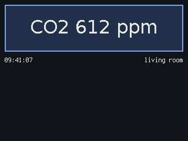

# Начало работы

*[In English](../en/getting-started.md)*

dgx-ui — это лёгкий слой виджетов на [DGX](https://github.com/jef-sure/esp32-component-dgx), графической библиотеке
для ESP32. В этом руководстве мы добавим её в проект ESP-IDF и напишем первую программу, в три шага:

1. подключим компоненты к проекту;
2. напишем программу из одного файла: измерения CO2, температуры и влажности, которые раз в пять секунд присылает
   задача с датчиком SCD41, показаны круглой шкалой с зонами — число внутри кольца, температура и влажность под ним;
3. соберём её и запустим — на плате или в окне на компьютере.

В конце на дисплее будет вот это. Дуга раскрашена по зонам CO2, новое измерение приходит раз в пять секунд, и
перерисовывается ровно то, что изменилось, а между изменениями задача, которая владеет дисплеем, спит:



Нужно уметь собирать и прошивать проект ESP-IDF. Знать dgx-ui, DGX или датчики Sensirion не требуется: каждая часть
программы объясняется там, где она появляется.

## Что нужно

- ESP-IDF 5.3 или новее: столько требует драйвер датчика scd4x 0.3.0 (dgx-ui хватило бы 5.2).
- Дисплей, с которым работает [DGX](https://github.com/jef-sure/esp32-component-dgx). Здесь это круглый GC9A01
  240 на 240 на SPI.
- Датчик CO2 Sensirion SCD41 по I2C. Подойдёт и SCD40 или SCD43: команды одни и те же, разница в точности и режимах.
- DGX 0.12.3 или новее из ветки 0.12. Она подтянется сама вместе с dgx-ui.
- На машине сборки, кроме ESP-IDF: свой компилятор C, файлы разработки FreeType, `pkg-config`, fontconfig и одна из
  гарнитур DejaVu Sans, Liberation Sans, Noto Sans, FreeSans и Arial — из неё DGX при сборке делает шрифты
  программы. В Debian и Ubuntu:
  `sudo apt install build-essential libfreetype-dev pkg-config fontconfig fonts-dejavu-core`; окну на компьютере
  нужна ещё SDL2, `libsdl2-dev`.

Здесь плата ESP32-C3 и те же выводы, что у станции
[esp32-co2-station](https://github.com/jef-sure/esp32-co2-station), — на другой плате меняются только номера выводов
в программе:

| Устройство | Вывод | GPIO |
| ---------- | ----- | ---- |
| GC9A01     | MOSI  | 6    |
|            | CLK   | 4    |
|            | CS    | 7    |
|            | DC    | 1    |
|            | RST   | 2    |
| SCD41      | SDA   | 3    |
|            | SCL   | 5    |

По выводу 2 ESP32-C3 при сбросе выбирает, как загружаться, и он должен быть в это время высоким. Сам он тогда не
подтянут, а вход RST дисплея его не держит: если на модуле дисплея нет резистора от RST к питанию, поставьте 10 кОм
от вывода 2 к 3,3 В. Датчику нужны подтяжки SDA и SCL: станции хватило внутренних подтяжек ESP32, даташит советует внешние около 10 кОм (на модулях они обычно
распаяны). Датчик питается от 3,3 В и работает при влажности до 95 % без конденсата.

Можно и без железа: та же программа работает в окне на компьютере. Шины I2C у компьютера нет, поэтому измерения
там выдумывает сама программа, раз в секунду: видно всю шкалу, и это тоже полезно.

## 1. Подключите компонент

Версия 0.0.62 dgx-ui — это тег в репозитории, в реестре компонентов ESP её пока нет; драйвер датчика, наоборот,
лежит в реестре. В `main/idf_component.yml` проекта:

```yaml
dependencies:
  dgx-ui:
    git: https://github.com/jef-sure/esp32-component-dgx-ui.git
    version: "0.0.62"
  jef-sure/scd4x: "^0.3.0"
```

При следующей сборке менеджер компонентов возьмёт dgx-ui с GitHub, а DGX и scd4x — из реестра: dgx-ui требует DGX,
scd4x требуется нашей программе.

DGX собирает только те шины и драйверы дисплеев, которые включены в проекте. Для GC9A01 на SPI в
`sdkconfig.defaults`:

```
CONFIG_DGX_ENABLE_SPI=y
CONFIG_DGX_ENABLE_SPI_GC9A01=y
```

Остальные дисплеи и шины описаны в разделе
[Getting started у DGX](https://github.com/jef-sure/esp32-component-dgx#getting-started).

Шрифты делает DGX, когда собирает программу: со сглаженными краями, 4 бита на пиксель, и только с теми буквами,
которые программа пишет. `main/CMakeLists.txt`:

```cmake
idf_component_register(SRCS "main.c")
# the number large, of its digits; the other texts of every letter of main.c
dgx_fonts_rules(fonts.rules)
dgx_font_need(large SIZE 32px BITS 4 LETTERS "0123456789")
dgx_font_need(body SIZE 13px BITS 4 TEXTS main.c)
```

и рядом с ним `main/fonts.rules` — из каких гарнитур их делать: из первой, какая есть на машине сборки:

```
source system
allow "DejaVu Sans"      7..
allow "Liberation Sans"  7..
allow "Noto Sans"        7..
allow "FreeSans"         7..
allow "Arial"            7..
```

Сборка печатает, какую гарнитуру взяла.

## 2. Напишите первую программу

Ниже `main/main.c` по частям: части в этом порядке и есть весь файл. Программа рисует ту же шкалу, что рецепт
[Шкала по кругу с виджетами внутри](cookbook.md#шкала-по-кругу-с-виджетами-внутри), только значения ей присылает
настоящий датчик.

```c
#include "dgx_colors.h" /* DGX_BLACK() and the other named colours */
#include "dgx_fonts.h"  /* made by DGX at build time: dgx_font_large, dgx_font_body */
#include "dgx_ui_paint.h"
#include "dgx_ui_post.h"
#include "dgx_ui_text.h"
#include "esp_log.h"
#include "esp_timer.h"
#include "freertos/FreeRTOS.h"
#include "freertos/task.h"
```

### Дисплей

dgx-ui рисует на экране DGX, и ей всё равно, на каком. Здесь это GC9A01 на ESP32-C3, а если программа собрана для
компьютера — окно того же размера, 240 на 240:

```c
#ifdef DGX_HOST_WINDOW
#include "dgx_host_screen.h"
static dgx_screen_t *display_init(void)
{
    return dgx_host_screen_init(240, 240, 16, NULL);
}
#else
#include "bus/dgx_spi_esp32.h"
#include "drivers/gc9a01.h"
/* GC9A01: MOSI 6, CLK 4, CS 7, DC 1, RST 2, no MISO, SPI at 40 MHz */
static dgx_screen_t *display_init(void)
{
    dgx_bus_protocols_t *bus = dgx_spi_init(SPI2_HOST, SPI_DMA_CH_AUTO, GPIO_NUM_6, GPIO_NUM_NC, GPIO_NUM_4, GPIO_NUM_7,
                                            GPIO_NUM_1, 40 * 1000 * 1000, 0);
    return bus ? dgx_gc9a01_init(bus, GPIO_NUM_2, GPIO_NUM_NC, 16, DgxScreenBGR) : NULL;
}
#endif
```

### Сообщения

Сообщение — это номер, который выбирает программа, и до 12 байт данных. dgx-ui не занимает ни одного номера и
внутрь сообщения не заглядывает. `DGX_UI_MESSAGE` связывает тип с номером и даёт две функции: `msg_post_air()`
отправляет сообщение, `msg_decode_air()` читает его.

Датчик выдаёт CO2, температуру и влажность одним измерением, поэтому и сообщение одно — со всеми тремя: CO2 в ppm,
температура в десятых градуса, влажность в десятых процента.

```c
enum { MSG_AIR = 1 };
typedef struct {
    uint16_t ppm;  /* CO2, ppm: the sensor reads 0..40000 */
    int16_t  t_dC; /* temperature, tenths of a degree */
    uint16_t rh_d; /* humidity, tenths of a percent */
} air_t;
DGX_UI_MESSAGE(air, MSG_AIR, air_t)
```

### Кольцо

Круглая шкала — это виджет собственного вида `DGX_UI_OWN`, нарисованный обликом библиотеки. Значение виджета живёт
не в дереве, а в памяти программы: поле `.value` указывает на переменную, в неё пишет задача, которая владеет деревом, а
отрисовка на каждом проходе сравнивает её с нарисованным и рисует разницу — в `take()` ниже это одна строка.

Дуга идёт от `min` до `max`: от 400 до 2000 ppm. Углы заданы в градусах по часовой стрелке от верха: начало -135 —
это «половина восьмого», размах 270 кончается на «половине пятого». Диапазоны красят каждую часть дуги цветом тех
значений, которым она соответствует: до 800 ppm зелёным, до 1200 жёлтым, дальше красным. Цвета — индексы таблицы
отрисовки, той же, что у текстов:

```c
enum { PAPER = 0, INK, RING_OFF, RING_LOW, RING_MID, RING_HIGH };

static int32_t ring_ppm; /* the ring's value: written by take(), read by every pass */

/* up to 800 ppm in one colour, up to 1200 in another, from there in a third, each part of the arc by its own place;
   14 points wide, from half past seven round to half past four */
static const dgx_ui_band_t      ring_bands[] = {{800, RING_LOW}, {1200, RING_MID}};
static const dgx_ui_ring_look_t ring_params  = {
    .on = RING_HIGH, .off = RING_OFF, .paper = DGX_UI_PAPER, .width = 14, .start = -135, .sweep = 270,
    .band_count = 2, .bands_by = DGX_UI_BANDS_BY_PLACE, .bands = ring_bands};
static const dgx_ui_look_t ring_look = {.draw = dgx_ui_draw_ring, .params = &ring_params, .fill = -1};
```

### Тексты

Надпись показывает текст текстового поля. Поле лежит в памяти: в нём буфер программы под строку и стиль. Стиль
перечисляет шрифты, которыми можно нарисовать текст, начиная с лучшего. Отрисовка берёт первый, в который текст
помещается целиком.

Здесь четыре поля: большое число, подпись «ppm CO2» — поле над строкой-константой, менять его программа не будет, —
и две надписи внизу, температура слева и влажность справа.

```c
static char                  ppm_buf[8], temp_buf[12], rh_buf[8];
static dgx_ui_textbox_t      ppm_box, temp_box, rh_box;

/* the value in the large font, or in the small one when it does not go in */
static const dgx_ui_font_variant_t vbig[2]   = {{.font = &dgx_font_large}, {.font = &dgx_font_body}};
static const dgx_ui_font_variant_t vsmall[1] = {{.font = &dgx_font_body}};
static const dgx_ui_text_style_t   st_big    = {.fonts = vbig, .count = 2, .align = DGX_FONT_ALIGN_CENTER, .flags = DGX_UI_TEXT_MIDDLE};
static const dgx_ui_text_style_t   st_centre = {.fonts = vsmall, .count = 1, .align = DGX_FONT_ALIGN_CENTER};
static const dgx_ui_text_style_t   st_left   = {.fonts = vsmall, .count = 1, .align = DGX_FONT_ALIGN_LEFT};
static const dgx_ui_text_style_t   st_right  = {.fonts = vsmall, .count = 1, .align = DGX_FONT_ALIGN_RIGHT};

static dgx_ui_textbox_t unit_box = DGX_UI_TEXT_CONST("ppm CO2", 1, &st_centre);
```

### Что виджет делает с сообщением

Каждое сообщение предлагается каждому виджету, в порядке дерева. Функция `take()` виджета читает из сообщения
то, что ей нужно, и возвращает `false`. Если она вернёт `true`, виджет забрал сообщение, и следующие виджеты его не
увидят. Поэтому сообщение, которое нужно нескольким виджетам, не забирает ни один: так оно гарантированно дойдёт
до всех.

Одно измерение читают четверо: кольцо пишет значение в свою переменную, число и две надписи печатают свои поля, и
все четверо возвращают `false`.
`dgx_ui_text_printf()` сравнивает новый текст с прежним: если значение пришло то же самое, ничего не меняется и
ничего не рисуется.

```c
static bool ring_take(dgx_ui_t *ui, int i, const dgx_ui_msg_t *msg)
{
    air_t a;
    if (msg_decode_air(msg, &a) == ESP_OK) ring_ppm = a.ppm; /* shown within 400..2000 by the pass after this message */
    return false; /* the number and the two labels read the same message */
}

static bool ppm_take(dgx_ui_t *ui, int i, const dgx_ui_msg_t *msg)
{
    air_t a;
    if (msg_decode_air(msg, &a) == ESP_OK) dgx_ui_text_printf(ui, i, "%d", a.ppm);
    return false;
}

static bool temp_take(dgx_ui_t *ui, int i, const dgx_ui_msg_t *msg)
{
    air_t a;
    if (msg_decode_air(msg, &a) == ESP_OK) dgx_ui_text_printf(ui, i, "%.1f C", a.t_dC / 10.0f);
    return false; /* the humidity label reads the same message */
}

static bool rh_take(dgx_ui_t *ui, int i, const dgx_ui_msg_t *msg)
{
    air_t a;
    if (msg_decode_air(msg, &a) == ESP_OK) dgx_ui_text_printf(ui, i, "%.0f %%", a.rh_d / 10.0f);
    return false; /* read by four: claimed by none, so that each of them gets it */
}
```

Кольцо пишет значение в переменную, и больше ничего: у него нет своего текста, дугу нарисует следующий проход
отрисовки.

### Виджеты

Виджет — константа: какого он вида, какого размера, что показывает и что делает. Библиотека в него не пишет, поэтому
он лежит во флеше. Размеры заданы в точках; сколько пикселей в точке, говорится в `dgx_ui_init()`.

- Корень — само кольцо: виджет собственного вида с обликом из раздела выше. Он же контейнер: дети стоят в нём
  столбцом, отступ `pad` держит их внутри круга. На экране 240 внешний радиус кольца 120, ширина 14, значит
  внутренний круг — 106, вписанный в него квадрат — 149 точек, и отступ равен (240 − 149) / 2 = 46.
- В столбце: число высотой 44, подпись «ppm CO2», пустой контейнер с `DGX_UI_REST` и строка высотой 13.
- В строке две надписи: температура с `DGX_UI_REST` и влажность шириной 50.

```c
static const dgx_ui_widget_t ring_w  = {.kind = DGX_UI_OWN, .flags = DGX_UI_COLUMN, .pad = 46, .gap = 2,
                                        .min = 400, .max = 2000, .value = &ring_ppm, .look = &ring_look, .take = ring_take};
static const dgx_ui_widget_t ppm_w   = {.kind = DGX_UI_LABEL, .text = &ppm_box, .want_h = 44, .take = ppm_take};
static const dgx_ui_widget_t unit_w  = {.kind = DGX_UI_LABEL, .text = &unit_box};
static const dgx_ui_widget_t rest_w  = {.kind = DGX_UI_BOX, .flags = DGX_UI_REST};
static const dgx_ui_widget_t row_w   = {.kind = DGX_UI_BOX, .flags = DGX_UI_ROW, .want_h = 13};
static const dgx_ui_widget_t temp_w  = {.kind = DGX_UI_LABEL, .flags = DGX_UI_REST, .text = &temp_box, .take = temp_take};
static const dgx_ui_widget_t rh_w    = {.kind = DGX_UI_LABEL, .text = &rh_box, .want_w = 50, .take = rh_take};
```

Три правила о размерах стоит запомнить:

- У контейнера своего размера нет: высоту или ширину ему задаёт `want_h` или `want_w`, а кольцо здесь корень и
  занимает весь экран. Облик рисует круг по меньшей стороне своего прямоугольника, посередине.
- Надпись без `want_h` высотой в свои строки текста; у большого числа выше он задан. Своей ширины у неё нет: в
  столбце она берёт ширину столбца, а в строке ей нужен `want_w`.
- Ребёнок с флагом `DGX_UI_REST` занимает то, что осталось в его строке или столбце после остальных. Пустой
  контейнер под подписью именно такой: он растягивается и придвигает строку со значениями к низу квадрата.

### Дерево, очередь и датчик

То, что меняется во время работы, хранит дерево: на каждый виджет узел в 28 байт<!-- sizeof dgx_ui_node_t -->, в массиве, который даёт программа.
Деревом и дисплеем владеет одна задача. Все остальные задачи только шлют сообщения.

```c
static dgx_ui_node_t nodes[8];
static dgx_ui_t      ui;
static QueueHandle_t queue;
```

Датчик — задача сама по себе. Она открывает шину I2C, запускает периодический замер — датчик выдаёт значение раз в
пять секунд — и шлёт каждое сообщение в очередь, не дожидаясь никого:

```c
#ifndef DGX_HOST_WINDOW
#include <math.h>
#include "driver/i2c_master.h"
#include "driver/i2c_types.h"
#include "scd4x.h"

/* the sensor: SDA 3 and SCL 5, as the station wires it; any two free GPIOs go */
static scd4x_t *sensor_open(void)
{
    i2c_master_bus_config_t bus_config = {
        .i2c_port                     = I2C_NUM_0,
        .sda_io_num                   = GPIO_NUM_3,
        .scl_io_num                   = GPIO_NUM_5,
        .clk_source                   = I2C_CLK_SRC_DEFAULT,
        .glitch_ignore_cnt            = 7,
        .flags.enable_internal_pullup = true, /* the station lives with them; external 10k are better */
    };
    i2c_master_bus_handle_t bus = NULL;
    if (i2c_new_master_bus(&bus_config, &bus) != ESP_OK) return NULL;

    i2c_device_config_t dev_config = {
        .dev_addr_length = I2C_ADDR_BIT_LEN_7,
        .device_address  = SCD4X_I2C_ADDR,
        .scl_speed_hz    = 100000,
    };
    i2c_master_dev_handle_t dev = NULL;
    if (i2c_master_bus_add_device(bus, &dev_config, &dev) != ESP_OK) return NULL;

    scd4x_t *sensor = scd4x_init(dev); /* stops a measurement left running, reads the variant */
    if (!sensor) return NULL;
    return scd4x_start_periodic_measurement(sensor) == ESP_OK ? sensor : NULL; /* a value every 5 s */
}

static void sensor_task(void *arg)
{
    scd4x_t *sensor = sensor_open();
    if (!sensor) {
        ESP_LOGE("sensor", "SCD41 not found: check SDA 3 and SCL 5");
        vTaskDelete(NULL);
        return;
    }
    for (;;) {
        scd4x_measurement_t m;
        if (scd4x_read_measurement(sensor, &m) == ESP_OK) {
            const air_t a = {.ppm  = (uint16_t)lroundf(m.co2),
                             .t_dC = (int16_t)lroundf(m.temperature * 10),
                             .rh_d = (uint16_t)lroundf(m.humidity * 10)};
            msg_post_air(queue, &a);
        }
        vTaskDelay(pdMS_TO_TICKS(5000));
    }
}
#else
/* the window has no I2C: a made-up measurement every second, so that all of the scale can be seen */
static void sensor_task(void *arg)
{
    for (int k = 0;; ++k) {
        const air_t a = {.ppm = 420 + (k * 37) % 1400, .t_dC = 231 + k % 7, .rh_d = 420};
        msg_post_air(queue, &a);
        vTaskDelay(pdMS_TO_TICKS(1000));
    }
}
#endif
```

Пара вещей о чтении. `scd4x_read_measurement()` возвращает `ESP_ERR_NOT_FINISHED`, пока новое значение не готово:
это не ошибка, просто ещё рано — цикл молчит и дождётся следующего раза. Если данных не было три интервала подряд,
драйвер решает, что датчик перестал измерять, сам перезапускает измерение и один раз возвращает
`ESP_ERR_TIMEOUT`. Драйвер не потокобезопасен, и это здесь соблюдено: весь обмен с датчиком идёт из одной задачи,
а наружу значения выходят только сообщениями.

### Запуск и цикл

```c
void app_main(void)
{
    dgx_screen_t *scr = display_init();
    if (!scr) return;

    /* the colours of the looks are indices of this table: 0 the paper, 1 the ink, 2..5 the ring; DGX's named colours,
       packed for a display of 16 bits */
    const uint32_t colors[] = {
        DGX_BLACK(DGX_RGB_16), DGX_WHITE(DGX_RGB_16),  DGX_GRAY(DGX_RGB_16),
        DGX_LIME(DGX_RGB_16),  DGX_YELLOW(DGX_RGB_16), DGX_RED(DGX_RGB_16),
    };

    dgx_ui_textbox_init(&ppm_box, ppm_buf, sizeof ppm_buf, 1, &st_big);
    dgx_ui_textbox_init(&temp_box, temp_buf, sizeof temp_buf, 1, &st_left);
    dgx_ui_textbox_init(&rh_box, rh_buf, sizeof rh_buf, 1, &st_right);

    /* the tree: a point is a pixel here; the first widget added is the root */
    dgx_ui_init(&ui, nodes, 8, 1);
    const int ring = dgx_ui_add(&ui, -1, &ring_w);
    dgx_ui_add(&ui, ring, &ppm_w);
    dgx_ui_add(&ui, ring, &unit_w);
    dgx_ui_add(&ui, ring, &rest_w); /* pushes the row to the bottom of the square */
    const int row = dgx_ui_add(&ui, ring, &row_w);
    dgx_ui_add(&ui, row, &temp_w);
    dgx_ui_add(&ui, row, &rh_w);

    /* the queue of the task that owns the display, and who sends into it */
    queue = xQueueCreate(8, sizeof(dgx_ui_msg_t));
    xTaskCreate(sensor_task, "sensor", 4096, NULL, 4, NULL);

    dgx_ui_paint_t paint = {.scr = scr, .colors = colors, .color_count = 6, .background = 0};
    TickType_t     wait  = 0;
    for (;;) {
        dgx_ui_msg_t msg;
        while (xQueueReceive(queue, &msg, wait) == pdTRUE) {
            wait = 0;
            if (!dgx_ui_take(&ui, &msg)) {
                /* no widget claimed it: the program's own messages are handled here */
            }
            dgx_ui_msg_done(&msg); /* once, whatever handled it */
        }
        const uint32_t now = (uint32_t)(esp_timer_get_time() / 1000);
        dgx_ui_time(&ui, now);
        dgx_ui_paint(&ui, &paint, now);
        /* asleep until a message comes, or until the moment a widget or a held key asks for: a tick at least */
        const uint32_t ms = dgx_ui_wake(&paint, &ui, now);
        wait              = ms == DGX_UI_WAKE_NONE ? portMAX_DELAY : pdMS_TO_TICKS(ms) > 0 ? pdMS_TO_TICKS(ms) : 1;
    }
}
```

Что делает цикл:

1. Спит на очереди. Его будит сообщение; он забирает все пришедшие сообщения и каждое предлагает виджетам.
2. `dgx_ui_msg_done()` вызывается один раз для каждого сообщения, кто бы его ни обработал.
3. `dgx_ui_paint()` раскладывает дерево, если нужно, и рисует то, что изменилось с прошлого прохода. Здесь это дуга
   кольца и три поля раз в пять секунд: облик кольца пишет только пиксели дуги между прежним значением и новым, а
   число — своё поле. Само кольцо, подпись и бумага рисуются один раз.
4. `dgx_ui_wake()` говорит, сколько времени делать нечего. Если никто не просит, `DGX_UI_WAKE_NONE`, и задача ждёт
   сообщения бесконечно. В этой программе времени никто не просит, и между измерениями задача спит.

## 3. Соберите и запустите

Для платы:

```sh
idf.py set-target esp32c3
idf.py build flash monitor
```

Что вы должны увидеть: круглая шкала, число внутри — сначала пусто, через пять секунд после старта придёт первое
измерение и дальше по одному раз в пять секунд. В комнате это обычно 500–800 ppm, дуга зелёная; выдохните на
датчик — CO2 уйдёт за 2000, дуга дойдёт до конца: зелёная, потом жёлтая, потом красная часть, каждая на месте
своих значений. Число внутри покажет настоящее значение, а температура и влажность под ним останутся на своих
местах.

Первые дни значение может плыть: автоматическая самокалибровка датчика включена по умолчанию и предполагает, что
раз в неделю он видит свежий воздух — примерно 400 ppm. О калибровке — в README компонента scd4x.

На компьютере, в окне DGX, с целью `linux` ESP-IDF. В `CMakeLists.txt` и `sdkconfig.defaults` проекта нужны несколько
строк, описанных у DGX в разделе
[The linux target of ESP-IDF](https://github.com/jef-sure/esp32-component-dgx/blob/main/docs/host-window-en.md#the-linux-target-of-esp-idf-host-esp-idf);
в примере [thin_paint](../../examples/thin_paint/CMakeLists.txt) они есть. Собранная программа называется по
проекту, как он назван в `project()` его `CMakeLists.txt`:

```sh
idf.py --preview set-target linux
idf.py build
./build/<project>.elf
```

Значения в окне выдуманные и меняются раз в секунду: число растёт, дуга проходит все три зоны и начинает
снова.

## 4. Измените её

Три маленьких изменения показывают, как части программы зависят друг от друга. Сделайте одно, соберите и запустите
снова:

- В `sensor_open()` замените `scd4x_start_periodic_measurement()` на `scd4x_start_low_power_periodic_measurement()`,
  а в `sensor_task()` — `pdMS_TO_TICKS(5000)` на `pdMS_TO_TICKS(30000)`. Датчик теперь измеряет примерно раз в
  полминуты: меньше ток и самонагрев. Больше ничто в программе не знает, как часто приходят значения: кольцо
  перерисуется, когда придёт сообщение.
- В `ring_params` замените `.start = -135, .sweep = 270` на `.start = 0, .sweep = 180`. Шкала станет полукругом от
  двенадцати до шести по часовой стрелке: углы считаются от верха, это правило облика, и дерево об этом ничего не
  знает. Отступ `pad` тот же — дети по-прежнему внутри круга.
- В `ring_w` замените `.max = 2000` на `.max = 5000`. При том же значении дуга закрашивает меньшую часть, а
  границы зон сдвинутся к началу дуги: они заданы значениями, 800 и 1200, а не углами. Число внутри не изменится
  вовсе: шкала и число — независимые виджеты, связанные только сообщением.

## Что дальше

- [Как это устроено](how-it-works.md): что такое дерево, отрисовка и облик и почему дуга, нарисованная заново, не
  мигает.
- [Рецепты](cookbook.md): шкала по кругу и остальное — кнопки, ползунки, значки, длинные тексты, всплывающее окно,
  клавиши и касание.
- [Справочник API](api.md).
- [README scd4x](https://github.com/jef-sure/esp32-component-scd4x#readme): калибровка датчика, одиночные замеры,
  режимы питания.
- [Станция esp32-co2-station](https://github.com/jef-sure/esp32-co2-station): круглый дисплей, MQTT для Home
  Assistant, веб-сервер с настройками — та же связка экрана и датчика в большом проекте.
